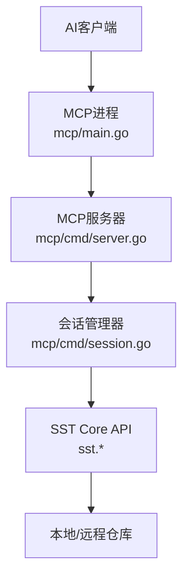
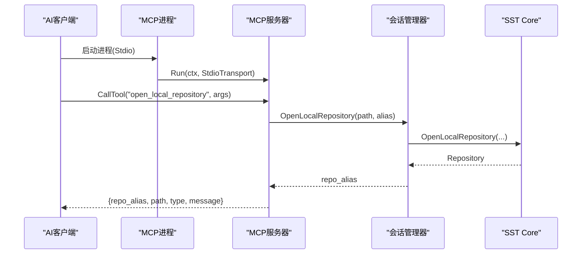
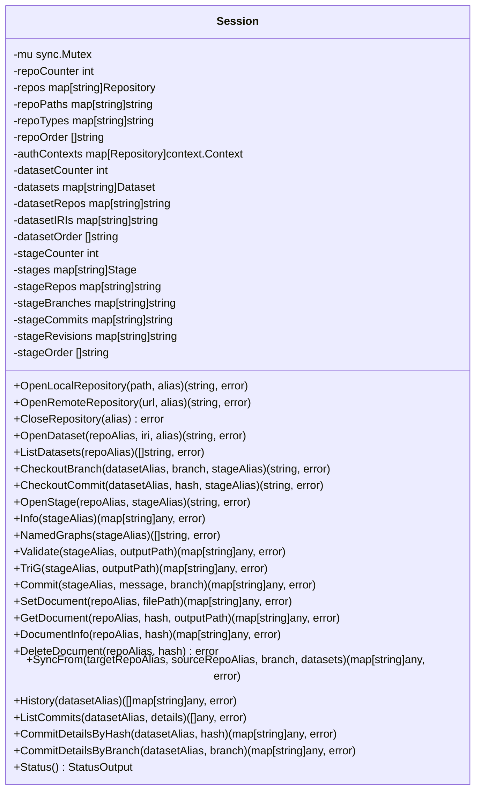
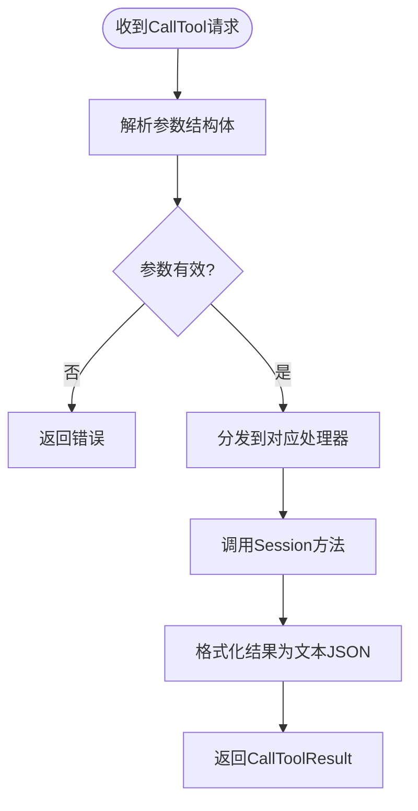
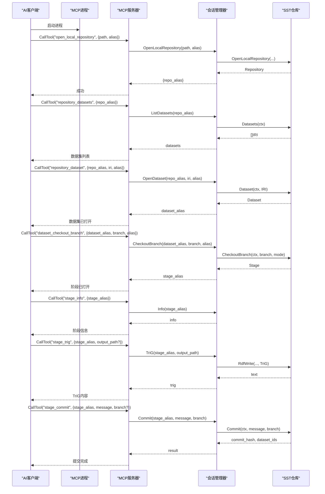
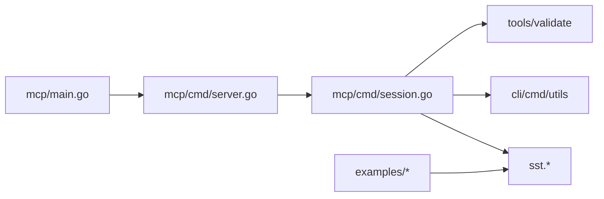

# AI客户端集成

<cite>
**本文引用的文件**
- [mcp/main.go](file://mcp/main.go)
- [mcp/cmd/server.go](file://mcp/cmd/server.go)
- [mcp/cmd/session.go](file://mcp/cmd/session.go)
- [examples/helloworldrepolocalbasic/repolocalbasic_test.go](file://examples/helloworldrepolocalbasic/repolocalbasic_test.go)
- [examples/helloworldreporemote/main.go](file://examples/helloworldreporemote/main.go)
- [README.md](file://README.md)
</cite>

## 目录
1. [简介](#简介)
2. [项目结构](#项目结构)
3. [核心组件](#核心组件)
4. [架构总览](#架构总览)
5. [详细组件分析](#详细组件分析)
6. [依赖关系分析](#依赖关系分析)
7. [性能考虑](#性能考虑)
8. [故障排查指南](#故障排查指南)
9. [结论](#结论)
10. [附录](#附录)

## 简介
本指南面向AI客户端开发者，提供基于SST MCP（Model Context Protocol）的端到端集成方案。仓库中的MCP服务通过标准输入/输出暴露SST Core能力，包括本地与远程仓库管理、数据集操作、阶段（Stage）工作流、提交历史、文档上传下载、数据校验与导出等。本文档将：
- 解释MCP消息的构建与解析方法
- 给出Python、JavaScript、Go三种语言的客户端实现思路
- 介绍错误处理与数据转换的最佳实践
- 提供从连接建立到数据操作的完整流程
- 说明异步与流式处理的实现方式
- 给出性能优化建议与常见问题解决方案
- 展示与主流AI平台（如LangChain、AutoGen）的集成思路
- 提供调试工具与测试方法

## 项目结构
SST MCP以独立可执行程序形式运行，对外暴露一组“工具”（Tools），供AI框架调用。核心入口位于mcp/main.go，负责加载环境、创建会话并启动MCP服务器；server.go注册所有可用工具；session.go维护会话级资源（仓库、数据集、阶段）并提供业务逻辑。

图表来源
- [mcp/main.go:22-31](file://mcp/main.go#L22-L31)
- [mcp/cmd/server.go:13-563](file://mcp/cmd/server.go#L13-L563)
- [mcp/cmd/session.go:25-67](file://mcp/cmd/session.go#L25-L67)

章节来源
- [README.md:1-15](file://README.md#L1-L15)
- [mcp/main.go:1-33](file://mcp/main.go#L1-L33)

## 核心组件
- MCP进程入口：初始化会话并通过Stdio传输运行MCP服务器
- 工具注册层：将SST能力封装为MCP工具，定义参数结构与返回格式
- 会话管理层：维护仓库、数据集、阶段的别名映射与生命周期，提供同步、校验、导出、提交等操作
- SST Core接口：底层仓库、数据集、阶段API，支持本地与远程访问、分支/提交、RDF读写、文档管理等

章节来源
- [mcp/main.go:22-31](file://mcp/main.go#L22-L31)
- [mcp/cmd/server.go:13-563](file://mcp/cmd/server.go#L13-L563)
- [mcp/cmd/session.go:25-67](file://mcp/cmd/session.go#L25-L67)

## 架构总览
MCP采用JSON-RPC风格的请求/响应模型，工具调用由AI框架发起，MCP服务端路由到对应处理器，再委托给Session执行具体SST操作。

图表来源
- [mcp/main.go:22-31](file://mcp/main.go#L22-L31)
- [mcp/cmd/server.go:20-47](file://mcp/cmd/server.go#L20-L47)
- [mcp/cmd/session.go:100-118](file://mcp/cmd/session.go#L100-L118)

## 详细组件分析

### 会话管理器（Session）
会话是MCP调用的上下文，维护仓库、数据集、阶段的别名与关联，保证并发安全。关键职责：
- 别名分配与冲突检测
- 仓库打开/关闭、认证上下文绑定
- 数据集打开、列表、分支/提交查询
- 阶段检出、信息获取、命名图列表、验证、导出、提交
- 文档上传/下载/删除
- 跨仓库同步

图表来源
- [mcp/cmd/session.go:25-67](file://mcp/cmd/session.go#L25-L67)
- [mcp/cmd/session.go:100-118](file://mcp/cmd/session.go#L100-L118)
- [mcp/cmd/session.go:367-391](file://mcp/cmd/session.go#L367-L391)
- [mcp/cmd/session.go:952-1021](file://mcp/cmd/session.go#L952-L1021)
- [mcp/cmd/session.go:1023-1038](file://mcp/cmd/session.go#L1023-L1038)
- [mcp/cmd/session.go:1040-1091](file://mcp/cmd/session.go#L1040-L1091)
- [mcp/cmd/session.go:1093-1106](file://mcp/cmd/session.go#L1093-L1106)
- [mcp/cmd/session.go:1108-1138](file://mcp/cmd/session.go#L1108-L1138)
- [mcp/cmd/session.go:1140-1174](file://mcp/cmd/session.go#L1140-L1174)
- [mcp/cmd/session.go:1176-1215](file://mcp/cmd/session.go#L1176-L1215)
- [mcp/cmd/session.go:449-506](file://mcp/cmd/session.go#L449-L506)
- [mcp/cmd/session.go:508-558](file://mcp/cmd/session.go#L508-L558)
- [mcp/cmd/session.go:560-583](file://mcp/cmd/session.go#L560-L583)
- [mcp/cmd/session.go:585-603](file://mcp/cmd/session.go#L585-L603)
- [mcp/cmd/session.go:753-820](file://mcp/cmd/session.go#L753-L820)
- [mcp/cmd/session.go:844-950](file://mcp/cmd/session.go#L844-L950)
- [mcp/cmd/session.go:625-680](file://mcp/cmd/session.go#L625-L680)
- [mcp/cmd/session.go:710-751](file://mcp/cmd/session.go#L710-L751)
- [mcp/cmd/session.go:218-252](file://mcp/cmd/session.go#L218-L252)

章节来源
- [mcp/cmd/session.go:25-67](file://mcp/cmd/session.go#L25-L67)
- [mcp/cmd/session.go:100-118](file://mcp/cmd/session.go#L100-L118)
- [mcp/cmd/session.go:367-391](file://mcp/cmd/session.go#L367-L391)
- [mcp/cmd/session.go:952-1021](file://mcp/cmd/session.go#L952-L1021)
- [mcp/cmd/session.go:1023-1038](file://mcp/cmd/session.go#L1023-L1038)
- [mcp/cmd/session.go:1040-1091](file://mcp/cmd/session.go#L1040-L1091)
- [mcp/cmd/session.go:1093-1106](file://mcp/cmd/session.go#L1093-L1106)
- [mcp/cmd/session.go:1108-1138](file://mcp/cmd/session.go#L1108-L1138)
- [mcp/cmd/session.go:1140-1174](file://mcp/cmd/session.go#L1140-L1174)
- [mcp/cmd/session.go:1176-1215](file://mcp/cmd/session.go#L1176-L1215)
- [mcp/cmd/session.go:449-506](file://mcp/cmd/session.go#L449-L506)
- [mcp/cmd/session.go:508-558](file://mcp/cmd/session.go#L508-L558)
- [mcp/cmd/session.go:560-583](file://mcp/cmd/session.go#L560-L583)
- [mcp/cmd/session.go:585-603](file://mcp/cmd/session.go#L585-L603)
- [mcp/cmd/session.go:753-820](file://mcp/cmd/session.go#L753-L820)
- [mcp/cmd/session.go:844-950](file://mcp/cmd/session.go#L844-L950)
- [mcp/cmd/session.go:625-680](file://mcp/cmd/session.go#L625-L680)
- [mcp/cmd/session.go:710-751](file://mcp/cmd/session.go#L710-L751)
- [mcp/cmd/session.go:218-252](file://mcp/cmd/session.go#L218-L252)

### 工具注册层（Server）
将SST能力暴露为MCP工具，每个工具包含名称、描述、参数结构与处理器。处理器负责参数校验、调用Session方法、格式化结果。

图表来源
- [mcp/cmd/server.go:535-556](file://mcp/cmd/server.go#L535-L556)
- [mcp/cmd/server.go:20-47](file://mcp/cmd/server.go#L20-L47)
- [mcp/cmd/server.go:49-69](file://mcp/cmd/server.go#L49-L69)
- [mcp/cmd/server.go:71-87](file://mcp/cmd/server.go#L71-L87)
- [mcp/cmd/server.go:89-109](file://mcp/cmd/server.go#L89-L109)
- [mcp/cmd/server.go:111-128](file://mcp/cmd/server.go#L111-L128)
- [mcp/cmd/server.go:130-154](file://mcp/cmd/server.go#L130-L154)
- [mcp/cmd/server.go:156-173](file://mcp/cmd/server.go#L156-L173)
- [mcp/cmd/server.go:175-195](file://mcp/cmd/server.go#L175-L195)
- [mcp/cmd/server.go:197-216](file://mcp/cmd/server.go#L197-L216)
- [mcp/cmd/server.go:218-238](file://mcp/cmd/server.go#L218-L238)
- [mcp/cmd/server.go:240-258](file://mcp/cmd/server.go#L240-L258)
- [mcp/cmd/server.go:260-284](file://mcp/cmd/server.go#L260-L284)
- [mcp/cmd/server.go:286-310](file://mcp/cmd/server.go#L286-L310)
- [mcp/cmd/server.go:312-331](file://mcp/cmd/server.go#L312-L331)
- [mcp/cmd/server.go:333-347](file://mcp/cmd/server.go#L333-L347)
- [mcp/cmd/server.go:349-367](file://mcp/cmd/server.go#L349-L367)
- [mcp/cmd/server.go:369-384](file://mcp/cmd/server.go#L369-L384)
- [mcp/cmd/server.go:386-401](file://mcp/cmd/server.go#L386-L401)
- [mcp/cmd/server.go:403-422](file://mcp/cmd/server.go#L403-L422)
- [mcp/cmd/server.go:424-442](file://mcp/cmd/server.go#L424-L442)
- [mcp/cmd/server.go:445-464](file://mcp/cmd/server.go#L445-L464)
- [mcp/cmd/server.go:466-486](file://mcp/cmd/server.go#L466-L486)
- [mcp/cmd/server.go:488-507](file://mcp/cmd/server.go#L488-L507)
- [mcp/cmd/server.go:509-530](file://mcp/cmd/server.go#L509-L530)

章节来源
- [mcp/cmd/server.go:13-563](file://mcp/cmd/server.go#L13-L563)

### 典型工作流序列图
以下示例展示“打开本地仓库→列出数据集→检出分支→查看阶段信息→导出TriG→提交变更”的端到端流程。

图表来源
- [mcp/cmd/server.go:20-47](file://mcp/cmd/server.go#L20-L47)
- [mcp/cmd/server.go:111-128](file://mcp/cmd/server.go#L111-L128)
- [mcp/cmd/server.go:130-154](file://mcp/cmd/server.go#L130-L154)
- [mcp/cmd/server.go:260-284](file://mcp/cmd/server.go#L260-L284)
- [mcp/cmd/server.go:333-347](file://mcp/cmd/server.go#L333-L347)
- [mcp/cmd/server.go:386-401](file://mcp/cmd/server.go#L386-L401)
- [mcp/cmd/server.go:403-422](file://mcp/cmd/server.go#L403-L422)
- [mcp/cmd/session.go:100-118](file://mcp/cmd/session.go#L100-L118)
- [mcp/cmd/session.go:405-423](file://mcp/cmd/session.go#L405-L423)
- [mcp/cmd/session.go:367-391](file://mcp/cmd/session.go#L367-L391)
- [mcp/cmd/session.go:952-983](file://mcp/cmd/session.go#L952-L983)
- [mcp/cmd/session.go:1040-1091](file://mcp/cmd/session.go#L1040-L1091)
- [mcp/cmd/session.go:1140-1174](file://mcp/cmd/session.go#L1140-L1174)
- [mcp/cmd/session.go:1176-1215](file://mcp/cmd/session.go#L1176-L1215)

## 依赖关系分析
- mcp/main.go依赖cli/utils进行环境变量加载，依赖mcp/cmd提供会话与服务器运行能力
- mcp/cmd/server.go依赖go-sdk/mcp注册工具，依赖session.go提供的会话方法
- mcp/cmd/session.go依赖sst包进行仓库/数据集/阶段操作，依赖tools/validate进行校验，依赖cli/utils进行日志与路径处理
- 示例展示了如何直接通过sst包创建本地仓库、添加三元组、提交与搜索

图表来源
- [mcp/main.go:12-20](file://mcp/main.go#L12-L20)
- [mcp/cmd/server.go:5-11](file://mcp/cmd/server.go#L5-L11)
- [mcp/cmd/session.go:5-23](file://mcp/cmd/session.go#L5-L23)
- [examples/helloworldrepolocalbasic/repolocalbasic_test.go:11-27](file://examples/helloworldrepolocalbasic/repolocalbasic_test.go#L11-L27)
- [examples/helloworldreporemote/main.go:10-26](file://examples/helloworldreporemote/main.go#L10-L26)

章节来源
- [mcp/main.go:12-20](file://mcp/main.go#L12-L20)
- [mcp/cmd/server.go:5-11](file://mcp/cmd/server.go#L5-L11)
- [mcp/cmd/session.go:5-23](file://mcp/cmd/session.go#L5-L23)
- [examples/helloworldrepolocalbasic/repolocalbasic_test.go:11-27](file://examples/helloworldrepolocalbasic/repolocalbasic_test.go#L11-L27)
- [examples/helloworldreporemote/main.go:10-26](file://examples/helloworldreporemote/main.go#L10-L26)

## 性能考虑
- 批量操作：尽量合并多次小写操作，减少网络往返与序列化开销
- 流式导出：使用TriG导出大段RDF时，优先写入文件或流，避免内存膨胀
- 索引与搜索：在需要全文检索的场景下，参考示例配置Bleve索引，并在必要时重建索引
- 并发控制：会话内部使用互斥锁保护资源表，避免竞态；外部客户端应合理设置超时与重试策略
- 认证上下文：远程仓库操作需携带正确的OIDC上下文，避免重复鉴权失败导致的重试风暴

[本节为通用指导，不直接分析具体文件]

## 故障排查指南
- 参数缺失：工具处理器对必填字段进行校验，若缺少会返回明确错误；检查调用方传递的参数
- 别名冲突：仓库/数据集/阶段别名在同一会话中唯一，冲突时会报错；更换别名或复用已有别名
- 哈希格式：文档与提交哈希需为有效的Base58字符串；非法格式会返回错误
- 阶段无效：导出或提交前需确保阶段有效且关联仓库；否则返回相应错误
- 远程认证：远程仓库操作依赖.env.sst-cli配置；未配置或权限不足会导致鉴权失败
- 日志与输出：校验报告可通过output_path写入文件；导出TriG也可选择写入文件便于离线分析

章节来源
- [mcp/cmd/server.go:20-47](file://mcp/cmd/server.go#L20-L47)
- [mcp/cmd/server.go:49-69](file://mcp/cmd/server.go#L49-L69)
- [mcp/cmd/server.go:71-87](file://mcp/cmd/server.go#L71-L87)
- [mcp/cmd/server.go:466-486](file://mcp/cmd/server.go#L466-L486)
- [mcp/cmd/server.go:488-507](file://mcp/cmd/server.go#L488-L507)
- [mcp/cmd/server.go:509-530](file://mcp/cmd/server.go#L509-L530)
- [mcp/cmd/session.go:1108-1138](file://mcp/cmd/session.go#L1108-L1138)
- [mcp/cmd/session.go:1140-1174](file://mcp/cmd/session.go#L1140-L1174)
- [mcp/cmd/session.go:1176-1215](file://mcp/cmd/session.go#L1176-L1215)

## 结论
SST MCP为AI客户端提供了标准化的数据访问与操作接口，覆盖仓库、数据集、阶段、文档、校验与导出等核心能力。通过统一的工具调用模型，AI框架可以以一致的方式与SST交互，简化集成复杂度。结合合理的错误处理、数据转换与性能优化策略，可在多种语言环境中稳定高效地集成SST能力。

[本节为总结性内容，不直接分析具体文件]

## 附录

### MCP消息构建与解析方法
- 请求：AI框架构造CallTool请求，指定工具名与参数结构体（由server.go定义）
- 响应：服务端返回CallToolResult，内容为文本形式的JSON；客户端需解析该文本为结构化对象
- 参数校验：服务端对必填字段进行校验，缺失则返回错误；客户端应在调用前做基础校验
- 数据转换：服务端将SST对象转换为map[string]any后序列化为文本；客户端按约定键读取字段

章节来源
- [mcp/cmd/server.go:535-556](file://mcp/cmd/server.go#L535-L556)
- [mcp/cmd/server.go:20-47](file://mcp/cmd/server.go#L20-L47)

### 多语言客户端实现要点
- Python
  - 使用子进程启动MCP进程，通过stdin/stdout发送JSON-RPC请求
  - 解析返回的文本JSON，提取关键字段（如repo_alias、dataset_alias、stage_alias）
  - 处理错误：捕获异常并记录日志，必要时重试
- JavaScript
  - 使用Node.js child_process或WebSocket/HTTP（若扩展传输）与MCP进程通信
  - 异步调用工具，使用Promise/async-await管理流程
  - 错误处理：区分网络错误、参数错误、服务端错误
- Go
  - 可直接调用mcp/cmd提供的函数或通过SDK与MCP进程交互
  - 利用Go的context管理超时与取消
  - 错误处理：使用errors.Is/As判断错误类型，进行针对性恢复

[本节为通用指导，不直接分析具体文件]

### 异步与流式处理
- 异步：MCP工具调用本身为请求/响应模式；AI框架可在上层实现并发调用与结果聚合
- 流式：对于大文件导出（如TriG），建议使用output_path写入文件，避免内存占用；客户端可分块读取文件
- 长耗时操作：如同步、提交、校验，建议在客户端设置超时与进度提示

[本节为通用指导，不直接分析具体文件]

### 与主流AI平台的集成案例
- LangChain
  - 将MCP工具包装为自定义工具，注入到Agent的工具链中
  - 使用Prompt模板驱动工具调用顺序，实现自动化数据操作
- AutoGen
  - 将MCP工具作为可调用技能，让多Agent协作完成复杂任务
  - 通过会话状态共享仓库/数据集/阶段别名，协调多个Agent的工作

[本节为概念性内容，不直接分析具体文件]

### 调试工具与测试方法
- MCP Inspector：用于调试MCP服务，观察工具列表与调用过程
- 单元测试：参考示例中的仓库操作测试，验证本地仓库创建、数据写入、提交与搜索
- 集成测试：通过远程仓库示例，验证服务端配置、OIDC鉴权与服务可用性

章节来源
- [mcp/main.go:7-9](file://mcp/main.go#L7-L9)
- [examples/helloworldrepolocalbasic/repolocalbasic_test.go:29-128](file://examples/helloworldrepolocalbasic/repolocalbasic_test.go#L29-L128)
- [examples/helloworldreporemote/main.go:28-115](file://examples/helloworldreporemote/main.go#L28-L115)