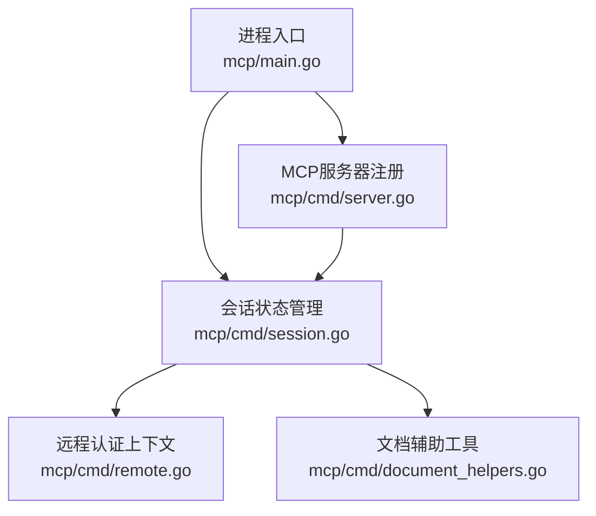
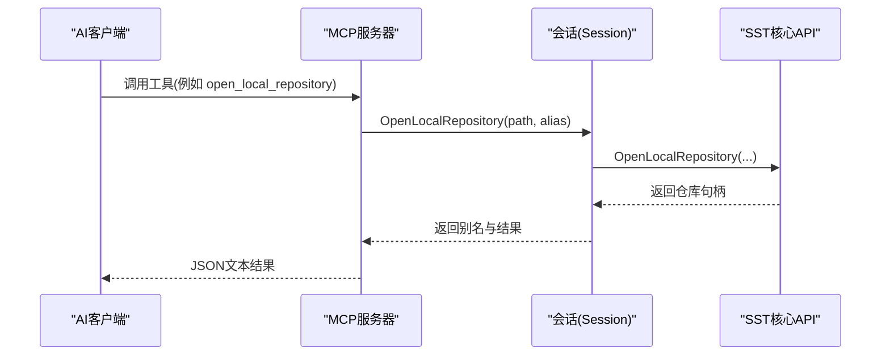
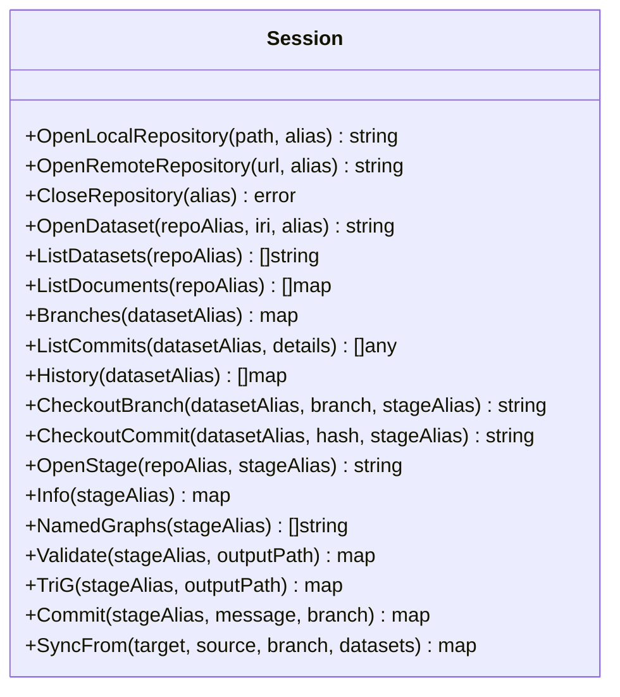
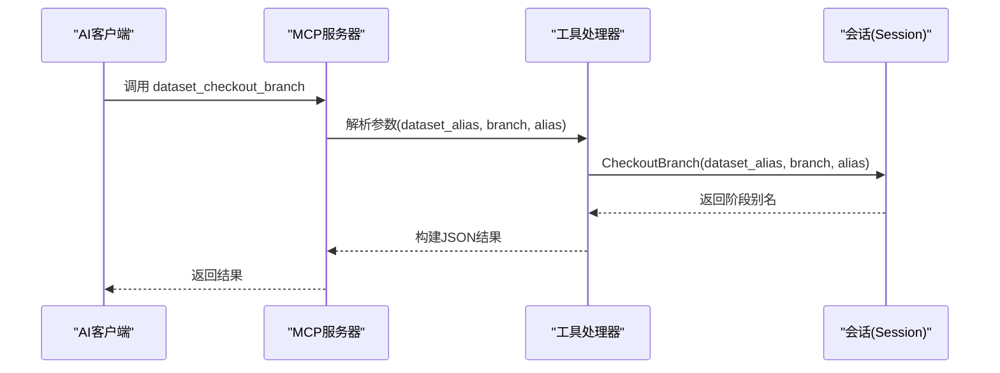
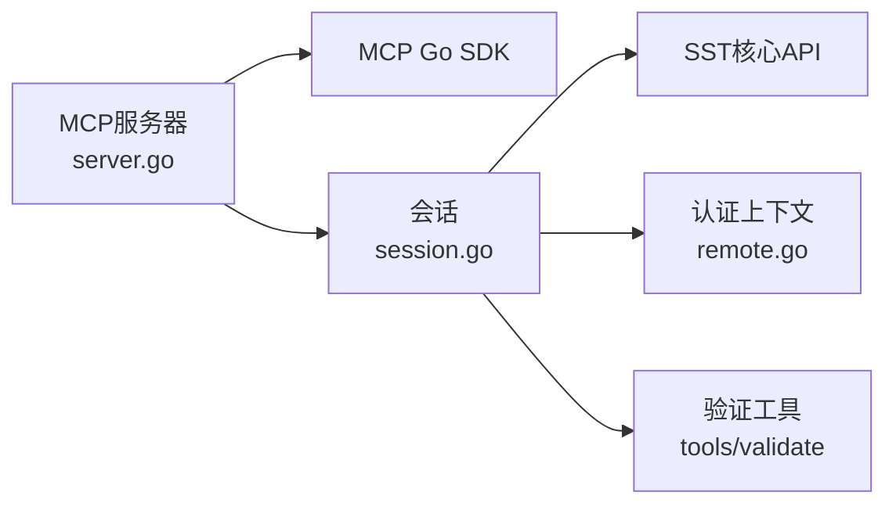

# MCP协议概述

<cite>
**本文引用的文件**
- [mcp/main.go](file://mcp/main.go)
- [mcp/cmd/server.go](file://mcp/cmd/server.go)
- [mcp/cmd/session.go](file://mcp/cmd/session.go)
- [mcp/cmd/remote.go](file://mcp/cmd/remote.go)
- [mcp/cmd/document_helpers.go](file://mcp/cmd/document_helpers.go)
- [README.md](file://README.md)
</cite>

## 目录
1. [简介](#简介)
2. [项目结构](#项目结构)
3. [核心组件](#核心组件)
4. [架构总览](#架构总览)
5. [详细组件分析](#详细组件分析)
6. [依赖关系分析](#依赖关系分析)
7. [性能与可扩展性](#性能与可扩展性)
8. [故障排查指南](#故障排查指南)
9. [结论](#结论)
10. [附录：协议能力清单与使用示例](#附录协议能力清单与使用示例)

## 简介
本文件面向AI客户端与SST系统之间的集成，系统性阐述SST通过MCP（Model Context Protocol）暴露的核心能力、消息与通信模式、状态管理以及版本与兼容性考虑。SST-MCP以进程内服务形式运行，通过标准输入输出与外部AI客户端进行工具调用交互，将仓库访问、数据查询、版本控制、文档管理等SST核心操作封装为可被AI调用的“工具”，从而在AI工作流中提供一致、可控且可审计的数据访问路径。

## 项目结构
SST-MCP位于仓库的mcp目录下，采用“入口程序 + 服务器注册 + 会话状态”的分层组织方式：
- 入口程序负责加载环境、创建会话并启动MCP服务。
- 服务器负责注册所有可用的工具（工具即SST操作的MCP映射）。
- 会话维护当前打开的仓库、数据集、阶段等资源的句柄与元信息，并提供线程安全的访问。
- 远程认证与文档辅助逻辑独立成模块，便于复用与维护。

图表来源
- [mcp/main.go:22-31](file://mcp/main.go#L22-L31)
- [mcp/cmd/server.go:13-18](file://mcp/cmd/server.go#L13-L18)
- [mcp/cmd/session.go:25-67](file://mcp/cmd/session.go#L25-L67)
- [mcp/cmd/remote.go:38-48](file://mcp/cmd/remote.go#L38-L48)
- [mcp/cmd/document_helpers.go:15-52](file://mcp/cmd/document_helpers.go#L15-L52)

章节来源
- [mcp/main.go:22-31](file://mcp/main.go#L22-L31)
- [README.md:1-15](file://README.md#L1-L15)

## 核心组件
- 会话（Session）：维护当前MCP会话内的资源句柄（仓库、数据集、阶段），提供别名分配、生命周期管理与并发安全访问。
- 服务器（Server）：基于MCP SDK创建并注册工具，每个工具对应一个SST操作。
- 远程认证（Remote Auth）：从环境变量或CLI配置获取OIDC令牌，构造gRPC传输凭据与认证上下文。
- 文档辅助（Document Helpers）：统一格式化文档元信息、推断MIME类型与扩展名。

章节来源
- [mcp/cmd/session.go:25-67](file://mcp/cmd/session.go#L25-L67)
- [mcp/cmd/server.go:13-18](file://mcp/cmd/server.go#L13-L18)
- [mcp/cmd/remote.go:38-48](file://mcp/cmd/remote.go#L38-L48)
- [mcp/cmd/document_helpers.go:15-52](file://mcp/cmd/document_helpers.go#L15-L52)

## 架构总览
SST-MCP作为MCP服务端，通过标准I/O与AI客户端通信。客户端调用工具时，服务器解析参数，委托给会话方法，再由会话调用SST核心API完成具体操作。会话内部对仓库、数据集、阶段的打开、关闭、同步、提交等操作进行集中管理，确保资源的生命周期正确与一致性。

图表来源
- [mcp/cmd/server.go:20-47](file://mcp/cmd/server.go#L20-L47)
- [mcp/cmd/session.go:100-118](file://mcp/cmd/session.go#L100-L118)

章节来源
- [mcp/cmd/server.go:13-18](file://mcp/cmd/server.go#L13-L18)
- [mcp/cmd/session.go:100-118](file://mcp/cmd/session.go#L100-L118)

## 详细组件分析

### 会话（Session）：状态与生命周期管理
- 资源模型：仓库（Repository）、数据集（Dataset）、阶段（Stage）三类资源均以“别名”标识，支持自动分配或用户指定。
- 并发安全：使用互斥锁保护所有共享状态，避免竞态条件。
- 生命周期：
  - 打开本地仓库：校验路径，分配别名，打开仓库并记录类型与位置。
  - 打开远程仓库：从环境读取OIDC令牌，构造TLS凭据，建立连接并记录认证上下文。
  - 关闭仓库：释放句柄，清理关联的数据集与阶段引用。
  - 打开数据集：根据IRI或别名打开数据集，记录IRI与所属仓库。
  - 打开阶段：可从分支或提交检出，也可创建空阶段；记录分支、提交、修订等元信息。
  - 提交变更：将阶段变更提交到仓库，返回提交哈希与受影响的数据集ID列表。
- 查询与导出：
  - 列出数据集、文档、命名图。
  - 导出TriG格式RDF。
  - 验证阶段（类型与域范围检查）。
- 同步：支持从一个仓库向另一个仓库同步数据，可选择分支与数据集集合。

图表来源
- [mcp/cmd/session.go:25-67](file://mcp/cmd/session.go#L25-L67)
- [mcp/cmd/session.go:100-118](file://mcp/cmd/session.go#L100-L118)
- [mcp/cmd/session.go:367-391](file://mcp/cmd/session.go#L367-L391)
- [mcp/cmd/session.go:952-1021](file://mcp/cmd/session.go#L952-L1021)
- [mcp/cmd/session.go:1023-1038](file://mcp/cmd/session.go#L1023-L1038)
- [mcp/cmd/session.go:1040-1091](file://mcp/cmd/session.go#L1040-L1091)
- [mcp/cmd/session.go:1108-1138](file://mcp/cmd/session.go#L1108-L1138)
- [mcp/cmd/session.go:1140-1174](file://mcp/cmd/session.go#L1140-L1174)
- [mcp/cmd/session.go:1176-1215](file://mcp/cmd/session.go#L1176-L1215)
- [mcp/cmd/session.go:753-820](file://mcp/cmd/session.go#L753-L820)

章节来源
- [mcp/cmd/session.go:25-67](file://mcp/cmd/session.go#L25-L67)
- [mcp/cmd/session.go:100-118](file://mcp/cmd/session.go#L100-L118)
- [mcp/cmd/session.go:367-391](file://mcp/cmd/session.go#L367-L391)
- [mcp/cmd/session.go:952-1021](file://mcp/cmd/session.go#L952-L1021)
- [mcp/cmd/session.go:1023-1038](file://mcp/cmd/session.go#L1023-L1038)
- [mcp/cmd/session.go:1040-1091](file://mcp/cmd/session.go#L1040-L1091)
- [mcp/cmd/session.go:1108-1138](file://mcp/cmd/session.go#L1108-L1138)
- [mcp/cmd/session.go:1140-1174](file://mcp/cmd/session.go#L1140-L1174)
- [mcp/cmd/session.go:1176-1215](file://mcp/cmd/session.go#L1176-L1215)
- [mcp/cmd/session.go:753-820](file://mcp/cmd/session.go#L753-L820)

### 服务器（Server）：工具注册与调用流程
- 工具定义：每个工具包含名称、描述与处理器函数，处理器接收参数并返回结构化JSON文本结果。
- 典型工具类别：
  - 仓库管理：open_local_repository、open_remote_repository、repository_close、repository_sync_from、repository_datasets、repository_documents、repository_document_set/get/info/delete。
  - 数据集与版本：dataset_branches、dataset_list_commits、dataset_commit_details_by_hash、dataset_commit_details_by_branch、dataset_history、dataset_checkout_branch/commit。
  - 阶段操作：repository_open_stage、stage_info、stage_named_graphs、stage_validate、stage_trig、stage_commit。
  - 会话状态：status。
- 调用流程：客户端调用工具 -> 服务器解析参数 -> 调用会话方法 -> 返回JSON文本结果。

图表来源
- [mcp/cmd/server.go:260-284](file://mcp/cmd/server.go#L260-L284)
- [mcp/cmd/session.go:952-983](file://mcp/cmd/session.go#L952-L983)

章节来源
- [mcp/cmd/server.go:20-533](file://mcp/cmd/server.go#L20-L533)

### 远程认证与上下文
- 认证来源：从CLI环境读取OIDC令牌（访问令牌与刷新令牌）。
- 上下文注入：为远程仓库操作注入认证上下文，确保gRPC调用具备权限。
- 错误处理：若未配置令牌或无法连接，返回明确错误信息，便于客户端提示。

章节来源
- [mcp/cmd/remote.go:38-48](file://mcp/cmd/remote.go#L38-L48)
- [mcp/cmd/remote.go:50-94](file://mcp/cmd/remote.go#L50-L94)

### 文档辅助与MIME推断
- 文档元信息格式化：统一hash、mime_type、author、timestamp、size字段。
- MIME类型推断：优先按扩展名判断，其次尝试内容探测，最后回退为二进制流。
- 扩展名映射：下载时根据MIME类型生成默认文件名扩展。

章节来源
- [mcp/cmd/document_helpers.go:15-52](file://mcp/cmd/document_helpers.go#L15-L52)

## 依赖关系分析
- 外部SDK：MCP Go SDK用于创建服务器、注册工具与标准I/O传输。
- SST核心：仓库、数据集、阶段、提交、文档等核心能力由sst包提供。
- 认证与安全：通过sstauth与gRPC凭据实现远程仓库的安全访问。
- 工具链：validate包用于阶段数据的类型与域范围校验。

图表来源
- [mcp/cmd/server.go:13-18](file://mcp/cmd/server.go#L13-L18)
- [mcp/cmd/session.go:19-23](file://mcp/cmd/session.go#L19-L23)
- [mcp/cmd/remote.go:5-15](file://mcp/cmd/remote.go#L5-L15)

章节来源
- [mcp/cmd/server.go:13-18](file://mcp/cmd/server.go#L13-L18)
- [mcp/cmd/session.go:19-23](file://mcp/cmd/session.go#L19-L23)
- [mcp/cmd/remote.go:5-15](file://mcp/cmd/remote.go#L5-L15)

## 性能与可扩展性
- 并发安全：会话使用互斥锁保护共享状态，保证多线程/多协程下的资源访问一致性。
- 资源复用：仓库、数据集、阶段句柄在会话内缓存，减少重复打开开销。
- 批量操作：历史遍历与提交列表采用去重与有序输出，避免重复计算。
- 可扩展点：
  - 新增工具：在服务器注册处添加新工具即可暴露新的SST能力。
  - 认证扩展：可替换静态令牌提供者以实现更灵活的认证策略。
  - 导出与验证：可通过扩展validate规则与导出格式增强数据处理能力。

[本节为通用指导，不直接分析具体文件]

## 故障排查指南
- 远程仓库无法连接：
  - 检查是否已设置OIDC相关环境变量与用户名/密码。
  - 确认网络可达与服务端证书配置正确。
- 仓库或数据集别名冲突：
  - 会话会拒绝重复别名，需更换别名或关闭已有资源。
- 提交失败：
  - 确保阶段有效且关联了仓库；检查提交信息与分支参数。
- 文档上传/下载异常：
  - 确认文件路径存在、MIME类型推断合理、目标目录可写。

章节来源
- [mcp/cmd/remote.go:38-48](file://mcp/cmd/remote.go#L38-L48)
- [mcp/cmd/session.go:69-82](file://mcp/cmd/session.go#L69-L82)
- [mcp/cmd/session.go:1176-1215](file://mcp/cmd/session.go#L1176-L1215)
- [mcp/cmd/document_helpers.go:25-52](file://mcp/cmd/document_helpers.go#L25-L52)

## 结论
SST-MCP通过标准化的工具接口将SST核心能力暴露给AI客户端，实现了跨进程、跨语言的稳定通信。其会话式状态管理使AI能够以人类友好的别名操作复杂的仓库、数据集与阶段对象，同时保持并发安全与资源生命周期清晰。结合远程认证与文档管理能力，SST-MCP为AI驱动的数据工程、知识图谱与版本控制提供了强大而灵活的桥梁。

[本节为总结，不直接分析具体文件]

## 附录：协议能力清单与使用示例

### 工具清单（按功能分类）
- 仓库管理
  - open_local_repository：打开本地仓库
  - open_remote_repository：打开远程仓库（需要OIDC认证）
  - repository_close：关闭仓库
  - repository_sync_from：从另一仓库同步数据
  - repository_datasets：列出数据集IRI
  - repository_documents：列出文档
  - repository_document_set/get/info/delete：文档上传/下载/元信息/删除
- 数据集与版本控制
  - dataset_branches：列出分支与提交哈希
  - dataset_list_commits：遍历提交历史（可选详情）
  - dataset_commit_details_by_hash/by_branch：查看提交详情
  - dataset_history：提交历史图（含父节点与分支标记）
  - dataset_checkout_branch/commit：检出分支或提交到阶段
- 阶段操作
  - repository_open_stage：创建空阶段
  - stage_info：阶段信息（本地/引用图与三元组计数）
  - stage_named_graphs：列出命名图IRI
  - stage_validate：验证阶段（类型与域范围）
  - stage_trig：导出TriG格式RDF
  - stage_commit：提交阶段变更
- 会话状态
  - status：显示当前打开的仓库、数据集、阶段

章节来源
- [mcp/cmd/server.go:20-533](file://mcp/cmd/server.go#L20-L533)

### 基本使用示例（步骤说明）
- 启动服务：运行入口程序，加载环境并启动MCP服务。
- 打开仓库：调用open_local_repository或open_remote_repository，获得仓库别名。
- 打开数据集：调用repository_dataset，传入仓库别名与数据集IRI，获得数据集别名。
- 检出阶段：调用dataset_checkout_branch或dataset_checkout_commit，获得阶段别名。
- 查看与导出：调用stage_info、stage_named_graphs、stage_trig等工具查看与导出数据。
- 提交变更：调用stage_commit提交修改，得到提交哈希与受影响数据集ID。
- 同步数据：调用repository_sync_from将数据从源仓库同步到目标仓库。

章节来源
- [mcp/main.go:22-31](file://mcp/main.go#L22-L31)
- [mcp/cmd/server.go:20-533](file://mcp/cmd/server.go#L20-L533)
- [mcp/cmd/session.go:100-118](file://mcp/cmd/session.go#L100-L118)
- [mcp/cmd/session.go:367-391](file://mcp/cmd/session.go#L367-L391)
- [mcp/cmd/session.go:952-1021](file://mcp/cmd/session.go#L952-L1021)
- [mcp/cmd/session.go:1040-1091](file://mcp/cmd/session.go#L1040-L1091)
- [mcp/cmd/session.go:1176-1215](file://mcp/cmd/session.go#L1176-L1215)
- [mcp/cmd/session.go:753-820](file://mcp/cmd/session.go#L753-L820)

### 通信模式与消息格式
- 通信模式：标准输入输出（stdio）传输，适合进程间调用与调试。
- 消息格式：工具调用返回JSON文本，便于AI客户端解析与展示。
- 状态管理：会话维护资源别名与元信息，支持status查询当前状态。

章节来源
- [mcp/cmd/server.go:535-563](file://mcp/cmd/server.go#L535-L563)
- [mcp/cmd/session.go:218-252](file://mcp/cmd/session.go#L218-L252)

### 优势与适用场景
- 优势：
  - 标准化接口：通过MCP统一暴露SST能力，降低集成成本。
  - 会话式管理：别名机制简化复杂资源操作。
  - 并发安全：互斥锁保障资源访问一致性。
  - 远程安全：OIDC认证与TLS传输保障数据安全。
- 适用场景：
  - AI驱动的仓库与数据管理自动化。
  - 知识图谱构建与版本控制流水线。
  - 跨团队数据同步与协作。

[本节为概念性内容，不直接分析具体文件]

### 与传统API的区别
- 传统API：通常以REST/gRPC等方式直接调用后端服务，需自行管理会话与资源生命周期。
- MCP工具：以“工具”形式暴露能力，AI客户端通过工具调用完成操作，无需关心底层细节。
- 状态管理：MCP会话集中管理资源别名与状态，提升易用性与可观测性。

[本节为概念性内容，不直接分析具体文件]

### 协议版本管理与兼容性
- 服务器版本：MCP服务器声明自身版本（如“0.1.0”），便于客户端识别与适配。
- 工具演进：新增工具不影响既有调用，但需注意参数兼容性与行为变更。
- 建议：在工具描述中注明版本依赖与变更日志，客户端进行能力协商与降级处理。

章节来源
- [mcp/cmd/server.go:13-18](file://mcp/cmd/server.go#L13-L18)