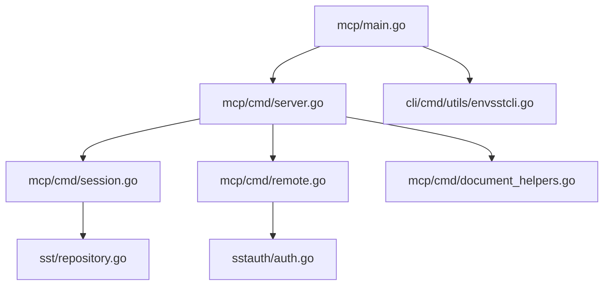
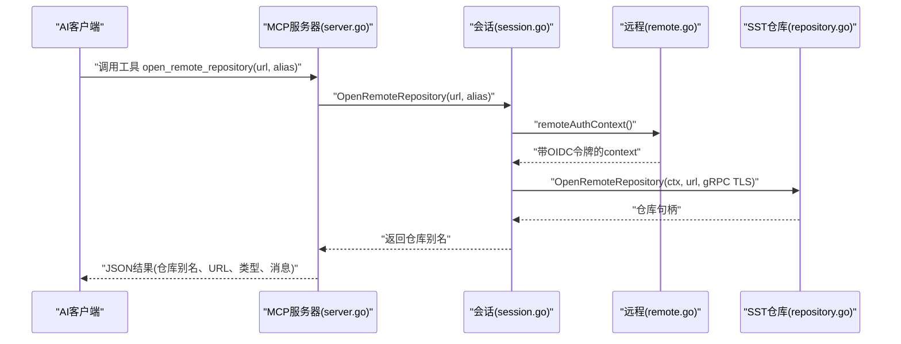
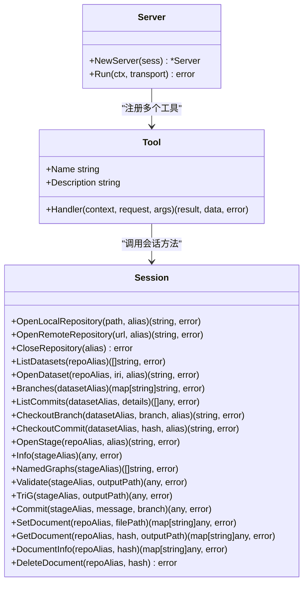
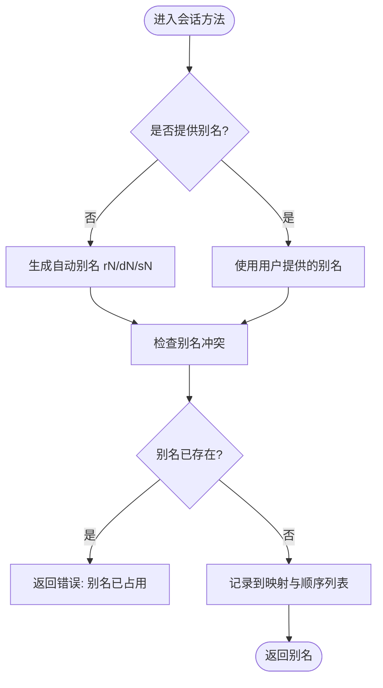
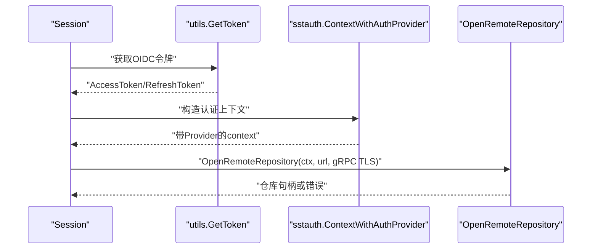
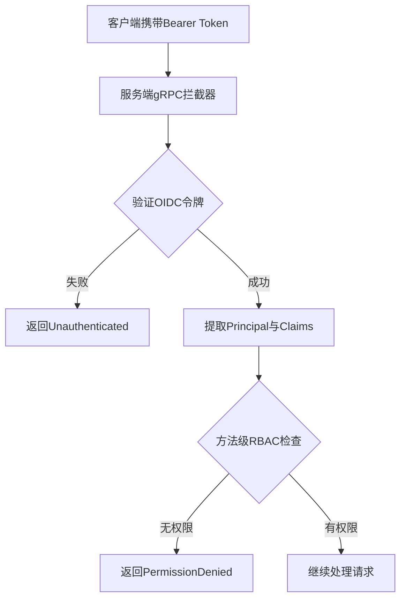
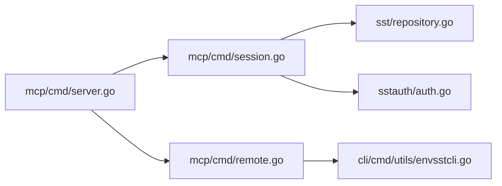

# MCP服务器

<cite>
**本文引用的文件**
- [mcp/main.go](file://mcp/main.go)
- [mcp/cmd/server.go](file://mcp/cmd/server.go)
- [mcp/cmd/session.go](file://mcp/cmd/session.go)
- [mcp/cmd/remote.go](file://mcp/cmd/remote.go)
- [mcp/cmd/document_helpers.go](file://mcp/cmd/document_helpers.go)
- [sst/repository.go](file://sst/repository.go)
- [sstauth/auth.go](file://sstauth/auth.go)
- [sstauth/accessmode.go](file://sstauth/accessmode.go)
- [cli/cmd/utils/envsstcli.go](file://cli/cmd/utils/envsstcli.go)
</cite>

## 目录
1. [简介](#简介)
2. [项目结构](#项目结构)
3. [核心组件](#核心组件)
4. [架构总览](#架构总览)
5. [详细组件分析](#详细组件分析)
6. [依赖关系分析](#依赖关系分析)
7. [性能与监控](#性能与监控)
8. [故障排查指南](#故障排查指南)
9. [结论](#结论)
10. [附录：集成与部署](#附录集成与部署)

## 简介
本仓库包含一个基于 Model Context Protocol（MCP）的SST MCP服务器，用于将SST Core的数据管理能力暴露给AI客户端。该服务器通过标准输入/输出通道运行，提供工具方法以打开本地或远程SST仓库、管理数据集与阶段、提交变更、导出RDF、同步数据以及文档上传下载等。其设计目标是让AI代理能够以统一、可组合的方式访问SST资源，同时复用SST的安全与认证机制。

## 项目结构
MCP服务器位于 mcp 包中，入口为 main.go，核心逻辑在 cmd 子包：
- server.go：注册MCP工具并实现HTTP/stdio传输的运行入口
- session.go：会话状态管理，维护仓库、数据集、阶段的句柄及生命周期
- remote.go：远程仓库连接与认证上下文构建
- document_helpers.go：文档元信息格式化与MIME类型推断
- main.go：进程启动、环境变量加载、信号处理与stdio服务运行

**图表来源**
- [mcp/main.go:22-31](file://mcp/main.go#L22-L31)
- [mcp/cmd/server.go:13-563](file://mcp/cmd/server.go#L13-L563)
- [mcp/cmd/session.go:25-174](file://mcp/cmd/session.go#L25-L174)
- [mcp/cmd/remote.go:38-94](file://mcp/cmd/remote.go#L38-L94)
- [mcp/cmd/document_helpers.go:15-76](file://mcp/cmd/document_helpers.go#L15-L76)
- [sst/repository.go:34-179](file://sst/repository.go#L34-L179)
- [sstauth/auth.go:9-53](file://sstauth/auth.go#L9-L53)
- [cli/cmd/utils/envsstcli.go:12-34](file://cli/cmd/utils/envsstcli.go#L12-L34)

**章节来源**
- [mcp/main.go:22-31](file://mcp/main.go#L22-L31)
- [mcp/cmd/server.go:13-563](file://mcp/cmd/server.go#L13-L563)

## 核心组件
- 会话（Session）：线程安全地维护当前MCP会话内的仓库、数据集、阶段句柄，负责别名分配、生命周期管理与清理。
- 服务器（Server）：基于MCP SDK创建并注册工具方法，封装调用处理器，统一返回文本结果。
- 远程连接（Remote）：从环境读取OIDC令牌，构造gRPC TLS连接与认证上下文，打开远程仓库。
- 文档辅助（Document Helpers）：格式化文档元信息、推断MIME类型、根据MIME选择扩展名。
- 配置与环境（Env）：从 .env.sst-cli 加载必要的环境变量，支持非交互式登录。

**章节来源**
- [mcp/cmd/session.go:25-174](file://mcp/cmd/session.go#L25-L174)
- [mcp/cmd/server.go:13-563](file://mcp/cmd/server.go#L13-L563)
- [mcp/cmd/remote.go:38-94](file://mcp/cmd/remote.go#L38-L94)
- [mcp/cmd/document_helpers.go:15-76](file://mcp/cmd/document_helpers.go#L15-L76)
- [cli/cmd/utils/envsstcli.go:12-34](file://cli/cmd/utils/envsstcli.go#L12-L34)

## 架构总览
MCP服务器作为进程启动，通过stdio与AI客户端通信。每个请求由server.go中的工具处理器解析参数，委托session.go执行具体操作，必要时通过remote.go建立带认证的gRPC连接访问远程SST仓库。所有仓库、数据集、阶段的生命周期由Session统一管理，确保并发安全与资源释放。

**图表来源**
- [mcp/cmd/server.go:49-69](file://mcp/cmd/server.go#L49-L69)
- [mcp/cmd/session.go:100-118](file://mcp/cmd/session.go#L100-L118)
- [mcp/cmd/remote.go:38-94](file://mcp/cmd/remote.go#L38-L94)
- [sst/repository.go:34-179](file://sst/repository.go#L34-L179)

## 详细组件分析

### 服务器与工具注册
- 使用MCP SDK创建服务器实例，注册一系列工具方法，包括仓库打开/关闭、数据集列表/打开、分支与提交历史查询、阶段检出/打开/验证/导出/提交、文档上传/下载/删除等。
- 所有工具处理器统一通过 textResult 将结构化结果序列化为JSON文本返回，便于AI客户端解析。

**图表来源**
- [mcp/cmd/server.go:13-563](file://mcp/cmd/server.go#L13-L563)
- [mcp/cmd/session.go:100-800](file://mcp/cmd/session.go#L100-L800)

**章节来源**
- [mcp/cmd/server.go:13-563](file://mcp/cmd/server.go#L13-L563)

### 会话管理与连接处理
- 会话使用互斥锁保护仓库、数据集、阶段的映射与顺序列表，避免并发竞争。
- 别名分配策略：若未指定别名则自动生成 rN/dN/sN；已存在别名会报错。
- 仓库关闭时自动清理关联的数据集与阶段引用，防止资源泄漏。
- 状态查询 Status 返回当前会话内所有仓库、数据集、阶段的摘要。

**图表来源**
- [mcp/cmd/session.go:69-98](file://mcp/cmd/session.go#L69-L98)
- [mcp/cmd/session.go:254-337](file://mcp/cmd/session.go#L254-L337)

**章节来源**
- [mcp/cmd/session.go:25-174](file://mcp/cmd/session.go#L25-L174)
- [mcp/cmd/session.go:69-98](file://mcp/cmd/session.go#L69-L98)
- [mcp/cmd/session.go:254-337](file://mcp/cmd/session.go#L254-L337)

### 远程操作支持与网络配置
- 远程仓库通过gRPC TLS连接，使用OIDC访问令牌进行认证。
- 认证上下文从 .env.sst-cli 读取 OIDC 相关环境变量，并通过 sstauth 注入到上下文中。
- 连接失败时会尝试解释错误并提供更友好的提示。

**图表来源**
- [mcp/cmd/remote.go:38-94](file://mcp/cmd/remote.go#L38-L94)
- [cli/cmd/utils/envsstcli.go:12-34](file://cli/cmd/utils/envsstcli.go#L12-L34)
- [sst/repository.go:34-179](file://sst/repository.go#L34-L179)

**章节来源**
- [mcp/cmd/remote.go:38-94](file://mcp/cmd/remote.go#L38-L94)
- [cli/cmd/utils/envsstcli.go:12-34](file://cli/cmd/utils/envsstcli.go#L12-L34)

### AI客户端集成示例与最佳实践
- 使用MCP Inspector快速调试：构建二进制后通过 npx @modelcontextprotocol/inspector 启动，观察工具列表与调用结果。
- 推荐流程：
  - 先调用 open_local_repository 或 open_remote_repository 打开仓库
  - 使用 repository_datasets 列出数据集IRI
  - 用 repository_dataset 打开目标数据集
  - 通过 dataset_branches 与 dataset_list_commits 浏览历史
  - 使用 dataset_checkout_branch 或 dataset_checkout_commit 检出阶段
  - 对阶段执行 stage_validate、stage_trig、stage_commit 等操作
  - 使用 repository_document_* 系列工具进行文档上传/下载/删除
- 最佳实践：
  - 始终显式关闭仓库 repository_close，避免资源泄漏
  - 合理设置别名，便于后续操作定位资源
  - 远程操作前确保 .env.sst-cli 配置正确，避免认证失败

**章节来源**
- [mcp/main.go:22-31](file://mcp/main.go#L22-L31)
- [mcp/cmd/server.go:20-532](file://mcp/cmd/server.go#L20-L532)

### 性能与监控
- 会话内部使用互斥锁保护共享状态，保证并发安全；批量操作建议合并以减少上下文切换。
- 提交历史遍历采用去重访问，避免重复计算。
- 文档上传路径中包含去重检测，减少重复存储开销。
- 日志与指标：当前MCP层未内置指标收集，建议在调用方或网关层增加请求计数、耗时统计与错误率监控。

[本节为通用指导，不直接分析具体文件]

### 认证授权与访问控制
- 客户端侧：通过 .env.sst-cli 提供OIDC令牌，构造认证上下文，用于远程仓库访问。
- 服务端侧：SST仓库服务支持基于OIDC的RBAC拦截器，按方法与仓库维度校验权限。
- 访问模式：通过角色映射到访问模式（如只读、读写），并在gRPC拦截器中强制执行。

**图表来源**
- [sstauth/accessmode.go](file://sstauth/accessmode.go)
- [sstauth/authoids.go:73-91](file://sstauth/authoids.go#L73-L91)
- [sstauth/authoids.go:338-423](file://sstauth/authoids.go#L338-L423)

**章节来源**
- [sstauth/auth.go:9-53](file://sstauth/auth.go#L9-L53)
- [sstauth/accessmode.go](file://sstauth/accessmode.go)
- [sstauth/authoids.go:73-91](file://sstauth/authoids.go#L73-L91)
- [sstauth/authoids.go:338-423](file://sstauth/authoids.go#L338-L423)

## 依赖关系分析
- mcp 包依赖 sst 包提供的仓库接口与实现，以及 sstauth 的认证能力。
- 服务器通过MCP SDK注册工具，工具处理器调用会话方法，会话再调用仓库API。
- 远程连接依赖gRPC与TLS证书，认证上下文由OIDC令牌驱动。

**图表来源**
- [mcp/cmd/server.go:13-563](file://mcp/cmd/server.go#L13-L563)
- [mcp/cmd/session.go:25-174](file://mcp/cmd/session.go#L25-L174)
- [mcp/cmd/remote.go:38-94](file://mcp/cmd/remote.go#L38-L94)
- [sst/repository.go:34-179](file://sst/repository.go#L34-L179)
- [sstauth/auth.go:9-53](file://sstauth/auth.go#L9-L53)
- [cli/cmd/utils/envsstcli.go:12-34](file://cli/cmd/utils/envsstcli.go#L12-L34)

**章节来源**
- [mcp/cmd/server.go:13-563](file://mcp/cmd/server.go#L13-L563)
- [mcp/cmd/session.go:25-174](file://mcp/cmd/session.go#L25-L174)
- [mcp/cmd/remote.go:38-94](file://mcp/cmd/remote.go#L38-L94)
- [sst/repository.go:34-179](file://sst/repository.go#L34-L179)
- [sstauth/auth.go:9-53](file://sstauth/auth.go#L9-L53)
- [cli/cmd/utils/envsstcli.go:12-34](file://cli/cmd/utils/envsstcli.go#L12-L34)

## 性能与监控
- 会话层面的并发控制通过互斥锁实现，适合中等规模并发；在高并发场景下可考虑分片会话或连接池。
- 文档上传包含去重检测，减少冗余存储；下载时按MIME推断扩展名，提升用户体验。
- 建议在外部网关或代理层增加请求度量（QPS、延迟、错误率）、慢查询告警与审计日志。

[本节为通用指导，不直接分析具体文件]

## 故障排查指南
- 远程连接失败：检查 .env.sst-cli 是否包含必要的OIDC环境变量，确认令牌有效且未被撤销。
- 别名冲突：确保每次打开仓库/数据集/阶段时使用唯一别名，或在失败后重试。
- 权限不足：服务端RBAC拦截器可能拒绝访问，需检查令牌中的角色与受众是否与仓库匹配。
- 资源未释放：忘记调用 repository_close 可能导致句柄泄漏，应在客户端结束时显式关闭。

**章节来源**
- [mcp/cmd/remote.go:38-94](file://mcp/cmd/remote.go#L38-L94)
- [mcp/cmd/session.go:120-174](file://mcp/cmd/session.go#L120-L174)
- [sstauth/authoids.go:338-423](file://sstauth/authoids.go#L338-L423)

## 结论
SST MCP服务器将SST Core的能力以标准化的MCP工具形式暴露给AI客户端，提供了仓库、数据集、阶段与文档的全生命周期管理。通过会话管理确保资源安全与一致性，结合OIDC认证与RBAC访问控制保障安全性。建议在生产环境中配合外部监控与日志系统，以实现可观测性与稳定性。

[本节为总结性内容，不直接分析具体文件]

## 附录：集成与部署
- 构建与运行：
  - 构建二进制：go build -o mcp/sst-mcp ./mcp/main.go
  - 使用MCP Inspector调试：npx @modelcontextprotocol/inspector ./mcp/sst-mcp
- 环境配置：
  - 在 .env.sst-cli 中设置 SST_OIDC_REALM_URL、SST_OIDC_CLIENT_ID、SST_OIDC_CLIENT_SECRET，可选 SST_USERNAME/SST_PASSWORD
- 服务端部署：
  - 参考示例中的远程仓库服务配置，启用TLS与OIDC签发者，按需开启索引重建与详细日志
- 客户端集成：
  - 通过MCP协议调用工具，遵循“打开仓库→打开数据集→检出阶段→操作→关闭”的流程
  - 在错误处理中捕获认证与权限异常，并给出友好提示

**章节来源**
- [mcp/main.go:22-31](file://mcp/main.go#L22-L31)
- [cli/cmd/utils/envsstcli.go:12-34](file://cli/cmd/utils/envsstcli.go#L12-L34)
- [examples/helloworldsuperreporemote/main.go:45-137](file://examples/helloworldsuperreporemote/main.go#L45-L137)