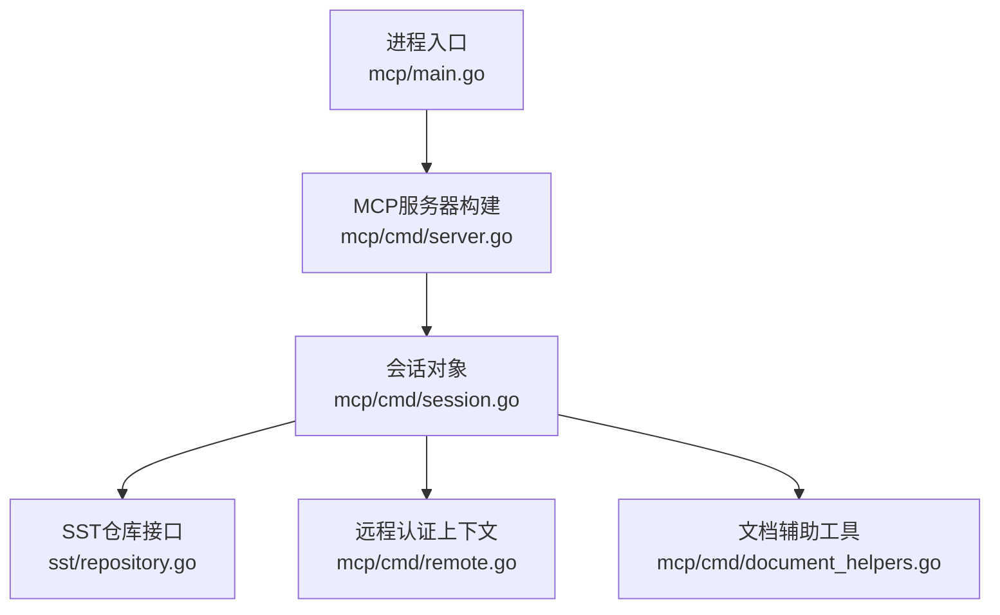
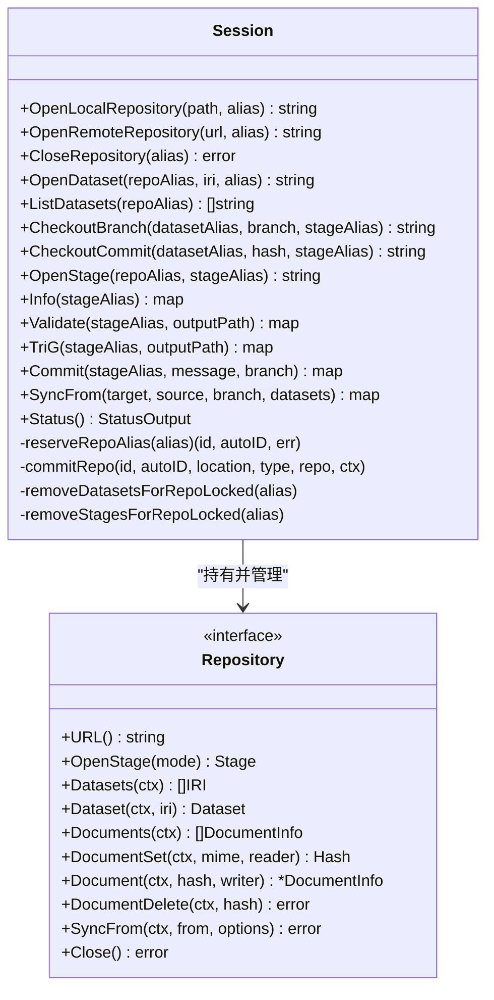
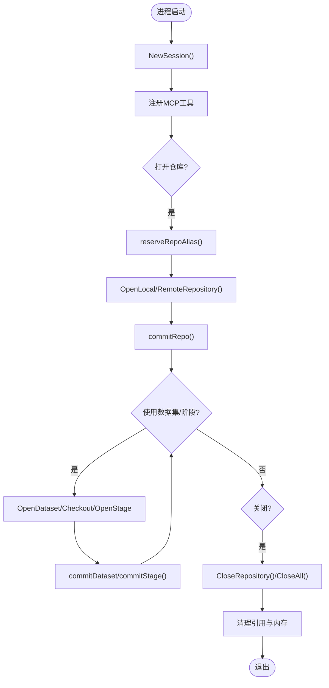
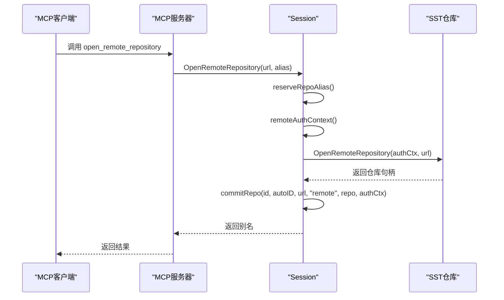
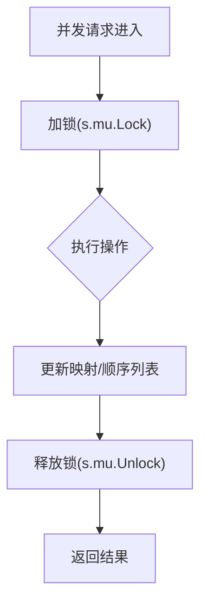
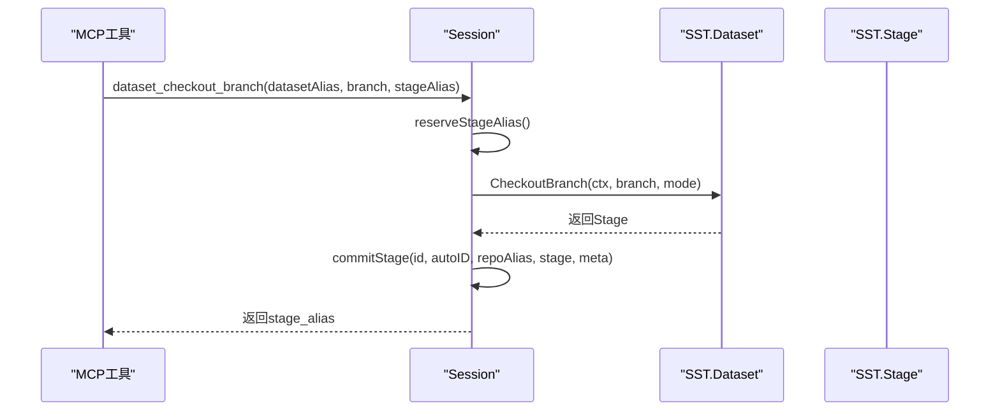
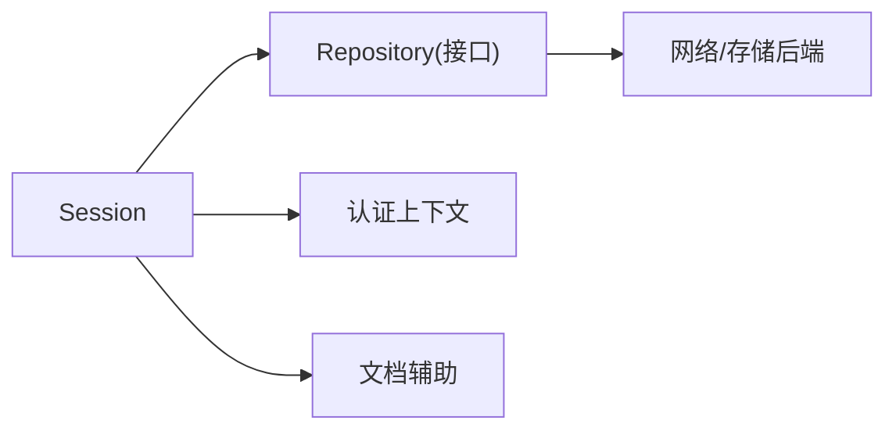
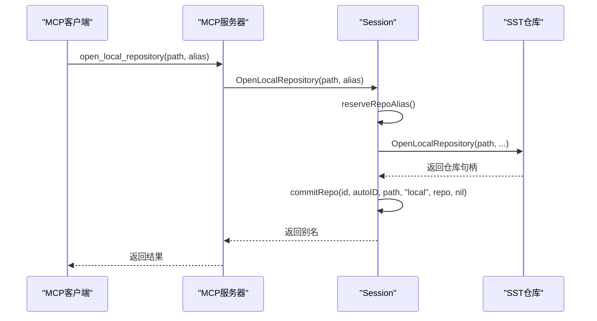
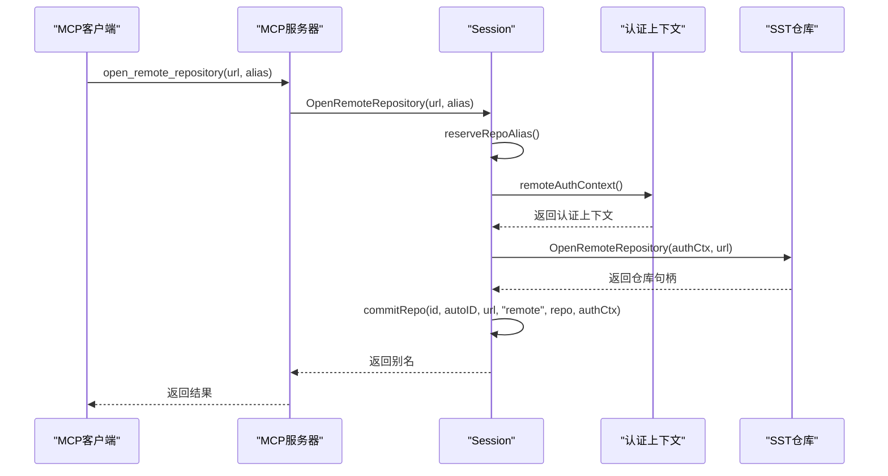
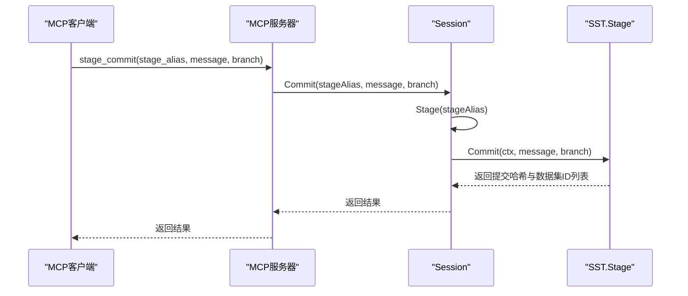

# 会话管理

<cite>
**本文引用的文件**
- [mcp/main.go](file://mcp/main.go)
- [mcp/cmd/server.go](file://mcp/cmd/server.go)
- [mcp/cmd/session.go](file://mcp/cmd/session.go)
- [mcp/cmd/remote.go](file://mcp/cmd/remote.go)
- [mcp/cmd/document_helpers.go](file://mcp/cmd/document_helpers.go)
- [sst/repository.go](file://sst/repository.go)
</cite>

## 目录
1. [简介](#简介)
2. [项目结构](#项目结构)
3. [核心组件](#核心组件)
4. [架构总览](#架构总览)
5. [详细组件分析](#详细组件分析)
6. [依赖关系分析](#依赖关系分析)
7. [性能与并发](#性能与并发)
8. [故障恢复与超时](#故障恢复与超时)
9. [监控与调试](#监控与调试)
10. [结论](#结论)
11. [附录：关键流程时序图](#附录关键流程时序图)

## 简介
本文件面向SST MCP（Model Context Protocol）服务中的“会话管理”能力，系统性说明会话的生命周期、状态跟踪、上下文保持、并发隔离、资源清理、与SST仓库操作的关联，以及监控调试与优化建议。文档以代码为依据，提供可视化图示与路径引用，便于读者快速定位实现位置。

## 项目结构
MCP服务入口通过标准输入输出运行，创建并持有Session实例，将工具注册到MCP Server，所有工具调用最终委托给Session进行资源管理与业务编排。

**图表来源**
- [mcp/main.go:22-31](file://mcp/main.go#L22-L31)
- [mcp/cmd/server.go:14-563](file://mcp/cmd/server.go#L14-L563)
- [mcp/cmd/session.go:25-67](file://mcp/cmd/session.go#L25-L67)
- [sst/repository.go:34-179](file://sst/repository.go#L34-L179)
- [mcp/cmd/remote.go:38-103](file://mcp/cmd/remote.go#L38-L103)
- [mcp/cmd/document_helpers.go:15-76](file://mcp/cmd/document_helpers.go#L15-L76)

**章节来源**
- [mcp/main.go:22-31](file://mcp/main.go#L22-L31)
- [mcp/cmd/server.go:14-563](file://mcp/cmd/server.go#L14-L563)

## 核心组件
- Session：维护当前MCP进程内的所有SST资源句柄（仓库、数据集、阶段），负责别名分配、生命周期管理、状态查询、以及与底层SST接口的桥接。
- MCP Server：暴露工具方法（如打开仓库、打开数据集、提交、同步等），统一参数校验后委派给Session。
- 远程认证上下文：为远程仓库操作注入OAuth令牌上下文，保证跨网络访问的鉴权一致性。
- 文档辅助：用于上传/下载/元数据展示时的MIME类型推断与扩展名映射。

**章节来源**
- [mcp/cmd/session.go:25-67](file://mcp/cmd/session.go#L25-L67)
- [mcp/cmd/server.go:14-563](file://mcp/cmd/server.go#L14-L563)
- [mcp/cmd/remote.go:38-103](file://mcp/cmd/remote.go#L38-L103)
- [mcp/cmd/document_helpers.go:15-76](file://mcp/cmd/document_helpers.go#L15-L76)

## 架构总览
MCP会话作为“进程内资源管理器”，对上层工具透明地封装了SST仓库、数据集、阶段的打开、使用与关闭；同时通过authContexts为远程仓库维持一致的认证上下文。

**图表来源**
- [mcp/cmd/session.go:25-67](file://mcp/cmd/session.go#L25-L67)
- [mcp/cmd/session.go:100-174](file://mcp/cmd/session.go#L100-L174)
- [mcp/cmd/session.go:367-423](file://mcp/cmd/session.go#L367-L423)
- [mcp/cmd/session.go:952-1038](file://mcp/cmd/session.go#L952-L1038)
- [mcp/cmd/session.go:1176-1214](file://mcp/cmd/session.go#L1176-L1214)
- [mcp/cmd/session.go:753-820](file://mcp/cmd/session.go#L753-L820)
- [sst/repository.go:34-179](file://sst/repository.go#L34-L179)

## 详细组件分析

### 会话生命周期管理
- 创建：进程启动时构造Session，内部初始化仓库、数据集、阶段的索引表与顺序列表。
- 维护：通过别名机制（r1/r2/d1/s1等）统一管理资源；支持自动分配或用户指定别名；同一别名冲突会报错。
- 销毁：支持单仓库关闭与全部关闭；关闭仓库时会级联清理其数据集与阶段引用，避免悬挂句柄。

**图表来源**
- [mcp/cmd/session.go:25-67](file://mcp/cmd/session.go#L25-L67)
- [mcp/cmd/session.go:69-98](file://mcp/cmd/session.go#L69-L98)
- [mcp/cmd/session.go:100-174](file://mcp/cmd/session.go#L100-L174)
- [mcp/cmd/session.go:254-353](file://mcp/cmd/session.go#L254-L353)

**章节来源**
- [mcp/cmd/session.go:25-67](file://mcp/cmd/session.go#L25-L67)
- [mcp/cmd/session.go:69-98](file://mcp/cmd/session.go#L69-L98)
- [mcp/cmd/session.go:100-174](file://mcp/cmd/session.go#L100-L174)
- [mcp/cmd/session.go:254-353](file://mcp/cmd/session.go#L254-L353)

### 会话状态跟踪与上下文保持
- 状态跟踪：Session维护仓库、数据集、阶段的顺序列表与映射，Status()可返回当前会话中所有已打开资源的摘要信息，便于监控与排障。
- 上下文保持：对于远程仓库，Session在打开时记录对应的认证上下文（包含OAuth令牌），后续对该仓库的所有操作复用该上下文，确保鉴权一致。

**图表来源**
- [mcp/cmd/server.go:49-69](file://mcp/cmd/server.go#L49-L69)
- [mcp/cmd/session.go:50-93](file://mcp/cmd/session.go#L50-L93)
- [mcp/cmd/remote.go:38-93](file://mcp/cmd/remote.go#L38-L93)

**章节来源**
- [mcp/cmd/session.go:188-252](file://mcp/cmd/session.go#L188-L252)
- [mcp/cmd/remote.go:96-103](file://mcp/cmd/remote.go#L96-L103)

### 并发会话处理与资源隔离
- 并发安全：Session内部使用互斥锁保护所有共享状态（仓库、数据集、阶段及其元数据），确保多请求并发下的数据一致性。
- 资源隔离：每个Session实例独立维护资源集合；不同会话之间不共享仓库/数据集/阶段句柄，天然隔离。
- 别名冲突检测：在分配别名时检查是否重复，避免跨请求的资源覆盖。

**图表来源**
- [mcp/cmd/session.go:25-67](file://mcp/cmd/session.go#L25-L67)
- [mcp/cmd/session.go:69-98](file://mcp/cmd/session.go#L69-L98)
- [mcp/cmd/session.go:254-353](file://mcp/cmd/session.go#L254-L353)

**章节来源**
- [mcp/cmd/session.go:25-67](file://mcp/cmd/session.go#L25-L67)
- [mcp/cmd/session.go:69-98](file://mcp/cmd/session.go#L69-L98)
- [mcp/cmd/session.go:254-353](file://mcp/cmd/session.go#L254-L353)

### 会话超时与自动清理
- 超时控制：SST仓库接口方法接受context.Context，可用于设置超时与取消；MCP工具层未内置全局超时策略，需在上层调用处传入带超时的上下文。
- 自动清理：Session提供CloseAll()，在进程退出或异常时集中关闭所有仓库并清空内部状态，防止资源泄漏。

**章节来源**
- [sst/repository.go:34-179](file://sst/repository.go#L34-L179)
- [mcp/cmd/session.go:147-174](file://mcp/cmd/session.go#L147-L174)

### 会话与SST仓库操作的关联
- 仓库操作：打开本地/远程仓库、列出数据集、同步数据、文档上传/下载/删除等，均由Session代理至底层Repository。
- 数据集操作：按IRI打开数据集、列出分支、遍历提交历史、查看提交详情等。
- 阶段操作：从分支/提交检出阶段、创建空阶段、导出RDF、验证、提交变更等。

**图表来源**
- [mcp/cmd/server.go:260-284](file://mcp/cmd/server.go#L260-L284)
- [mcp/cmd/session.go:952-983](file://mcp/cmd/session.go#L952-L983)
- [mcp/cmd/session.go:318-337](file://mcp/cmd/session.go#L318-L337)

**章节来源**
- [mcp/cmd/server.go:260-284](file://mcp/cmd/server.go#L260-L284)
- [mcp/cmd/session.go:952-983](file://mcp/cmd/session.go#L952-L983)
- [mcp/cmd/session.go:318-337](file://mcp/cmd/session.go#L318-L337)

### 会话监控与调试
- 状态查询：通过status工具获取当前会话中所有仓库、数据集、阶段的摘要，便于排查资源占用与状态。
- 日志与错误：工具层对必要参数进行校验并返回明确错误；远程仓库连接失败会包装为可读提示。

**章节来源**
- [mcp/cmd/server.go:20-25](file://mcp/cmd/server.go#L20-L25)
- [mcp/cmd/server.go:49-69](file://mcp/cmd/server.go#L49-L69)
- [mcp/cmd/remote.go:38-93](file://mcp/cmd/remote.go#L38-L93)

### 会话性能优化与故障恢复
- 性能优化建议
  - 合理复用Session：长驻进程中复用单一Session，减少频繁创建/销毁开销。
  - 控制并发：对高并发场景，结合上游限流与队列，避免过多并发导致底层IO压力过大。
  - 批量操作：优先使用批量接口（如同步、列出）减少往返次数。
  - 上下文超时：为远程操作设置合理的超时与取消，避免阻塞。
- 故障恢复策略
  - 重试与退避：对网络抖动导致的远程操作失败，可在上层实现指数退避重试。
  - 资源回收：出现异常时调用CloseAll确保资源释放，避免句柄泄漏。
  - 幂等性：文档上传具备去重逻辑，重复上传不会重复存储。

[本节为通用指导，不直接分析具体文件]

## 依赖关系分析
Session依赖SST仓库接口完成实际的数据与版本管理；依赖认证上下文注入以保证远程访问的鉴权；依赖文档辅助模块进行MIME类型推断与扩展名映射。

**图表来源**
- [mcp/cmd/session.go:25-67](file://mcp/cmd/session.go#L25-L67)
- [mcp/cmd/remote.go:38-103](file://mcp/cmd/remote.go#L38-L103)
- [mcp/cmd/document_helpers.go:15-76](file://mcp/cmd/document_helpers.go#L15-L76)
- [sst/repository.go:34-179](file://sst/repository.go#L34-L179)

**章节来源**
- [mcp/cmd/session.go:25-67](file://mcp/cmd/session.go#L25-L67)
- [mcp/cmd/remote.go:38-103](file://mcp/cmd/remote.go#L38-L103)
- [mcp/cmd/document_helpers.go:15-76](file://mcp/cmd/document_helpers.go#L15-L76)
- [sst/repository.go:34-179](file://sst/repository.go#L34-L179)

## 性能与并发
- 并发安全：Session内部使用互斥锁保护所有共享数据结构，确保多线程并发访问的一致性。
- 资源隔离：每个Session实例独立，避免跨会话的资源竞争。
- 建议：在高并发环境下，结合上游限流与批处理，降低对底层存储/网络的冲击。

[本节为通用指导，不直接分析具体文件]

## 故障恢复与超时
- 超时：SST仓库接口接受context.Context，可通过上层传入带超时的上下文控制远程操作耗时。
- 恢复：异常时调用CloseAll进行资源回收；远程连接失败会给出可读的错误提示，便于定位问题。

**章节来源**
- [sst/repository.go:34-179](file://sst/repository.go#L34-L179)
- [mcp/cmd/session.go:147-174](file://mcp/cmd/session.go#L147-L174)
- [mcp/cmd/remote.go:38-93](file://mcp/cmd/remote.go#L38-L93)

## 监控与调试
- 使用status工具查看当前会话中所有仓库、数据集、阶段的状态，快速定位资源占用情况。
- 通过工具返回的错误信息进行初步排障；远程仓库连接失败会包含更友好的提示信息。

**章节来源**
- [mcp/cmd/server.go:20-25](file://mcp/cmd/server.go#L20-L25)
- [mcp/cmd/server.go:49-69](file://mcp/cmd/server.go#L49-L69)
- [mcp/cmd/remote.go:38-93](file://mcp/cmd/remote.go#L38-L93)

## 结论
SST MCP会话管理通过Session集中管理仓库、数据集与阶段的生命周期，提供并发安全的资源隔离、清晰的别名机制、一致的认证上下文传递，以及与SST仓库操作的紧密集成。配合状态查询与错误提示，可满足大多数AI客户端对SST资源的交互式操作需求。在生产环境中，建议结合超时控制、重试策略与资源回收，进一步提升稳定性与性能。

[本节为总结，不直接分析具体文件]

## 附录：关键流程时序图

### 打开本地仓库

**图表来源**
- [mcp/cmd/server.go:27-47](file://mcp/cmd/server.go#L27-L47)
- [mcp/cmd/session.go:100-118](file://mcp/cmd/session.go#L100-L118)
- [mcp/cmd/session.go:69-98](file://mcp/cmd/session.go#L69-L98)

### 打开远程仓库

**图表来源**
- [mcp/cmd/server.go:49-69](file://mcp/cmd/server.go#L49-L69)
- [mcp/cmd/session.go:50-93](file://mcp/cmd/session.go#L50-L93)
- [mcp/cmd/remote.go:38-93](file://mcp/cmd/remote.go#L38-L93)

### 提交阶段变更

**图表来源**
- [mcp/cmd/server.go:403-422](file://mcp/cmd/server.go#L403-L422)
- [mcp/cmd/session.go:1176-1214](file://mcp/cmd/session.go#L1176-L1214)