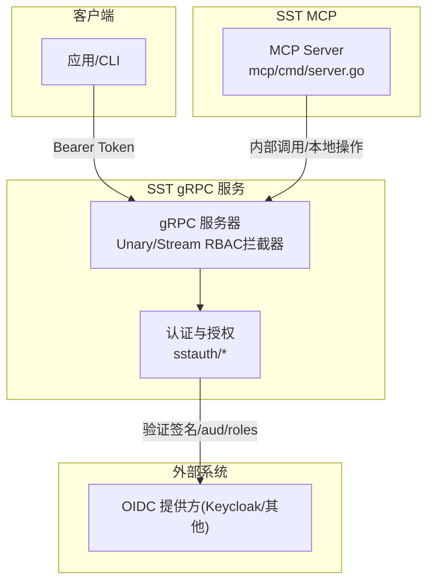
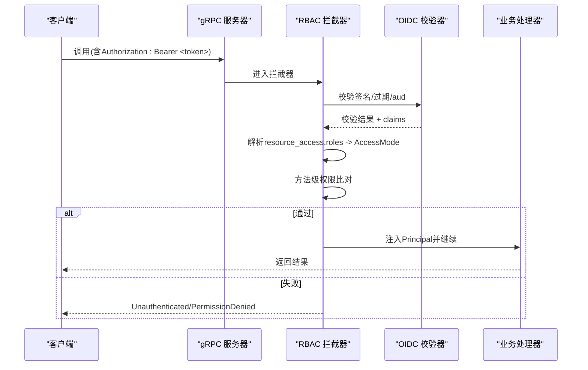
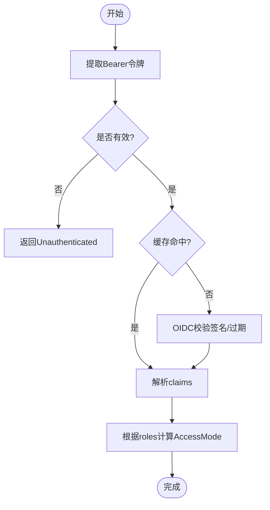
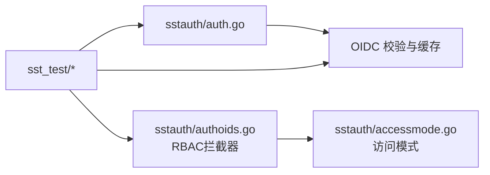

# 安全认证

<cite>
**本文引用的文件**
- [auth.go](file://sstauth/auth.go)
- [authoids.go](file://sstauth/authoids.go)
- [accessmode.go](file://sstauth/accessmode.go)
- [ACCESS_RIGHTS.md](file://sstauth/ACCESS_RIGHTS.md)
- [server.go](file://mcp/cmd/server.go)
- [per_repo_auth_test.go](file://sst_test/per_repo_auth_test.go)
- [testauth.go](file://sst_test/testutil/testauth.go)
- [oidc_provider.go](file://sst_test/testutil/oidc_provider.go)
</cite>

## 目录
1. [简介](#简介)
2. [项目结构](#项目结构)
3. [核心组件](#核心组件)
4. [架构总览](#架构总览)
5. [详细组件分析](#详细组件分析)
6. [依赖关系分析](#依赖关系分析)
7. [性能与安全特性](#性能与安全特性)
8. [故障排查指南](#故障排查指南)
9. [结论](#结论)
10. [附录：部署与最佳实践](#附录部署与最佳实践)

## 简介
本文件面向SST MCP服务器与SST gRPC服务的安全认证体系，系统性说明支持的认证机制（OAuth2/OIDC、基于Keycloak的自定义角色映射）、令牌管理与权限验证流程、访问控制与细粒度权限设置、安全传输与加密通信配置、审计日志与安全监控要点、跨域请求与CORS注意事项、安全配置检查与漏洞扫描方法，以及实际部署案例。文档严格依据仓库中的实现与测试代码进行归纳，避免臆测未实现的特性。

## 项目结构
与安全认证直接相关的代码集中在以下位置：
- sstauth：认证与授权核心包，提供OIDC令牌校验、RBAC拦截器、访问模式定义、上下文用户信息传递等能力。
- mcp/cmd/server.go：MCP工具注册与服务入口，侧重功能暴露；安全由底层gRPC或HTTP中间件保障。
- sst_test：包含大量端到端认证与授权测试，覆盖单仓库与超级仓库两种模型、流式与一元调用、越权拒绝等场景。
- sst_test/testutil：测试用OIDC提供者、TLS证书与gRPC凭据构造，用于模拟真实认证链路。



图表来源
- [server.go:1-563](file://mcp/cmd/server.go#L1-L563)
- [authoids.go:58-140](file://sstauth/authoids.go#L58-L140)
- [authoids.go:375-510](file://sstauth/authoids.go#L375-L510)

章节来源
- [server.go:1-563](file://mcp/cmd/server.go#L1-L563)
- [authoids.go:58-140](file://sstauth/authoids.go#L58-L140)
- [authoids.go:375-510](file://sstauth/authoids.go#L375-L510)

## 核心组件
- 认证提供者接口与上下文注入：通过AuthProvider将访问令牌注入gRPC/HTTP上下文，并在后续处理中获取当前用户信息。
- OIDC令牌校验与缓存：支持从gRPC元数据或HTTP头提取Bearer令牌，使用OIDC Provider校验签名与过期时间，并对已验证令牌做LRU缓存以提升性能。
- RBAC拦截器：为gRPC一元和流式调用提供统一的鉴权入口，校验audience与角色，并将Principal注入上下文供业务使用。
- 访问模式与角色映射：将Keycloak resource_access.<clientID>.roles映射为AccessMode（None/ReadOnly/ReadWrite/Admin/SuperAdmin），并支持按方法级最小权限要求校验。
- 超级仓库与单仓库两种模型：PerRepoAuth=false时仅校验服务端ClientID；PerRepoAuth=true时为每个子仓库生成独立audience（superClientID#repoName）并实施隔离。

章节来源
- [auth.go:9-52](file://sstauth/auth.go#L9-L52)
- [authoids.go:58-140](file://sstauth/authoids.go#L58-L140)
- [authoids.go:206-233](file://sstauth/authoids.go#L206-L233)
- [authoids.go:375-510](file://sstauth/authoids.go#L375-L510)
- [accessmode.go:7-129](file://sstauth/accessmode.go#L7-L129)
- [ACCESS_RIGHTS.md:13-50](file://sstauth/ACCESS_RIGHTS.md#L13-L50)

## 架构总览
下图展示一次带认证的gRPC调用在SST中的完整路径：客户端携带Bearer令牌，gRPC拦截器提取并校验OIDC令牌，解析aud与roles，执行方法级RBAC，最终进入业务处理器。



图表来源
- [authoids.go:58-140](file://sstauth/authoids.go#L58-L140)
- [authoids.go:206-233](file://sstauth/authoids.go#L206-L233)
- [authoids.go:375-510](file://sstauth/authoids.go#L375-L510)

## 详细组件分析

### 认证机制与令牌管理
- OAuth2/OIDC支持
  - 从gRPC元数据或HTTP头提取Bearer令牌。
  - 使用OIDC Provider校验签名与过期时间，跳过默认ClientID检查以支持按仓库动态audience。
  - 对已验证令牌进行LRU缓存，减少重复校验开销。
- 令牌来源
  - 用户/服务账号通过Keycloak或其他OIDC提供方获取access token。
  - 支持刷新令牌与客户端凭证模式TokenSource，便于服务间调用。
- 上下文用户信息
  - 认证成功后将SstUserInfo或Principal注入上下文，供后续逻辑使用。



图表来源
- [authoids.go:58-140](file://sstauth/authoids.go#L58-L140)
- [authoids.go:255-288](file://sstauth/authoids.go#L255-L288)
- [authoids.go:533-560](file://sstauth/authoids.go#L533-L560)

章节来源
- [authoids.go:58-140](file://sstauth/authoids.go#L58-L140)
- [authoids.go:206-233](file://sstauth/authoids.go#L206-L233)
- [authoids.go:255-288](file://sstauth/authoids.go#L255-L288)
- [authoids.go:533-560](file://sstauth/authoids.go#L533-L560)

### 访问控制与细粒度权限
- 访问模式
  - None < ReadOnly < ReadWrite < Admin < SuperAdmin，数值越大权限越高。
  - 通过角色名关键字匹配推导AccessMode（如包含admin/write/read-only等）。
- 方法级权限表
  - 不同gRPC方法有最低所需AccessMode，例如写操作需ReadWrite及以上，SuperRepository管理需SuperAdmin。
- 两种授权模型
  - PerRepoAuth=false：单仓库服务器，仅校验服务端ClientID。
  - PerRepoAuth=true：超级仓库服务器，每个子仓库拥有独立audience（superClientID#repoName），实现仓库级隔离。
- 流式调用的特殊处理
  - 流式调用在握手阶段无法获知目标仓库，先做基础audience校验，再在读取首条消息后调用CheckRepoAccess完成精确的仓库级权限判定。

```mermaid
classDiagram
class AccessMode {
+String() string
+ParseAccessMode(s) AccessMode
+HasAccess(user, required) bool
}
class KCClaims {
+Email string
+Name string
+ResourceAccess map[string]struct{Roles []string}
}
class Principal {
+Email string
+Name string
+Claims KCClaims
+Audience []string
}
AccessMode <.. Principal : "用于权限比较"
KCClaims <.. Principal : "承载角色"
```

图表来源
- [accessmode.go:7-129](file://sstauth/accessmode.go#L7-L129)
- [authoids.go:235-253](file://sstauth/authoids.go#L235-L253)
- [authoids.go:425-443](file://sstauth/authoids.go#L425-L443)

章节来源
- [accessmode.go:7-129](file://sstauth/accessmode.go#L7-L129)
- [ACCESS_RIGHTS.md:13-50](file://sstauth/ACCESS_RIGHTS.md#L13-L50)
- [ACCESS_RIGHTS.md:130-171](file://sstauth/ACCESS_RIGHTS.md#L130-L171)
- [ACCESS_RIGHTS.md:240-313](file://sstauth/ACCESS_RIGHTS.md#L240-L313)
- [authoids.go:338-373](file://sstauth/authoids.go#L338-L373)
- [authoids.go:445-510](file://sstauth/authoids.go#L445-L510)

### 安全传输与加密通信
- TLS
  - 测试环境通过自签CA与服务器证书启用gRPC TLS传输，生产应使用可信CA签发证书。
- 传输凭据
  - 客户端使用TLS凭据连接服务器，并通过Per-RPC凭据注入OAuth2 access token。
- HTTP中间件
  - 提供从HTTP头提取Bearer令牌并注入上下文的中间件，便于Web网关集成。

章节来源
- [testauth.go:49-127](file://sst_test/testutil/testauth.go#L49-L127)
- [testauth.go:129-144](file://sst_test/testutil/testauth.go#L129-L144)
- [authoids.go:108-140](file://sstauth/authoids.go#L108-L140)

### 审计日志与安全监控
- 同步操作的审计记录
  - 远程到本地或远端到远端的SyncFrom会在目标仓库记录“sync_from”类型日志条目，包含作者、来源URL、影响数量及数据集标识等字段，便于追踪变更来源。
- 提交与变更
  - 通过SstUserInfo将操作者邮箱注入上下文，确保提交与关键操作可追溯。

章节来源
- [per_repo_auth_test.go:1530-1618](file://sst_test/per_repo_auth_test.go#L1530-L1618)
- [auth.go:19-36](file://sstauth/auth.go#L19-L36)

### 跨域请求与CORS
- 当前仓库未实现内置CORS处理逻辑。若通过HTTP网关暴露API，应在网关层配置CORS策略，限制允许的源、方法与头部，遵循最小权限原则。

[本节为通用建议，不直接分析具体文件]

### 安全配置检查与漏洞扫描
- 配置检查清单
  - 确认Issuer与ClientID正确配置，且与OIDC提供方一致。
  - 确认每仓库的audience格式为superClientID#repoName（超级仓库模式）。
  - 确认资源角色映射已开启，使resource_access.<clientID>.roles存在。
  - 确认TLS证书有效且受信任，禁用弱密码套件。
- 扫描与验证
  - 使用静态扫描工具检查敏感配置泄露。
  - 使用依赖漏洞扫描工具定期检测第三方库风险。
  - 通过单元测试与集成测试（如per_repo_auth_test）验证鉴权与授权行为。

[本节为通用建议，不直接分析具体文件]

## 依赖关系分析
- 认证与授权模块依赖OIDC库进行令牌校验，并使用可插拔的Provider接口适配不同认证源。
- RBAC拦截器依赖访问模式与角色映射，结合方法级权限表实现细粒度控制。
- 测试工具链提供伪造OIDC提供者与TLS证书，支撑端到端认证测试。



图表来源
- [auth.go:9-52](file://sstauth/auth.go#L9-L52)
- [authoids.go:58-140](file://sstauth/authoids.go#L58-L140)
- [accessmode.go:7-129](file://sstauth/accessmode.go#L7-L129)
- [per_repo_auth_test.go:23-190](file://sst_test/per_repo_auth_test.go#L23-L190)

章节来源
- [auth.go:9-52](file://sstauth/auth.go#L9-L52)
- [authoids.go:58-140](file://sstauth/authoids.go#L58-L140)
- [accessmode.go:7-129](file://sstauth/accessmode.go#L7-L129)
- [per_repo_auth_test.go:23-190](file://sst_test/per_repo_auth_test.go#L23-L190)

## 性能与安全特性
- 性能
  - 令牌校验结果LRU缓存，降低重复校验开销。
  - 流式调用在握手阶段只做基础audience校验，精确权限在首条消息后执行，兼顾吞吐与安全。
- 安全
  - 严格的audience与方法级权限校验，防止越权访问。
  - 支持超级仓库与单仓库两种模型，满足多租户隔离需求。
  - 通过TLS保证传输安全，配合Bearer令牌实现身份认证。

[本节为总结性内容，不直接分析具体文件]

## 故障排查指南
- 常见错误码
  - Unauthenticated：缺少或无效令牌、签名校验失败、过期。
  - PermissionDenied：audience不匹配、角色不足、方法权限不够。
- 定位步骤
  - 检查客户端是否正确附加Bearer令牌。
  - 核对服务端Issuer与ClientID配置是否与OIDC提供方一致。
  - 确认Keycloak中resource_access.<clientID>.roles已正确映射。
  - 对于超级仓库模式，确认令牌aud为superClientID#repoName。
  - 查看目标仓库的“sync_from”日志，确认同步来源与操作者。

章节来源
- [authoids.go:290-312](file://sstauth/authoids.go#L290-L312)
- [authoids.go:375-510](file://sstauth/authoids.go#L375-L510)
- [per_repo_auth_test.go:70-190](file://sst_test/per_repo_auth_test.go#L70-L190)

## 结论
SST的安全认证体系以OIDC为核心，结合RBAC拦截器与访问模式映射，实现了从传输安全、身份认证到细粒度授权的完整闭环。其支持单仓库与超级仓库两种模型，既能满足简单场景，也能支撑多租户隔离与精细化权限控制。通过完善的测试与审计日志，可在生产环境中可靠运行并持续演进。

[本节为总结性内容，不直接分析具体文件]

## 附录：部署与最佳实践
- 认证与授权
  - 使用强密钥与受信任CA签发TLS证书。
  - 在Keycloak中为每个仓库创建独立Client ID，并配置resource_access角色映射。
  - 为超级仓库启用PerRepoAuth，并为每个子仓库分配最小必要角色。
- 令牌管理
  - 使用短期access token并结合刷新令牌或客户端凭证模式。
  - 在服务端启用令牌缓存以降低负载。
- 安全传输
  - 强制HTTPS/TLS，禁用不安全协议与弱套件。
  - 在网关层配置CORS，限制允许源与头部。
- 审计与监控
  - 开启并集中收集“sync_from”等审计日志。
  - 对认证失败与权限拒绝事件告警。
- 配置检查与扫描
  - 定期审查OIDC配置与角色映射。
  - 使用静态与依赖扫描工具发现潜在风险。
- 实际部署案例
  - 参考测试用例中的超级仓库与单仓库场景，复现并验证鉴权与授权行为。

章节来源
- [ACCESS_RIGHTS.md:173-239](file://sstauth/ACCESS_RIGHTS.md#L173-L239)
- [per_repo_auth_test.go:23-190](file://sst_test/per_repo_auth_test.go#L23-L190)
- [testauth.go:49-127](file://sst_test/testutil/testauth.go#L49-L127)
- [oidc_provider.go:26-186](file://sst_test/testutil/oidc_provider.go#L26-L186)