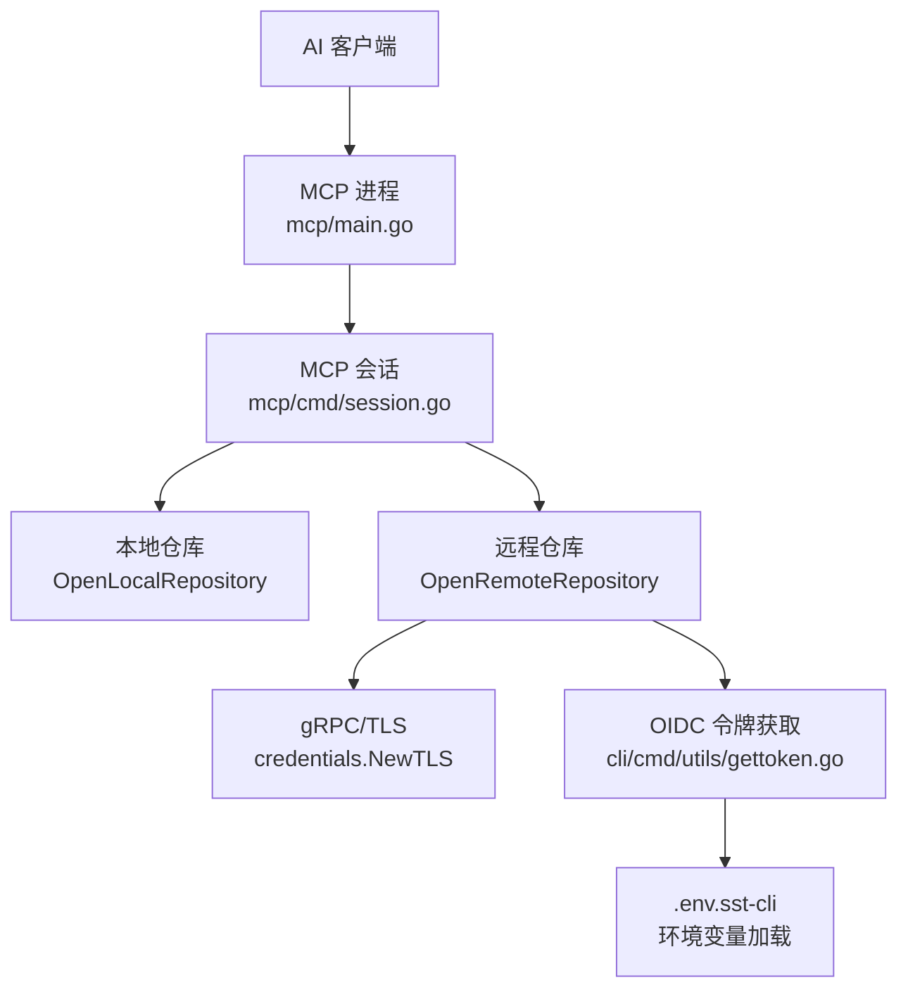
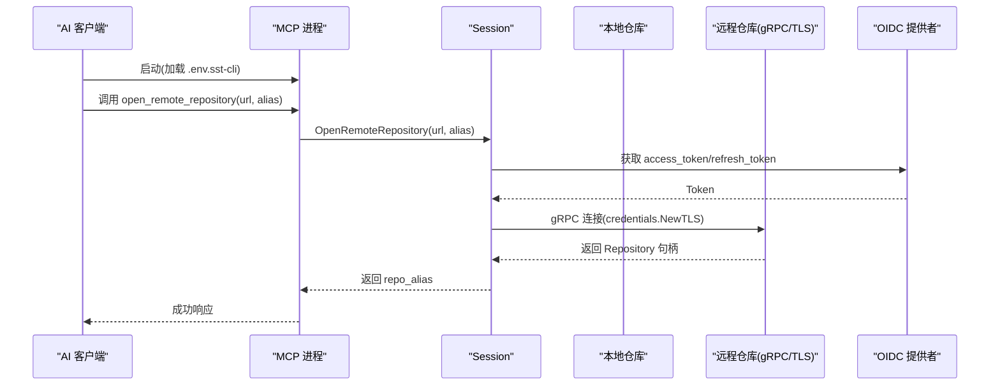
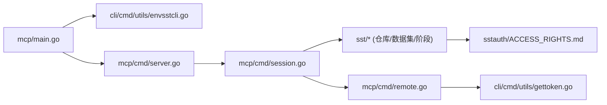

# 服务器配置

<cite>
**本文引用的文件**
- [mcp/main.go](file://mcp/main.go)
- [mcp/cmd/server.go](file://mcp/cmd/server.go)
- [mcp/cmd/session.go](file://mcp/cmd/session.go)
- [mcp/cmd/remote.go](file://mcp/cmd/remote.go)
- [cli/cmd/utils/envsstcli.go](file://cli/cmd/utils/envsstcli.go)
- [cli/cmd/utils/gettoken.go](file://cli/cmd/utils/gettoken.go)
- [sstauth/ACCESS_RIGHTS.md](file://sstauth/ACCESS_RIGHTS.md)
- [examples/helloworldsuperreporemote/main.go](file://examples/helloworldsuperreporemote/main.go)
</cite>

## 目录
1. [简介](#简介)
2. [项目结构](#项目结构)
3. [核心组件](#核心组件)
4. [架构总览](#架构总览)
5. [详细组件分析](#详细组件分析)
6. [依赖关系分析](#依赖关系分析)
7. [性能与资源限制](#性能与资源限制)
8. [故障排查指南](#故障排查指南)
9. [结论](#结论)
10. [附录：部署场景配置示例](#附录部署场景配置示例)

## 简介
本文件面向部署和运维人员，提供 SST MCP 服务器的完整配置说明。内容涵盖启动参数与环境变量、标准输入输出（stdio）模式与网络模式的差异、认证授权（OAuth2/OIDC）、日志与监控、不同环境的配置示例、性能调优与安全最佳实践，以及配置验证方法。

## 项目结构
MCP 服务器以进程内服务形式运行，通过 Model Context Protocol（MCP）暴露工具能力；默认采用 stdio 传输，适合被 AI 客户端直接调用。远程仓库访问通过 gRPC over TLS 进行，并使用 OIDC 令牌进行鉴权。

图表来源
- [mcp/main.go:22-31](file://mcp/main.go#L22-L31)
- [mcp/cmd/server.go:558-562](file://mcp/cmd/server.go#L558-L562)
- [mcp/cmd/session.go:100-118](file://mcp/cmd/session.go#L100-L118)
- [mcp/cmd/remote.go:50-94](file://mcp/cmd/remote.go#L50-L94)
- [cli/cmd/utils/envsstcli.go:14-34](file://cli/cmd/utils/envsstcli.go#L14-L34)
- [cli/cmd/utils/gettoken.go:65-141](file://cli/cmd/utils/gettoken.go#L65-L141)

章节来源
- [mcp/main.go:22-31](file://mcp/main.go#L22-L31)
- [mcp/cmd/server.go:558-562](file://mcp/cmd/server.go#L558-L562)

## 核心组件
- MCP 入口与生命周期管理：负责加载环境、处理中断信号、创建会话并启动 stdio 服务。
- MCP 工具注册：将 SST 仓库、数据集、阶段、文档等能力注册为 MCP 工具。
- 会话与会话状态：维护仓库、数据集、阶段的别名映射与生命周期。
- 远程仓库与认证：通过 OIDC 获取令牌，使用 gRPC/TLS 连接远端仓库。
- 环境变量与令牌：从 .env.sst-cli 读取 OIDC 配置与凭据，支持刷新令牌。

章节来源
- [mcp/main.go:22-31](file://mcp/main.go#L22-L31)
- [mcp/cmd/server.go:13-56](file://mcp/cmd/server.go#L13-L56)
- [mcp/cmd/session.go:25-67](file://mcp/cmd/session.go#L25-L67)
- [mcp/cmd/remote.go:38-94](file://mcp/cmd/remote.go#L38-L94)
- [cli/cmd/utils/envsstcli.go:14-34](file://cli/cmd/utils/envsstcli.go#L14-L34)
- [cli/cmd/utils/gettoken.go:65-141](file://cli/cmd/utils/gettoken.go#L65-L141)

## 架构总览
MCP 服务器作为“进程内服务”运行，对外暴露一组工具；内部通过 Session 管理资源句柄，对本地仓库直接操作，对远程仓库则通过 gRPC/TLS + OIDC 鉴权访问。

图表来源
- [mcp/main.go:22-31](file://mcp/main.go#L22-L31)
- [mcp/cmd/server.go:49-69](file://mcp/cmd/server.go#L49-L69)
- [mcp/cmd/session.go:100-118](file://mcp/cmd/session.go#L100-L118)
- [mcp/cmd/remote.go:50-94](file://mcp/cmd/remote.go#L50-L94)
- [cli/cmd/utils/gettoken.go:65-141](file://cli/cmd/utils/gettoken.go#L65-L141)

## 详细组件分析

### 启动参数与环境变量
- 启动方式
  - 构建产物：通过编译生成可执行文件后直接运行。
  - 传输模式：默认使用 stdio 传输（RunStdio），由 MCP SDK 在进程内完成消息收发。
- 环境变量（来自 .env.sst-cli）
  - 必需（远程访问）：SST_OIDC_REALM_URL、SST_OIDC_CLIENT_ID、SST_OIDC_CLIENT_SECRET。
  - 可选（非交互式登录）：SST_USERNAME、SST_PASSWORD。
- 环境变量加载顺序
  - 当前工作目录下的 .env.sst-cli，随后是用户主目录下的 .env.sst-cli。
  - 已存在的环境变量不会被覆盖。

章节来源
- [mcp/main.go:22-31](file://mcp/main.go#L22-L31)
- [cli/cmd/utils/envsstcli.go:14-34](file://cli/cmd/utils/envsstcli.go#L14-L34)
- [cli/cmd/utils/envsstcli.go:47-75](file://cli/cmd/utils/envsstcli.go#L47-L75)
- [cli/cmd/utils/gettoken.go:65-83](file://cli/cmd/utils/gettoken.go#L65-L83)

### 标准输入输出模式与网络模式
- 标准输入输出模式（stdio）
  - 由 RunStdio 启动，适用于被 AI 客户端直接调用的进程内服务模式。
  - 无需监听端口，通信通过进程 stdin/stdout。
- 网络模式（gRPC/TLS）
  - 用于访问远程 SST 仓库，使用 credentials.NewTLS 建立安全通道。
  - 服务端需启用 OIDC 校验与 RBAC 拦截器（参考服务端配置）。

章节来源
- [mcp/cmd/server.go:558-562](file://mcp/cmd/server.go#L558-L562)
- [mcp/cmd/remote.go:66-77](file://mcp/cmd/remote.go#L66-L77)

### 认证与授权（OAuth2/OIDC）
- 令牌获取流程
  - 从 .env.sst-cli 读取 OIDC 配置。
  - 支持用户名/密码或刷新令牌两种方式获取 access_token。
  - 自动校验 JWT 有效性并在接近过期时刷新。
- 上下文传递
  - 通过 sstauth.ContextWithAuthProvider 将 Provider 注入 context。
  - 远程仓库每次 RPC 都会携带 OAuth2 bearer token。
- 服务端鉴权模型
  - 基于 Keycloak 的 resource_access.<clientID>.roles 解析角色。
  - 支持单仓库与超级仓库两种模式，按 gRPC 方法的最小权限要求进行检查。

章节来源
- [cli/cmd/utils/gettoken.go:65-141](file://cli/cmd/utils/gettoken.go#L65-L141)
- [cli/cmd/utils/gettoken.go:144-192](file://cli/cmd/utils/gettoken.go#L144-L192)
- [cli/cmd/utils/gettoken.go:217-267](file://cli/cmd/utils/gettoken.go#L217-L267)
- [sstauth/ACCESS_RIGHTS.md:31-50](file://sstauth/ACCESS_RIGHTS.md#L31-L50)
- [sstauth/ACCESS_RIGHTS.md:52-98](file://sstauth/ACCESS_RIGHTS.md#L52-L98)
- [sstauth/ACCESS_RIGHTS.md:173-213](file://sstauth/ACCESS_RIGHTS.md#L173-L213)
- [sstauth/ACCESS_RIGHTS.md:314-335](file://sstauth/ACCESS_RIGHTS.md#L314-L335)

### 日志记录与监控
- 日志
  - 代码中使用 zap 进行结构化日志记录（例如搜索请求、错误信息）。
  - 可通过上层应用配置 zap 的 sink、级别与输出目标。
- 监控
  - 建议结合系统级指标（CPU、内存、磁盘 I/O）与业务指标（仓库打开数、数据集数量、阶段数量）进行观测。
  - 可在工具层增加耗时统计与错误计数，便于定位瓶颈。

章节来源
- [sst/reporemote.go:146-175](file://sst/reporemote.go#L146-L175)

### 工具与能力清单（MCP 工具）
- 仓库管理：open_local_repository、open_remote_repository、repository_close、repository_sync_from、repository_datasets、repository_documents、repository_document_set、repository_document_get、repository_document_info、repository_document_delete
- 数据集与分支：repository_dataset、dataset_branches、dataset_list_commits、dataset_commit_details_by_hash、dataset_commit_details_by_branch、dataset_history
- 阶段操作：dataset_checkout_branch、dataset_checkout_commit、repository_open_stage、stage_info、stage_named_graphs、stage_validate、stage_trig、stage_commit
- 会话状态：status

章节来源
- [mcp/cmd/server.go:20-532](file://mcp/cmd/server.go#L20-L532)

## 依赖关系分析
- 进程入口依赖 CLI 工具包加载环境变量。
- MCP 会话依赖 SST Core API 进行仓库/数据集/阶段操作。
- 远程仓库依赖 gRPC/TLS 与 OIDC 令牌。
- 服务端鉴权依赖 Keycloak OIDC 与 RBAC 拦截器。

图表来源
- [mcp/main.go:22-31](file://mcp/main.go#L22-L31)
- [mcp/cmd/server.go:13-56](file://mcp/cmd/server.go#L13-L56)
- [mcp/cmd/session.go:25-67](file://mcp/cmd/session.go#L25-L67)
- [mcp/cmd/remote.go:38-94](file://mcp/cmd/remote.go#L38-L94)
- [cli/cmd/utils/envsstcli.go:14-34](file://cli/cmd/utils/envsstcli.go#L14-L34)
- [cli/cmd/utils/gettoken.go:65-141](file://cli/cmd/utils/gettoken.go#L65-L141)
- [sstauth/ACCESS_RIGHTS.md:314-335](file://sstauth/ACCESS_RIGHTS.md#L314-L335)

## 性能与资源限制
- 连接与并发
  - 远程仓库使用 gRPC 连接，注意连接复用与超时设置。
  - 建议在客户端侧控制并发度，避免对远端造成压力。
- 索引与搜索
  - 全文检索依赖 Bleve，关注索引目录大小与重建频率。
- 内存与 I/O
  - 大文档上传/下载时注意内存占用与磁盘空间。
  - 批量操作（如历史遍历）应分页或限制范围。
- 服务端配置参考
  - 示例中展示了 RepositoryServerConfig 的使用，包括 Issuer、ClientID、ServerCert、Verbose、DeriveInfo 等。

章节来源
- [examples/helloworldsuperreporemote/main.go:68-76](file://examples/helloworldsuperreporemote/main.go#L68-L76)
- [examples/helloworldsuperreporemote/main.go:83-95](file://examples/helloworldsuperreporemote/main.go#L83-L95)

## 故障排查指南
- 无法连接远程仓库
  - 检查 .env.sst-cli 中的 OIDC 配置是否正确。
  - 确认网络可达与服务端证书有效。
- 认证失败
  - 检查用户名/密码或刷新令牌是否有效。
  - 确认服务端配置的 Issuer 与 ClientID 与客户端一致。
- 权限不足
  - 检查 Keycloak 中 resource_access.<clientID>.roles 是否包含所需角色。
  - 核对 gRPC 方法的最小权限要求。
- 令牌过期
  - 使用刷新令牌机制自动续期；若仍失败，重新获取令牌。

章节来源
- [mcp/cmd/remote.go:38-48](file://mcp/cmd/remote.go#L38-L48)
- [cli/cmd/utils/gettoken.go:65-141](file://cli/cmd/utils/gettoken.go#L65-L141)
- [sstauth/ACCESS_RIGHTS.md:52-98](file://sstauth/ACCESS_RIGHTS.md#L52-L98)

## 结论
SST MCP 服务器以 stdio 模式提供轻量、易集成的能力，配合 OIDC 与 gRPC/TLS 实现安全的远程仓库访问。通过合理的环境变量配置、RBAC 角色分配与性能调优，可在开发、测试与生产环境中稳定运行。

## 附录：部署场景配置示例

- 开发环境
  - 使用本地仓库为主，必要时开启最小权限的远程只读访问。
  - 环境变量：仅配置必要的 OIDC 地址与客户端 ID，使用测试账号。
  - 日志级别：调试级别，便于问题定位。
- 测试环境
  - 模拟真实 OIDC 与 RBAC 策略，覆盖读写与管理员路径。
  - 启用 TLS 与证书校验，验证端到端链路。
  - 增加错误注入与超时测试，确保健壮性。
- 生产环境
  - 严格配置 OIDC Issuer、ClientID 与角色映射。
  - 启用 TLS 与强密码策略，定期轮换密钥与令牌。
  - 限制并发与资源配额，监控关键指标与告警阈值。

章节来源
- [cli/cmd/utils/envsstcli.go:14-34](file://cli/cmd/utils/envsstcli.go#L14-L34)
- [cli/cmd/utils/gettoken.go:65-141](file://cli/cmd/utils/gettoken.go#L65-L141)
- [sstauth/ACCESS_RIGHTS.md:173-213](file://sstauth/ACCESS_RIGHTS.md#L173-L213)
- [examples/helloworldsuperreporemote/main.go:68-76](file://examples/helloworldsuperreporemote/main.go#L68-L76)