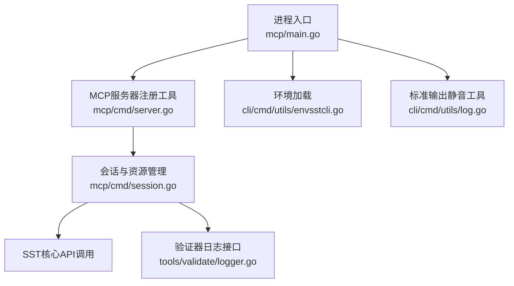
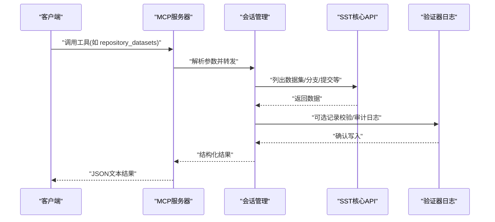
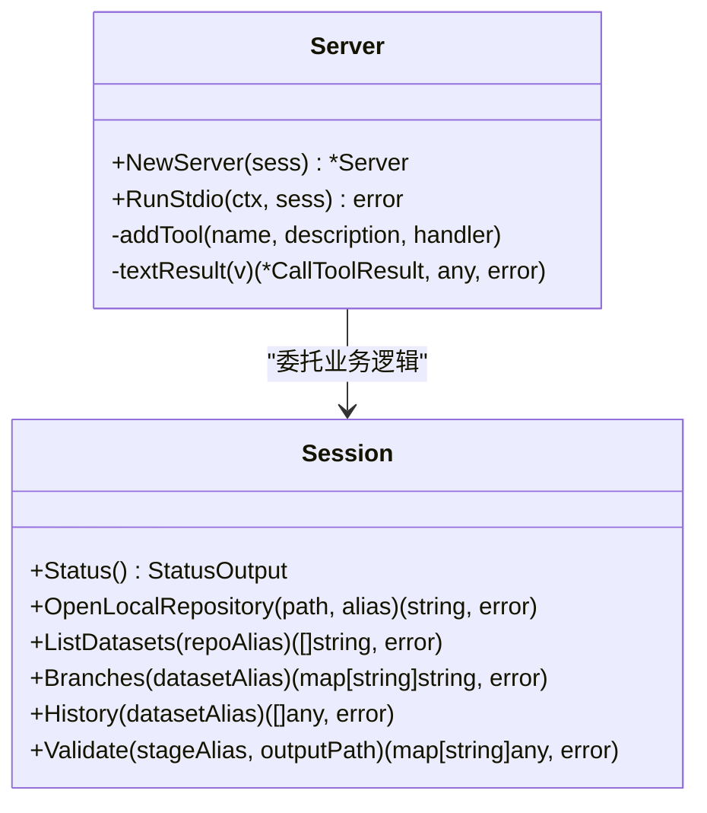
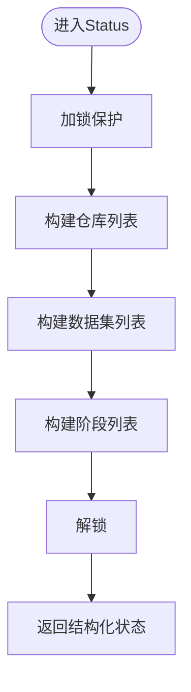
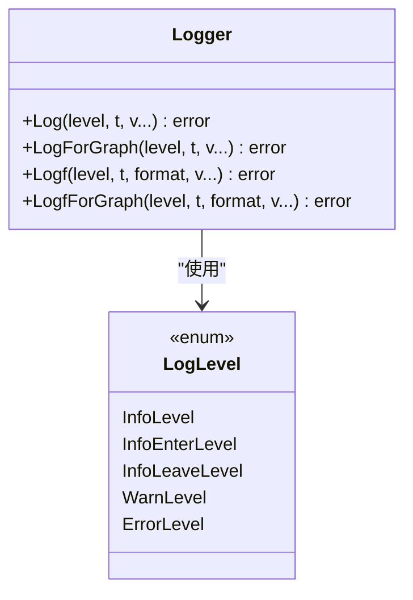
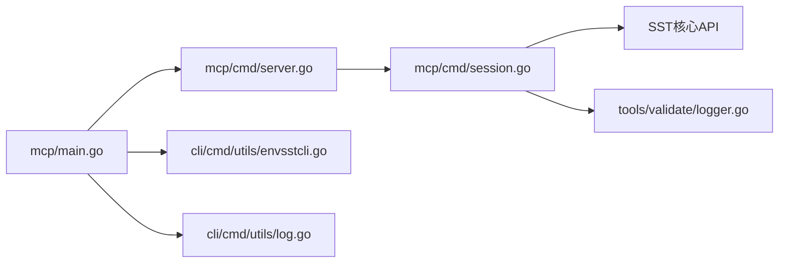

# 监控调试

<cite>
**本文引用的文件**
- [mcp/main.go](file://mcp/main.go)
- [mcp/cmd/server.go](file://mcp/cmd/server.go)
- [mcp/cmd/session.go](file://mcp/cmd/session.go)
- [cli/cmd/utils/log.go](file://cli/cmd/utils/log.go)
- [cli/cmd/utils/envsstcli.go](file://cli/cmd/utils/envsstcli.go)
- [tools/validate/logger.go](file://tools/validate/logger.go)
- [tools/validate/validate.go](file://tools/validate/validate.go)
- [sst/errrecovery.go](file://sst/errrecovery.go)
- [examples/helloworldsuperreporemote/main.go](file://examples/helloworldsuperreporemote/main.go)
- [sst_test/syncfrom_test.go](file://sst_test/syncfrom_test.go)
</cite>

## 目录
1. [简介](#简介)
2. [项目结构](#项目结构)
3. [核心组件](#核心组件)
4. [架构总览](#架构总览)
5. [详细组件分析](#详细组件分析)
6. [依赖关系分析](#依赖关系分析)
7. [性能考量](#性能考量)
8. [故障排查指南](#故障排查指南)
9. [结论](#结论)
10. [附录](#附录)

## 简介
本指南面向SST MCP服务器的监控与调试，覆盖日志记录配置与级别、性能指标与仪表板、调试模式与诊断工具、常见问题排查、内存与垃圾回收调优、分布式追踪与链路跟踪集成、健康检查与状态报告、基准与压力测试方法，以及实际监控与调试案例。内容基于仓库中MCP服务器实现、会话管理、验证器日志、错误恢复与环境加载等源码进行系统化梳理。

## 项目结构
SST MCP服务器通过标准输入输出运行，暴露一组工具（如打开仓库、数据集、阶段、提交历史、文档操作等），并通过Session统一管理资源生命周期。验证模块提供结构化日志接口，便于将校验结果输出到外部系统。环境加载支持从工作目录或用户主目录读取认证相关环境变量。

图表来源
- [mcp/main.go:22-31](file://mcp/main.go#L22-L31)
- [mcp/cmd/server.go:13-563](file://mcp/cmd/server.go#L13-L563)
- [mcp/cmd/session.go:25-252](file://mcp/cmd/session.go#L25-L252)
- [cli/cmd/utils/envsstcli.go:14-34](file://cli/cmd/utils/envsstcli.go#L14-L34)
- [cli/cmd/utils/log.go:15-40](file://cli/cmd/utils/log.go#L15-L40)

章节来源
- [mcp/main.go:22-31](file://mcp/main.go#L22-L31)
- [mcp/cmd/server.go:13-563](file://mcp/cmd/server.go#L13-L563)
- [mcp/cmd/session.go:25-252](file://mcp/cmd/session.go#L25-L252)
- [cli/cmd/utils/envsstcli.go:14-34](file://cli/cmd/utils/envsstcli.go#L14-L34)
- [cli/cmd/utils/log.go:15-40](file://cli/cmd/utils/log.go#L15-L40)

## 核心组件
- MCP服务器：注册并暴露工具，统一处理请求与响应。
- Session：维护仓库、数据集、阶段的别名映射与生命周期，提供状态查询。
- 验证器日志：定义日志级别与目标接口，用于结构化输出校验结果。
- 环境加载：从配置文件加载认证变量，避免重复设置。
- 标准输出静音：在需要时屏蔽控制台输出，便于管道化或静默执行。

章节来源
- [mcp/cmd/server.go:13-563](file://mcp/cmd/server.go#L13-L563)
- [mcp/cmd/session.go:25-252](file://mcp/cmd/session.go#L25-L252)
- [tools/validate/logger.go:11-31](file://tools/validate/logger.go#L11-L31)
- [cli/cmd/utils/envsstcli.go:14-34](file://cli/cmd/utils/envsstcli.go#L14-L34)
- [cli/cmd/utils/log.go:15-40](file://cli/cmd/utils/log.go#L15-L40)

## 架构总览
MCP服务器以stdin/stdout为传输通道，接收客户端工具调用，委托Session执行具体操作；Session访问SST核心API完成仓库、数据集、阶段与文档操作；验证器通过日志接口输出结构化信息；环境加载确保远程认证可用；必要时可静音标准输出。

图表来源
- [mcp/cmd/server.go:13-563](file://mcp/cmd/server.go#L13-L563)
- [mcp/cmd/session.go:25-252](file://mcp/cmd/session.go#L25-L252)
- [tools/validate/logger.go:11-31](file://tools/validate/logger.go#L11-L31)

## 详细组件分析

### 组件A：MCP服务器与工具注册
- 功能：创建MCP服务器实例，注册一系列工具（如open_local_repository、repository_datasets、dataset_history、stage_validate等）。
- 关键点：每个工具均包含参数校验、调用Session对应方法、返回JSON文本结果。
- 扩展点：可通过addTool注册新工具，textResult统一封装返回值。

图表来源
- [mcp/cmd/server.go:13-563](file://mcp/cmd/server.go#L13-L563)
- [mcp/cmd/session.go:25-252](file://mcp/cmd/session.go#L25-L252)

章节来源
- [mcp/cmd/server.go:13-563](file://mcp/cmd/server.go#L13-L563)
- [mcp/cmd/session.go:25-252](file://mcp/cmd/session.go#L25-L252)

### 组件B：会话管理与状态报告
- 功能：维护仓库、数据集、阶段的别名映射与顺序，提供Status输出当前打开的资源。
- 关键点：并发安全（互斥锁）、自动分配别名、清理关联资源。
- 健康检查：通过status工具暴露当前会话状态，便于外部监控采集。

图表来源
- [mcp/cmd/session.go:218-252](file://mcp/cmd/session.go#L218-L252)

章节来源
- [mcp/cmd/session.go:218-252](file://mcp/cmd/session.go#L218-L252)

### 组件C：验证器日志与级别控制
- 功能：定义日志级别（Info、Warn、Error等）与目标接口，支持按节点或图输出。
- 关键点：结构化字段便于聚合与分析；可在校验流程中插入审计日志。
- 使用场景：stage_validate等工具可将问题三元组与规则命中情况输出到外部系统。

图表来源
- [tools/validate/logger.go:11-31](file://tools/validate/logger.go#L11-L31)

章节来源
- [tools/validate/logger.go:11-31](file://tools/validate/logger.go#L11-L31)
- [tools/validate/validate.go:335-362](file://tools/validate/validate.go#L335-L362)

### 组件D：环境加载与认证
- 功能：从工作目录或用户主目录的.env.sst-cli加载认证变量（如OIDC相关），不覆盖已有环境变量。
- 关键点：支持注释与空白行，值可引号包裹；缺失文件非致命。
- 使用场景：远程仓库访问需先加载认证上下文。

章节来源
- [cli/cmd/utils/envsstcli.go:14-34](file://cli/cmd/utils/envsstcli.go#L14-L34)
- [cli/cmd/utils/envsstcli.go:47-75](file://cli/cmd/utils/envsstcli.go#L47-L75)

### 组件E：标准输出静音
- 功能：将stdout重定向到空设备，屏蔽fmt.Printf等输出；支持恢复。
- 关键点：防御性关闭前句柄，避免资源泄漏。
- 使用场景：批量任务或管道化场景下减少噪音输出。

章节来源
- [cli/cmd/utils/log.go:15-40](file://cli/cmd/utils/log.go#L15-L40)

### 组件F：错误恢复与堆栈控制
- 功能：通过recover捕获panic并转换为错误；根据GOTRACEBACK控制堆栈深度。
- 关键点：便于上层统一错误处理与调试开关。
- 使用场景：关键路径异常恢复与调试信息控制。

章节来源
- [sst/errrecovery.go:59-92](file://sst/errrecovery.go#L59-L92)

## 依赖关系分析
- 入口依赖：mcp/main.go依赖utils环境加载与MCP服务器运行。
- 服务器依赖：server.go依赖session.go进行业务编排。
- 会话依赖：session.go依赖SST核心API与验证器日志接口。
- 工具依赖：validate/logger.go提供日志抽象，validate/validate.go实现校验逻辑并调用全局日志。

图表来源
- [mcp/main.go:22-31](file://mcp/main.go#L22-L31)
- [mcp/cmd/server.go:13-563](file://mcp/cmd/server.go#L13-L563)
- [mcp/cmd/session.go:25-252](file://mcp/cmd/session.go#L25-L252)
- [cli/cmd/utils/envsstcli.go:14-34](file://cli/cmd/utils/envsstcli.go#L14-L34)
- [cli/cmd/utils/log.go:15-40](file://cli/cmd/utils/log.go#L15-L40)

章节来源
- [mcp/main.go:22-31](file://mcp/main.go#L22-L31)
- [mcp/cmd/server.go:13-563](file://mcp/cmd/server.go#L13-L563)
- [mcp/cmd/session.go:25-252](file://mcp/cmd/session.go#L25-L252)
- [cli/cmd/utils/envsstcli.go:14-34](file://cli/cmd/utils/envsstcli.go#L14-L34)
- [cli/cmd/utils/log.go:15-40](file://cli/cmd/utils/log.go#L15-L40)

## 性能考量
- 日志级别与采样：建议在生产环境降低Info级别频率，仅保留Warn/Error；对高频路径使用采样或节流。
- 批量操作：利用Session的别名机制复用仓库/数据集/阶段，减少重复打开开销。
- 网络与I/O：远程同步与文档上传/下载应结合超时与重试策略；大文件流式处理避免内存峰值。
- 索引与搜索：若启用全文检索，关注索引目录大小与重建成本。
- 监控指标：建议采集QPS、P95/P99延迟、错误率、GC次数与暂停时间、内存占用、磁盘I/O、网络吞吐。

[本节为通用指导，无需特定文件引用]

## 故障排查指南
- 无法连接远程仓库：检查.env.sst-cli是否包含必要OIDC变量；确认环境变量未被覆盖。
- 工具参数错误：server.go中对必填参数进行校验，错误信息直接返回；核对参数命名与类型。
- 资源未释放：CloseRepository会清理关联的数据集与阶段；确保在会话结束时调用CloseAll。
- 校验失败定位：通过stage_validate输出与验证器日志定位三元组与规则冲突；结合commit history回溯变更。
- 崩溃与堆栈：设置GOTRACEBACK控制堆栈深度；结合recover统一错误处理。
- 同步日志验证：参考测试用例中的sync_from日志断言，确认作者、时间戳、影响范围等字段。

章节来源
- [cli/cmd/utils/envsstcli.go:14-34](file://cli/cmd/utils/envsstcli.go#L14-L34)
- [mcp/cmd/server.go:20-563](file://mcp/cmd/server.go#L20-L563)
- [mcp/cmd/session.go:120-174](file://mcp/cmd/session.go#L120-L174)
- [tools/validate/validate.go:335-362](file://tools/validate/validate.go#L335-L362)
- [sst/errrecovery.go:59-92](file://sst/errrecovery.go#L59-L92)
- [sst_test/syncfrom_test.go:1378-1408](file://sst_test/syncfrom_test.go#L1378-L1408)

## 结论
SST MCP服务器提供了清晰的工具接口与会话管理能力，配合验证器日志与环境加载机制，可实现完整的监控与调试闭环。通过合理配置日志级别、采集关键指标、实施健康检查与错误恢复，并结合基准与压力测试，可有效保障服务稳定性与性能。

[本节为总结，无需特定文件引用]

## 附录

### 日志记录配置与级别设置
- 验证器日志：使用Logger接口与LogLevel枚举，按Info/Warn/Error分级输出；可在校验流程中插入审计日志。
- 标准输出静音：在需要时调用静音函数屏蔽控制台输出，完成后恢复。
- 环境变量：通过.env.sst-cli加载认证变量，避免硬编码。

章节来源
- [tools/validate/logger.go:11-31](file://tools/validate/logger.go#L11-L31)
- [cli/cmd/utils/log.go:15-40](file://cli/cmd/utils/log.go#L15-L40)
- [cli/cmd/utils/envsstcli.go:14-34](file://cli/cmd/utils/envsstcli.go#L14-L34)

### 性能指标收集与仪表板配置
- 建议指标：QPS、延迟分位、错误率、GC次数/暂停、内存RSS、磁盘I/O、网络吞吐。
- 采集方式：在工具处理器前后埋点计时；在Session关键路径记录操作计数；在服务器启动处注入指标初始化。
- 仪表板：将指标导出至时序数据库，构建看板展示趋势与告警阈值。

[本节为通用指导，无需特定文件引用]

### 调试模式与诊断工具
- 调试开关：通过GOTRACEBACK控制堆栈深度；在开发环境开启更详细的日志。
- 诊断工具：使用stage_info、stage_named_graphs、dataset_list_commits、dataset_history等工具获取运行时状态。
- 错误恢复：利用recover捕获panic并转为错误，便于上层统一处理。

章节来源
- [sst/errrecovery.go:59-92](file://sst/errrecovery.go#L59-L92)
- [mcp/cmd/server.go:332-370](file://mcp/cmd/server.go#L332-L370)

### 常见问题排查与解决方案
- 认证失败：检查.env.sst-cli内容与权限；确认环境变量未被覆盖。
- 资源泄漏：确保CloseRepository/CloseAll被调用；监控Session状态。
- 校验错误：结合验证器日志与commit history定位问题三元组。
- 同步不一致：参考测试用例中的日志断言，确认author、timestamp、affected_count等字段。

章节来源
- [cli/cmd/utils/envsstcli.go:14-34](file://cli/cmd/utils/envsstcli.go#L14-L34)
- [mcp/cmd/session.go:120-174](file://mcp/cmd/session.go#L120-L174)
- [tools/validate/validate.go:335-362](file://tools/validate/validate.go#L335-L362)
- [sst_test/syncfrom_test.go:1378-1408](file://sst_test/syncfrom_test.go#L1378-L1408)

### 内存使用监控与垃圾回收调优
- 监控：采集GC次数、暂停时间、内存RSS；观察大对象分配热点。
- 调优：调整GOGC/GOMEMLIMIT；优化数据结构与缓冲；避免长时间持有大对象引用。
- 实践：在批量导入/导出时采用流式处理，减少峰值内存。

[本节为通用指导，无需特定文件引用]

### 分布式追踪与链路跟踪集成
- 集成点：在工具处理器前后注入Span；在Session关键路径记录TraceID；将日志与追踪关联。
- 后端：将Span发送至Jaeger/Zipkin等后端；构建端到端链路视图。
- 指标关联：将延迟与错误率与TraceID关联，便于根因分析。

[本节为通用指导，无需特定文件引用]

### 健康检查端点与状态报告
- 健康检查：通过status工具暴露当前会话状态（仓库、数据集、阶段）。
- 状态报告：定期调用status并上报指标；结合告警规则检测异常。
- 服务端配置：参考示例服务器配置，启用verbose输出以便调试。

章节来源
- [mcp/cmd/server.go:20-25](file://mcp/cmd/server.go#L20-L25)
- [mcp/cmd/session.go:218-252](file://mcp/cmd/session.go#L218-L252)
- [examples/helloworldsuperreporemote/main.go:68-95](file://examples/helloworldsuperreporemote/main.go#L68-L95)

### 性能基准测试与压力测试方法
- 基准：针对常用工具（如list_commits、history、validate）设计基准用例，测量CPU/内存/延迟。
- 压力：模拟并发调用，观察QPS、延迟分位、错误率与资源占用。
- 报告：生成性能报告，对比不同配置下的表现，识别瓶颈。

[本节为通用指导，无需特定文件引用]

### 实际监控与调试案例
- 案例一：远程同步日志验证
  - 步骤：执行SyncFrom后查询仓库日志，断言type=“sync_from”，检查author、timestamp、affected_count、dataset_0、branch_0等字段。
  - 目的：确认同步行为可观测且可审计。
- 案例二：阶段校验与问题定位
  - 步骤：调用stage_validate，结合验证器日志输出，定位三元组与规则冲突。
  - 目的：快速发现并修复数据模型问题。
- 案例三：会话状态监控
  - 步骤：周期性调用status，上报仓库/数据集/阶段数量与类型分布。
  - 目的：及时发现资源泄漏与异常增长。

章节来源
- [sst_test/syncfrom_test.go:1378-1408](file://sst_test/syncfrom_test.go#L1378-L1408)
- [tools/validate/validate.go:335-362](file://tools/validate/validate.go#L335-L362)
- [mcp/cmd/session.go:218-252](file://mcp/cmd/session.go#L218-L252)