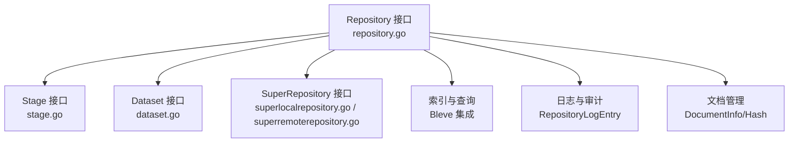
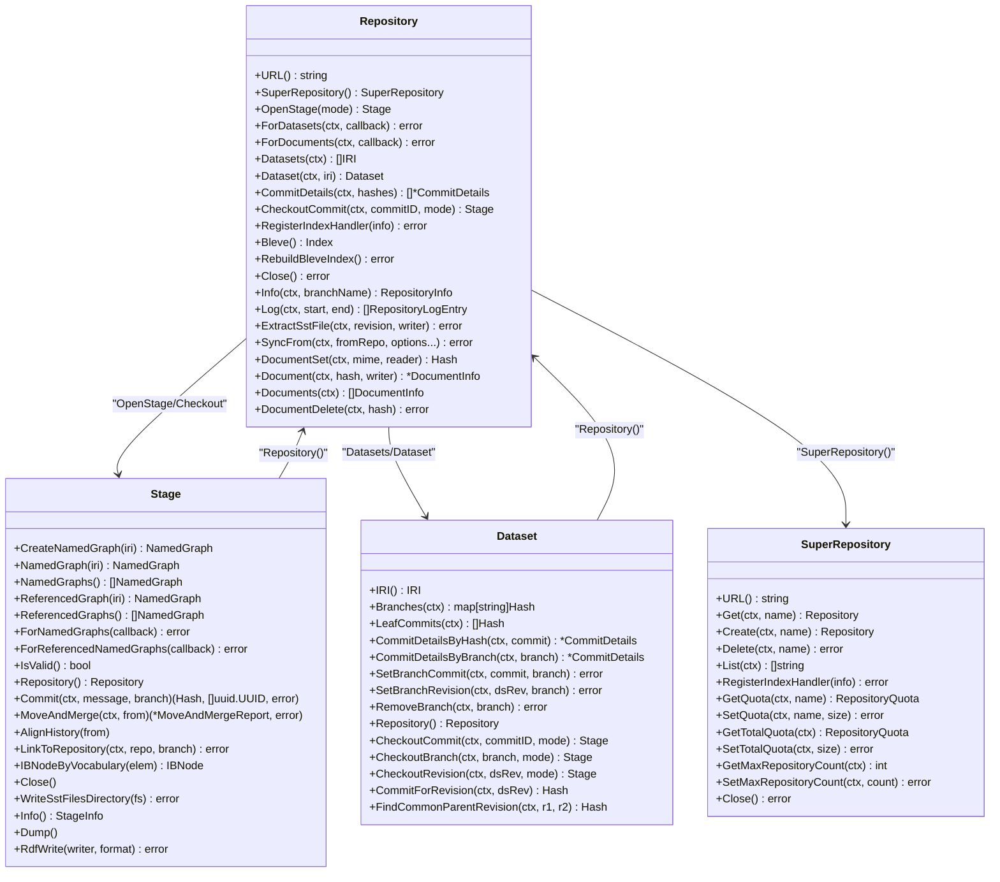
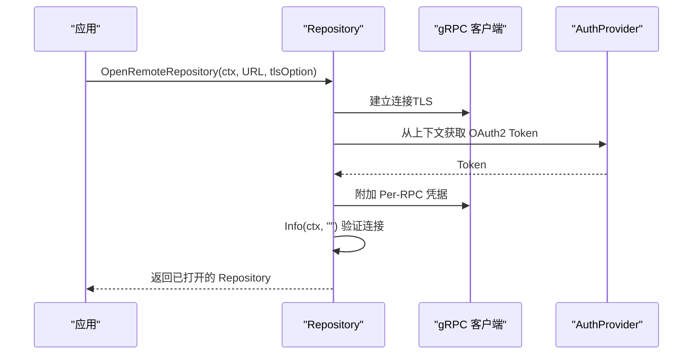
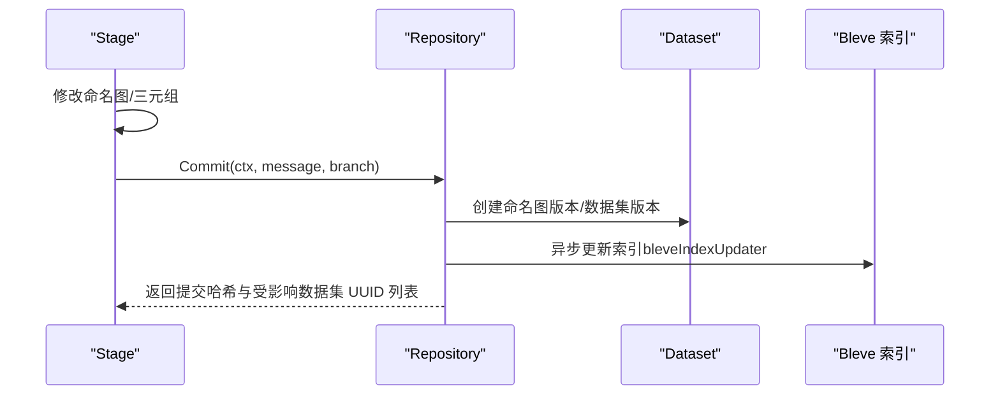
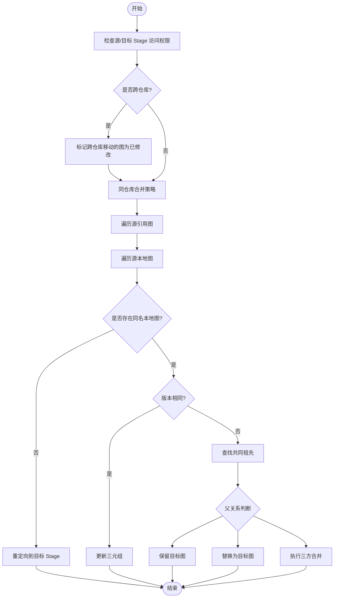
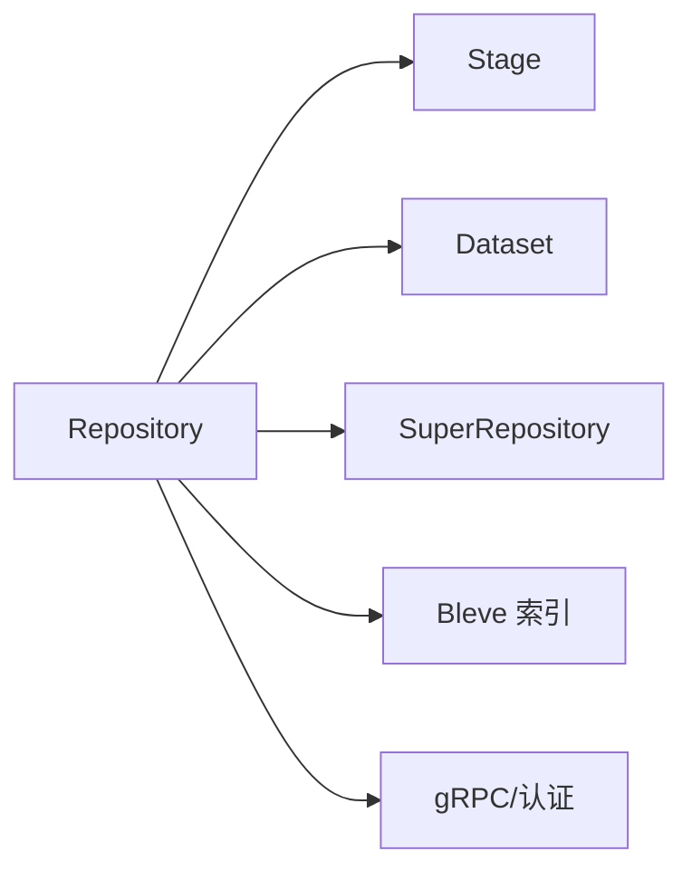

# Repository接口定义

<cite>
**本文引用的文件**
- [repository.go](file://sst/repository.go)
- [stage.go](file://sst/stage.go)
- [dataset.go](file://sst/dataset.go)
- [superlocalrepository.go](file://sst/superlocalrepository.go)
- [superremoterepository.go](file://sst/superremoterepository.go)
</cite>

## 目录
1. [简介](#简介)
2. [项目结构](#项目结构)
3. [核心组件](#核心组件)
4. [架构总览](#架构总览)
5. [详细组件分析](#详细组件分析)
6. [依赖关系分析](#依赖关系分析)
7. [性能考虑](#性能考虑)
8. [故障排查指南](#故障排查指南)
9. [结论](#结论)
10. [附录](#附录)

## 简介
本文件为 SST 仓库（Repository）接口的权威 API 文档，聚焦于以下能力：
- URL 管理与仓库定位
- Stage 操作与数据工作区
- 数据集（Dataset）管理、版本控制与分支
- 索引（Bleve）注册与重建
- 日志与审计
- 文档存储与检索
- 上下文参数（超时、取消、认证）
- 生命周期管理与资源清理
- 并发安全与性能优化建议

Repository 是持久化存储一组相关数据集的抽象，支持日志、修订历史、查询等能力。根据实现不同，可分为远程仓库、本地全量仓库、本地基础仓库、本地扁平仓库等。所有方法均接受 context 以支持超时、取消与用户认证信息传递。

## 项目结构
围绕 Repository 的核心代码位于 sst 包中，关键文件职责如下：
- repository.go：定义 Repository 接口、错误常量、仓库创建/打开函数、仓库信息与日志结构、同步选项等
- stage.go：定义 Stage 接口与工作区语义（创建/获取命名图、提交、移动合并、导出等）
- dataset.go：定义 Dataset 接口（分支、提交详情、检出、共同祖先查找等）
- superlocalrepository.go / superremoterepository.go：SuperRepository 接口及本地/远程实现，用于多仓库容器化管理

图表来源
- [repository.go:34-179](file://sst/repository.go#L34-L179)
- [stage.go:74-234](file://sst/stage.go#L74-L234)
- [dataset.go:9-94](file://sst/dataset.go#L9-L94)
- [superlocalrepository.go:28-88](file://sst/superlocalrepository.go#L28-L88)
- [superremoterepository.go:20-88](file://sst/superremoterepository.go#L20-L88)

章节来源
- [repository.go:34-179](file://sst/repository.go#L34-L179)
- [stage.go:74-234](file://sst/stage.go#L74-L234)
- [dataset.go:9-94](file://sst/dataset.go#L9-L94)
- [superlocalrepository.go:28-88](file://sst/superlocalrepository.go#L28-L88)
- [superremoterepository.go:20-88](file://sst/superremoterepository.go#L20-L88)

## 核心组件
- Repository：仓库抽象，提供 URL、Stage、数据集、版本、索引、日志、文档、同步等能力
- Stage：内存工作区，承载命名图与三元组，支持提交、移动合并、导出
- Dataset：数据集抽象，封装命名图的版本、分支、检出与合并支持
- SuperRepository：多仓库容器，统一管理多个仓库的创建、删除、配额等

章节来源
- [repository.go:34-179](file://sst/repository.go#L34-L179)
- [stage.go:74-234](file://sst/stage.go#L74-L234)
- [dataset.go:9-94](file://sst/dataset.go#L9-L94)
- [superlocalrepository.go:28-88](file://sst/superlocalrepository.go#L28-L88)

## 架构总览
下图展示了 Repository 与其主要协作对象的关系，以及典型调用路径。

图表来源
- [repository.go:34-179](file://sst/repository.go#L34-L179)
- [stage.go:74-234](file://sst/stage.go#L74-L234)
- [dataset.go:9-94](file://sst/dataset.go#L9-L94)
- [superlocalrepository.go:28-88](file://sst/superlocalrepository.go#L28-L88)

## 详细组件分析

### Repository 接口详解
- URL(): 返回仓库的具体位置。远程主仓库无片段；作为 SuperRepository 成员的远程仓库包含片段名；本地仓库返回本地路径 URL。
- SuperRepository(): 若仓库属于某个 SuperRepository，则返回该容器；否则 nil。
- OpenStage(mode): 创建空 Stage 以对工作区进行读写，可加载/修改/提交数据集。
- ForDatasets(ctx, callback): 遍历仓库中的数据集，回调返回错误时终止并返回错误。
- ForDocuments(ctx, callback): 遍历仓库中的文档元数据，回调返回错误时终止并返回错误。
- Datasets(ctx): 获取所有数据集 IRI 列表；若无数据集返回空切片。
- Dataset(ctx, iri): 获取已存在的数据集。
- CommitDetails(ctx, hashes): 获取给定提交哈希的提交元数据。
- CheckoutCommit(ctx, commitID, mode): 将指定提交的命名图版本物化为 Stage，包含 checkout 元数据。
- RegisterIndexHandler(info): 注册 Bleve 索引处理器（仅本地仓库有效），用于查询功能；传入空映射可移除已有索引。
- Bleve(): 返回已注册的 Bleve 索引或客户端（远程）。
- RebuildBleveIndex(): 重建索引（本地支持，远程不支持）。
- Close(): 关闭仓库。
- Info(ctx, branchName): 返回仓库基本信息（大小、数量、是否远程、索引信息等）。
- Log(ctx, start, end): 按范围返回日志条目。
- ExtractSstFile(ctx, namedGraphRevision, writer): 提取某命名图版本到 SST 文件写入器。
- SyncFrom(ctx, from, options...): 从另一个仓库同步提交，支持按数据集和分支过滤。
- DocumentSet/Document/Documents/DocumentDelete: 文档的增删查。

上下文参数作用
- 超时与取消：所有方法接受 context，用于控制请求超时与取消信号。
- 用户认证：通过上下文携带认证提供者（如 OAuth2 Token），在远程访问时附加到 gRPC 调用。

章节来源
- [repository.go:34-179](file://sst/repository.go#L34-L179)
- [repository.go:240-309](file://sst/repository.go#L240-L309)

### Stage 接口详解
- CreateNamedGraph/NamedGraph/NamedGraphs: 创建与获取本地命名图。
- ReferencedGraph/ReferencedGraphs: 获取引用命名图（外部图）。
- ForNamedGraphs/ForReferencedNamedGraphs: 遍历本地或引用命名图。
- IsValid/Repository: 校验有效性并获取关联仓库。
- Commit(ctx, message, branch): 提交变更，生成命名图版本与数据集版本，可选更新分支指针。
- MoveAndMerge(ctx, from): 自动移动与合并命名图，处理跨仓库场景与三方合并逻辑，返回详细报告。
- AlignHistory(from): 对齐历史与检出元数据，便于从读取流创建的 Stage 也能提交到同一仓库。
- LinkToRepository(ctx, repo, branch): 将 Stage 链接到仓库并为本地命名图设置分支。
- IBNodeByVocabulary: 按词汇元素定位 IBNode。
- Close: 释放内存，使 Stage 失效。
- WriteSstFilesDirectory/fs.FS: 将命名图持久化为独立 SST 文件。
- Info/Dump/RdfWrite: 统计、调试输出、导出 RDF。

章节来源
- [stage.go:74-234](file://sst/stage.go#L74-L234)

### Dataset 接口详解
- IRI: 默认命名图的 IRI。
- Branches/LeafCommits: 列出分支与叶子提交。
- CommitDetailsByHash/CommitDetailsByBranch: 获取提交详情。
- SetBranchCommit/SetBranchRevision/RemoveBranch: 分支管理。
- Repository: 所属仓库。
- CheckoutCommit/CheckoutBranch/CheckoutRevision: 基于提交/分支/版本创建 Stage。
- CommitForRevision: 由数据集版本反查提交哈希。
- FindCommonParentRevision: 查找两个版本的共同祖先，用于三方差异与合并。

章节来源
- [dataset.go:9-94](file://sst/dataset.go#L9-L94)

### SuperRepository 接口详解
- URL: 返回容器 URL（本地 file://，远程 grpc://）。
- Get/Create/Delete/List: 仓库条目管理。
- RegisterIndexHandler: 为所有仓库注册索引处理器。
- GetQuota/SetQuota/GetTotalQuota/SetTotalQuota: 单仓库与总体配额管理。
- GetMaxRepositoryCount/SetMaxRepositoryCount: 最大仓库数量限制。
- Close: 释放所有资源。

章节来源
- [superlocalrepository.go:28-88](file://sst/superlocalrepository.go#L28-L88)
- [superremoterepository.go:20-88](file://sst/superremoterepository.go#L20-L88)

### 关键流程时序图

#### 打开远程仓库并建立认证

图表来源
- [repository.go:240-309](file://sst/repository.go#L240-L309)

#### 提交变更流程（Stage -> Repository）

图表来源
- [stage.go:121-130](file://sst/stage.go#L121-L130)
- [repository.go:225-231](file://sst/repository.go#L225-L231)

#### 移动与合并（MoveAndMerge）

图表来源
- [stage.go:468-800](file://sst/stage.go#L468-L800)

## 依赖关系分析
- Repository 与 Stage：通过 OpenStage/Checkout 创建工作区，提交时回写至仓库
- Repository 与 Dataset：通过 Datasets/Dataset 获取数据集，进行分支与版本管理
- Repository 与 SuperRepository：通过 SuperRepository() 获取容器，或在远程 URL 片段解析后进入特定仓库
- 索引子系统：RegisterIndexHandler 与 RebuildBleveIndex 管理 Bleve 索引，支持本地重建
- 认证与网络：OpenRemoteRepository 使用上下文中的 AuthProvider 注入 OAuth2 Token 到 gRPC 调用

图表来源
- [repository.go:34-179](file://sst/repository.go#L34-L179)
- [repository.go:240-309](file://sst/repository.go#L240-L309)

章节来源
- [repository.go:34-179](file://sst/repository.go#L34-L179)
- [repository.go:240-309](file://sst/repository.go#L240-L309)

## 性能考虑
- 索引重建：RebuildBleveIndex 会关闭当前索引、删除目录并从头重建，建议在低峰期执行；远程仓库不支持客户端重建
- 三元组模式：TriplexMode 影响内存与性能，默认模式同时维护主体、谓词、对象三元组，适合复杂子属性场景
- 批量操作：ForDatasets/ForDocuments 使用回调迭代，避免一次性加载全部数据到内存
- 文件系统写入：WriteSstFilesDirectory 将每个命名图写入独立文件，适合分片与并行处理
- 配额与容量：通过 SuperRepository 的配额接口限制仓库大小，防止磁盘耗尽
- 并发安全：仓库内部对 BBolt 与 Bleve 的操作通常有锁保护；跨仓库移动合并需关注并发访问冲突

[本节为通用指导，不直接分析具体文件]

## 故障排查指南
常见错误与处理建议：
- ErrRepositoryNotFound/ErrDatasetNotFound：检查 URL、片段名称与数据集 IRI 是否正确
- ErrNotAvailable/ErrNotSupported：某些功能仅在本地仓库可用（如 RegisterIndexHandler/RebuildBleveIndex）
- ErrBranchNotFound：确认分支名称与提交是否存在
- ErrEmptyCommitMessage：提交消息不能为空
- ErrQuotaExceeded：配额超限，调整配额或清理数据
- 远程连接失败：检查 TLS 配置与 OAuth2 Token 是否有效

章节来源
- [repository.go:197-215](file://sst/repository.go#L197-L215)
- [superremoterepository.go:74-90](file://sst/superremoterepository.go#L74-L90)

## 结论
Repository 接口提供了统一的仓库抽象，覆盖 URL 管理、Stage 工作区、数据集与版本控制、索引与查询、日志与文档、同步与配额等核心能力。通过 context 支持超时、取消与认证，结合 SuperRepository 实现多仓库容器化管理。遵循最佳实践（合理选择 TriplexMode、谨慎重建索引、使用配额与并发控制）可获得稳定高效的性能表现。

[本节为总结性内容，不直接分析具体文件]

## 附录

### 上下文参数说明
- 超时与取消：所有方法接受 context，用于控制请求生命周期
- 认证：通过上下文中的 AuthProvider 注入 OAuth2 Token，适用于远程仓库 gRPC 调用

章节来源
- [repository.go:46-49](file://sst/repository.go#L46-L49)
- [repository.go:286-294](file://sst/repository.go#L286-L294)

### 仓库生命周期与资源清理
- 创建：CreateLocalRepository/OpenLocalRepository/CreateLocalFlatRepository
- 打开：OpenLocalRepository/OpenLocalFlatRepository/OpenRemoteRepository
- 关闭：Close() 释放底层资源（BBolt、Bleve、gRPC 连接等）
- 配额：通过 SuperRepository 的 Get/SetQuota 与 Get/SetTotalQuota 管理

章节来源
- [repository.go:311-423](file://sst/repository.go#L311-L423)
- [repository.go:465-562](file://sst/repository.go#L465-L562)
- [repository.go:564-694](file://sst/repository.go#L564-L694)
- [superlocalrepository.go:112-163](file://sst/superlocalrepository.go#L112-L163)
- [superremoterepository.go:198-205](file://sst/superremoterepository.go#L198-L205)

### 最佳实践与错误处理模式
- 使用 context 控制超时与取消，避免长时间阻塞
- 本地仓库优先使用 RegisterIndexHandler 启用查询；远程仓库在服务端管理索引
- 提交前确保命名图唯一性与导入无环；使用 MoveAndMerge 报告诊断合并结果
- 使用 WithDatasetIRIs/WithBranch 精确控制 SyncFrom 的范围，减少不必要传输
- 定期监控配额与仓库大小，避免超出限制导致写入失败

章节来源
- [repository.go:835-872](file://sst/repository.go#L835-L872)
- [stage.go:132-152](file://sst/stage.go#L132-L152)