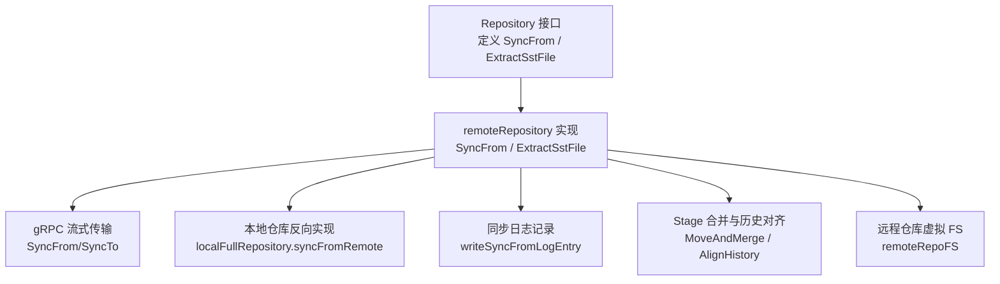
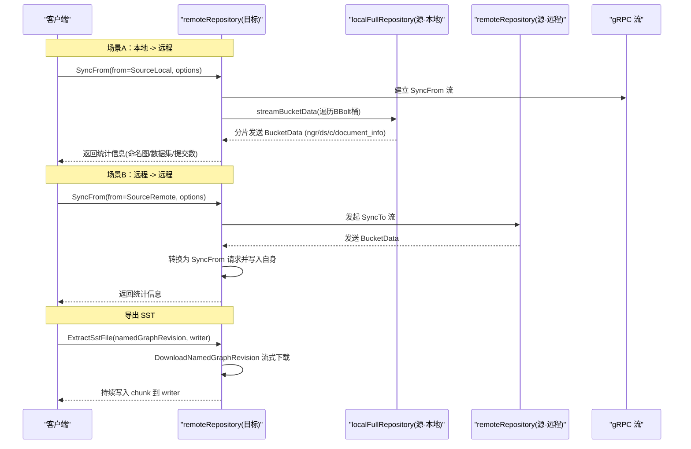
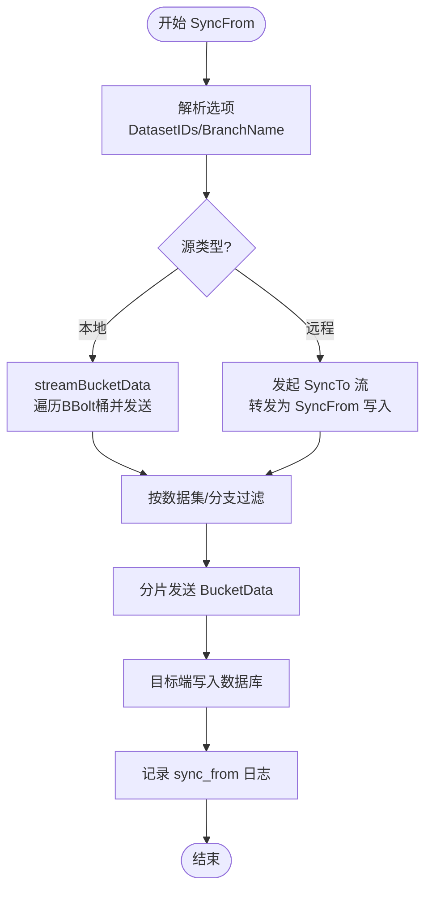
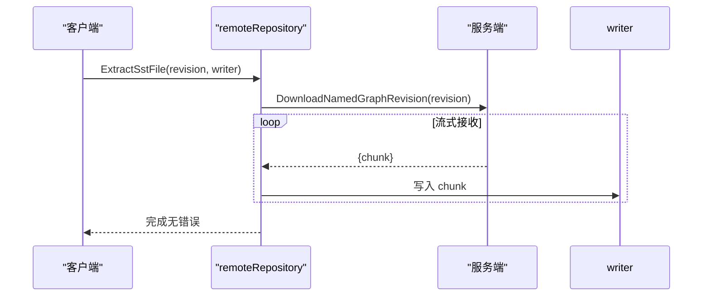
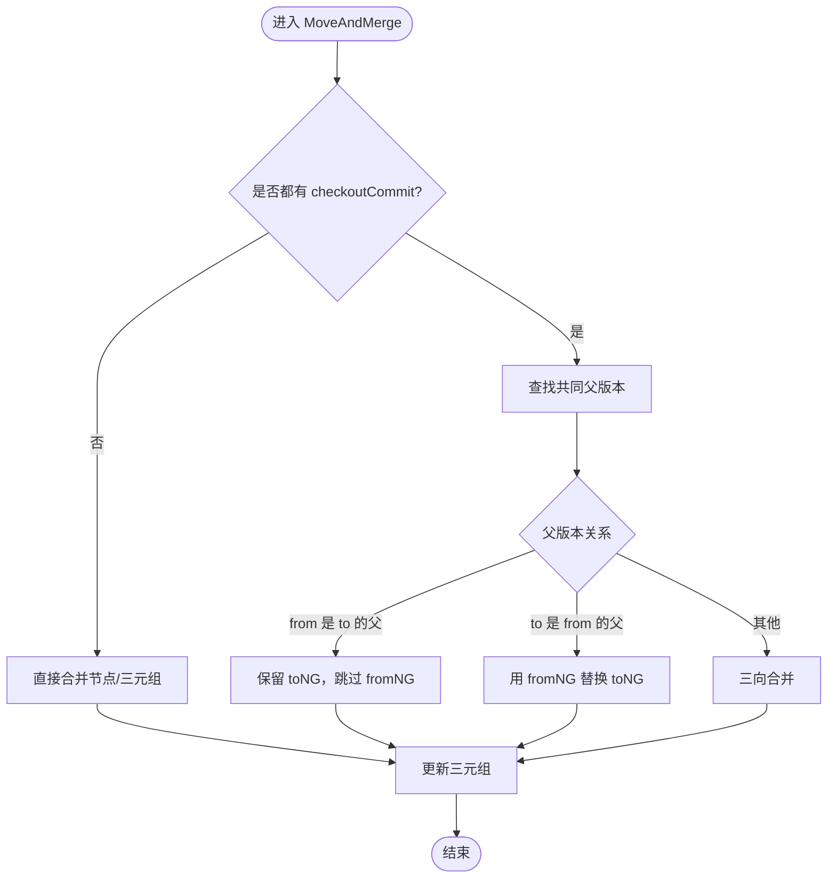
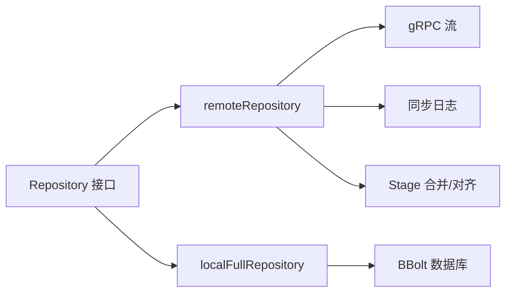

# 同步和导出方法

<cite>
**本文引用的文件**
- [repository.go](file://sst/repository.go)
- [reporemote.go](file://sst/reporemote.go)
- [repolocalfull.go](file://sst/repolocalfull.go)
- [syncfromlog.go](file://sst/syncfromlog.go)
- [stage.go](file://sst/stage.go)
- [sstfile.go](file://sst/sstfile.go)
- [stagefsremoterepo.go](file://sst/stagefsremoterepo.go)
- [syncfrom_test.go](file://sst_test/syncfrom_test.go)
</cite>

## 目录
1. [简介](#简介)
2. [项目结构](#项目结构)
3. [核心组件](#核心组件)
4. [架构总览](#架构总览)
5. [详细组件分析](#详细组件分析)
6. [依赖关系分析](#依赖关系分析)
7. [性能与网络优化](#性能与网络优化)
8. [故障排查指南](#故障排查指南)
9. [结论](#结论)
10. [附录：使用示例](#附录使用示例)

## 简介
本文件聚焦于仓库的“同步”和“导出”能力，重点说明以下接口与方法：
- SyncFrom：将源仓库的数据增量或全量同步到目标仓库，支持本地到远程、远程到远程等场景。
- ExtractSstFile：从仓库中按命名图版本（NamedGraph Revision）导出为 SST 二进制流，便于备份、格式转换与离线分发。

文档同时覆盖同步选项、冲突解决策略、增量同步机制、网络传输优化与错误重试建议，并提供完整的使用示例路径与最佳实践。

## 项目结构
围绕同步与导出，关键代码分布在如下模块：
- Repository 接口定义与同步选项：[repository.go](file://sst/repository.go)
- 远程仓库实现（SyncFrom、ExtractSstFile、流式桶数据同步）：[reporemote.go](file://sst/reporemote.go)
- 本地全量仓库对远程同步的反向实现（用于本地作为目标接收远程推送）：[repolocalfull.go](file://sst/repolocalfull.go)
- 同步日志记录（记录受影响的命名图版本、分支等）：[syncfromlog.go](file://sst/syncfromlog.go)
- Stage 合并与历史对齐（MoveAndMerge、AlignHistory）：[stage.go](file://sst/stage.go)
- SST 文件格式与默认日志配置：[sstfile.go](file://sst/sstfile.go)
- 远程仓库在 Stage 中的虚拟文件系统映射（用于读取/写入命名图内容）：[stagefsremoterepo.go](file://sst/stagefsremoterepo.go)
- 端到端测试用例（包含远程到远程同步、日志验证等）：[syncfrom_test.go](file://sst_test/syncfrom_test.go)

图表来源
- [repository.go:151-163](file://sst/repository.go#L151-L163)
- [reporemote.go:2007-2029](file://sst/reporemote.go#L2007-L2029)
- [repolocalfull.go:3946-3946](file://sst/repolocalfull.go#L3946-L3946)
- [syncfromlog.go:172-203](file://sst/syncfromlog.go#L172-L203)
- [stage.go:132-163](file://sst/stage.go#L132-L163)
- [stagefsremoterepo.go:16-53](file://sst/stagefsremoterepo.go#L16-L53)

章节来源
- [repository.go:151-163](file://sst/repository.go#L151-L163)
- [reporemote.go:2007-2029](file://sst/reporemote.go#L2007-L2029)

## 核心组件
- Repository 接口
  - ExtractSstFile：按命名图版本导出 SST 文件流。
  - SyncFrom：将源仓库数据同步到当前仓库，支持数据集与分支过滤。
- remoteRepository
  - SyncFrom：根据源类型（本地/远程）选择不同同步路径；本地源通过 gRPC 流式发送 BBolt 桶数据；远程源通过转发 SyncTo 到目标。
  - ExtractSstFile：通过 DownloadNamedGraphRevision 流式下载指定版本的命名图并写入目标 Writer。
- localFullRepository
  - syncFromRemote：当本地仓库作为目标时，接收来自远程源的桶数据流并写入本地数据库。
- 同步选项
  - SyncOptions：DatasetIDs、BranchName。
  - WithDatasetIRIs、WithBranch：用于精确控制同步范围。
- 同步日志
  - writeSyncFromLogEntry：记录同步事件及受影响的数据集、分支、命名图版本。
- Stage 合并
  - MoveAndMerge：跨仓库或同仓库内合并命名图，处理父版本关系与三向合并。
  - AlignHistory：对齐 checkout 元数据，使不同来源的 Stage 能一致提交。

章节来源
- [repository.go:151-163](file://sst/repository.go#L151-L163)
- [repository.go:812-872](file://sst/repository.go#L812-L872)
- [reporemote.go:1963-2005](file://sst/reporemote.go#L1963-L2005)
- [reporemote.go:2007-2029](file://sst/reporemote.go#L2007-L2029)
- [repolocalfull.go:3946-3946](file://sst/repolocalfull.go#L3946-L3946)
- [syncfromlog.go:172-203](file://sst/syncfromlog.go#L172-L203)
- [stage.go:132-163](file://sst/stage.go#L132-L163)

## 架构总览
下图展示了远程仓库作为目标的同步流程，包括本地到远程、远程到远程两种路径，以及导出 SST 文件的流式下载过程。

图表来源
- [reporemote.go:2007-2029](file://sst/reporemote.go#L2007-L2029)
- [reporemote.go:2031-2093](file://sst/reporemote.go#L2031-L2093)
- [reporemote.go:2095-2207](file://sst/reporemote.go#L2095-L2207)
- [reporemote.go:1963-2005](file://sst/reporemote.go#L1963-L2005)

## 详细组件分析

### 同步 API：SyncFrom
- 功能概述
  - 将源仓库的数据同步到当前仓库，支持按数据集 IRIs 与分支名进行过滤。
  - 若未提供选项，则同步所有数据集与所有分支。
  - 自动处理导入依赖的数据集。
- 参数与选项
  - SyncOptions：
    - DatasetIDs：仅同步指定数据集（及其导入依赖）。
    - BranchName：空字符串或 "*" 表示所有分支；否则仅同步指定分支。
  - WithDatasetIRIs(...)：设置要同步的数据集 IRIs。
  - WithBranch(name)：设置要同步的分支。
- 行为差异
  - 源为本地仓库：通过 gRPC 流式发送 BBolt 桶数据（命名图版本、数据集版本、数据集、提交、文档信息等），目标端逐条写入。
  - 源为远程仓库：目标端调用源端的 SyncTo，并将收到的桶数据转换为 SyncFrom 请求写入自身；完成后按需同步文档文件。
- 增量与过滤
  - 流式同步过程中会依据 datasetIDSet 与 branchName 过滤数据，避免不必要传输。
  - 提交与数据集版本也会基于分支与数据集集合进行筛选。
- 日志记录
  - 同步完成后记录类型为 "sync_from" 的日志条目，包含作者、时间戳、源仓库 URL、受影响条目数量与明细。

图表来源
- [reporemote.go:2007-2029](file://sst/reporemote.go#L2007-L2029)
- [reporemote.go:2031-2093](file://sst/reporemote.go#L2031-L2093)
- [reporemote.go:2095-2207](file://sst/reporemote.go#L2095-L2207)
- [reporemote.go:2262-2519](file://sst/reporemote.go#L2262-L2519)
- [syncfromlog.go:172-203](file://sst/syncfromlog.go#L172-L203)

章节来源
- [repository.go:151-163](file://sst/repository.go#L151-L163)
- [repository.go:812-872](file://sst/repository.go#L812-L872)
- [reporemote.go:2007-2029](file://sst/reporemote.go#L2007-L2029)
- [reporemote.go:2031-2093](file://sst/reporemote.go#L2031-L2093)
- [reporemote.go:2095-2207](file://sst/reporemote.go#L2095-L2207)
- [reporemote.go:2262-2519](file://sst/reporemote.go#L2262-L2519)
- [syncfromlog.go:172-203](file://sst/syncfromlog.go#L172-L203)

### 导出 API：ExtractSstFile
- 功能概述
  - 将指定命名图的某个版本（namedGraphRevision）以 SST 二进制流的形式导出到 io.Writer。
  - 适用于备份、离线分发与格式转换等场景。
- 实现要点
  - 通过 gRPC 的 DownloadNamedGraphRevision 流式接口获取分块数据。
  - 循环接收响应并写入目标 Writer，直到 EOF。
  - 支持上下文认证（OAuth2 Token）以确保安全访问。
- 输出格式
  - 遵循 SST 文件格式（头部、导入/引用、字典、内容等），详见 SST 文件结构说明。

图表来源
- [reporemote.go:1963-2005](file://sst/reporemote.go#L1963-L2005)
- [sstfile.go:12-54](file://sst/sstfile.go#L12-L54)

章节来源
- [repository.go:151-163](file://sst/repository.go#L151-L163)
- [reporemote.go:1963-2005](file://sst/reporemote.go#L1963-L2005)
- [sstfile.go:12-54](file://sst/sstfile.go#L12-L54)

### 冲突解决与合并策略
- 合并入口
  - MoveAndMerge：负责在不同 Stage 之间移动与合并命名图，处理本地与引用图之间的转移与合并。
- 冲突检测与解决
  - 若两个命名图均有 checkoutCommit 且不在跨仓库场景：
    - 查找共同父版本（FindCommonParentRevision）。
    - 若 fromNG 是 toNG 的父版本：保留 toNG，跳过 fromNG。
    - 若 toNG 是 fromNG 的父版本：用 fromNG 替换 toNG。
    - 否则执行三向合并（three-way merge），更新三元组。
  - 若相同版本但修改标记不同：优先保留被标记为修改的一方。
- 跨仓库场景
  - 跨仓库移动或合并会将命名图标记为 modified，确保后续提交能正确反映变更。
- 历史对齐
  - AlignHistory：将来源 Stage 的 checkout 元数据复制到目标 Stage，保证同一仓库内不同来源的 Stage 具有一致的提交上下文。

图表来源
- [stage.go:468-800](file://sst/stage.go#L468-L800)

章节来源
- [stage.go:132-163](file://sst/stage.go#L132-L163)
- [stage.go:468-800](file://sst/stage.go#L468-L800)

### 远程仓库虚拟文件系统（Stage 层）
- 作用
  - 在 Stage 中提供对远程仓库命名图内容的只读/写入抽象，便于工具链与上层逻辑以 fs.FS 方式访问。
- 关键点
  - Open/ReadDir/OpenFile：根据命名图 ID 映射到内存中的内容或哈希表。
  - Close：写入时将内容计算哈希并更新命名图映射，便于后续提交与同步。

章节来源
- [stagefsremoterepo.go:16-53](file://sst/stagefsremoterepo.go#L16-L53)
- [stagefsremoterepo.go:84-131](file://sst/stagefsremoterepo.go#L84-L131)

## 依赖关系分析
- Repository 接口定义了对外暴露的同步与导出能力。
- remoteRepository 实现了这些能力，并通过 gRPC 与服务器交互。
- localFullRepository 提供了反向同步能力，以便本地仓库作为目标接收远程推送。
- 同步日志依赖于 bbolt 数据库结构与用户上下文（邮箱）。
- Stage 合并与历史对齐依赖命名图版本与提交元数据。

图表来源
- [repository.go:151-163](file://sst/repository.go#L151-L163)
- [reporemote.go:2007-2029](file://sst/reporemote.go#L2007-L2029)
- [repolocalfull.go:3946-3946](file://sst/repolocalfull.go#L3946-L3946)
- [syncfromlog.go:172-203](file://sst/syncfromlog.go#L172-L203)
- [stage.go:132-163](file://sst/stage.go#L132-L163)

章节来源
- [repository.go:151-163](file://sst/repository.go#L151-L163)
- [reporemote.go:2007-2029](file://sst/reporemote.go#L2007-L2029)
- [repolocalfull.go:3946-3946](file://sst/repolocalfull.go#L3946-L3946)
- [syncfromlog.go:172-203](file://sst/syncfromlog.go#L172-L203)
- [stage.go:132-163](file://sst/stage.go#L132-L163)

## 性能与网络优化
- 流式传输
  - 同步与导出均采用流式协议（gRPC streaming），避免一次性加载大对象到内存，降低峰值内存占用。
- 过滤与增量
  - 通过 datasetIDSet 与 branchName 过滤，减少不必要的桶数据传输。
  - 提交与数据集版本在流式阶段即进行筛选，提高带宽利用率。
- 认证与连接
  - 使用 OAuth2 Token 进行 per-RPC 认证，保障安全的同时避免重复鉴权开销。
- 缓存与预编译消息
  - 远程请求缓存（PreparedMsg）减少序列化与握手成本。
- 建议的重试与超时
  - 建议在调用方为 SyncFrom/ExtractSstFile 设置合理的超时与重试策略（如指数退避），以应对网络抖动与服务端瞬时不可用。
  - 对于长耗时操作，建议使用可取消的 context，以便在需要时中断任务。

[本节提供通用指导，不直接分析具体文件]

## 故障排查指南
- 常见错误
  - 无法获取 OAuth2 Token：检查上下文中的认证提供者是否正确注入。
  - 同步失败（流初始化错误）：确认远端服务可用性与权限。
  - 文档同步失败：在远程到远程同步后，文档文件可能需单独同步，关注相关警告日志。
  - 自同步保护：禁止将仓库同步到自身，防止死循环。
- 日志定位
  - 查看 "sync_from" 类型的日志条目，确认受影响的数据集、分支与命名图版本。
  - 检查 gRPC 调用的错误码与消息，结合上下文定位问题。
- 调试建议
  - 启用默认日志（EnableDefaultLogger）并调整级别（AtomicLevel.SetLevel）。
  - 使用测试用例中的模式构造上下文与认证信息，复现问题。

章节来源
- [reporemote.go:2095-2207](file://sst/reporemote.go#L2095-L2207)
- [syncfromlog.go:172-203](file://sst/syncfromlog.go#L172-L203)
- [sstfile.go:73-102](file://sst/sstfile.go#L73-L102)

## 结论
- SyncFrom 提供了灵活、高效的仓库间数据同步能力，支持本地与远程多种组合，具备细粒度过滤与增量传输特性。
- ExtractSstFile 提供了标准化的 SST 导出接口，便于备份、迁移与格式转换。
- 通过 Stage 合并与历史对齐机制，系统能够在复杂场景下保持数据一致性与可追溯性。
- 建议在生产环境中结合超时、重试与日志监控，确保同步与导出的稳定性与可观测性。

[本节总结性内容，不直接分析具体文件]

## 附录：使用示例
以下为典型使用场景与对应测试/示例位置（不包含具体代码内容）：
- 本地仓库同步到远程仓库
  - 参考测试：[TestLocalFullRepository_SyncFrom:34-47](file://sst_test/syncfrom_test.go#L34-L47)
- 远程仓库同步到远程仓库
  - 参考测试：[TestSyncFrom_Remote:874-895](file://sst_test/syncfrom_test.go#L874-L895)
- 同步后验证日志条目
  - 参考测试：[TestLocalFullRepository_SyncFrom_LogEntry:1351-1381](file://sst_test/syncfrom_test.go#L1351-L1381)
- 远程到远程同步后的文档文件同步
  - 参考测试片段：[远程到远程同步日志与文档同步:1620-1655](file://sst_test/syncfrom_test.go#L1620-L1655)
- 导出 SST 文件（远程仓库）
  - 参考实现：[ExtractSstFile:1963-2005](file://sst/reporemote.go#L1963-L2005)

章节来源
- [syncfrom_test.go:34-47](file://sst_test/syncfrom_test.go#L34-L47)
- [syncfrom_test.go:874-895](file://sst_test/syncfrom_test.go#L874-L895)
- [syncfrom_test.go:1351-1381](file://sst_test/syncfrom_test.go#L1351-L1381)
- [syncfrom_test.go:1620-1655](file://sst_test/syncfrom_test.go#L1620-L1655)
- [reporemote.go:1963-2005](file://sst/reporemote.go#L1963-L2005)