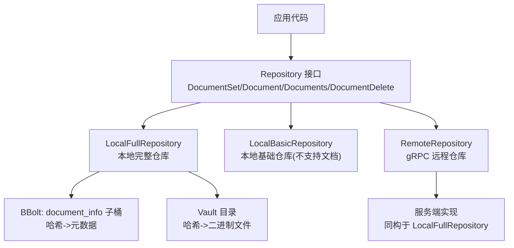
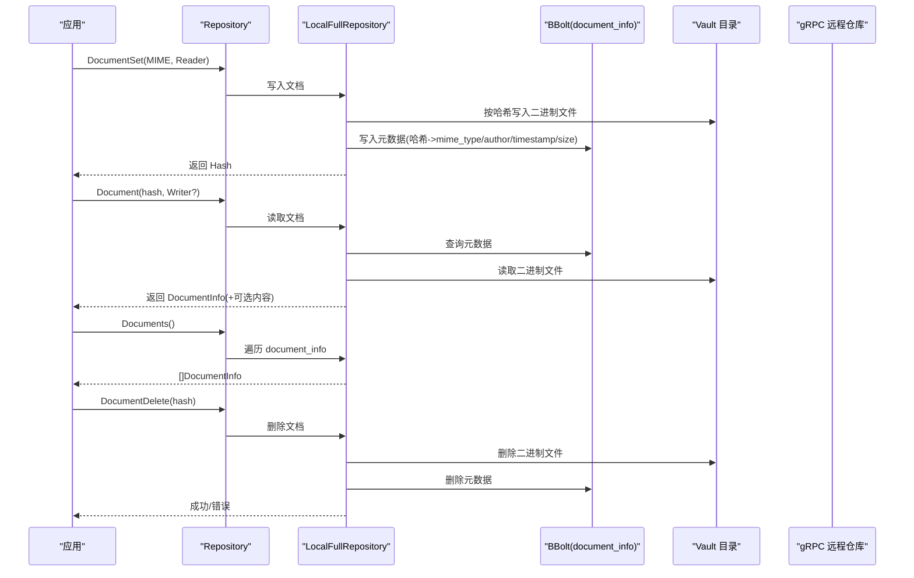
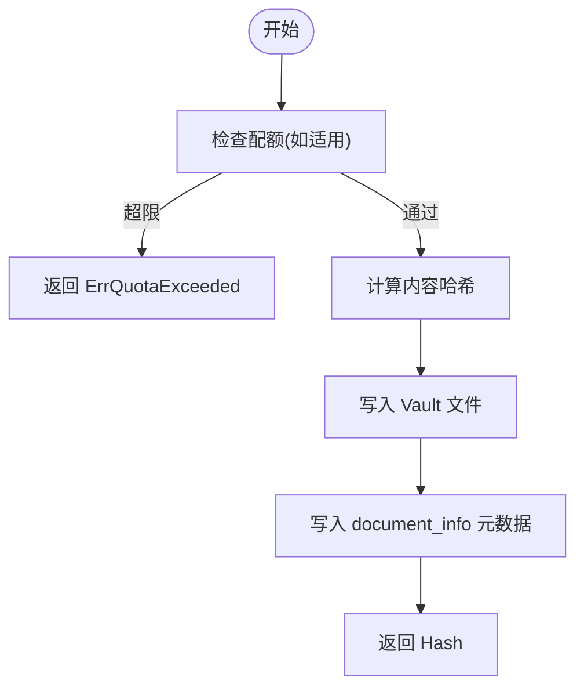
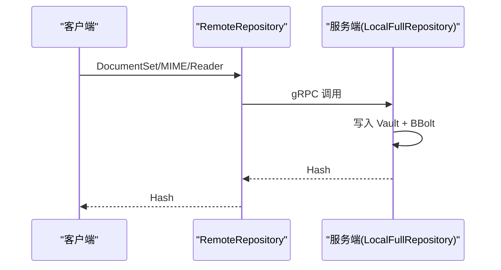
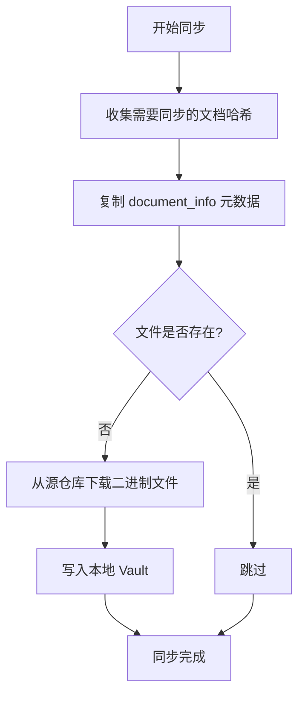
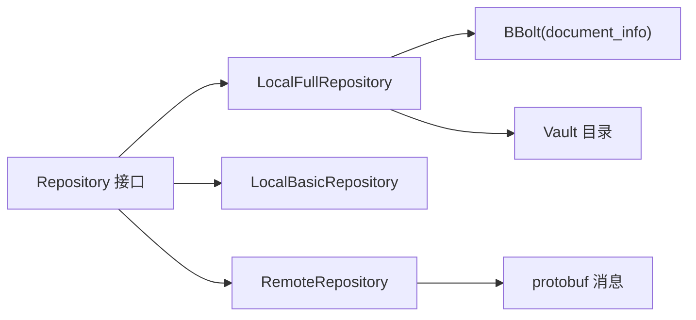

# 文档管理方法

<cite>
**本文引用的文件**
- [repository.go](file://sst/repository.go)
- [repolocalfull.go](file://sst/repolocalfull.go)
- [repolocalbasic.go](file://sst/repolocalbasic.go)
- [DocumentInfo.go](file://sst/DocumentInfo.go)
- [hash.go](file://sst/hash.go)
- [repository.pb.go](file://bboltproto/repository.pb.go)
- [quota_test.go](file://sst_test/quota_test.go)
</cite>

## 目录
1. [简介](#简介)
2. [项目结构](#项目结构)
3. [核心组件](#核心组件)
4. [架构总览](#架构总览)
5. [详细组件分析](#详细组件分析)
6. [依赖关系分析](#依赖关系分析)
7. [性能考虑](#性能考虑)
8. [故障排查指南](#故障排查指南)
9. [结论](#结论)
10. [附录](#附录)

## 简介
本文件面向仓库的“文档管理”能力，系统性说明 DocumentSet、Document、Documents、DocumentDelete 等接口的设计与实现，覆盖本地与远程仓库、元数据（哈希、MIME、作者、时间戳）、存储与检索流程、删除策略、同步机制、批量操作场景以及大文件处理与错误处理建议。读者可据此完成上传、下载、批量管理与跨库同步等完整工作流。

## 项目结构
- 文档管理的核心接口定义在 Repository 接口中，统一暴露 DocumentSet/Document/Documents/DocumentDelete 等方法。
- 本地完整仓库（LocalFullRepository）提供完整的文档管理能力；本地基础仓库（LocalBasicRepository）对文档相关方法返回“不支持”。
- 文档元数据以 BBolt 子桶形式持久化，实际二进制内容通过 Vault 目录按哈希分片存放。
- 远程仓库通过 gRPC 协议暴露相同的文档操作语义，客户端调用与本地一致。

图表来源
- [repository.go:165-178](file://sst/repository.go#L165-L178)
- [repolocalfull.go:2894-3144](file://sst/repolocalfull.go#L2894-L3144)
- [repolocalbasic.go:773-787](file://sst/repolocalbasic.go#L773-L787)
- [DocumentInfo.go:23-87](file://sst/DocumentInfo.go#L23-L87)

章节来源
- [repository.go:165-178](file://sst/repository.go#L165-L178)
- [repolocalfull.go:2894-3144](file://sst/repolocalfull.go#L2894-L3144)
- [repolocalbasic.go:773-787](file://sst/repolocalbasic.go#L773-L787)
- [DocumentInfo.go:23-87](file://sst/DocumentInfo.go#L23-L87)

## 核心组件
- Repository 接口：统一文档操作的入口，包含 DocumentSet、Document、Documents、DocumentDelete。
- DocumentInfo：文档元数据结构，包含 Hash、MIMEType、Author、Timestamp、Size。
- LocalFullRepository：本地完整仓库实现，支持文档上传、下载、列举、删除、同步。
- LocalBasicRepository：本地基础仓库实现，文档相关方法均返回“不支持”。
- 远程仓库：通过 gRPC 暴露相同语义，底层同样基于 BBolt + Vault 存储。

章节来源
- [repository.go:165-178](file://sst/repository.go#L165-L178)
- [DocumentInfo.go:12-19](file://sst/DocumentInfo.go#L12-L19)
- [repolocalfull.go:2894-3144](file://sst/repolocalfull.go#L2894-L3144)
- [repolocalbasic.go:773-787](file://sst/repolocalbasic.go#L773-L787)

## 架构总览
下图展示文档从客户端到存储层的端到端流程，涵盖上传、下载、列举、删除与同步。

图表来源
- [repository.go:165-178](file://sst/repository.go#L165-L178)
- [repolocalfull.go:2894-3144](file://sst/repolocalfull.go#L2894-L3144)
- [DocumentInfo.go:23-87](file://sst/DocumentInfo.go#L23-L87)

## 详细组件分析

### 接口与数据结构
- Repository 接口
  - DocumentSet(ctx, MIMEType, source) -> (Hash, error)
  - Document(ctx, hash, target) -> (*DocumentInfo, error)
  - Documents(ctx) -> ([]DocumentInfo, error)
  - DocumentDelete(ctx, hash) -> error
- DocumentInfo
  - Hash: 文档内容的 SHA-256 哈希（Base58 表示用于字符串化）
  - MIMEType: 文档类型标识
  - Author: 上传者/作者
  - Timestamp: 时间戳（RFC3339）
  - Size: 文件大小

章节来源
- [repository.go:165-178](file://sst/repository.go#L165-L178)
- [DocumentInfo.go:12-19](file://sst/DocumentInfo.go#L12-L19)
- [hash.go:51-131](file://sst/hash.go#L51-L131)

### 本地完整仓库（LocalFullRepository）
- 上传（DocumentSet）
  - 计算内容哈希并写入 Vault 目录（按哈希命名）
  - 写入 document_info 子桶（哈希作为键），记录 mime_type、author、timestamp、size
  - 返回哈希供后续检索与删除使用
- 下载（Document）
  - 根据哈希查询 document_info 获取元数据
  - 从 Vault 目录读取二进制内容，写入目标 Writer
  - 若 target 为 nil，仅返回元数据
- 列举（Documents）
  - 遍历 document_info 子桶，收集所有文档元数据
- 删除（DocumentDelete）
  - 删除 Vault 中的二进制文件
  - 删除 document_info 子桶中的对应条目
- 配额与限制
  - 当属于 SuperRepository 时，会进行配额检查，超出配额将返回 ErrQuotaExceeded

图表来源
- [repolocalfull.go:2894-3144](file://sst/repolocalfull.go#L2894-L3144)
- [DocumentInfo.go:23-87](file://sst/DocumentInfo.go#L23-L87)

章节来源
- [repolocalfull.go:2894-3144](file://sst/repolocalfull.go#L2894-L3144)
- [DocumentInfo.go:23-87](file://sst/DocumentInfo.go#L23-L87)

### 本地基础仓库（LocalBasicRepository）
- 文档相关方法全部返回“不支持”，适用于仅关注数据集（NamedGraph）的场景。

章节来源
- [repolocalbasic.go:773-787](file://sst/repolocalbasic.go#L773-L787)

### 远程仓库（gRPC）
- 客户端调用 Repository 接口的方法，底层通过 gRPC 与服务端交互。
- 服务端实现与本地完整仓库一致，确保跨网络访问行为一致。
- 请求/响应消息由 protobuf 定义，包含 DocumentSetRequest/Response、DocumentRequest、DocumentDeleteRequest/Response 等。

图表来源
- [repository.pb.go:4469-4608](file://bboltproto/repository.pb.go#L4469-L4608)
- [repository.pb.go:4742-4792](file://bboltproto/repository.pb.go#L4742-L4792)

章节来源
- [repository.pb.go:4469-4608](file://bboltproto/repository.pb.go#L4469-L4608)
- [repository.pb.go:4742-4792](file://bboltproto/repository.pb.go#L4742-L4792)

### 同步与一致性
- 跨库同步时会复制 document_info 元数据，并拉取缺失的二进制文件至目标 Vault 目录。
- 若部分文件同步失败，不会导致整体同步失败，但会记录警告日志。

图表来源
- [repolocalfull.go:4442-4583](file://sst/repolocalfull.go#L4442-L4583)

章节来源
- [repolocalfull.go:4442-4583](file://sst/repolocalfull.go#L4442-L4583)

## 依赖关系分析
- Repository 接口依赖具体实现（LocalFullRepository/LocalBasicRepository/RemoteRepository）。
- 文档元数据依赖 BBolt 的 document_info 子桶结构。
- 文档内容依赖 Vault 目录按哈希命名的二进制文件。
- 远程仓库依赖 gRPC 协议与 protobuf 消息定义。

图表来源
- [repository.go:165-178](file://sst/repository.go#L165-L178)
- [repolocalfull.go:2894-3144](file://sst/repolocalfull.go#L2894-L3144)
- [repolocalbasic.go:773-787](file://sst/repolocalbasic.go#L773-L787)
- [repository.pb.go:4469-4608](file://bboltproto/repository.pb.go#L4469-L4608)

章节来源
- [repository.go:165-178](file://sst/repository.go#L165-L178)
- [repolocalfull.go:2894-3144](file://sst/repolocalfull.go#L2894-L3144)
- [repolocalbasic.go:773-787](file://sst/repolocalbasic.go#L773-L787)
- [repository.pb.go:4469-4608](file://bboltproto/repository.pb.go#L4469-L4608)

## 性能考虑
- 大文件上传/下载
  - 使用流式读写（bufio.Reader/io.Writer）避免一次性加载到内存。
  - 优先直接写入 Vault 文件，减少中间拷贝。
- 并发与锁
  - 在 SuperRepository 下，写路径可能涉及配额检查与并发控制，注意串行化以避免竞态。
- 索引与同步
  - 文档同步时先复制元数据再按需拉取文件，降低网络开销。
  - 对于批量操作，尽量合并请求以减少往返次数。
- 存储布局
  - 按哈希命名文件便于去重与快速定位，避免重复存储。

[本节为通用指导，不直接分析具体文件]

## 故障排查指南
- 配额超限
  - 现象：DocumentSet 返回 ErrQuotaExceeded
  - 处理：调整仓库配额或清理已存文档后重试
- 文件缺失
  - 现象：Document 读取失败或同步时部分文件缺失
  - 处理：检查 Vault 目录是否存在对应哈希文件；必要时重新同步
- 元数据不一致
  - 现象：document_info 存在但 Vault 文件缺失，或反之
  - 处理：校验哈希一致性，必要时重建 Vault 文件或修复元数据
- 远程连接问题
  - 现象：gRPC 调用失败
  - 处理：检查认证、TLS 配置与网络连通性

章节来源
- [quota_test.go:45-62](file://sst_test/quota_test.go#L45-L62)

## 结论
SST-Core 通过统一的 Repository 接口提供一致的文档管理能力，本地完整仓库实现完整的上传、下载、列举与删除功能，基础仓库则明确不支持文档操作。文档以哈希为核心标识，结合 BBolt 元数据与 Vault 二进制存储，既保证去重又便于扩展。远程仓库通过 gRPC 提供同等能力，配合同步机制可实现跨库一致性。生产环境中应重视配额、并发、流式处理与错误恢复策略，以确保稳定与高效。

## 附录

### API 参考摘要
- DocumentSet(ctx, MIMEType, source) -> (Hash, error)
  - 用途：上传文档，返回内容哈希
  - 输入：MIME 类型、流式 Reader
  - 输出：哈希
- Document(ctx, hash, target) -> (*DocumentInfo, error)
  - 用途：下载文档，target 可为 nil 仅获取元数据
  - 输入：哈希、可选 Writer
  - 输出：文档元数据（+可选内容）
- Documents(ctx) -> ([]DocumentInfo, error)
  - 用途：列举所有文档元数据
  - 输出：元数据列表
- DocumentDelete(ctx, hash) -> error
  - 用途：删除文档内容与元数据
  - 输入：哈希

章节来源
- [repository.go:165-178](file://sst/repository.go#L165-L178)

### 工作流程示例
- 上传文档
  - 准备 MIME 类型与 Reader
  - 调用 DocumentSet
  - 保存返回的哈希以便后续操作
- 下载文档
  - 使用哈希调用 Document
  - 若需内容，传入 Writer；否则仅获取元数据
- 批量操作
  - 使用 Documents 获取列表
  - 对每个元素执行下载或删除
- 跨库同步
  - 使用 SyncFrom 同步元数据与文件
  - 处理可能的部分失败并记录日志

章节来源
- [repolocalfull.go:4442-4583](file://sst/repolocalfull.go#L4442-L4583)
- [quota_test.go:45-62](file://sst_test/quota_test.go#L45-L62)