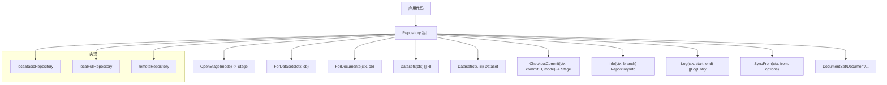
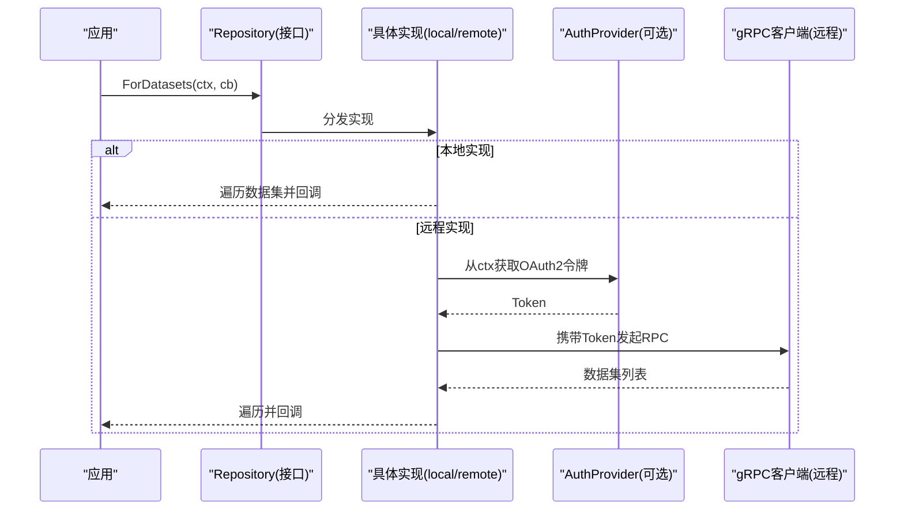
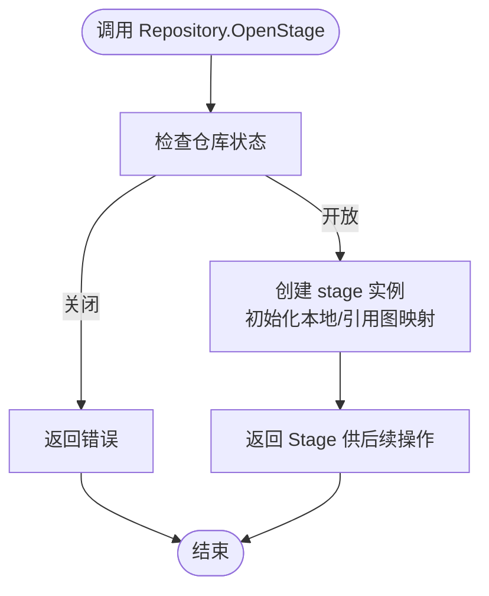
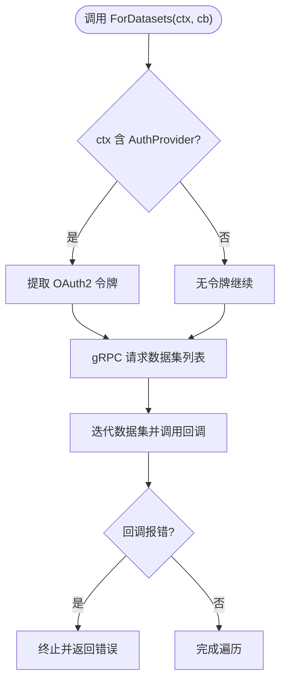
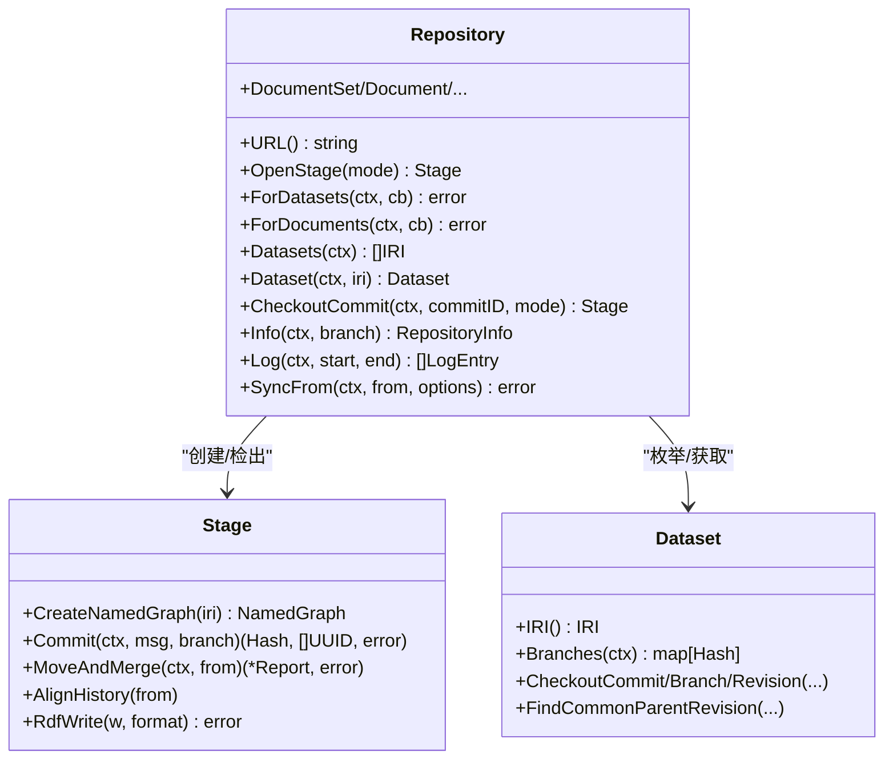

# 核心方法

<cite>
**本文引用的文件**
- [repository.go](file://sst/repository.go)
- [stage.go](file://sst/stage.go)
- [dataset.go](file://sst/dataset.go)
- [repolocalbasic.go](file://sst/repolocalbasic.go)
- [reporemote.go](file://sst/reporemote.go)
- [auth.go](file://sstauth/auth.go)
- [sstfile.go](file://sst/sstfile.go)
- [repolocalfull.go](file://examples/helloworldrepolocalfull/repolocalfull.go)
</cite>

## 目录
1. [简介](#简介)
2. [项目结构](#项目结构)
3. [核心组件](#核心组件)
4. [架构总览](#架构总览)
5. [详细组件分析](#详细组件分析)
6. [依赖关系分析](#依赖关系分析)
7. [性能考虑](#性能考虑)
8. [故障排查指南](#故障排查指南)
9. [结论](#结论)
10. [附录：使用示例与最佳实践](#附录使用示例与最佳实践)

## 简介
本文件聚焦于 Repository 接口的核心方法，围绕 URL 管理、Stage 操作、数据集管理等基础能力进行系统化说明。重点覆盖 OpenStage、ForDatasets、ForDocuments、Datasets、Dataset 等方法的参数、返回值与典型使用场景；解释上下文参数的作用（超时控制、用户认证）；并提供错误处理与性能优化的实践建议。

## 项目结构
SST 的核心以接口为中心，Repository、Stage、Dataset 构成数据访问与版本管理的三大抽象。本地仓库通过 BBolt 持久化，远程仓库通过 gRPC 与服务器交互；索引能力基于 Bleve。

图表来源
- [repository.go:50-179](file://sst/repository.go#L50-L179)
- [repolocalbasic.go:48-65](file://sst/repolocalbasic.go#L48-L65)
- [reporemote.go:105-139](file://sst/reporemote.go#L105-L139)

章节来源
- [repository.go:50-179](file://sst/repository.go#L50-L179)

## 核心组件
- Repository：仓库级入口，负责数据集枚举、阶段创建、提交元信息、同步、文档存取、日志查询、索引管理等。
- Stage：内存工作区，承载 NamedGraph 的增删改查与合并，支持提交到关联的 Repository。
- Dataset：数据集及其版本历史、分支、检出等操作。

章节来源
- [repository.go:50-179](file://sst/repository.go#L50-L179)
- [stage.go:74-234](file://sst/stage.go#L74-L234)
- [dataset.go:30-94](file://sst/dataset.go#L30-L94)

## 架构总览
下图展示了从应用调用 Repository 核心方法到具体实现的调用路径，以及上下文在远程调用中的传递与作用。

图表来源
- [reporemote.go:146-200](file://sst/reporemote.go#L146-L200)
- [auth.go:41-52](file://sstauth/auth.go#L41-L52)
- [repository.go:257-309](file://sst/repository.go#L257-L309)

## 详细组件分析

### Repository 接口与核心方法
- URL() string
  - 返回仓库的具体位置。远程主仓库无 Fragment；作为 SuperRepository 成员的远程仓库包含 Fragment；本地仓库为文件系统路径。
- SuperRepository() SuperRepository
  - 若该仓库属于某个超级仓库则返回之，否则 nil。
- OpenStage(mode TriplexMode) Stage
  - 创建一个空的工作阶段，用于加载、修改、提交数据。TriplexMode 决定内部三元组结构的粒度与内存/性能权衡。
- ForDatasets(ctx context.Context, c func(ds Dataset) error) error
  - 遍历仓库中所有数据集，对每个数据集调用回调。回调返回错误时终止遍历并返回错误。
- ForDocuments(ctx context.Context, c func(d DocumentInfo) error) error
  - 遍历仓库中所有文档元信息，回调错误将终止遍历。
- Datasets(ctx context.Context) ([]IRI, error)
  - 获取仓库中所有数据集的 IRI 列表；若无数据集返回空切片。
- Dataset(ctx context.Context, iri IRI) (Dataset, error)
  - 根据 IRI 获取已存在的数据集对象。
- CheckoutCommit(ctx context.Context, commitID Hash, mode TriplexMode) (Stage, error)
  - 基于指定提交 ID 生成一个 Stage，包含该提交记录的命名图修订及检出元数据。
- Info(ctx context.Context, branchName string) (RepositoryInfo, error)
  - 返回仓库基本信息与统计；branchName 为空时统计所有分支的数据集数量。
- Log(ctx context.Context, start, end *int) ([]RepositoryLogEntry, error)
  - 按 logKey 范围或数量读取日志条目；start=nil 表示从最新开始；end 负数表示最多返回若干条；正数为下界排除。
- SyncFrom(ctx context.Context, from Repository, options ...SyncOption) error
  - 将源仓库的提交同步到当前仓库，可指定数据集与分支范围。
- DocumentSet/Document/Documents/DocumentDelete
  - 文档内容的存储、读取、列举与删除。

章节来源
- [repository.go:50-179](file://sst/repository.go#L50-L179)

### Stage 接口与工作流
- CreateNamedGraph/NamedGraph/NamedGraphs/ReferencedGraph/ReferencedGraphs
  - 创建与获取本地/引用命名图。
- Commit(ctx context.Context, message string, branchName string) (Hash, []uuid.UUID, error)
  - 将当前 Stage 的所有变更提交到关联仓库，生成新的命名图修订与数据集修订；可选择更新分支指向。
- MoveAndMerge(ctx context.Context, from Stage) (*MoveAndMergeReport, error)
  - 自动移动与合并来自源 Stage 的命名图与引用图，支持三向合并策略与报告输出。
- AlignHistory(from Stage)
  - 对齐检出历史元数据，便于跨来源的 Stage 提交一致性。
- LinkToRepository(ctx context.Context, repo Repository, branch string) error
  - 将 Stage 绑定到仓库并统一设置分支。
- RdfWrite/Dump/Info
  - 导出、调试与信息统计。

章节来源
- [stage.go:74-234](file://sst/stage.go#L74-L234)

### Dataset 接口与版本管理
- IRI() IRI
- Branches(ctx) map[string]Hash
- LeafCommits(ctx) []Hash
- CommitDetailsByHash/CommitDetailsByBranch
- SetBranchCommit/SetBranchRevision/RemoveBranch
- CheckoutCommit/CheckoutBranch/CheckoutRevision
- CommitForRevision
- FindCommonParentRevision(revision1, revision2) parent Hash
  - 查找两个修订的最近公共祖先，用于三向差异与合并。

章节来源
- [dataset.go:30-94](file://sst/dataset.go#L30-L94)

### 上下文参数与认证机制
- 上下文用途
  - 超时控制：为远程仓库的网络请求提供截止时间与取消信号。
  - 用户认证：通过 sstauth.AuthProvider 注入 OAuth2 令牌，远程调用时自动附加至 gRPC 元数据。
- 认证流程要点
  - 客户端在 ctx 中设置 AuthProvider；远程仓库在建立连接与每次 RPC 前提取令牌并附加。
  - 服务端拦截器校验令牌签名、过期时间、受众与角色，执行权限控制。
- 相关实现位置
  - 远程仓库打开与搜索均从 ctx 提取令牌并配置 gRPC 凭据。

章节来源
- [repository.go:257-309](file://sst/repository.go#L257-L309)
- [reporemote.go:146-200](file://sst/reporemote.go#L146-L200)
- [auth.go:41-52](file://sstauth/auth.go#L41-L52)

### 关键流程图：OpenStage 与数据集遍历

图表来源
- [repolocalbasic.go:52-65](file://sst/repolocalbasic.go#L52-L65)
- [reporemote.go:126-139](file://sst/reporemote.go#L126-L139)

### 关键流程图：ForDatasets 远程遍历

图表来源
- [reporemote.go:146-200](file://sst/reporemote.go#L146-L200)
- [repository.go:66-74](file://sst/repository.go#L66-L74)

## 依赖关系分析
- Repository 接口由多种实现提供：
  - localBasicRepository：本地基础仓库，支持 Bleve 索引重建与注册。
  - localFullRepository：本地完整仓库，支持版本历史。
  - remoteRepository：远程仓库，通过 gRPC 与服务器通信，支持认证与流式搜索。
- Stage 与 Dataset 通过 Repository 暴露的能力协作，形成“工作区 + 版本”的模型。
- 认证依赖 sstauth 提供的上下文注入与令牌提取。

图表来源
- [repository.go:50-179](file://sst/repository.go#L50-L179)
- [stage.go:74-234](file://sst/stage.go#L74-L234)
- [dataset.go:30-94](file://sst/dataset.go#L30-L94)

章节来源
- [repolocalbasic.go:48-65](file://sst/repolocalbasic.go#L48-L65)
- [reporemote.go:105-139](file://sst/reporemote.go#L105-L139)

## 性能考虑
- TriplexMode 选择
  - DefaultTriplexMode 同时维护主体、谓词、客体三元组，适合复杂子属性与个体遍历；可根据应用场景在内存与性能间权衡。
- 索引与查询
  - 本地仓库可通过 RegisterIndexHandler 注册/重建 Bleve 索引；Remote 仓库索引在服务端维护。
- 批量与流式
  - ForDatasets/ForDocuments 采用回调模式，避免一次性加载全部数据；远程搜索通过流式 gRPC 减少内存占用。
- 并发与安全
  - 远程仓库使用 stateControl 管理生命周期，防止在关闭期间并发访问；认证令牌在每次 RPC 前注入。

章节来源
- [stage.go:33-51](file://sst/stage.go#L33-L51)
- [repolocalbasic.go:67-145](file://sst/repolocalbasic.go#L67-L145)
- [reporemote.go:146-200](file://sst/reporemote.go#L146-L200)

## 故障排查指南
- 常见错误类型
  - 仓库不存在/已存在、数据集不存在/已存在、分支未找到、配额超限、不支持的操作等。
- 远程调用失败
  - 检查 ctx 是否包含有效的 AuthProvider；确认网络与 TLS 配置；查看 gRPC 错误码与消息。
- 阶段无效
  - 某些操作会导致 Stage 失效（如 MoveAndMerge），需检查 IsValid() 并在必要时重新创建。
- 索引问题
  - 本地仓库索引重建失败时，检查目录权限与磁盘空间；确保 DerivePackageVersion 一致以避免全量重建。

章节来源
- [repository.go:197-215](file://sst/repository.go#L197-L215)
- [stage.go:21-31](file://sst/stage.go#L21-L31)
- [reporemote.go:69-86](file://sst/reporemote.go#L69-L86)

## 结论
Repository 接口提供了统一的仓库访问抽象，结合 Stage 与 Dataset 实现了灵活的数据工作区与版本管理能力。通过上下文注入认证与超时控制，既保证了远程调用的安全性与可控性，也提升了整体系统的健壮性。合理选择 TriplexMode、利用索引与流式 API，可在性能与资源消耗之间取得平衡。

## 附录：使用示例与最佳实践

### 基本用法模式（本地仓库）
- 创建仓库、打开阶段、创建命名图、提交、导出 TTL、检出验证。
- 参考示例路径：[repolocalfull.go](file://examples/helloworldrepolocalfull/repolocalfull.go)

章节来源
- [repolocalfull.go:24-94](file://examples/helloworldrepolocalfull/repolocalfull.go#L24-L94)

### 上下文与认证最佳实践
- 为远程仓库调用构造带超时的 context，并通过 ContextWithAuthProvider 注入令牌。
- 在每次远程调用前确保令牌有效且未过期；服务端会校验受众与角色。
- 参考认证注入点：[auth.go](file://sstauth/auth.go)、[reporemote.go](file://sst/reporemote.go)

章节来源
- [auth.go:41-52](file://sstauth/auth.go#L41-L52)
- [reporemote.go:146-200](file://sst/reporemote.go#L146-L200)

### 错误处理建议
- 对 ForDatasets/ForDocuments 的回调错误及时中断并记录。
- 对远程调用捕获 gRPC 错误并转换为业务错误（如配额超限）。
- 对 Stage 操作后检查 IsValid()，避免对失效阶段进行操作。

章节来源
- [repository.go:66-74](file://sst/repository.go#L66-L74)
- [stage.go:113-117](file://sst/stage.go#L113-L117)
- [superremoterepository.go:74-90](file://sst/superremoterepository.go#L74-L90)