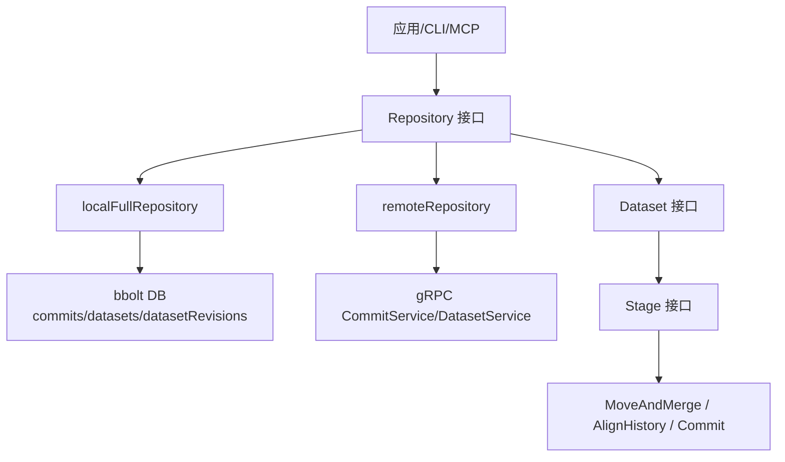
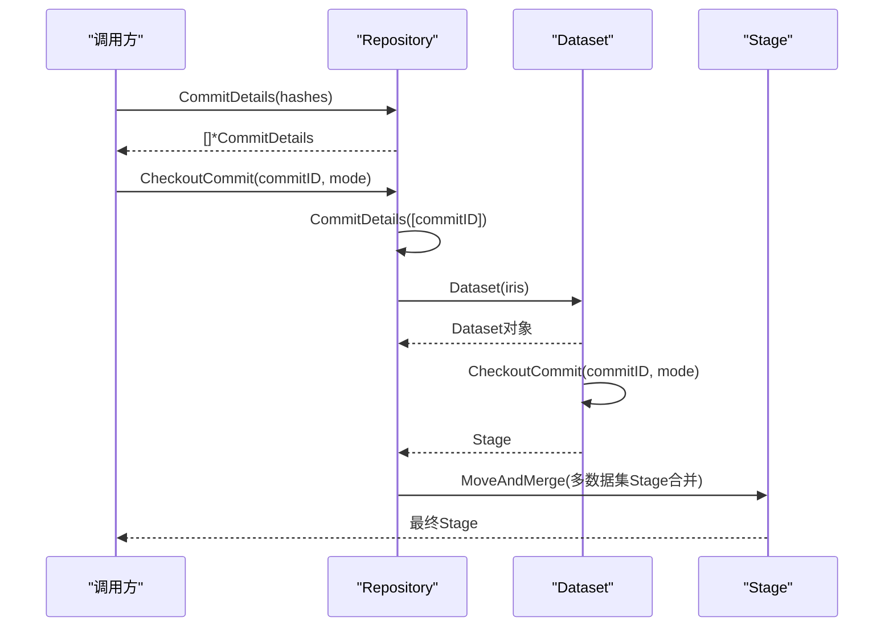
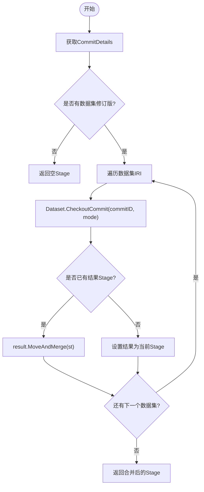
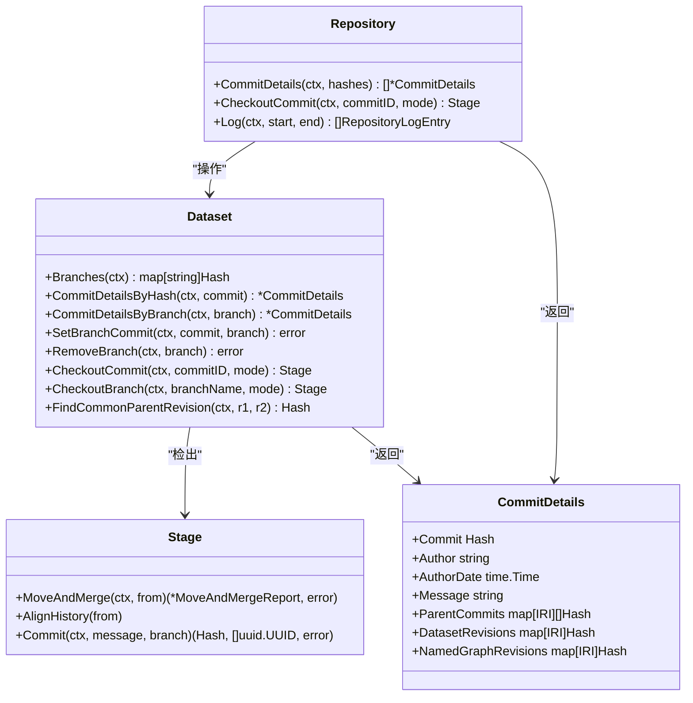

# 版本控制方法

<cite>
**本文引用的文件**
- [commit.go](file://sst/commit.go)
- [repository.go](file://sst/repository.go)
- [repocheckout.go](file://sst/repocheckout.go)
- [repolocalfull.go](file://sst/repolocalfull.go)
- [reporemote.go](file://sst/reporemote.go)
- [dataset.go](file://sst/dataset.go)
- [stage.go](file://sst/stage.go)
- [repointernalcommit.go](file://sst/repointernalcommit.go)
</cite>

## 目录
1. [简介](#简介)
2. [项目结构](#项目结构)
3. [核心组件](#核心组件)
4. [架构总览](#架构总览)
5. [详细组件分析](#详细组件分析)
6. [依赖关系分析](#依赖关系分析)
7. [性能与并发考虑](#性能与并发考虑)
8. [故障排查指南](#故障排查指南)
9. [结论](#结论)
10. [附录：完整工作流程示例](#附录完整工作流程示例)

## 简介
本文件面向SST仓库的版本控制能力，围绕提交元数据、提交历史查询、版本检出（Checkout）、分支管理等核心API进行系统化说明。重点解释以下概念与方法：
- CommitDetails：提交详情数据结构，包含提交哈希、作者、时间、消息、父提交、数据集修订版映射、命名图修订版映射等。
- CheckoutCommit：基于提交哈希或分支将仓库状态“检出”为可编辑的Stage。
- 提交哈希（Hash）：不可变标识符，用于唯一标识一次提交及对应的数据快照。
- 命名图修订版（NamedGraphRevision）：对某个命名图的某次写入产生的不可变版本标识。
- 分支管理：通过数据集维度的分支指针（如master）指向特定提交或修订版。

这些能力在本地完整仓库（localFullRepository）和远程仓库（remoteRepository）中均有实现；基础/扁平仓库则部分不支持历史与检出。

## 项目结构
与版本控制直接相关的代码主要分布在以下模块：
- 接口与公共类型：Repository、Dataset、Stage、CommitDetails、Hash、IRI等定义于 repository.go、dataset.go、stage.go、commit.go、hash.go、vocabulary.go。
- 本地完整仓库实现：repolocalfull.go（支持历史、索引、检出）。
- 远程仓库实现：reporemote.go（通过gRPC访问服务端，提供CommitDetails、CheckoutCommit等）。
- 通用检出逻辑：repocheckout.go（根据CommitDetails合并多个数据集的检出结果）。
- 提交关系与祖先判定：repointernalcommit.go（比较提交关系、查找祖先等内部算法）。

图表来源
- [repository.go:50-179](file://sst/repository.go#L50-L179)
- [repolocalfull.go:220-230](file://sst/repolocalfull.go#L220-L230)
- [reporemote.go:88-99](file://sst/reporemote.go#L88-L99)
- [dataset.go:30-94](file://sst/dataset.go#L30-L94)
- [stage.go:74-234](file://sst/stage.go#L74-L234)

章节来源
- [repository.go:50-179](file://sst/repository.go#L50-L179)
- [dataset.go:30-94](file://sst/dataset.go#L30-L94)
- [stage.go:74-234](file://sst/stage.go#L74-L234)

## 核心组件
- Repository接口：提供URL、OpenStage、Datasets、Dataset、CommitDetails、CheckoutCommit、Log、Info、SyncFrom、Document系列等方法。其中CommitDetails与CheckoutCommit是版本控制的核心入口。
- Dataset接口：提供Branches、LeafCommits、CommitDetailsByHash/ByBranch、SetBranchCommit/SetBranchRevision/RemoveBranch、CheckoutCommit/CheckoutBranch/CheckoutRevision、FindCommonParentRevision等。
- Stage接口：表示工作区，支持CreateNamedGraph、MoveAndMerge、AlignHistory、Commit等。
- CommitDetails：提交元数据载体，包含Commit、Author、AuthorDate、Message、ParentCommits、DatasetRevisions、NamedGraphRevisions。
- Hash/IRI：提交哈希与资源标识类型。

章节来源
- [repository.go:50-179](file://sst/repository.go#L50-L179)
- [dataset.go:30-94](file://sst/dataset.go#L30-L94)
- [stage.go:74-234](file://sst/stage.go#L74-L234)
- [commit.go:18-62](file://sst/commit.go#L18-L62)

## 架构总览
版本控制的关键流程包括：
- 提交历史查询：Repository.CommitDetails批量获取提交元数据；Dataset.CommitDetailsByHash/ByBranch按数据集范围查询。
- 版本检出：Repository.CheckoutCommit或Dataset.CheckoutCommit/CheckoutBranch/CheckoutRevision生成Stage；内部通过checkoutCommitFromCommitDetails按数据集维度合并。
- 分支管理：Dataset.SetBranchCommit/SetBranchRevision/RemoveBranch维护数据集维度的分支指针。
- 提交关系计算：repointernalcommit.go提供祖先判定、提交新旧关系压缩等内部工具，支撑合并与差异分析。

图表来源
- [repository.go:83-89](file://sst/repository.go#L83-L89)
- [repocheckout.go:10-44](file://sst/repocheckout.go#L10-L44)
- [repolocalfull.go:721-732](file://sst/repolocalfull.go#L721-L732)
- [reporemote.go:639-653](file://sst/reporemote.go#L639-L653)

## 详细组件分析

### CommitDetails：提交详情
- 字段含义
  - Commit：本次提交的哈希。
  - Author/AuthorDate/Message：提交者、时间与消息。
  - ParentCommits：每个数据集在该提交下的父提交列表（支持合并）。
  - DatasetRevisions：提交对应的数据集修订版映射（数据集IRI -> 修订版哈希）。
  - NamedGraphRevisions：提交对应的命名图修订版映射（命名图IRI -> 命名图修订版哈希）。
- 用途
  - 作为CommitDetails API的返回值，供上层展示、比对、检出使用。
  - 配合CheckoutCommit，按命名图修订版精确还原工作区。

章节来源
- [commit.go:18-62](file://sst/commit.go#L18-L62)

### Repository.CommitDetails：批量提交详情查询
- 本地完整仓库实现从bbolt读取commits、datasets、datasetRevisions等桶，组装CommitDetails并返回。
- 远程仓库通过gRPC的CommitService.GetCommitDetailsBatch批量拉取并提交到客户端解析。
- 不支持历史的基础/扁平仓库会返回错误。

章节来源
- [repolocalfull.go:595-719](file://sst/repolocalfull.go#L595-L719)
- [reporemote.go:546-637](file://sst/reporemote.go#L546-L637)
- [repository.go:83-84](file://sst/repository.go#L83-L84)

### Repository.CheckoutCommit：按提交检出工作区
- 流程
  - 先获取该提交的CommitDetails。
  - 若无数据集修订版，返回空Stage（无内容）。
  - 否则遍历所有数据集，逐个Dataset.CheckoutCommit得到Stage，再依次MoveAndMerge合并为一个统一Stage。
- 语义
  - 检出的Stage包含CommitDetails.NamedGraphRevisions中记录的各命名图的正确修订版，并附带检出血缘信息。

图表来源
- [repocheckout.go:10-44](file://sst/repocheckout.go#L10-L44)
- [repolocalfull.go:721-732](file://sst/repolocalfull.go#L721-L732)
- [reporemote.go:639-653](file://sst/reporemote.go#L639-L653)

章节来源
- [repocheckout.go:10-44](file://sst/repocheckout.go#L10-L44)
- [repolocalfull.go:721-732](file://sst/repolocalfull.go#L721-L732)
- [reporemote.go:639-653](file://sst/reporemote.go#L639-L653)

### Dataset接口：分支管理与版本检出
- 分支管理
  - Branches：列出所有分支名及其指向的提交哈希。
  - SetBranchCommit/SetBranchRevision：将分支指针移动到指定提交或修订版。
  - RemoveBranch：删除分支。
- 版本检出
  - CheckoutCommit/CheckoutBranch/CheckoutRevision：分别按提交、分支、数据集修订版创建Stage。
  - FindCommonParentRevision：用于三路合并时寻找共同祖先。
- 提交详情
  - CommitDetailsByHash/ByBranch：按提交哈希或分支名获取提交详情。

章节来源
- [dataset.go:30-94](file://sst/dataset.go#L30-L94)

### 提交关系与祖先判定（内部）
- compareCommits/isCommitAncestor/comparisonCommitFrom等函数用于判断两个提交的新旧关系、是否为祖先，以及压缩连续相同关系的区间。
- 这些能力支撑了MoveAndMerge中的三路合并策略与冲突检测。

章节来源
- [repointernalcommit.go:47-144](file://sst/repointernalcommit.go#L47-L144)
- [repointernalcommit.go:234-266](file://sst/repointernalcommit.go#L234-L266)

### Stage：工作区与合并
- MoveAndMerge：将源Stage的命名图与引用图合并到目标Stage，支持跨仓库移动、重定向、修改标记、三路合并等。
- AlignHistory：对齐检出历史元数据，便于后续在同一仓库提交。
- Commit：将工作区变更持久化为提交，并为每个修改的命名图创建新的命名图修订版，同时创建数据集修订版与提交记录。

章节来源
- [stage.go:74-234](file://sst/stage.go#L74-L234)

## 依赖关系分析
- Repository接口是版本控制的顶层抽象，具体由localFullRepository与remoteRepository实现。
- Dataset接口由不同仓库类型的Dataset实现，提供分支与检出能力。
- Stage接口由stage实现，承载内存中的图结构与合并逻辑。
- commit.go定义了CommitDetails，被Repository与Dataset的多种方法复用。
- repocheckout.go封装了跨数据集的检出合并逻辑，被Repository.CheckoutCommit调用。
- repointernalcommit.go提供底层提交关系计算，被合并与差异相关逻辑间接使用。

图表来源
- [repository.go:50-179](file://sst/repository.go#L50-L179)
- [dataset.go:30-94](file://sst/dataset.go#L30-L94)
- [stage.go:74-234](file://sst/stage.go#L74-L234)
- [commit.go:18-62](file://sst/commit.go#L18-L62)

## 性能与并发考虑
- 批量查询优化
  - Repository.CommitDetails支持批量传入多个提交哈希，减少往返与重复解析开销。
- 检出合并优化
  - checkoutCommitFromCommitDetails对数据集IRI排序后顺序合并，避免随机IO与锁竞争。
  - MoveAndMerge内部对引用图与本地图分别处理，尽量复用已存在节点，减少重复构建。
- 祖先判定并行化
  - isCommitAncestor及相关比较中使用goroutine与原子变量提前终止，提升长链祖先搜索效率。
- 上下文与超时
  - 所有方法接受context，建议设置合理超时与取消信号，尤其在远程仓库场景下。
- 索引与历史
  - localFullRepository支持Bleve索引重建与历史保留；remote仓库索引在服务端维护。
- 并发安全
  - 仓库与数据集方法普遍有enter/leave保护，避免并发访问同一资源导致不一致。
  - 建议在应用层对同一仓库的多阶段操作进行串行化或使用互斥，避免竞态。

章节来源
- [repolocalfull.go:595-719](file://sst/repolocalfull.go#L595-L719)
- [repolocalfull.go:721-732](file://sst/repolocalfull.go#L721-L732)
- [repointernalcommit.go:107-135](file://sst/repointernalcommit.go#L107-L135)
- [reporemote.go:546-637](file://sst/reporemote.go#L546-L637)

## 故障排查指南
- 常见错误
  - ErrCommitNotFound：请求的提交不存在。
  - ErrNotSupported/ErrNotAvailable：基础/扁平仓库不支持历史、检出或索引功能。
  - ErrRepoClosed：仓库已关闭或Stage无效。
  - ErrPreCommitConditionFailed：预提交条件失败。
- 定位建议
  - 检查仓库类型是否支持所需功能（例如basic/flat不支持CommitDetails/Checkout）。
  - 确认传入的提交哈希或分支名称有效。
  - 远程仓库需确保认证与网络连通性。
  - 查看日志输出（如CommitDetails.Dump）以确认提交元数据完整性。

章节来源
- [commit.go:11-13](file://sst/commit.go#L11-L13)
- [repository.go:197-215](file://sst/repository.go#L197-L215)
- [stage.go:21-31](file://sst/stage.go#L21-L31)

## 结论
SST的版本控制以Repository/Dataset/Stage三层抽象为核心，通过CommitDetails描述提交快照，借助CheckoutCommit将历史状态恢复为可编辑的工作区，并通过分支指针管理开发流。本地完整仓库与远程仓库均提供一致的能力模型，内部通过bbolt与gRPC实现持久化与通信。对于大规模数据与高并发场景，应充分利用批量API、上下文控制与合理的合并策略，以获得更好的性能与稳定性。

## 附录：完整工作流程示例
以下为典型版本控制工作流（不展示具体代码，仅给出步骤与对应API路径）：
- 创建/打开仓库
  - 本地完整仓库：参考创建与打开入口（见仓库初始化相关实现）。
  - 远程仓库：通过OpenRemoteRepository建立连接。
- 创建工作区并修改数据
  - 使用Repository.OpenStage(mode)创建Stage。
  - 在Stage中创建/修改命名图，必要时导入其他命名图。
- 提交变更
  - Stage.Commit(ctx, message, branch)生成新提交，返回提交哈希与数据集修订版列表。
- 查看提交历史
  - Repository.Log(ctx, start, end)获取日志条目。
  - Repository.CommitDetails(ctx, hashes)批量获取提交详情。
  - Dataset.CommitDetailsByHash/ByBranch按数据集范围获取详情。
- 版本检出
  - Repository.CheckoutCommit(ctx, commitID, mode)或Dataset.CheckoutCommit/CheckoutBranch/CheckoutRevision生成Stage。
  - 内部会按命名图修订版精确还原，并合并多数据集。
- 分支管理
  - Dataset.SetBranchCommit/SetBranchRevision将分支指向特定提交或修订版。
  - Dataset.RemoveBranch删除分支。
- 回滚版本
  - 检出目标提交：Repository.CheckoutCommit或Dataset.CheckoutCommit。
  - 如需覆盖当前分支：Dataset.SetBranchCommit指向目标提交。
- 差异与合并
  - 使用Stage.MoveAndMerge进行合并，内部会尝试三路合并与冲突处理。
  - 利用FindCommonParentRevision寻找共同祖先，辅助差异计算。

章节来源
- [repository.go:83-89](file://sst/repository.go#L83-L89)
- [dataset.go:30-94](file://sst/dataset.go#L30-L94)
- [stage.go:74-234](file://sst/stage.go#L74-L234)
- [repocheckout.go:10-44](file://sst/repocheckout.go#L10-L44)