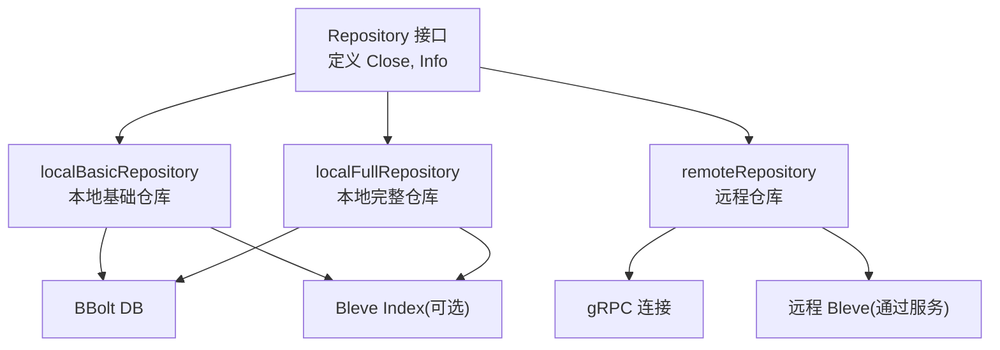
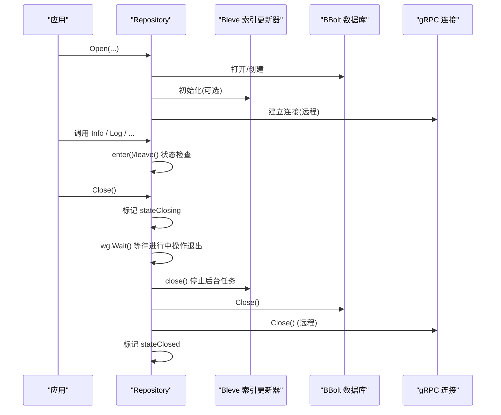
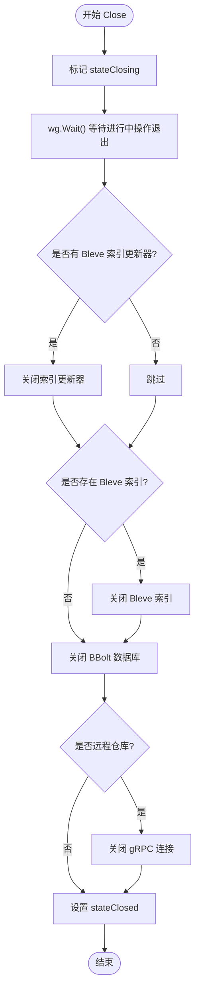
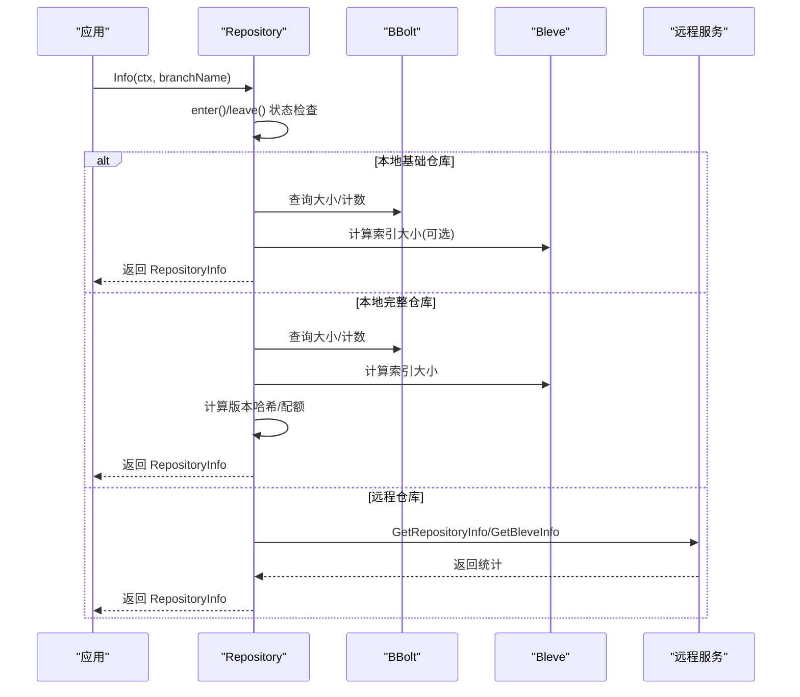
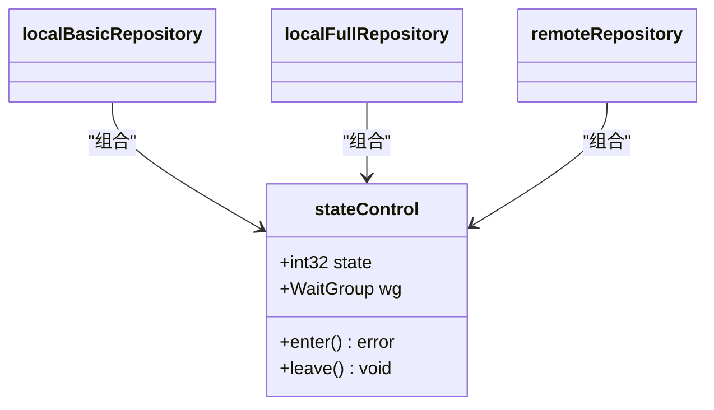
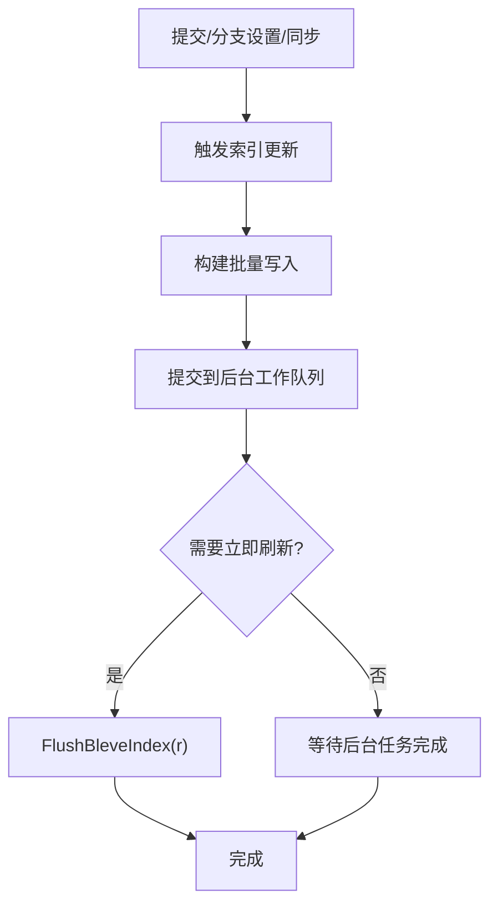
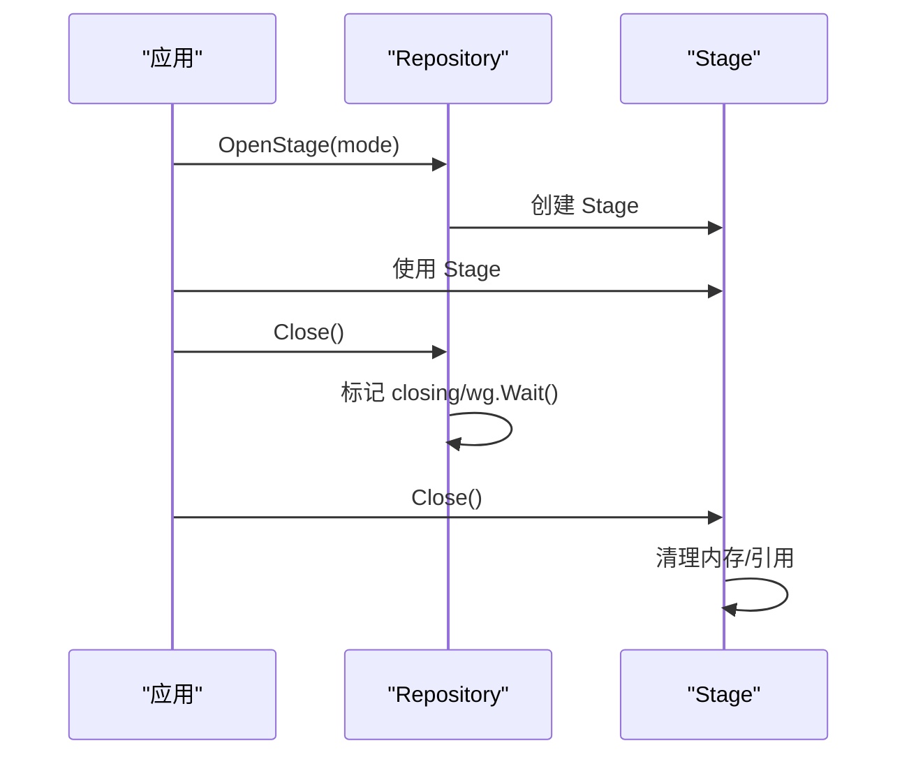
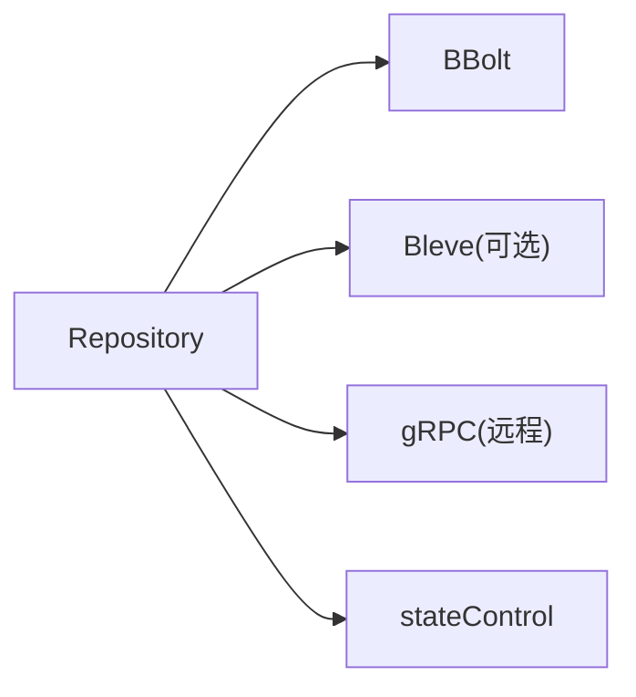

# 生命周期方法

<cite>
**本文引用的文件**
- [repository.go](file://sst/repository.go)
- [repolocalbasic.go](file://sst/repolocalbasic.go)
- [repolocalfull.go](file://sst/repolocalfull.go)
- [reporemote.go](file://sst/reporemote.go)
- [indexupdate.go](file://sst/indexupdate.go)
- [stage.go](file://sst/stage.go)
- [superlocalrepository.go](file://sst/superlocalrepository.go)
- [superremoterepository.go](file://sst/superremoterepository.go)
</cite>

## 目录
1. [简介](#简介)
2. [项目结构](#项目结构)
3. [核心组件](#核心组件)
4. [架构总览](#架构总览)
5. [详细组件分析](#详细组件分析)
6. [依赖关系分析](#依赖关系分析)
7. [性能考量](#性能考量)
8. [故障排查指南](#故障排查指南)
9. [结论](#结论)
10. [附录](#附录)

## 简介
本文件聚焦仓库（Repository）的生命周期管理，围绕 Close、Info 等关键方法进行系统化说明。内容涵盖：
- 关闭与清理：资源释放顺序、连接池与索引更新器关闭、并发安全
- 信息获取：仓库统计、配额、版本哈希、Bleve 索引信息等
- 资源管理：BBolt 数据库、Bleve 索引、gRPC 连接的打开与关闭
- 最佳实践：正确打开/关闭仓库、监控资源使用、异常处理与恢复策略

## 项目结构
仓库接口定义在统一入口文件中，具体实现分为本地基础仓库、本地完整仓库、远程仓库以及超级仓库。生命周期相关的关键点包括：
- Repository 接口定义了 Close、Info 等方法
- 各实现类分别维护不同的资源（BBolt、Bleve、gRPC 连接）
- stateControl 提供统一的进入/离开与状态机控制，确保并发安全

图表来源
- [repository.go:50-179](file://sst/repository.go#L50-L179)
- [repolocalbasic.go:418-442](file://sst/repolocalbasic.go#L418-L442)
- [repolocalfull.go:734-761](file://sst/repolocalfull.go#L734-L761)
- [reporemote.go:655-670](file://sst/reporemote.go#L655-L670)

章节来源
- [repository.go:50-179](file://sst/repository.go#L50-L179)

## 核心组件
- Repository 接口：统一暴露 URL、OpenStage、ForDatasets、Dataset、CommitDetails、CheckoutCommit、RegisterIndexHandler、Bleve、RebuildBleveIndex、Close、Info、Log、ExtractSstFile、SyncFrom、DocumentSet/Document/Documents/DocumentDelete 等能力
- localBasicRepository：轻量本地仓库，支持 BBolt + 可选 Bleve，无修订历史
- localFullRepository：完整本地仓库，支持 BBolt + Bleve + 修订历史 + 文档存储
- remoteRepository：远程仓库，基于 gRPC 访问服务端仓库
- stateControl：原子状态 + WaitGroup，保证并发安全与优雅关闭

章节来源
- [repository.go:50-179](file://sst/repository.go#L50-L179)
- [repolocalbasic.go:418-442](file://sst/repolocalbasic.go#L418-L442)
- [repolocalfull.go:734-761](file://sst/repolocalfull.go#L734-L761)
- [reporemote.go:655-670](file://sst/reporemote.go#L655-L670)
- [reporemote.go:109-124](file://sst/reporemote.go#L109-L124)

## 架构总览
仓库生命周期管理的核心流程如下：
- 打开阶段：创建或打开 BBolt、初始化 Bleve（可选）、建立 gRPC 连接（远程）
- 运行阶段：所有操作通过 enter()/leave() 进行状态检查与并发计数
- 关闭阶段：标记 closing -> 等待所有 in-flight 操作完成 -> 关闭索引更新器 -> 关闭 Bleve -> 关闭 BBolt/gRPC -> 标记 closed

图表来源
- [repolocalbasic.go:418-442](file://sst/repolocalbasic.go#L418-L442)
- [repolocalfull.go:734-761](file://sst/repolocalfull.go#L734-L761)
- [reporemote.go:655-670](file://sst/reporemote.go#L655-L670)
- [reporemote.go:109-124](file://sst/reporemote.go#L109-L124)

## 详细组件分析

### Close 方法与资源清理
- 本地基础仓库（localBasicRepository.Close）
  - 将状态从 open 切换到 closing
  - 等待所有已进入的操作完成（WaitGroup）
  - 关闭 Bleve 索引更新器，确保后台任务排空
  - 关闭 Bleve 索引（若存在）
  - 关闭 BBolt 数据库
  - 将状态设置为 closed
- 本地完整仓库（localFullRepository.Close）
  - 与基础仓库相同，但可能包含更多资源（如文档存储、配额状态）
- 远程仓库（remoteRepository.Close）
  - 将状态从 open 切换到 closing
  - 等待所有进行中操作完成
  - 关闭 gRPC 连接
  - 将状态设置为 closed

图表来源
- [repolocalbasic.go:418-442](file://sst/repolocalbasic.go#L418-L442)
- [repolocalfull.go:734-761](file://sst/repolocalfull.go#L734-L761)
- [reporemote.go:655-670](file://sst/reporemote.go#L655-L670)

章节来源
- [repolocalbasic.go:418-442](file://sst/repolocalbasic.go#L418-L442)
- [repolocalfull.go:734-761](file://sst/repolocalfull.go#L734-L761)
- [reporemote.go:655-670](file://sst/reporemote.go#L655-L670)

### Info 方法与仓库信息获取
- 本地基础仓库（localBasicRepository.Info）
  - 计算 BBolt 数据库大小
  - 统计数据集数量
  - 计算 Bleve 索引大小（若已注册）
  - 返回不包含修订历史的统计信息
- 本地完整仓库（localFullRepository.Info）
  - 计算 BBolt、Bleve、文档存储大小
  - 统计数据集、分支、修订、提交、日志、文档数量
  - 计算版本哈希
  - 读取配额信息（最大容量与实际占用）
- 远程仓库（remoteRepository.Info）
  - 通过 gRPC 获取服务端仓库信息与 Bleve 信息
  - 返回 IsRemote=true 的统计结果

图表来源
- [repolocalbasic.go:660-723](file://sst/repolocalbasic.go#L660-L723)
- [repolocalfull.go:2362-2461](file://sst/repolocalfull.go#L2362-L2461)
- [reporemote.go:1608-1661](file://sst/reporemote.go#L1608-L1661)

章节来源
- [repolocalbasic.go:660-723](file://sst/repolocalbasic.go#L660-L723)
- [repolocalfull.go:2362-2461](file://sst/repolocalfull.go#L2362-L2461)
- [reporemote.go:1608-1661](file://sst/reporemote.go#L1608-L1661)

### 并发与状态控制（stateControl）
- enter()：检查当前状态是否为 open；若是则增加 WaitGroup 计数并再次检查状态，防止竞态
- leave()：减少 WaitGroup 计数
- Close()：先标记 closing，再 wg.Wait() 等待所有进入的操作退出，最后关闭资源并标记 closed

图表来源
- [reporemote.go:75-86](file://sst/reporemote.go#L75-L86)
- [reporemote.go:109-124](file://sst/reporemote.go#L109-L124)

章节来源
- [reporemote.go:75-86](file://sst/reporemote.go#L75-L86)
- [reporemote.go:109-124](file://sst/reporemote.go#L109-L124)

### 索引更新与刷新
- 默认索引更新器（defaultBleveIndexUpdater）
  - 在提交后、分支设置、同步等操作中异步更新 Bleve 索引
  - 提供 flush() 以在关闭前确保队列排空
- FlushBleveIndex：对本地仓库类型进行类型断言并调用 flush()

图表来源
- [indexupdate.go:164-249](file://sst/indexupdate.go#L164-L249)
- [indexupdate.go:252-283](file://sst/indexupdate.go#L252-L283)
- [indexupdate.go:314-344](file://sst/indexupdate.go#L314-L344)
- [indexupdate.go:636-648](file://sst/indexupdate.go#L636-L648)

章节来源
- [indexupdate.go:164-249](file://sst/indexupdate.go#L164-L249)
- [indexupdate.go:252-283](file://sst/indexupdate.go#L252-L283)
- [indexupdate.go:314-344](file://sst/indexupdate.go#L314-L344)
- [indexupdate.go:636-648](file://sst/indexupdate.go#L636-L648)

### Stage 与仓库生命周期关联
- Stage 通过 repo 引用仓库，并在 Close 时清理内部资源
- 仓库关闭会阻止新的 Stage 打开，并等待现有 Stage 退出

图表来源
- [stage.go:1530-1557](file://sst/stage.go#L1530-L1557)
- [reporemote.go:109-124](file://sst/reporemote.go#L109-L124)

章节来源
- [stage.go:1530-1557](file://sst/stage.go#L1530-L1557)

### 超级仓库的生命周期
- 本地超级仓库（localSuperRepository.Close）：遍历子仓库并逐一关闭
- 远程超级仓库（remoteSuperRepository.Close）：关闭 gRPC 连接

章节来源
- [superlocalrepository.go:460-474](file://sst/superlocalrepository.go#L460-L474)
- [superremoterepository.go:199-204](file://sst/superremoterepository.go#L199-L204)

## 依赖关系分析
- 仓库实现依赖：
  - BBolt：持久化存储（本地仓库）
  - Bleve：全文检索索引（本地仓库，可选）
  - gRPC：远程通信（远程仓库）
- 生命周期关键点：
  - 关闭顺序必须保证：先停止索引更新器，再关闭索引和数据库/连接
  - 并发安全：通过 stateControl 的 enter/leave 与 WaitGroup 保证
  - 错误传播：wrapError 增强错误上下文

图表来源
- [repolocalbasic.go:418-442](file://sst/repolocalbasic.go#L418-L442)
- [repolocalfull.go:734-761](file://sst/repolocalfull.go#L734-L761)
- [reporemote.go:655-670](file://sst/reporemote.go#L655-L670)
- [reporemote.go:109-124](file://sst/reporemote.go#L109-L124)

章节来源
- [repolocalbasic.go:418-442](file://sst/repolocalbasic.go#L418-L442)
- [repolocalfull.go:734-761](file://sst/repolocalfull.go#L734-L761)
- [reporemote.go:655-670](file://sst/reporemote.go#L655-L670)
- [reporemote.go:109-124](file://sst/reporemote.go#L109-L124)

## 性能考量
- 关闭顺序影响：先关闭索引更新器避免阻塞，再关闭底层资源，减少等待时间
- 索引批量写入：后台队列合并写入，降低频繁 I/O 开销
- 大仓库 Info：统计计算涉及多次扫描，建议在低峰期执行或缓存结果
- 远程仓库：网络延迟与认证开销，建议复用连接与上下文

[本节为通用指导，不直接分析具体文件]

## 故障排查指南
- 常见错误
  - ErrRepoClosed：尝试在仓库关闭后进行操作
  - ErrNotSupported：基础仓库不支持某些功能（如修订历史、文档）
  - ErrQuotaExceeded：超出配额限制（远程上传/创建）
- 定位方法
  - 使用 wrapError 提供的文件与行号信息
  - 检查仓库状态（open/closing/closed）
  - 查看日志输出（GlobalLogger 记录）
- 恢复策略
  - 重试机制：对网络错误与临时失败进行指数退避重试
  - 资源清理：确保 Close 被调用，必要时捕获 panic 并清理
  - 降级策略：在索引不可用时回退到基本查询

章节来源
- [reporemote.go:52-61](file://sst/reporemote.go#L52-L61)
- [repolocalbasic.go:769-799](file://sst/repolocalbasic.go#L769-L799)
- [reporemote.go:1791-1799](file://sst/reporemote.go#L1791-L1799)

## 结论
仓库生命周期管理通过统一的 stateControl 与明确的关闭顺序，确保了资源的正确释放与并发安全。Info 方法提供了全面的仓库统计与配额信息，便于监控与运维。遵循最佳实践（及时关闭、合理刷新索引、监控资源使用）可显著提升系统稳定性与性能。

[本节为总结性内容，不直接分析具体文件]

## 附录
- 最佳实践清单
  - 打开仓库后立即登记，确保最终 Close
  - 使用 defer 确保 Close 在函数退出时执行
  - 在关闭前调用 FlushBleveIndex 确保索引一致
  - 监控仓库大小与配额，避免超限
  - 对远程仓库进行超时与重试配置
- 参考路径
  - 关闭实现：[repolocalbasic.go:418-442](file://sst/repolocalbasic.go#L418-L442)、[repolocalfull.go:734-761](file://sst/repolocalfull.go#L734-L761)、[reporemote.go:655-670](file://sst/reporemote.go#L655-L670)
  - 信息获取：[repolocalbasic.go:660-723](file://sst/repolocalbasic.go#L660-L723)、[repolocalfull.go:2362-2461](file://sst/repolocalfull.go#L2362-L2461)、[reporemote.go:1608-1661](file://sst/reporemote.go#L1608-L1661)
  - 索引刷新：[indexupdate.go:636-648](file://sst/indexupdate.go#L636-L648)