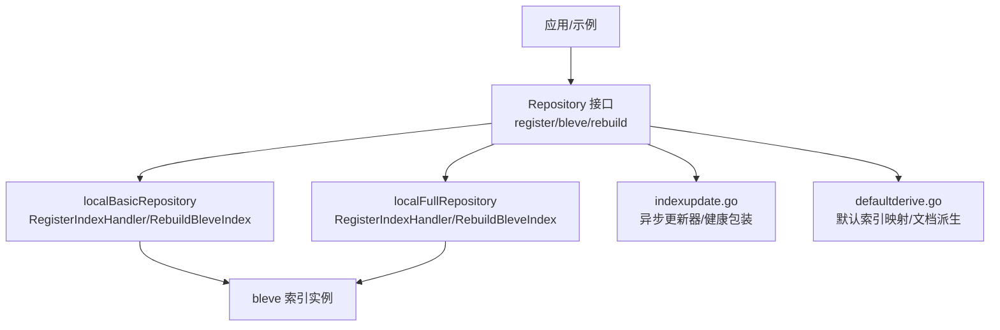
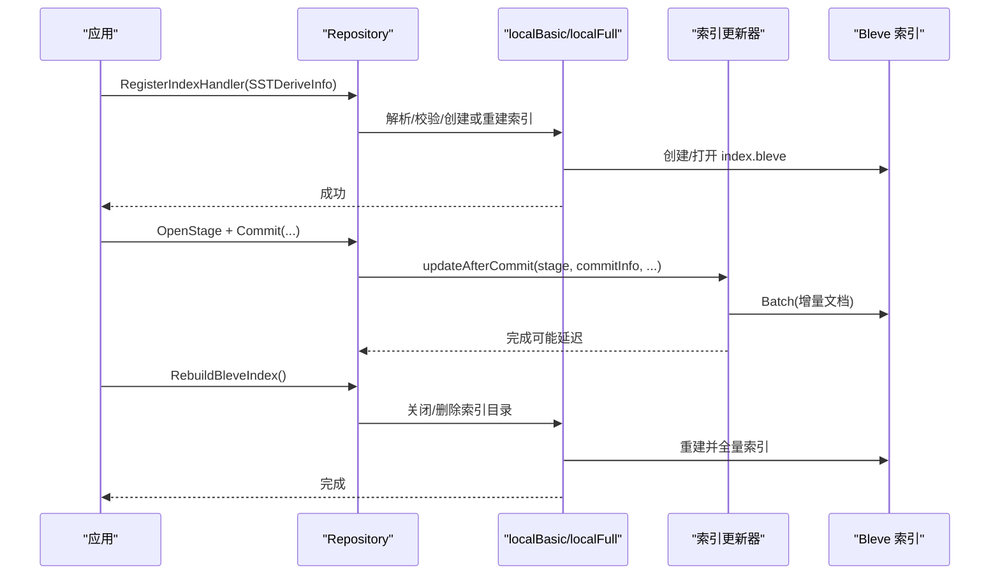
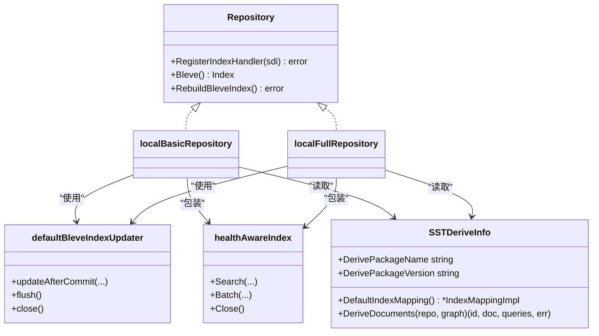

# 索引管理方法

<cite>
**本文引用的文件**
- [repository.go](file://sst/repository.go)
- [repolocalbasic.go](file://sst/repolocalbasic.go)
- [repolocalfull.go](file://sst/repolocalfull.go)
- [indexupdate.go](file://sst/indexupdate.go)
- [defaultderive.go](file://defaultderive/defaultderive.go)
- [repolocalfullwithbleve.go](file://examples/helloworldrepolocalfullwithbleve/repolocalfullwithbleve.go)
</cite>

## 目录
1. [简介](#简介)
2. [项目结构](#项目结构)
3. [核心组件](#核心组件)
4. [架构总览](#架构总览)
5. [详细组件分析](#详细组件分析)
6. [依赖关系分析](#依赖关系分析)
7. [性能考虑](#性能考虑)
8. [故障排查指南](#故障排查指南)
9. [结论](#结论)
10. [附录：使用示例与最佳实践](#附录使用示例与最佳实践)

## 简介
本文件聚焦于 SST Core 中的“索引管理”能力，围绕以下关键方法进行系统化说明：
- RegisterIndexHandler：注册/重建 Bleve 搜索引擎的索引处理器，支持默认或自定义索引映射。
- Bleve：获取已注册的 Bleve 索引实例（本地仓库返回实际索引；远程仓库返回客户端）。
- RebuildBleveIndex：关闭当前索引、删除索引目录并从头重建。
同时，文档将解释 SSTDeriveInfo 结构体的作用与配置项，给出完整的使用示例（含自定义映射、重建、性能调优），并说明不同仓库类型对索引的支持与限制。

## 项目结构
与索引管理直接相关的代码主要分布在 sst 包及其子模块中：
- 接口定义与仓库生命周期：repository.go
- 本地基础仓库实现（无历史）：repolocalbasic.go
- 本地完整仓库实现（带历史）：repolocalfull.go
- 索引更新器与健康包装：indexupdate.go
- 默认索引映射与文档派生：defaultderive.go
- 示例程序：examples/helloworldrepolocalfullwithbleve/repolocalfullwithbleve.go

图表来源
- [repository.go:91-120](file://sst/repository.go#L91-L120)
- [repolocalbasic.go:67-253](file://sst/repolocalbasic.go#L67-L253)
- [repolocalfull.go:259-449](file://sst/repolocalfull.go#L259-L449)
- [indexupdate.go:39-158](file://sst/indexupdate.go#L39-L158)
- [defaultderive.go:127-211](file://defaultderive/defaultderive.go#L127-L211)

章节来源
- [repository.go:91-120](file://sst/repository.go#L91-L120)

## 核心组件
- Repository 接口中的索引管理方法
  - RegisterIndexHandler(*SSTDeriveInfo) error：为本地仓库注册索引处理器。若传入空 SSTDeriveInfo 则删除现有索引；若版本不匹配则触发重建。
  - Bleve() bleve.Index：返回已注册的 Bleve 索引（本地）或客户端句柄（远程）。
  - RebuildBleveIndex() error：关闭并删除索引目录后重建。
- SSTDeriveInfo 结构体
  - DerivePackageName / DerivePackageVersion：用于校验索引映射版本一致性。
  - DefaultIndexMapping：返回 bleve 的 IndexMappingImpl，定义字段类型、分词器、是否存储/排序等。
  - DeriveDocuments：从 NamedGraph 派生出可索引的文档数据，并可返回预条件查询以做唯一性约束检查。
- 索引更新器与健壮性
  - defaultBleveIndexUpdater：后台队列异步执行批量写入，避免阻塞 BBolt 事务。
  - healthAwareIndex：对 bleve.Index 的健康状态进行包装，失败时重试并记录错误计数。

章节来源
- [repository.go:181-195](file://sst/repository.go#L181-L195)
- [indexupdate.go:39-158](file://sst/indexupdate.go#L39-L158)
- [defaultderive.go:127-211](file://defaultderive/defaultderive.go#L127-L211)

## 架构总览
下图展示了注册索引、提交变更、异步更新索引以及重建索引的整体流程。

图表来源
- [repolocalbasic.go:67-253](file://sst/repolocalbasic.go#L67-L253)
- [repolocalfull.go:259-449](file://sst/repolocalfull.go#L259-L449)
- [indexupdate.go:160-249](file://sst/indexupdate.go#L160-L249)

## 详细组件分析

### RegisterIndexHandler：注册与版本控制
- 行为要点
  - 若传入空 SSTDeriveInfo：删除 index.bleve 目录，禁用索引功能。
  - 若存在已有索引：读取索引信息文件，比较 DerivePackageName/DerivePackageVersion。一致则复用索引并设置预提交条件；不一致则重建。
  - 首次创建：建立 index.bleve 目录，保存 derive info JSON，设置 pre-commit 回调与异步更新器，并调用重建逻辑遍历数据生成初始索引。
- 差异点
  - localBasicRepository：无分支语义，仅维护单一主分支索引。
  - localFullRepository：保留修订历史，重建时仍会基于当前仓库内容构建索引。

章节来源
- [repolocalbasic.go:67-253](file://sst/repolocalbasic.go#L67-L253)
- [repolocalfull.go:259-449](file://sst/repolocalfull.go#L259-L449)

### Bleve：获取索引实例
- 本地仓库：返回健康包装后的 bleve.Index，可直接用于 Search/SearchInContext 等操作。
- 远程仓库：返回远程 Bleve 客户端（由服务端管理索引），无需本地上下文参数。

章节来源
- [repository.go:104-107](file://sst/repository.go#L104-L107)
- [repolocalbasic.go:224-232](file://sst/repolocalbasic.go#L224-L232)
- [repolocalfull.go:428-436](file://sst/repolocalfull.go#L428-L436)

### RebuildBleveIndex：重建索引
- 行为要点
  - 关闭当前索引与异步更新器，删除 index.bleve 目录，重新创建并全量重建。
  - 支持：localFullRepository（保留修订历史）、localBasicRepository（无历史）。
  - 不支持：remoteRepository（返回不支持错误）、localFlat*（无索引能力）。
- 适用场景
  - 升级索引映射（DerivePackageVersion 变化）。
  - 修复损坏索引。
  - 大规模数据迁移后统一重建。

章节来源
- [repository.go:109-120](file://sst/repository.go#L109-L120)
- [repolocalbasic.go:234-253](file://sst/repolocalbasic.go#L234-L253)
- [repolocalfull.go:438-449](file://sst/repolocalfull.go#L438-L449)

### 索引更新器与预提交约束
- 异步更新器
  - 在 BBolt 提交成功后，收集受影响的 NamedGraph，构造批量写入任务，后台线程执行，避免阻塞写路径。
  - 提供 flush/close 能力，便于测试与优雅关闭。
- 预提交约束
  - 通过 DeriveDocuments 返回的查询，在提交前/后检查唯一性约束（如 mainType+id+idOwner 组合唯一），冲突时拒绝提交。
- 健康包装
  - 搜索失败自动重试一次，记录错误计数与最近成功时间，辅助监控与告警。

章节来源
- [indexupdate.go:39-158](file://sst/indexupdate.go#L39-L158)
- [indexupdate.go:160-249](file://sst/indexupdate.go#L160-L249)
- [indexupdate.go:346-502](file://sst/indexupdate.go#L346-L502)
- [indexupdate.go:650-795](file://sst/indexupdate.go#L650-L795)

### 默认索引映射与文档派生
- 默认映射
  - 定义多种文档类型（组织、人员、分类系统等），并为 label/comment/id 等字段配置不同的分词器、是否存储/排序/DocValues。
  - 包含 commitHash/commitAuthor/commitTime/commitMessage 等元数据字段。
- 文档派生
  - 遍历 NamedGraph 节点，识别类型与属性，生成结构化文档；支持 idOwner、directImport、nodeCount、literal 等字段。
  - 返回预条件查询，用于唯一性约束检查。

章节来源
- [defaultderive.go:127-211](file://defaultderive/defaultderive.go#L127-L211)
- [defaultderive.go:213-291](file://defaultderive/defaultderive.go#L213-L291)
- [defaultderive.go:297-800](file://defaultderive/defaultderive.go#L297-L800)

### 不同仓库类型的索引支持与限制
- localFullRepository
  - 支持 RegisterIndexHandler/Bleve/RebuildBleveIndex。
  - 保留修订历史，重建时基于仓库内容生成索引。
- localBasicRepository
  - 支持 RegisterIndexHandler/Bleve/RebuildBleveIndex。
  - 无分支历史，仅维护主分支索引。
- remoteRepository
  - RegisterIndexHandler 不可用（服务端管理）。
  - Bleve 返回远程客户端。
  - RebuildBleveIndex 返回不支持错误。
- localFlatRepository / localFlatFileSystemRepository
  - 无 Bleve 索引能力，相关操作返回不可用错误。

章节来源
- [repository.go:109-120](file://sst/repository.go#L109-L120)
- [repolocalflat.go:42-50](file://sst/repolocalflat.go#L42-L50)
- [repolocalflatfilesystem.go:33-41](file://sst/repolocalflatfilesystem.go#L33-L41)
- [reporemote.go:243-260](file://sst/reporemote.go#L243-L260)

## 依赖关系分析

图表来源
- [repository.go:91-120](file://sst/repository.go#L91-L120)
- [repolocalbasic.go:67-253](file://sst/repolocalbasic.go#L67-L253)
- [repolocalfull.go:259-449](file://sst/repolocalfull.go#L259-L449)
- [indexupdate.go:39-158](file://sst/indexupdate.go#L39-L158)
- [indexupdate.go:650-795](file://sst/indexupdate.go#L650-L795)
- [repository.go:181-195](file://sst/repository.go#L181-L195)

## 性能考虑
- 异步批量写入
  - 默认更新器使用后台队列与批量提交，降低写放大与锁竞争。
  - 可通过 FlushBleveIndex 在测试中等待队列清空。
- 批大小阈值
  - 内部根据文档总大小阈值进行中间提交，避免单次批过大导致内存压力。
- 健康重试
  - 搜索失败自动重试一次，减少偶发 I/O 抖动影响。
- 建议
  - 大批量导入后优先使用 RebuildBleveIndex 一次性重建，再配合业务分批提交增量。
  - 合理设计索引映射，避免过多 DocValues/Store 字段造成体积膨胀。
  - 在高并发下关注磁盘 IO 与索引合并开销，必要时调整批大小与刷新策略。

[本节为通用指导，不直接分析具体文件]

## 故障排查指南
- 常见错误与定位
  - 索引目录不存在或损坏：RebuildBleveIndex 会删除并重建；若失败请检查权限与磁盘空间。
  - 版本不匹配：当 DerivePackageVersion 变化时会触发重建；确认默认映射版本与预期一致。
  - 唯一性约束冲突：提交时报错提示 mainType+id+idOwner 冲突，需检查数据或调整映射/约束。
  - 远程仓库重建：返回不支持错误，请在服务端侧处理。
- 诊断步骤
  - 查看仓库 Info 中的 BleveName/BleveVersion 与实际索引目录是否一致。
  - 使用 FlushBleveIndex 确保异步任务完成后再验证结果。
  - 直接打开 index.bleve 目录进行独立检索，排除仓库层问题。

章节来源
- [repolocalbasic.go:67-253](file://sst/repolocalbasic.go#L67-L253)
- [repolocalfull.go:259-449](file://sst/repolocalfull.go#L259-L449)
- [indexupdate.go:346-502](file://sst/indexupdate.go#L346-L502)
- [repository.go:109-120](file://sst/repository.go#L109-L120)

## 结论
SST 的索引管理以 RegisterIndexHandler/Bleve/RebuildBleveIndex 为核心，结合 SSTDeriveInfo 提供的映射与文档派生能力，实现了灵活、可扩展的全文检索集成。本地仓库支持完整的索引生命周期管理，远程仓库由服务端托管。通过异步更新与健康包装，系统在吞吐与稳定性之间取得平衡。生产环境建议结合默认映射与自定义映射，按需重建与调优，以获得最佳性能与可维护性。

[本节为总结，不直接分析具体文件]

## 附录：使用示例与最佳实践

### 基本用法（创建、注册、搜索、重建）
- 创建本地仓库并注册默认索引处理器。
- 添加数据并提交，随后通过 repo.Bleve() 进行搜索。
- 需要时调用 RebuildBleveIndex 进行全量重建。

参考示例路径
- [repolocalfullwithbleve.go:44-88](file://examples/helloworldrepolocalfullwithbleve/repolocalfullwithbleve.go#L44-L88)
- [repolocalfullwithbleve.go:90-129](file://examples/helloworldrepolocalfullwithbleve/repolocalfullwithbleve.go#L90-L129)

### 自定义索引映射
- 通过实现 SSTDeriveInfo.DefaultIndexMapping 与 DeriveDocuments，定制字段类型、分词器、存储策略及文档结构。
- 注意保持 DerivePackageVersion 与索引版本一致，否则将触发重建。

参考路径
- [defaultderive.go:127-211](file://defaultderive/defaultderive.go#L127-L211)
- [defaultderive.go:297-800](file://defaultderive/defaultderive.go#L297-L800)

### 索引重建流程（含分支与历史）
- 调用 RebuildBleveIndex 关闭并删除索引目录，然后重建。
- localFullRepository 会在重建过程中基于仓库内容（含历史）生成索引。

参考路径
- [repolocalfull.go:438-449](file://sst/repolocalfull.go#L438-L449)
- [repolocalbasic.go:234-253](file://sst/repolocalbasic.go#L234-L253)

### 性能调优建议
- 大批量导入后优先重建索引，再逐步提交增量。
- 合理选择字段是否 Store/DocValues，控制索引体积。
- 使用 FlushBleveIndex 在测试中确保异步任务完成。

参考路径
- [indexupdate.go:160-249](file://sst/indexupdate.go#L160-L249)
- [indexupdate.go:633-648](file://sst/indexupdate.go#L633-L648)

### 不同仓库类型的支持情况
- localFullRepository：支持全部索引管理方法。
- localBasicRepository：支持全部索引管理方法（无历史）。
- remoteRepository：RegisterIndexHandler 不可用；RebuildBleveIndex 不支持；Bleve 返回客户端。
- localFlat*：无索引能力。

参考路径
- [repository.go:109-120](file://sst/repository.go#L109-L120)
- [repolocalflat.go:42-50](file://sst/repolocalflat.go#L42-L50)
- [repolocalflatfilesystem.go:33-41](file://sst/repolocalflatfilesystem.go#L33-L41)
- [reporemote.go:243-260](file://sst/reporemote.go#L243-L260)