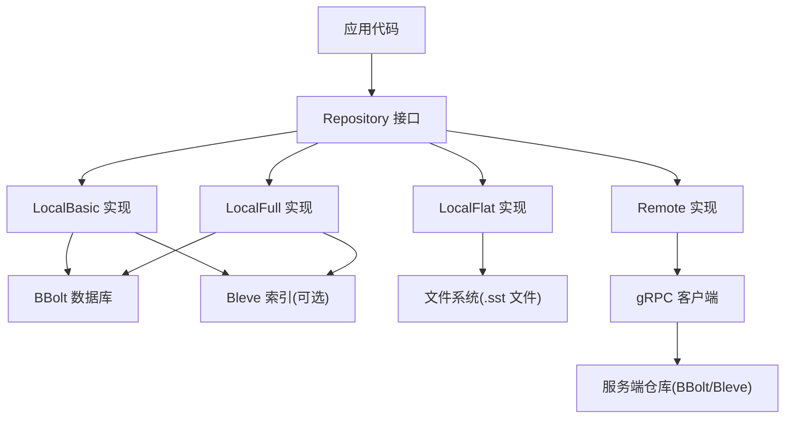
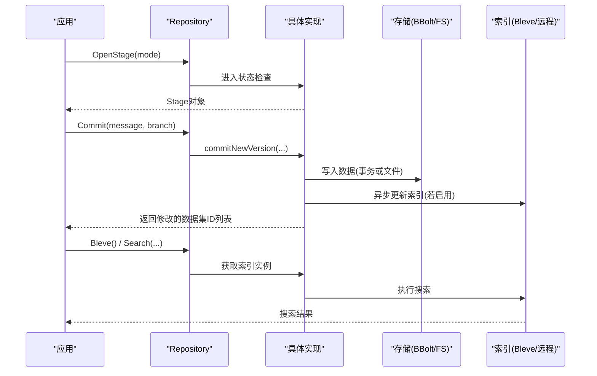
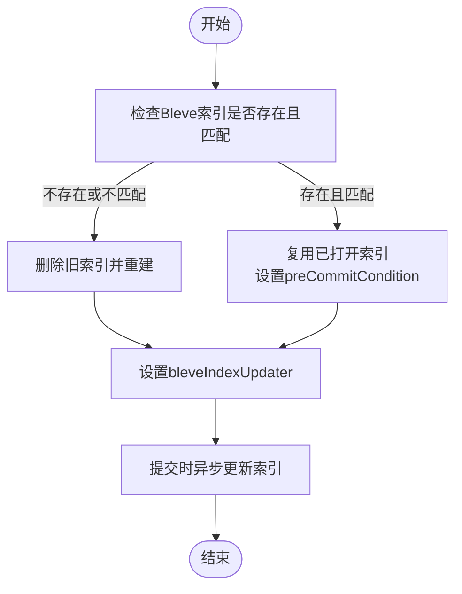
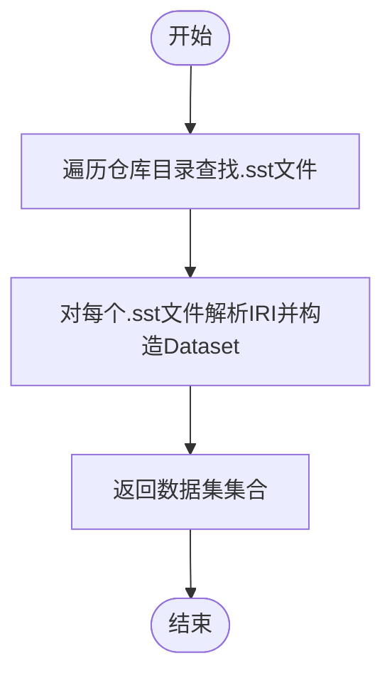
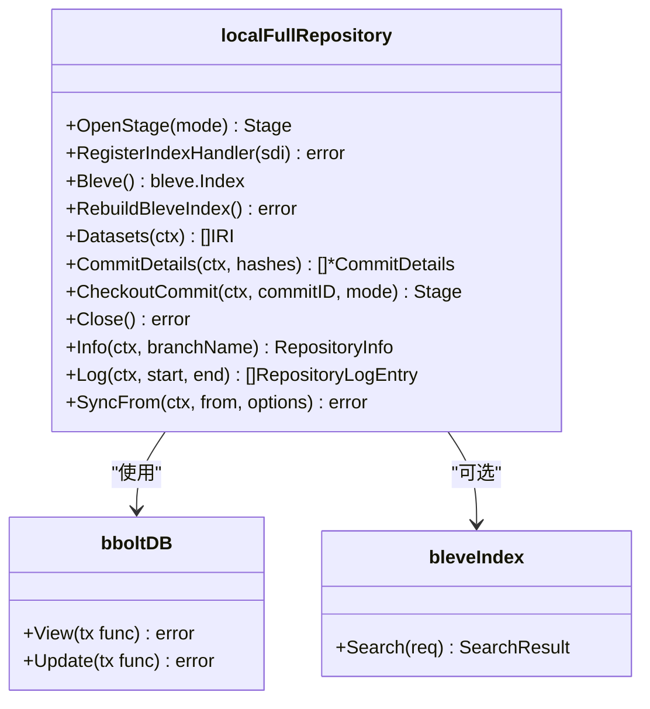
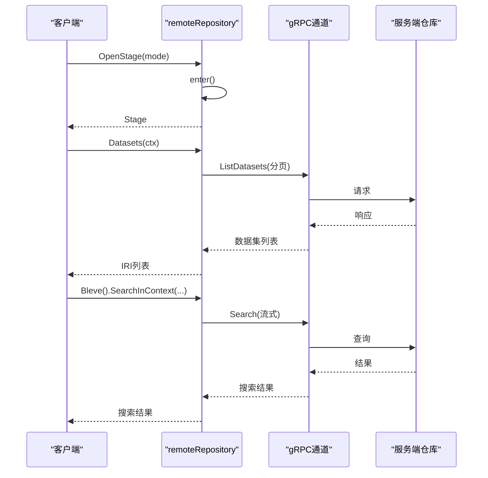
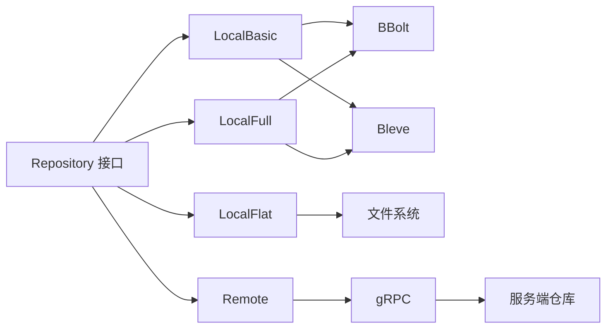

# 仓库API

<cite>
**本文引用的文件**
- [repository.go](file://sst/repository.go)
- [repolocalbasic.go](file://sst/repolocalbasic.go)
- [repolocalflat.go](file://sst/repolocalflat.go)
- [repolocalfull.go](file://sst/repolocalfull.go)
- [reporemote.go](file://sst/reporemote.go)
- [types.go](file://sst/types.go)
- [repolocalbasic_test.go](file://examples/helloworldrepolocalbasic/repolocalbasic_test.go)
- [repolocalfull.go](file://examples/helloworldrepolocalfull/repolocalfull.go)
- [main.go](file://examples/helloworldreporemote/main.go)
</cite>

## 目录
1. [简介](#简介)
2. [项目结构](#项目结构)
3. [核心组件](#核心组件)
4. [架构总览](#架构总览)
5. [详细组件分析](#详细组件分析)
6. [依赖关系分析](#依赖关系分析)
7. [性能与存储后端选择](#性能与存储后端选择)
8. [并发、事务与资源管理最佳实践](#并发事务与资源管理最佳实践)
9. [错误处理与故障排查](#错误处理与故障排查)
10. [迁移指南与兼容性说明](#迁移指南与兼容性说明)
11. [结论](#结论)

## 简介
本参考文档面向SST仓库API，系统性阐述Repository接口的设计理念与各实现模式，覆盖本地基础仓库（LocalBasic）、本地扁平仓库（LocalFlat）、本地完整仓库（LocalFull）和远程仓库（Remote）。文档包含各仓库类型的创建、配置与使用示例路径，生命周期与连接管理、错误处理机制，不同存储后端的性能特点与选型建议，以及并发访问、事务处理和资源管理的最佳实践。同时提供迁移指南与兼容性说明，帮助读者在不同场景下选择合适的仓库类型并正确集成。

## 项目结构
SST仓库API的核心位于sst包中，围绕统一的Repository接口提供多种实现：
- Repository接口定义统一能力：数据集枚举、提交历史、索引、日志、文档存取、同步等。
- 四种仓库实现：
  - LocalBasic：基于BBolt + Bleve，无数据集版本历史，适合轻量级本地存储与检索。
  - LocalFlat：纯文件系统扁平目录，每个NamedGraph一个SST二进制文件，无事务、无历史、无索引。
  - LocalFull：基于BBolt + Bleve，支持数据集版本历史、分支、提交、日志、全文检索。
  - Remote：通过gRPC远程访问服务端仓库，具备与LocalFull一致的能力模型，但索引重建在服务端进行。

图表来源
- [repository.go:34-179](file://sst/repository.go#L34-L179)
- [repolocalbasic.go:34-42](file://sst/repolocalbasic.go#L34-L42)
- [repolocalflat.go:28-32](file://sst/repolocalflat.go#L28-L32)
- [repolocalfull.go:217-230](file://sst/repolocalfull.go#L217-L230)
- [reporemote.go:88-99](file://sst/reporemote.go#L88-L99)

章节来源
- [repository.go:34-179](file://sst/repository.go#L34-L179)

## 核心组件
- Repository接口：统一抽象了仓库的URL、阶段Stage操作、数据集枚举与获取、提交详情、检出版本、索引注册与重建、信息统计、日志、文档存取、同步等能力。
- SSTDeriveInfo：描述Bleve索引的派生包信息与默认映射，用于本地仓库索引构建与重建。
- 仓库配置repoConfig：封装时间函数、仓库目录、预提交条件、后提交通知、Bleve更新器、派生信息等。
- 仓库信息RepositoryInfo：统计仓库大小、数据集数量、提交数、是否远程、是否支持版本历史、Bleve名称与版本、版本哈希等。
- 错误常量：如ErrNotSupported、ErrNotAvailable、ErrDatasetNotFound等，用于区分不支持与不可用的能力。

章节来源
- [repository.go:34-179](file://sst/repository.go#L34-L179)
- [repository.go:181-238](file://sst/repository.go#L181-L238)
- [repository.go:217-231](file://sst/repository.go#L217-L231)
- [repository.go:706-727](file://sst/repository.go#L706-L727)
- [repository.go:197-215](file://sst/repository.go#L197-L215)

## 架构总览
SST仓库API采用“统一接口 + 多实现”的架构：
- 本地仓库通过BBolt持久化数据，可选Bleve提供全文检索；LocalFull支持版本历史、分支、提交、日志。
- 扁平仓库直接以文件系统组织SST文件，简单高效但不支持事务与历史。
- 远程仓库通过gRPC将请求转发到服务端，客户端持有连接与缓存，索引查询通过远程Bleve服务完成。

图表来源
- [repository.go:60-120](file://sst/repository.go#L60-L120)
- [repolocalbasic.go:67-145](file://sst/repolocalbasic.go#L67-L145)
- [repolocalfull.go:259-341](file://sst/repolocalfull.go#L259-L341)
- [reporemote.go:141-228](file://sst/reporemote.go#L141-L228)

## 详细组件分析

### LocalBasic（本地基础仓库）
- 设计目标：轻量本地存储，支持BBolt事务与Bleve全文检索，不维护数据集版本历史。
- 关键特性：
  - 使用BBolt作为主存储，按数据集UUID为键存储SST文件内容。
  - 支持RegisterIndexHandler注册Bleve索引，自动检测派生包版本一致性，必要时重建索引。
  - 提交时通过preCommitCondition触发索引增量更新，commitNewVersion写回SST文件并调用bleveIndexUpdater异步更新。
  - 不支持CheckoutCommit、Log、DocumentSet等高级功能，返回ErrNotSupported或ErrNotAvailable。
- 适用场景：需要本地快速读写与检索，不需要版本历史与分支的场景。

图表来源
- [repolocalbasic.go:67-145](file://sst/repolocalbasic.go#L67-L145)
- [repolocalbasic.go:147-222](file://sst/repolocalbasic.go#L147-L222)
- [repolocalbasic.go:616-653](file://sst/repolocalbasic.go#L616-L653)

章节来源
- [repolocalbasic.go:34-42](file://sst/repolocalbasic.go#L34-L42)
- [repolocalbasic.go:67-145](file://sst/repolocalbasic.go#L67-L145)
- [repolocalbasic.go:234-253](file://sst/repolocalbasic.go#L234-L253)
- [repolocalbasic.go:616-653](file://sst/repolocalbasic.go#L616-L653)
- [repolocalbasic.go:725-727](file://sst/repolocalbasic.go#L725-L727)

### LocalFlat（本地扁平仓库）
- 设计目标：极简存储，每个NamedGraph对应一个独立SST文件，无事务、无历史、无索引。
- 关键特性：
  - 通过文件系统遍历.sst文件枚举数据集，文件名由IRI的base URL经Base64URL编码生成。
  - CheckoutBranch直接读取对应.sst文件并加载到Stage，递归合并导入图。
  - 不支持RegisterIndexHandler、Bleve、RebuildBleveIndex、Log、DocumentSet等，返回ErrNotAvailable或ErrNotSupported。
- 适用场景：对存储结构透明、无需事务与历史、便于跨进程共享文件的场景。

图表来源
- [repolocalflat.go:63-86](file://sst/repolocalflat.go#L63-L86)
- [repolocalflat.go:88-108](file://sst/repolocalflat.go#L88-L108)
- [repolocalflat.go:211-235](file://sst/repolocalflat.go#L211-L235)

章节来源
- [repolocalflat.go:28-32](file://sst/repolocalflat.go#L28-L32)
- [repolocalflat.go:42-52](file://sst/repolocalflat.go#L42-L52)
- [repolocalflat.go:63-86](file://sst/repolocalflat.go#L63-L86)
- [repolocalflat.go:211-235](file://sst/repolocalflat.go#L211-L235)
- [repolocalflat.go:301-322](file://sst/repolocalflat.go#L301-L322)
- [repolocalflat.go:381-430](file://sst/repolocalflat.go#L381-L430)

### LocalFull（本地完整仓库）
- 设计目标：完整的本地仓库，支持数据集版本历史、分支、提交、日志、全文检索。
- 关键特性：
  - BBolt存储数据集、提交、引用（分支/叶子提交）、命名图版本等。
  - RegisterIndexHandler与LocalBasic类似，支持Bleve索引重建与增量更新。
  - CommitDetails、CheckoutCommit、Log、SyncFrom等高级能力可用。
  - 支持计算仓库版本哈希，便于一致性校验。
- 适用场景：需要版本控制、分支管理、审计日志、全文检索的本地仓库。

图表来源
- [repolocalfull.go:217-230](file://sst/repolocalfull.go#L217-L230)
- [repolocalfull.go:259-341](file://sst/repolocalfull.go#L259-L341)
- [repolocalfull.go:595-719](file://sst/repolocalfull.go#L595-L719)
- [repolocalfull.go:721-732](file://sst/repolocalfull.go#L721-L732)
- [repolocalfull.go:734-761](file://sst/repolocalfull.go#L734-L761)

章节来源
- [repolocalfull.go:217-230](file://sst/repolocalfull.go#L217-L230)
- [repolocalfull.go:259-341](file://sst/repolocalfull.go#L259-L341)
- [repolocalfull.go:595-719](file://sst/repolocalfull.go#L595-L719)
- [repolocalfull.go:721-732](file://sst/repolocalfull.go#L721-L732)
- [repolocalfull.go:734-761](file://sst/repolocalfull.go#L734-L761)

### Remote（远程仓库）
- 设计目标：通过网络访问服务端仓库，保持与LocalFull一致的API语义。
- 关键特性：
  - 通过gRPC连接服务端，封装DatasetService、CommitService、IndexService客户端。
  - 所有方法在enter()/leave()保护下进行状态检查与并发计数。
  - 索引查询通过remoteIndex代理到服务端Bleve服务，不支持客户端重建索引。
  - 支持分页列出数据集、批量获取提交详情、检出提交、分支与叶子提交查询等。
- 适用场景：集中式部署、多客户端共享仓库、需要服务端权限与配额控制的场景。

图表来源
- [reporemote.go:88-99](file://sst/reporemote.go#L88-L99)
- [reporemote.go:126-139](file://sst/reporemote.go#L126-L139)
- [reporemote.go:141-228](file://sst/reporemote.go#L141-L228)
- [reporemote.go:296-347](file://sst/reporemote.go#L296-L347)
- [reporemote.go:349-407](file://sst/reporemote.go#L349-L407)
- [reporemote.go:546-637](file://sst/reporemote.go#L546-L637)

章节来源
- [reporemote.go:88-99](file://sst/reporemote.go#L88-L99)
- [reporemote.go:126-139](file://sst/reporemote.go#L126-L139)
- [reporemote.go:141-228](file://sst/reporemote.go#L141-L228)
- [reporemote.go:296-347](file://sst/reporemote.go#L296-L347)
- [reporemote.go:349-407](file://sst/reporemote.go#L349-L407)
- [reporemote.go:546-637](file://sst/reporemote.go#L546-L637)

## 依赖关系分析
- Repository接口依赖：
  - sstauth：认证与授权上下文。
  - bleve：本地全文检索索引。
  - bbolt：本地事务型KV存储。
  - grpc/gRPC凭据：远程仓库通信与OAuth认证。
- 实现间耦合：
  - LocalBasic与LocalFull共享Bleve索引构建与更新逻辑，差异在于版本历史与分支支持。
  - LocalFlat完全解耦于BBolt与Bleve，仅依赖文件系统。
  - Remote通过gRPC协议与服务器交互，屏蔽底层存储细节。

图表来源
- [repository.go:23-32](file://sst/repository.go#L23-L32)
- [repolocalbasic.go:5-27](file://sst/repolocalbasic.go#L5-L27)
- [repolocalflat.go:5-24](file://sst/repolocalflat.go#L5-L24)
- [repolocalfull.go:5-34](file://sst/repolocalfull.go#L5-L34)
- [reporemote.go:5-37](file://sst/reporemote.go#L5-L37)

章节来源
- [repository.go:23-32](file://sst/repository.go#L23-L32)
- [repolocalbasic.go:5-27](file://sst/repolocalbasic.go#L5-L27)
- [repolocalflat.go:5-24](file://sst/repolocalflat.go#L5-L24)
- [repolocalfull.go:5-34](file://sst/repolocalfull.go#L5-L34)
- [reporemote.go:5-37](file://sst/reporemote.go#L5-L37)

## 性能与存储后端选择
- LocalBasic：
  - 优点：BBolt事务保证原子性；Bleve提供快速全文检索；结构简单，启动快。
  - 缺点：无版本历史，无法回溯与分支。
  - 适用：读多写少、需检索但不需历史的本地场景。
- LocalFlat：
  - 优点：零依赖、易移植、可并行访问不同文件；无索引开销。
  - 缺点：无事务、无历史、无检索；大目录遍历可能较慢。
  - 适用：简单归档、跨进程共享、无需复杂能力的场景。
- LocalFull：
  - 优点：完整版本控制、分支、提交、日志、检索；适合协作与审计。
  - 缺点：BBolt与Bleve维护成本较高；索引重建耗时。
  - 适用：需要强一致性与可追溯性的本地仓库。
- Remote：
  - 优点：集中管理、权限控制、可扩展；客户端轻量。
  - 缺点：网络延迟与可用性影响；索引重建在服务端。
  - 适用：多客户端共享、企业级部署。

[本节为通用指导，不直接分析具体文件]

## 并发、事务与资源管理最佳实践
- 并发访问：
  - 所有仓库实现均通过stateControl的enter()/leave()进行状态检查与等待组计数，确保关闭期间不再接受新操作。
  - Remote仓库使用WaitGroup等待进行中Stage关闭，避免连接提前释放。
- 事务处理：
  - LocalBasic与LocalFull使用BBolt的View/Update封装事务边界，保证数据一致性。
  - LocalFlat无事务，提交时直接写文件，需注意外部并发冲突。
- 资源管理：
  - 关闭顺序：先停止索引更新器，再关闭Bleve索引，最后关闭BBolt或gRPC连接。
  - 远程仓库Close会等待所有inflight操作完成后关闭gRPC连接。
- 索引更新：
  - 使用bleveIndexUpdater异步更新，避免阻塞提交；重建索引时暂停更新并清理旧索引。

章节来源
- [reporemote.go:83-124](file://sst/reporemote.go#L83-L124)
- [repolocalbasic.go:418-442](file://sst/repolocalbasic.go#L418-L442)
- [repolocalfull.go:734-761](file://sst/repolocalfull.go#L734-L761)
- [repolocalbasic.go:234-253](file://sst/repolocalbasic.go#L234-L253)
- [repolocalfull.go:438-458](file://sst/repolocalfull.go#L438-L458)

## 错误处理与故障排查
- 常见错误：
  - ErrNotSupported：方法在当前仓库类型中不支持（如LocalBasic的CheckoutCommit）。
  - ErrNotAvailable：能力不可用（如LocalFlat的RegisterIndexHandler）。
  - ErrDatasetNotFound、ErrRepositoryDoesNotExist：数据或仓库不存在。
  - ErrRepoClosed：仓库已关闭，拒绝新操作。
- 排查建议：
  - 检查仓库类型是否支持所需能力。
  - 确认BBolt与Bleve路径权限与完整性。
  - 远程仓库检查gRPC连接与认证令牌。
  - 查看仓库Info输出，核对大小、数据集数量、Bleve版本等。

章节来源
- [repository.go:197-215](file://sst/repository.go#L197-L215)
- [repolocalbasic.go:769-798](file://sst/repolocalbasic.go#L769-L798)
- [repolocalflat.go:42-52](file://sst/repolocalflat.go#L42-L52)
- [reporemote.go:69-81](file://sst/reporemote.go#L69-L81)

## 迁移指南与兼容性说明
- 从LocalFlat迁移到LocalBasic/LocalFull：
  - 将现有.sst文件复制到新仓库目录。
  - 初始化BBolt数据库并导入数据集元数据。
  - 如需检索，注册SSTDeriveInfo并重建Bleve索引。
- 从LocalBasic升级到LocalFull：
  - 保留BBolt数据库，启用版本历史与分支功能。
  - 重新构建Bleve索引以支持历史数据的检索。
- 从本地迁移到远程：
  - 部署服务端仓库，配置OIDC与TLS。
  - 客户端使用OpenRemoteRepository连接，确保上下文携带认证信息。
  - 注意索引重建在服务端进行，客户端仅能查询。

[本节为通用指导，不直接分析具体文件]

## 结论
SST仓库API通过统一的Repository接口提供了灵活多样的存储与检索能力。LocalBasic适合轻量本地场景，LocalFlat适合极简文件共享，LocalFull提供完整的版本控制与检索，Remote则支持集中式部署与多客户端共享。根据业务需求选择合适的仓库类型，遵循并发、事务与资源管理最佳实践，可有效提升系统稳定性与性能。迁移时应关注索引重建与数据一致性，确保平滑升级。