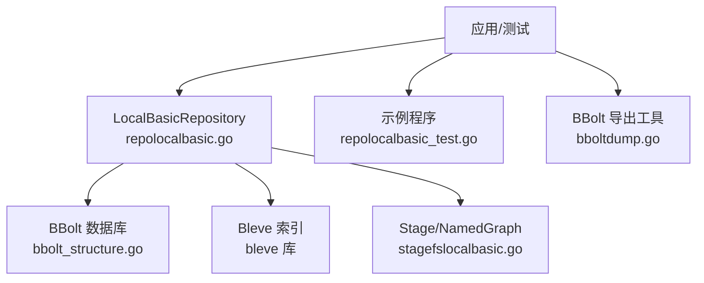
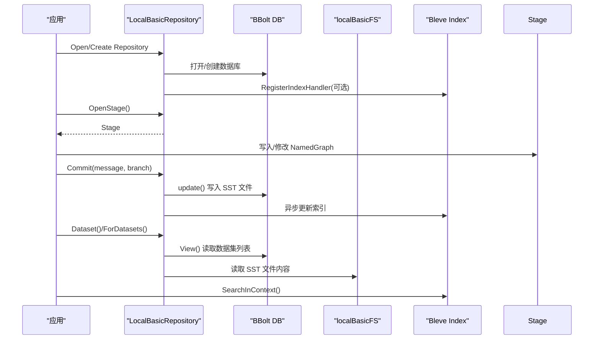
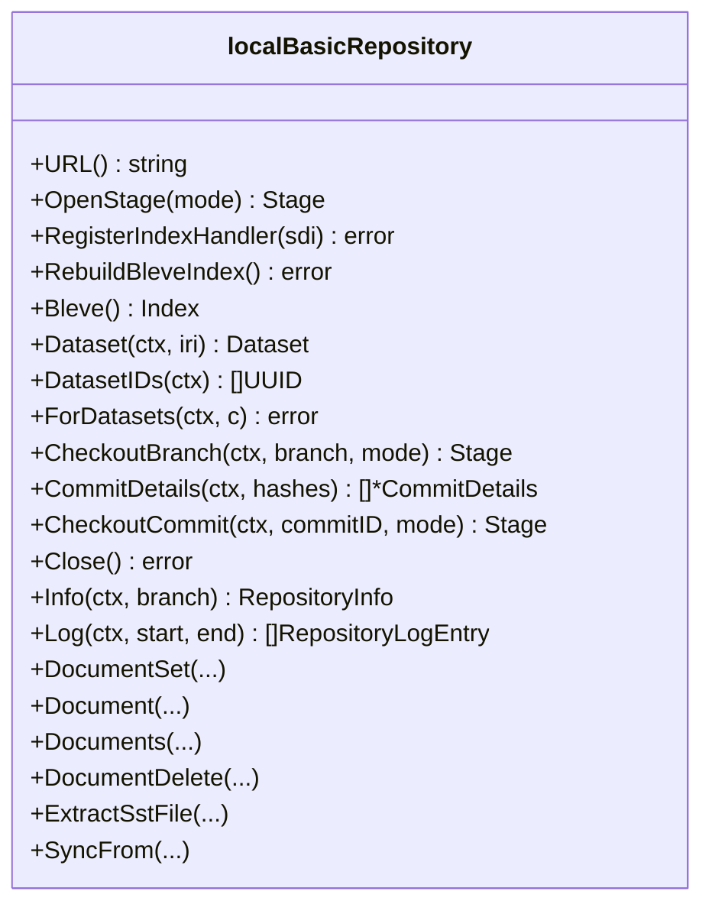
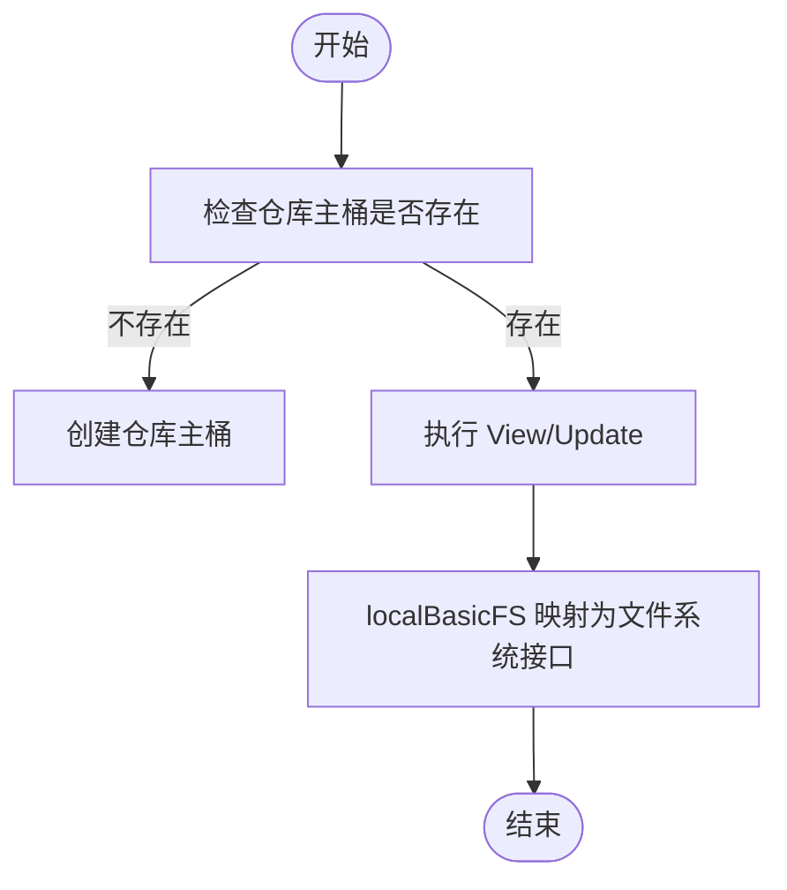
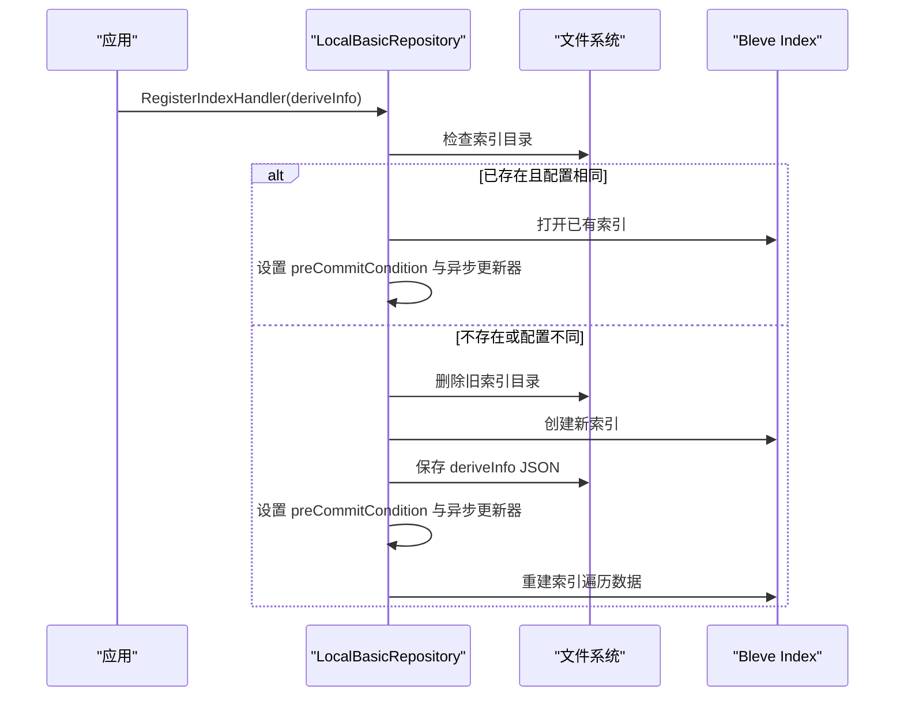
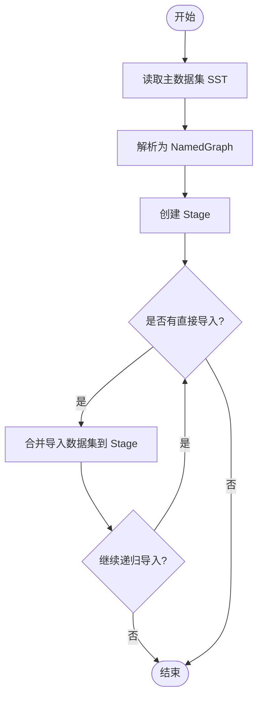
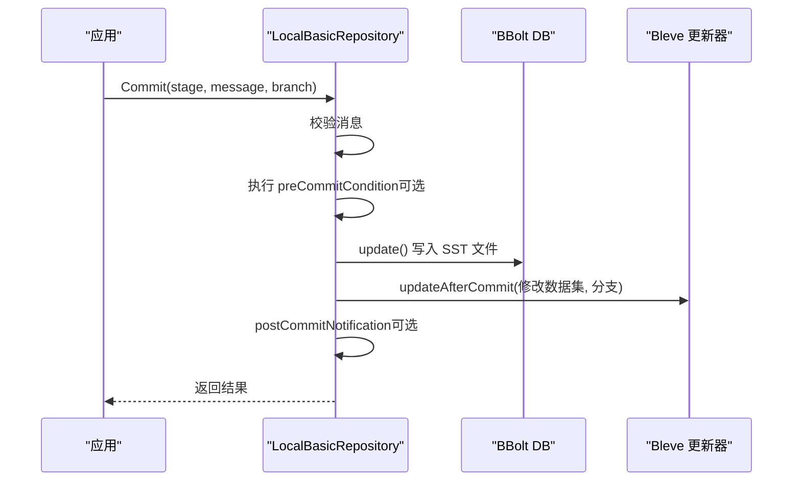
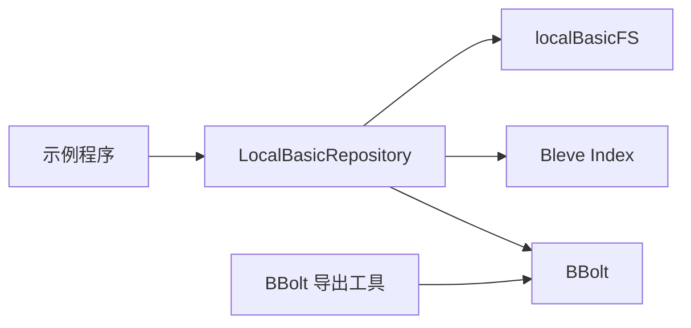
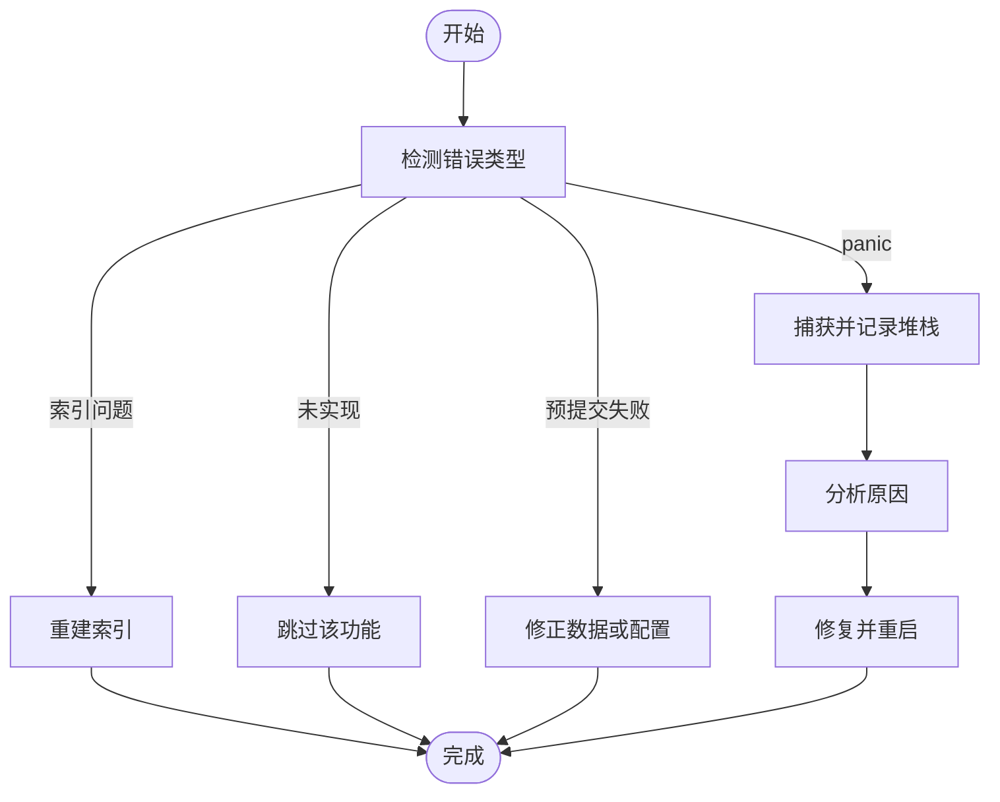

# 本地基础仓库

<cite>
**本文引用的文件**
- [repolocalbasic.go](file://sst/repolocalbasic.go)
- [bbolt_structure.go](file://sst/bbolt_structure.go)
- [stagefslocalbasic.go](file://sst/stagefslocalbasic.go)
- [errrecovery.go](file://sst/errrecovery.go)
- [repolocalbasic_test.go](file://examples/helloworldrepolocalbasic/repolocalbasic_test.go)
- [bboltdump.go](file://cli/cmd/utils/bboltdump.go)
</cite>

## 目录
1. [简介](#简介)
2. [项目结构](#项目结构)
3. [核心组件](#核心组件)
4. [架构总览](#架构总览)
5. [详细组件分析](#详细组件分析)
6. [依赖关系分析](#依赖关系分析)
7. [性能考量](#性能考量)
8. [故障排查与恢复](#故障排查与恢复)
9. [结论](#结论)
10. [附录](#附录)

## 简介
本地基础仓库（LocalBasicRepository）是 SST 提供的一种轻量级本地数据仓库实现。它基于 BBolt 键值存储，支持数据集的创建、提交、查询以及可选的 Bleve 全文索引；同时具备日志记录能力（通过仓库信息统计等），但不支持数据集修订历史、分支管理、文档管理等高级特性。其设计目标是：在不需要版本化与复杂协作能力的场景下，提供简单、稳定、可检索的数据管理能力。

主要特点
- 使用 BBolt 作为持久化存储，事务安全、读多写少场景下性能优异。
- 支持 Bleve 索引注册与重建，便于进行全文检索。
- 不支持数据集修订历史、分支、标签、文档操作等高级功能。
- 提供仓库信息统计（数据库大小、数据集数量、索引大小等）。
- 提供错误恢复机制与调试辅助。

适用场景
- 单机或单进程应用的数据集管理与检索。
- 对版本控制无需求，但需要结构化存储和搜索的场景。
- 快速原型验证、离线数据处理与分析。

不适用场景
- 需要多分支、多版本、审计日志、远程同步等功能的协作式仓库。
- 需要文档对象管理的场景。

## 项目结构
围绕 LocalBasicRepository 的核心代码分布在 sst 包中，示例位于 examples 子目录，CLI 工具提供 BBolt 数据导出能力。

图表来源
- [repolocalbasic.go:34-42](file://sst/repolocalbasic.go#L34-L42)
- [bbolt_structure.go:81-191](file://sst/bbolt_structure.go#L81-L191)
- [stagefslocalbasic.go:21-34](file://sst/stagefslocalbasic.go#L21-L34)
- [repolocalbasic_test.go:31-129](file://examples/helloworldrepolocalbasic/repolocalbasic_test.go#L31-L129)
- [bboltdump.go:16-45](file://cli/cmd/utils/bboltdump.go#L16-L45)

章节来源
- [repolocalbasic.go:34-42](file://sst/repolocalbasic.go#L34-L42)
- [bbolt_structure.go:81-191](file://sst/bbolt_structure.go#L81-L191)
- [stagefslocalbasic.go:21-34](file://sst/stagefslocalbasic.go#L21-L34)
- [repolocalbasic_test.go:31-129](file://examples/helloworldrepolocalbasic/repolocalbasic_test.go#L31-L129)
- [bboltdump.go:16-45](file://cli/cmd/utils/bboltdump.go#L16-L45)

## 核心组件
- localBasicRepository：本地基础仓库实现，封装 BBolt 访问、Bleve 索引生命周期、数据集枚举与查找、提交流程、仓库信息等。
- localBasicDataset：数据集抽象，支持按分支检出并加载导入图。
- localBasicFS：将 BBolt Bucket 映射为文件系统接口，用于读写 SST 文件。
- Bleve 索引：可选的全文检索能力，支持注册、重建、异步更新。
- 错误恢复：统一的 panic 捕获与堆栈收集，便于定位问题。

章节来源
- [repolocalbasic.go:34-42](file://sst/repolocalbasic.go#L34-L42)
- [repolocalbasic.go:474-577](file://sst/repolocalbasic.go#L474-L577)
- [stagefslocalbasic.go:21-34](file://sst/stagefslocalbasic.go#L21-L34)
- [errrecovery.go:15-50](file://sst/errrecovery.go#L15-L50)

## 架构总览
LocalBasicRepository 以 BBolt 为核心存储，SST 数据集以二进制文件形式存储在仓库 Bucket 中；Bleve 索引独立于 BBolt，存放于仓库目录下的索引文件夹，并在提交后异步更新。

图表来源
- [repolocalbasic.go:52-65](file://sst/repolocalbasic.go#L52-L65)
- [repolocalbasic.go:616-653](file://sst/repolocalbasic.go#L616-L653)
- [repolocalbasic.go:255-335](file://sst/repolocalbasic.go#L255-L335)
- [stagefslocalbasic.go:36-88](file://sst/stagefslocalbasic.go#L36-L88)
- [repolocalbasic.go:147-222](file://sst/repolocalbasic.go#L147-L222)

## 详细组件分析

### LocalBasicRepository 类与方法
- 关键属性
  - url：仓库 URL
  - config：仓库配置（包含 deriveInfo、preCommitCondition、bleveIndexUpdater 等）
  - db：BBolt 数据库实例
  - repositoryBucketName：仓库主桶名称
  - bleveIndex：Bleve 索引实例
  - accessRight：访问权限（打开/创建时从文件系统探测确定）

- 关键方法
  - OpenStage：打开工作区，返回 Stage
  - RegisterIndexHandler：注册/重建 Bleve 索引，设置预提交条件与异步更新器
  - RebuildBleveIndex：关闭当前索引并重建
  - Dataset/DatasetIDs/ForDatasets：数据集枚举与查找
  - CheckoutBranch：按分支检出数据集到 Stage
  - CommitDetails/CheckoutCommit：不支持（返回未实现错误）
  - Close：关闭索引更新器、索引与数据库
  - Info：仓库信息统计（BBolt 大小、数据集数量、Bleve 大小等）
  - Log：不支持（返回未实现错误）
  - 文档相关方法：DocumentSet/Document/Documents/DocumentDelete：均不支持

图表来源
- [repolocalbasic.go:34-42](file://sst/repolocalbasic.go#L34-L42)
- [repolocalbasic.go:48-65](file://sst/repolocalbasic.go#L48-L65)
- [repolocalbasic.go:67-232](file://sst/repolocalbasic.go#L67-L232)
- [repolocalbasic.go:255-335](file://sst/repolocalbasic.go#L255-L335)
- [repolocalbasic.go:418-442](file://sst/repolocalbasic.go#L418-L442)
- [repolocalbasic.go:660-727](file://sst/repolocalbasic.go#L660-L727)
- [repolocalbasic.go:773-798](file://sst/repolocalbasic.go#L773-L798)

章节来源
- [repolocalbasic.go:34-42](file://sst/repolocalbasic.go#L34-L42)
- [repolocalbasic.go:48-65](file://sst/repolocalbasic.go#L48-L65)
- [repolocalbasic.go:67-232](file://sst/repolocalbasic.go#L67-L232)
- [repolocalbasic.go:255-335](file://sst/repolocalbasic.go#L255-L335)
- [repolocalbasic.go:418-442](file://sst/repolocalbasic.go#L418-L442)
- [repolocalbasic.go:660-727](file://sst/repolocalbasic.go#L660-L727)
- [repolocalbasic.go:773-798](file://sst/repolocalbasic.go#L773-L798)

### BBolt 存储结构与性能特点
- 存储布局
  - 仓库主桶：repository
  - 数据集文件：以 UUID 为键，SST 二进制内容为值，通过 localBasicFS 暴露为文件系统接口
  - 其他结构（如命名图修订、数据集修订、提交、日志等）定义在 bbolt_structure.go 中，供完整仓库使用；LocalBasicRepository 仅使用数据集文件存储与基本枚举

- 性能特点
  - BBolt 是单文件、不可变页结构的 KV 存储，适合高并发读、顺序写场景
  - 事务隔离保证一致性，View/Update 分别用于只读与写操作
  - 本地文件系统映射简化了 SST 文件的读写逻辑

图表来源
- [repolocalbasic.go:444-472](file://sst/repolocalbasic.go#L444-L472)
- [stagefslocalbasic.go:36-88](file://sst/stagefslocalbasic.go#L36-L88)
- [bbolt_structure.go:81-191](file://sst/bbolt_structure.go#L81-L191)

章节来源
- [repolocalbasic.go:444-472](file://sst/repolocalbasic.go#L444-L472)
- [stagefslocalbasic.go:36-88](file://sst/stagefslocalbasic.go#L36-L88)
- [bbolt_structure.go:81-191](file://sst/bbolt_structure.go#L81-L191)

### Bleve 索引注册与重建
- 注册索引：根据 deriveInfo 判断是否已有索引且配置一致，若不一致则重建；设置预提交条件与异步更新器
- 重建索引：删除旧索引目录，创建新索引，保存 deriveInfo JSON，遍历现有数据重建索引
- 健康感知：使用 healthAwareIndex 包装，提升索引可用性

图表来源
- [repolocalbasic.go:67-145](file://sst/repolocalbasic.go#L67-L145)
- [repolocalbasic.go:147-222](file://sst/repolocalbasic.go#L147-L222)

章节来源
- [repolocalbasic.go:67-145](file://sst/repolocalbasic.go#L67-L145)
- [repolocalbasic.go:147-222](file://sst/repolocalbasic.go#L147-L222)

### 数据集检出与导入图合并
- CheckoutBranch：从仓库主桶读取数据集 SST 文件，解析为 NamedGraph，并将其 Stage 返回
- 递归导入：自动加载直接导入的数据集，合并到当前 Stage，避免重复加载

图表来源
- [repolocalbasic.go:504-567](file://sst/repolocalbasic.go#L504-L567)

章节来源
- [repolocalbasic.go:504-567](file://sst/repolocalbasic.go#L504-L567)

### 提交流程与索引更新
- Commit：校验消息非空，调用预提交条件（如有），写入 SST 文件，收集修改的数据集，触发索引异步更新，执行后置通知

图表来源
- [repolocalbasic.go:616-653](file://sst/repolocalbasic.go#L616-L653)

章节来源
- [repolocalbasic.go:616-653](file://sst/repolocalbasic.go#L616-L653)

### 仓库信息与统计
- Info：计算 BBolt 数据库大小、数据集数量、Bleve 索引大小，返回仓库信息（不包含文档相关字段）

章节来源
- [repolocalbasic.go:660-727](file://sst/repolocalbasic.go#L660-L727)

## 依赖关系分析
- LocalBasicRepository 依赖 BBolt 进行数据持久化，依赖 Bleve 进行全文检索（可选）
- localBasicFS 将 BBolt Bucket 映射为文件系统接口，简化 SST 文件读写
- 示例程序演示创建、写入、提交、重新打开、检索的完整流程
- CLI 工具提供 BBolt 数据导出能力，便于诊断与迁移

图表来源
- [repolocalbasic.go:34-42](file://sst/repolocalbasic.go#L34-L42)
- [stagefslocalbasic.go:21-34](file://sst/stagefslocalbasic.go#L21-L34)
- [repolocalbasic_test.go:31-129](file://examples/helloworldrepolocalbasic/repolocalbasic_test.go#L31-L129)
- [bboltdump.go:16-45](file://cli/cmd/utils/bboltdump.go#L16-L45)

章节来源
- [repolocalbasic.go:34-42](file://sst/repolocalbasic.go#L34-L42)
- [stagefslocalbasic.go:21-34](file://sst/stagefslocalbasic.go#L21-L34)
- [repolocalbasic_test.go:31-129](file://examples/helloworldrepolocalbasic/repolocalbasic_test.go#L31-L129)
- [bboltdump.go:16-45](file://cli/cmd/utils/bboltdump.go#L16-L45)

## 性能考量
- BBolt 特性
  - 单文件、不可变页结构，读性能优秀，适合大量只读查询
  - 事务隔离确保一致性，避免脏读
  - 写入采用追加模式，适合批量提交

- 索引策略
  - 使用 Bleve 进行全文检索，建议合理配置 deriveInfo 以优化索引字段与分词
  - 预提交条件与异步更新器减少提交阻塞时间
  - 定期重建索引可修复索引损坏或不一致

- 资源监控
  - 通过 Info 获取 BBolt 文件大小、数据集数量、Bleve 索引大小，评估存储增长与性能影响
  - 关注内存占用与磁盘 I/O，避免频繁重建索引

[本节为通用性能讨论，不直接分析具体文件]

## 故障排查与恢复
- 错误类型
  - 未实现错误：CommitDetails、CheckoutCommit、Log、文档相关方法等返回“不支持”
  - 预提交条件失败：提交前校验失败会返回相应错误
  - 索引相关错误：索引目录不存在、JSON 解码失败、重建失败等

- 恢复机制
  - 统一 panic 捕获与堆栈收集，便于定位崩溃点
  - 重建索引：当索引损坏或配置变更时，调用 RebuildBleveIndex 恢复
  - 数据导出：使用 CLI 工具导出 BBolt 数据，便于分析与迁移

图表来源
- [repolocalbasic.go:67-145](file://sst/repolocalbasic.go#L67-L145)
- [repolocalbasic.go:234-253](file://sst/repolocalbasic.go#L234-L253)
- [errrecovery.go:15-50](file://sst/errrecovery.go#L15-L50)
- [bboltdump.go:16-45](file://cli/cmd/utils/bboltdump.go#L16-L45)

章节来源
- [repolocalbasic.go:67-145](file://sst/repolocalbasic.go#L67-L145)
- [repolocalbasic.go:234-253](file://sst/repolocalbasic.go#L234-L253)
- [errrecovery.go:15-50](file://sst/errrecovery.go#L15-L50)
- [bboltdump.go:16-45](file://cli/cmd/utils/bboltdump.go#L16-L45)

## 结论
LocalBasicRepository 提供了简洁可靠的本地数据存储与检索能力，适用于不需要版本控制与协作功能的场景。通过 BBolt 的高性能存储与 Bleve 的灵活索引，能够满足大多数单机应用的读写与查询需求。对于需要更复杂特性的场景，建议使用完整仓库（LocalFullRepository）或远程仓库。

[本节为总结性内容，不直接分析具体文件]

## 附录

### 创建、配置与使用方法
- 创建仓库：使用 CreateLocalRepository 指定路径与参数
- 注册索引：调用 RegisterIndexHandler 传入 deriveInfo，启用 Bleve 索引
- 打开阶段：OpenStage 获取 Stage，创建/修改 NamedGraph
- 提交：Commit 提交更改，触发索引异步更新
- 重新打开：OpenLocalRepository 重新打开仓库，继续使用
- 检索：通过 Bleve 索引执行搜索

章节来源
- [repolocalbasic_test.go:31-129](file://examples/helloworldrepolocalbasic/repolocalbasic_test.go#L31-L129)

### 数据导入导出
- 导入：通过 Stage 写入 SST 文件并提交
- 导出：使用 CLI 工具 DumpBboltFromDB 导出 BBolt 数据，便于备份或迁移

章节来源
- [repolocalbasic_test.go:31-129](file://examples/helloworldrepolocalbasic/repolocalbasic_test.go#L31-L129)
- [bboltdump.go:16-45](file://cli/cmd/utils/bboltdump.go#L16-L45)

### 查询索引配置
- 配置 deriveInfo：定义索引字段、分词器等，影响检索效果
- 重建索引：当配置变更或索引损坏时，调用 RebuildBleveIndex

章节来源
- [repolocalbasic.go:67-145](file://sst/repolocalbasic.go#L67-L145)
- [repolocalbasic.go:147-222](file://sst/repolocalbasic.go#L147-L222)

### 性能调优示例
- 批量提交：合并多次修改后一次性提交，减少事务开销
- 合理索引字段：仅索引必要字段，降低索引体积与更新成本
- 监控指标：定期查看 Info 输出，评估存储增长与性能变化

[本节为通用指导，不直接分析具体文件]

### 与完整仓库的区别与适用场景
- 区别
  - 不支持数据集修订历史、分支、标签、文档管理
  - 不支持远程同步与审计日志
  - 仅提供基础的数据集存储与检索能力

- 适用场景
  - 单机应用、离线数据处理、原型验证
  - 对版本控制无需求的简单数据管理

[本节为概念性对比，不直接分析具体文件]