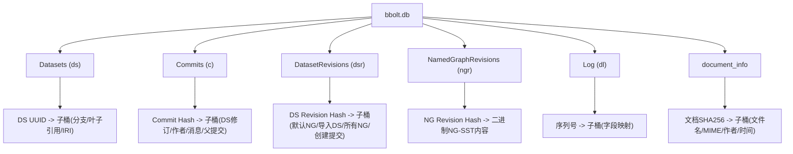
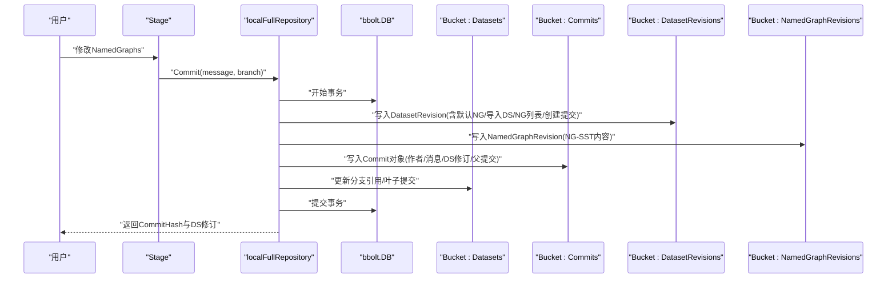
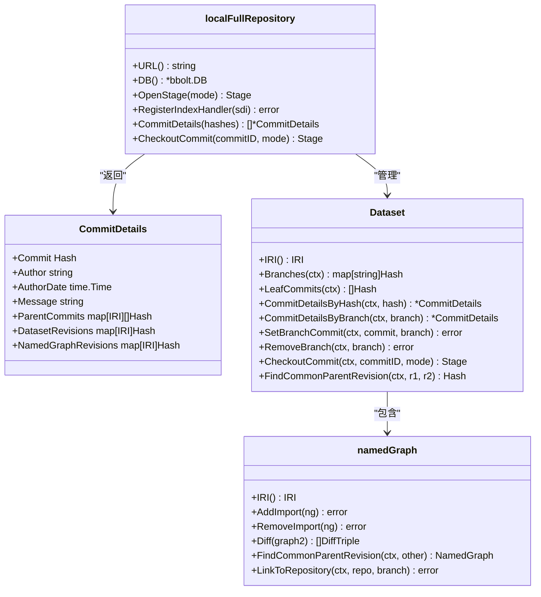
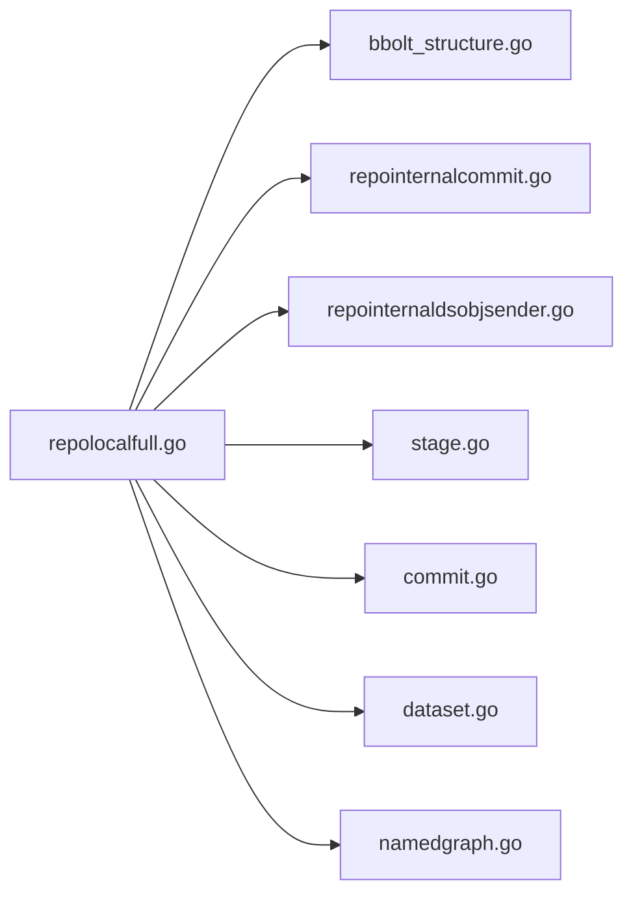

# BBolt数据库结构

<cite>
**本文引用的文件**
- [bbolt_structure.go](file://sst/bbolt_structure.go)
- [repolocalfull.go](file://sst/repolocalfull.go)
- [commit.go](file://sst/commit.go)
- [dataset.go](file://sst/dataset.go)
- [namedgraph.go](file://sst/namedgraph.go)
- [stage.go](file://sst/stage.go)
- [repointernalcommit.go](file://sst/repointernalcommit.go)
- [repointernaldsobjsender.go](file://sst/repointernaldsobjsender.go)
</cite>

## 目录
1. [简介](#简介)
2. [项目结构](#项目结构)
3. [核心组件](#核心组件)
4. [架构总览](#架构总览)
5. [详细组件分析](#详细组件分析)
6. [依赖关系分析](#依赖关系分析)
7. [性能考量](#性能考量)
8. [故障排查指南](#故障排查指南)
9. [结论](#结论)
10. [附录：备份、恢复与迁移策略](#附录备份恢复与迁移策略)

## 简介
本文件系统性说明 LocalFullRepository 使用的 BBolt 数据库布局，覆盖 Datasets、Commits、DatasetRevisions、NamedGraphRevisions 等核心桶的组织方式；解释键值编码规则、前缀约定与数据序列化格式；描述版本控制相关的元数据存储（分支引用、提交历史、命名图版本信息）；并提供数据库结构图、示例数据以及备份、恢复与迁移策略。

## 项目结构
LocalFullRepository 将仓库的持久化状态存储在单个 bbolt.db 文件中，采用多桶分层设计：顶层桶包含数据集索引、提交对象、数据集版本、命名图版本、日志与文档信息等。各桶内部使用紧凑的二进制键与子桶组织数据，以支持高效查询与版本回溯。

图表来源
- [bbolt_structure.go:81-191](file://sst/bbolt_structure.go#L81-L191)

章节来源
- [bbolt_structure.go:81-191](file://sst/bbolt_structure.go#L81-L191)

## 核心组件
- 桶与键常量：定义顶级桶名与常用键常量，如 keyDatasets、keyCommits、keyDatasetRevisions、keyNamedGraphRevisions、keyDatasetLog 等。
- 前缀与编码：
  - dsPrefix、ngPrefix 用于在 DS/NG 相关键中区分类型。
  - commitDsPrefix 用于在提交对象中标识某数据集的条目。
  - refBranchPrefix、refLeafPrefix 用于在数据集桶内标识分支与叶子提交引用。
  - iDToPrefixedKey 将 UUID 与单字节前缀组合成稳定排序的键。
- 版本控制元数据：
  - 分支引用：在 Datasets 下每个 DS UUID 的子桶中以 refBranchPrefix + 分支名 指向最新提交哈希。
  - 叶子提交：refLeafPrefix + 提交哈希 指向不可再被其他提交作为父的提交。
  - 提交历史：Commits 桶中每个提交对象记录其修改的数据集修订及父提交链。
  - 命名图版本：NamedGraphRevisions 存储独立 NG-SST 文件内容，DatasetRevisions 维护默认 NG 与各导入 NG 的版本映射。
- 日志与文档：
  - Log 桶按递增序列号有序记录仓库级操作事件。
  - document_info 桶记录上传文档的元数据。

章节来源
- [bbolt_structure.go:15-51](file://sst/bbolt_structure.go#L15-L51)
- [bbolt_structure.go:192-254](file://sst/bbolt_structure.go#L192-L254)

## 架构总览
LocalFullRepository 通过以下流程实现“提交-版本-引用”的闭环：
- 写入阶段：Stage 持有内存中的 NamedGraph 集合，提交时生成 DatasetRevision 与 NamedGraphRevision，并写入 Commits 与 Datasets 的引用。
- 读取阶段：根据分支或提交哈希解析 CommitDetails，进而定位 DatasetRevisions 与 NamedGraphRevisions，加载对应版本的三元组。
- 版本回溯：通过父提交链与叶子提交集合，支持任意两点的最近公共祖先查找与三路合并。

图表来源
- [repolocalfull.go:54-184](file://sst/repolocalfull.go#L54-L184)
- [repointernalcommit.go:146-183](file://sst/repointernalcommit.go#L146-L183)
- [bbolt_structure.go:81-191](file://sst/bbolt_structure.go#L81-L191)

## 详细组件分析

### 桶结构与键值编码
- 顶级桶
  - Datasets (ds): 键为 DS UUID，值为子桶，包含分支引用、叶子提交、Version 5 IRI 映射。
  - Commits (c): 键为 Commit Hash，值为子桶，包含 DS 修订、作者、消息、父提交。
  - DatasetRevisions (dsr): 键为 DS Revision Hash，值为子桶，包含默认 NG、导入 DS、全部 NG 列表、创建提交。
  - NamedGraphRevisions (ngr): 键为 NG Revision Hash，值为二进制 NG-SST 内容。
  - Log (dl): 键为 8 字节大端 uint64 序列号，值为字符串到字符串的映射（字段）。
  - document_info: 键为文档 SHA256 小写十六进制，值为元数字符串映射。
- 键前缀与编码
  - iDToPrefixedKey(id, prefix): 将 UUID 与单字节前缀拼接，保证排序稳定且可区分类型。
  - bytesToRefKey(b, prefix): 对分支/叶子引用键加前缀。
  - commitDsPrefix + DS UUID: 在提交对象中标识该 DS 的修订与父提交。
  - ngPrefix + NG UUID: 在 DatasetRevisions 中标识导入的命名图。
  - dsPrefix + DS UUID: 在 DatasetRevisions 中标识导入的数据集。
  - Version 5 UUID 的原始 IRI 以 dsIRIPrefix 单独存储于 Datasets 子桶。

章节来源
- [bbolt_structure.go:15-51](file://sst/bbolt_structure.go#L15-L51)
- [bbolt_structure.go:81-191](file://sst/bbolt_structure.go#L81-L191)
- [bbolt_structure.go:192-254](file://sst/bbolt_structure.go#L192-L254)

### 数据集与命名图版本
- DatasetRevisions 子桶
  - 默认 NG 哈希：键为 \x00，值为 NamedGraph-Revision-Hash；删除时使用空数组的 Hash256。
  - 直接导入的 DS UUID：键为 \x00 + DS UUID，值为 DS Revision Hash，构建导入树。
  - 所有 DS 的 NG（直/间接）：键为 \x01 + NG UUID，值为 NG Revision Hash，用于性能优化。
  - 创建提交：键为 \x02，值为 Commit Hash。
- NamedGraphRevisions
  - 键为 NG Revision Hash，值为独立的 NG-SST 二进制内容。

章节来源
- [bbolt_structure.go:89-108](file://sst/bbolt_structure.go#L89-L108)

### 提交对象与父提交链
- Commits 子桶
  - DS 修订列表：键为 commitDsPrefix + DS UUID，值为 DS Revision Hash 拼接若干父提交哈希（长度 > 32 表示存在父提交）。
  - 作者：键 "author"，值为 URI + 8 字节大端 UTC 时间戳。
  - 消息：键 "message"，值为提交消息。
  - 预留字段：committer、签名等。
- 父提交链与最近公共祖先
  - 通过遍历提交对象的 DS 修订项，提取父提交哈希，沿链回溯。
  - compareCommits/isCommitAncestor 支持并发比较两个提交的祖先关系。

章节来源
- [bbolt_structure.go:127-146](file://sst/bbolt_structure.go#L127-L146)
- [repolocalfull.go:186-208](file://sst/repolocalfull.go#L186-L208)
- [repointernalcommit.go:146-183](file://sst/repointernalcommit.go#L146-L183)

### 分支与叶子提交引用
- 分支引用：在 Datasets 下 DS UUID 子桶中，键为 refBranchPrefix + 分支名，值为最新 Commit Hash。
- 叶子提交：键为 refLeafPrefix + Commit Hash，值为 Commit Hash，用于保留不可达分支的提交以便历史浏览。
- 合并与冲突处理：mergeDatasetRefsFromSource/mergeIncomingDatasetRef 在分支分歧时保留目标分支尖点，并将源尖点转为叶子提交。

章节来源
- [bbolt_structure.go:33-40](file://sst/bbolt_structure.go#L33-L40)
- [repolocalfull.go:54-184](file://sst/repolocalfull.go#L54-L184)

### 日志与文档信息
- Log (dl)
  - 键：8 字节大端 uint64 序列号，严格递增。
  - 值：子桶，字符串到字符串映射，包含 type、author、dataset、branch、commit_id、message、hash、file_name、mime_type、timestamp 等字段。
- document_info
  - 键：文档内容的 SHA256 小写十六进制。
  - 值：子桶，包含 file_name、mime_type、author、timestamp。

章节来源
- [bbolt_structure.go:147-191](file://sst/bbolt_structure.go#L147-L191)

### 数据结构类图（代码级）

图表来源
- [repolocalfull.go:217-242](file://sst/repolocalfull.go#L217-L242)
- [commit.go:18-29](file://sst/commit.go#L18-L29)
- [dataset.go:9-94](file://sst/dataset.go#L9-L94)
- [namedgraph.go:42-108](file://sst/namedgraph.go#L42-L108)

## 依赖关系分析
- 模块耦合
  - repolocalfull.go 负责仓库生命周期、索引重建、提交详情获取、分支/叶子引用操作。
  - bbolt_structure.go 提供桶与键的常量、编码工具与错误定义。
  - repointernalcommit.go 实现提交关系比较与祖先判断。
  - repointernaldsobjsender.go 在同步/传输过程中访问多个桶（datasets、commits、dsr、ngr）。
- 外部依赖
  - bbolt 用于持久化存储。
  - bleve 用于全文检索索引（独立目录 index.bleve）。
  - uuid、crypto/sha256 用于 ID 与哈希计算。

图表来源
- [repolocalfull.go:217-242](file://sst/repolocalfull.go#L217-L242)
- [repointernaldsobjsender.go:216-383](file://sst/repointernaldsobjsender.go#L216-L383)

章节来源
- [repolocalfull.go:217-242](file://sst/repolocalfull.go#L217-L242)
- [repointernaldsobjsender.go:216-383](file://sst/repointernaldsobjsender.go#L216-L383)

## 性能考量
- 键设计与排序
  - 使用前缀+UUID 的键确保字典序稳定，利于范围扫描与游标迭代。
- 子桶扁平化
  - DatasetRevisions 中维护“所有 NG”的扁平列表（\x01 + NG UUID），避免重复遍历导入树，提升查询性能。
- 并发与原子性
  - 提交与引用更新在同一事务中完成，保证一致性。
  - 提交关系比较使用 goroutine 并行检查祖先关系，减少阻塞。
- 索引与缓存
  - Bleve 索引独立目录，支持异步更新；关闭仓库时先关闭更新器再关闭索引，避免竞争。

章节来源
- [bbolt_structure.go:89-108](file://sst/bbolt_structure.go#L89-L108)
- [repolocalfull.go:345-426](file://sst/repolocalfull.go#L345-L426)
- [repointernalcommit.go:107-135](file://sst/repointernalcommit.go#L107-L135)

## 故障排查指南
- 常见错误
  - ErrDatasetRevisionNotFound / ErrNamedGraphRevisionNotFound：版本不存在或路径错误。
  - ErrConcurrentModification：并发修改导致的事务冲突。
  - ErrBucketNotExist：尝试访问不存在的桶。
- 诊断步骤
  - 检查 Datasets 子桶是否存在分支/叶子引用。
  - 检查 Commits 子桶中 DS 修订项是否包含正确的父提交链。
  - 检查 DatasetRevisions 子桶中默认 NG 与导入 NG 映射是否完整。
  - 查看 Log 桶中最近的操作事件，确认提交/分支变更顺序。
- 建议
  - 在关键路径添加事务回滚与错误包装，便于定位问题。
  - 对频繁访问的桶使用游标与范围查询，避免全表扫描。

章节来源
- [bbolt_structure.go:53-59](file://sst/bbolt_structure.go#L53-L59)
- [repolocalfull.go:595-719](file://sst/repolocalfull.go#L595-L719)

## 结论
LocalFullRepository 的 BBolt 布局以“提交-版本-引用”为核心，通过紧凑的键编码与子桶组织，实现了高效的数据存取与版本回溯。Datasets、Commits、DatasetRevisions、NamedGraphRevisions 各司其职，配合 Log 与 document_info 完善仓库元数据。该设计在保证一致性的同时，兼顾了性能与可扩展性，适合复杂 RDF 数据集的版本化管理。

## 附录：备份、恢复与迁移策略
- 备份
  - 直接复制 bbolt.db 文件（需确保无活跃写入或使用只读快照）。
  - 如需增量备份，可基于 Log 桶的序列号进行事件回放。
- 恢复
  - 将备份的 bbolt.db 替换为目标仓库文件，重新打开仓库即可。
  - 若仅恢复部分数据，可通过同步接口（SyncFrom/SyncTo）按桶粒度传输。
- 迁移
  - 版本升级：测试用例展示了从旧版 bbolt 结构迁移到新仓库的流程（丢失历史但保留当前状态）。
  - 字段兼容：Log 桶的字段为字符串映射，新增字段不影响旧客户端读取。
  - 索引重建：当 deriveInfo 变化时，重建 Bleve 索引目录 index.bleve。

章节来源
- [bbolt_structure.go:147-191](file://sst/bbolt_structure.go#L147-L191)
- [repolocalfull.go:345-426](file://sst/repolocalfull.go#L345-L426)
- [sst_test/bbolt_version_update_test.go:38-46](file://sst_test/bbolt_version_update_test.go#L38-L46)