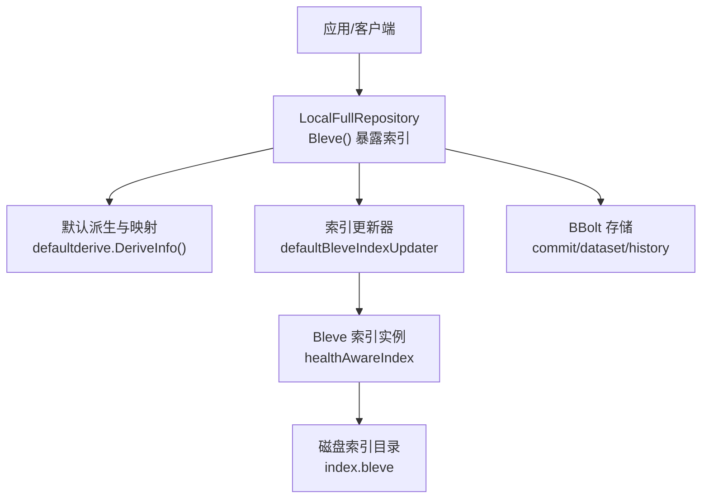
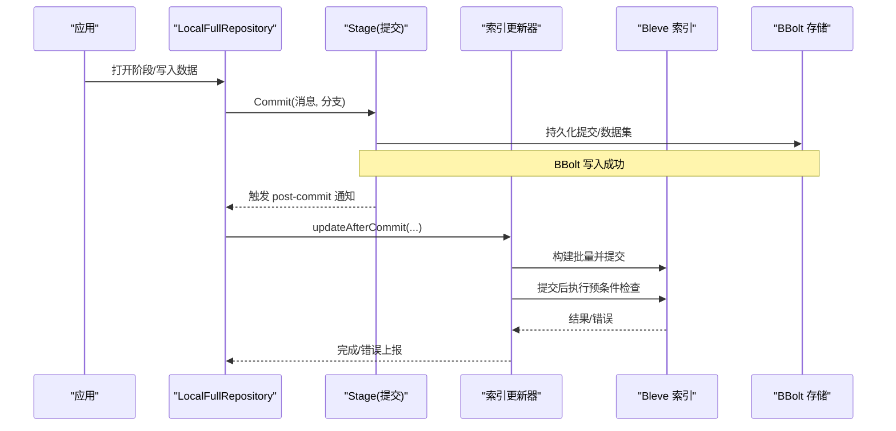
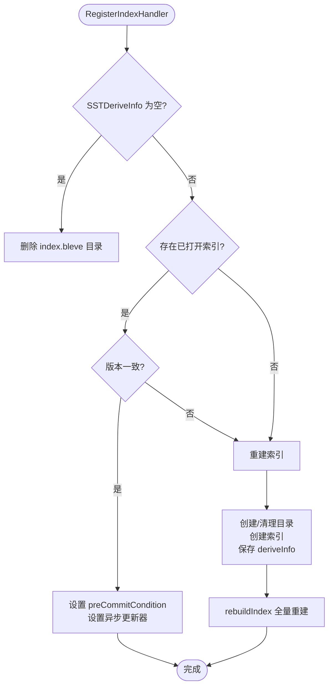
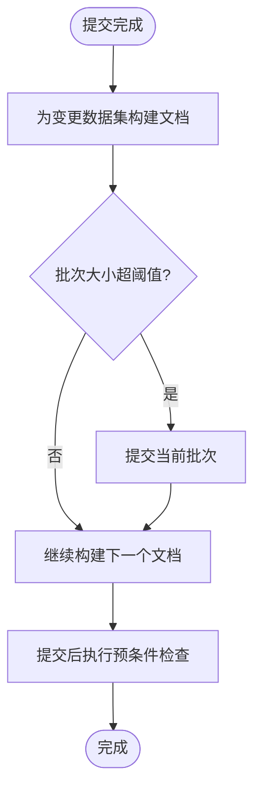
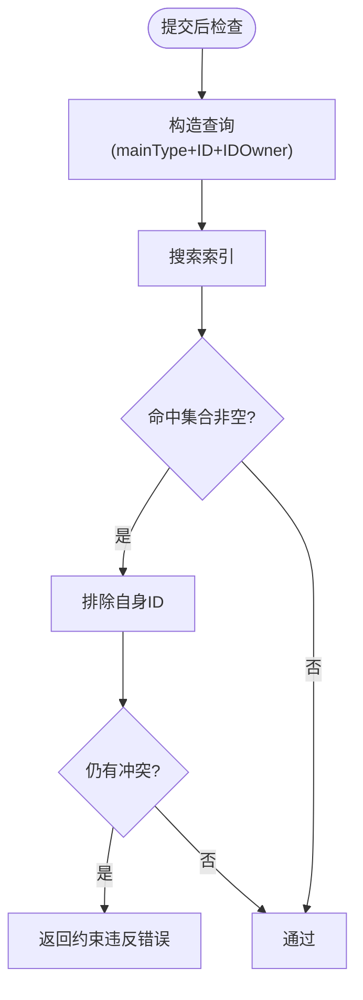
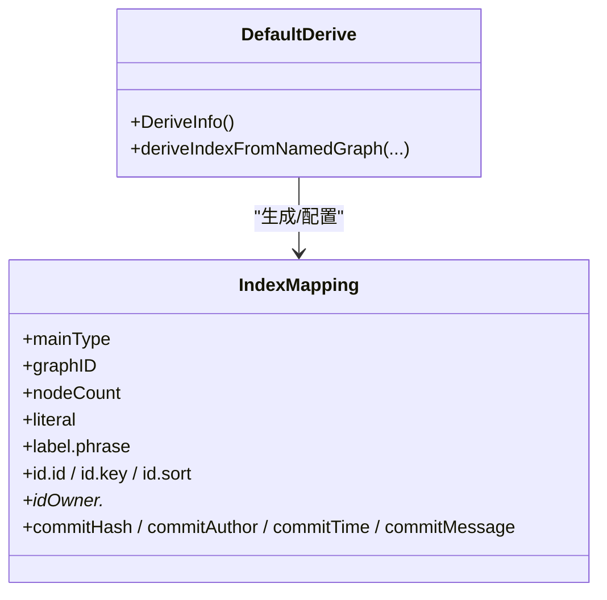
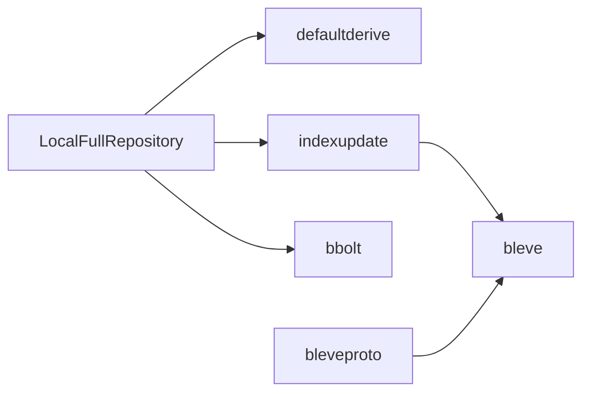

# Bleve搜索引擎集成

<cite>
**本文引用的文件**
- [repolocalfull.go](file://sst/repolocalfull.go)
- [indexupdate.go](file://sst/indexupdate.go)
- [defaultderive.go](file://defaultderive/defaultderive.go)
- [remote.go](file://bleveproto/remote.go)
- [repository.go](file://sst/repository.go)
- [repolocalfullwithbleve.go](file://examples/helloworldrepolocalfullwithbleve/repolocalfullwithbleve.go)
- [searchInContext_test.go](file://sst_test/searchInContext_test.go)
</cite>

## 目录
1. [简介](#简介)
2. [项目结构](#项目结构)
3. [核心组件](#核心组件)
4. [架构总览](#架构总览)
5. [详细组件分析](#详细组件分析)
6. [依赖关系分析](#依赖关系分析)
7. [性能考量](#性能考量)
8. [故障排查指南](#故障排查指南)
9. [结论](#结论)
10. [附录](#附录)

## 简介
本文件系统性说明 LocalFullRepository 如何集成 Bleve 实现全文检索与索引管理，覆盖索引构建、增量更新、预提交约束检查、映射配置、查询语法、结果处理模式、索引维护与重建、以及故障恢复策略。文档面向不同技术背景的读者，提供从高层到代码级的逐步深入说明，并附带可视化图示与可操作示例路径。

## 项目结构
围绕 Bleve 集成的关键位置如下：
- 仓库层：LocalFullRepository 负责索引生命周期（创建、打开、重建）、注册索引处理器、暴露 bleve.Index 接口。
- 索引更新器：异步队列驱动，将 BBolt 写入与 Bleve I/O 解耦，支持批量提交、阈值分片、健康感知与重试。
- 默认派生与映射：定义字段、分析器、子文档结构与版本标记，指导如何将 NamedGraph 数据抽取为索引文档。
- 远程协议：对 SearchRequest/SearchResult 进行 JSON 编解码，便于远程调用。
- 示例与测试：演示注册索引处理器、提交数据、搜索、分页、排序、上下文取消、一致性等场景。

**图表来源**
- [repolocalfull.go:220-436](file://sst/repolocalfull.go#L220-L436)
- [indexupdate.go:77-158](file://sst/indexupdate.go#L77-L158)
- [defaultderive.go:127-211](file://defaultderive/defaultderive.go#L127-L211)

**章节来源**
- [repolocalfull.go:220-436](file://sst/repolocalfull.go#L220-L436)
- [indexupdate.go:77-158](file://sst/indexupdate.go#L77-L158)
- [defaultderive.go:127-211](file://defaultderive/defaultderive.go#L127-L211)

## 核心组件
- LocalFullRepository：封装 Bleve 索引的创建、打开、重建；在 RegisterIndexHandler 中根据 SSTDeriveInfo 决定重建或复用；通过 preCommitCondition 注入约束检查；通过 bleveIndexUpdater 执行异步增量更新。
- defaultBleveIndexUpdater：后台工作协程消费任务队列，按批提交 Bleve Batch，并在提交后执行预条件检查；支持 flush/close 保证优雅关闭。
- healthAwareIndex：对底层 bleve.Index 的健康状态进行跟踪，失败时记录错误并尝试重试，返回结果时附带健康告警。
- defaultderive：定义默认索引映射、字段类型、分析器、子文档结构及版本字段，用于将 RDF/NamedGraph 数据转换为 Bleve 文档。
- bleveproto：提供 SearchRequest/Result 的 JSON 序列化/反序列化，支撑远程调用。

**章节来源**
- [repolocalfull.go:259-436](file://sst/repolocalfull.go#L259-L436)
- [indexupdate.go:77-158](file://sst/indexupdate.go#L77-L158)
- [indexupdate.go:650-795](file://sst/indexupdate.go#L650-L795)
- [defaultderive.go:127-211](file://defaultderive/defaultderive.go#L127-L211)
- [remote.go:21-39](file://bleveproto/remote.go#L21-L39)

## 架构总览
下图展示从数据写入到索引更新的完整流程，包括预提交约束检查与异步批量提交。

**图表来源**
- [repolocalfull.go:259-436](file://sst/repolocalfull.go#L259-L436)
- [indexupdate.go:160-249](file://sst/indexupdate.go#L160-L249)
- [indexupdate.go:486-502](file://sst/indexupdate.go#L486-L502)

## 详细组件分析

### LocalFullRepository 与索引生命周期
- 注册索引处理器：若传入空 SSTDeriveInfo，则删除现有 index.bleve；否则比较版本，相同则复用并设置 preCommitCondition，不同则重建。
- 构建索引：创建/清理 index.bleve 目录，使用默认映射创建新索引，保存 deriveInfo 到 bleveInfo.json，设置 preCommitCondition 与异步更新器，并调用 rebuildIndex 全量重建。
- 暴露索引：Bleve() 返回健康包装后的 bleve.Index；RebuildBleveIndex() 安全关闭旧索引并重建。
- 关闭顺序：先关闭更新器，再关闭索引与数据库，确保无悬挂任务。

**图表来源**
- [repolocalfull.go:259-436](file://sst/repolocalfull.go#L259-L436)

**章节来源**
- [repolocalfull.go:259-436](file://sst/repolocalfull.go#L259-L436)
- [repository.go:91-120](file://sst/repository.go#L91-L120)

### 索引构建与增量更新机制
- 全量构建：rebuildIndex 遍历仓库所有数据集，检出默认分支，生成文档并批量提交，超过阈值自动落盘。
- 增量更新：updateAfterCommit 仅针对修改的数据集生成文档，批量提交后执行预条件检查；SetBranch/RemoveBranch/Sync 分别触发重算或删除。
- 批量与阈值：indexBatchIfOverThreshold 控制 batch 大小，避免单次过大导致内存压力。
- 异步与刷新：默认更新器使用后台协程队列，flush 阻塞等待队列清空，close 优雅停止。

**图表来源**
- [indexupdate.go:160-249](file://sst/indexupdate.go#L160-L249)
- [indexupdate.go:366-434](file://sst/indexupdate.go#L366-L434)
- [indexupdate.go:633-648](file://sst/indexupdate.go#L633-L648)

**章节来源**
- [indexupdate.go:160-249](file://sst/indexupdate.go#L160-L249)
- [indexupdate.go:366-434](file://sst/indexupdate.go#L366-L434)
- [indexupdate.go:633-648](file://sst/indexupdate.go#L633-L648)

### 预提交条件检查与约束一致性
- 唯一性约束：基于 mainType + ID + IDOwner 的组合，确保根节点唯一；冲突时返回错误，阻止写入。
- 检查时机：在批量提交后，对每个受影响的文档执行 checkPreCondition，排除自身以避免误报。
- 覆盖语义：当使用 overrideIndex 时，会合并“覆盖”命中集合，确保事务内可见性。

**图表来源**
- [indexupdate.go:504-573](file://sst/indexupdate.go#L504-L573)

**章节来源**
- [indexupdate.go:504-573](file://sst/indexupdate.go#L504-L573)

### 索引映射配置与字段分析
- 默认映射：定义主类型字段、图标识、节点计数、字面量、标签短语、ID 及其拥有者、提交元数据等子文档结构。
- 分析器：短语字段使用自定义 phrase 分析器；关键字字段使用 keyword 分析器；部分字段启用 DocValues 以支持排序/聚合。
- 版本标记：内置 sst/sso 版本字段，用于检测映射不兼容并触发重建。
- 派生逻辑：deriveIndexFromNamedGraph 遍历 NamedGraph，识别类型与属性，填充文档字段，必要时加载跨图引用。

**图表来源**
- [defaultderive.go:155-211](file://defaultderive/defaultderive.go#L155-L211)
- [defaultderive.go:293-800](file://defaultderive/defaultderive.go#L293-L800)

**章节来源**
- [defaultderive.go:155-211](file://defaultderive/defaultderive.go#L155-L211)
- [defaultderive.go:293-800](file://defaultderive/defaultderive.go#L293-L800)

### 搜索API使用与查询构建
- 基本用法：通过 repo.Bleve() 获取 bleve.Index，使用 NewSearchRequest/NewMatchQuery 等构建查询。
- 上下文搜索：SearchInContext 支持超时/取消，适合远程或长耗时场景。
- 分页与排序：NewSearchRequestOptions 支持 size/offset；sortFieldSuffix 字段可用于排序。
- 结果处理：遍历 Hits，按需 Document 拉取原始文档；注意 Total 与 Hits 数量差异。

示例参考路径：
- 基础搜索与直接打开索引：[repolocalfullwithbleve.go:90-129](file://examples/helloworldrepolocalfullwithbleve/repolocalfullwithbleve.go#L90-L129)
- 分页、排序、上下文取消、一致性验证：[searchInContext_test.go:215-350](file://sst_test/searchInContext_test.go#L215-L350)、[searchInContext_test.go:776-913](file://sst_test/searchInContext_test.go#L776-L913)、[searchInContext_test.go:1947-2018](file://sst_test/searchInContext_test.go#L1947-L2018)

**章节来源**
- [repolocalfullwithbleve.go:90-129](file://examples/helloworldrepolocalfullwithbleve/repolocalfullwithbleve.go#L90-L129)
- [searchInContext_test.go:215-350](file://sst_test/searchInContext_test.go#L215-L350)
- [searchInContext_test.go:776-913](file://sst_test/searchInContext_test.go#L776-L913)
- [searchInContext_test.go:1947-2018](file://sst_test/searchInContext_test.go#L1947-L2018)

### 远程支持与协议
- 请求/响应：SearchRequest 序列化为字节，SearchResult 封装 Result 字节以便传输。
- 适用场景：远程仓库通过 gRPC 调用本地/服务端索引能力，客户端无需关心索引细节。

**章节来源**
- [remote.go:21-39](file://bleveproto/remote.go#L21-L39)

## 依赖关系分析
- LocalFullRepository 依赖：
  - defaultderive：提供索引映射与文档派生函数。
  - indexupdate：提供异步更新器、批量提交、预条件检查、健康包装。
  - bbolt：持久化提交与数据集历史。
- 外部依赖：
  - bleve：全文检索引擎。
  - grpc/json：远程协议序列化。

**图表来源**
- [repolocalfull.go:220-436](file://sst/repolocalfull.go#L220-L436)
- [indexupdate.go:77-158](file://sst/indexupdate.go#L77-L158)
- [remote.go:21-39](file://bleveproto/remote.go#L21-L39)

**章节来源**
- [repolocalfull.go:220-436](file://sst/repolocalfull.go#L220-L436)
- [indexupdate.go:77-158](file://sst/indexupdate.go#L77-L158)
- [remote.go:21-39](file://bleveproto/remote.go#L21-L39)

## 性能考量
- 异步更新：将 BBolt 写入与 Bleve I/O 分离，降低提交延迟。
- 批量提交：按阈值分批提交，避免单次过大导致的内存峰值。
- 健康感知：失败重试与错误计数，提高可用性。
- 字段设计：关键字字段启用 DocValues 支持排序；短语字段使用专用分析器提升召回。
- 重建优化：仅在映射版本变化时重建，减少不必要开销。

[本节为通用性能建议，不直接分析具体文件]

## 故障排查指南
- 索引不可用/报错：
  - 检查 healthAwareIndex 的错误计数与最近错误；必要时调用 RebuildBleveIndex 重建。
  - 确认 index.bleve 目录权限与磁盘空间。
- 提交后未立即看到结果：
  - 使用 FlushBleveIndex 等待异步队列处理完毕。
- 约束冲突：
  - 检查 mainType + ID + IDOwner 组合是否重复；定位冲突文档 ID。
- 远程搜索异常：
  - 校验 SearchRequest/Result 序列化是否正确；检查网络与认证上下文。

**章节来源**
- [indexupdate.go:650-795](file://sst/indexupdate.go#L650-L795)
- [indexupdate.go:633-648](file://sst/indexupdate.go#L633-L648)
- [indexupdate.go:504-573](file://sst/indexupdate.go#L504-L573)

## 结论
LocalFullRepository 通过清晰的职责划分与异步化设计，将数据持久化与全文检索解耦，提供了高性能、可扩展且健壮的索引管理能力。结合默认映射与灵活的派生逻辑，既能满足通用场景，也便于扩展定制。配合预提交约束与健康感知，系统在保证一致性的同时具备良好的容错能力。

[本节为总结性内容，不直接分析具体文件]

## 附录

### 索引维护、重建与故障恢复
- 重建索引：调用 RebuildBleveIndex，内部会关闭旧索引、清理目录、重新创建并全量重建，期间搜索不可用但 BBolt 仍可用。
- 恢复策略：若索引损坏或映射版本不一致，优先重建；若频繁失败，检查磁盘与权限，并关注健康状态。
- 增量修复：对于少量数据不一致，可通过 SetBranch/RemoveBranch/Sync 触发对应数据集的重算。

**章节来源**
- [repolocalfull.go:438-458](file://sst/repolocalfull.go#L438-L458)
- [indexupdate.go:251-344](file://sst/indexupdate.go#L251-L344)

### 搜索API使用示例与结果处理模式
- 示例路径：
  - 创建仓库、注册索引处理器、提交数据、搜索、直接打开索引搜索、检出验证：[repolocalfullwithbleve.go:44-175](file://examples/helloworldrepolocalfullwithbleve/repolocalfullwithbleve.go#L44-L175)
  - 分页、排序、上下文取消、一致性验证、远程上下文搜索：[searchInContext_test.go:215-350](file://sst_test/searchInContext_test.go#L215-L350)、[searchInContext_test.go:776-913](file://sst_test/searchInContext_test.go#L776-L913)、[searchInContext_test.go:1947-2018](file://sst_test/searchInContext_test.go#L1947-L2018)
- 结果处理：
  - 使用 Hits 列表遍历匹配项；按需调用 Document 获取原始文档。
  - 使用 Size/Offset 实现分页；使用 sortFieldSuffix 字段进行排序。
  - 使用 Fields 指定返回字段以减少带宽。

**章节来源**
- [repolocalfullwithbleve.go:44-175](file://examples/helloworldrepolocalfullwithbleve/repolocalfullwithbleve.go#L44-L175)
- [searchInContext_test.go:215-350](file://sst_test/searchInContext_test.go#L215-L350)
- [searchInContext_test.go:776-913](file://sst_test/searchInContext_test.go#L776-L913)
- [searchInContext_test.go:1947-2018](file://sst_test/searchInContext_test.go#L1947-L2018)