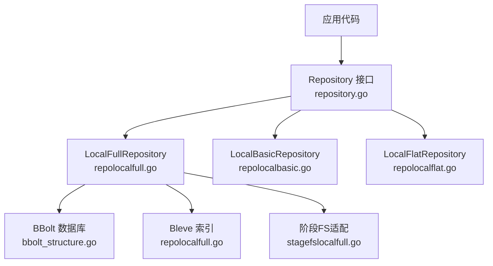
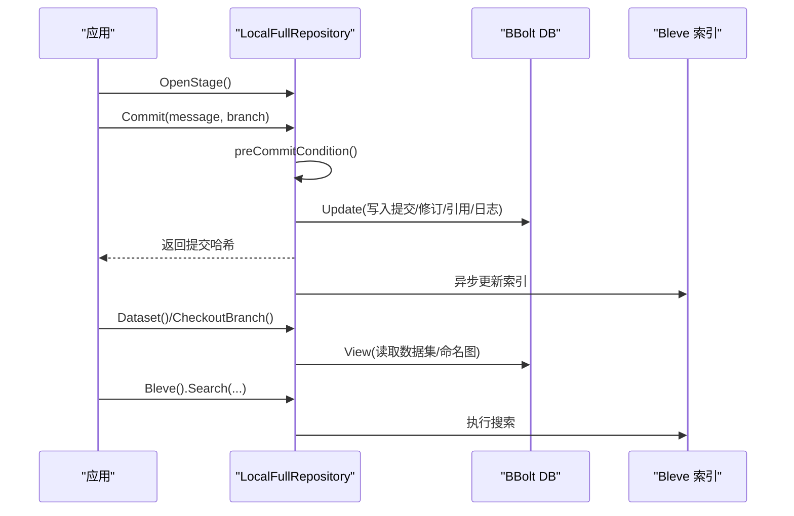
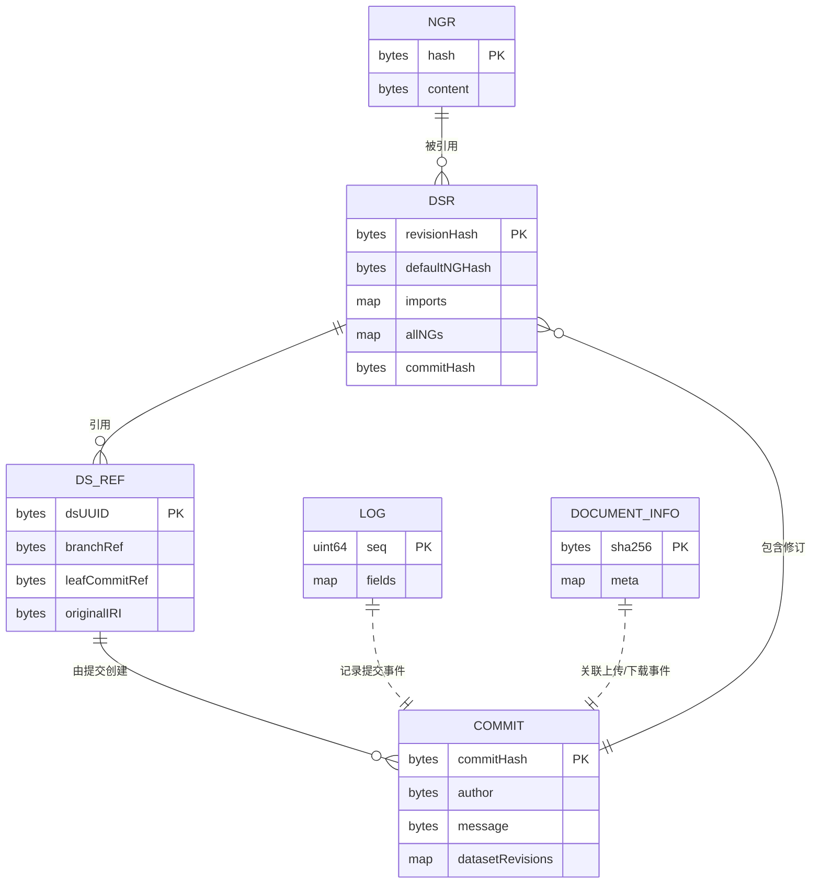
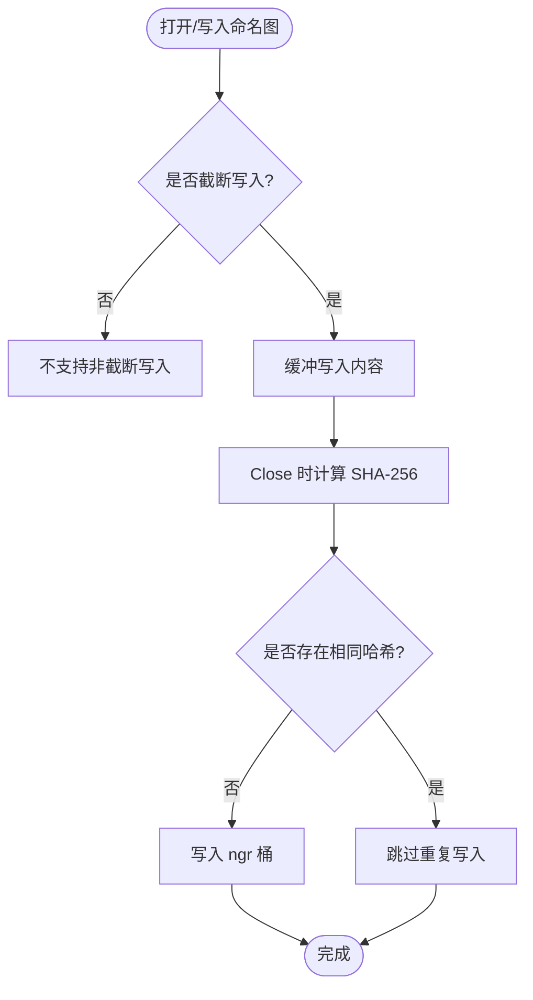
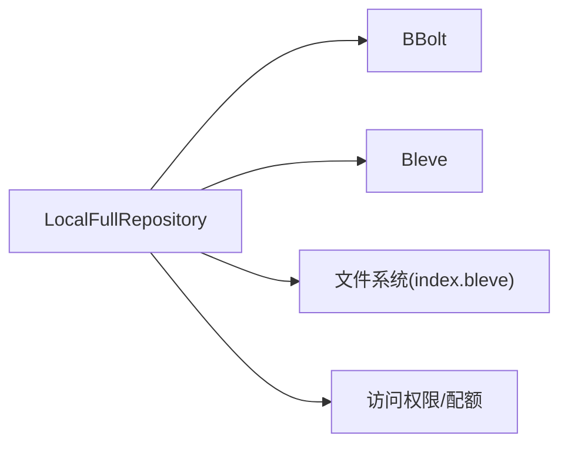

# 仓库概述和特性

<cite>
**本文引用的文件**
- [repolocalfull.go](file://sst/repolocalfull.go)
- [repository.go](file://sst/repository.go)
- [bbolt_structure.go](file://sst/bbolt_structure.go)
- [stagefslocalfull.go](file://sst/stagefslocalfull.go)
- [repolocalbasic.go](file://sst/repolocalbasic.go)
- [repolocalflat.go](file://sst/repolocalflat.go)
- [repolocalfull.go（示例）](file://examples/helloworldrepolocalfull/repolocalfull.go)
- [repolocalfullwithbleve.go（示例）](file://examples/helloworldrepolocalfullwithbleve/repolocalfullwithbleve.go)
</cite>

## 目录
1. [简介](#简介)
2. [项目结构](#项目结构)
3. [核心组件](#核心组件)
4. [架构总览](#架构总览)
5. [详细组件分析](#详细组件分析)
6. [依赖关系分析](#依赖关系分析)
7. [性能与内存模型](#性能与内存模型)
8. [故障排查指南](#故障排查指南)
9. [结论](#结论)
10. [附录：创建、配置与使用示例](#附录创建配置与使用示例)

## 简介
本文件面向本地完整仓库 LocalFullRepository，系统性阐述其设计目标与核心特性：完整的版本控制能力（分支/提交/历史）、基于 BBolt 的持久化存储、可选的 Bleve 全文检索集成，以及与基础仓库、扁平仓库在功能与适用场景上的差异。文档同时覆盖并发安全机制、性能特点、内存使用模式，并提供仓库创建、配置与基本使用的参考路径。

## 项目结构
LocalFullRepository 位于 sst 包中，围绕以下关键文件组织：
- 仓库接口与工厂方法：repository.go
- 本地完整仓库实现：repolocalfull.go
- BBolt 数据库布局与常量：bbolt_structure.go
- 阶段文件系统适配（用于 Full 仓库的数据读写）：stagefslocalfull.go
- 对比实现：基础仓库 repolocalbasic.go、扁平仓库 repolocalflat.go
- 使用示例：examples/helloworldrepolocalfull 与 examples/helloworldrepolocalfullwithbleve



图表来源
- [repository.go:34-179](file://sst/repository.go#L34-L179)
- [repolocalfull.go:217-230](file://sst/repolocalfull.go#L217-L230)
- [repolocalbasic.go:34-42](file://sst/repolocalbasic.go#L34-L42)
- [repolocalflat.go:28-32](file://sst/repolocalflat.go#L28-L32)
- [bbolt_structure.go:81-191](file://sst/bbolt_structure.go#L81-L191)
- [stagefslocalfull.go:16-27](file://sst/stagefslocalfull.go#L16-L27)

章节来源
- [repository.go:34-179](file://sst/repository.go#L34-L179)
- [repolocalfull.go:217-230](file://sst/repolocalfull.go#L217-L230)
- [bbolt_structure.go:81-191](file://sst/bbolt_structure.go#L81-L191)

## 核心组件
- Repository 接口：统一抽象了 URL、Stage、数据集操作、提交详情、检出、索引管理、日志、文档等能力。
- LocalFullRepository：支持完整版本控制（分支、提交、历史）、BBolt 持久化、可选 Bleve 全文检索、同步与配额等。
- BBolt 存储布局：定义命名图修订、数据集修订、提交对象、数据集引用、日志等桶结构与键值约定。
- 阶段文件系统：将 BBolt 中的命名图内容以 FS 接口暴露给 Stage，便于读取/写入 SST 数据。
- 对比实现：
  - LocalBasicRepository：有 BBolt + Bleve，但不提供版本控制（无提交/分支/历史）。
  - LocalFlatRepository：纯文件系统 SST 文件集合，无事务、无版本控制、无索引。

章节来源
- [repository.go:34-179](file://sst/repository.go#L34-L179)
- [repolocalfull.go:217-230](file://sst/repolocalfull.go#L217-L230)
- [repolocalbasic.go:34-42](file://sst/repolocalbasic.go#L34-L42)
- [repolocalflat.go:28-32](file://sst/repolocalflat.go#L28-L32)
- [bbolt_structure.go:81-191](file://sst/bbolt_structure.go#L81-L191)

## 架构总览
LocalFullRepository 采用“BBolt 主存储 + 可选 Bleve 索引”的双引擎架构：
- 写路径：Stage 修改后通过 commitNewVersion 写入 BBolt，并触发预提交条件与异步索引更新。
- 读路径：Dataset/NamedGraph 通过 BBolt 查询；如需全文检索，则通过 Bleve 索引。
- 版本控制：提交对象记录数据集修订与父提交，分支指向最新提交，叶子提交保留不可达历史。
- 并发安全：状态机 + 读写锁保护进入/离开临界区；BBolt 事务保证一致性；Bleve 更新解耦为后台任务。



图表来源
- [repolocalfull.go:244-257](file://sst/repolocalfull.go#L244-L257)
- [repolocalfull.go:345-426](file://sst/repolocalfull.go#L345-L426)
- [repolocalfull.go:721-732](file://sst/repolocalfull.go#L721-L732)
- [bbolt_structure.go:81-191](file://sst/bbolt_structure.go#L81-L191)

## 详细组件分析

### LocalFullRepository：版本控制与持久化
- 数据结构：包含状态控制、配额、超级仓库引用、URL、配置、认证信息、Bleve 索引、BBolt 连接与访问权限。
- 生命周期：OpenStage/Close 通过 enter/leave 进行并发保护；Close 时先关闭索引更新器，再关闭 Bleve 与 BBolt。
- 版本控制：
  - 分支/叶子提交：通过 refBranchPrefix/refLeafPrefix 维护分支指向与不可达提交。
  - 提交详情：从 Commits 桶解析作者、消息、数据集修订与父提交。
  - 检出：根据提交详情构建 Stage，按命名图修订加载数据。
- 索引管理：
  - RegisterIndexHandler：若提供空 SSTDeriveInfo 则删除索引；否则创建或重建 index.bleve 目录，保存 deriveInfo.json，设置预提交条件与异步更新器。
  - RebuildBleveIndex：安全关闭当前索引与更新器，重建索引。
- 数据集与命名图：
  - DatasetIDs/Datasets/ForDatasets：遍历 datasets 桶获取数据集 IRI。
  - CheckoutCommit：基于提交详情构造可检出的 Stage。

```mermaid
classDiagram
class localFullRepository {
+SuperRepository() SuperRepository
+URL() string
+DB() *bbolt.DB
+OpenStage(mode) Stage
+RegisterIndexHandler(sdi) error
+Bleve() bleve.Index
+RebuildBleveIndex() error
+DatasetIDs(ctx) []uuid.UUID
+Datasets(ctx) []IRI
+CommitDetails(ctx, hashes) []*CommitDetails
+CheckoutCommit(ctx, commitID, mode) Stage
+Close() error
}
class bbolt_DB {
+View(tx) error
+Update(tx) error
}
class bleve_Index {
+Search(req) (*SearchResult, error)
+Document(id) (map[string]interface{}, error)
+Close() error
}
localFullRepository --> bbolt_DB : "持久化"
localFullRepository --> bleve_Index : "全文检索"
```

图表来源
- [repolocalfull.go:217-230](file://sst/repolocalfull.go#L217-L230)
- [repolocalfull.go:244-257](file://sst/repolocalfull.go#L244-L257)
- [repolocalfull.go:345-426](file://sst/repolocalfull.go#L345-L426)
- [repolocalfull.go:595-732](file://sst/repolocalfull.go#L595-L732)
- [repolocalfull.go:734-761](file://sst/repolocalfull.go#L734-L761)

章节来源
- [repolocalfull.go:217-230](file://sst/repolocalfull.go#L217-L230)
- [repolocalfull.go:244-257](file://sst/repolocalfull.go#L244-L257)
- [repolocalfull.go:345-426](file://sst/repolocalfull.go#L345-L426)
- [repolocalfull.go:595-732](file://sst/repolocalfull.go#L595-L732)
- [repolocalfull.go:734-761](file://sst/repolocalfull.go#L734-L761)

### BBolt 数据库布局
- 命名图修订（ngr）：键为命名图独立 SST 文件的 Hash，值为二进制内容。
- 数据集修订（dsr）：键为数据集修订 Hash，值为子桶，包含默认命名图 Hash、导入依赖、所有命名图修订映射、创建该修订的提交 Hash。
- 数据集引用（ds）：键为数据集 UUID，值为子桶，包含分支、标签、叶子提交、原始 IRI（V5 UUID）等引用。
- 提交对象（c）：键为提交 Hash，值为子桶，包含数据集修订列表、作者、消息等。
- 日志（log）：有序序列号键，值为单条仓库级操作日志的子桶。
- 文档元信息（document_info）：键为文档内容 SHA-256，值为元信息子桶。



图表来源
- [bbolt_structure.go:81-191](file://sst/bbolt_structure.go#L81-L191)

章节来源
- [bbolt_structure.go:81-191](file://sst/bbolt_structure.go#L81-L191)

### 阶段文件系统（Full）
- localFullFs：将 BBolt 中的命名图内容以 fs.FS 形式暴露，支持 ReadDir/Open/OpenFile。
- 写入流程：datasetFileReadWriter 在 Close 时对内容进行 SHA-256 计算，去重存储到 ngr 桶，并更新排序哈希表。



图表来源
- [stagefslocalfull.go:73-88](file://sst/stagefslocalfull.go#L73-L88)
- [stagefslocalfull.go:116-128](file://sst/stagefslocalfull.go#L116-L128)

章节来源
- [stagefslocalfull.go:16-27](file://sst/stagefslocalfull.go#L16-L27)
- [stagefslocalfull.go:73-88](file://sst/stagefslocalfull.go#L73-L88)
- [stagefslocalfull.go:116-128](file://sst/stagefslocalfull.go#L116-L128)

### 与其他仓库类型的区别与适用场景
- LocalFullRepository
  - 特性：完整版本控制（分支/提交/历史）、BBolt 事务、可选 Bleve 全文检索、文档管理、同步、配额。
  - 适用：需要审计、回溯、多分支协作、全文检索的场景。
- LocalBasicRepository
  - 特性：BBolt + Bleve，但无版本控制（无提交/分支/历史），不支持部分高级 API。
  - 适用：仅需持久化与检索，不需要历史追踪的场景。
- LocalFlatRepository
  - 特性：每个命名图为独立 .sst 文件，无事务、无版本控制、无索引。
  - 适用：简单归档、跨进程共享、最小依赖的文件级存储。

章节来源
- [repository.go:34-45](file://sst/repository.go#L34-L45)
- [repolocalbasic.go:34-42](file://sst/repolocalbasic.go#L34-L42)
- [repolocalflat.go:28-32](file://sst/repolocalflat.go#L28-L32)

## 依赖关系分析
- LocalFullRepository 依赖：
  - BBolt：事务型 KV 存储，承载提交、修订、引用、日志等。
  - Bleve：全文检索索引，支持注册自定义映射、重建与异步更新。
  - 文件系统：index.bleve 目录与 deriveInfo.json。
  - 认证与配额：访问权限固定于打开/创建时探测；配额在 SuperRepository 上下文中启用。
- 耦合与内聚：
  - 高内聚：版本控制逻辑集中在 LocalFullRepository。
  - 低耦合：通过 Repository 接口屏蔽底层实现差异；Bleve 更新通过回调与后台任务解耦。



图表来源
- [repolocalfull.go:217-230](file://sst/repolocalfull.go#L217-L230)
- [repolocalfull.go:345-426](file://sst/repolocalfull.go#L345-L426)
- [bbolt_structure.go:81-191](file://sst/bbolt_structure.go#L81-L191)

章节来源
- [repolocalfull.go:217-230](file://sst/repolocalfull.go#L217-L230)
- [repolocalfull.go:345-426](file://sst/repolocalfull.go#L345-L426)
- [bbolt_structure.go:81-191](file://sst/bbolt_structure.go#L81-L191)

## 性能与内存模型
- 写路径优化
  - 去重存储：命名图内容按 SHA-256 去重写入 ngr 桶，减少冗余。
  - 异步索引更新：commit 后通过 bleveIndexUpdater 异步更新索引，避免阻塞主事务。
  - BBolt 选项：NoFreelistSync + FreelistMapType，提升写入吞吐。
- 读路径优化
  - 视图事务：Dataset/CommitDetails 等读操作使用 View，降低锁竞争。
  - 排序与缓存：localFullFs 维护排序 ID 与哈希数组，加速 ReadDir 与查找。
- 内存使用
  - 大对象流式处理：SST 读写尽量以流式方式处理，避免一次性加载全部数据。
  - 索引内存：Bleve 索引按需加载，可通过 RebuildBleveIndex 释放并重建。
- 并发安全
  - 状态机：enter/leave 确保同一时刻仅有限并发进入临界区。
  - 事务隔离：BBolt 事务提供 ACID 语义。
  - 原子计数：配额统计使用 atomic.Int64 避免竞态。

[本节为通用性能讨论，不直接分析具体文件]

## 故障排查指南
- 索引相关
  - 现象：搜索结果为空或报错。
  - 排查：确认已调用 RegisterIndexHandler 且 deriveInfo 匹配；必要时调用 RebuildBleveIndex 重建索引。
  - 参考路径：[repolocalfull.go:259-341](file://sst/repolocalfull.go#L259-L341)、[repolocalfull.go:345-426](file://sst/repolocalfull.go#L345-L426)
- 版本控制相关
  - 现象：分支未指向预期提交或历史缺失。
  - 排查：检查分支引用与叶子提交；确认提交详情中的父提交链正确。
  - 参考路径：[repolocalfull.go:54-184](file://sst/repolocalfull.go#L54-L184)、[repolocalfull.go:595-732](file://sst/repolocalfull.go#L595-L732)
- 写入失败
  - 现象：Commit 失败或索引未更新。
  - 排查：检查 preCommitCondition 是否返回错误；确认 BBolt 事务成功；查看日志输出。
  - 参考路径：[repolocalfull.go:734-761](file://sst/repolocalfull.go#L734-L761)

章节来源
- [repolocalfull.go:259-341](file://sst/repolocalfull.go#L259-L341)
- [repolocalfull.go:345-426](file://sst/repolocalfull.go#L345-L426)
- [repolocalfull.go:54-184](file://sst/repolocalfull.go#L54-L184)
- [repolocalfull.go:595-732](file://sst/repolocalfull.go#L595-L732)
- [repolocalfull.go:734-761](file://sst/repolocalfull.go#L734-L761)

## 结论
LocalFullRepository 提供了企业级的本地版本控制与检索能力：以 BBolt 为核心存储保障一致性与高性能，以 Bleve 提供灵活的全文检索，并通过完善的提交/分支/历史机制满足审计与回溯需求。相比基础仓库与扁平仓库，它在功能完备性上更强，适合对数据治理要求较高的场景。对于仅需轻量存储或无需历史的场景，可选择 Basic 或 Flat 仓库类型。

[本节为总结性内容，不直接分析具体文件]

## 附录：创建、配置与使用示例
- 创建本地完整仓库（无索引）
  - 参考路径：[repolocalfull.go（示例）:41-69](file://examples/helloworldrepolocalfull/repolocalfull.go#L41-L69)
- 创建本地完整仓库（含 Bleve 索引）
  - 参考路径：[repolocalfullwithbleve.go（示例）:44-87](file://examples/helloworldrepolocalfullwithbleve/repolocalfullwithbleve.go#L44-L87)
- 打开已有仓库并检出数据集
  - 参考路径：[repolocalfull.go（示例）:72-93](file://examples/helloworldrepolocalfull/repolocalfull.go#L72-L93)
- 索引管理与重建
  - 参考路径：[repolocalfull.go:259-458](file://sst/repolocalfull.go#L259-L458)
- 提交与日志
  - 参考路径：[repolocalfull.go:595-732](file://sst/repolocalfull.go#L595-L732)

章节来源
- [repolocalfull.go（示例）:41-93](file://examples/helloworldrepolocalfull/repolocalfull.go#L41-L93)
- [repolocalfullwithbleve.go（示例）:44-87](file://examples/helloworldrepolocalfullwithbleve/repolocalfullwithbleve.go#L44-L87)
- [repolocalfull.go:259-458](file://sst/repolocalfull.go#L259-L458)
- [repolocalfull.go:595-732](file://sst/repolocalfull.go#L595-L732)