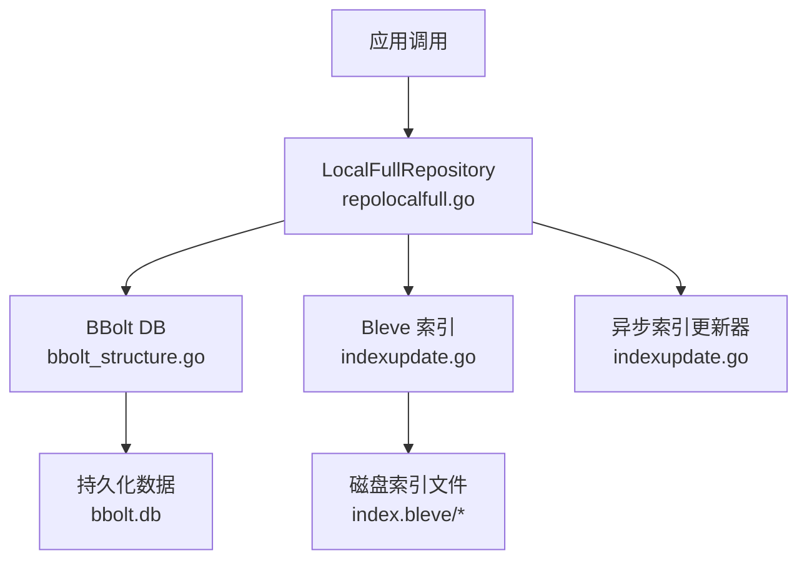
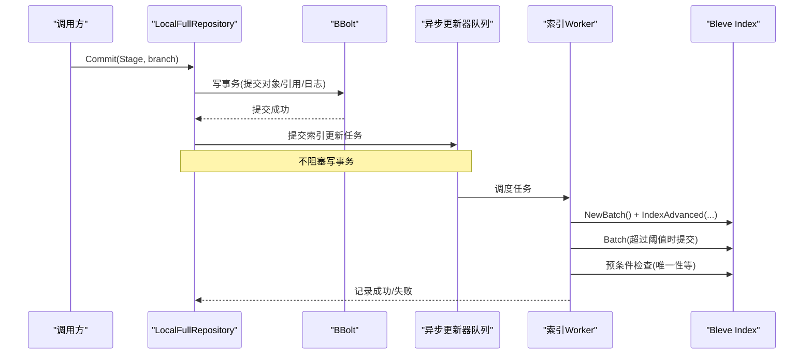
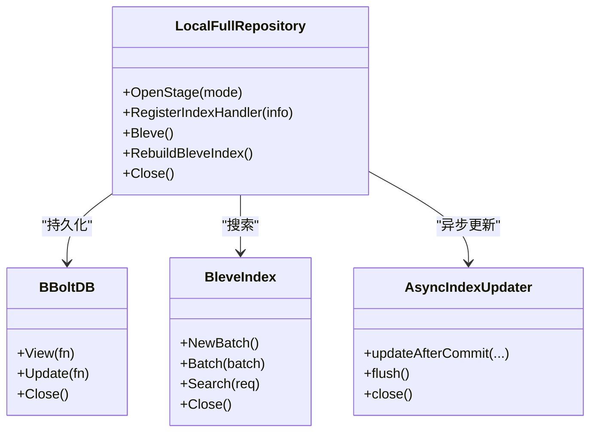

# 性能优化和调优

<cite>
**本文引用的文件**
- [repolocalfull.go](file://sst/repolocalfull.go)
- [bbolt_structure.go](file://sst/bbolt_structure.go)
- [indexupdate.go](file://sst/indexupdate.go)
- [repository.go](file://sst/repository.go)
- [reporemote.go](file://sst/reporemote.go)
- [hash_base58_benchmark_test.go](file://sst/hash_base58_benchmark_test.go)
</cite>

## 目录
1. [简介](#简介)
2. [项目结构](#项目结构)
3. [核心组件](#核心组件)
4. [架构总览](#架构总览)
5. [详细组件分析](#详细组件分析)
6. [依赖关系分析](#依赖关系分析)
7. [性能考量与瓶颈](#性能考量与瓶颈)
8. [监控指标与基准测试](#监控指标与基准测试)
9. [故障排查指南](#故障排查指南)
10. [结论](#结论)
11. [附录：不同数据规模下的表现与扩展性](#附录：不同数据规模下的表现与扩展性)

## 简介
本文件聚焦 LocalFullRepository 的性能特点、瓶颈分析与优化策略，系统阐述 BBolt 数据库配置、事务处理与并发控制；Bleve 索引的批量更新、异步处理与健康检查；内存管理与缓存策略；以及资源池化、监控指标、基准测试与调优建议。内容基于仓库源码实现进行归纳，帮助在不同数据规模下获得稳定且可扩展的性能表现。

## 项目结构
LocalFullRepository 将“持久化存储（BBolt）”与“全文检索（Bleve）”解耦，并通过异步索引更新器将写路径上的索引 I/O 移出主事务，从而降低提交延迟并提升吞吐。关键文件职责如下：
- repolocalfull.go：本地完整仓库实现、BBolt 打开与 Bleve 索引生命周期管理、数据集/分支/提交元数据访问等。
- bbolt_structure.go：BBolt 桶结构与键前缀定义、引用与日志结构说明。
- indexupdate.go：Bleve 索引更新接口、默认异步更新器、批量阈值控制、健康感知包装、预提交约束检查。
- repository.go：仓库打开流程与 BBolt 选项设置。
- reporemote.go：远程仓库对 Bleve 能力的代理与限制（无本地索引）。
- hash_base58_benchmark_test.go：哈希编解码基准测试。

图表来源
- [repolocalfull.go:220-230](file://sst/repolocalfull.go#L220-L230)
- [bbolt_structure.go:81-191](file://sst/bbolt_structure.go#L81-L191)
- [indexupdate.go:77-120](file://sst/indexupdate.go#L77-L120)

章节来源
- [repolocalfull.go:220-230](file://sst/repolocalfull.go#L220-L230)
- [bbolt_structure.go:81-191](file://sst/bbolt_structure.go#L81-L191)
- [indexupdate.go:77-120](file://sst/indexupdate.go#L77-L120)

## 核心组件
- LocalFullRepository：封装 BBolt 与 Bleve，提供数据集、分支、提交、搜索等能力；在关闭时按顺序释放资源，确保后台索引工作完成后再关闭底层索引。
- BBolt 存储：以桶组织命名图修订、数据集修订、提交对象、数据集引用与仓库日志；通过只读视图与写事务分离读写路径。
- Bleve 索引：使用映射生成文档，支持批量写入与阈值分片；通过异步更新器避免阻塞写事务；提供健康感知包装以重试可恢复错误。
- 异步索引更新器：队列化索引任务，单 worker 串行执行，提供 flush/close 语义，保证优雅退出。

章节来源
- [repolocalfull.go:220-230](file://sst/repolocalfull.go#L220-L230)
- [bbolt_structure.go:81-191](file://sst/bbolt_structure.go#L81-L191)
- [indexupdate.go:77-120](file://sst/indexupdate.go#L77-L120)

## 架构总览
LocalFullRepository 的写路径：
- 用户提交变更进入 Stage，Stage 内构建待提交的命名图集合。
- 提交阶段先写入 BBolt（事务），随后触发异步索引更新。
- 异步更新器收集需要更新的命名图，构造 Bleve Batch，超过阈值则分批提交，并在提交后执行唯一性等预条件检查。

读路径：
- 查询走 BBolt 视图或 Bleve 搜索；搜索经健康感知包装，遇到可恢复错误会短暂休眠并重试。

图表来源
- [indexupdate.go:160-249](file://sst/indexupdate.go#L160-L249)
- [indexupdate.go:424-434](file://sst/indexupdate.go#L424-L434)
- [indexupdate.go:486-502](file://sst/indexupdate.go#L486-L502)

章节来源
- [indexupdate.go:160-249](file://sst/indexupdate.go#L160-L249)
- [indexupdate.go:424-434](file://sst/indexupdate.go#L424-L434)
- [indexupdate.go:486-502](file://sst/indexupdate.go#L486-L502)

## 详细组件分析

### LocalFullRepository 性能特点与优化点
- 资源生命周期管理：Close 时先等待所有进入的操作完成，再关闭索引更新器与 Bleve，最后关闭 BBolt，避免竞态与资源泄漏。
- 索引重建：RebuildBleveIndex 关闭当前索引与更新器，清理索引目录并重建，期间 BBolt 仍可读写，但搜索不可用。
- 注册索引处理器：若已有索引且 deriveInfo 一致，则复用索引并设置预提交条件；否则重建索引。

优化建议
- 在高并发写场景下，优先使用异步更新器，避免同步索引 I/O 阻塞提交。
- 索引重建应安排在低峰期，或在服务重启时进行，以减少搜索中断时间。

章节来源
- [repolocalfull.go:734-761](file://sst/repolocalfull.go#L734-L761)
- [repolocalfull.go:438-458](file://sst/repolocalfull.go#L438-L458)
- [repolocalfull.go:259-341](file://sst/repolocalfull.go#L259-L341)

### BBolt 数据库配置、事务与并发
- 打开选项：使用 NoFreelistSync=true 与 FreelistType=Map，减少写放大与锁竞争，提高高并发写入性能。
- 桶结构：命名图修订、数据集修订、提交对象、数据集引用、仓库日志等均有明确的前缀与布局，便于高效扫描与定位。
- 事务模型：读操作使用 View，写操作使用 Update；提交成功后才触发索引更新，保证一致性。

优化建议
- 合理划分桶与键空间，避免热点键导致的锁竞争。
- 大批量写入时尽量合并为单次事务，减少事务开销。
- 对于只读遍历，使用 Cursor 迭代以降低内存占用。

章节来源
- [repository.go:482-531](file://sst/repository.go#L482-L531)
- [bbolt_structure.go:81-191](file://sst/bbolt_structure.go#L81-L191)

### Bleve 索引优化、内存管理与缓存策略
- 批量写入：使用 Batch 与 IndexAdvanced，累计文档大小超过阈值时自动提交，防止内存膨胀。
- 异步更新：默认更新器在独立 goroutine 中串行执行索引任务，队列容量固定，避免阻塞写路径。
- 健康感知：SearchInContext 对可恢复错误进行重试，并记录健康状态；异常时返回带警告的结果，便于上层观测。
- 预提交约束：在批量提交后检查唯一性等约束，确保数据完整性。

优化建议
- 根据负载调整批量阈值与队列长度，平衡内存与吞吐。
- 监控健康状态，出现频繁错误时考虑重建索引或降级搜索。
- 对高频字段建立合适的映射与分词器，减少索引体积与查询成本。

章节来源
- [indexupdate.go:27-35](file://sst/indexupdate.go#L27-L35)
- [indexupdate.go:77-120](file://sst/indexupdate.go#L77-L120)
- [indexupdate.go:424-434](file://sst/indexupdate.go#L424-L434)
- [indexupdate.go:650-735](file://sst/indexupdate.go#L650-L735)
- [indexupdate.go:486-502](file://sst/indexupdate.go#L486-L502)

### 批量操作、异步处理与资源池化
- 批量操作：Bleve 侧通过 indexBatch 累积文档，达到阈值后提交；BBolt 侧通过事务合并多键写入。
- 异步处理：defaultBleveIndexUpdater 使用通道队列与单 worker，flush/close 提供背压与优雅停机。
- 资源池化：当前实现未显式引入连接池；BBolt 由仓库实例持有单一 DB 句柄，Bleve 索引同样由仓库持有。可通过外部连接池或请求级复用进一步提升并发。

优化建议
- 对跨仓库或跨服务的共享资源（如网络客户端、序列化器）引入池化，减少分配与 GC 压力。
- 在高并发场景下，评估是否需要对 BBolt 打开参数做进一步调优（如 mmap 大小、页大小等，视部署环境而定）。

章节来源
- [indexupdate.go:77-120](file://sst/indexupdate.go#L77-L120)
- [indexupdate.go:160-249](file://sst/indexupdate.go#L160-L249)
- [repolocalfull.go:734-761](file://sst/repolocalfull.go#L734-L761)

### 并发控制与一致性
- 仓库级互斥：OpenStage/Bleve 等方法在进入时加锁，离开时释放，保证同一时刻只有一个操作在执行。
- 事务隔离：BBolt 的 View/Update 提供快照读与原子写；提交后才触发索引更新，避免脏读。
- 预提交约束：在索引层校验唯一性等约束，防止冲突写入。

优化建议
- 对热点数据集的分支操作进行限流或排队，避免长事务导致锁竞争。
- 结合业务语义设计合理的分支粒度，减少合并冲突概率。

章节来源
- [repolocalfull.go:244-257](file://sst/repolocalfull.go#L244-L257)
- [indexupdate.go:486-502](file://sst/indexupdate.go#L486-L502)

## 依赖关系分析
- LocalFullRepository 依赖 BBolt 作为持久化后端，依赖 Bleve 作为全文检索后端。
- 索引更新器与仓库解耦，通过接口抽象，便于替换实现或扩展功能。
- 远程仓库不提供本地 Bleve 索引，仅返回代理对象，搜索能力受限。

图表来源
- [repolocalfull.go:220-230](file://sst/repolocalfull.go#L220-L230)
- [indexupdate.go:77-120](file://sst/indexupdate.go#L77-L120)

章节来源
- [repolocalfull.go:220-230](file://sst/repolocalfull.go#L220-L230)
- [indexupdate.go:77-120](file://sst/indexupdate.go#L77-L120)
- [reporemote.go:221-257](file://sst/reporemote.go#L221-L257)

## 性能考量与瓶颈
- 写路径瓶颈：BBolt 事务提交与 Bleve 索引写入是主要耗时点。通过异步更新器将索引 I/O 移出事务，显著降低提交延迟。
- 内存压力：Bleve 批量累积文档可能带来峰值内存；需根据数据规模调整批量阈值与队列长度。
- 锁竞争：仓库级互斥保护了临界区，但在高并发下可能成为瓶颈；可通过拆分热点数据集或引入更细粒度的锁来缓解。
- 索引健康：搜索过程中可能出现临时错误，健康感知包装提供重试与告警，但频繁错误需关注底层原因（磁盘 IO、索引损坏等）。

优化建议
- 针对大文档或大量字段，适当减小批量阈值，避免内存尖峰。
- 对高频查询字段优化映射与分词器，减少索引体积与查询成本。
- 监控队列积压与错误率，必要时扩容 worker 或降级搜索。

章节来源
- [indexupdate.go:27-35](file://sst/indexupdate.go#L27-L35)
- [indexupdate.go:424-434](file://sst/indexupdate.go#L424-L434)
- [indexupdate.go:650-735](file://sst/indexupdate.go#L650-L735)

## 监控指标与基准测试
- 监控指标
  - 索引健康：健康状态、最近错误、错误计数、最近成功时间。
  - 队列深度：异步更新器队列长度（可通过自定义指标暴露）。
  - 批量大小：每次提交的文档数量与字节数。
  - 事务耗时：BBolt 事务提交耗时（可在上层埋点）。
- 基准测试
  - Base58 编解码：提供 encode/decode 基准，可用于评估哈希处理的性能影响。
  - 建议补充：提交吞吐、搜索延迟、索引重建耗时等端到端基准。

章节来源
- [indexupdate.go:650-735](file://sst/indexupdate.go#L650-L735)
- [hash_base58_benchmark_test.go:39-67](file://sst/hash_base58_benchmark_test.go#L39-L67)

## 故障排查指南
- 索引不可用：检查 RebuildBleveIndex 是否被调用，确认索引目录存在且可写；查看健康状态与错误计数。
- 提交缓慢：确认异步更新器是否正常工作，队列是否积压；检查批量阈值与磁盘 IO。
- 搜索错误：观察健康感知包装的重试逻辑，若持续失败，考虑重建索引或检查底层文件系统权限。
- 资源泄漏：确保 Close 被调用，顺序为：停止更新器、关闭索引、关闭 BBolt。

章节来源
- [repolocalfull.go:734-761](file://sst/repolocalfull.go#L734-L761)
- [indexupdate.go:650-735](file://sst/indexupdate.go#L650-L735)

## 结论
LocalFullRepository 通过 BBolt 与 Bleve 的解耦、异步索引更新与健康感知搜索，实现了高吞吐与稳定的搜索能力。调优重点在于批量阈值、队列长度、索引映射与监控指标。在高并发与大文本场景下，应重点关注内存峰值与索引健康，必要时进行重建或降级。

## 附录：不同数据规模下的表现与扩展性
- 小规模数据（GB 级以下）
  - 单实例即可满足读写需求；批量阈值适中，队列长度无需过大。
  - 索引重建耗时较短，可在维护窗口进行。
- 中等规模数据（数十 GB）
  - 需要关注批量阈值与队列长度，避免内存尖峰。
  - 建议定期监控索引健康，必要时重建索引。
- 大规模数据（百 GB 以上）
  - 考虑分库分表或分仓库策略，减少单实例压力。
  - 对热点数据集进行隔离，降低锁竞争。
  - 结合外部资源池化（如网络客户端、序列化器）提升整体吞吐。

[本节为概念性总结，不直接分析具体文件]