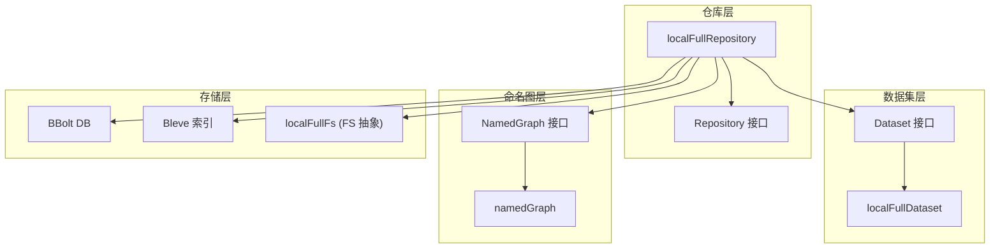
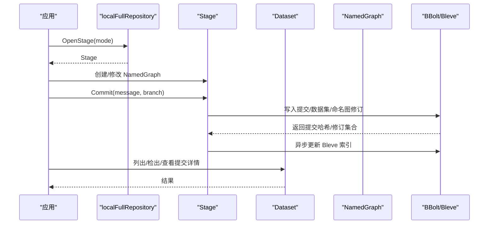
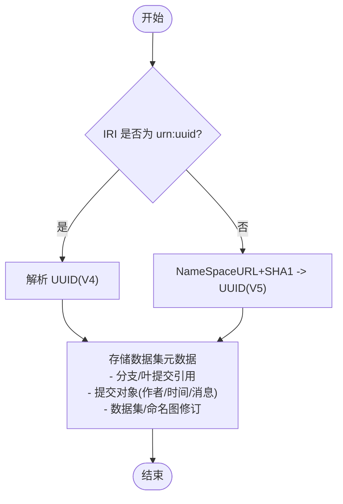
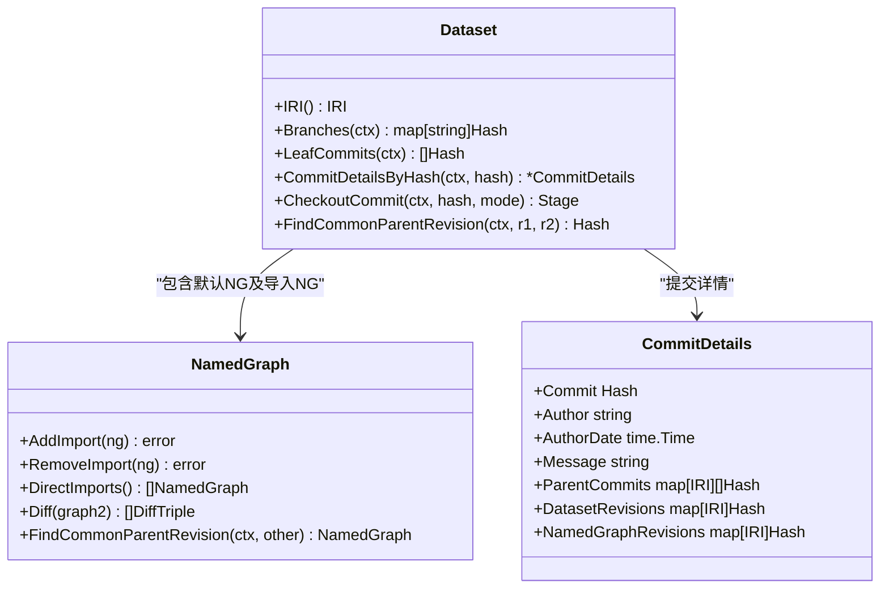
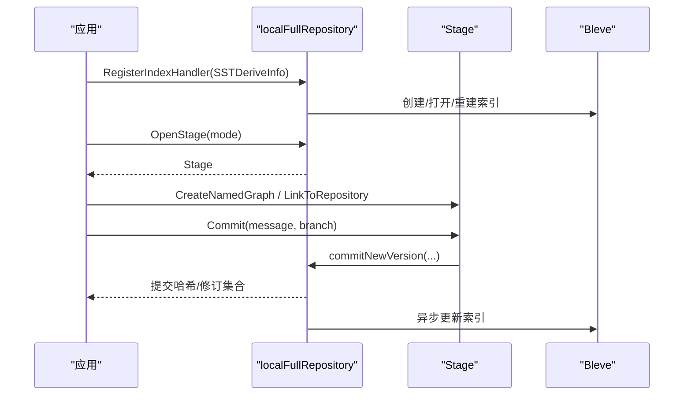
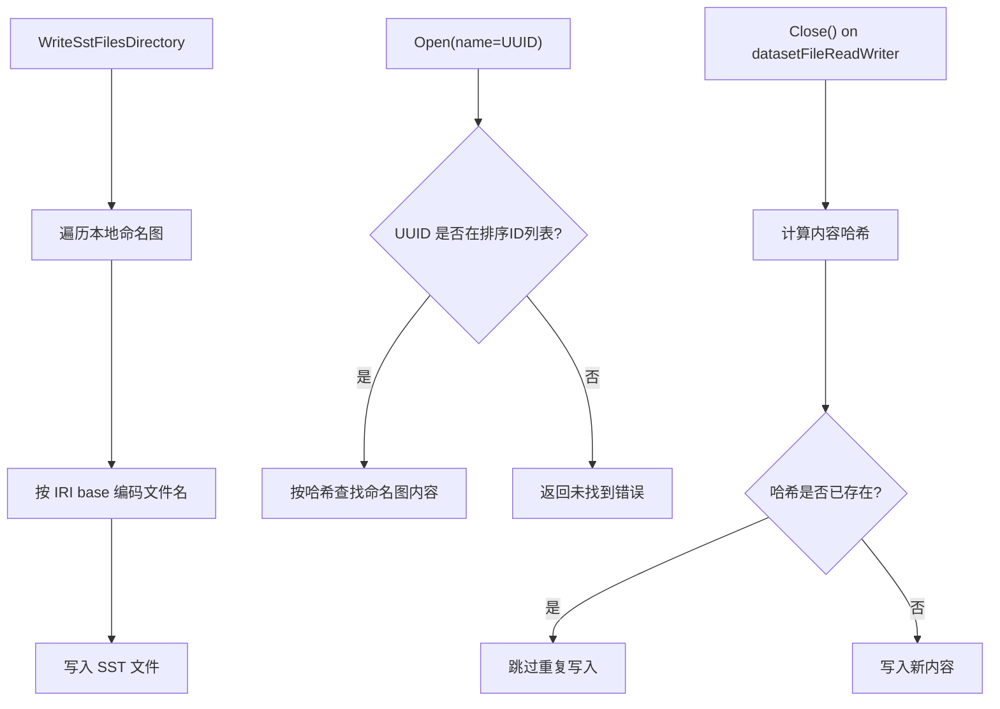
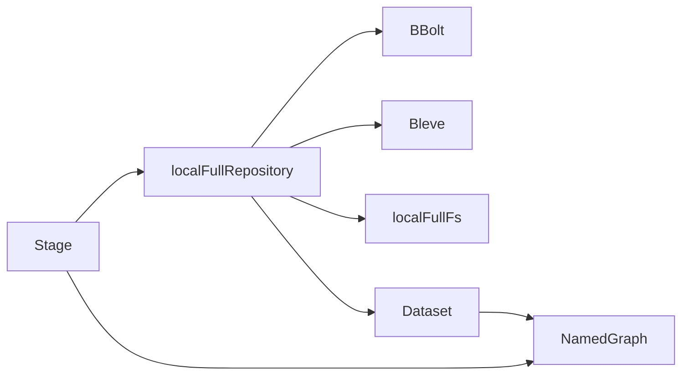

# 数据集管理

<cite>
**本文引用的文件**
- [repolocalfull.go](file://sst/repolocalfull.go)
- [dataset.go](file://sst/dataset.go)
- [namedgraph.go](file://sst/namedgraph.go)
- [stagefslocalfull.go](file://sst/stagefslocalfull.go)
- [bbolt_structure.go](file://sst/bbolt_structure.go)
- [repository.go](file://sst/repository.go)
- [stage.go](file://sst/stage.go)
</cite>

## 目录
1. [简介](#简介)
2. [项目结构](#项目结构)
3. [核心组件](#核心组件)
4. [架构总览](#架构总览)
5. [详细组件分析](#详细组件分析)
6. [依赖关系分析](#依赖关系分析)
7. [性能考虑](#性能考虑)
8. [故障排查指南](#故障排查指南)
9. [结论](#结论)
10. [附录](#附录)

## 简介
本文件面向 LocalFullRepository 的数据集管理能力，系统性说明数据集的创建、配置与生命周期管理；解释数据集 ID 生成、IRI 映射与元数据存储；阐述数据集与命名图的关系、版本控制与依赖管理；覆盖导入导出、批量操作与性能优化；提供 API 使用示例与管理最佳实践；并给出备份、迁移与清理策略。内容基于代码库中的实现进行归纳与可视化。

## 项目结构
LocalFullRepository 是本地全功能仓库实现，基于 BBolt 持久化存储，结合 Bleve 索引支持查询。其关键职责包括：
- 数据集（Dataset）的枚举、查找与按 IRI/UUID 访问
- 提交历史、分支与叶提交引用管理
- 命名图（NamedGraph）的版本化与依赖（import）管理
- 阶段（Stage）的创建、修改、合并与提交
- 索引注册与重建、健康感知更新
- 文件系统抽象下的数据集视图（用于读取/写入 SST 文件）

图表来源
- [repolocalfull.go:220-257](file://sst/repolocalfull.go#L220-L257)
- [dataset.go:30-94](file://sst/dataset.go#L30-L94)
- [namedgraph.go:117-350](file://sst/namedgraph.go#L117-L350)
- [stagefslocalfull.go:16-88](file://sst/stagefslocalfull.go#L16-L88)
- [repository.go:34-128](file://sst/repository.go#L34-L128)

章节来源
- [repolocalfull.go:220-257](file://sst/repolocalfull.go#L220-L257)
- [repository.go:34-128](file://sst/repository.go#L34-L128)

## 核心组件
- localFullRepository：本地全功能仓库实现，负责数据集、提交、分支、索引与文件系统视图等。
- Dataset 接口：定义数据集的 IRI、分支、叶提交、提交详情、检出与合并能力。
- namedGraph：命名图内存模型，维护三元组、导入关系、检出元数据与变更追踪。
- Stage：工作区，承载本地/引用命名图，支持移动合并、链接仓库、提交。
- localFullFs：将数据集内的命名图以 FS 形式暴露，便于读写 SST 文件。
- bbolt_structure：BBolt 键空间与数据集 IRI 存取工具。

章节来源
- [repolocalfull.go:220-257](file://sst/repolocalfull.go#L220-L257)
- [dataset.go:30-94](file://sst/dataset.go#L30-L94)
- [namedgraph.go:117-350](file://sst/namedgraph.go#L117-L350)
- [stage.go:53-177](file://sst/stage.go#L53-L177)
- [stagefslocalfull.go:16-88](file://sst/stagefslocalfull.go#L16-L88)
- [bbolt_structure.go:215-254](file://sst/bbolt_structure.go#L215-L254)

## 架构总览
下图展示 LocalFullRepository 在数据集层面的整体交互：应用通过 Repository 接口打开 Stage，对命名图进行修改并提交；提交时生成数据集与命名图修订，维护分支与叶提交引用；同时触发索引更新；数据集视图通过 FS 抽象暴露以便外部工具读写 SST 文件。

图表来源
- [repolocalfull.go:244-257](file://sst/repolocalfull.go#L244-L257)
- [stage.go:121-177](file://sst/stage.go#L121-L177)
- [repolocalfull.go:460-548](file://sst/repolocalfull.go#L460-L548)
- [repolocalfull.go:595-732](file://sst/repolocalfull.go#L595-L732)

## 详细组件分析

### 数据集 ID 生成、IRI 映射与元数据存储
- 数据集标识：内部以 UUID 作为主键，默认命名图的 UUID 与数据集 UUID 一致。
- IRI 映射：
  - 若数据集 IRI 为 urn:uuid:xxx（V4），则直接解析为 UUID。
  - 若为其他 IRI，则通过 NameSpaceURL + SHA1 派生 V5 UUID，确保确定性映射。
  - 对于 V5 UUID 的数据集，原始 IRI 会存储在数据集子桶中，供对外查询与显示。
- 元数据存储：
  - 数据集桶下维护分支引用（refBranchPrefix）、叶提交引用（refLeafPrefix）。
  - 提交对象包含作者、时间戳、消息以及每个数据集的修订与父提交信息。
  - 命名图修订桶记录默认命名图与各导入命名图的修订哈希。

图表来源
- [namedgraph.go:729-739](file://sst/namedgraph.go#L729-L739)
- [bbolt_structure.go:215-254](file://sst/bbolt_structure.go#L215-L254)
- [repolocalfull.go:595-719](file://sst/repolocalfull.go#L595-L719)

章节来源
- [namedgraph.go:729-739](file://sst/namedgraph.go#L729-L739)
- [bbolt_structure.go:215-254](file://sst/bbolt_structure.go#L215-L254)
- [repolocalfull.go:595-719](file://sst/repolocalfull.go#L595-L719)

### 数据集与命名图的关系、版本控制与依赖管理
- 关系：一个数据集由默认命名图与所有直接或间接导入的命名图组成。SST 保证导入关系构成有向无环图（DAG）。
- 版本控制：
  - 每次提交会为每个修改的命名图创建命名图修订，并为受影响的数据集创建数据集修订。
  - 提交对象记录数据集修订与父提交，支持单父（普通提交）或多父（合并提交）。
  - 分支指向最新提交，未关联分支的提交可作为“叶提交”保留可追溯性。
- 依赖管理：
  - 命名图支持 AddImport/RemoveImport/DirectImports，提交时会跟踪导入变化。
  - Diff 输出包含导入级别的变化（新增/移除/替换修订）。

图表来源
- [dataset.go:30-94](file://sst/dataset.go#L30-L94)
- [namedgraph.go:222-265](file://sst/namedgraph.go#L222-L265)
- [repolocalfull.go:595-719](file://sst/repolocalfull.go#L595-L719)

章节来源
- [dataset.go:30-94](file://sst/dataset.go#L30-L94)
- [namedgraph.go:222-265](file://sst/namedgraph.go#L222-L265)
- [repolocalfull.go:595-719](file://sst/repolocalfull.go#L595-L719)

### 数据集的创建、配置与生命周期管理
- 创建：
  - 通过 Stage.CreateNamedGraph 或 LinkToRepository 将命名图关联到仓库与分支，首次提交时自动创建数据集。
  - 若数据集已存在但分支不存在，提交将新建分支；若均存在，则以当前分支尖端的提交作为父提交继续历史。
- 配置：
  - RegisterIndexHandler 设置 Bleve 索引映射；若版本不一致则重建索引。
  - RebuildBleveIndex 支持关闭当前索引、删除目录并从头重建。
- 生命周期：
  - OpenStage 打开工作区；Commit 持久化并提交；Close 释放资源（先关闭索引更新器，再关闭索引与数据库）。
  - ForDatasets/Datasets/DatasetIDs 遍历与列举数据集；DatasetByID 按 UUID 获取数据集。

图表来源
- [repolocalfull.go:259-426](file://sst/repolocalfull.go#L259-L426)
- [repolocalfull.go:734-761](file://sst/repolocalfull.go#L734-L761)
- [stage.go:121-177](file://sst/stage.go#L121-L177)
- [repository.go:91-128](file://sst/repository.go#L91-L128)

章节来源
- [repolocalfull.go:259-426](file://sst/repolocalfull.go#L259-L426)
- [repolocalfull.go:734-761](file://sst/repolocalfull.go#L734-L761)
- [stage.go:121-177](file://sst/stage.go#L121-L177)
- [repository.go:91-128](file://sst/repository.go#L91-L128)

### 数据集的导入导出、批量操作与性能优化
- 导入导出：
  - 通过 Stage.WriteSstFilesDirectory 将当前 Stage 的所有命名图写出到目录，文件名基于 IRI 的 base 部分编码，便于恢复。
  - 通过 localFullFs 提供的 FS 接口，可按 UUID 路径打开/读取/写入命名图内容，写回时按内容哈希去重存储。
- 批量操作：
  - ForDatasets 遍历数据集；CommitDetails 批量获取提交详情；Merge/AlignHistory 支持跨 Stage 的移动与合并。
- 性能优化：
  - TriplexMode 控制三元组类型数量，平衡内存与遍历性能。
  - Bleve 索引采用健康感知与异步更新，避免阻塞提交。
  - BBolt 事务与游标高效扫描数据集与提交桶。

图表来源
- [stage.go:179-196](file://sst/stage.go#L179-L196)
- [stagefslocalfull.go:39-88](file://sst/stagefslocalfull.go#L39-L88)
- [stagefslocalfull.go:116-128](file://sst/stagefslocalfull.go#L116-L128)

章节来源
- [stage.go:179-196](file://sst/stage.go#L179-L196)
- [stagefslocalfull.go:39-88](file://sst/stagefslocalfull.go#L39-L88)
- [stagefslocalfull.go:116-128](file://sst/stagefslocalfull.go#L116-L128)

### 数据集操作的 API 示例与管理最佳实践
- 常用 API 路径（不展示具体代码，仅给出调用位置参考）：
  - 打开仓库与工作区：[OpenStage:244-257](file://sst/repolocalfull.go#L244-L257)
  - 创建/链接命名图并提交：[CreateNamedGraph/LinkToRepository/Commit:74-177](file://sst/stage.go#L74-L177)
  - 列举/查找数据集：[Datasets/Dataset/DatasetIDs:460-593](file://sst/repolocalfull.go#L460-L593)
  - 获取提交详情：[CommitDetails:595-719](file://sst/repolocalfull.go#L595-L719)
  - 检出提交/分支：[CheckoutCommit/CheckoutBranch:721-732](file://sst/repolocalfull.go#L721-L732)
  - 索引注册与重建：[RegisterIndexHandler/RebuildBleveIndex:259-458](file://sst/repolocalfull.go#L259-L458)
  - 关闭仓库：[Close:734-761](file://sst/repolocalfull.go#L734-L761)
- 最佳实践：
  - 使用 LinkToRepository 将无历史的命名图接入仓库，确保后续提交继承分支历史。
  - 合理选择 TriplexMode，在内存与遍历需求之间权衡。
  - 提交前通过 PreCommitCondition 校验约束，避免非法状态进入提交。
  - 定期重建索引以应对映射变更或损坏。
  - 使用 FS 接口进行批量导入导出，减少中间格式转换成本。

章节来源
- [repolocalfull.go:244-458](file://sst/repolocalfull.go#L244-L458)
- [repolocalfull.go:460-761](file://sst/repolocalfull.go#L460-L761)
- [stage.go:74-177](file://sst/stage.go#L74-L177)

### 备份、迁移与清理策略
- 备份：
  - 备份 BBolt 数据库文件与 Bleve 索引目录，确保一致性（建议在空闲期或只读模式下进行）。
  - 使用 WriteSstFilesDirectory 导出各命名图为 SST 文件，便于归档与跨系统迁移。
- 迁移：
  - 通过 SyncFrom 从源仓库同步提交与数据集，支持按数据集与分支过滤。
  - 利用 AlignHistory 将来自不同来源的 Stage 对齐到同一仓库的历史上下文。
- 清理：
  - 删除不再使用的分支与叶提交，减少不可达对象。
  - 当索引映射变更或损坏时，调用 RebuildBleveIndex 重建索引。
  - 关闭仓库时确保先关闭索引更新器，再关闭索引与数据库，避免资源泄漏。

章节来源
- [repolocalfull.go:259-458](file://sst/repolocalfull.go#L259-L458)
- [repolocalfull.go:734-761](file://sst/repolocalfull.go#L734-L761)
- [stage.go:154-177](file://sst/stage.go#L154-L177)

## 依赖关系分析
- 组件耦合：
  - localFullRepository 依赖 BBolt 存储与 Bleve 索引，并通过 FS 抽象暴露数据集视图。
  - Dataset 与 NamedGraph 通过提交与修订建立强关联，提交对象记录两者之间的版本关系。
  - Stage 作为工作区，协调命名图修改与提交流程，并与仓库指针绑定。
- 外部依赖：
  - BBolt 提供高性能键值存储。
  - Bleve 提供全文检索与字段级索引。
  - uuid 库用于唯一标识与确定性映射。
- 循环依赖：
  - 通过接口隔离（Repository/Dataset/NamedGraph/Stage）降低耦合，避免循环依赖。

图表来源
- [repolocalfull.go:220-257](file://sst/repolocalfull.go#L220-L257)
- [stage.go:53-177](file://sst/stage.go#L53-L177)
- [dataset.go:30-94](file://sst/dataset.go#L30-L94)
- [namedgraph.go:117-350](file://sst/namedgraph.go#L117-L350)

章节来源
- [repolocalfull.go:220-257](file://sst/repolocalfull.go#L220-L257)
- [stage.go:53-177](file://sst/stage.go#L53-L177)
- [dataset.go:30-94](file://sst/dataset.go#L30-L94)
- [namedgraph.go:117-350](file://sst/namedgraph.go#L117-L350)

## 性能考虑
- 三元组模式：DefaultTriplexMode 同时维护 subject/predicate/object 三元组，适合复杂遍历场景，但内存占用较高。可根据业务需求评估是否调整。
- 索引更新：采用健康感知与异步更新，提交后后台任务增量更新索引，减少阻塞。
- 存储访问：BBolt 事务与游标高效扫描数据集与提交桶；命名图内容按哈希去重存储，减少重复写入。
- 文件系统抽象：localFullFs 将数据集视图暴露为 FS，便于批量读写 SST 文件，提升导入导出效率。

章节来源
- [stage.go:33-51](file://sst/stage.go#L33-L51)
- [repolocalfull.go:259-426](file://sst/repolocalfull.go#L259-L426)
- [stagefslocalfull.go:39-88](file://sst/stagefslocalfull.go#L39-L88)
- [stagefslocalfull.go:116-128](file://sst/stagefslocalfull.go#L116-L128)

## 故障排查指南
- 常见问题定位：
  - 数据集未找到：检查 Dataset/DatasetByID 返回值与错误码。
  - 提交未找到：确认 CommitDetails 传入的哈希是否存在于提交桶。
  - 命名图未找到：检查 localFullFs.Open 的路径与排序 ID 列表。
  - 索引问题：若索引损坏或映射变更，调用 RebuildBleveIndex 重建。
- 日志与诊断：
  - 关注全局日志输出，如索引创建/删除、重建失败、关闭顺序等。
  - 使用 Info/Log 方法了解仓库内容与历史记录。
- 资源释放：
  - 确保 Close 顺序正确：先关闭索引更新器，再关闭索引与数据库。

章节来源
- [repolocalfull.go:259-426](file://sst/repolocalfull.go#L259-L426)
- [repolocalfull.go:734-761](file://sst/repolocalfull.go#L734-L761)
- [stagefslocalfull.go:39-88](file://sst/stagefslocalfull.go#L39-L88)

## 结论
LocalFullRepository 提供了完整的数据集管理能力，涵盖 ID 生成、IRI 映射、元数据存储、版本控制与依赖管理；通过 Stage 与命名图协作实现灵活的修改与提交；借助 BBolt 与 Bleve 实现高效存储与检索；通过 FS 抽象支持导入导出与批量操作。遵循最佳实践与清理策略，可保障系统的稳定性与可维护性。

## 附录
- 术语表：
  - 数据集（Dataset）：由默认命名图与导入命名图组成的逻辑单元。
  - 命名图（NamedGraph）：RDF 图中的命名子图，包含三元组与导入关系。
  - 提交（Commit）：一次持久化变更的快照，包含作者、时间与修订信息。
  - 分支（Branch）：指向某个提交的引用，用于标识数据集的最新版本。
  - 叶提交（Leaf Commit）：未被分支指向但仍可追溯的提交。
  - 修订（Revision）：数据集或命名图的特定版本。
- 参考路径：
  - 数据集接口定义：[dataset.go:30-94](file://sst/dataset.go#L30-L94)
  - 命名图接口定义：[namedgraph.go:117-350](file://sst/namedgraph.go#L117-L350)
  - 仓库接口定义：[repository.go:34-128](file://sst/repository.go#L34-L128)
  - 本地全功能仓库实现：[repolocalfull.go:220-761](file://sst/repolocalfull.go#L220-L761)
  - 阶段与工作区：[stage.go:53-177](file://sst/stage.go#L53-L177)
  - 文件系统抽象：[stagefslocalfull.go:16-128](file://sst/stagefslocalfull.go#L16-L128)
  - BBolt 结构与 IRI 存取：[bbolt_structure.go:215-254](file://sst/bbolt_structure.go#L215-L254)