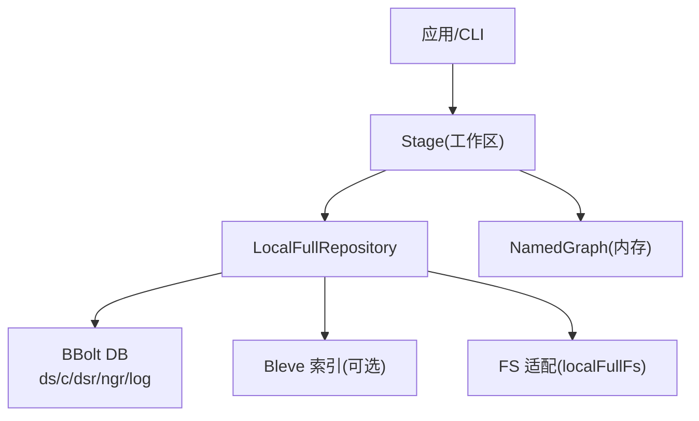
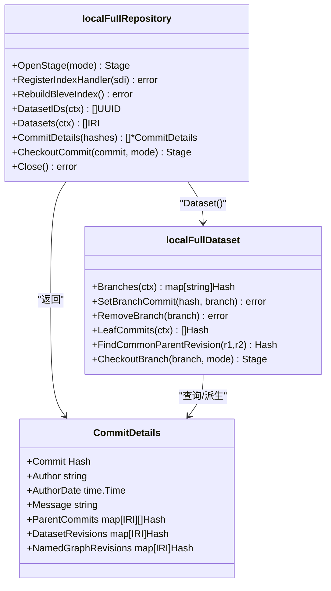
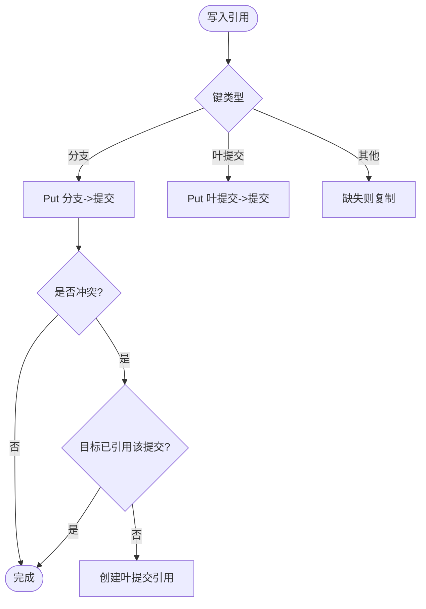
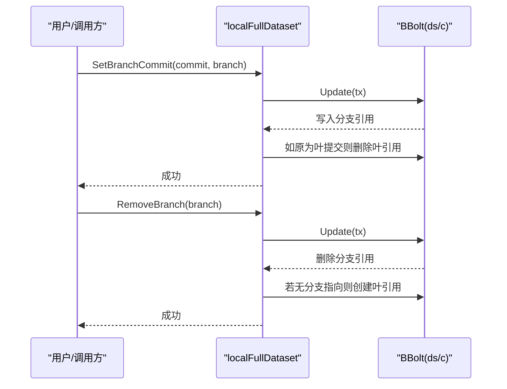
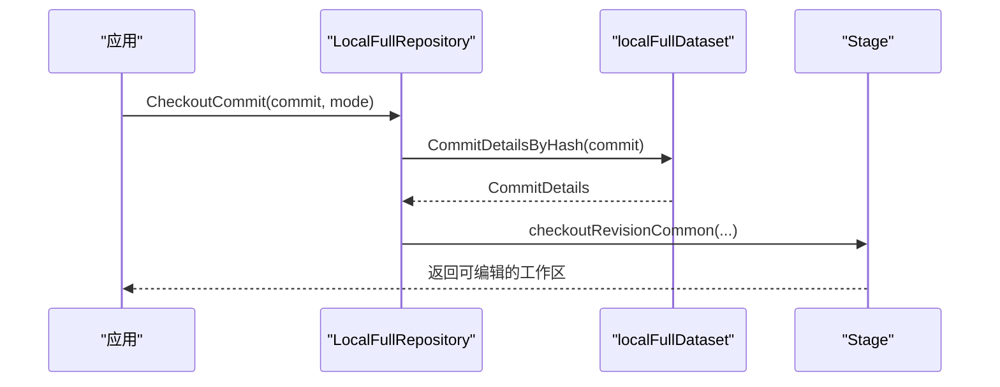
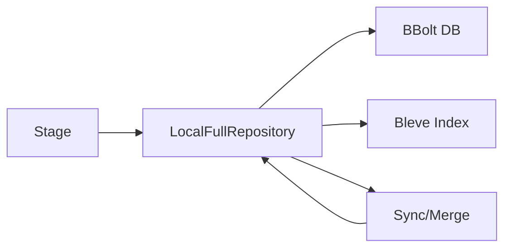

# 本地完整仓库

<cite>
**本文引用的文件**
- [repolocalfull.go](file://sst/repolocalfull.go)
- [bbolt_structure.go](file://sst/bbolt_structure.go)
- [stagefslocalfull.go](file://sst/stagefslocalfull.go)
- [commit.go](file://sst/commit.go)
- [stage.go](file://sst/stage.go)
- [repolocalbasic.go](file://sst/repolocalbasic.go)
- [repolocalfull.go](file://examples/helloworldrepolocalfull/repolocalfull.go)
- [syncfrom_test.go](file://sst_test/syncfrom_test.go)
</cite>

## 目录
1. [简介](#简介)
2. [项目结构](#项目结构)
3. [核心组件](#核心组件)
4. [架构总览](#架构总览)
5. [详细组件分析](#详细组件分析)
6. [依赖关系分析](#依赖关系分析)
7. [性能考量](#性能考量)
8. [故障排查指南](#故障排查指南)
9. [结论](#结论)
10. [附录：使用示例与最佳实践](#附录使用示例与最佳实践)

## 简介
本地完整仓库（LocalFullRepository）是 SST Core 中基于 BBolt 的本地版本化存储实现，提供完整的版本控制能力：分支、提交历史、合并与检出。它通过 BBolt 的多桶结构持久化数据集版本、命名图版本、提交对象和引用（分支/叶提交），并可选集成 Bleve 全文索引以支持检索。相比基础仓库（LocalBasicRepository），LocalFullRepository 在数据模型上引入了“提交-版本”链式结构，从而支持多分支、历史回溯与跨分支同步。

## 项目结构
围绕 LocalFullRepository 的关键代码分布在以下文件中：
- 仓库实现与版本控制逻辑：[repolocalfull.go](file://sst/repolocalfull.go)
- BBolt 数据库布局与键空间定义：[bbolt_structure.go](file://sst/bbolt_structure.go)
- 阶段文件系统适配（用于按命名图快照读写）：[stagefslocalfull.go](file://sst/stagefslocalfull.go)
- 提交数据结构与默认分支常量：[commit.go](file://sst/commit.go)
- 工作区 Stage 接口与提交流程入口：[stage.go](file://sst/stage.go)
- 基础仓库对比参考：[repolocalbasic.go](file://sst/repolocalbasic.go)
- 示例程序（创建、提交、导出、检出）：[repolocalfull.go](file://examples/helloworldrepolocalfull/repolocalfull.go)
- 同步与分支过滤测试用例（体现分支管理行为）：[syncfrom_test.go](file://sst_test/syncfrom_test.go)

图表来源
- [repolocalfull.go:217-230](file://sst/repolocalfull.go#L217-L230)
- [bbolt_structure.go:81-191](file://sst/bbolt_structure.go#L81-L191)
- [stagefslocalfull.go:16-27](file://sst/stagefslocalfull.go#L16-L27)

章节来源
- [repolocalfull.go:217-230](file://sst/repolocalfull.go#L217-L230)
- [bbolt_structure.go:81-191](file://sst/bbolt_structure.go#L81-L191)
- [stagefslocalfull.go:16-27](file://sst/stagefslocalfull.go#L16-L27)

## 核心组件
- LocalFullRepository：封装 BBolt 数据库访问、分支/提交/版本管理、Bleve 索引生命周期、配额与权限等。
- Dataset（localFullDataset）：对单个数据集的版本操作（分支设置、删除、列出、检出、查找共同祖先）。
- Stage：内存工作区，承载 NamedGraph 修改，提交时生成新的命名图版本、数据集版本与提交对象。
- localFullFs：将数据集快照映射为 FS 视图，便于外部工具或内部流程读取/写入命名图内容。
- CommitDetails：提交元信息（作者、时间、消息、父提交、数据集/命名图版本映射）。

章节来源
- [repolocalfull.go:217-230](file://sst/repolocalfull.go#L217-L230)
- [repolocalfull.go:851-951](file://sst/repolocalfull.go#L851-L951)
- [repolocalfull.go:1079-1161](file://sst/repolocalfull.go#L1079-L1161)
- [commit.go:15-29](file://sst/commit.go#L15-L29)
- [stage.go:53-130](file://sst/stage.go#L53-L130)
- [stagefslocalfull.go:16-27](file://sst/stagefslocalfull.go#L16-L27)

## 架构总览
LocalFullRepository 的核心在于“提交-版本”模型：
- 提交（Commit）：记录作者、消息、以及每个数据集在该提交中的“数据集版本”及其父提交链。
- 数据集版本（DatasetRevision）：描述该提交下默认命名图与各导入命名图的版本哈希，并记录创建该版本的提交哈希。
- 命名图版本（NamedGraphRevision）：实际三元组数据的二进制快照，按哈希去重存储。
- 引用（Ref）：分支指向某个提交；无分支指向的提交作为“叶提交”保留，保证历史可达性。

图表来源
- [repolocalfull.go:217-230](file://sst/repolocalfull.go#L217-L230)
- [repolocalfull.go:851-951](file://sst/repolocalfull.go#L851-L951)
- [commit.go:15-29](file://sst/commit.go#L15-L29)

## 详细组件分析

### BBolt 数据库结构与版本管理
- 顶层桶
  - ds（Datasets）：按数据集 UUID 组织引用（分支、标签、叶提交）及原始 IRI（V5 UUID）。
  - c（Commits）：提交对象，包含作者、消息、各数据集版本与父提交链。
  - dsr（DatasetRevisions）：数据集版本，含默认命名图哈希、导入命名图哈希、创建提交的哈希。
  - ngr（NamedGraphRevisions）：命名图版本二进制内容，按哈希键存储。
  - log：仓库级操作日志（提交、分支变更、文档上传/删除、同步等）。
- 引用键前缀
  - refBranchPrefix：分支名到提交哈希的映射。
  - refLeafPrefix：无分支指向的“叶提交”，确保历史可追溯。
- 关键辅助
  - createLeafCommitRef / deleteLeafCommitRef：维护叶提交集合。
  - mergeDatasetRefsFromSource / mergeIncomingDatasetRef：同步时合并引用，冲突时保留目标分支尖点并将源尖点转为叶提交。
  - isMasterBranchRefKey：识别默认分支（master）。

图表来源
- [repolocalfull.go:83-120](file://sst/repolocalfull.go#L83-L120)
- [bbolt_structure.go:33-51](file://sst/bbolt_structure.go#L33-L51)

章节来源
- [bbolt_structure.go:81-191](file://sst/bbolt_structure.go#L81-L191)
- [repolocalfull.go:54-120](file://sst/repolocalfull.go#L54-L120)

### 分支管理与提交历史
- 设置分支：将分支指向某提交；若该提交原为叶提交且被分支引用，则移除叶引用。
- 删除分支：删除分支引用；若该提交不再被任何分支指向，则将其转为叶提交以保持历史可达。
- 列出分支/叶提交：分别扫描 ds 桶中对应前缀的键值。
- 共同祖先查找：双指针沿父提交链回溯，找到两版本的最近公共祖先，用于合并策略。

图表来源
- [repolocalfull.go:851-951](file://sst/repolocalfull.go#L851-L951)
- [repolocalfull.go:961-1073](file://sst/repolocalfull.go#L961-L1073)

章节来源
- [repolocalfull.go:851-951](file://sst/repolocalfull.go#L851-L951)
- [repolocalfull.go:961-1073](file://sst/repolocalfull.go#L961-L1073)
- [repolocalfull.go:1079-1161](file://sst/repolocalfull.go#L1079-L1161)
- [repolocalfull.go:777-845](file://sst/repolocalfull.go#L777-L845)

### 检出与快照（Stage 与 FS 适配）
- Checkout：根据提交或数据集版本，构建 Stage，加载默认命名图与导入命名图至内存。
- localFullFs：将数据集快照暴露为 FS 接口，支持 ReadDir/OpenFile，便于导出或第三方工具处理。

图表来源
- [repolocalfull.go:721-732](file://sst/repolocalfull.go#L721-L732)
- [repolocalfull.go:1165-1196](file://sst/repolocalfull.go#L1165-L1196)
- [stagefslocalfull.go:39-88](file://sst/stagefslocalfull.go#L39-L88)

章节来源
- [repolocalfull.go:721-732](file://sst/repolocalfull.go#L721-L732)
- [repolocalfull.go:1165-1196](file://sst/repolocalfull.go#L1165-L1196)
- [stagefslocalfull.go:39-88](file://sst/stagefslocalfull.go#L39-L88)

### 与基础仓库的差异与性能影响
- 数据模型差异
  - LocalBasicRepository：更简化的本地存储，通常不维护完整的提交-版本链与多分支历史。
  - LocalFullRepository：引入提交对象、数据集版本、命名图版本与引用体系，支持分支、历史回溯与同步。
- 性能影响
  - 写路径：每次提交会创建新的命名图版本与数据集版本，并更新引用；可能触发 Bleve 索引增量更新。
  - 读路径：通过哈希直接定位命名图版本，避免重复存储；分支/叶提交快速定位提交尖点。
  - 索引：Bleve 索引按需重建或增量更新，关闭索引可提升写入吞吐但牺牲搜索能力。

章节来源
- [repolocalbasic.go:34-42](file://sst/repolocalbasic.go#L34-L42)
- [repolocalbasic.go:67-145](file://sst/repolocalbasic.go#L67-L145)
- [repolocalfull.go:259-426](file://sst/repolocalfull.go#L259-L426)

### 版本控制操作、分支管理与冲突解决示例
- 创建仓库并提交
  - 步骤：创建仓库 -> 打开 Stage -> 创建/修改 NamedGraph -> Commit(message, branch)。
  - 参考示例：[repolocalfull.go](file://examples/helloworldrepolocalfull/repolocalfull.go)
- 分支管理
  - 设置分支：SetBranchCommit(commit, branch)。
  - 删除分支：RemoveBranch(branch)，自动转为叶提交保持历史可达。
  - 列出分支/叶提交：Branches(), LeafCommits()。
- 合并与冲突
  - 共同祖先：FindCommonParentRevision(r1, r2) 用于三路合并的基础。
  - 同步冲突：mergeDatasetRefsFromSource 在分支尖点冲突时保留目标尖点，并将源尖点转为叶提交，确保历史可追踪。
  - 分支过滤同步：WithBranch("*") 或指定分支进行选择性同步，见测试用例。

章节来源
- [repolocalfull.go:777-845](file://sst/repolocalfull.go#L777-L845)
- [repolocalfull.go:851-951](file://sst/repolocalfull.go#L851-L951)
- [repolocalfull.go:961-1073](file://sst/repolocalfull.go#L961-L1073)
- [syncfrom_test.go:620-639](file://sst_test/syncfrom_test.go#L620-L639)

## 依赖关系分析
- LocalFullRepository 依赖 BBolt 进行事务型读写，使用多个桶组织不同语义的数据。
- Stage 负责内存中的图操作，并在提交时与 Repository 协作生成新版本与提交。
- Bleve 索引可选，用于检索；注册后会在预提交条件检查中进行约束验证，并在提交后异步更新。
- 同步功能通过 mergeDatasetRefsFromSource 等函数合并引用，保证冲突时的数据一致性。

图表来源
- [repolocalfull.go:217-230](file://sst/repolocalfull.go#L217-L230)
- [repolocalfull.go:259-426](file://sst/repolocalfull.go#L259-L426)
- [repolocalfull.go:83-120](file://sst/repolocalfull.go#L83-L120)

章节来源
- [repolocalfull.go:217-230](file://sst/repolocalfull.go#L217-L230)
- [repolocalfull.go:259-426](file://sst/repolocalfull.go#L259-L426)
- [repolocalfull.go:83-120](file://sst/repolocalfull.go#L83-L120)

## 性能考量
- 写入优化
  - 批量提交：尽量在一次 Stage 中累积多次修改后统一提交，减少版本对象创建与索引更新次数。
  - 关闭索引：在不需搜索的场景，延迟或禁用 Bleve 索引以提升写入吞吐。
- 读取优化
  - 哈希直取：命名图版本按哈希存储，读取路径 O(1) 定位，适合大规模遍历。
  - 分支尖点缓存：常用分支尖点可通过 Branches() 快速获取，避免全量扫描。
- 同步与合并
  - 选择性同步：使用 WithBranch 限制同步范围，减少不必要的数据传输与合并开销。
  - 冲突处理：冲突时保留目标尖点并转为叶提交，避免破坏历史可达性。

[本节为通用指导，无需特定文件来源]

## 故障排查指南
- 常见错误
  - 提交未找到：ErrCommitNotFound，检查提交哈希是否正确。
  - 数据集版本未找到：ErrDatasetRevisionNotFound，确认版本是否存在于提交详情中。
  - 命名图版本未找到：ErrNamedGraphRevisionNotFound，检查命名图哈希与存储桶。
  - 并发修改：ErrConcurrentModification，重试或降低并发度。
- 诊断建议
  - 查看仓库日志：log 桶记录提交、分支变更等操作，便于审计。
  - 重建索引：当索引不一致时，调用 RebuildBleveIndex 重建。
  - 校验引用：通过 Branches()/LeafCommits() 检查引用状态，确保历史可达。

章节来源
- [bbolt_structure.go:53-59](file://sst/bbolt_structure.go#L53-L59)
- [repolocalfull.go:438-458](file://sst/repolocalfull.go#L438-L458)

## 结论
LocalFullRepository 提供了完善的本地版本控制能力，通过 BBolt 的多桶结构与“提交-版本”模型，实现了分支、历史回溯、合并与同步。其设计在保证一致性的同时，兼顾了性能与可扩展性（可选 Bleve 索引）。对于需要强版本管理能力的应用，LocalFullRepository 是首选实现。

[本节为总结，无需特定文件来源]

## 附录：使用示例与最佳实践
- 创建与提交
  - 参考示例：创建仓库、添加数据、提交、导出 TTL、检出验证。
  - 参考路径：[repolocalfull.go](file://examples/helloworldrepolocalfull/repolocalfull.go)
- 分支管理
  - 设置/删除分支、列出分支与叶提交，确保历史可达。
  - 参考路径：[repolocalfull.go:851-951](file://sst/repolocalfull.go#L851-L951), [repolocalfull.go:961-1073](file://sst/repolocalfull.go#L961-L1073), [repolocalfull.go:1079-1161](file://sst/repolocalfull.go#L1079-L1161)
- 同步与冲突
  - 使用 WithBranch 进行选择性同步，冲突时保留目标尖点并转为叶提交。
  - 参考路径：[syncfrom_test.go:620-639](file://sst_test/syncfrom_test.go#L620-L639)
- 数据一致性
  - 利用事务与引用机制保证分支与提交的一致性；必要时重建索引以确保检索正确性。
  - 参考路径：[repolocalfull.go:438-458](file://sst/repolocalfull.go#L438-L458)

章节来源
- [repolocalfull.go:851-951](file://sst/repolocalfull.go#L851-L951)
- [repolocalfull.go:961-1073](file://sst/repolocalfull.go#L961-L1073)
- [repolocalfull.go:1079-1161](file://sst/repolocalfull.go#L1079-L1161)
- [syncfrom_test.go:620-639](file://sst_test/syncfrom_test.go#L620-L639)
- [repolocalfull.go:438-458](file://sst/repolocalfull.go#L438-L458)