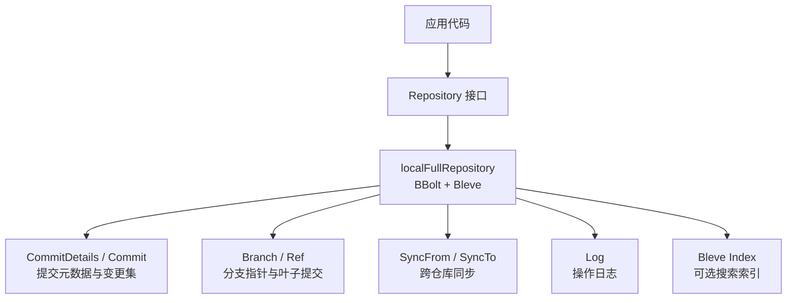
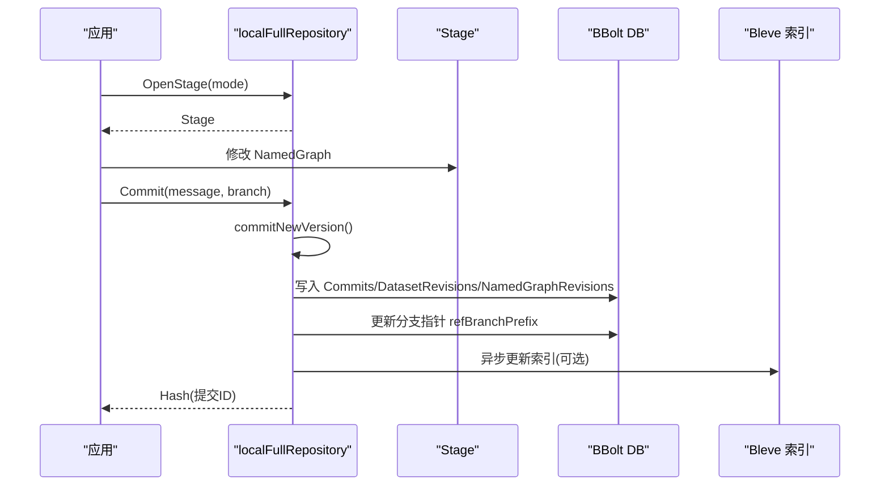
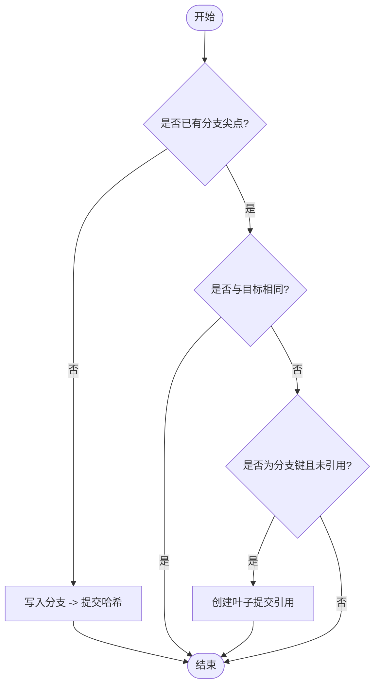
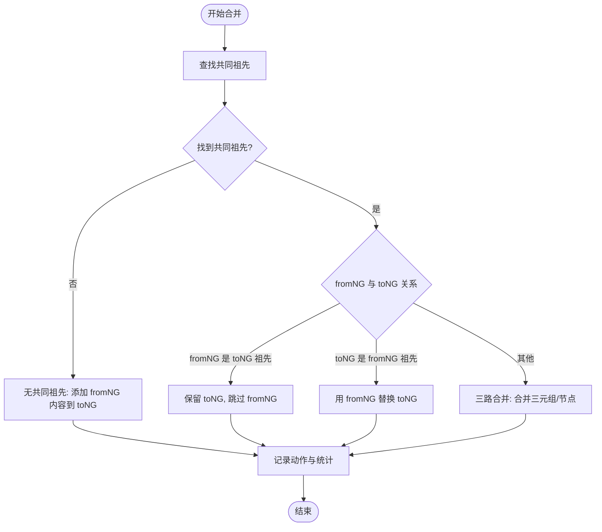
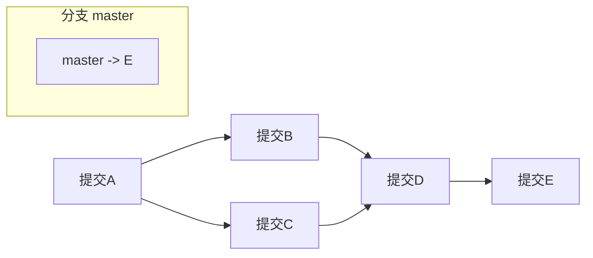
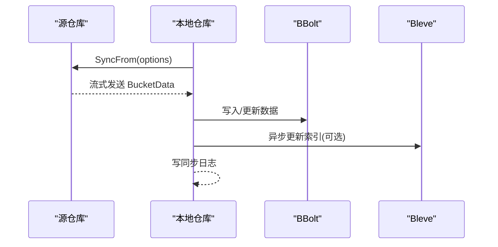
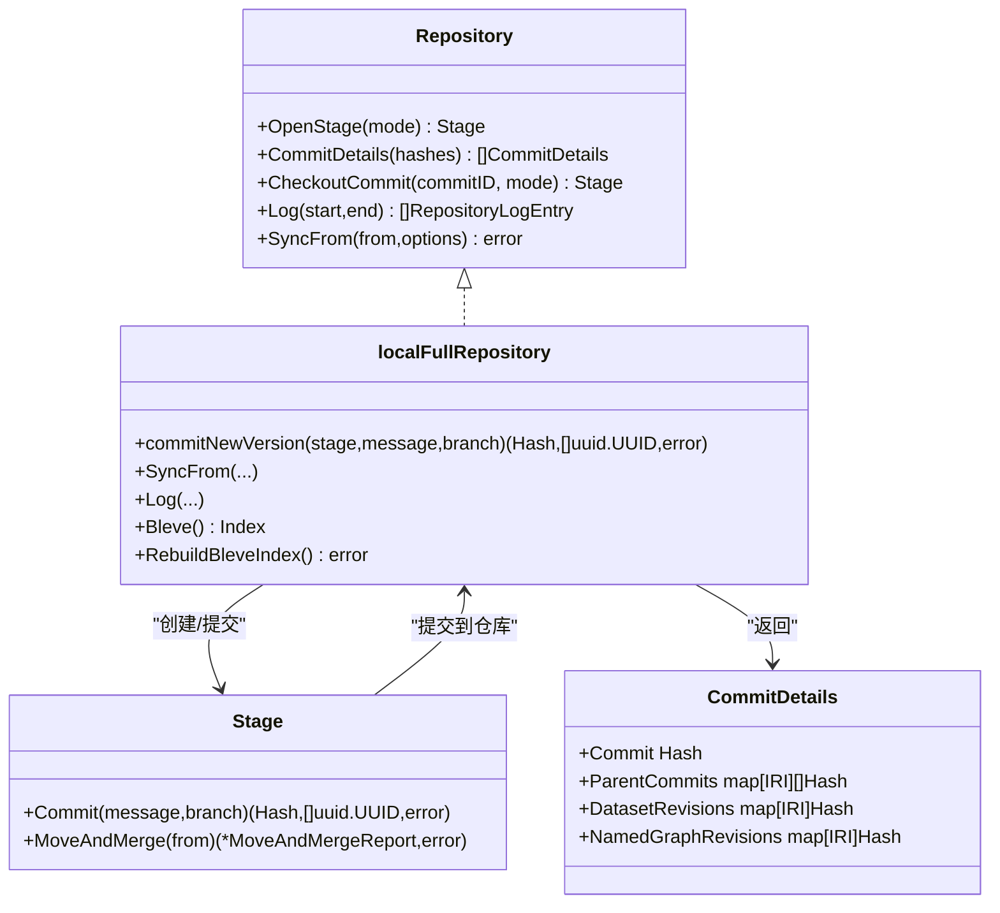

# 版本控制系统

<cite>
**本文引用的文件**
- [commit.go](file://sst/commit.go)
- [repolocalfull.go](file://sst/repolocalfull.go)
- [repository.go](file://sst/repository.go)
- [stage.go](file://sst/stage.go)
- [diff.go](file://sst/diff.go)
- [stagefslocalfull.go](file://sst/stagefslocalfull.go)
- [repolocalfull_example.go](file://examples/helloworldrepolocalfull/repolocalfull.go)
</cite>

## 目录
1. [简介](#简介)
2. [项目结构](#项目结构)
3. [核心组件](#核心组件)
4. [架构总览](#架构总览)
5. [详细组件分析](#详细组件分析)
6. [依赖关系分析](#依赖关系分析)
7. [性能考量](#性能考量)
8. [故障排查指南](#故障排查指南)
9. [结论](#结论)
10. [附录：API示例与最佳实践](#附录api示例与最佳实践)

## 简介
本文件系统基于 LocalFullRepository 实现类 Git 的版本控制能力，提供分支管理、提交历史、合并操作与冲突解决。系统以 BBolt 作为持久化存储，Bleve 作为可选的全文检索索引；通过 Commit 对象记录数据集与命名图的变更集（DatasetRevisions、NamedGraphRevisions）以及父提交关系，支持按分支指针进行版本导航与回溯。

## 项目结构
- sst 包为核心实现，包含仓库接口、本地完整仓库实现、阶段（Stage）模型、差异计算等。
- examples 提供最小可运行示例，演示创建仓库、提交、检出与导出。
- bboltproto 与 bleveproto 用于远程同步与索引协议定义（与本文档重点不直接相关）。

图表来源
- [repository.go:50-179](file://sst/repository.go#L50-L179)
- [repolocalfull.go:220-230](file://sst/repolocalfull.go#L220-L230)
- [commit.go:18-29](file://sst/commit.go#L18-L29)

章节来源
- [repository.go:50-179](file://sst/repository.go#L50-L179)
- [repolocalfull.go:220-230](file://sst/repolocalfull.go#L220-L230)

## 核心组件
- Repository 接口：统一仓库访问入口，包括打开阶段、数据集枚举、提交详情、检出、索引管理、日志、同步、文档管理等。
- localFullRepository：基于 BBolt 的本地完整仓库实现，支持修订历史、分支、提交、同步与 Bleve 索引重建。
- Stage：内存中的工作区，承载 NamedGraph 的增删改，并支持提交到仓库。
- CommitDetails：提交元数据，包含作者、时间、消息、父提交映射、数据集与命名图修订哈希。
- diff：三元组级差异计算，支撑合并与变更可视化。

章节来源
- [repository.go:50-179](file://sst/repository.go#L50-L179)
- [repolocalfull.go:220-230](file://sst/repolocalfull.go#L220-L230)
- [stage.go:53-234](file://sst/stage.go#L53-L234)
- [commit.go:18-29](file://sst/commit.go#L18-L29)
- [diff.go:28-327](file://sst/diff.go#L28-L327)

## 架构总览
LocalFullRepository 将“工作区（Stage）—提交（Commit）—分支（Ref）—历史（Log）—索引（Bleve）”解耦：
- 工作区：Stage 持有当前修改的 NamedGraph，支持 MoveAndMerge 合并。
- 提交：commitNewVersion 将修改写入 BBolt，生成 DatasetRevisions 与 NamedGraphRevisions，并维护父提交链。
- 分支：refBranchPrefix 指向某数据集的最新提交；refLeafPrefix 保留不可达但需追踪的提交。
- 历史：Log 提供按时间倒序的操作日志；CommitDetails 提供提交元数据与变更集。
- 索引：Bleve 提供全文检索，支持按需重建与增量更新。

图表来源
- [repolocalfull.go:244-257](file://sst/repolocalfull.go#L244-L257)
- [repolocalfull.go:1607-2138](file://sst/repolocalfull.go#L1607-L2138)
- [repolocalfull.go:345-426](file://sst/repolocalfull.go#L345-L426)

## 详细组件分析

### Commit 对象结构与父提交关系
- CommitDetails 包含：
  - Commit：提交哈希
  - Author/AuthorDate/Message：提交元信息
  - ParentCommits：按数据集 IRI 映射的父提交哈希列表
  - DatasetRevisions：数据集修订哈希
  - NamedGraphRevisions：命名图修订哈希
- 父提交关系在提交时由 commitNewVersion 构建，每个数据集的提交可能有一个或多个父提交（例如合并场景），并通过 DatasetRevisions 关联到具体数据集版本。

章节来源
- [commit.go:18-29](file://sst/commit.go#L18-L29)
- [repolocalfull.go:595-719](file://sst/repolocalfull.go#L595-L719)
- [repolocalfull.go:1607-2138](file://sst/repolocalfull.go#L1607-L2138)

### 分支指针、标签与引用管理
- 分支指针：使用 refBranchPrefix 键前缀，将分支名映射到提交哈希；提供 get/set/delete 分支引用方法。
- 叶子提交：当分支分叉或旧提交不再被任何分支指向时，将其转为 refLeafPrefix 的叶子提交，保证可通过 LeafCommits/history 可达。
- 合并时的引用处理：mergeDatasetRefsFromSource 与 mergeIncomingDatasetRef 在目标库中保留目标分支尖点，并将源尖点记录为叶子提交，避免丢失历史。

图表来源
- [repolocalfull.go:83-120](file://sst/repolocalfull.go#L83-L120)
- [repolocalfull.go:122-145](file://sst/repolocalfull.go#L122-L145)
- [repolocalfull.go:153-184](file://sst/repolocalfull.go#L153-L184)

章节来源
- [repolocalfull.go:83-120](file://sst/repolocalfull.go#L83-L120)
- [repolocalfull.go:122-145](file://sst/repolocalfull.go#L122-L145)
- [repolocalfull.go:153-184](file://sst/repolocalfull.go#L153-L184)

### 合并算法、冲突检测与自动解决规则
- 合并入口：Stage.MoveAndMerge 负责将源 Stage 的 NamedGraph 移动到目标 Stage，并在同仓库内尝试基于共同祖先的三路合并。
- 共同祖先查找：FindCommonParentRevision 使用双指针法沿提交历史回退，寻找两个提交的最近公共祖先。
- 自动解决策略：
  - 若 fromNG 是 toNG 的祖先：保留 toNG，跳过 fromNG。
  - 若 toNG 是 fromNG 的祖先：用 fromNG 替换 toNG。
  - 否则执行本地合并（合并节点与三元组），标记 modified。
- 冲突检测：差异计算基于 diff 模块对 IBNode 与三元组进行有序比较，识别新增、删除与修改；当存在无法自动解决的冲突时，MoveAndMergeReport 会记录动作类型与结果，供上层决策。

图表来源
- [stage.go:132-163](file://sst/stage.go#L132-L163)
- [stage.go:468-800](file://sst/stage.go#L468-L800)
- [repolocalfull.go:777-800](file://sst/repolocalfull.go#L777-L800)
- [diff.go:28-327](file://sst/diff.go#L28-L327)

章节来源
- [stage.go:132-163](file://sst/stage.go#L132-L163)
- [stage.go:468-800](file://sst/stage.go#L468-L800)
- [repolocalfull.go:777-800](file://sst/repolocalfull.go#L777-L800)
- [diff.go:28-327](file://sst/diff.go#L28-L327)

### 提交历史与版本树可视化
- 提交详情：CommitDetails 提供提交元信息与变更集；CheckoutCommit 根据提交详情恢复 Stage。
- 历史记录：Log 支持从最新到最早分页读取，支持 start/end 参数控制范围。
- 版本树：通过 CommitDetails.ParentCommits 与 DatasetRevisions 可构建有向无环图（DAG），结合分支指针展示多分支历史。

图表来源
- [repolocalfull.go:595-719](file://sst/repolocalfull.go#L595-L719)
- [repolocalfull.go:2467-2564](file://sst/repolocalfull.go#L2467-L2564)

章节来源
- [repolocalfull.go:595-719](file://sst/repolocalfull.go#L595-L719)
- [repolocalfull.go:2467-2564](file://sst/repolocalfull.go#L2467-L2564)

### 同步与跨仓库协作
- SyncFrom：支持从本地或远程仓库同步 NamedGraphRevisions、DatasetRevisions、Datasets、Commits 与文档信息；必要时触发 Bleve 索引重建。
- 远程同步：通过 gRPC 流式传输 bucket 数据，客户端处理并落盘，完成后更新索引与日志。

图表来源
- [repolocalfull.go:3407-3490](file://sst/repolocalfull.go#L3407-L3490)
- [repolocalfull.go:3946-4073](file://sst/repolocalfull.go#L3946-L4073)

章节来源
- [repolocalfull.go:3407-3490](file://sst/repolocalfull.go#L3407-L3490)
- [repolocalfull.go:3946-4073](file://sst/repolocalfull.go#L3946-L4073)

## 依赖关系分析
- Repository 接口定义了统一的仓库操作契约，localFullRepository 实现了大部分功能。
- Stage 依赖 Repository 以提交到持久化存储；MoveAndMerge 依赖 diff 模块进行三元组级差异计算。
- localFullRepository 依赖 BBolt 进行结构化存储，依赖 Bleve 进行索引管理；同时通过 repoConfig 注入预提交条件与后通知回调。
- 同步逻辑依赖 bboltproto 协议与 gRPC 流式通信。

图表来源
- [repository.go:50-179](file://sst/repository.go#L50-L179)
- [repolocalfull.go:220-230](file://sst/repolocalfull.go#L220-L230)
- [stage.go:53-234](file://sst/stage.go#L53-L234)
- [commit.go:18-29](file://sst/commit.go#L18-L29)

章节来源
- [repository.go:50-179](file://sst/repository.go#L50-L179)
- [repolocalfull.go:220-230](file://sst/repolocalfull.go#L220-L230)
- [stage.go:53-234](file://sst/stage.go#L53-L234)
- [commit.go:18-29](file://sst/commit.go#L18-L29)

## 性能考量
- 提交批处理：commitNewVersion 收集所有修改的 NamedGraph，排序后批量写入，减少锁竞争与重复 IO。
- 索引更新：Bleve 更新通过后台任务异步进行，避免阻塞主流程；支持 RebuildBleveIndex 全量重建。
- 同步优化：SyncFrom 流式传输，服务端过滤数据集与分支，降低网络与存储压力。
- 差异计算：diff 模块采用有序遍历与区间扫描，复杂度接近 O(n+m)，适合大规模三元组对比。

章节来源
- [repolocalfull.go:1607-2138](file://sst/repolocalfull.go#L1607-L2138)
- [repolocalfull.go:345-426](file://sst/repolocalfull.go#L345-L426)
- [repolocalfull.go:3407-3490](file://sst/repolocalfull.go#L3407-L3490)
- [diff.go:28-327](file://sst/diff.go#L28-L327)

## 故障排查指南
- 提交失败：检查 pre-commit 条件是否通过；确认存在修改的 NamedGraph；查看错误码 ErrNothingToCommit。
- 分支不存在：确保分支名正确；使用 Log 查询 set_branch/remove_branch 事件定位问题。
- 合并冲突：查看 MoveAndMergeReport 的 Actions 与 Stats，识别 ActionThreeWayMerge 或 ActionOther；必要时手动解析差异并调整。
- 索引异常：调用 RebuildBleveIndex 重建索引；检查 index.bleve 目录权限与完整性。
- 同步失败：检查 gRPC 连接与认证；查看 SyncFrom 日志与 Complete 消息统计；确认文档文件已同步。

章节来源
- [repolocalfull.go:1607-2138](file://sst/repolocalfull.go#L1607-L2138)
- [repolocalfull.go:2467-2564](file://sst/repolocalfull.go#L2467-L2564)
- [stage.go:348-433](file://sst/stage.go#L348-L433)
- [repolocalfull.go:441-458](file://sst/repolocalfull.go#L441-L458)
- [repolocalfull.go:3946-4073](file://sst/repolocalfull.go#L3946-L4073)

## 结论
LocalFullRepository 提供了完整的 Git-like 版本控制能力：以 Commit 为中心记录变更集与父提交关系，通过分支指针与叶子提交管理历史可达性；借助 Stage 的工作区与 MoveAndMerge 实现三路合并与冲突检测；配合 Log 与 CommitDetails 支持历史查询与可视化；Bleve 索引提供高效检索。整体设计清晰、可扩展，适用于复杂数据集的版本管理与协作。

## 附录：API示例与最佳实践
- 创建仓库并提交：
  - 参考示例：创建 LocalFullRepository，打开 Stage，创建 NamedGraph，添加三元组，提交到默认分支。
  - 路径：[repolocalfull_example.go:41-59](file://examples/helloworldrepolocalfull/repolocalfull.go#L41-L59)
- 检出数据集：
  - 使用 CheckoutBranch 或 CheckoutCommit 获取指定版本的 Stage，验证内容一致性。
  - 路径：[repolocalfull_example.go:72-93](file://examples/helloworldrepolocalfull/repolocalfull.go#L72-L93)
- 查询提交详情与历史：
  - 使用 CommitDetails 获取提交元数据与变更集；使用 Log 分页读取操作日志。
  - 路径：[repolocalfull.go:595-719](file://sst/repolocalfull.go#L595-L719), [repolocalfull.go:2467-2564](file://sst/repolocalfull.go#L2467-L2564)
- 合并与冲突处理：
  - 使用 MoveAndMerge 合并多个 Stage；依据 MoveAndMergeReport 判断冲突类型并决定后续策略。
  - 路径：[stage.go:132-163](file://sst/stage.go#L132-L163), [stage.go:468-800](file://sst/stage.go#L468-L800)
- 同步与协作：
  - 使用 SyncFrom 从本地或远程仓库同步数据；必要时重建索引并记录日志。
  - 路径：[repolocalfull.go:3407-3490](file://sst/repolocalfull.go#L3407-L3490), [repolocalfull.go:3946-4073](file://sst/repolocalfull.go#L3946-L4073)

最佳实践
- 小步提交：频繁提交有助于缩小差异、降低冲突概率。
- 明确分支策略：为功能特性创建独立分支，合并前确保共同祖先清晰。
- 合理使用索引：仅在需要搜索时启用 Bleve，并定期重建以保持性能。
- 监控同步状态：关注 SyncFrom 的统计与日志，及时处理缺失文件或索引不一致。

章节来源
- [repolocalfull_example.go:41-93](file://examples/helloworldrepolocalfull/repolocalfull.go#L41-L93)
- [repolocalfull.go:595-719](file://sst/repolocalfull.go#L595-L719)
- [repolocalfull.go:2467-2564](file://sst/repolocalfull.go#L2467-L2564)
- [stage.go:132-163](file://sst/stage.go#L132-L163)
- [stage.go:468-800](file://sst/stage.go#L468-L800)
- [repolocalfull.go:3407-3490](file://sst/repolocalfull.go#L3407-L3490)
- [repolocalfull.go:3946-4073](file://sst/repolocalfull.go#L3946-L4073)