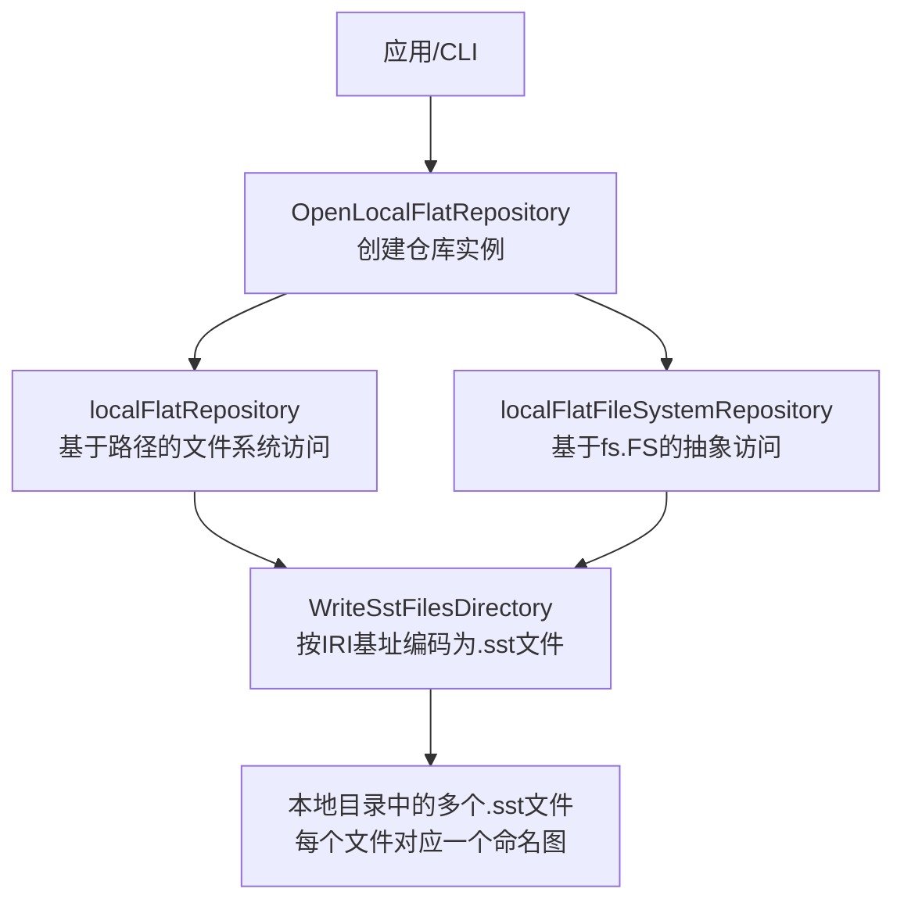
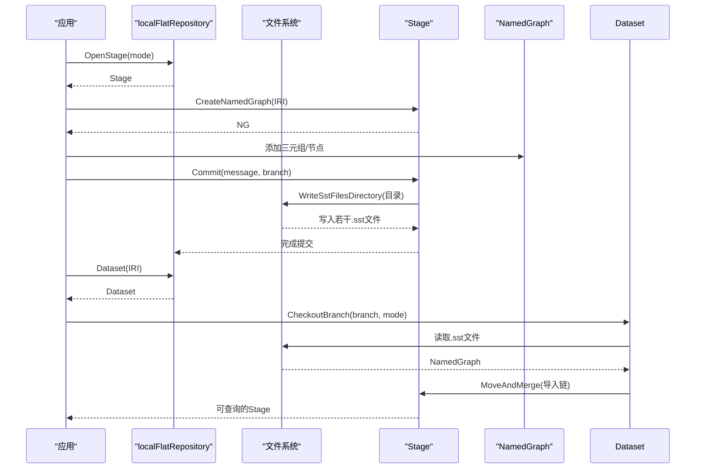
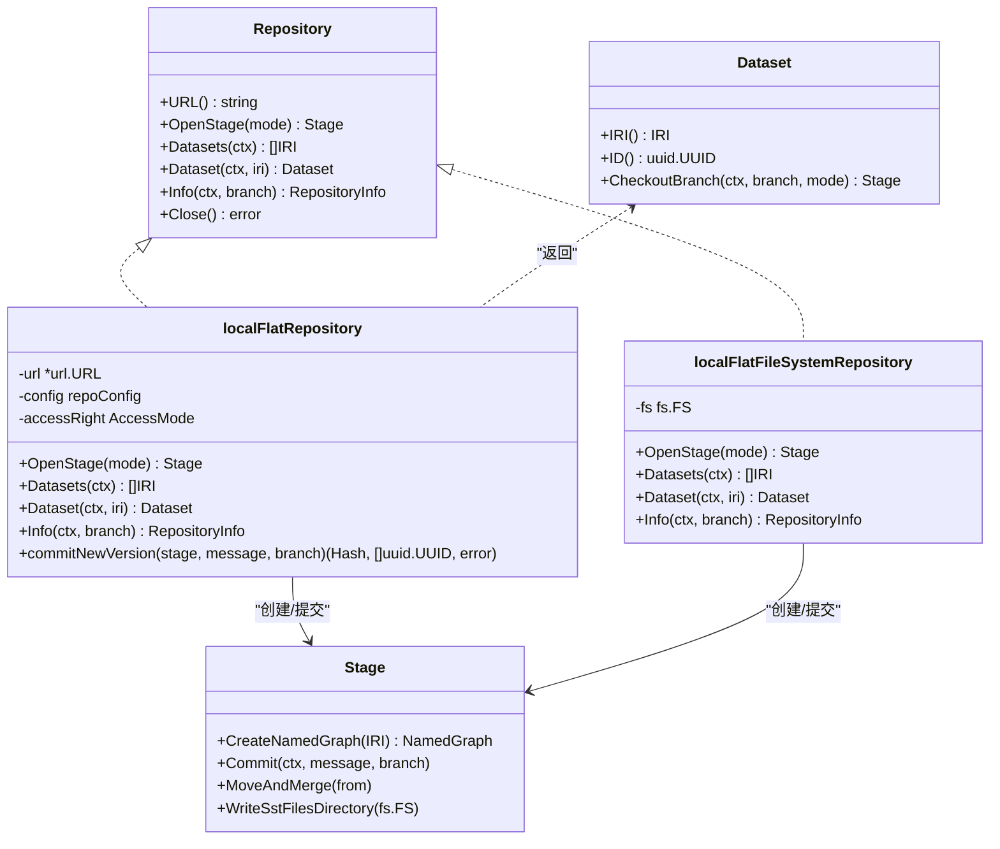
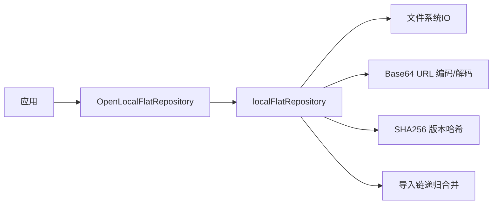

# 本地扁平仓库

<cite>
**本文引用的文件**
- [repolocalflat.go](file://sst/repolocalflat.go)
- [repolocalflatfilesystem.go](file://sst/repolocalflatfilesystem.go)
- [repository.go](file://sst/repository.go)
- [sstwriterstage.go](file://sst/sstwritestage.go)
- [helloworldrepolocalflat.go](file://examples/helloworldrepolocalflat/helloworldrepolocalflat.go)
- [repolocalflat_test.go](file://sst/repolocalflat_test.go)
</cite>

## 目录
1. [简介](#简介)
2. [项目结构](#项目结构)
3. [核心组件](#核心组件)
4. [架构总览](#架构总览)
5. [详细组件分析](#详细组件分析)
6. [依赖关系分析](#依赖关系分析)
7. [性能与容量特性](#性能与容量特性)
8. [故障排查指南](#故障排查指南)
9. [结论](#结论)
10. [附录：使用示例与最佳实践](#附录使用示例与最佳实践)

## 简介
本地扁平仓库（LocalFlatRepository）是一种将命名图以独立 SST 二进制文件形式直接持久化到本地文件系统的仓库实现。其特点是：
- 每个命名图对应一个 .sst 文件，文件名由 IRI 的“基址”部分经 Base64 URL 安全编码生成，便于文件系统安全存储且可逆解析。
- 不支持事务、分支、提交历史、远程同步等高级功能；适合简单、直接的图谱数据持久化与交换场景。
- 支持读取导入链（import chain），在检出时自动合并被导入的图。

本文件面向初次使用者与运维人员，提供创建、配置、使用、批量操作、文件管理、性能优化、迁移与备份恢复等完整指南。

## 项目结构
与本地扁平仓库相关的核心代码位于 sst 包中，示例位于 examples 子目录。关键文件职责如下：
- repolocalflat.go：本地扁平仓库的实现（基于真实文件系统路径）。
- repolocalflatfilesystem.go：本地扁平仓库的抽象文件系统实现（基于 fs.FS）。
- repository.go：OpenLocalFlatRepository 入口函数与仓库信息结构体定义。
- sstwritestage.go：Stage 写入 SST 文件的通用逻辑（含文件名编码规则）。
- helloworldrepolocalflat.go：最小可用示例，演示创建、写入、提交与导出。
- repolocalflat_test.go：单元测试，覆盖提交、打开数据集等行为。

图表来源
- [repository.go:640-694](file://sst/repository.go#L640-L694)
- [repolocalflat.go:28-61](file://sst/repolocalflat.go#L28-L61)
- [repolocalflatfilesystem.go:21-52](file://sst/repolocalflatfilesystem.go#L21-L52)
- [sstwriterstage.go:25-113](file://sst/sstwritestage.go#L25-L113)

章节来源
- [repository.go:640-694](file://sst/repository.go#L640-L694)
- [repolocalflat.go:28-61](file://sst/repolocalflat.go#L28-L61)
- [repolocalflatfilesystem.go:21-52](file://sst/repolocalflatfilesystem.go#L21-L52)
- [sstwriterstage.go:25-113](file://sst/sstwritestage.go#L25-L113)

## 核心组件
- localFlatRepository：基于真实文件系统路径的本地扁平仓库实现，负责列出数据集、打开数据集、计算版本哈希、统计信息等。
- localFlatFileSystemRepository：基于 fs.FS 的等价实现，便于测试或替换底层存储。
- Stage：用于构建、修改、合并命名图，并在提交时将变更写为 .sst 文件。
- Dataset 接口：对单个命名图的访问封装，支持检出、获取 IRIs、ID 等。

关键行为要点：
- 提交：调用 Commit 后，会将当前 Stage 中所有已修改的命名图写出为 .sst 文件，文件名由 IRI 基址经 Base64 URL 编码得到。
- 检出：CheckoutBranch 会读取目标 .sst 文件并递归加载其导入图，合并到 Stage 中供查询。
- 信息：Info 返回仓库统计（如数据集数量、总大小、版本哈希等），但不包含提交日志。

章节来源
- [repolocalflat.go:28-61](file://sst/repolocalflat.go#L28-L61)
- [repolocalflat.go:114-152](file://sst/repolocalflat.go#L114-L152)
- [repolocalflat.go:301-322](file://sst/repolocalflat.go#L301-L322)
- [repolocalflat.go:381-430](file://sst/repolocalflat.go#L381-L430)
- [repolocalflatfilesystem.go:21-52](file://sst/repolocalflatfilesystem.go#L21-L52)
- [repolocalflatfilesystem.go:117-144](file://sst/repolocalflatfilesystem.go#L117-L144)
- [sstwriterstage.go:25-113](file://sst/sstwritestage.go#L25-L113)

## 架构总览
本地扁平仓库采用“一图一文件”的扁平存储模型，通过 Stage 进行内存态建模，提交时落盘为 .sst 文件。检出时按需读取并合并导入链。

图表来源
- [repolocalflat.go:54-61](file://sst/repolocalflat.go#L54-L61)
- [repolocalflat.go:142-152](file://sst/repolocalflat.go#L142-L152)
- [repolocalflat.go:211-235](file://sst/repolocalflat.go#L211-L235)
- [repolocalflat.go:301-322](file://sst/repolocalflat.go#L301-L322)
- [sstwriterstage.go:48-113](file://sst/sstwritestage.go#L48-L113)

## 详细组件分析

### 创建与配置
- 创建仓库：使用 OpenLocalFlatRepository 传入仓库目录路径。若目录不存在将返回错误；若路径不是目录也会报错。
- 访问权限：仓库实例在打开时探测目录访问模式并固定下来，后续生命周期内不再变化。
- 文件系统抽象：也可通过 OpenLocalFlatFileSystemRepository 使用 fs.FS 抽象，便于测试或替换存储后端。

章节来源
- [repository.go:640-694](file://sst/repository.go#L640-L694)
- [repository.go:696-704](file://sst/repository.go#L696-L704)

### 数据写入与提交
- 创建命名图：通过 Stage.CreateNamedGraph(IRI) 创建，IRI 的“基址”部分将决定最终文件名。
- 提交：Commit 会调用 WriteSstFilesDirectory，将所有已修改的命名图写出为 .sst 文件。
- 文件名规则：文件名 = Base64 URL 安全编码（无填充）的 IRI 基址 + ".sst"。该编码保证文件名在各类文件系统上安全，并可逆解码回原始基址。
- 导入链：提交后，其他图可通过 import 机制引用；检出时会递归加载并合并导入图。

章节来源
- [sstwriterstage.go:25-113](file://sst/sstwritestage.go#L25-L113)
- [repolocalflat.go:301-322](file://sst/repolocalflat.go#L301-L322)
- [repolocalflat.go:237-266](file://sst/repolocalflat.go#L237-L266)

### 数据读取与检出
- 列出数据集：遍历仓库目录，收集所有 .sst 文件，解码文件名得到 IRI。
- 打开数据集：根据 IRI 计算 .sst 文件路径并打开；若不存在返回“未找到”错误。
- 检出分支：读取 .sst 文件为 NamedGraph，再递归合并其导入图，返回可查询的 Stage。

章节来源
- [repolocalflat.go:63-86](file://sst/repolocalflat.go#L63-L86)
- [repolocalflat.go:114-152](file://sst/repolocalflat.go#L114-L152)
- [repolocalflat.go:211-235](file://sst/repolocalflat.go#L211-L235)

### 版本信息与统计
- Info：返回仓库 URL、访问权限、数据集数量、总大小、版本哈希等信息。本地扁平仓库不支持提交历史，因此相关计数为零或不适用。
- 版本哈希：通过对仓库目录下所有 .sst 文件按相对路径排序后逐文件内容计算 SHA256 得出，可用于一致性校验。

章节来源
- [repolocalflat.go:381-430](file://sst/repolocalflat.go#L381-L430)
- [repolocalflat.go:324-379](file://sst/repolocalflat.go#L324-L379)

### 类关系图

图表来源
- [repolocalflat.go:28-61](file://sst/repolocalflat.go#L28-L61)
- [repolocalflatfilesystem.go:21-52](file://sst/repolocalflatfilesystem.go#L21-L52)
- [sstwriterstage.go:48-113](file://sst/sstwritestage.go#L48-L113)

## 依赖关系分析
- 文件系统依赖：本地扁平仓库直接依赖操作系统文件系统（或 fs.FS 抽象），通过 Walk/Creat/Open 等操作读写 .sst 文件。
- 编码/解码：使用 Base64 URL 安全编码（无填充）将 IRI 基址映射为文件名，确保跨平台兼容性与可读性。
- 哈希计算：版本哈希基于所有 .sst 文件的相对路径与内容顺序一致地计算，便于跨机器比对。
- 导入链：检出时递归读取导入图并合并，避免重复加载（使用已加载集合去重）。

图表来源
- [repository.go:640-694](file://sst/repository.go#L640-L694)
- [sstwriterstage.go:25-113](file://sst/sstwritestage.go#L25-L113)
- [repolocalflat.go:324-379](file://sst/repolocalflat.go#L324-L379)
- [repolocalflat.go:237-266](file://sst/repolocalflat.go#L237-L266)

章节来源
- [sstwriterstage.go:25-113](file://sst/sstwritestage.go#L25-L113)
- [repolocalflat.go:324-379](file://sst/repolocalflat.go#L324-L379)
- [repolocalflat.go:237-266](file://sst/repolocalflat.go#L237-L266)

## 性能与容量特性
- 存储模型：每个命名图一个 .sst 文件，结构简单，随机访问成本低，适合小中型图谱与频繁单图读写的场景。
- 写入性能：提交时仅写入已修改的图，减少不必要的 IO；批量提交建议合并多次修改后一次性提交。
- 读取性能：检出时按需读取并合并导入链，避免全库扫描；大数据集建议分图拆分，提升并发与缓存命中率。
- 容量限制：无内置配额限制；Info 可统计总大小与文件数，但需自行监控磁盘空间。
- 索引能力：不提供全文检索索引（Bleve），如需搜索请使用其他仓库类型或外部索引。

[本节为通用指导，不直接分析具体文件]

## 故障排查指南
常见错误与处理：
- 目录不存在或非目录：OpenLocalFlatRepository 会返回相应错误。请确认路径存在且为目录。
- 数据集未找到：Dataset 打开失败时返回“未找到”，检查 IRI 对应的 .sst 文件是否存在。
- 提交消息为空：Commit 要求非空消息，否则会返回错误。
- 导入链读取失败：检出时报错通常是因为导入图文件缺失或损坏，检查导入链完整性。
- 版本哈希不一致：Info 的版本哈希可用于一致性校验；若不同，说明仓库内容或顺序发生变化。

章节来源
- [repository.go:640-694](file://sst/repository.go#L640-L694)
- [repolocalflat.go:114-152](file://sst/repolocalflat.go#L114-L152)
- [repolocalflat.go:301-322](file://sst/repolocalflat.go#L301-L322)
- [repolocalflat.go:211-235](file://sst/repolocalflat.go#L211-L235)
- [repolocalflat.go:381-430](file://sst/repolocalflat.go#L381-L430)

## 结论
本地扁平仓库以极简的“一图一文件”模型提供稳定可靠的 SST 持久化能力，适合不需要事务与历史追踪的场景。通过合理的分图策略与批量提交，可获得良好的读写性能与可维护性。对于需要复杂版本控制或检索能力的场景，建议选择其他仓库类型。

[本节为总结，不直接分析具体文件]

## 附录：使用示例与最佳实践

### 快速开始（示例）
- 创建仓库目录并打开仓库。
- 创建命名图，添加三元组。
- 提交一次变更。
- 导出为 TTL 或再次打开仓库读取。

参考示例路径
- [helloworldrepolocalflat.go](file://examples/helloworldrepolocalflat/helloworldrepolocalflat.go)

章节来源
- [helloworldrepolocalflat.go:23-75](file://examples/helloworldrepolocalflat/helloworldrepolocalflat.go#L23-L75)

### UUID 命名规则与文件组织
- 命名图 IRI 的“基址”部分（即最后一个 # 之前的部分）将被 Base64 URL 安全编码（无填充）作为文件名，后缀为 .sst。
- 同一仓库目录下存放多个 .sst 文件，每个文件对应一个命名图。
- 通过 decodeBaseURL 可将文件名还原为原始基址，从而定位 IRI。

章节来源
- [sstwriterstage.go:25-113](file://sst/sstwritestage.go#L25-L113)
- [repolocalflat.go:507-523](file://sst/repolocalflat.go#L507-L523)

### 批量操作与文件管理
- 批量写入：在单次 Stage 中创建/修改多个命名图，然后统一提交，以减少 IO 次数。
- 批量读取：使用 ForDatasets 遍历所有数据集，按需加载。
- 文件清理：删除不再需要的 .sst 文件即可移除对应命名图；注意保持导入链一致性。
- 导入链合并：检出时会自动递归合并导入图，避免重复加载（已加载集合去重）。

章节来源
- [repolocalflat.go:63-86](file://sst/repolocalflat.go#L63-L86)
- [repolocalflat.go:237-266](file://sst/repolocalflat.go#L237-L266)
- [sstwriterstage.go:48-113](file://sst/sstwritestage.go#L48-L113)

### 性能优化建议
- 合理分图：将大图谱拆分为多个命名图，降低单文件大小，提高并发与缓存效率。
- 合并提交：将多次小改动合并为一次提交，减少文件写入与元数据开销。
- 只读场景：优先使用 Dataset.CheckoutBranch 获取只读 Stage，避免不必要的写入。
- 监控容量：定期调用 Info 统计总大小与文件数，结合文件系统监控预警。

[本节为通用指导，不直接分析具体文件]

### 数据迁移与备份恢复
- 备份：直接复制仓库目录（包含所有 .sst 文件）即可完成备份；利用版本哈希进行一致性校验。
- 恢复：将备份目录恢复到目标位置，重新打开仓库即可使用。
- 迁移：在不同机器或文件系统间迁移时，确保 .sst 文件完整且权限正确；可使用 Info 的版本哈希验证一致性。
- 增量更新：通过多次提交形成新的 .sst 文件集合；如需保留旧版本，可在备份中保留历史目录快照。

章节来源
- [repolocalflat.go:381-430](file://sst/repolocalflat.go#L381-L430)
- [repolocalflat.go:324-379](file://sst/repolocalflat.go#L324-L379)

### 单元测试参考
- 提交行为：包括空消息、简单提交、提交后通知回调等用例。
- 数据集打开：预置数据集与缺失数据集的错误路径。

章节来源
- [repolocalflat_test.go:16-189](file://sst/repolocalflat_test.go#L16-L189)
- [repolocalflat_test.go:191-284](file://sst/repolocalflat_test.go#L191-L284)