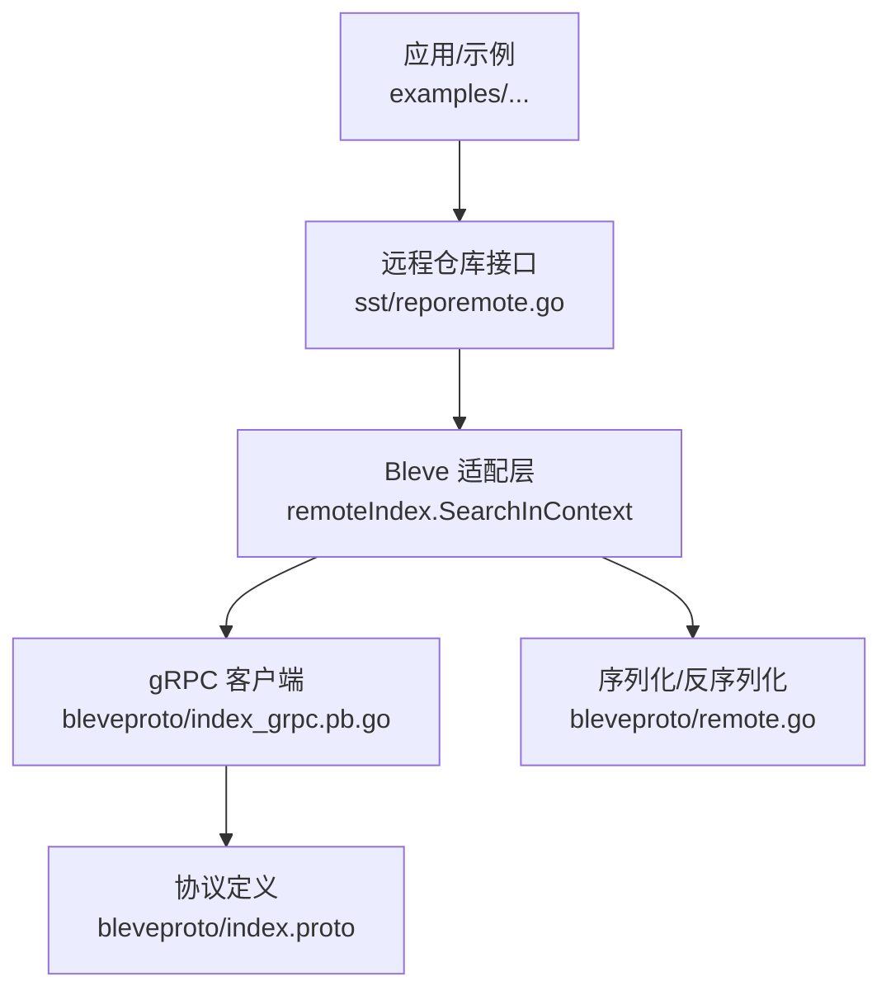
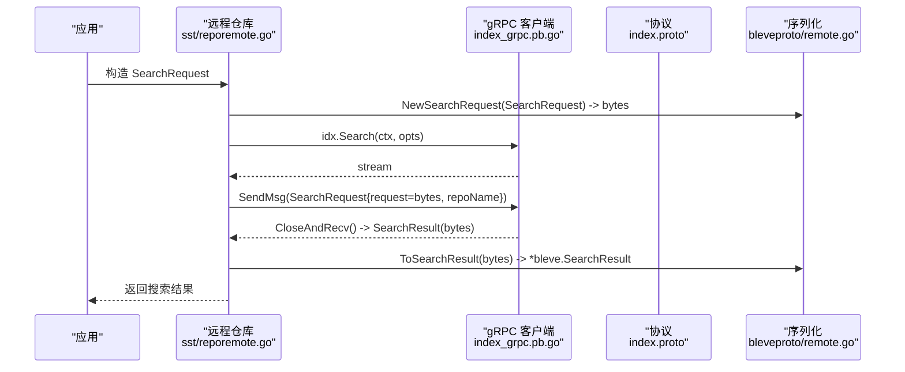
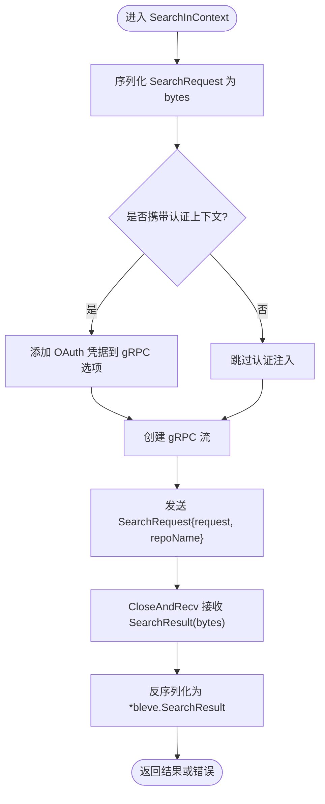
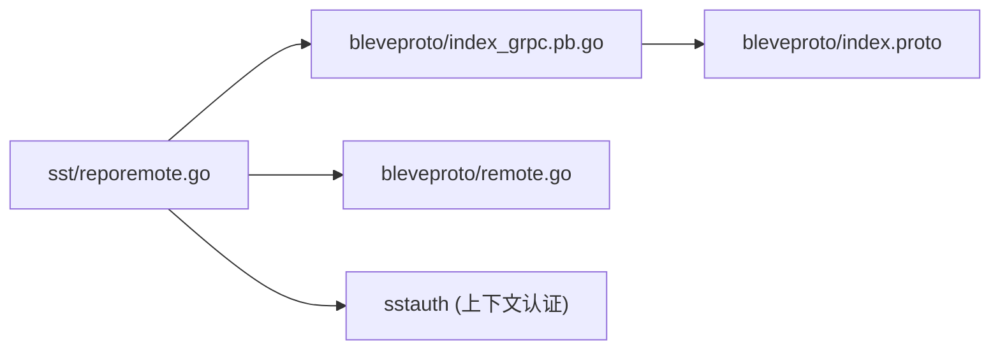

# 全文搜索功能

<cite>
**本文引用的文件**
- [bleveproto/remote.go](file://bleveproto/remote.go)
- [bleveproto/index.proto](file://bleveproto/index.proto)
- [bleveproto/index_grpc.pb.go](file://bleveproto/index_grpc.pb.go)
- [sst/reporemote.go](file://sst/reporemote.go)
- [sst/indexupdate.go](file://sst/indexupdate.go)
- [examples/helloworldreporemote/reporemoteread/reporemoteread.go](file://examples/helloworldreporemote/reporemoteread/reporemoteread.go)
- [sst_test/searchInContext_test.go](file://sst_test/searchInContext_test.go)
</cite>

## 目录
1. [简介](#简介)
2. [项目结构](#项目结构)
3. [核心组件](#核心组件)
4. [架构总览](#架构总览)
5. [详细组件分析](#详细组件分析)
6. [依赖关系分析](#依赖关系分析)
7. [性能与优化](#性能与优化)
8. [故障排查指南](#故障排查指南)
9. [结论](#结论)
10. [附录：查询语法示例](#附录：查询语法示例)

## 简介
本文件面向远程仓库的全文搜索能力，聚焦于 Bleve 搜索引擎通过 gRPC 的远程集成方式。文档说明客户端如何通过 IndexServiceClient 发起 Search 流式调用、SearchRequest 的构建与序列化、以及搜索结果的分页、排序与字段返回机制。同时提供复杂查询（布尔、范围、文本匹配）的使用示例，并给出索引优化、查询性能调优与缓存策略的配置建议。

## 项目结构
围绕远程全文搜索的关键代码分布在以下模块：
- bleveproto：定义 IndexService 的 gRPC 协议与请求/响应消息，并提供 Bleve 对象的序列化工具。
- sst：实现远程仓库对 Bleve.Index 的适配层 remoteIndex，封装 gRPC 调用与认证上下文传递。
- examples：演示如何连接远程仓库并执行搜索。
- sst_test：覆盖分页、排序、空结果、一致性等场景的测试用例。

图表来源
- [sst/reporemote.go:141-207](file://sst/reporemote.go#L141-L207)
- [bleveproto/index_grpc.pb.go:27-50](file://bleveproto/index_grpc.pb.go#L27-L50)
- [bleveproto/index.proto:9-20](file://bleveproto/index.proto#L9-L20)
- [bleveproto/remote.go:21-39](file://bleveproto/remote.go#L21-L39)

章节来源
- [bleveproto/index.proto:9-20](file://bleveproto/index.proto#L9-L20)
- [bleveproto/index_grpc.pb.go:27-50](file://bleveproto/index_grpc.pb.go#L27-L50)
- [bleveproto/remote.go:21-39](file://bleveproto/remote.go#L21-L39)
- [sst/reporemote.go:141-207](file://sst/reporemote.go#L141-L207)

## 核心组件
- IndexServiceClient（gRPC 客户端）：暴露 Search 流式 RPC，用于发送 SearchRequest 并接收 SearchResult。
- remoteIndex（Bleve 远程适配）：实现 bleve.Index 的 Search/SearchInContext，将 Bleve 请求序列化为字节并通过 gRPC 流发送，再将服务端返回的字节反序列化为 Bleve 结果。
- 序列化工具：NewSearchRequest/NewSearchResult/ToSearchResult，负责 Bleve 对象与 proto bytes 之间的转换。
- 健康感知包装：healthAwareIndex 在本地索引路径上提供重试与健康状态提示，便于理解错误处理模式（远程路径由 remoteIndex 直接调用）。

章节来源
- [bleveproto/index_grpc.pb.go:27-50](file://bleveproto/index_grpc.pb.go#L27-L50)
- [bleveproto/remote.go:21-39](file://bleveproto/remote.go#L21-L39)
- [sst/reporemote.go:141-207](file://sst/reporemote.go#L141-L207)
- [sst/indexupdate.go:703-735](file://sst/indexupdate.go#L703-L735)

## 架构总览
远程搜索的整体流程如下：
- 应用构造 Bleve.SearchRequest（包含查询、分页、排序、字段列表等）。
- 通过 repo.Bleve() 获取 remoteIndex，调用 SearchInContext。
- remoteIndex 将 SearchRequest 序列化为字节，附加 repoName，通过 gRPC 流发送到服务端。
- 服务端执行 Bleve 搜索，返回 SearchResult 并序列化为字节。
- 客户端反序列化为 Bleve.SearchResult 并返回给应用。

图表来源
- [sst/reporemote.go:150-207](file://sst/reporemote.go#L150-L207)
- [bleveproto/index_grpc.pb.go:27-50](file://bleveproto/index_grpc.pb.go#L27-L50)
- [bleveproto/index.proto:9-20](file://bleveproto/index.proto#L9-L20)
- [bleveproto/remote.go:21-39](file://bleveproto/remote.go#L21-L39)

## 详细组件分析

### remoteIndex：远程 Bleve 搜索适配
- 职责：实现 bleve.Index 的 Search/SearchInContext；其他写操作返回“未实现”以表明远程仓库不支持本地索引写入。
- 关键流程：
  - 从 context 提取认证信息并注入 gRPC 调用选项。
  - 使用 bleveproto.NewSearchRequest 将 Bleve 请求序列化为字节。
  - 通过 IndexServiceClient.Search 建立流，发送包含 repoName 的 SearchRequest。
  - 接收并反序列化为 Bleve.SearchResult。
- 错误处理：记录日志并向上返回错误；支持上下文取消与超时传播。

图表来源
- [sst/reporemote.go:150-207](file://sst/reporemote.go#L150-L207)
- [bleveproto/remote.go:21-39](file://bleveproto/remote.go#L21-L39)

章节来源
- [sst/reporemote.go:141-207](file://sst/reporemote.go#L141-L207)

### gRPC 客户端与服务端契约
- 服务名与方法：IndexService.Search，客户端流式调用，服务端单条响应。
- 消息结构：
  - SearchRequest：包含 request（字节）、repoName（字符串）。
  - SearchResult：包含 result（字节）。
- 客户端生成类型：IndexServiceClient.Search 返回流式客户端，支持 SendMsg 与 CloseAndRecv。

章节来源
- [bleveproto/index.proto:9-20](file://bleveproto/index.proto#L9-L20)
- [bleveproto/index_grpc.pb.go:27-50](file://bleveproto/index_grpc.pb.go#L27-L50)

### 序列化与反序列化
- NewSearchRequest：将 Bleve.SearchRequest 序列化为 JSON 字节，作为 gRPC 载荷。
- NewSearchResult/ToSearchResult：将 Bleve.SearchResult 序列化为字节并在客户端反序列化回对象。
- 注意：该设计将完整的 Bleve 对象跨进程传输，需确保两端版本兼容。

章节来源
- [bleveproto/remote.go:21-39](file://bleveproto/remote.go#L21-L39)

### 健康感知与重试（本地索引路径）
- healthAwareIndex 对底层索引进行健康检查与可重试错误的自动重试，成功后恢复健康状态。
- 远程路径中 remoteIndex 直接调用 gRPC，不经过该包装；但错误处理模式可参考其思路（如区分可重试错误、记录失败计数）。

章节来源
- [sst/indexupdate.go:703-735](file://sst/indexupdate.go#L703-L735)

### 示例与测试中的用法
- 示例程序展示了如何打开远程仓库、构造查询、设置返回字段并执行搜索。
- 测试覆盖了分页、排序、空结果、上下文取消、一致性对比等场景。

章节来源
- [examples/helloworldreporemote/reporemoteread/reporemoteread.go:27-70](file://examples/helloworldreporemote/reporemoteread/reporemoteread.go#L27-L70)
- [sst_test/searchInContext_test.go:540-622](file://sst_test/searchInContext_test.go#L540-L622)
- [sst_test/searchInContext_test.go:651-678](file://sst_test/searchInContext_test.go#L651-L678)

## 依赖关系分析
- 客户端侧依赖：
  - sst/reporemote.go 依赖 bleveproto 提供的 gRPC 客户端与序列化工具。
  - 通过 context 注入认证信息，依赖 sstauth 提供的 Provider。
- 协议侧依赖：
  - index.proto 定义了服务与消息结构。
  - index_grpc.pb.go 由 protoc 生成，提供客户端与服务端接口。
- 运行时依赖：
  - gRPC 连接复用与流式通信。
  - Bleve 对象在两端需保持兼容的序列化格式。

图表来源
- [sst/reporemote.go:150-207](file://sst/reporemote.go#L150-L207)
- [bleveproto/index_grpc.pb.go:27-50](file://bleveproto/index_grpc.pb.go#L27-L50)
- [bleveproto/index.proto:9-20](file://bleveproto/index.proto#L9-L20)
- [bleveproto/remote.go:21-39](file://bleveproto/remote.go#L21-L39)

章节来源
- [sst/reporemote.go:150-207](file://sst/reporemote.go#L150-L207)
- [bleveproto/index.proto:9-20](file://bleveproto/index.proto#L9-L20)
- [bleveproto/index_grpc.pb.go:27-50](file://bleveproto/index_grpc.pb.go#L27-L50)
- [bleveproto/remote.go:21-39](file://bleveproto/remote.go#L21-L39)

## 性能与优化
- 查询构建优化
  - 仅请求必要字段：通过 SearchRequest.Fields 限制返回字段，减少网络与序列化开销。
  - 合理设置分页：使用 size 与 from 控制每页大小与偏移，避免一次性拉取大量数据。
  - 排序字段选择：优先使用索引字段排序，避免复杂表达式排序。
- 网络与并发
  - 复用 gRPC 连接：通过仓库实例管理连接生命周期，避免频繁建连。
  - 上下文超时与取消：为长耗时查询设置合理超时，及时释放资源。
- 序列化成本
  - 由于 Bleve 对象整体序列化传输，应控制查询复杂度与返回结果规模。
- 健康与重试（参考本地模式）
  - 对于本地索引路径，healthAwareIndex 提供了可重试错误识别与短暂退避；远程路径可通过上层重试策略与幂等性保障提升鲁棒性。

[本节为通用指导，无需特定文件引用]

## 故障排查指南
- 常见问题定位
  - 认证失败：确认 context 中包含有效的认证提供者，并能正确获取 OAuth token。
  - 连接异常：检查 gRPC 连接状态与服务器可用性，必要时增加重试与退避。
  - 序列化错误：确保客户端与服务端的 Bleve 版本兼容，避免字段变更导致反序列化失败。
- 日志与诊断
  - 关注远程搜索过程中的日志输出，包括请求发送、流创建、消息编码与接收阶段。
  - 结合上下文取消与超时，观察是否存在长时间阻塞或资源泄漏。
- 结果验证
  - 通过最小化查询（如 MatchAll）验证连通性与基本返回结构。
  - 逐步增加查询复杂度，定位问题所在。

章节来源
- [sst/reporemote.go:150-207](file://sst/reporemote.go#L150-L207)
- [bleveproto/remote.go:21-39](file://bleveproto/remote.go#L21-L39)

## 结论
本项目通过 gRPC 将 Bleve 搜索引擎能力暴露为远程服务，客户端以流式调用方式发送查询并接收结果。remoteIndex 实现了与 bleve.Index 的无缝对接，使上层应用可以以统一接口访问本地或远程索引。配合合理的查询构建、分页与排序策略，可在保证一致性的同时获得良好的性能表现。

[本节为总结性内容，无需特定文件引用]

## 附录：查询语法示例
以下为基于测试与示例中使用的常见查询模式（以 Bleve API 为主），可直接组合到 SearchRequest 中：
- 文本匹配
  - 使用 MatchQuery 指定字段与关键词，适合精确或部分匹配。
  - 示例参考：在 label 字段上进行匹配查询。
- 正则匹配
  - 使用 RegexpQuery 进行模式匹配，适合模糊或规则化筛选。
  - 示例参考：在 literal 字段上使用正则表达式。
- 布尔查询
  - 使用 BooleanQuery 组合 Must/MustNot/Should 子句，实现复杂条件。
  - 示例参考：组合多个 MatchQuery 或 RegexpQuery。
- 全文查询
  - 使用 QueryStringQuery 编写自然语言风格的查询语句。
  - 示例参考：根据 filterQuery 动态构建查询。
- 分页与排序
  - 使用 SearchRequestOptions 设置 size 与 from，实现分页。
  - 使用 SortBy 指定排序字段，支持降序（前缀“-”）。
- 聚合（Facet）
  - 使用 FacetRequest 对字段进行分组统计，便于前端展示分类分布。

章节来源
- [examples/helloworldreporemote/reporemoteread/reporemoteread.go:53-65](file://examples/helloworldreporemote/reporemoteread/reporemoteread.go#L53-L65)
- [sst_test/searchInContext_test.go:540-622](file://sst_test/searchInContext_test.go#L540-L622)
- [sst_test/searchInContext_test.go:651-678](file://sst_test/searchInContext_test.go#L651-L678)