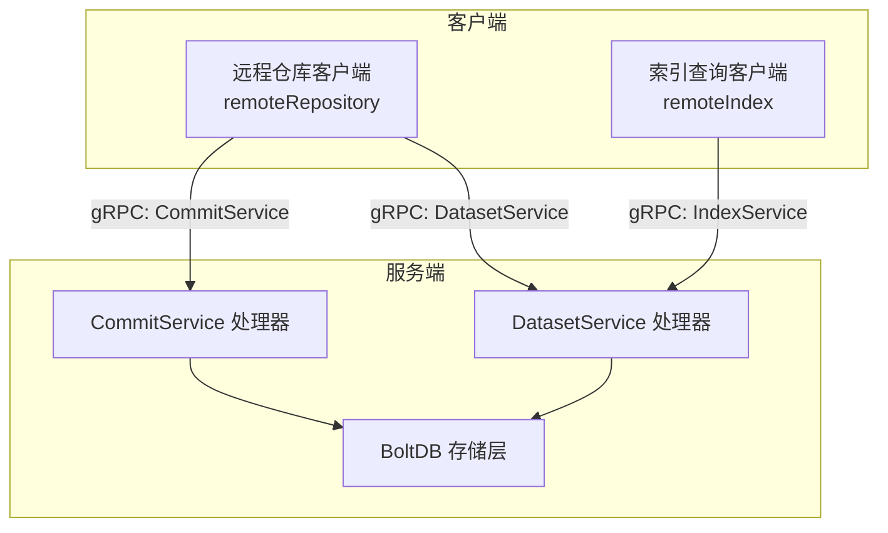
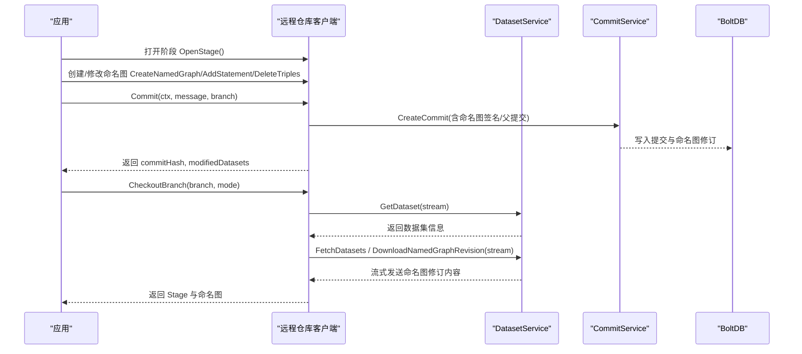
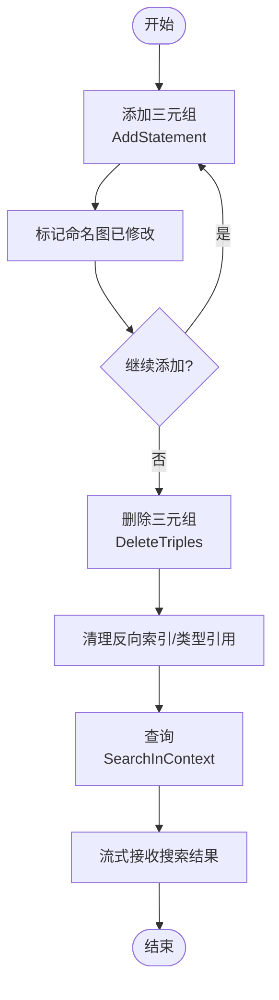
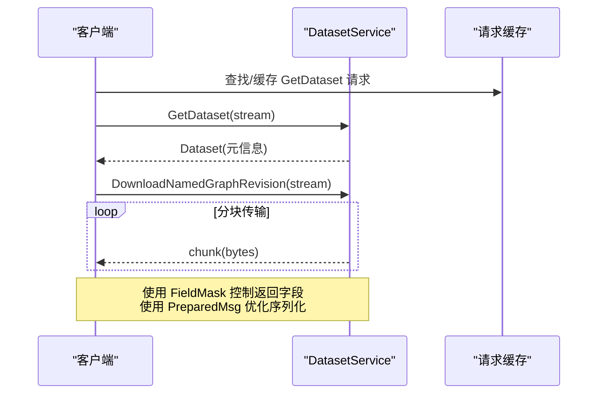
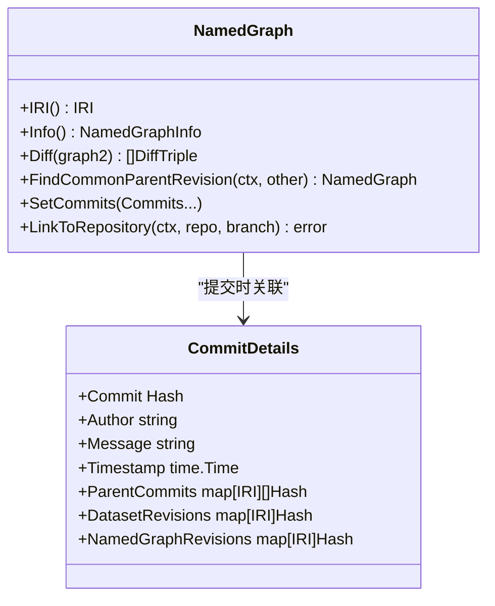
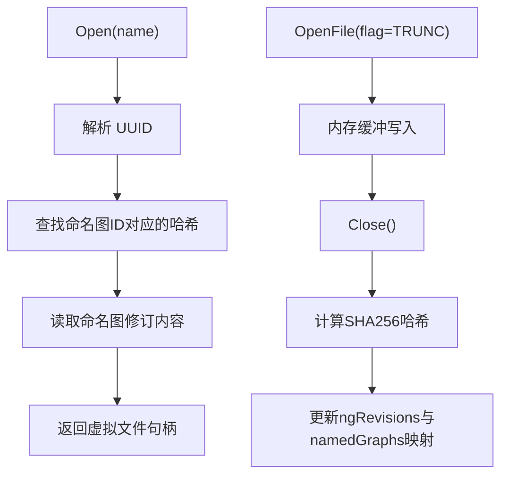
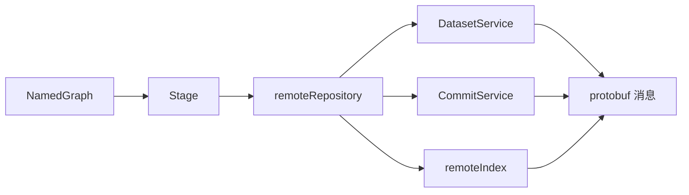

# 命名图操作

<cite>
**本文引用的文件**
- [namedgraph.go](file://sst/namedgraph.go)
- [reporemote.go](file://sst/reporemote.go)
- [reporemoteds.go](file://sst/reporemoteds.go)
- [repository.proto](file://bboltproto/repository.proto)
- [remote.go](file://bboltproto/remote.go)
- [stage.go](file://sst/stage.go)
- [stagefsremoterepo.go](file://sst/stagefsremoterepo.go)
- [ibnode.go](file://sst/ibnode.go)
- [namedgraph_handler.go](file://cli/cmd/interactive/namedgraph_handler.go)
</cite>

## 目录
1. [简介](#简介)
2. [项目结构](#项目结构)
3. [核心组件](#核心组件)
4. [架构总览](#架构总览)
5. [详细组件分析](#详细组件分析)
6. [依赖关系分析](#依赖关系分析)
7. [性能考量](#性能考量)
8. [故障排查指南](#故障排查指南)
9. [结论](#结论)
10. [附录：使用示例与最佳实践](#附录使用示例与最佳实践)

## 简介
本文件面向远程仓库的“命名图”操作，系统性说明三元组（Subject-Predicate-Object）的增删改查、远程 gRPC 调用细节（流式传输、二进制序列化、网络优化）、版本控制集成（修订版本管理、变更追踪、历史回滚），并提供完整的代码级示例路径与错误处理策略。文档以 SST 代码库为依据，确保所有实现细节均可追溯至具体源码位置。

## 项目结构
围绕命名图的远程操作，主要涉及以下模块：
- 内存模型与接口：命名图、阶段（Stage）、三元组存储与节点管理
- 远程客户端：gRPC 连接、数据集/提交服务封装、流式数据收发
- 服务端：gRPC 处理器、BoltDB 读取、流式下载与同步
- 协议定义：protobuf 消息与服务定义
- CLI 交互：交互式命令对命名图的读写导出

图表来源
- [reporemote.go:88-144](file://sst/reporemote.go#L88-L144)
- [reporemoteds.go:39-131](file://sst/reporemoteds.go#L39-L131)
- [repository.proto:88-131](file://bboltproto/repository.proto#L88-L131)

章节来源
- [reporemote.go:88-144](file://sst/reporemote.go#L88-L144)
- [reporemoteds.go:39-131](file://sst/reporemoteds.go#L39-L131)
- [repository.proto:88-131](file://bboltproto/repository.proto#L88-L131)

## 核心组件
- 命名图（NamedGraph）：RDF 命名图的内存表示，维护三元组、节点、导入关系与版本元数据
- 阶段（Stage）：一组命名图的内存工作区，支持创建、合并、提交到仓库
- 远程仓库（remoteRepository）：封装 gRPC 客户端，提供数据集、提交、分支、日志等能力
- 远程索引（remoteIndex）：通过 gRPC 流式调用执行搜索
- 协议（protobuf）：定义数据集、提交、命名图修订、同步等消息与服务

章节来源
- [namedgraph.go:42-108](file://sst/namedgraph.go#L42-L108)
- [stage.go:53-71](file://sst/stage.go#L53-L71)
- [reporemote.go:88-144](file://sst/reporemote.go#L88-L144)
- [repository.proto:88-131](file://bboltproto/repository.proto#L88-L131)

## 架构总览
远程命名图操作的端到端流程如下：
- 客户端在 Stage 中创建/修改 NamedGraph，并通过 Commit 将变更持久化到远程仓库
- 读取时通过 CheckoutBranch/CheckoutCommit 拉取指定版本的命名图内容
- 三元组的增删改由 IBNode 方法完成，提交时生成新的命名图修订并记录父提交
- 查询通过 Bleve 索引的远程流式 SearchInContext 完成
- 大对象（如命名图修订内容）采用流式下载，分块传输以降低内存占用

图表来源
- [reporemote.go:639-653](file://sst/reporemote.go#L639-L653)
- [reporemoteds.go:407-452](file://sst/reporemoteds.go#L407-L452)
- [repository.proto:101-131](file://bboltproto/repository.proto#L101-L131)

## 详细组件分析

### 三元组操作：添加、删除、查询
- 添加三元组：IBNode.AddStatement 负责将谓词与对象加入当前节点的三元组存储，并标记命名图为已修改
- 删除三元组：IBNode.DeleteTriples 移除该节点的所有主体三元组，并清理相关反向索引
- 批量添加：通常通过循环调用 AddStatement 实现；对于大量数据，建议结合流式读取与分批提交以减少内存峰值
- 查询：通过远程索引的 SearchInContext 进行全文或结构化检索，结果经流式返回

图表来源
- [ibnode.go:2083-2102](file://sst/ibnode.go#L2083-L2102)
- [ibnode.go:1960-1986](file://sst/ibnode.go#L1960-L1986)
- [reporemote.go:146-207](file://sst/reporemote.go#L146-L207)

章节来源
- [ibnode.go:2083-2102](file://sst/ibnode.go#L2083-L2102)
- [ibnode.go:1960-1986](file://sst/ibnode.go#L1960-L1986)
- [reporemote.go:146-207](file://sst/reporemote.go#L146-L207)

### 远程 gRPC 调用：流式数据传输、二进制序列化与网络优化
- 流式调用：
  - 数据集获取：GetDataset(stream) 单条请求后返回数据集元信息
  - 数据集拉取：FetchDatasets(stream) 双向流，按需请求与响应数据集对象
  - 命名图修订下载：DownloadNamedGraphRevision(stream) 按固定大小分块流式传输二进制内容
  - 搜索：SearchInContext 使用流式接口发送请求并接收结果
- 二进制序列化：
  - 所有消息均基于 protobuf 编码，字段掩码（FieldMask）用于选择性返回字段，减少带宽
  - 命名图修订内容以原始字节流传输，避免中间格式转换开销
- 网络优化：
  - 分页与令牌：ListDatasets 使用 page_token 分页
  - 预编译消息：SearchInContext 使用 PreparedMsg 缓存序列化结果，降低重复编码成本
  - 认证上下文：从 Context 提取 OAuth2 Token 注入 PerRPCCredentials，保证安全访问

图表来源
- [reporemote.go:470-536](file://sst/reporemote.go#L470-L536)
- [reporemote.go:146-207](file://sst/reporemote.go#L146-L207)
- [reporemoteds.go:407-452](file://sst/reporemoteds.go#L407-L452)
- [repository.proto:215-247](file://bboltproto/repository.proto#L215-L247)

章节来源
- [reporemote.go:470-536](file://sst/reporemote.go#L470-L536)
- [reporemote.go:146-207](file://sst/reporemote.go#L146-L207)
- [reporemoteds.go:407-452](file://sst/reporemoteds.go#L407-L452)
- [repository.proto:215-247](file://bboltproto/repository.proto#L215-L247)

### 版本控制集成：修订版本管理、变更追踪与历史回滚
- 修订版本：
  - 每次提交会为每个修改的命名图生成新的 NamedGraphRevision，并在 CommitDetails 中记录 DatasetRevisions 与 NamedGraphRevisions
  - 分支指向最新提交，支持多父提交的合并场景
- 变更追踪：
  - 命名图内部维护 checkedOutCommits、checkedOutNGRevisions、checkedOutDSRevisions，用于后续提交时确定父提交
  - Diff 与对齐（AlignHistory）可识别新增、删除、修改的三元组与导入关系
- 历史回滚：
  - 通过 CheckoutCommit/CheckoutBranch 加载任意历史版本
  - FindCommonParentRevision 支持三路合并时的共同祖先定位

图表来源
- [namedgraph.go:237-265](file://sst/namedgraph.go#L237-L265)
- [namedgraph.go:435-503](file://sst/namedgraph.go#L435-L503)
- [reporemote.go:546-637](file://sst/reporemote.go#L546-L637)
- [repository.proto:328-341](file://bboltproto/repository.proto#L328-L341)

章节来源
- [namedgraph.go:237-265](file://sst/namedgraph.go#L237-L265)
- [namedgraph.go:435-503](file://sst/namedgraph.go#L435-L503)
- [reporemote.go:546-637](file://sst/reporemote.go#L546-L637)
- [repository.proto:328-341](file://bboltproto/repository.proto#L328-L341)

### 远程文件系统抽象：命名图内容的本地视图
- remoteRepoFS 将远程命名图修订映射为虚拟文件系统，支持 Open/ReadDir/OpenFile
- memRevFileReadWriter 在关闭时将写入内容计算哈希并更新命名图修订映射，便于后续提交

图表来源
- [stagefsremoterepo.go:34-53](file://sst/stagefsremoterepo.go#L34-L53)
- [stagefsremoterepo.go:84-130](file://sst/stagefsremoterepo.go#L84-L130)

章节来源
- [stagefsremoterepo.go:34-53](file://sst/stagefsremoterepo.go#L34-L53)
- [stagefsremoterepo.go:84-130](file://sst/stagefsremoterepo.go#L84-L130)

## 依赖关系分析
- 命名图依赖阶段（Stage）管理其生命周期与提交
- 远程仓库依赖 gRPC 客户端与服务端处理器，通过 protobuf 消息通信
- 索引查询依赖 bleveproto 的流式接口
- 版本控制依赖提交详情（CommitDetails）与分支引用（Branches）

图表来源
- [stage.go:53-71](file://sst/stage.go#L53-L71)
- [reporemote.go:88-144](file://sst/reporemote.go#L88-L144)
- [repository.proto:88-131](file://bboltproto/repository.proto#L88-L131)

章节来源
- [stage.go:53-71](file://sst/stage.go#L53-L71)
- [reporemote.go:88-144](file://sst/reporemote.go#L88-L144)
- [repository.proto:88-131](file://bboltproto/repository.proto#L88-L131)

## 性能考量
- 流式传输：大对象（命名图修订、文档）采用分块流式传输，降低内存峰值与网络拥塞风险
- 预编译消息：SearchInContext 使用 PreparedMsg 缓存序列化结果，减少重复编码开销
- 字段掩码：FieldMask 控制返回字段，减少不必要的数据传输
- 分页：ListDatasets 使用 page_token 分页，避免一次性加载全部数据集
- 三元组模式：DefaultTriplexMode 同时维护主体、谓词、对象三元组，适合复杂遍历但内存占用较高；可根据应用场景权衡

## 故障排查指南
- 网络超时与重试：
  - gRPC 调用应设置合理的上下文超时与取消机制
  - 对幂等操作（如查询）可实现指数退避重试
- 数据冲突：
  - 提交时使用父提交链与分支指针，避免并发写冲突
  - 若检测到分支分歧，可通过 FindCommonParentRevision 定位共同祖先并进行三路合并
- 权限与认证：
  - 确保 Context 中包含有效的 OAuth2 Token
  - 检查服务端 RBAC 拦截器是否放行目标仓库访问
- 常见错误：
  - ErrDatasetNotFound：数据集不存在或不可见
  - ErrCommitNotFound：提交哈希无效
  - ErrRepoClosed：仓库已关闭或处于关闭中

章节来源
- [reporemote.go:69-73](file://sst/reporemote.go#L69-L73)
- [reporemoteds.go:134-156](file://sst/reporemoteds.go#L134-L156)
- [repository.proto:549-569](file://bboltproto/repository.proto#L549-L569)

## 结论
SST 的远程命名图操作通过清晰的内存模型、高效的 gRPC 流式传输与完善的版本控制机制，提供了可靠的三元组增删改查能力。结合字段掩码、分页、预编译消息等优化手段，可在大规模数据场景下保持良好性能。建议在应用中合理设计提交粒度与查询策略，并完善错误处理与重试逻辑，以确保系统的稳定性与可扩展性。

## 附录：使用示例与最佳实践

### 创建命名图与管理三元组
- 创建命名图：通过 Stage.CreateNamedGraph 创建新命名图
- 添加三元组：使用 IBNode.AddStatement 添加谓词与对象
- 删除三元组：使用 IBNode.DeleteTriples 删除节点的所有主体三元组
- 提交变更：调用 Stage.Commit 将修改持久化到远程仓库

示例路径
- [stage.go:74-130](file://sst/stage.go#L74-L130)
- [ibnode.go:2083-2102](file://sst/ibnode.go#L2083-L2102)
- [ibnode.go:1960-1986](file://sst/ibnode.go#L1960-L1986)
- [reporemote.go:639-653](file://sst/reporemote.go#L639-L653)

### 执行复杂查询
- 构建查询：使用 bleve 查询构造器创建 Match/QueryString/Boolean 等查询
- 远程搜索：调用 repo.Bleve().SearchInContext 执行流式搜索
- 结果处理：遍历搜索结果并提取所需字段

示例路径
- [reporemote.go:146-207](file://sst/reporemote.go#L146-L207)
- [sst_test/remoteRepository_test.go:547-563](file://sst_test/remoteRepository_test.go#L547-L563)
- [sst_test/searchInContext_test.go:420-453](file://sst_test/searchInContext_test.go#L420-L453)

### 版本控制与历史回滚
- 查看提交详情：通过 ds.CommitDetailsByHash 获取提交信息与父提交链
- 检出历史版本：使用 ds.CheckoutCommit 或 ds.CheckoutBranch 加载指定版本
- 共同祖先定位：使用 ds.FindCommonParentRevision 进行三路合并

示例路径
- [reporemote.go:546-637](file://sst/reporemote.go#L546-L637)
- [sst_test/remoteRepositoryMultipleCommits_test.go:641-670](file://sst_test/remoteRepositoryMultipleCommits_test.go#L641-L670)
- [sst_test/commit_parent_and_leaf_test.go:367-403](file://sst_test/commit_parent_and_leaf_test.go#L367-L403)

### 错误处理与重试机制
- 网络超时：为 gRPC 调用设置 context.WithTimeout/context.WithCancel
- 数据冲突：检测分支分歧并使用 FindCommonParentRevision 进行合并
- 权限校验：确保 Context 包含有效 Token，并检查服务端 RBAC 配置

示例路径
- [reporemote.go:69-73](file://sst/reporemote.go#L69-L73)
- [reporemoteds.go:134-156](file://sst/reporemoteds.go#L134-L156)
- [sstauth/ACCESS_RIGHTS.md:103-128](file://sstauth/ACCESS_RIGHTS.md#L103-L128)

### CLI 交互示例
- 列出命名图中的 IRI 节点、空白节点
- 导出命名图为 TTL/SST/SVG 格式
- 通过别名快速访问节点与命名图

示例路径
- [namedgraph_handler.go:18-151](file://cli/cmd/interactive/namedgraph_handler.go#L18-L151)
- [namedgraph_handler.go:209-306](file://cli/cmd/interactive/namedgraph_handler.go#L209-L306)
- [namedgraph_handler.go:322-395](file://cli/cmd/interactive/namedgraph_handler.go#L322-L395)