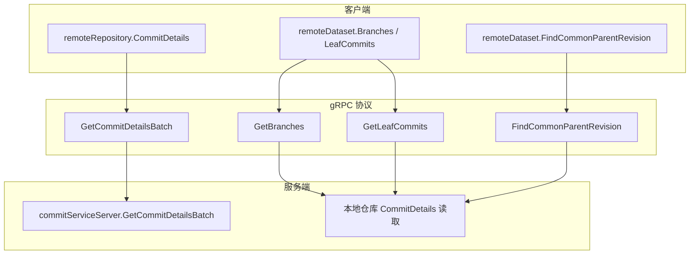
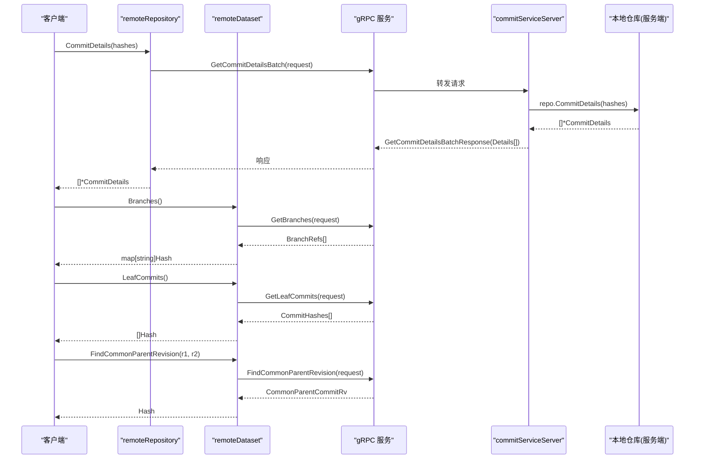
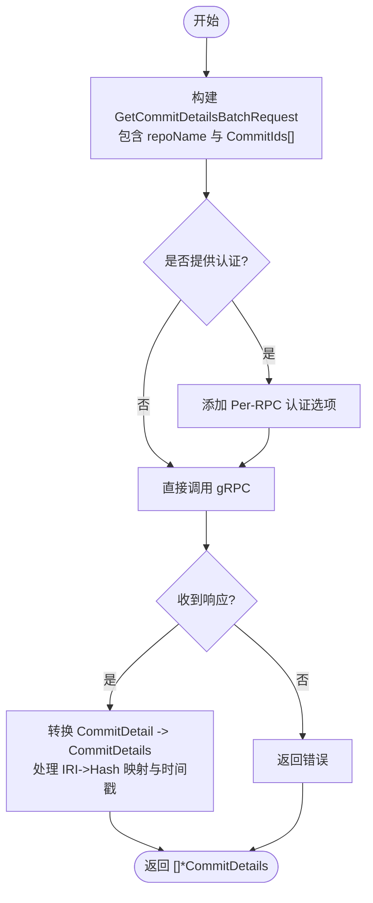
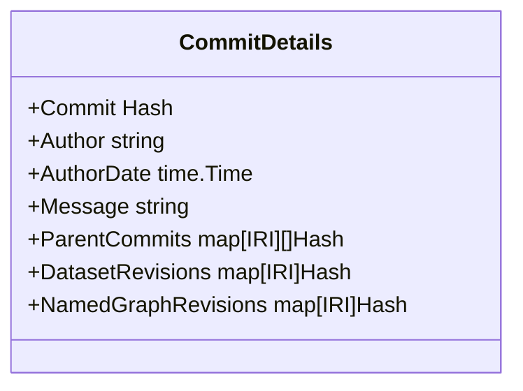
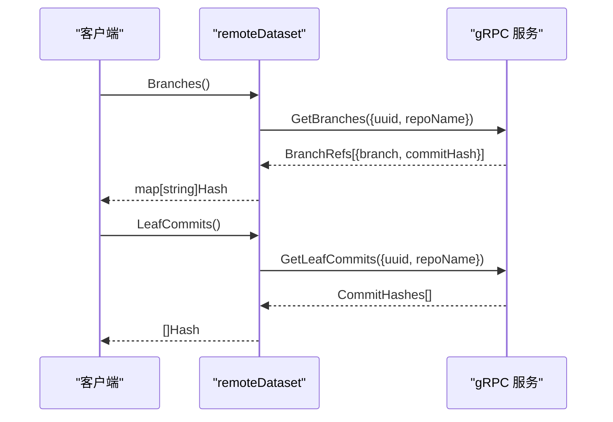
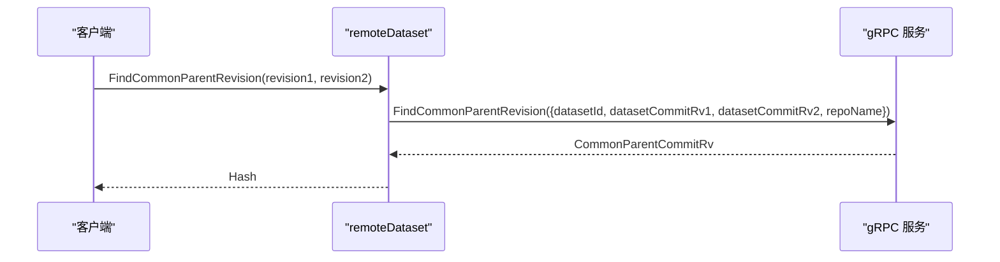
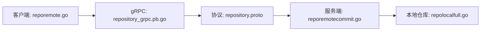

# 提交历史操作

<cite>
**本文引用的文件**
- [commit.go](file://sst/commit.go)
- [reporemotecommit.go](file://sst/reporemotecommit.go)
- [reporemote.go](file://sst/reporemote.go)
- [repolocalfull.go](file://sst/repolocalfull.go)
- [repository.proto](file://bboltproto/repository.proto)
- [repository.pb.go](file://bboltproto/repository.pb.go)
- [repository_grpc.pb.go](file://bboltproto/repository_grpc.pb.go)
- [dataset.go](file://sst/dataset.go)
</cite>

## 目录
1. [简介](#简介)
2. [项目结构](#项目结构)
3. [核心组件](#核心组件)
4. [架构总览](#架构总览)
5. [详细组件分析](#详细组件分析)
6. [依赖关系分析](#依赖关系分析)
7. [性能考虑](#性能考虑)
8. [故障排查指南](#故障排查指南)
9. [结论](#结论)
10. [附录：示例与最佳实践](#附录示例与最佳实践)

## 简介
本文件聚焦于远程仓库的提交历史操作，重点说明以下能力：
- 批量获取提交详情：通过 GetCommitDetailsBatch gRPC 接口一次性拉取多个提交的详细信息，并实现本地到远端的数据转换。
- 提交信息结构：作者、提交时间、消息、父提交关系、数据集修订、命名图修订等字段含义与来源。
- 分支信息查询：Branches 方法返回分支名到提交哈希的映射；LeafCommits 方法返回叶子提交列表。
- 常见操作示例：查询提交历史、遍历提交树、查找共同祖先提交（FindCommonParentRevision）。
- 性能优化建议：批量请求、缓存策略、连接复用等。

## 项目结构
围绕提交历史的代码主要分布在以下位置：
- 数据模型与协议定义：bboltproto 下的 repository.proto 及生成的 pb 文件，定义了 CommitDetail、GetCommitDetailsBatchRequest/Response、GetBranches、GetLeafCommits、FindCommonParentRevision 等消息与服务。
- 客户端实现：sst/reporemote.go 中 remoteRepository.CommitDetails、remoteDataset.Branches、LeafCommits、FindCommonParentRevision 等方法封装了 gRPC 调用与认证。
- 服务端实现：sst/reporemotecommit.go 中的 commitServiceServer.GetCommitDetailsBatch 将请求转换为本地仓库的 CommitDetails 并序列化为 proto。
- 本地仓库实现：sst/repolocalfull.go 实现了本地 Full 仓库的 CommitDetails 读取逻辑，用于服务端侧解析存储。
- 类型与接口：sst/commit.go 定义了 CommitDetails 结构体；sst/dataset.go 定义了 Dataset 接口，包括 FindCommonParentRevision。

图表来源
- [reporemote.go:546-637](file://sst/reporemote.go#L546-L637)
- [reporemotecommit.go:247-279](file://sst/reporemotecommit.go#L247-L279)
- [repository.proto:88-131](file://bboltproto/repository.proto#L88-L131)

章节来源
- [reporemote.go:546-637](file://sst/reporemote.go#L546-L637)
- [reporemotecommit.go:247-279](file://sst/reporemotecommit.go#L247-L279)
- [repository.proto:88-131](file://bboltproto/repository.proto#L88-L131)

## 核心组件
- CommitDetails：提交详情的核心数据结构，包含提交哈希、作者、作者时间、消息、父提交关系、数据集修订、命名图修订。
- 批量提交详情获取：客户端通过 CommitDetails(hashes) 发起批量请求，服务端通过 GetCommitDetailsBatch 返回 CommitDetail 列表，客户端将其转换为 []*CommitDetails。
- 分支与叶子提交：Branches 返回分支到提交哈希的映射；LeafCommits 返回所有叶子提交哈希列表。
- 共同祖先提交：FindCommonParentRevision 用于在两个数据集修订之间寻找共同祖先，支持三路合并与差异计算。

章节来源
- [commit.go:18-29](file://sst/commit.go#L18-L29)
- [reporemote.go:546-637](file://sst/reporemote.go#L546-L637)
- [reporemote.go:741-813](file://sst/reporemote.go#L741-L813)
- [reporemote.go:679-703](file://sst/reporemote.go#L679-L703)
- [dataset.go:83-94](file://sst/dataset.go#L83-L94)

## 架构总览
下图展示了从客户端发起批量提交详情请求到服务端处理并返回的完整流程，以及分支与叶子提交查询、共同祖先查找的交互路径。

图表来源
- [reporemote.go:546-637](file://sst/reporemote.go#L546-L637)
- [reporemote.go:741-813](file://sst/reporemote.go#L741-L813)
- [reporemote.go:679-703](file://sst/reporemote.go#L679-L703)
- [reporemotecommit.go:247-279](file://sst/reporemotecommit.go#L247-L279)
- [repository.proto:88-131](file://bboltproto/repository.proto#L88-L131)

## 详细组件分析

### 批量提交详情：GetCommitDetailsBatch
- 客户端侧（remoteRepository.CommitDetails）
  - 构建 GetCommitDetailsBatchRequest，包含仓库名与待查询的提交哈希列表。
  - 附加 OAuth2 凭据（若上下文提供）。
  - 调用 gRPC 后，将响应中的 CommitDetail 列表转换为本地 CommitDetails 对象，包括：
    - 提交哈希、作者、消息、时间戳（Unix -> time.Time UTC）。
    - 数据集修订映射（IRI -> Hash）。
    - 命名图修订映射（IRI -> Hash）。
    - 父提交关系映射（IRI -> []Hash）。
- 服务端侧（commitServiceServer.GetCommitDetailsBatch）
  - 校验并转换请求中的提交哈希。
  - 通过本地仓库的 CommitDetails 方法获取详细信息。
  - 将本地 CommitDetails 序列化为 CommitDetail 列表返回。

图表来源
- [reporemote.go:546-637](file://sst/reporemote.go#L546-L637)
- [reporemotecommit.go:247-279](file://sst/reporemotecommit.go#L247-L279)

章节来源
- [reporemote.go:546-637](file://sst/reporemote.go#L546-L637)
- [reporemotecommit.go:247-279](file://sst/reporemotecommit.go#L247-L279)
- [repository.pb.go:4155-4251](file://bboltproto/repository.pb.go#L4155-L4251)

### 提交信息结构：CommitDetails
- 字段说明
  - Commit：提交哈希。
  - Author：作者标识。
  - AuthorDate：作者时间（UTC）。
  - Message：提交消息。
  - ParentCommits：按数据集 IRI 分组的父提交哈希列表。
  - DatasetRevisions：数据集修订映射（IRI -> Hash）。
  - NamedGraphRevisions：命名图修订映射（IRI -> Hash）。
- 数据来源
  - 客户端从 gRPC 响应中解析得到。
  - 服务端从本地仓库存储中读取并提交序列化。

图表来源
- [commit.go:18-29](file://sst/commit.go#L18-L29)
- [reporemote.go:580-633](file://sst/reporemote.go#L580-L633)
- [reporemotecommit.go:281-317](file://sst/reporemotecommit.go#L281-L317)

章节来源
- [commit.go:18-29](file://sst/commit.go#L18-L29)
- [reporemote.go:580-633](file://sst/reporemote.go#L580-L633)
- [reporemotecommit.go:281-317](file://sst/reporemotecommit.go#L281-L317)

### 分支信息查询：Branches 与 LeafCommits
- Branches
  - 调用 GetBranches，返回 BranchRefs 列表，每个元素包含分支名与对应提交哈希。
  - 客户端将其转换为 map[string]Hash。
- LeafCommits
  - 调用 GetLeafCommits，返回所有叶子提交哈希列表。
  - 客户端将其转换为 []Hash。

图表来源
- [reporemote.go:741-813](file://sst/reporemote.go#L741-L813)
- [repository.proto:175-198](file://bboltproto/repository.proto#L175-L198)

章节来源
- [reporemote.go:741-813](file://sst/reporemote.go#L741-L813)
- [repository.proto:175-198](file://bboltproto/repository.proto#L175-L198)

### 共同祖先提交：FindCommonParentRevision
- 用途：为同一数据集的两个修订版本寻找共同祖先提交修订，用于三路差异与合并。
- 流程：客户端构造请求（包含数据集 ID、两个修订哈希、仓库名），服务端返回共同祖先修订哈希。

图表来源
- [reporemote.go:679-703](file://sst/reporemote.go#L679-L703)
- [repository.proto:133-142](file://bboltproto/repository.proto#L133-L142)

章节来源
- [reporemote.go:679-703](file://sst/reporemote.go#L679-L703)
- [repository.proto:133-142](file://bboltproto/repository.proto#L133-L142)

### 本地仓库提交详情读取（服务端侧）
- 本地 Full 仓库在服务端侧实现 CommitDetails 读取，从数据库桶中解析作者、消息、数据集修订与命名图修订，并填充父提交关系。
- 该实现确保服务端能正确响应批量提交详情请求。

章节来源
- [repolocalfull.go:595-719](file://sst/repolocalfull.go#L595-L719)

## 依赖关系分析
- 客户端依赖 gRPC 客户端生成代码（repository_grpc.pb.go）进行服务调用。
- 协议定义（repository.proto）驱动 pb 生成，确保请求与响应结构一致。
- 客户端与服务端通过统一的 CommitDetail 结构进行数据交换，客户端负责将 proto 字段转换为内部 CommitDetails。

图表来源
- [reporemote.go:546-637](file://sst/reporemote.go#L546-L637)
- [repository_grpc.pb.go:1593-1643](file://bboltproto/repository_grpc.pb.go#L1593-L1643)
- [repository.proto:88-131](file://bboltproto/repository.proto#L88-L131)
- [reporemotecommit.go:247-279](file://sst/reporemotecommit.go#L247-L279)
- [repolocalfull.go:595-719](file://sst/repolocalfull.go#L595-L719)

章节来源
- [repository_grpc.pb.go:1593-1643](file://bboltproto/repository_grpc.pb.go#L1593-L1643)
- [repository.proto:88-131](file://bboltproto/repository.proto#L88-L131)

## 性能考虑
- 批量请求：优先使用 CommitDetails(hashes) 一次性拉取多个提交详情，减少网络往返与认证开销。
- 缓存策略：对频繁访问的提交详情或分支映射进行本地缓存，避免重复请求。
- 连接复用：保持 gRPC 连接复用，避免频繁建立连接；合理设置超时与重试。
- 分页与限流：当需要大量提交时，结合 LeafCommits 与分批拉取，控制单次请求大小。
- 认证优化：复用上下文中的认证提供者，避免每次请求重新获取令牌。

[本节为通用指导，不直接分析具体文件]

## 故障排查指南
- 认证失败：检查上下文是否提供 sstauth.AuthProvider，并确保 Oauth2Token 可用。
- 无效提交哈希：服务端会跳过长度不为 32 的提交哈希；客户端应确保传入正确的 Hash。
- 空结果：确认仓库名与数据集 UUID 是否正确；必要时先调用 RepositoryInfo 或 ListDatasets 验证。
- 时间戳异常：服务端以 Unix 秒为单位，客户端转换为 UTC 时间；注意时区与精度。
- 分支不存在：Branches 返回空映射；需先创建或设置分支。

章节来源
- [reporemote.go:546-637](file://sst/reporemote.go#L546-L637)
- [reporemote.go:741-813](file://sst/reporemote.go#L741-L813)
- [reporemotecommit.go:247-279](file://sst/reporemotecommit.go#L247-L279)

## 结论
通过 GetCommitDetailsBatch、Branches、LeafCommits 与 FindCommonParentRevision 等接口，SST 提供了完整的远程仓库提交历史操作能力。客户端与服务端通过统一的协议与数据结构协作，既保证了高效批量获取，又支持复杂的提交树遍历与合并场景。遵循批量请求、缓存与连接复用的优化策略，可显著提升性能与稳定性。

[本节为总结性内容，不直接分析具体文件]

## 附录：示例与最佳实践
- 查询提交历史
  - 使用 CommitDetails(hashes) 批量获取提交详情，再根据 ParentCommits 遍历提交链。
- 遍历提交树
  - 从当前提交开始，循环读取父提交哈希，直到无父提交为止。
- 查找共同祖先提交
  - 使用 FindCommonParentRevision(datasetRevision1, datasetRevision2) 获取共同祖先，便于三路差异与合并。
- 分支管理
  - 使用 Branches 获取分支到提交的映射；使用 SetBranchCommit 更新分支指向；使用 RemoveBranch 删除分支。
- 性能建议
  - 批量拉取提交详情，避免逐条请求。
  - 缓存分支映射与常用提交详情。
  - 复用 gRPC 连接与认证令牌。

章节来源
- [reporemote.go:546-637](file://sst/reporemote.go#L546-L637)
- [reporemote.go:741-813](file://sst/reporemote.go#L741-L813)
- [reporemote.go:679-703](file://sst/reporemote.go#L679-L703)
- [commit.go:18-29](file://sst/commit.go#L18-L29)