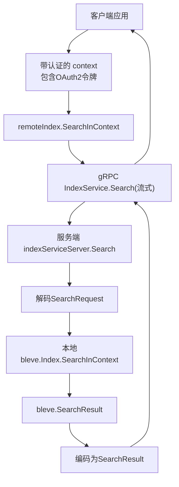
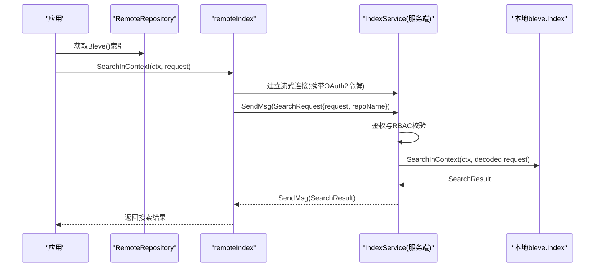
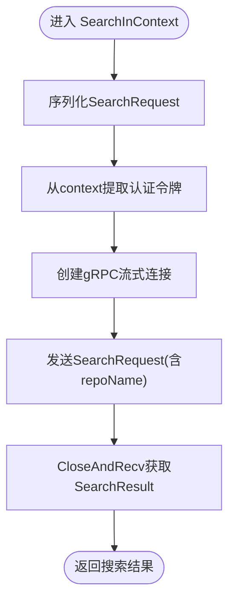
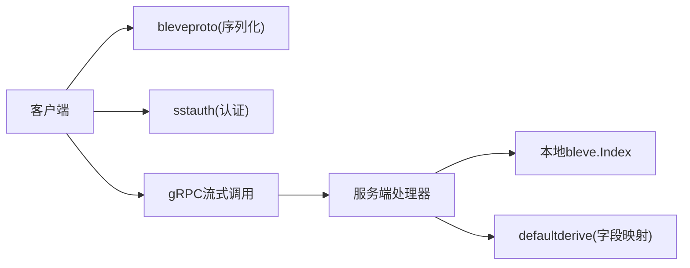

# 搜索查询操作

<cite>
**本文引用的文件**
- [reporemote.go](file://sst/reporemote.go)
- [reporemoteapp.go](file://sst/reporemoteapp.go)
- [index.proto](file://bleveproto/index.proto)
- [remote.go](file://bleveproto/remote.go)
- [defaultderive.go](file://defaultderive/defaultderive.go)
- [searchInContext_test.go](file://sst_test/searchInContext_test.go)
- [per_repo_auth_test.go](file://sst_test/per_repo_auth_test.go)
</cite>

## 目录
1. [简介](#简介)
2. [项目结构](#项目结构)
3. [核心组件](#核心组件)
4. [架构总览](#架构总览)
5. [详细组件分析](#详细组件分析)
6. [依赖关系分析](#依赖关系分析)
7. [性能考量](#性能考量)
8. [故障排查指南](#故障排查指南)
9. [结论](#结论)
10. [附录](#附录)

## 简介
本文件围绕远程仓库的 Bleve 搜索引擎调用，系统化说明 SearchInContext 流式查询接口、SearchRequest/SearchResult 数据结构、全文搜索语法支持（关键词匹配、布尔查询、范围查询等）、查询上下文管理（认证令牌传递、请求超时控制、结果分页处理），并提供构建复杂查询、执行全文搜索与处理结果的实践建议与优化策略。

## 项目结构
与远程搜索相关的关键位置：
- 客户端侧：通过 remoteIndex.SearchInContext 将 bleve.SearchRequest 序列化为字节并通过 gRPC 流发送，附加 OAuth2 令牌后调用服务端 IndexService.Search。
- 服务端侧：IndexService.Search 接收流式请求，解析并调用本地 bleve.Index.SearchInContext，再将 SearchResult 序列化回传。
- 索引映射：defaultderive 定义字段映射与文档结构，决定哪些字段可被检索与排序。
- 测试用例：覆盖基本查询、分页、排序、取消上下文、权限校验等场景。

图表来源
- [reporemote.go:146-207](file://sst/reporemote.go#L146-L207)
- [reporemoteapp.go:387-427](file://sst/reporemoteapp.go#L387-L427)
- [index.proto:9-20](file://bleveproto/index.proto#L9-L20)

章节来源
- [reporemote.go:141-229](file://sst/reporemote.go#L141-L229)
- [reporemoteapp.go:351-427](file://sst/reporemoteapp.go#L351-L427)
- [index.proto:1-21](file://bleveproto/index.proto#L1-L21)

## 核心组件
- remoteIndex：实现 bleve.Index 接口的最小集，仅暴露 Search 与 SearchInContext，其他写操作返回“未实现”错误，确保远程仓库只读搜索能力。
- IndexService（gRPC）：定义流式 Search 接口，请求体携带序列化的 bleve.SearchRequest 与 repoName，响应体为序列化的 bleve.SearchResult。
- 服务端处理器：对请求进行鉴权与角色校验，解码请求并调用本地索引执行搜索，再编码结果返回。
- 默认索引映射：定义 mainType、label、literal、id.*、commit* 等字段，支撑关键词、短语、排序与过滤。

章节来源
- [reporemote.go:141-229](file://sst/reporemote.go#L141-L229)
- [index.proto:9-20](file://bleveproto/index.proto#L9-L20)
- [reporemoteapp.go:387-427](file://sst/reporemoteapp.go#L387-L427)
- [defaultderive.go:155-211](file://defaultderive/defaultderive.go#L155-L211)

## 架构总览
远程搜索采用“客户端构造查询 -> gRPC 流式传输 -> 服务端本地执行 -> 返回结果”的模式。认证信息通过 context 注入，并在每次 gRPC 调用时附加 OAuth2 令牌；服务端根据 per-repo 授权策略限制访问。

图表来源
- [reporemote.go:150-207](file://sst/reporemote.go#L150-L207)
- [reporemoteapp.go:387-427](file://sst/reporemoteapp.go#L387-L427)

## 详细组件分析

### 远程索引与流式查询
- remoteIndex.SearchInContext
  - 将 bleve.SearchRequest 序列化为字节，构造 gRPC 流式请求，从 context 中读取认证提供者并附加 OAuth2 令牌。
  - 使用 PreparedMsg 发送请求，随后 CloseAndRecv 获取单一 SearchResult。
  - 其他索引方法（如 Index/Delete/Batch）均返回“未实现”，体现远程只读搜索语义。
- 服务端 indexServiceServer.Search
  - 接收流式请求，解析 repoName 并定位仓库，执行 RBAC 校验。
  - 解码请求为 bleve.SearchRequest，调用本地索引执行搜索，编码结果为 SearchResult 并返回。

图表来源
- [reporemote.go:150-207](file://sst/reporemote.go#L150-L207)
- [reporemoteapp.go:387-427](file://sst/reporemoteapp.go#L387-L427)

章节来源
- [reporemote.go:146-229](file://sst/reporemote.go#L146-L229)
- [reporemoteapp.go:387-427](file://sst/reporemoteapp.go#L387-L427)

### 数据协议与转换
- index.proto 定义了 IndexService.Search 流式 RPC，以及 SearchRequest/Result 消息结构。
- bleveproto.NewSearchRequest/NewSearchResult 负责 JSON 编解码，便于跨进程传输 bleve 对象。

章节来源
- [index.proto:9-20](file://bleveproto/index.proto#L9-L20)
- [remote.go:21-39](file://bleveproto/remote.go#L21-L39)

### 全文搜索语法与字段支持
- 支持的查询类型由 bleve 提供，包括 MatchQuery、MatchAllQuery、BooleanQuery、RegexpQuery、QueryStringQuery 等。
- 常用字段：
  - mainType：文档主类型
  - label/literal：文本内容（label 支持短语分词）
  - id.*：标识符及其子字段（key、type、owner.*）
  - commit*：提交元数据（hash、author、time、message）
- 这些字段在 defaultderive 中定义映射，用于索引与检索。

章节来源
- [defaultderive.go:155-211](file://defaultderive/defaultderive.go#L155-L211)
- [defaultderive.go:213-264](file://defaultderive/defaultderive.go#L213-L264)

### 查询上下文管理
- 认证令牌传递：
  - 客户端从 context 中获取 sstauth.Provider，并生成 OAuth2 令牌附加到 gRPC 调用选项。
  - 服务端通过拦截器链进行 OIDC 验证与 RBAC 校验，按方法名映射所需 AccessMode。
- 请求超时控制：
  - 通过 context.WithTimeout 设置超时，服务端与客户端均可感知取消信号。
- 结果分页处理：
  - 分页由 bleve.SearchRequestOptions 的 size/offset 参数控制，服务端直接透传到本地索引执行。

章节来源
- [reporemote.go:157-166](file://sst/reporemote.go#L157-L166)
- [reporemoteapp.go:456-529](file://sst/reporemoteapp.go#L456-L529)
- [searchInContext_test.go:526-563](file://sst_test/searchInContext_test.go#L526-L563)
- [per_repo_auth_test.go:117-143](file://sst_test/per_repo_auth_test.go#L117-L143)

### 示例：构建复杂查询与执行搜索
以下为基于测试用例的实践要点（不展示具体代码内容，仅提供路径参考）：
- 基本全量查询与字段选择
  - 参考：[searchInContext_test.go:47-68](file://sst_test/searchInContext_test.go#L47-L68)
- 关键词匹配与正则匹配
  - 参考：[searchInContext_test.go:71-80](file://sst_test/searchInContext_test.go#L71-L80)
  - 参考：[searchInContext_test.go:88-116](file://sst_test/searchInContext_test.go#L88-L116)
- 布尔组合查询
  - 参考：[searchInContext_test.go:95-103](file://sst_test/searchInContext_test.go#L95-L103)
- 分页与排序
  - 参考：[searchInContext_test.go:526-563](file://sst_test/searchInContext_test.go#L526-L563)
  - 参考：[searchInContext_test.go:565-645](file://sst_test/searchInContext_test.go#L565-L645)
- 上下文取消与超时
  - 参考：[searchInContext_test.go:651-678](file://sst_test/searchInContext_test.go#L651-L678)
- 权限控制（per-repo）
  - 参考：[per_repo_auth_test.go:117-143](file://sst_test/per_repo_auth_test.go#L117-L143)

章节来源
- [searchInContext_test.go:47-68](file://sst_test/searchInContext_test.go#L47-L68)
- [searchInContext_test.go:88-116](file://sst_test/searchInContext_test.go#L88-L116)
- [searchInContext_test.go:526-563](file://sst_test/searchInContext_test.go#L526-L563)
- [searchInContext_test.go:651-678](file://sst_test/searchInContext_test.go#L651-L678)
- [per_repo_auth_test.go:117-143](file://sst_test/per_repo_auth_test.go#L117-L143)

## 依赖关系分析
- 客户端依赖：
  - bleveproto 用于请求/结果序列化
  - sstauth 用于认证上下文
  - grpc 用于流式通信
- 服务端依赖：
  - 本地 bleve.Index 执行实际搜索
  - sstauth 的 OIDC 验证与 RBAC 拦截器
  - 默认索引映射 defaultderive 决定可检索字段

图表来源
- [reporemote.go:146-207](file://sst/reporemote.go#L146-L207)
- [reporemoteapp.go:387-427](file://sst/reporemoteapp.go#L387-L427)
- [defaultderive.go:155-211](file://defaultderive/defaultderive.go#L155-L211)

章节来源
- [reporemote.go:146-207](file://sst/reporemote.go#L146-L207)
- [reporemoteapp.go:387-427](file://sst/reporemoteapp.go#L387-L427)
- [defaultderive.go:155-211](file://defaultderive/defaultderive.go#L155-L211)

## 性能考量
- 查询缓存
  - 客户端存在 PreparedMsg 与请求消息缓存的预留逻辑（已注释），可用于减少重复序列化开销。建议在高频相同查询场景启用并评估收益。
- 索引优化
  - 合理选择字段：仅对需要检索/排序的字段开启索引或 DocValues，避免不必要开销。
  - 使用短语分词字段（label.phrase）提升短语匹配精度。
  - 利用主类型（mainType）与标识符（id.*）进行快速过滤。
- 并发查询
  - 通过并发发起多个 SearchInContext 请求，结合 context 超时控制，提高吞吐。
  - 注意服务端 RBAC 与资源限制，避免过度并发导致拥塞。
- 分页与排序
  - 使用 size/offset 控制每页大小，避免一次性拉取大量结果。
  - 优先在索引字段上排序，减少计算成本。

章节来源
- [reporemote.go:176-190](file://sst/reporemote.go#L176-L190)
- [defaultderive.go:155-211](file://defaultderive/defaultderive.go#L155-L211)
- [searchInContext_test.go:526-563](file://sst_test/searchInContext_test.go#L526-L563)

## 故障排查指南
- 认证失败
  - 检查 context 是否包含有效的 sstauth.Provider，并确保能生成有效 OAuth2 令牌。
  - 服务端 RBAC 校验失败会返回权限拒绝错误。
- 超时与取消
  - 若 context 超时或被取消，gRPC 流会中断，需捕获错误并重试或降级。
- 无结果或结果不一致
  - 确认数据已提交并刷新索引（本地仓库需 FlushBleveIndex）。
  - 核对查询字段是否与索引映射一致。
- 分页异常
  - 检查 size/offset 参数是否合理，避免越界或负值。

章节来源
- [reporemote.go:157-166](file://sst/reporemote.go#L157-L166)
- [reporemoteapp.go:456-529](file://sst/reporemoteapp.go#L456-L529)
- [searchInContext_test.go:651-678](file://sst_test/searchInContext_test.go#L651-L678)

## 结论
该实现通过 gRPC 流式接口将 bleve 搜索能力暴露为远程服务，客户端以标准 bleve.SearchRequest 构建查询，服务端在本地执行并返回 SearchResult。借助默认索引映射，系统支持关键词、短语、布尔、正则等多种查询方式，并通过 context 实现认证、超时与权限控制。在生产环境中，建议结合查询缓存、索引优化与并发策略，以获得更好的性能与稳定性。

## 附录
- 常见查询模式参考路径
  - 全量查询与字段选择：[searchInContext_test.go:47-68](file://sst_test/searchInContext_test.go#L47-L68)
  - 关键词与正则匹配：[searchInContext_test.go:88-116](file://sst_test/searchInContext_test.go#L88-L116)
  - 布尔组合查询：[searchInContext_test.go:95-103](file://sst_test/searchInContext_test.go#L95-L103)
  - 分页与排序：[searchInContext_test.go:526-563](file://sst_test/searchInContext_test.go#L526-L563)
  - 上下文取消与超时：[searchInContext_test.go:651-678](file://sst_test/searchInContext_test.go#L651-L678)
  - 权限控制（per-repo）：[per_repo_auth_test.go:117-143](file://sst_test/per_repo_auth_test.go#L117-L143)