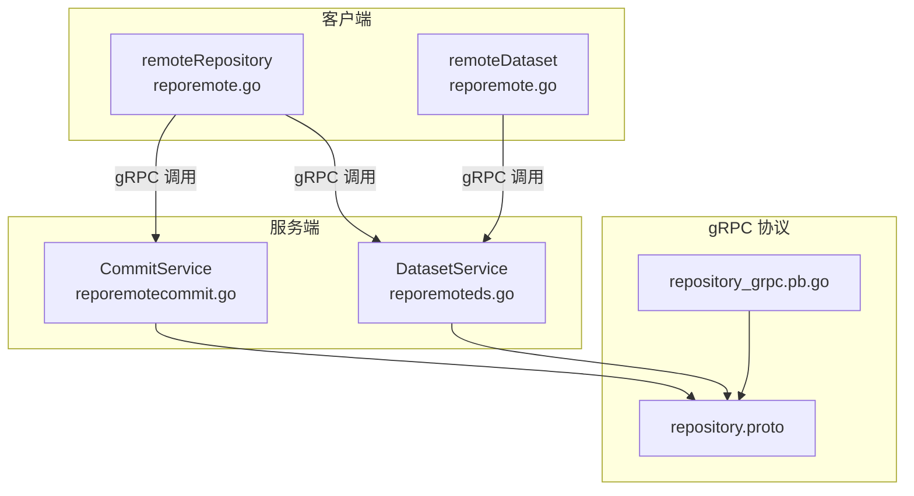
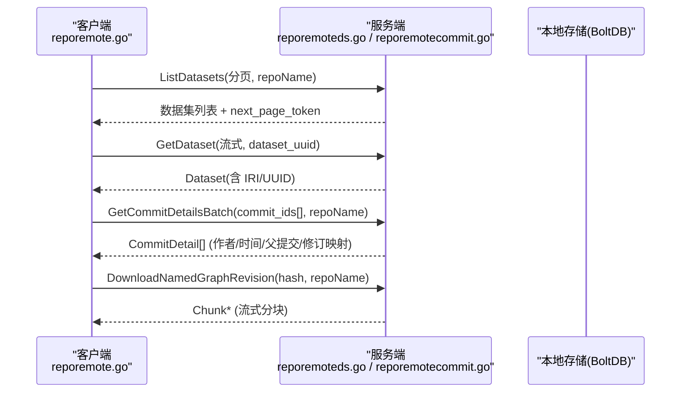
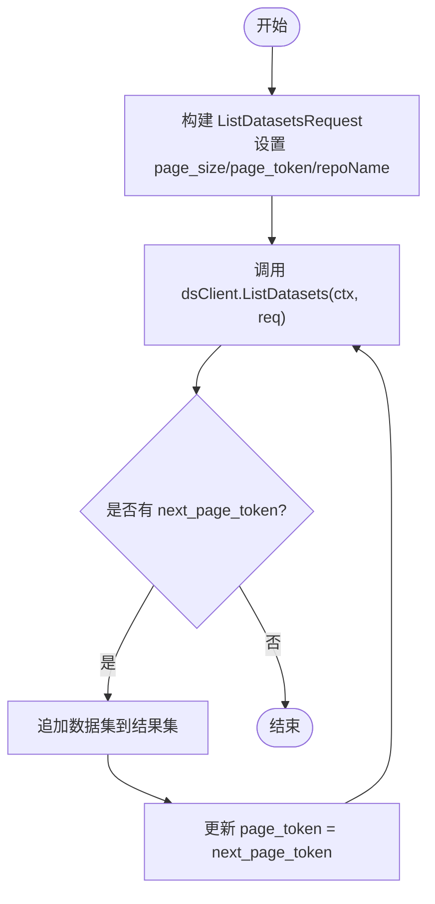
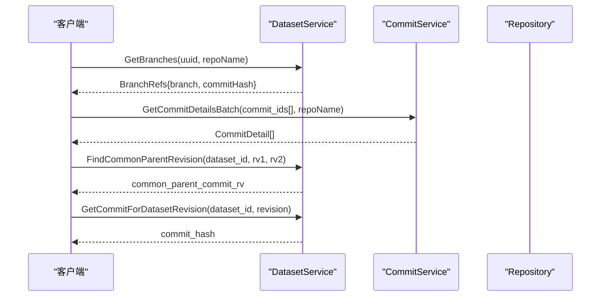
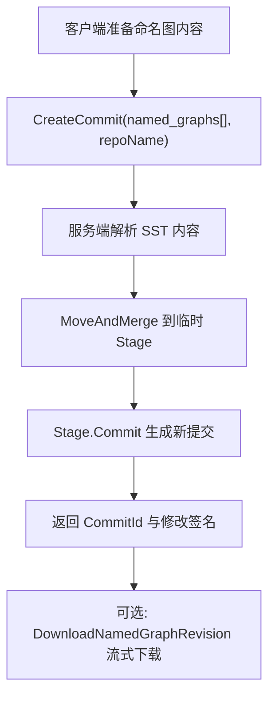
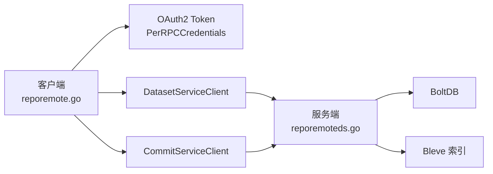

# 数据操作接口

<cite>
**本文引用的文件**
- [repository.proto](file://bboltproto/repository.proto)
- [repository_grpc.pb.go](file://bboltproto/repository_grpc.pb.go)
- [reporemote.go](file://sst/reporemote.go)
- [reporemoteds.go](file://sst/reporemoteds.go)
- [reporemotecommit.go](file://sst/reporemotecommit.go)
- [dataset.go](file://sst/dataset.go)
- [namedgraph.go](file://sst/namedgraph.go)
- [commit.go](file://sst/commit.go)
</cite>

## 目录
1. [简介](#简介)
2. [项目结构](#项目结构)
3. [核心组件](#核心组件)
4. [架构总览](#架构总览)
5. [详细组件分析](#详细组件分析)
6. [依赖关系分析](#依赖关系分析)
7. [性能考虑](#性能考虑)
8. [故障排查指南](#故障排查指南)
9. [结论](#结论)
10. [附录：分页、流式与批量示例路径](#附录：分页流式与批量示例路径)

## 简介
本文件面向远程仓库的数据操作，系统性说明基于 gRPC 的客户端与服务端实现，覆盖数据集操作（ListDatasets、GetDataset）、提交历史查询（CommitDetails 批量获取、分支信息、合并历史）、命名图操作的远程实现（三元组的增删改查与网络传输优化），并给出分页处理、流式传输和批量操作的代码路径参考。最后提供性能优化建议，包括请求缓存、连接复用与错误重试策略。

## 项目结构
- 协议定义位于 bboltproto/repository.proto，定义了 DatasetService、CommitService、RefService 等 RPC 服务及消息类型，涵盖数据集列表、获取、同步、文档、命名图版本下载、提交详情批量获取等能力。
- 服务端实现位于 sst/reporemoteds.go（DatasetService）与 sst/reporemotecommit.go（CommitService）。
- 客户端封装位于 sst/reporemote.go，提供 remoteRepository、remoteDataset 等对象，统一封装认证、分页、流式调用与本地缓存。
- 领域模型与接口定义位于 sst/dataset.go、sst/namedgraph.go、sst/commit.go。

图表来源
- [repository.proto:88-131](file://bboltproto/repository.proto#L88-L131)
- [repository_grpc.pb.go:23-48](file://bboltproto/repository_grpc.pb.go#L23-L48)
- [reporemote.go:88-99](file://sst/reporemote.go#L88-L99)
- [reporemoteds.go:39-47](file://sst/reporemoteds.go#L39-L47)
- [reporemotecommit.go:22-26](file://sst/reporemotecommit.go#L22-L26)

章节来源
- [repository.proto:88-131](file://bboltproto/repository.proto#L88-L131)
- [reporemote.go:88-99](file://sst/reporemote.go#L88-L99)
- [reporemoteds.go:39-47](file://sst/reporemoteds.go#L39-L47)
- [reporemotecommit.go:22-26](file://sst/reporemotecommit.go#L22-L26)

## 核心组件
- 客户端连接与状态管理：remoteRepository 维护 gRPC 连接、客户端实例、请求缓存与索引客户端；提供进入/离开状态控制，确保并发安全。
- 数据集访问：remoteDataset 封装数据集级别的分支、叶子提交、共同祖先、修订到提交的映射等远程调用。
- 提交详情批量获取：通过 CommitService.GetCommitDetailsBatch 一次性拉取多个提交的详细信息，减少往返次数。
- 命名图下载：DownloadNamedGraphRevision 以流式方式分块返回命名图内容，降低内存占用。
- 同步：SyncFrom/SyncTo 支持双向流式同步，按桶粒度传输数据，支持过滤指定数据集与分支。

章节来源
- [reporemote.go:88-99](file://sst/reporemote.go#L88-L99)
- [reporemote.go:296-347](file://sst/reporemote.go#L296-L347)
- [reporemote.go:546-637](file://sst/reporemote.go#L546-L637)
- [reporemoteds.go:407-452](file://sst/reporemoteds.go#L407-L452)
- [reporemoteds.go:807-982](file://sst/reporemoteds.go#L807-L982)

## 架构总览
下图展示了从客户端发起数据集列表、获取单个数据集、批量获取提交详情、以及命名图下载的端到端流程。

图表来源
- [reporemote.go:296-347](file://sst/reporemote.go#L296-L347)
- [reporemote.go:470-536](file://sst/reporemote.go#L470-L536)
- [reporemote.go:546-637](file://sst/reporemote.go#L546-L637)
- [reporemoteds.go:670-751](file://sst/reporemoteds.go#L670-L751)
- [reporemoteds.go:753-786](file://sst/reporemoteds.go#L753-L786)
- [reporemoteds.go:407-452](file://sst/reporemoteds.go#L407-L452)
- [reporemotecommit.go:247-279](file://sst/reporemotecommit.go#L247-L279)

## 详细组件分析

### 数据集操作：ListDatasets、GetDataset
- ListDatasets
  - 客户端使用分页参数 page_size/page_token 循环拉取，直到 next_page_token 为空。
  - 支持 FieldMask 控制返回字段（如屏蔽 UUID/IRI）。
  - 服务端在 BoltDB 中按游标遍历，限制最大页大小，生成下一页 token。
- GetDataset
  - 客户端使用流式 RPC，发送一次请求后 CloseAndRecv 获取结果。
  - 服务端根据 dataset_uuid 查找数据集，按 FieldMask 返回 UUID/IRI。

图表来源
- [reporemote.go:296-347](file://sst/reporemote.go#L296-L347)
- [reporemoteds.go:670-751](file://sst/reporemoteds.go#L670-L751)

章节来源
- [reporemote.go:296-347](file://sst/reporemote.go#L296-L347)
- [reporemote.go:349-407](file://sst/reporemote.go#L349-L407)
- [reporemote.go:470-536](file://sst/reporemote.go#L470-L536)
- [reporemoteds.go:670-751](file://sst/reporemoteds.go#L670-L751)
- [reporemoteds.go:753-786](file://sst/reporemoteds.go#L753-L786)

### 提交历史查询：CommitDetails 批量获取、分支信息与合并历史
- 批量获取提交详情
  - 客户端构造 GetCommitDetailsBatchRequest，包含 commit_ids[] 与 repoName。
  - 服务端将 CommitDetails 转换为 proto 消息返回，包含作者、时间、父提交、数据集/命名图修订映射。
- 分支信息
  - 客户端通过 remoteDataset.Branches() 调用 GetBranches，返回分支名到提交哈希的映射。
- 合并历史
  - FindCommonParentRevision 用于计算两个修订的共同祖先，支持三路差异与合并。
  - CommitForRevision 可将数据集修订映射回创建它的提交哈希。

图表来源
- [reporemote.go:679-732](file://sst/reporemote.go#L679-L732)
- [reporemote.go:741-776](file://sst/reporemote.go#L741-L776)
- [reporemoteds.go:454-507](file://sst/reporemoteds.go#L454-L507)
- [reporemoteds.go:509-543](file://sst/reporemoteds.go#L509-L543)
- [reporemotecommit.go:247-279](file://sst/reporemotecommit.go#L247-L279)

章节来源
- [reporemote.go:546-637](file://sst/reporemote.go#L546-L637)
- [reporemote.go:679-732](file://sst/reporemote.go#L679-L732)
- [reporemote.go:741-776](file://sst/reporemote.go#L741-L776)
- [reporemoteds.go:454-507](file://sst/reporemoteds.go#L454-L507)
- [reporemoteds.go:509-543](file://sst/reporemoteds.go#L509-L543)
- [reporemotecommit.go:247-279](file://sst/reporemotecommit.go#L247-L279)
- [commit.go:18-29](file://sst/commit.go#L18-L29)

### 命名图操作：三元组增删改查与网络传输优化
- 三元组增删改查
  - 在 Stage 中对 NamedGraph 进行 AddStatement/RemoveStatement 等操作，最终通过 CreateCommit 提交。
  - 服务端 CreateCommit 接收命名图内容，解析为 SST 格式，执行 MoveAndMerge 并 Commit，返回新提交 ID 与变更签名。
- 网络传输优化
  - DownloadNamedGraphRevision 以固定大小的 chunk 流式返回，避免大对象一次性加载。
  - FetchDatasets/PushDatasets 支持双向流式，按需拉取或推送数据集对象，减少带宽与内存压力。
  - SyncFrom/SyncTo 按桶粒度流式传输，支持按数据集与分支过滤，提升同步效率。

图表来源
- [reporemotecommit.go:57-212](file://sst/reporemotecommit.go#L57-L212)
- [reporemoteds.go:407-452](file://sst/reporemoteds.go#L407-L452)
- [reporemoteds.go:798-805](file://sst/reporemoteds.go#L798-L805)
- [reporemoteds.go:807-982](file://sst/reporemoteds.go#L807-L982)

章节来源
- [reporemotecommit.go:57-212](file://sst/reporemotecommit.go#L57-L212)
- [reporemoteds.go:407-452](file://sst/reporemoteds.go#L407-L452)
- [reporemoteds.go:798-805](file://sst/reporemoteds.go#L798-L805)
- [reporemoteds.go:807-982](file://sst/reporemoteds.go#L807-L982)
- [namedgraph.go:222-235](file://sst/namedgraph.go#L222-L235)

### 分页、流式与批量操作要点
- 分页
  - ListDatasets/ListRefs/ListCommits 均支持 page_size/page_token/next_page_token。
  - 服务端对 page_size 做上限限制，防止过大负载。
- 流式
  - GetDataset、Document、DownloadNamedGraphRevision、FetchDatasets、PushDatasets、SyncFrom、SyncTo 均为流式 RPC。
  - 客户端使用 stream.SendMsg/CloseAndRecv 或 Recv 循环读取。
- 批量
  - GetCommitDetailsBatch 支持一次性获取多个提交详情，显著减少往返。
  - CompareCommits 支持多对提交比较，压缩响应。

章节来源
- [repository.proto:215-237](file://bboltproto/repository.proto#L215-L237)
- [repository.proto:397-424](file://bboltproto/repository.proto#L397-L424)
- [repository.proto:460-480](file://bboltproto/repository.proto#L460-L480)
- [repository.proto:528-547](file://bboltproto/repository.proto#L528-L547)
- [reporemote.go:296-347](file://sst/reporemote.go#L296-L347)
- [reporemoteds.go:670-751](file://sst/reporemoteds.go#L670-L751)
- [reporemotecommit.go:247-279](file://sst/reporemotecommit.go#L247-L279)

## 依赖关系分析
- 客户端依赖
  - gRPC 客户端：DatasetServiceClient、CommitServiceClient、IndexServiceClient。
  - 认证：从 Context 提取 OAuth2 Token，附加到 PerRPCCredentials。
  - 缓存：请求级缓存（如 GetDataset 的请求消息缓存）以减少重复编码。
- 服务端依赖
  - 存储：BoltDB 桶（ngr、dsr、c、ds、document_info）。
  - 索引：Bleve 异步更新，必要时 FlushBleveIndex 保证可见性。
  - 权限：基于 JWT 的角色与资源访问控制，支持 per-repo 授权。

图表来源
- [reporemote.go:146-207](file://sst/reporemote.go#L146-L207)
- [reporemote.go:264-285](file://sst/reporemote.go#L264-L285)
- [reporemoteds.go:71-132](file://sst/reporemoteds.go#L71-L132)
- [reporemoteds.go:899-908](file://sst/reporemoteds.go#L899-L908)

章节来源
- [reporemote.go:146-207](file://sst/reporemote.go#L146-L207)
- [reporemote.go:264-285](file://sst/reporemote.go#L264-L285)
- [reporemoteds.go:71-132](file://sst/reporemoteds.go#L71-L132)
- [reporemoteds.go:899-908](file://sst/reporemoteds.go#L899-L908)

## 性能考虑
- 请求缓存
  - 客户端对 GetDataset 的请求消息进行缓存，避免重复序列化与发送。
  - 建议在高频小请求场景启用请求级缓存，注意失效策略。
- 连接复用
  - 使用 grpc.NewClient 建立长连接，复用连接池，减少握手开销。
  - 合理配置连接数与超时，避免连接泄漏。
- 错误重试策略
  - 对幂等读操作（ListDatasets、GetCommitDetailsBatch）可实施指数退避重试。
  - 写操作（CreateCommit、DocumentSet）需谨慎重试，结合事务与幂等键。
- 流式与批量化
  - 优先使用流式 RPC（DownloadNamedGraphRevision、SyncFrom/SyncTo）降低内存峰值。
  - 批量接口（GetCommitDetailsBatch、CompareCommits）减少往返次数。
- 索引与可见性
  - 写操作后调用 FlushBleveIndex 确保索引一致性与可见性。
  - 同步完成后按需触发增量索引更新。

章节来源
- [reporemote.go:493-507](file://sst/reporemote.go#L493-L507)
- [reporemote.go:264-285](file://sst/reporemote.go#L264-L285)
- [reporemoteds.go:591-596](file://sst/reporemoteds.go#L591-L596)
- [reporemoteds.go:625-628](file://sst/reporemoteds.go#L625-L628)
- [reporemoteds.go:899-908](file://sst/reporemoteds.go#L899-L908)

## 故障排查指南
- 常见错误码
  - NotFound：数据集/修订/文档不存在。
  - Unauthenticated：缺少或无效授权头。
  - ResourceExhausted：配额超限。
  - Internal：内部错误（如存储读取失败）。
- 定位步骤
  - 检查上下文中的认证信息是否正确注入。
  - 确认 repoName 与数据集/分支是否存在。
  - 查看服务端日志，核对 Bucket 名称与键值。
  - 对于流式 RPC，确认客户端正确读取 EOF 与错误。
- 典型问题
  - 分页 token 解码失败：检查 base64 编码与协议版本一致性。
  - 索引不一致：写操作后未刷新索引导致查询延迟。
  - 大对象传输失败：调整 chunk 大小或增加超时。

章节来源
- [reporemoteds.go:134-156](file://sst/reporemoteds.go#L134-L156)
- [reporemoteds.go:223-272](file://sst/reporemoteds.go#L223-L272)
- [reporemoteds.go:274-354](file://sst/reporemoteds.go#L274-L354)
- [reporemoteds.go:356-405](file://sst/reporemoteds.go#L356-L405)
- [reporemoteds.go:407-452](file://sst/reporemoteds.go#L407-L452)

## 结论
该远程仓库数据操作方案通过 gRPC 提供了高效、可扩展的数据集与提交管理能力。借助分页、流式与批量接口，系统在处理大规模 RDF 数据时具备良好的吞吐与稳定性。配合请求缓存、连接复用与合理的重试策略，可进一步提升性能与鲁棒性。

## 附录：分页、流式与批量示例路径
- 分页
  - 客户端：[reporemote.go:296-347](file://sst/reporemote.go#L296-L347)
  - 服务端：[reporemoteds.go:670-751](file://sst/reporemoteds.go#L670-L751)
- 流式
  - GetDataset：[reporemote.go:470-536](file://sst/reporemote.go#L470-L536)，[reporemoteds.go:753-786](file://sst/reporemoteds.go#L753-L786)
  - DownloadNamedGraphRevision：[reporemoteds.go:407-452](file://sst/reporemoteds.go#L407-L452)
  - SyncFrom/SyncTo：[reporemoteds.go:807-982](file://sst/reporemoteds.go#L807-L982)
- 批量
  - GetCommitDetailsBatch：[reporemote.go:546-637](file://sst/reporemote.go#L546-L637)，[reporemotecommit.go:247-279](file://sst/reporemotecommit.go#L247-L279)
  - CompareCommits：[reporemotecommit.go:214-245](file://sst/reporemotecommit.go#L214-L245)