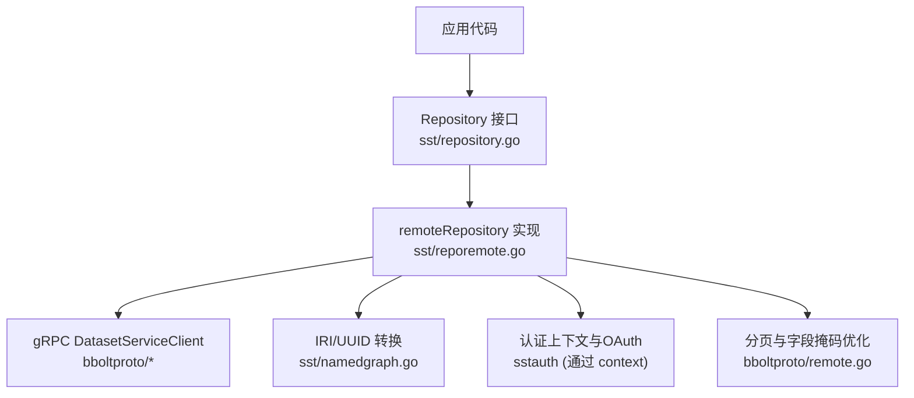
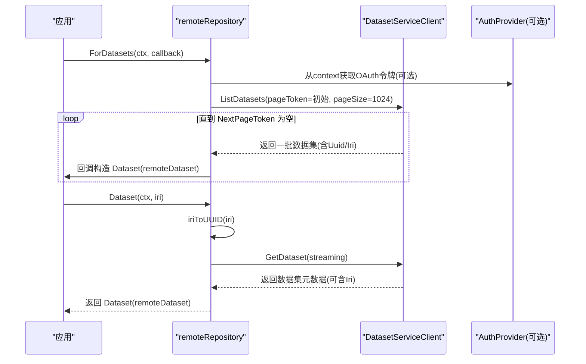
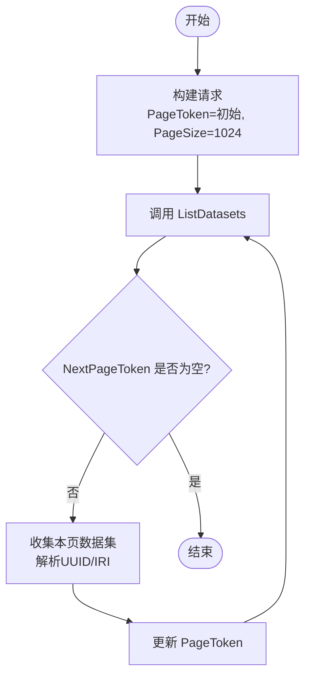
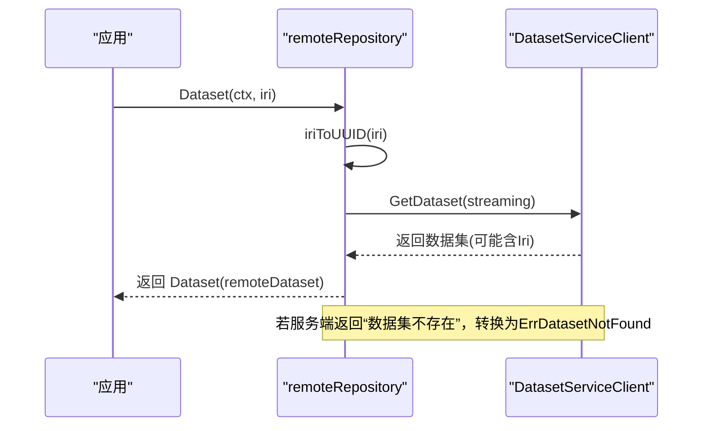
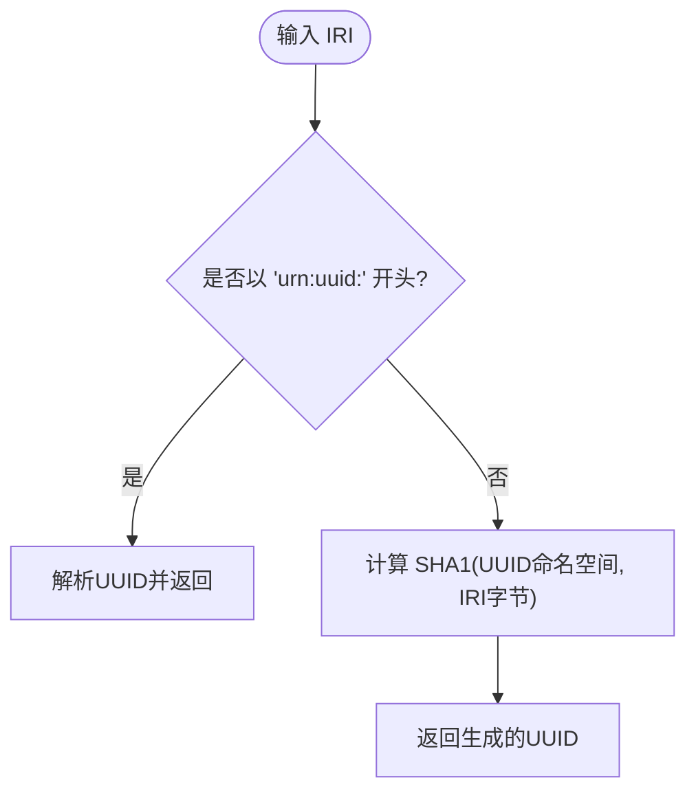
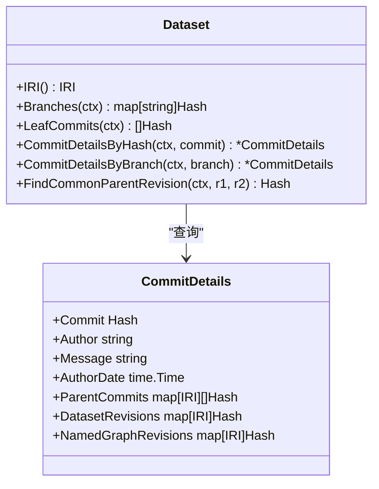
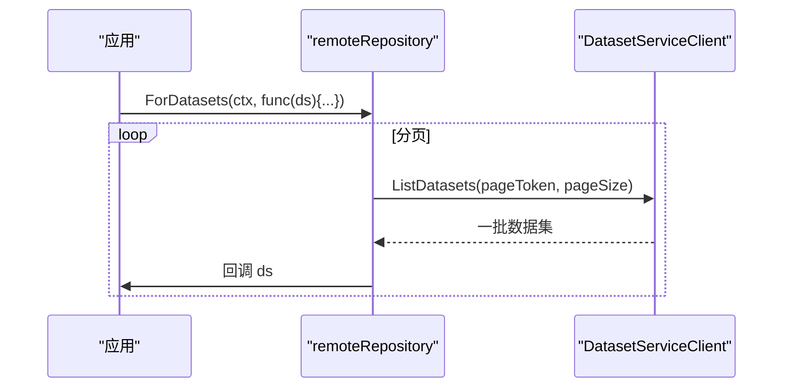
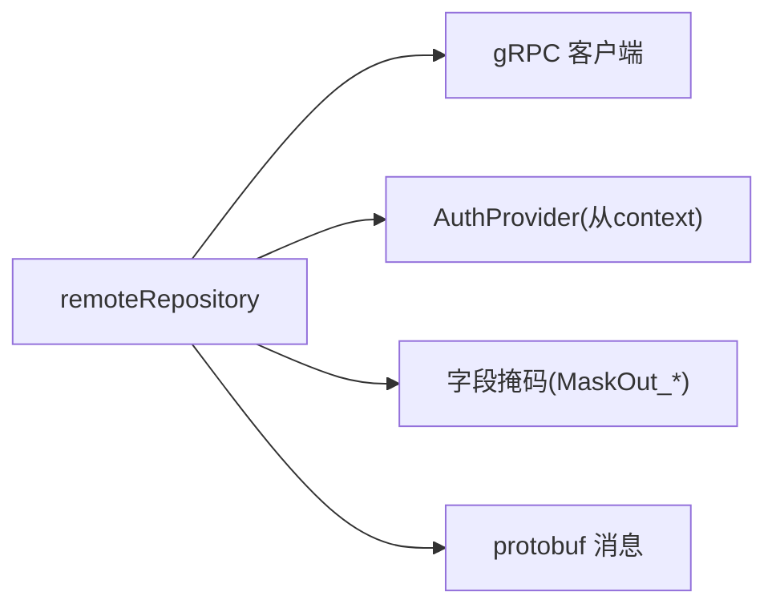

# 数据集操作

<cite>
**本文引用的文件**
- [dataset.go](file://sst/dataset.go)
- [reporemote.go](file://sst/reporemote.go)
- [repository.go](file://sst/repository.go)
- [namedgraph.go](file://sst/namedgraph.go)
- [stage.go](file://sst/stage.go)
- [remote.go](file://bboltproto/remote.go)
- [repository.pb.go](file://bboltproto/repository.pb.go)
</cite>

## 目录
1. [简介](#简介)
2. [项目结构](#项目结构)
3. [核心组件](#核心组件)
4. [架构总览](#架构总览)
5. [详细组件分析](#详细组件分析)
6. [依赖关系分析](#依赖关系分析)
7. [性能考虑](#性能考虑)
8. [故障排查指南](#故障排查指南)
9. [结论](#结论)
10. [附录：代码示例路径与最佳实践](#附录代码示例路径与最佳实践)

## 简介
本文件面向远程仓库的数据集操作，系统性说明以下能力：
- 数据集的CRUD访问模式（列举、精确获取、按IRI查找）
- ListDatasets分页查询、GetDataset流式获取、DatasetByID精确查找等核心方法
- 数据集ID与IRI的转换机制，UUID到URN格式的映射规则
- 数据集元数据管理（命名图关联、版本信息、引用关系）
- 完整的使用流程与错误处理策略（数据集不存在、权限不足等）

## 项目结构
围绕远程仓库的数据集操作，主要涉及以下模块：
- sst 包：定义 Repository/Dataset 接口及远程实现、IRI/UUID 转换、Stage 管理等
- bboltproto 包：gRPC 协议消息与客户端封装，提供 ListDatasets、GetDataset 等 RPC 调用
- 其他辅助：认证上下文、字段掩码优化、日志与错误包装

图表来源
- [repository.go:34-128](file://sst/repository.go#L34-L128)
- [reporemote.go:88-100](file://sst/reporemote.go#L88-L100)
- [remote.go:26-37](file://bboltproto/remote.go#L26-L37)
- [namedgraph.go:729-739](file://sst/namedgraph.go#L729-L739)

章节来源
- [repository.go:34-128](file://sst/repository.go#L34-L128)
- [reporemote.go:88-100](file://sst/reporemote.go#L88-L100)
- [remote.go:26-37](file://bboltproto/remote.go#L26-L37)
- [namedgraph.go:729-739](file://sst/namedgraph.go#L729-L739)

## 核心组件
- Repository 接口：统一抽象本地/远程仓库能力，包含 ForDatasets、Datasets、Dataset、CommitDetails、CheckoutCommit 等
- remoteRepository：远程仓库实现，封装 gRPC 客户端、认证、分页、缓存与错误处理
- Dataset 接口：描述单个数据集的分支、提交、检出等操作
- iriToUUID：将 IRI 转换为内部 UUID（支持 urn:uuid 直接解析或基于 URL 命名空间的 SHA1 生成）
- 字段掩码与分页：ListDatasets 使用 PageToken/PageSize 分页；MaskOut_Uuid/Iri 减少网络传输

章节来源
- [repository.go:34-128](file://sst/repository.go#L34-L128)
- [reporemote.go:287-468](file://sst/reporemote.go#L287-L468)
- [dataset.go:30-94](file://sst/dataset.go#L30-L94)
- [namedgraph.go:729-739](file://sst/namedgraph.go#L729-L739)
- [remote.go:26-37](file://bboltproto/remote.go#L26-L37)

## 架构总览
远程仓库数据集操作的端到端流程如下：

图表来源
- [reporemote.go:287-468](file://sst/reporemote.go#L287-L468)
- [reporemote.go:470-544](file://sst/reporemote.go#L470-L544)
- [remote.go:26-37](file://bboltproto/remote.go#L26-L37)
- [namedgraph.go:729-739](file://sst/namedgraph.go#L729-L739)

## 详细组件分析

### 数据集列举与分页（ListDatasets）
- 入口：Repository.Datasets / ForDatasets
- 行为：
  - 构造 ListDatasetsRequest，设置 PageSize=1024，使用 MaskOut_Uuid/MaskOut_Iri 按需屏蔽字段以减少带宽
  - 循环读取 NextPageToken，直至为空，聚合所有页
  - 对每个数据集项：
    - 若返回 IRI，则直接使用并去除尾部 #
    - 若未返回 IRI，则根据 UUID 构造默认 IRI（urn:uuid:<uuid>#）
- 输出：
  - Datasets() 返回 []IRI
  - ForDatasets() 以回调方式逐个交付 Dataset 实例（remoteDataset），便于批量处理

图表来源
- [reporemote.go:287-407](file://sst/reporemote.go#L287-L407)
- [reporemote.go:409-468](file://sst/reporemote.go#L409-L468)
- [remote.go:26-37](file://bboltproto/remote.go#L26-L37)

章节来源
- [reporemote.go:287-468](file://sst/reporemote.go#L287-L468)
- [remote.go:26-37](file://bboltproto/remote.go#L26-L37)

### 按IRI精确获取数据集（DatasetByID 与 Dataset）
- 入口：Repository.Dataset(ctx, iri)
- 行为：
  - 将 IRI 转换为 UUID（iriToUUID）
  - 通过 GetDataset 流式接口获取数据集元数据
  - 若响应包含 IRI，则保留；否则后续 IRI() 会回退为 urn:uuid:<uuid>#
- 错误处理：
  - 当服务端返回“未知”状态且消息匹配“数据集不存在”时，转换为 ErrDatasetNotFound

图表来源
- [reporemote.go:470-544](file://sst/reporemote.go#L470-L544)
- [namedgraph.go:729-739](file://sst/namedgraph.go#L729-L739)

章节来源
- [reporemote.go:470-544](file://sst/reporemote.go#L470-L544)
- [namedgraph.go:729-739](file://sst/namedgraph.go#L729-L739)

### 数据集ID与IRI的转换机制
- 规则：
  - 若 IRI 形如 urn:uuid:<uuid>，直接解析出 UUID
  - 否则，使用 uuid.NewSHA1(uuid.NameSpaceURL, []byte(IRI)) 生成确定性 UUID
- 作用：
  - 保证同一 IRI 始终映射到相同 UUID，便于存储与索引
  - 在缺少 IRI 的场景下，可通过 UUID 构造默认 IRI（urn:uuid:<uuid>#）

图表来源
- [namedgraph.go:729-739](file://sst/namedgraph.go#L729-L739)

章节来源
- [namedgraph.go:729-739](file://sst/namedgraph.go#L729-L739)

### 数据集元数据管理（命名图关联、版本信息与引用关系）
- 命名图关联：
  - Dataset.IRI() 返回默认命名图的 IRI；若无 IRI，则回退为 urn:uuid:<uuid>#
- 版本信息：
  - Branches() 返回分支名到提交哈希的映射
  - LeafCommits() 返回非分支标识的叶子提交
  - CommitDetailsByHash/Branch() 获取指定提交详情
  - FindCommonParentRevision() 用于三路差异与合并的公共祖先查找
- 引用关系：
  - CommitDetails 中包含 DatasetRevisions、NamedGraphRevisions、ParentCommits 等映射，体现数据集与命名图的版本关系以及父提交链

图表来源
- [dataset.go:30-94](file://sst/dataset.go#L30-L94)
- [reporemote.go:546-637](file://sst/reporemote.go#L546-L637)

章节来源
- [dataset.go:30-94](file://sst/dataset.go#L30-L94)
- [reporemote.go:546-637](file://sst/reporemote.go#L546-L637)

### 流式获取与批处理
- 流式获取：
  - GetDataset 使用 gRPC 流式接口，先发送一次请求后 CloseAndRecv 接收结果，适合单次精确获取
- 批处理：
  - ForDatasets 以回调形式遍历所有数据集，结合分页与字段掩码，适合批量枚举与处理

图表来源
- [reporemote.go:409-468](file://sst/reporemote.go#L409-L468)

章节来源
- [reporemote.go:409-468](file://sst/reporemote.go#L409-L468)

## 依赖关系分析
- 远程仓库实现依赖：
  - gRPC 客户端：DatasetServiceClient、CommitServiceClient、IndexServiceClient
  - 认证：从 context 中获取 OAuth2 Token，附加到每次 RPC 调用
  - 字段掩码：MaskOut_Uuid/MaskOut_Iri 减少不必要字段传输
  - 错误包装：wrapError 增加堆栈信息，便于定位问题
- 外部协议：
  - repository.proto 生成的 pb 消息定义了 ListDatasets、GetDataset、GetCommitDetailsBatch 等接口

图表来源
- [reporemote.go:88-100](file://sst/reporemote.go#L88-L100)
- [reporemote.go:287-468](file://sst/reporemote.go#L287-L468)
- [remote.go:26-37](file://bboltproto/remote.go#L26-L37)
- [repository.pb.go:22-52](file://bboltproto/repository.pb.go#L22-L52)

章节来源
- [reporemote.go:88-100](file://sst/reporemote.go#L88-L100)
- [reporemote.go:287-468](file://sst/reporemote.go#L287-L468)
- [remote.go:26-37](file://bboltproto/remote.go#L26-L37)
- [repository.pb.go:22-52](file://bboltproto/repository.pb.go#L22-L52)

## 性能考虑
- 分页大小：ListDatasets 默认 PageSize=1024，可根据网络与内存情况调整
- 字段掩码：使用 MaskOut_Uuid/MaskOut_Iri 避免传输冗余字段，降低带宽与序列化开销
- 流式接口：GetDataset 使用流式调用，减少一次性大对象传输
- 认证开销：仅在必要时从 context 提取 Token 并附加到每调用，避免重复计算
- 错误包装：wrapError 增加调试信息，但注意在生产环境控制日志级别

[本节为通用指导，不直接分析具体文件]

## 故障排查指南
常见错误与处理建议：
- 数据集不存在：
  - 现象：GetDataset 返回未知状态且消息匹配“数据集不存在”
  - 处理：捕获 ErrDatasetNotFound，进行降级或提示用户
- 权限不足：
  - 现象：gRPC 调用失败（例如鉴权错误）
  - 处理：检查 context 中的 AuthProvider 是否正确注入，确认 Token 有效
- 仓库关闭或阶段过期：
  - 现象：enter() 检查失败返回 ErrRepoClosed 或 ErrStageExpired
  - 处理：确保 Repository 处于打开状态，避免并发关闭导致竞争
- 分页异常：
  - 现象：NextPageToken 不为空但未继续拉取
  - 处理：检查循环条件与 PageToken 更新逻辑

章节来源
- [reporemote.go:470-544](file://sst/reporemote.go#L470-L544)
- [reporemote.go:109-124](file://sst/reporemote.go#L109-L124)
- [reporemote.go:51-61](file://sst/reporemote.go#L51-L61)

## 结论
远程仓库的数据集操作通过统一的 Repository/Dataset 接口暴露，底层由 gRPC 驱动，具备分页、流式、字段掩码等优化。IRI 与 UUID 的确定映射保证了跨系统的一致性。借助分支、提交与引用关系，可实现完整的版本管理与变更追踪。配合完善的错误处理与认证机制，可在生产环境中稳定运行。

[本节为总结性内容，不直接分析具体文件]

## 附录：代码示例路径与最佳实践
以下为常用操作的参考路径（不包含具体代码内容）：
- 枚举所有数据集（分页）：
  - 参考：[reporemote.go:287-407](file://sst/reporemote.go#L287-L407)、[reporemote.go:409-468](file://sst/reporemote.go#L409-L468)
- 按条件过滤数据集：
  - 在 ForDatasets 回调中对 IRI/UUID 进行筛选，或使用上层业务层过滤
  - 参考：[reporemote.go:409-468](file://sst/reporemote.go#L409-L468)
- 批量处理数据集：
  - 使用 ForDatasets 回调逐条处理，结合分页与字段掩码提升吞吐
  - 参考：[reporemote.go:409-468](file://sst/reporemote.go#L409-L468)
- 精确查找数据集（按IRI）：
  - 参考：[reporemote.go:538-544](file://sst/reporemote.go#L538-L544)、[namedgraph.go:729-739](file://sst/namedgraph.go#L729-L739)
- 获取数据集元数据（分支、提交、引用）：
  - 参考：[dataset.go:30-94](file://sst/dataset.go#L30-L94)、[reporemote.go:546-637](file://sst/reporemote.go#L546-L637)
- 错误处理策略：
  - 数据集不存在：[reporemote.go:515-527](file://sst/reporemote.go#L515-L527)
  - 权限不足：检查 context 中的 AuthProvider 与 Token
  - 仓库关闭：[reporemote.go:109-124](file://sst/reporemote.go#L109-L124)

[本节为指引性内容，不直接分析具体文件]