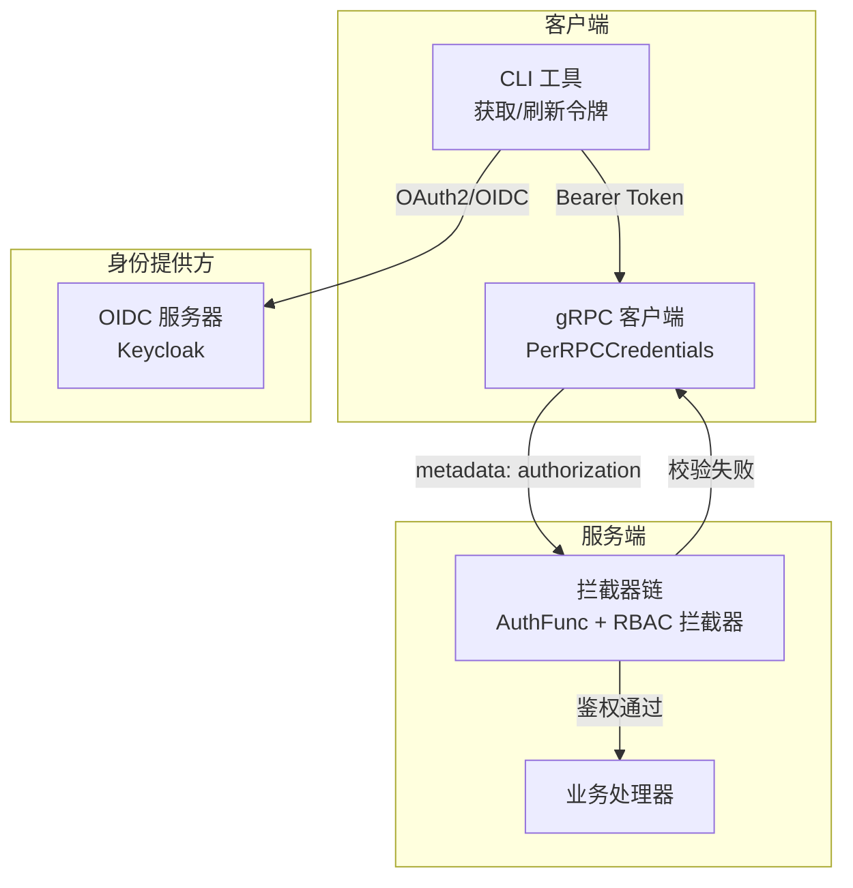
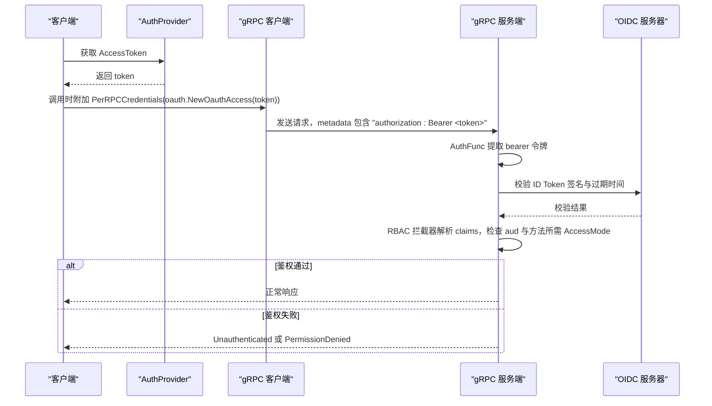
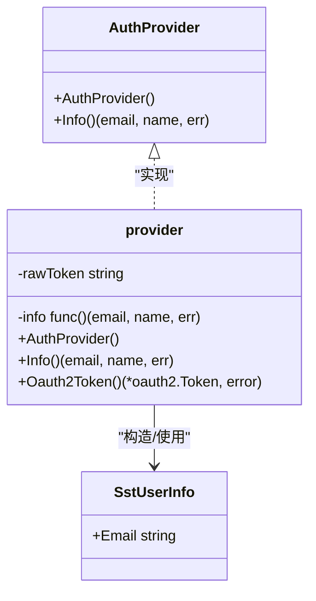
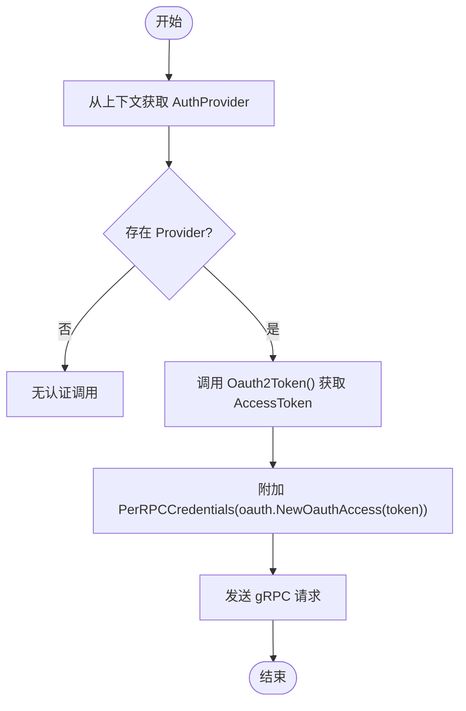
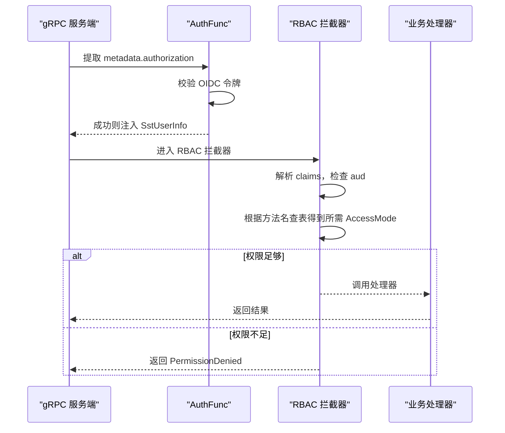
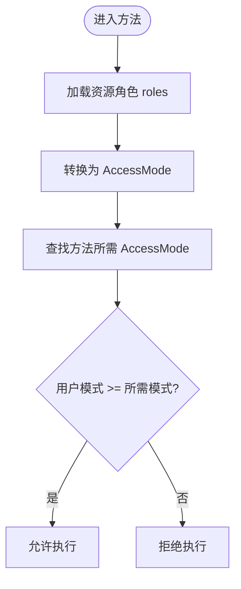
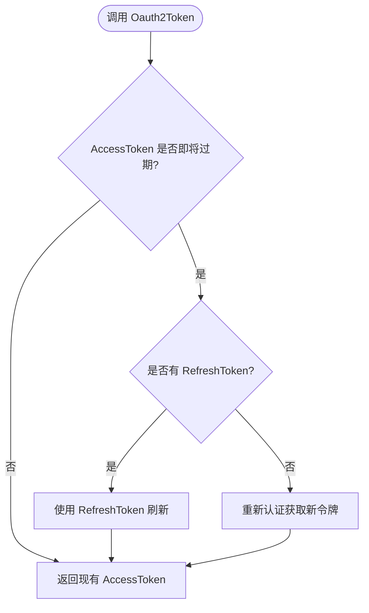
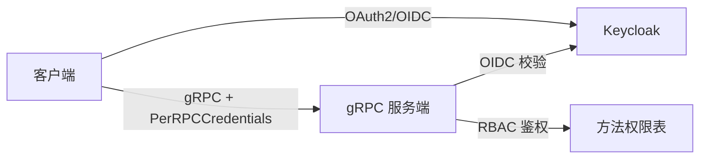

# 认证授权机制

<cite>
**本文引用的文件**
- [auth.go](file://sstauth/auth.go)
- [accessmode.go](file://sstauth/accessmode.go)
- [authoids.go](file://sstauth/authoids.go)
- [ACCESS_RIGHTS.md](file://sstauth/ACCESS_RIGHTS.md)
- [reporemote.go](file://sst/reporemote.go)
- [reporemoteapp.go](file://sst/reporemoteapp.go)
- [gettoken.go](file://cli/cmd/utils/gettoken.go)
- [testauth.go](file://sst_test/testutil/testauth.go)
- [oidc_provider.go](file://sst_test/testutil/oidc_provider.go)
</cite>

## 目录
1. [简介](#简介)
2. [项目结构](#项目结构)
3. [核心组件](#核心组件)
4. [架构总览](#架构总览)
5. [详细组件分析](#详细组件分析)
6. [依赖关系分析](#依赖关系分析)
7. [性能考量](#性能考量)
8. [故障排查指南](#故障排查指南)
9. [结论](#结论)
10. [附录](#附录)

## 简介
本文件系统性说明 SST 在远程仓库场景下的认证与授权机制，重点覆盖：
- OAuth2/OIDC 认证流程在 gRPC 调用中的集成方式（AccessToken 获取、传递与校验）
- AuthProvider 接口设计与实现，上下文中的认证信息提取与 PerRPCCredentials 配置
- 细粒度访问控制模型（读取、写入、删除等操作的权限验证）
- 认证配置示例（令牌刷新、会话管理、安全最佳实践）
- 常见认证错误的诊断与解决方案

## 项目结构
认证授权相关代码主要分布在以下模块：
- sstauth：认证与授权的核心库，包含 OIDC 校验、RBAC 拦截器、访问模式定义、上下文工具等
- sst：gRPC 客户端与服务端集成，负责将 AccessToken 注入到每次 RPC 调用，并装配拦截器链
- cli/cmd/utils：命令行工具的令牌获取与刷新逻辑
- sst_test/testutil：测试用 OIDC 提供者、证书与测试 Provider

图表来源
- [reporemote.go:150-166](file://sst/reporemote.go#L150-L166)
- [reporemoteapp.go:456-529](file://sst/reporemoteapp.go#L456-L529)
- [authoids.go:71-92](file://sstauth/authoids.go#L71-L92)

章节来源
- [reporemote.go:150-166](file://sst/reporemote.go#L150-L166)
- [reporemoteapp.go:456-529](file://sst/reporemoteapp.go#L456-L529)
- [authoids.go:71-92](file://sstauth/authoids.go#L71-L92)

## 核心组件
- AuthProvider 接口：抽象认证提供者，提供 Info() 与 Oauth2Token()，用于从上下文获取当前用户信息与访问令牌
- OIDC 校验与缓存：基于 go-oidc 的 ID Token 校验，带 LRU 缓存与周期性更新
- RBAC 拦截器：UnaryRBACInterceptor 与 StreamRBACInterceptor，完成令牌解析、签名校验、受众（aud）检查与方法级角色校验
- 访问模式 AccessMode：None < ReadOnly < ReadWrite < Admin < SuperAdmin，支持字符串解析与比较
- 上下文工具：ContextWithSstUserInfo / SstUserInfoFromContext / ContextWithAuthProvider / AuthProviderFromContext
- 客户端注入：在每次 gRPC 调用前，从上下文取出 Provider 并附加 oauth.NewOauthAccess(token) 作为 PerRPCCredentials

章节来源
- [auth.go:9-52](file://sstauth/auth.go#L9-L52)
- [authoids.go:206-288](file://sstauth/authoids.go#L206-L288)
- [authoids.go:375-510](file://sstauth/authoids.go#L375-L510)
- [accessmode.go:7-129](file://sstauth/accessmode.go#L7-L129)
- [reporemote.go:150-166](file://sst/reporemote.go#L150-L166)

## 架构总览
下图展示了从客户端发起 gRPC 调用到服务端鉴权的完整链路。

图表来源
- [reporemote.go:150-166](file://sst/reporemote.go#L150-L166)
- [authoids.go:71-92](file://sstauth/authoids.go#L71-L92)
- [authoids.go:268-288](file://sstauth/authoids.go#L268-L288)
- [authoids.go:375-423](file://sstauth/authoids.go#L375-L423)

## 详细组件分析

### AuthProvider 接口与上下文
- AuthProvider 接口定义了获取用户信息与 OAuth2 Token 的能力，便于在不同认证后端间切换
- 通过 ContextWithSstUserInfo 与 SstUserInfoFromContext 在上下文中传递已认证的用户信息（如邮箱）
- 通过 ContextWithAuthProvider 与 AuthProviderFromContext 在上下文中传递认证提供者，供客户端在发起 RPC 时动态获取 Token

图表来源
- [auth.go:9-52](file://sstauth/auth.go#L9-L52)
- [authoids.go:94-106](file://sstauth/authoids.go#L94-L106)

章节来源
- [auth.go:9-52](file://sstauth/auth.go#L9-L52)
- [authoids.go:94-106](file://sstauth/authoids.go#L94-L106)

### gRPC 客户端中 AccessToken 的获取与传递
- 客户端在发起任何 gRPC 调用前，从上下文中取出 AuthProvider，并调用 Oauth2Token() 获取 AccessToken
- 使用 grpc.PerRPCCredentials(oauth.NewOauthAccess(token)) 将令牌以 Bearer 形式附加到请求 metadata
- 该模式适用于所有读写操作，确保服务端能正确识别调用者身份

图表来源
- [reporemote.go:150-166](file://sst/reporemote.go#L150-L166)
- [reporemote.go:313-322](file://sst/reporemote.go#L313-L322)
- [reporemote.go:367-376](file://sst/reporemote.go#L367-L376)

章节来源
- [reporemote.go:150-166](file://sst/reporemote.go#L150-L166)
- [reporemote.go:313-322](file://sst/reporemote.go#L313-L322)
- [reporemote.go:367-376](file://sst/reporemote.go#L367-L376)

### 服务端认证与 RBAC 拦截器
- AuthFunc：从 gRPC metadata 中提取 Bearer 令牌，调用 OIDC 校验，并将用户信息放入上下文
- UnaryRBACInterceptor：对单请求进行鉴权，校验 aud 与方法所需 AccessMode
- StreamRBACInterceptor：对长连接流式请求进行初步鉴权，并在 handler 中通过 CheckRepoAccess 完成精确的 per-repo 鉴权
- 拦截器链顺序：状态转换 -> 日志/恢复 -> 认证 -> RBAC

图表来源
- [authoids.go:71-92](file://sstauth/authoids.go#L71-L92)
- [authoids.go:375-423](file://sstauth/authoids.go#L375-L423)
- [authoids.go:445-510](file://sstauth/authoids.go#L445-L510)
- [reporemoteapp.go:456-529](file://sst/reporemoteapp.go#L456-L529)

章节来源
- [authoids.go:71-92](file://sstauth/authoids.go#L71-L92)
- [authoids.go:375-423](file://sstauth/authoids.go#L375-L423)
- [authoids.go:445-510](file://sstauth/authoids.go#L445-L510)
- [reporemoteapp.go:456-529](file://sst/reporemoteapp.go#L456-L529)

### 细粒度访问控制模型
- 访问模式 AccessMode：None < ReadOnly < ReadWrite < Admin < SuperAdmin
- 角色映射：从 OIDC ID Token 的 resource_access.<clientID>.roles 中解析角色，并转换为最高 AccessMode
- 方法级权限表：repositoryMethodRoles 将每个 gRPC 方法与最低所需 AccessMode 绑定
- 两种授权模型：
  - PerRepoAuth = false：单仓库服务器，aud 必须等于配置的 ClientID
  - PerRepoAuth = true：SuperRepository 模式，管理方法使用 super client ID，其他方法使用 per-repo client ID（格式为 superClientID#repoName）

图表来源
- [accessmode.go:7-129](file://sstauth/accessmode.go#L7-L129)
- [reporemoteapp.go:41-97](file://sst/reporemoteapp.go#L41-L97)
- [ACCESS_RIGHTS.md:240-313](file://sstauth/ACCESS_RIGHTS.md#L240-L313)

章节来源
- [accessmode.go:7-129](file://sstauth/accessmode.go#L7-L129)
- [reporemoteapp.go:41-97](file://sst/reporemoteapp.go#L41-L97)
- [ACCESS_RIGHTS.md:240-313](file://sstauth/ACCESS_RIGHTS.md#L240-L313)

### 令牌刷新与会话管理
- 客户端侧刷新：refreshableProvider 在 AccessToken 即将过期时自动使用 RefreshToken 刷新；若无 RefreshToken 则重新认证
- 服务端侧缓存：tokenVerifierHolder 定期更新 OIDC Verifier，并使用 LRU 缓存 ID Token 以减少重复校验开销
- 服务账户模式：支持 clientcredentials 获取令牌，适合机器对机器访问

图表来源
- [gettoken.go:144-192](file://cli/cmd/utils/gettoken.go#L144-L192)
- [gettoken.go:217-241](file://cli/cmd/utils/gettoken.go#L217-L241)
- [authoids.go:26-33](file://sstauth/authoids.go#L26-L33)
- [authoids.go:533-560](file://sstauth/authoids.go#L533-L560)

章节来源
- [gettoken.go:144-192](file://cli/cmd/utils/gettoken.go#L144-L192)
- [gettoken.go:217-241](file://cli/cmd/utils/gettoken.go#L217-L241)
- [authoids.go:26-33](file://sstauth/authoids.go#L26-L33)
- [authoids.go:533-560](file://sstauth/authoids.go#L533-L560)

### 配置示例与安全最佳实践
- 单仓库服务器（PerRepoAuth = false）：Issuer 指向 Keycloak realm，ClientID 与 aud 一致；为客户端创建角色映射
- SuperRepository 服务器（PerRepoAuth = true）：super client ID 管理仓库，每个子仓库有独立 audience（superClientID#repoName）
- 安全建议：
  - 始终启用 TLS 传输加密
  - 使用最小权限原则分配角色
  - 合理设置令牌有效期与刷新策略
  - 在服务端启用 RBAC 与方法级权限控制
  - 避免在生产环境使用测试 Issuer

章节来源
- [ACCESS_RIGHTS.md:173-238](file://sstauth/ACCESS_RIGHTS.md#L173-L238)
- [reporemoteapp.go:456-529](file://sst/reporemoteapp.go#L456-L529)

## 依赖关系分析
- 客户端依赖：
  - sstauth.AuthProvider 接口与上下文工具
  - grpc.PerRPCCredentials 与 oauth.NewOauthAccess
- 服务端依赖：
  - sstauth.AuthFunc 与 RBAC 拦截器
  - go-oidc 的 ID Token 校验与缓存
  - repositoryMethodRoles 方法权限表
- 外部依赖：
  - Keycloak OIDC 服务器（issuer、jwks_uri、token_endpoint）

图表来源
- [reporemote.go:150-166](file://sst/reporemote.go#L150-L166)
- [reporemoteapp.go:456-529](file://sst/reporemoteapp.go#L456-L529)
- [authoids.go:206-288](file://sstauth/authoids.go#L206-L288)

章节来源
- [reporemote.go:150-166](file://sst/reporemote.go#L150-L166)
- [reporemoteapp.go:456-529](file://sst/reporemoteapp.go#L456-L529)
- [authoids.go:206-288](file://sstauth/authoids.go#L206-L288)

## 性能考量
- 令牌校验缓存：使用 LRU 缓存 ID Token，减少重复网络请求与签名校验开销
- 周期性更新 Verifier：每 30 秒更新一次 OIDC Provider 与 Verifier，保证公钥变更及时生效
- 流式请求优化：StreamRBACInterceptor 仅做初步鉴权，精确 per-repo 鉴权在 handler 中进行，降低握手阶段延迟
- 客户端令牌刷新：提前检测过期时间，避免在请求高峰期频繁刷新

章节来源
- [authoids.go:26-33](file://sstauth/authoids.go#L26-L33)
- [authoids.go:166-197](file://sstauth/authoids.go#L166-L197)
- [authoids.go:445-510](file://sstauth/authoids.go#L445-L510)

## 故障排查指南
常见问题与解决思路：
- 缺少 Authorization 元数据：检查客户端是否正确附加 PerRPCCredentials
- 令牌格式错误：确认 metadata 中为 "Bearer <token>"
- 令牌无效或过期：检查 OIDC 服务器配置与令牌有效期
- 受众不匹配：确认 aud 与期望的 ClientID 或 per-repo client ID 一致
- 权限不足：检查 resource_access.<clientID>.roles 与方法所需 AccessMode
- 流式请求未鉴权：确认 handler 中调用了 CheckRepoAccess

章节来源
- [authoids.go:290-312](file://sstauth/authoids.go#L290-L312)
- [authoids.go:375-423](file://sstauth/authoids.go#L375-L423)
- [authoids.go:445-510](file://sstauth/authoids.go#L445-L510)
- [ACCESS_RIGHTS.md:52-101](file://sstauth/ACCESS_RIGHTS.md#L52-L101)

## 结论
SST 的认证授权机制以 OAuth2/OIDC 为基础，结合 gRPC 的 PerRPCCredentials 与自定义拦截器，实现了细粒度的方法级访问控制。通过 AuthProvider 接口与上下文工具，系统能够灵活地嵌入不同认证后端，并在客户端与服务端之间安全地传递认证信息。配合 Keycloak 的角色映射与 RBAC 拦截器，SST 提供了强大且可扩展的远程仓库认证授权能力。

## 附录
- 测试辅助：
  - FakeOIDCProvider：生成带签名的 JWT 与发现文档，用于单元测试
  - TestProvider：模拟 AuthProvider，便于快速验证鉴权流程
  - TestDialPerRPCOauthCreds/TestCallPerRPCOauthCreds：便捷配置 gRPC 客户端的 OAuth 凭证

章节来源
- [oidc_provider.go:78-144](file://sst_test/testutil/oidc_provider.go#L78-L144)
- [testauth.go:129-144](file://sst_test/testutil/testauth.go#L129-L144)
- [testauth.go:206-224](file://sst_test/testutil/testauth.go#L206-L224)