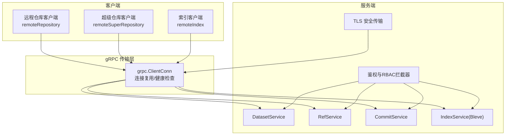
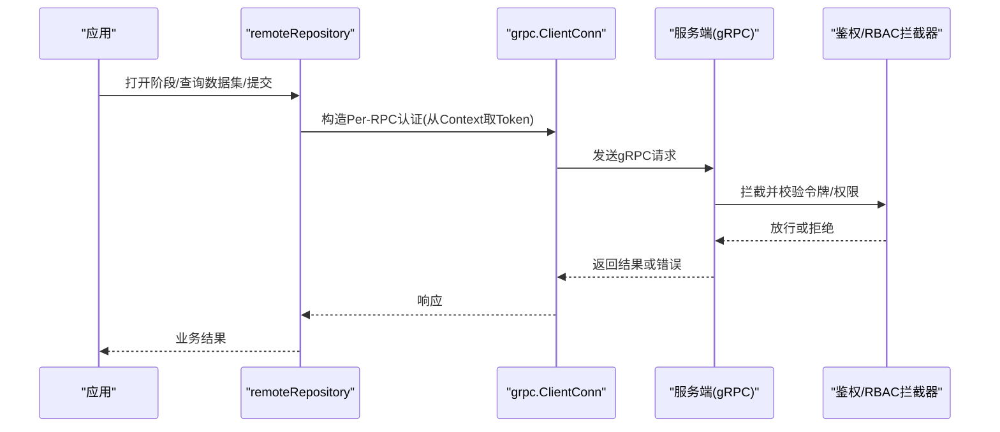
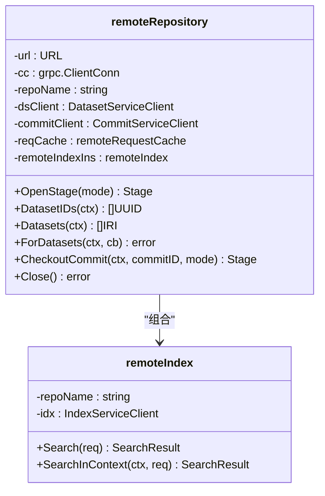
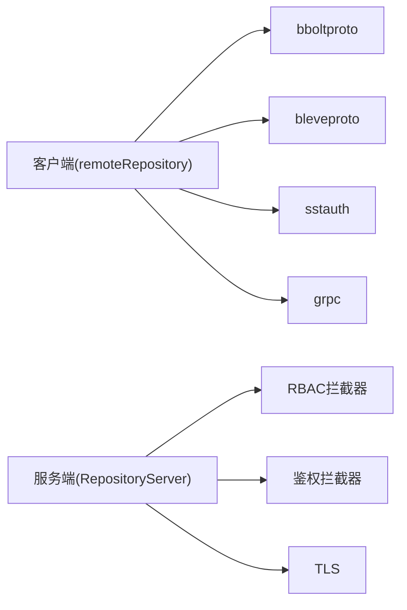

# 远程仓库

<cite>
**本文引用的文件**
- [reporemote.go](file://sst/reporemote.go)
- [superremoterepository.go](file://sst/superremoterepository.go)
- [reporemoteapp.go](file://sst/reporemoteapp.go)
- [remote.go](file://bboltproto/remote.go)
- [auth.go](file://sstauth/auth.go)
- [main.go](file://examples/helloworldreporemote/main.go)
- [reporemoteread.go](file://examples/helloworldreporemote/reporemoteread/reporemoteread.go)
- [reporemotewrite.go](file://examples/helloworldreporemote/reporemotewrite/reporemotewrite.go)
</cite>

## 目录
1. [简介](#简介)
2. [项目结构](#项目结构)
3. [核心组件](#核心组件)
4. [架构总览](#架构总览)
5. [详细组件分析](#详细组件分析)
6. [依赖关系分析](#依赖关系分析)
7. [性能与连接优化](#性能与连接优化)
8. [故障排查指南](#故障排查指南)
9. [结论](#结论)
10. [附录：配置与示例](#附录：配置与示例)

## 简介
本文件面向使用 gRPC 协议访问远程 SST 仓库（RemoteRepository）的开发者，系统性说明客户端与服务端的交互方式、连接与认证配置、上下文传递、超时控制、错误处理、重试策略建议，以及在高可用与负载均衡环境下的部署注意事项。文档同时提供可复用的客户端配置模式、连接池管理思路与性能监控要点，帮助在生产环境中稳定高效地使用远程仓库。

## 项目结构
远程仓库能力由以下关键部分组成：
- 客户端实现：通过 gRPC 调用服务端接口，封装为 Repository/SuperRepository/Dataset/Stage 等对象模型。
- 服务端实现：注册 DatasetService、RefService、CommitService、IndexService 等服务，并集成鉴权、RBAC、恢复拦截器与 TLS。
- 协议定义：基于 protobuf 的 gRPC 服务定义与字段掩码工具。
- 认证授权：基于 OIDC 的令牌校验与 RBAC 方法级权限控制。
- 示例程序：展示如何启动服务端、连接远程仓库并进行读写与搜索。

图表来源
- [reporemote.go:88-285](file://sst/reporemote.go#L88-L285)
- [superremoterepository.go:20-47](file://sst/superremoterepository.go#L20-L47)
- [reporemoteapp.go:429-530](file://sst/reporemoteapp.go#L429-L530)

章节来源
- [reporemote.go:88-285](file://sst/reporemote.go#L88-L285)
- [superremoterepository.go:20-47](file://sst/superremoterepository.go#L20-L47)
- [reporemoteapp.go:429-530](file://sst/reporemoteapp.go#L429-L530)

## 核心组件
- remoteRepository：封装对远端仓库的读/写/提交/分支等操作，内部持有 grpc.ClientConn 与各子服务客户端（Dataset/Commit/Ref/Index）。
- remoteSuperRepository：管理多仓库（创建/删除/配额/计数），返回具体仓库实例。
- remoteIndex：将 Bleve 搜索请求通过 IndexService 转发到服务端执行。
- 服务端 RepositoryServer：注册各 gRPC 服务，装配鉴权、RBAC、日志、恢复等拦截器，可选启用 TLS。
- 认证提供者 AuthProvider：从 Context 中注入 OAuth2 Token，用于每次 gRPC 调用的 Per-RPC 认证。

章节来源
- [reporemote.go:88-285](file://sst/reporemote.go#L88-L285)
- [superremoterepository.go:20-47](file://sst/superremoterepository.go#L20-L47)
- [reporemoteapp.go:429-530](file://sst/reporemoteapp.go#L429-L530)
- [auth.go:9-53](file://sstauth/auth.go#L9-L53)

## 架构总览
远程仓库采用“客户端-服务端”架构，所有数据操作均通过 gRPC 完成。客户端在发起调用前会从 Context 中提取认证信息并附加到每个 RPC 调用；服务端通过拦截器链进行统一鉴权、RBAC 校验、异常恢复与日志记录。

图表来源
- [reporemote.go:146-207](file://sst/reporemote.go#L146-L207)
- [reporemote.go:296-347](file://sst/reporemote.go#L296-L347)
- [reporemoteapp.go:456-530](file://sst/reporemoteapp.go#L456-L530)

## 详细组件分析

### 远程仓库客户端（remoteRepository）
- 连接建立：通过 grpc.NewClient 创建连接，并初始化 Dataset/Commit/Ref/Index 客户端。
- 状态控制：维护 open/closing/closed 状态，进入/离开操作时通过 WaitGroup 保证并发安全。
- 认证注入：从 Context 提取 AuthProvider，若存在则通过 oauth.NewOauthAccess 附加到每次 RPC。
- 分页与流式：列表类接口采用分页（NextPageToken），搜索等接口采用流式发送/接收。
- 错误映射：将特定 gRPC 状态码转换为领域错误（如数据集不存在、提交不存在等）。

图表来源
- [reporemote.go:88-285](file://sst/reporemote.go#L88-L285)
- [reporemote.go:141-229](file://sst/reporemote.go#L141-L229)

章节来源
- [reporemote.go:88-285](file://sst/reporemote.go#L88-L285)
- [reporemote.go:141-229](file://sst/reporemote.go#L141-L229)

### 超级仓库客户端（remoteSuperRepository）
- 功能：列出/创建/删除仓库，获取/设置仓库配额与最大仓库数。
- 认证：统一通过 perRPCCallOpts 从 Context 注入 Token。
- 资源限制：当服务端返回资源耗尽错误时，包装为领域错误提示配额超限。

章节来源
- [superremoterepository.go:20-47](file://sst/superremoterepository.go#L20-L47)
- [superremoterepository.go:61-124](file://sst/superremoterepository.go#L61-L124)
- [superremoterepository.go:135-196](file://sst/superremoterepository.go#L135-L196)

### 服务端（RepositoryServer）
- 服务注册：DatasetService、RefService、CommitService、IndexService。
- 拦截器链：状态转换、日志、恢复、鉴权、RBAC。
- TLS：可选启用服务器证书以加密传输。
- 方法角色映射：为每个 gRPC 方法指定最小访问级别（只读/读写/管理员/超级管理员）。

章节来源
- [reporemoteapp.go:429-530](file://sst/reporemoteapp.go#L429-L530)
- [reporemoteapp.go:41-98](file://sst/reporemoteapp.go#L41-L98)

### 认证与授权
- 客户端：通过 Context 注入 AuthProvider，每次 RPC 自动携带 OAuth2 Token。
- 服务端：根据 Issuer 与 ClientID 验证 OIDC 令牌，并按方法角色进行 RBAC 校验。
- 测试模式：支持本地测试令牌与无签名 JWT 解析，便于开发调试。

章节来源
- [auth.go:9-53](file://sstauth/auth.go#L9-L53)
- [reporemoteapp.go:474-512](file://sst/reporemoteapp.go#L474-L512)
- [reporemoteapp.go:532-560](file://sst/reporemoteapp.go#L532-L560)

### 上下文传递、超时控制与重试策略
- 上下文传递：所有 gRPC 调用均接受 ctx，用于取消与超时控制；认证信息通过 Context 注入。
- 超时控制：建议在调用方为每个 RPC 设置合理的超时（例如使用 context.WithTimeout），避免长时间阻塞。
- 重试策略：代码未内置自动重试。对于幂等读操作（如 ListDatasets、GetBranches），可在上层实现指数退避重试；写操作需谨慎评估幂等性后再重试。

章节来源
- [reporemote.go:146-207](file://sst/reporemote.go#L146-L207)
- [reporemote.go:296-347](file://sst/reporemote.go#L296-L347)

### 错误处理机制
- 常见错误映射：
  - 数据集不存在：将 Unknown 状态码与特定消息映射为 ErrDatasetNotFound。
  - 提交不存在：返回 ErrCommitNotFound。
  - 配额超限：包装 ResourceExhausted 为 ErrQuotaExceeded。
- 恢复与诊断：服务端通过恢复拦截器捕获 panic，并转换为带堆栈信息的 gRPC 错误，便于定位问题。

章节来源
- [reporemote.go:517-527](file://sst/reporemote.go#L517-L527)
- [superremoterepository.go:80-89](file://sst/superremoterepository.go#L80-L89)
- [reporemoteapp.go:574-605](file://sst/reporemoteapp.go#L574-L605)

## 依赖关系分析
- 客户端依赖：
  - bboltproto：Dataset/Commit/Ref 服务客户端。
  - bleveproto：Index 服务客户端。
  - sstauth：认证提供者与上下文工具。
  - grpc：gRPC 传输与凭证。
- 服务端依赖：
  - 各服务实现与 RBAC 拦截器。
  - TLS 证书用于安全传输。
  - 日志与恢复中间件。

图表来源
- [reporemote.go:88-285](file://sst/reporemote.go#L88-L285)
- [reporemoteapp.go:429-530](file://sst/reporemoteapp.go#L429-L530)

章节来源
- [reporemote.go:88-285](file://sst/reporemote.go#L88-L285)
- [reporemoteapp.go:429-530](file://sst/reporemoteapp.go#L429-L530)

## 性能与连接优化
- 连接复用：grpc.ClientConn 是长连接，建议进程内单例化，避免频繁新建连接造成开销。
- 批量与分页：列表接口使用分页（PageSize/NextPageToken），减少单次负载。
- 流式搜索：搜索接口采用流式发送/接收，降低内存峰值。
- 字段掩码：利用 FieldMask 仅返回必要字段，减少网络传输。
- 超时与取消：为每个 RPC 设置合理超时，结合上下文取消避免资源泄漏。
- 监控指标：建议在调用前后记录耗时、失败率、重试次数、队列长度等指标，以便容量规划与问题定位。

[本节为通用指导，不直接分析具体文件]

## 故障排查指南
- 连接失败：检查目标地址、TLS 配置、防火墙与证书有效性。
- 认证失败：确认 Issuer、ClientID、Token 是否有效且具备所需角色。
- 权限不足：核对方法角色映射，确保用户具备相应访问级别。
- 资源耗尽：关注配额限制与最大仓库数量，必要时调整配额。
- 性能问题：检查超时设置、分页大小、网络延迟与服务器负载。

章节来源
- [reporemoteapp.go:474-530](file://sst/reporemoteapp.go#L474-L530)
- [reporemoteapp.go:574-605](file://sst/reporemoteapp.go#L574-L605)

## 结论
远程仓库通过 gRPC 提供高性能、可扩展的数据访问能力。借助统一的认证与 RBAC 机制、流式与分页优化、以及健壮的错误处理与恢复策略，能够在生产环境中稳定运行。结合合理的连接复用、超时控制与监控手段，可以进一步提升系统可靠性与性能。

[本节为总结，不直接分析具体文件]

## 附录：配置与示例

### 服务端配置要点
- 绑定地址与仓库目录：通过命令行参数指定监听地址与仓库路径。
- OIDC 鉴权：配置 Issuer 与 ClientID，启用令牌校验与 RBAC。
- TLS 安全：提供证书与私钥启用加密传输。
- 索引重建：可选择重建 Bleve 全文索引。

章节来源
- [main.go:28-115](file://examples/helloworldreporemote/main.go#L28-L115)
- [reporemoteapp.go:294-350](file://sst/reporemoteapp.go#L294-L350)

### 客户端连接与认证
- 连接建立：使用 OpenRemoteRepository 传入目标地址与传输凭证（如 insecure 或 TLS）。
- 认证注入：通过 ContextWithAuthProvider 注入 AuthProvider，后续所有 RPC 自动携带 Token。
- 读写示例：参考示例程序进行数据集读取、写入与分支管理。

章节来源
- [reporemoteread.go:25-73](file://examples/helloworldreporemote/reporemoteread/reporemoteread.go#L25-L73)
- [reporemotewrite.go:25-58](file://examples/helloworldreporemote/reporemotewrite/reporemotewrite.go#L25-L58)
- [auth.go:41-53](file://sstauth/auth.go#L41-L53)

### 网络安全、负载均衡与高可用部署
- 网络安全：
  - 启用 TLS 加密传输，确保证书有效且受信任。
  - 严格配置 OIDC Issuer 与 ClientID，避免误配导致鉴权失效。
  - 最小权限原则：为不同方法设定最小访问级别，限制敏感操作。
- 负载均衡：
  - 在 gRPC 网关或反向代理层进行流量分发，客户端保持连接复用以提升吞吐。
  - 注意会话粘性需求（如有），但 gRPC 通常无状态，优先无粘性分发。
- 高可用：
  - 多副本部署服务端，配合健康检查与优雅停机。
  - 客户端侧实现重试与熔断，针对幂等读操作做指数退避重试。
  - 监控告警：覆盖连接数、错误率、延迟、配额使用等关键指标。

[本节为通用指导，不直接分析具体文件]