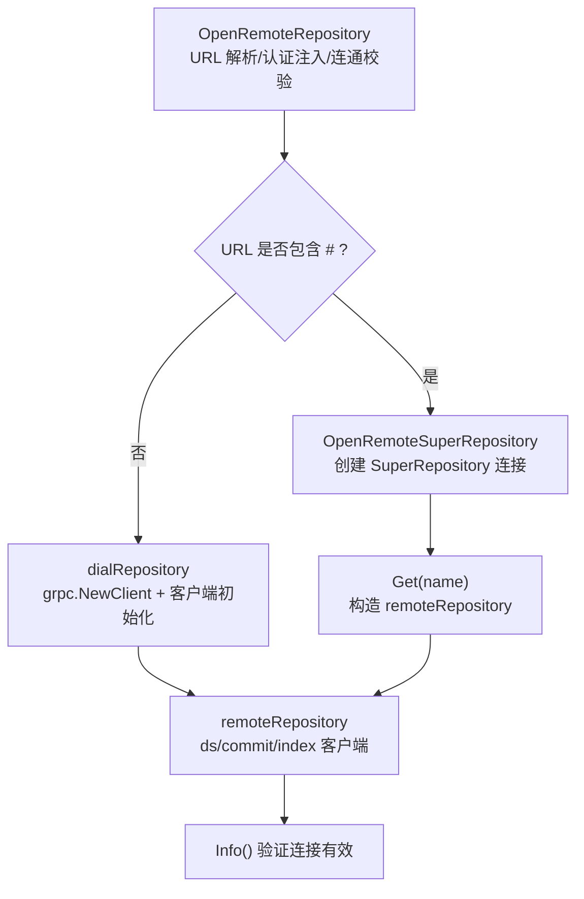
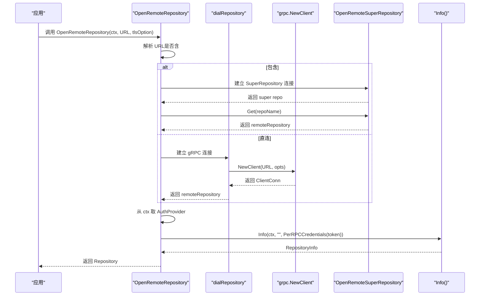
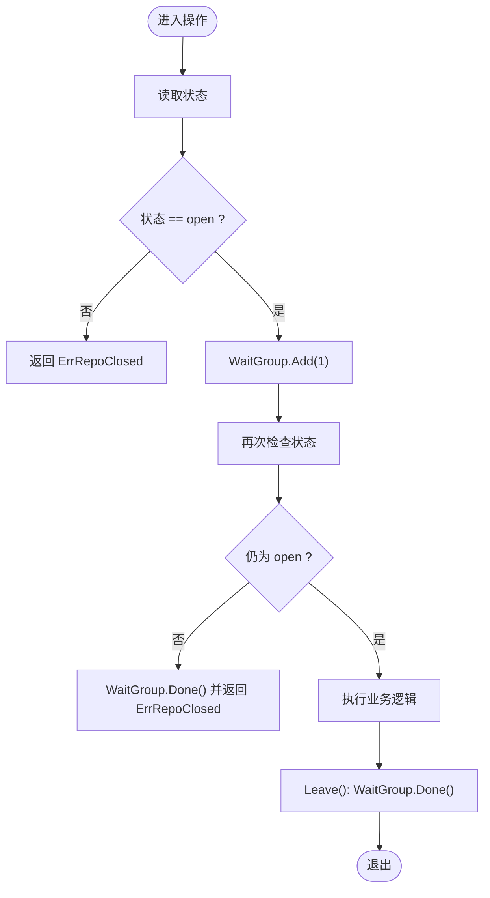
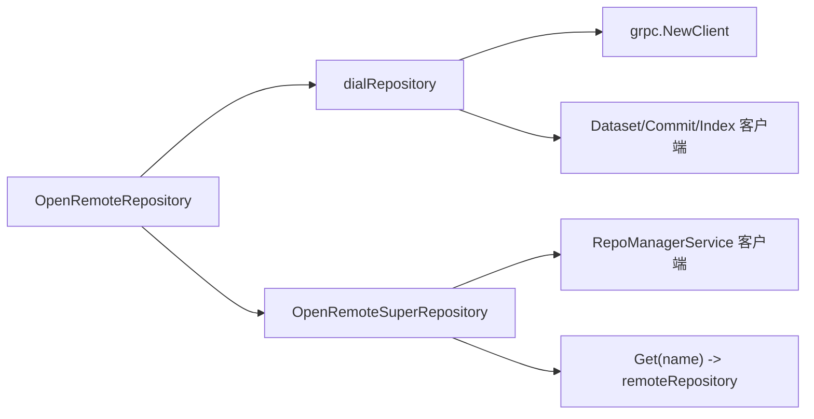

# 连接建立过程

<cite>
**本文引用的文件**
- [repository.go](file://sst/repository.go)
- [reporemote.go](file://sst/reporemote.go)
- [superremoterepository.go](file://sst/superremoterepository.go)
- [auth.go](file://sstauth/auth.go)
- [ACCESS_RIGHTS.md](file://sstauth/ACCESS_RIGHTS.md)
- [remote.go](file://mcp/cmd/remote.go)
</cite>

## 目录
1. [简介](#简介)
2. [项目结构](#项目结构)
3. [核心组件](#核心组件)
4. [架构总览](#架构总览)
5. [详细组件分析](#详细组件分析)
6. [依赖关系分析](#依赖关系分析)
7. [性能考量](#性能考量)
8. [故障排查指南](#故障排查指南)
9. [结论](#结论)
10. [附录：连接示例与最佳实践](#附录连接示例与最佳实践)

## 简介
本文聚焦于远程仓库连接的建立过程，重点说明 dialRepository 的实现原理、gRPC 客户端连接初始化流程、目标 URL 解析机制、认证与调用选项注入、连接状态管理（stateControl）的并发安全设计，以及错误处理与重试建议。文档同时提供基本连接、带认证的连接和自定义配置连接的完整使用路径指引。

## 项目结构
与远程连接建立直接相关的代码主要分布在以下模块：
- sst/repository.go：对外暴露 OpenRemoteRepository，负责 URL 解析、分支到 SuperRepository 或直连逻辑、认证注入与连通性校验。
- sst/reporemote.go：实现 dialRepository、remoteRepository 及其 gRPC 客户端封装、状态控制 stateControl、关闭与生命周期管理。
- sst/superremoterepository.go：实现 OpenRemoteSuperRepository，用于通过 SuperRepository 获取具体仓库实例。
- sstauth/auth.go：定义 AuthProvider 接口及上下文注入/提取方法。
- sstauth/ACCESS_RIGHTS.md：客户端与服务端认证流程说明（Bearer Token、audience、roles）。
- mcp/cmd/remote.go：MCP 层打开远程仓库的示例用法（TLS 与错误包装）。

图表来源
- [repository.go:257-309](file://sst/repository.go#L257-L309)
- [reporemote.go:265-285](file://sst/reporemote.go#L265-L285)
- [superremoterepository.go:26-47](file://sst/superremoterepository.go#L26-L47)

章节来源
- [repository.go:257-309](file://sst/repository.go#L257-L309)
- [reporemote.go:265-285](file://sst/reporemote.go#L265-L285)
- [superremoterepository.go:26-47](file://sst/superremoterepository.go#L26-L47)

## 核心组件
- OpenRemoteRepository：入口函数，负责 URL 解析、选择直连或 SuperRepository 模式、注入认证、执行 Info 校验。
- dialRepository：基于 grpc.NewClient 创建 gRPC 连接并构建 remoteRepository。
- remoteRepository：封装数据集、提交、索引等 gRPC 客户端，并提供进入/离开状态的并发安全控制。
- stateControl：原子状态 + WaitGroup 的生命周期控制，保证 Close 时等待所有 in-flight 操作完成。
- OpenRemoteSuperRepository：创建 SuperRepository 连接，并通过 Get 返回指定仓库的 remoteRepository。
- AuthProvider：通过 context 传递 OAuth2 token，在每次 RPC 调用中注入 PerRPCCredentials。

章节来源
- [reporemote.go:83-124](file://sst/reporemote.go#L83-L124)
- [reporemote.go:265-285](file://sst/reporemote.go#L265-L285)
- [superremoterepository.go:26-47](file://sst/superremoterepository.go#L26-L47)
- [auth.go:41-52](file://sstauth/auth.go#L41-L52)

## 架构总览
下图展示了从应用侧调用 OpenRemoteRepository 到 gRPC 连接建立、认证注入、连通性检查的完整序列。

图表来源
- [repository.go:257-309](file://sst/repository.go#L257-L309)
- [reporemote.go:265-285](file://sst/reporemote.go#L265-L285)
- [superremoterepository.go:26-47](file://sst/superremoterepository.go#L26-L47)

## 详细组件分析

### dialRepository 与 gRPC 客户端初始化
- 使用 grpc.NewClient(targetURL, opts...) 创建连接，不立即发起 I/O。
- 将连接与 DatasetServiceClient、CommitServiceClient、IndexServiceClient 绑定，形成 remoteRepository。
- 设置状态为 open，供后续 enter/leave 控制。

关键点
- 目标 URL 由上层传入，支持 host:port 或 grpc://host:port 等形式（由 gRPC 解析）。
- TLS 配置通过外部传入的 grpc.DialOption 注入（例如 WithTransportCredentials）。
- 连接池：gRPC 内部维护连接复用；此处未显式配置连接池参数，可通过 DialOption 扩展（如最大空闲连接、KeepAlive 等）。

章节来源
- [reporemote.go:265-285](file://sst/reporemote.go#L265-L285)

### URL 解析与 SuperRepository 路由
- OpenRemoteRepository 使用字符串切分判断 URL 是否包含 “#”。
- 若包含 “#”，则视为 SuperRepository 下的子仓库：先建立 SuperRepository 连接，再通过 Get(name) 获取具体仓库。
- 若不包含 “#”，则直连目标仓库。

章节来源
- [repository.go:265-284](file://sst/repository.go#L265-L284)
- [superremoterepository.go:26-47](file://sst/superremoterepository.go#L26-L47)
- [superremoterepository.go:102-124](file://sst/superremoterepository.go#L102-L124)

### 认证与调用选项注入
- 从 context 中提取 AuthProvider，获取 OAuth2 token。
- 将 token 以 PerRPCCredentials(oauth.NewOauthAccess(token)) 附加到每次 gRPC 调用。
- 服务端通过拦截器校验 Bearer Token、audience 与 roles，详见 ACCESS_RIGHTS.md。

章节来源
- [repository.go:286-294](file://sst/repository.go#L286-L294)
- [auth.go:41-52](file://sstauth/auth.go#L41-L52)
- [ACCESS_RIGHTS.md:52-101](file://sstauth/ACCESS_RIGHTS.md#L52-L101)

### 连接状态管理与生命周期（stateControl）
- stateControl 使用 atomic.Int32 表示 closed/open/closing 三种状态。
- enter() 在进入任何需要活跃连接的操作前检查状态并增加 WaitGroup 计数；leave() 在退出时减少计数。
- Close() 将状态置为 closing，等待所有 in-flight 操作完成后关闭底层 gRPC 连接，再置为 closed。
- 该设计确保并发安全：避免在关闭过程中仍有请求进入，且能正确等待所有请求结束。

图表来源
- [reporemote.go:110-124](file://sst/reporemote.go#L110-L124)
- [reporemote.go:655-670](file://sst/reporemote.go#L655-L670)

章节来源
- [reporemote.go:83-124](file://sst/reporemote.go#L83-L124)
- [reporemote.go:655-670](file://sst/reporemote.go#L655-L670)

### 连接建立后的有效性校验
- OpenRemoteRepository 在建立连接后调用 Info(ctx, "") 进行“握手”验证，确保远端服务可用且鉴权通过。
- 成功返回 Repository 实例，否则返回错误。

章节来源
- [repository.go:296-309](file://sst/repository.go#L296-L309)

### 错误处理与重试机制
- 当前实现未内置自动重试；错误直接向上抛出。
- 常见错误类型包括网络错误、认证失败、权限不足、资源耗尽（配额超限）等。
- 建议在调用方实现重试策略：对可重试错误（如网络抖动、超时）采用指数退避重试；对不可重试错误（如 401/403、配额超限）直接返回。

章节来源
- [superremoterepository.go:74-90](file://sst/superremoterepository.go#L74-L90)
- [ACCESS_RIGHTS.md:52-101](file://sstauth/ACCESS_RIGHTS.md#L52-L101)

## 依赖关系分析
- OpenRemoteRepository 依赖：
  - sstauth：从 context 获取认证提供者。
  - gRPC：创建连接与调用。
  - bboltproto/bleveproto：生成各服务的客户端。
- remoteRepository 依赖：
  - gRPC 连接与多个服务客户端。
  - stateControl：并发安全控制。
- SuperRepository 模式：
  - 共享同一 gRPC 连接，按仓库名派生 remoteRepository。

图表来源
- [repository.go:257-309](file://sst/repository.go#L257-L309)
- [reporemote.go:265-285](file://sst/reporemote.go#L265-L285)
- [superremoterepository.go:26-47](file://sst/superremoterepository.go#L26-L47)
- [superremoterepository.go:102-124](file://sst/superremoterepository.go#L102-L124)

章节来源
- [repository.go:257-309](file://sst/repository.go#L257-L309)
- [reporemote.go:265-285](file://sst/reporemote.go#L265-L285)
- [superremoterepository.go:26-47](file://sst/superremoterepository.go#L26-L47)

## 性能考量
- 连接复用：gRPC 默认会复用底层连接，适合高并发场景。
- 传输层：通过 DialOption 可配置 TLS、KeepAlive、最大连接数等，根据部署环境调优。
- 认证开销：每次调用附加 PerRPCCredentials，注意 token 获取成本，可在应用层缓存短期有效的 token。
- 流式与分页：部分列表接口使用分页 token，避免一次性拉取大量数据。

[本节为通用指导，无需特定文件引用]

## 故障排查指南
- 无法连接：
  - 检查 URL 格式与网络可达性。
  - 确认 TLS 配置是否正确（证书、主机名校验）。
- 认证失败：
  - 确认 context 中已注入 AuthProvider 且能获取有效 token。
  - 核对服务端配置的 issuer、clientID、audience 与角色要求。
- 权限不足：
  - 检查 token 中的 roles 是否满足方法所需的最小访问模式。
- 配额超限：
  - 当服务端返回资源耗尽错误时，需调整配额或清理仓库数据。

章节来源
- [ACCESS_RIGHTS.md:52-101](file://sstauth/ACCESS_RIGHTS.md#L52-L101)
- [superremoterepository.go:74-90](file://sst/superremoterepository.go#L74-L90)

## 结论
远程仓库连接通过 OpenRemoteRepository 统一入口，结合 URL 解析、gRPC 连接初始化、认证注入与连通性校验，提供了简洁而健壮的远程访问能力。stateControl 保证了连接生命周期的并发安全。实际使用中，应在调用层实现合适的重试与错误处理策略，并根据部署环境优化 gRPC 连接参数。

[本节为总结，无需特定文件引用]

## 附录：连接示例与最佳实践

### 基本连接（无认证）
- 使用 OpenRemoteRepository，传入空或 nil 的 TLS 选项（或仅基础传输凭据），不调用 ContextWithSstUserInfo 或 ContextWithAuthProvider。
- 适用于本地测试或无需鉴权的服务器。

参考路径
- [repository.go:257-309](file://sst/repository.go#L257-L309)

### 带认证的连接（OAuth2 Bearer）
- 在 context 中通过 ContextWithAuthProvider 注入 AuthProvider，使其能提供 Oauth2Token。
- 每次 gRPC 调用会自动附加 PerRPCCredentials。
- 服务端通过拦截器校验 token 的 audience 与 roles。

参考路径
- [auth.go:41-52](file://sstauth/auth.go#L41-L52)
- [repository.go:286-294](file://sst/repository.go#L286-L294)
- [ACCESS_RIGHTS.md:52-101](file://sstauth/ACCESS_RIGHTS.md#L52-L101)

### 自定义配置连接（TLS、超时、KeepAlive 等）
- 通过 grpc.DialOption 组合自定义参数（如 WithTransportCredentials、WithKeepaliveParams、WithConnectParams 等），再传入 OpenRemoteRepository。
- MCP 层示例展示了如何构造 TLS 凭据并调用 OpenRemoteRepository。

参考路径
- [remote.go:50-94](file://mcp/cmd/remote.go#L50-L94)
- [repository.go:257-309](file://sst/repository.go#L257-L309)

### SuperRepository 模式（通过 # 路由）
- URL 形如 grpc://host:port#repoName，OpenRemoteRepository 会先建立 SuperRepository 连接，再 Get(repoName) 获取具体仓库。
- 适合多租户或多仓库集中管理的场景。

参考路径
- [repository.go:265-284](file://sst/repository.go#L265-L284)
- [superremoterepository.go:26-47](file://sst/superremoterepository.go#L26-L47)
- [superremoterepository.go:102-124](file://sst/superremoterepository.go#L102-L124)

### 连接状态与关闭
- 使用 repository.Close() 安全关闭连接，内部会等待所有 in-flight 操作完成。
- 建议在应用退出或不再使用时及时关闭，释放底层资源。

参考路径
- [reporemote.go:655-670](file://sst/reporemote.go#L655-L670)

### 错误处理与重试建议
- 区分可重试与不可重试错误：
  - 可重试：网络错误、超时、暂时性服务不可用。
  - 不可重试：认证失败、权限不足、配额超限。
- 推荐策略：指数退避 + 最大重试次数 + 熔断（连续失败时暂停重试）。
- 记录关键日志：URL、错误码、重试次数，便于定位问题。

参考路径
- [superremoterepository.go:74-90](file://sst/superremoterepository.go#L74-L90)
- [ACCESS_RIGHTS.md:52-101](file://sstauth/ACCESS_RIGHTS.md#L52-L101)