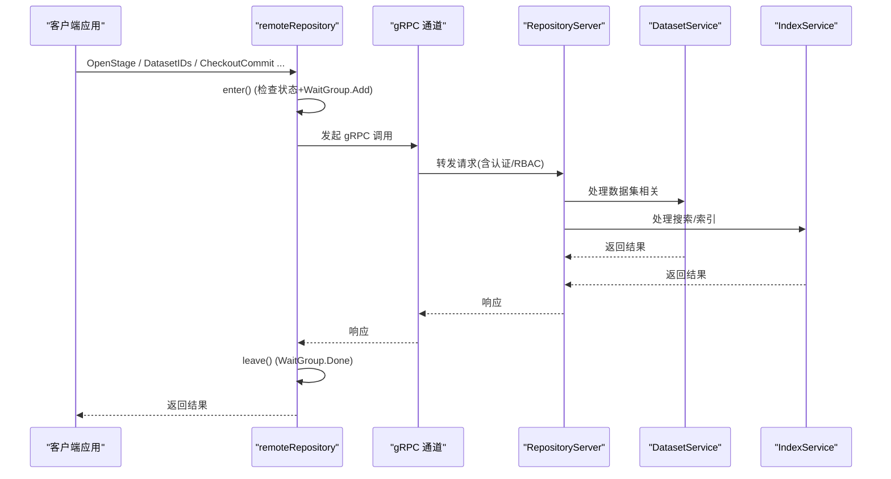
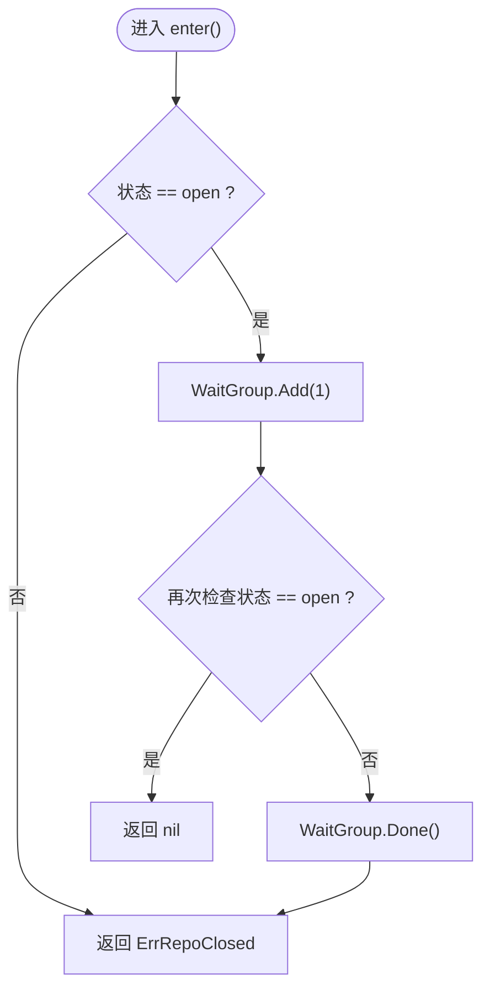
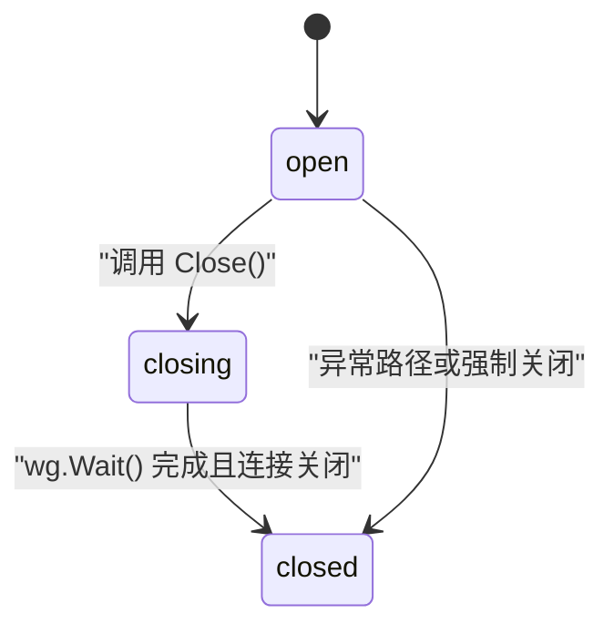
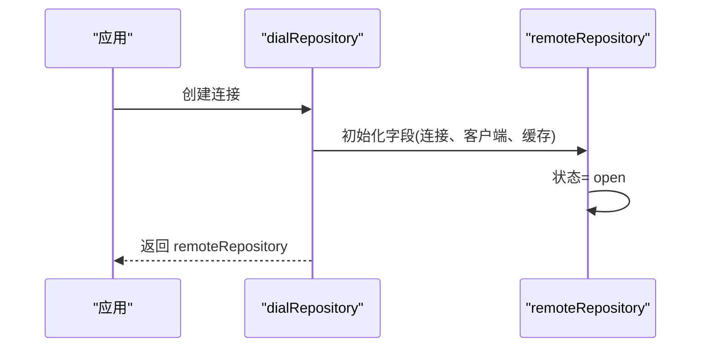
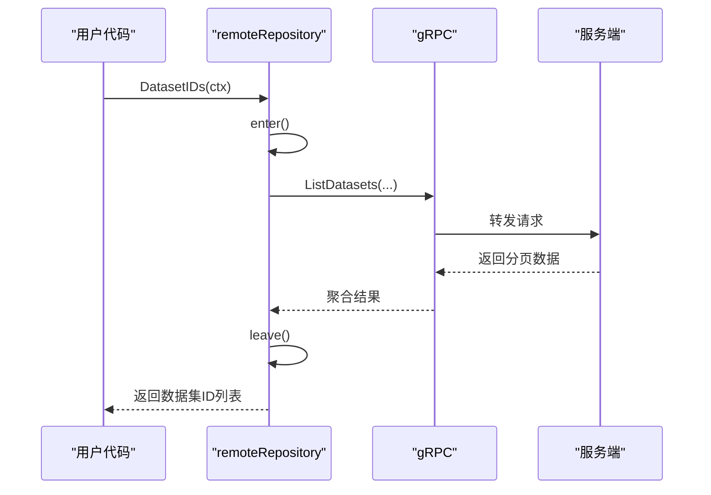
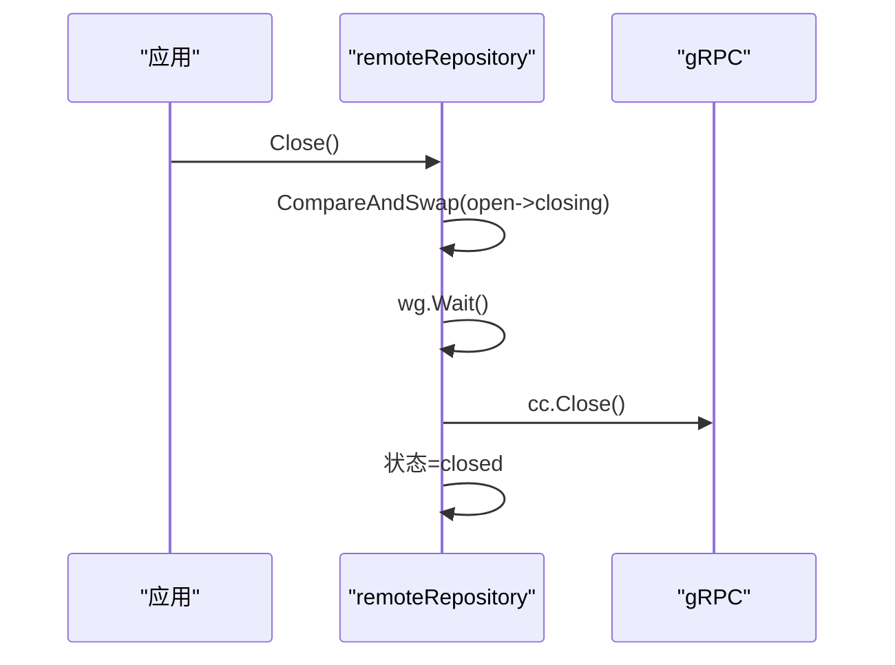
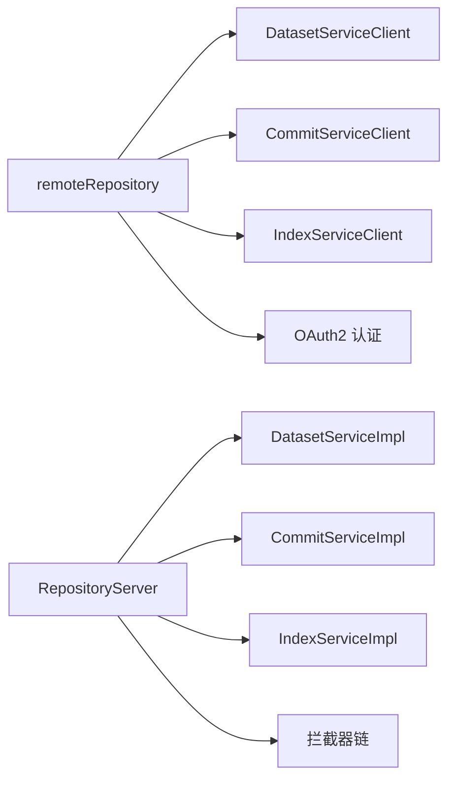

# 连接生命周期管理

<cite>
**本文引用的文件**
- [reporemote.go](file://sst/reporemote.go)
- [reporemoteapp.go](file://sst/reporemoteapp.go)
- [reporemotecommit.go](file://sst/reporemotecommit.go)
- [reporemoteds.go](file://sst/reporemoteds.go)
</cite>

## 目录
1. [简介](#简介)
2. [项目结构](#项目结构)
3. [核心组件](#核心组件)
4. [架构总览](#架构总览)
5. [详细组件分析](#详细组件分析)
6. [依赖关系分析](#依赖关系分析)
7. [性能考量](#性能考量)
8. [故障排查指南](#故障排查指南)
9. [结论](#结论)
10. [附录](#附录)

## 简介
本文面向远程仓库连接的完整生命周期管理，覆盖连接的创建、使用、维护与关闭流程；深入解析 stateControl 的设计原理（原子状态管理与等待组的使用），给出连接状态转换的时序图与状态机说明；阐述并发安全机制（enter()/leave() 的实现原理）；并提供异常处理、资源泄漏防护、优雅关闭的实践指南，以及连接监控与调试的最佳实践。

## 项目结构
围绕远程仓库连接的核心代码集中在 sst 包中：
- 客户端侧：remoteRepository 及其方法封装 gRPC 调用，统一通过 stateControl 进行进入/离开控制与优雅关闭。
- 服务端侧：RepositoryServer 注册并启动 gRPC 服务，提供数据集、提交、索引等接口，并在关闭时协调仓库关闭。
- 协议与中间件：基于 bboltproto/bleveproto 的 gRPC 服务定义，配合认证、RBAC、恢复拦截器等。

```mermaid
graph TB
subgraph "客户端"
RR["remoteRepository"]
SC["stateControl<br/>atomic.Int32 + WaitGroup"]
end
subgraph "网络层"
GRPC["gRPC 通道/流"]
end
subgraph "服务端"
RS["RepositoryServer"]
DS["DatasetService"]
CS["CommitService"]
IS["IndexService"]
end
RR --> |enter()/leave()| SC
RR --> |gRPC 调用| GRPC
GRPC --> RS
RS --> DS
RS --> CS
RS --> IS
```

图表来源
- [reporemote.go:83-124](file://sst/reporemote.go#L83-L124)
- [reporemoteapp.go:286-454](file://sst/reporemoteapp.go#L286-L454)

章节来源
- [reporemote.go:83-124](file://sst/reporemote.go#L83-L124)
- [reporemoteapp.go:286-454](file://sst/reporemoteapp.go#L286-L454)

## 核心组件
- remoteRepository：封装远程仓库访问，持有 gRPC 连接、各服务客户端、请求缓存与远程索引句柄。所有对外方法在进入前调用 enter()，退出后调用 leave()，保证并发安全与优雅关闭。
- stateControl：以 atomic.Int32 表示连接状态（closed/open/closing），以 sync.WaitGroup 统计当前活跃操作数。enter() 在 open 状态下增加计数，close() 将状态置为 closing，等待所有活跃操作完成后关闭底层连接，再置为 closed。
- RepositoryServer：服务端入口，注册 DatasetService、CommitService、IndexService，支持 TLS、认证、RBAC、恢复拦截器，并提供 GracefulStopAndClose 实现优雅停机。

章节来源
- [reporemote.go:83-124](file://sst/reporemote.go#L83-L124)
- [reporemote.go:264-285](file://sst/reporemote.go#L264-L285)
- [reporemote.go:655-670](file://sst/reporemote.go#L655-L670)
- [reporemoteapp.go:286-454](file://sst/reporemoteapp.go#L286-L454)
- [reporemoteapp.go:562-572](file://sst/reporemoteapp.go#L562-L572)

## 架构总览
远程仓库采用“客户端-服务端”模式：
- 客户端通过 dialRepository 建立 gRPC 连接，构造 remoteRepository，设置初始状态为 open。
- 所有业务方法（如 DatasetIDs、Datasets、ForDatasets、CheckoutCommit、Bleve 等）统一通过 enter()/leave() 保护。
- 服务端通过 RepositoryServer 暴露 gRPC 服务，按方法角色进行鉴权与 RBAC 校验，最终委托给本地仓库实现。



图表来源
- [reporemote.go:110-124](file://sst/reporemote.go#L110-L124)
- [reporemote.go:296-347](file://sst/reporemote.go#L296-L347)
- [reporemoteapp.go:429-454](file://sst/reporemoteapp.go#L429-L454)
- [reporemoteds.go:670-751](file://sst/reporemoteds.go#L670-L751)

## 详细组件分析

### stateControl 设计与并发安全
- 状态枚举：closed、open、closing，使用 atomic.Int32 存储。
- 进入控制 enter()：
  - 若当前状态非 open，直接返回 ErrRepoClosed。
  - 否则 WaitGroup.Add(1)，再次检查状态，避免 Close() 的竞态窗口。
  - 若此时已变为 non-open，则立即 Done() 并返回错误。
- 离开控制 leave()：WaitGroup.Done()。
- 优雅关闭 Close()：
  - CompareAndSwap(open -> closing)，确保仅一次标记。
  - wg.Wait() 等待所有已进入的操作完成。
  - 关闭底层 gRPC 连接。
  - 将状态置为 closed。



图表来源
- [reporemote.go:110-124](file://sst/reporemote.go#L110-L124)

章节来源
- [reporemote.go:110-124](file://sst/reporemote.go#L110-L124)

### 连接状态机与时序
状态机包含三个状态：
- open：允许进入新操作。
- closing：停止接受新操作，等待已有操作结束。
- closed：完全关闭，不可再使用。



图表来源
- [reporemote.go:75-81](file://sst/reporemote.go#L75-L81)
- [reporemote.go:655-670](file://sst/reporemote.go#L655-L670)

章节来源
- [reporemote.go:75-81](file://sst/reporemote.go#L75-L81)
- [reporemote.go:655-670](file://sst/reporemote.go#L655-L670)

### 连接创建与初始化
- dialRepository：创建 gRPC 客户端连接，构造 remoteRepository，设置状态为 open。
- 所有后续方法均通过 enter()/leave() 保护，确保并发安全。



图表来源
- [reporemote.go:264-285](file://sst/reporemote.go#L264-L285)

章节来源
- [reporemote.go:264-285](file://sst/reporemote.go#L264-L285)

### 连接使用流程（示例：列出数据集）
- 调用 DatasetIDs/Datasets/ForDatasets 等方法，先 enter()，再发起 gRPC 调用，最后 leave()。
- 支持分页、认证注入（从上下文获取 token）、错误日志记录。



图表来源
- [reporemote.go:296-347](file://sst/reporemote.go#L296-L347)
- [reporemoteds.go:670-751](file://sst/reporemoteds.go#L670-L751)

章节来源
- [reporemote.go:296-347](file://sst/reporemote.go#L296-L347)
- [reporemoteds.go:670-751](file://sst/reporemoteds.go#L670-L751)

### 连接维护与监控
- 健康检查：可通过 Info/GetRepositoryInfo 获取仓库统计信息，间接验证连接可用性。
- 日志与追踪：全局日志 GlobalLogger 在各关键路径输出调试/错误信息，便于定位问题。
- 认证与权限：通过上下文注入 OAuth2 Token，服务端通过 RBAC 拦截器校验方法所需最小权限。

章节来源
- [reporemoteds.go:71-132](file://sst/reporemoteds.go#L71-L132)
- [reporemote.go:150-207](file://sst/reporemote.go#L150-L207)

### 连接关闭与优雅停机
- 客户端：调用 Close() 将状态置为 closing，等待所有进入的操作完成，关闭 gRPC 连接，再置为 closed。
- 服务端：RepositoryServer.GracefulStopAndClose 先停止 gRPC 服务，再逐个关闭仓库实例。



图表来源
- [reporemote.go:655-670](file://sst/reporemote.go#L655-L670)
- [reporemoteapp.go:562-572](file://sst/reporemoteapp.go#L562-L572)

章节来源
- [reporemote.go:655-670](file://sst/reporemote.go#L655-L670)
- [reporemoteapp.go:562-572](file://sst/reporemoteapp.go#L562-L572)

### 异常处理与资源泄漏防护
- 统一错误包装：wrapError 附加调用位置信息，便于定位。
- 常见错误：
  - ErrRepoClosed：连接已关闭或正在关闭。
  - ErrStageExpired：阶段租约过期（与关闭流程相关）。
  - ErrDatasetNotFound/ErrCommitNotFound：资源不存在。
- 资源释放：
  - 所有进入操作必须配对 leave()，避免 WaitGroup 泄漏。
  - gRPC 流式调用需确保 Send/Recv 正确结束，避免死锁。
  - 服务端对文件/索引等资源使用 defer 关闭。

章节来源
- [reporemote.go:69-73](file://sst/reporemote.go#L69-L73)
- [reporemote.go:51-61](file://sst/reporemote.go#L51-L61)
- [reporemoteds.go:295-354](file://sst/reporemoteds.go#L295-L354)

### 最佳实践：连接监控与调试
- 启用详细日志：在关键路径记录请求/响应、错误堆栈，结合 GlobalLogger 输出。
- 指标采集：通过 GetRepositoryInfo 获取仓库大小、文档数量、版本哈希等指标。
- 断线重试：在客户端层面对网络错误进行指数退避重试，注意幂等性。
- 超时控制：为 gRPC 调用设置合理超时与取消上下文，防止长尾阻塞。
- 压力测试：模拟高并发进入/离开，验证 WaitGroup 与状态切换的正确性。

[本节为通用指导，不直接分析具体文件]

## 依赖关系分析
- remoteRepository 依赖：
  - gRPC 客户端：bboltproto.DatasetServiceClient、CommitServiceClient、bleveproto.IndexServiceClient。
  - 认证：从上下文提取 OAuth2 Token，注入到 PerRPCCredentials。
  - 缓存：remoteRequestCache 用于减少重复消息编码开销。
- RepositoryServer 依赖：
  - 拦截器链：状态转换、恢复、认证、RBAC、日志。
  - 服务注册：DatasetService、CommitService、IndexService。
  - TLS：可选配置。



图表来源
- [reporemote.go:88-99](file://sst/reporemote.go#L88-L99)
- [reporemoteapp.go:429-454](file://sst/reporemoteapp.go#L429-L454)

章节来源
- [reporemote.go:88-99](file://sst/reporemote.go#L88-L99)
- [reporemoteapp.go:429-454](file://sst/reporemoteapp.go#L429-L454)

## 性能考量
- 连接复用：dialRepository 创建的 gRPC 连接可被多个 remoteRepository 共享（视上层设计而定），减少握手开销。
- 请求缓存：remoteRequestCache 缓存预编译消息，降低序列化成本。
- 分页与批处理：ListDatasets 等接口支持分页，批量查询 CommitDetailsBatch 减少往返次数。
- 流式传输：FetchDatasets、DocumentSet/DownloadNamedGraphRevision 使用流式传输，降低内存峰值。
- 并发控制：enter()/leave() 限制并发进入，避免过度竞争。

[本节为通用指导，不直接分析具体文件]

## 故障排查指南
- 常见问题：
  - “repo is closed”：调用发生在 Close() 之后或竞态窗口内，检查调用时序与超时。
  - “stage lease expired”：阶段租约在关闭过程中失效，确保不在关闭期间继续写入。
  - “dataset not found”：确认数据集 ID 与分支指向是否正确。
- 定位步骤：
  - 查看 GlobalLogger 输出的错误与堆栈。
  - 检查 gRPC 状态码与消息，必要时开启更详细的日志。
  - 使用 GetRepositoryInfo 验证服务端可达性与仓库状态。
- 修复建议：
  - 在客户端增加重试与退避策略。
  - 在服务端确保资源清理顺序，避免部分关闭导致的不一致。
  - 对关键路径添加超时与取消上下文。

章节来源
- [reporemote.go:69-73](file://sst/reporemote.go#L69-L73)
- [reporemoteds.go:71-132](file://sst/reporemoteds.go#L71-L132)

## 结论
本方案通过 stateControl 的原子状态与 WaitGroup 组合，实现了远程仓库连接的严格并发控制与优雅关闭；客户端与服务端通过 gRPC 交互，结合认证、RBAC 与恢复拦截器，保障安全性与稳定性。遵循本文提供的生命周期管理、异常处理与监控调试实践，可有效提升系统的可靠性与可维护性。

[本节为总结，不直接分析具体文件]

## 附录
- 关键函数路径参考：
  - 进入/离开控制：[reporemote.go:110-124](file://sst/reporemote.go#L110-L124)
  - 优雅关闭：[reporemote.go:655-670](file://sst/reporemote.go#L655-L670)
  - 连接创建：[reporemote.go:264-285](file://sst/reporemote.go#L264-L285)
  - 服务端优雅停机：[reporemoteapp.go:562-572](file://sst/reporemoteapp.go#L562-L572)
  - 数据集列表：[reporemoteds.go:670-751](file://sst/reporemoteds.go#L670-L751)
  - 提交服务：[reporemotecommit.go:57-212](file://sst/reporemotecommit.go#L57-L212)

[本节为索引，不直接分析具体文件]