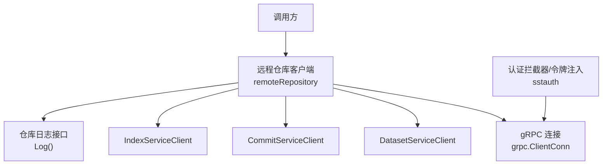
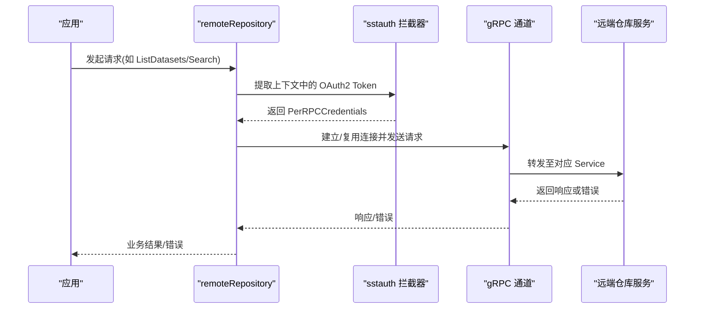
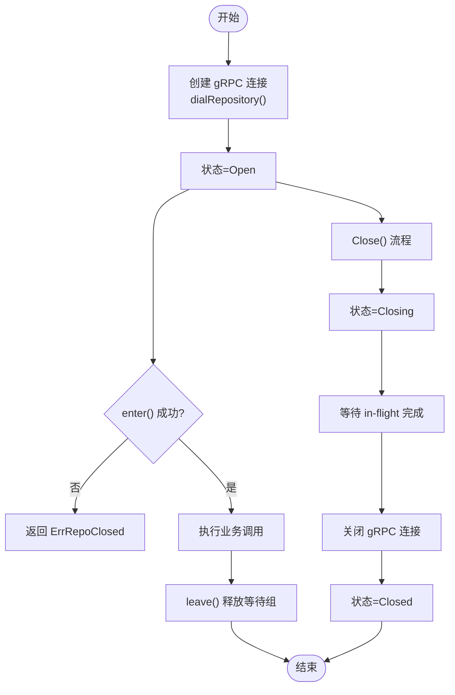
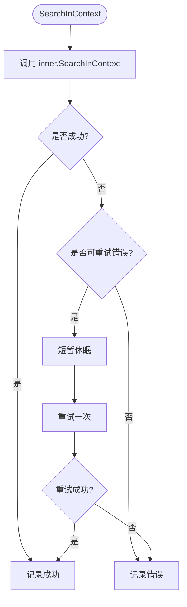
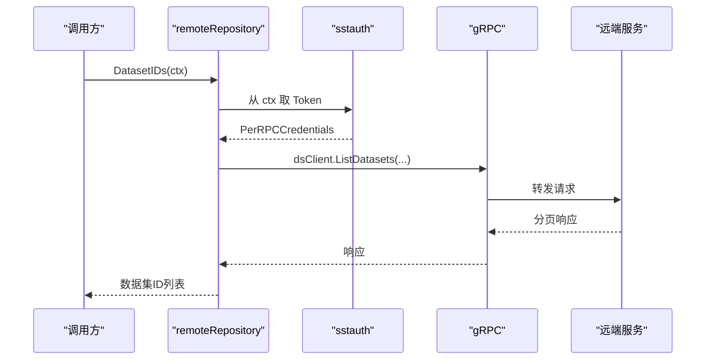
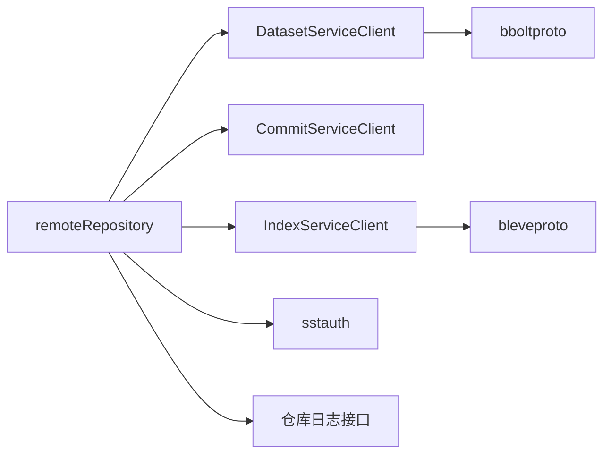

# 连接监控与健康检查

<cite>
**本文引用的文件**
- [reporemote.go](file://sst/reporemote.go)
- [indexupdate.go](file://sst/indexupdate.go)
- [repository.go](file://sst/repository.go)
- [authoids.go](file://sstauth/authoids.go)
- [remote.go](file://bboltproto/remote.go)
- [remote.go](file://bleveproto/remote.go)
- [clierror.go](file://cli/cmd/utils/clierror.go)
</cite>

## 目录
1. [简介](#简介)
2. [项目结构](#项目结构)
3. [核心组件](#核心组件)
4. [架构总览](#架构总览)
5. [详细组件分析](#详细组件分析)
6. [依赖关系分析](#依赖关系分析)
7. [性能考量](#性能考量)
8. [故障排查指南](#故障排查指南)
9. [结论](#结论)
10. [附录](#附录)

## 简介
本文件面向远程仓库连接的监控与健康检查，围绕以下目标展开：
- 定义并采集关键监控指标：连接数、请求延迟、错误率等。
- 说明健康检查机制：连接可用性检测与服务状态验证。
- 提供监控数据采集与分析方法：日志记录、指标导出与告警配置建议。
- 阐述故障检测与自动恢复策略：重试、服务发现与负载均衡思路。
- 给出性能分析与瓶颈识别工具与方法。
- 提供生产环境的监控部署与运维指南。

## 项目结构
本项目通过 gRPC 客户端与远端仓库交互，核心在 sst 包中实现远程仓库封装；索引与搜索能力通过 bleveproto 暴露；认证与鉴权由 sstauth 提供；CLI 层对错误进行友好化展示。

图表来源
- [reporemote.go:88-99](file://sst/reporemote.go#L88-L99)
- [reporemote.go:264-285](file://sst/reporemote.go#L264-L285)
- [authoids.go:375-413](file://sstauth/authoids.go#L375-L413)

章节来源
- [reporemote.go:88-99](file://sst/reporemote.go#L88-L99)
- [reporemote.go:264-285](file://sst/reporemote.go#L264-L285)
- [authoids.go:375-413](file://sstauth/authoids.go#L375-L413)

## 核心组件
- 远程仓库客户端（remoteRepository）：封装 gRPC 连接、数据集与提交操作、信息获取、日志读取等。
- 健康感知索引（healthAwareIndex）：包装底层索引，记录成功/失败，支持可重试错误的简单重试。
- 认证与鉴权（sstauth）：为 gRPC 调用注入 OAuth2 Token，并在服务端执行 RBAC。
- 协议适配（bboltproto/bleveproto）：字段掩码与搜索请求/结果序列化。
- CLI 错误处理：将底层错误转换为人类可读提示，便于监控与告警规则匹配。

章节来源
- [reporemote.go:88-99](file://sst/reporemote.go#L88-L99)
- [indexupdate.go:673-726](file://sst/indexupdate.go#L673-L726)
- [authoids.go:375-413](file://sstauth/authoids.go#L375-L413)
- [remote.go:26-37](file://bboltproto/remote.go#L26-L37)
- [remote.go:21-39](file://bleveproto/remote.go#L21-L39)
- [clierror.go:47-94](file://cli/cmd/utils/clierror.go#L47-L94)

## 架构总览
下图展示了从调用方到远端仓库的完整链路，包括认证、gRPC 调用、日志与索引访问路径。

图表来源
- [reporemote.go:296-347](file://sst/reporemote.go#L296-L347)
- [reporemote.go:146-207](file://sst/reporemote.go#L146-L207)
- [authoids.go:375-413](file://sstauth/authoids.go#L375-L413)

## 详细组件分析

### 远程仓库客户端与连接生命周期
- 连接创建：使用 grpc.NewClient 创建连接，构造 Dataset/Commit/Index 客户端，设置状态为 Open。
- 进入/离开控制：enter() 保证仓库处于打开状态并发放等待组计数；leave() 释放计数。
- 关闭流程：CompareAndSwap 标记 Closing，等待所有 in-flight 阶段完成，再关闭 gRPC 连接，最后置为 Closed。

图表来源
- [reporemote.go:264-285](file://sst/reporemote.go#L264-L285)
- [reporemote.go:109-124](file://sst/reporemote.go#L109-L124)
- [reporemote.go:655-670](file://sst/reporemote.go#L655-L670)

章节来源
- [reporemote.go:264-285](file://sst/reporemote.go#L264-L285)
- [reporemote.go:109-124](file://sst/reporemote.go#L109-L124)
- [reporemote.go:655-670](file://sst/reporemote.go#L655-L670)

### 健康检查与可用性探测
- 连接可用性：通过 Info()/Log() 等轻量 RPC 探测远端是否可达并可鉴权。
- 服务状态验证：Info() 返回仓库元数据（数据集数量、提交数量、版本哈希、Bleve 信息等），可用于判断服务是否就绪。
- 健康指标：
  - 连接数：可通过 gRPC 连接池统计（外部集成）。
  - 请求延迟：在调用前后打点计算耗时（需上层埋点）。
  - 错误率：统计 gRPC 错误码分布（如 Unauthenticated、PermissionDenied、NotFound、Unavailable 等）。

章节来源
- [reporemote.go:1645-1661](file://sst/reporemote.go#L1645-L1661)
- [reporemote.go:1663-1682](file://sst/reporemote.go#L1663-L1682)

### 指标采集与日志记录
- 日志记录：
  - 仓库创建时写入初始日志条目（type="init"）。
  - 同步操作（SyncFrom）会在远端生成 type="sync_from" 的日志条目，包含作者、数据集等信息。
  - 客户端在关键步骤输出 Debug/Info/Error 日志（如 gRPC 调用、错误包装）。
- 指标导出建议：
  - 在调用处增加计时器，收集 p50/p95/p99 延迟。
  - 统计各 gRPC 方法的调用次数、错误次数、超时次数。
  - 结合 Info() 返回的仓库规模指标（数据集数、提交数、文档数）作为容量与健康度参考。

章节来源
- [repository.go:386-454](file://sst/repository.go#L386-L454)
- [reporemote.go:296-347](file://sst/reporemote.go#L296-L347)
- [reporemote.go:1663-1682](file://sst/reporemote.go#L1663-L1682)

### 认证与鉴权对监控的影响
- 客户端侧：从上下文提取 OAuth2 Token，附加到每次 gRPC 调用。
- 服务端侧：UnaryRBACInterceptor 校验 Token 受众与角色，拒绝非法访问。
- 监控要点：
  - 未认证/权限不足导致的错误应单独归类，便于告警区分网络问题与授权问题。
  - 令牌刷新失败会导致连续鉴权错误，需关注令牌源健康。

章节来源
- [reporemote.go:296-347](file://sst/reporemote.go#L296-L347)
- [authoids.go:375-413](file://sstauth/authoids.go#L375-L413)

### 索引健康与重试
- healthAwareIndex 在 SearchInContext 中记录成功/失败，遇到可重试错误会短暂休眠后重试一次，提升鲁棒性。
- 该模式可作为“健康探针”的参考：若频繁触发重试，说明后端不稳定。

图表来源
- [indexupdate.go:673-726](file://sst/indexupdate.go#L673-L726)

章节来源
- [indexupdate.go:673-726](file://sst/indexupdate.go#L673-L726)

### 数据流与序列图（以数据集列表为例）

图表来源
- [reporemote.go:296-347](file://sst/reporemote.go#L296-L347)
- [authoids.go:375-413](file://sstauth/authoids.go#L375-L413)

章节来源
- [reporemote.go:296-347](file://sst/reporemote.go#L296-L347)

## 依赖关系分析
- remoteRepository 依赖：
  - bboltproto.DatasetServiceClient / CommitServiceClient
  - bleveproto.IndexServiceClient
  - sstauth 提供的上下文与 Token 注入
- 协议层：
  - bboltproto 提供字段掩码与请求构造
  - bleveproto 提供搜索请求/结果的 JSON 编解码
- CLI 层：
  - 将底层错误映射为人类可读消息，便于监控面板与告警规则解析

图表来源
- [reporemote.go:88-99](file://sst/reporemote.go#L88-L99)
- [remote.go:26-37](file://bboltproto/remote.go#L26-L37)
- [remote.go:21-39](file://bleveproto/remote.go#L21-L39)
- [authoids.go:375-413](file://sstauth/authoids.go#L375-L413)

章节来源
- [reporemote.go:88-99](file://sst/reporemote.go#L88-L99)
- [remote.go:26-37](file://bboltproto/remote.go#L26-L37)
- [remote.go:21-39](file://bleveproto/remote.go#L21-L39)
- [authoids.go:375-413](file://sstauth/authoids.go#L375-L413)

## 性能考量
- 连接复用：gRPC 连接默认复用，避免频繁握手开销。
- 分页与批处理：ListDatasets 等接口采用分页，减少单次负载。
- 重试与退避：索引层对可重试错误进行短延时重试，降低瞬时抖动影响。
- 建议优化：
  - 在调用层增加延迟直方图与错误分类计数器。
  - 对高频方法（如 ListDatasets、Search）进行采样与限流。
  - 结合 Info() 返回的仓库规模指标，评估查询复杂度与资源占用。

[本节为通用指导，不直接分析具体文件]

## 故障排查指南
- 常见错误类型与定位：
  - 未认证/权限不足：检查 Token 获取与受众配置。
  - 连接不可用：检查网络连通性与远端服务状态。
  - 数据不存在：如分支/数据集未找到，属于预期错误，可降低日志级别。
- 日志与指标：
  - 使用仓库日志接口查询 type="sync_from" 等事件，确认同步过程。
  - 在调用处记录延迟与错误码，形成仪表盘与告警。
- 快速自检：
  - 调用 Info() 获取仓库元数据，验证服务可用。
  - 调用 Log() 拉取最近日志，观察是否有异常事件。

章节来源
- [reporemote.go:1645-1661](file://sst/reporemote.go#L1645-L1661)
- [reporemote.go:1663-1682](file://sst/reporemote.go#L1663-L1682)
- [clierror.go:47-94](file://cli/cmd/utils/clierror.go#L47-L94)

## 结论
- 远程仓库通过 gRPC 提供稳定、可观测的数据访问能力。
- 健康检查可基于 Info()/Log() 等轻量接口实现，结合错误分类与延迟统计形成完整的监控体系。
- 建议在调用层补充指标埋点，配合日志与仓库日志，构建端到端的可观测性。
- 对于高可用场景，可在上层引入重试、熔断与服务发现，进一步提升韧性。

[本节为总结，不直接分析具体文件]

## 附录
- 监控指标建议清单
  - 连接数：gRPC 连接池活跃连接数。
  - 请求延迟：p50/p95/p99 分位延迟。
  - 错误率：按错误码分类的错误占比。
  - 吞吐：QPS、带宽占用。
  - 健康度：Info() 返回的仓库规模与版本信息变化。
- 告警阈值建议
  - 错误率超过阈值（如 5%）持续 N 分钟。
  - 延迟超过阈值（如 p99 > 2s）持续 N 分钟。
  - 连接失败率突增或令牌刷新失败。
- 生产部署建议
  - 启用结构化日志，集中收集。
  - 接入指标系统（如 Prometheus）与告警平台。
  - 定期演练故障切换与恢复流程。

[本节为通用指导，不直接分析具体文件]