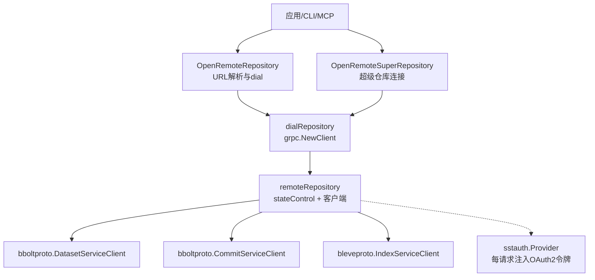
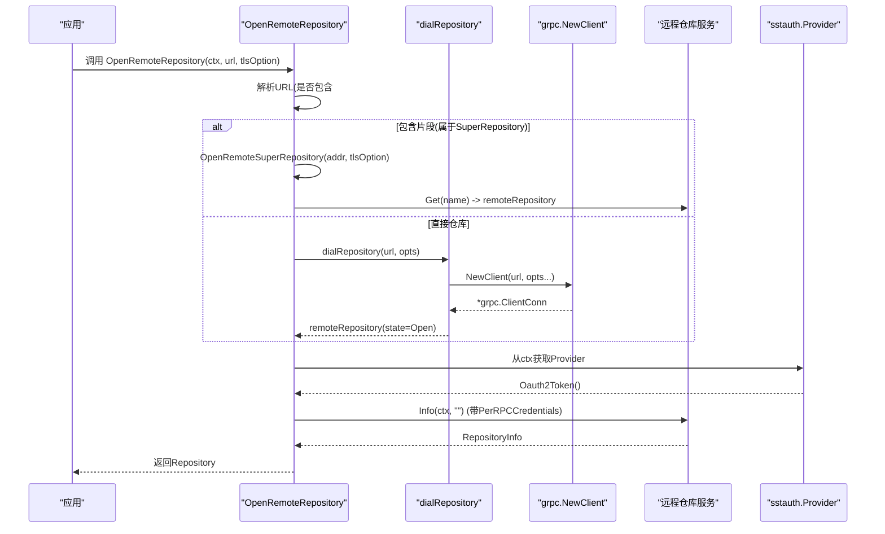
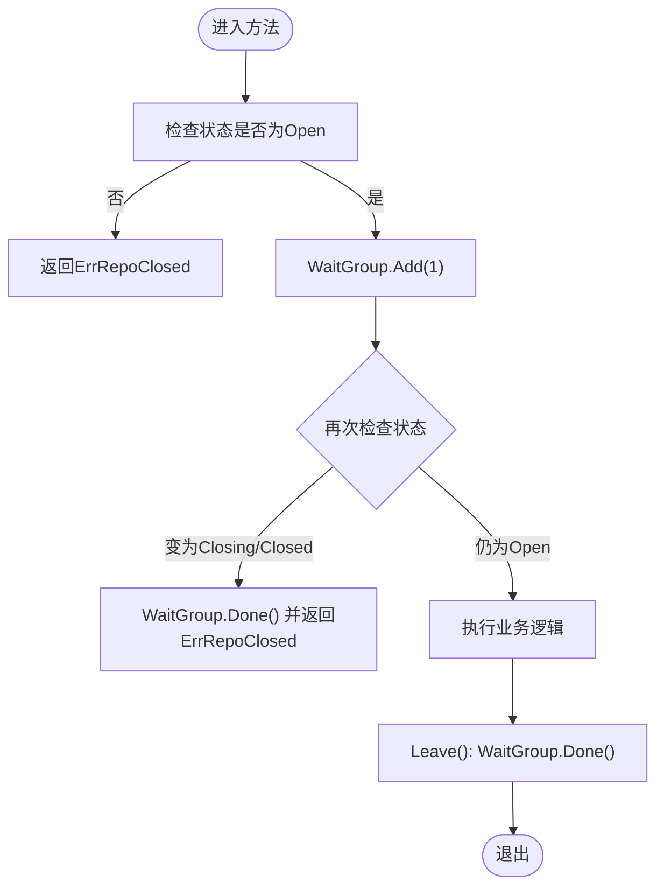
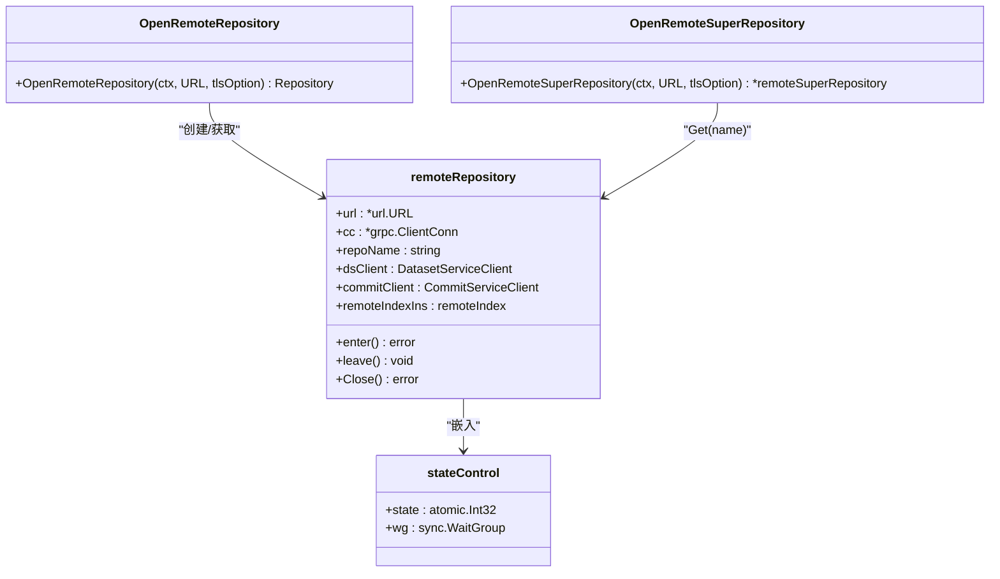

# 连接配置与管理

<cite>
**本文引用的文件**
- [reporemote.go](file://sst/reporemote.go)
- [repository.go](file://sst/repository.go)
- [superremoterepository.go](file://sst/superremoterepository.go)
- [ACCESS_RIGHTS.md](file://sstauth/ACCESS_RIGHTS.md)
- [interactive_handler.go](file://cli/cmd/interactive/interactive_handler.go)
- [superrepository_handler.go](file://cli/cmd/interactive/superrepository_handler.go)
- [remote.go](file://mcp/cmd/remote.go)
- [edmsystemdata.go](file://singleton/edmsystemdata.go)
</cite>

## 目录
1. [简介](#简介)
2. [项目结构](#项目结构)
3. [核心组件](#核心组件)
4. [架构总览](#架构总览)
5. [详细组件分析](#详细组件分析)
6. [依赖关系分析](#依赖关系分析)
7. [性能与连接池](#性能与连接池)
8. [故障排查指南](#故障排查指南)
9. [结论](#结论)
10. [附录：配置示例与最佳实践](#附录：配置示例与最佳实践)

## 简介
本文件面向需要建立并管理远程仓库 gRPC 连接的开发者，系统说明 URL 解析、连接参数配置、连接生命周期与并发安全、以及超时、重试、错误处理、健康检查与故障转移的实践建议。重点围绕以下实现点展开：
- gRPC 客户端连接建立流程（OpenRemoteRepository / OpenRemoteSuperRepository）
- dialRepository 函数原理与 grpc.NewClient 的使用
- stateControl 的并发安全设计与生命周期管理
- 认证与鉴权在 gRPC 调用中的注入方式
- 监控、健康检查与故障转移的实现思路与落地建议

## 项目结构
与远程连接相关的核心代码集中在 sst 包中，并通过 sstauth 提供认证上下文能力；CLI 与 MCP 层展示了如何在不同入口使用 OpenRemoteRepository/OpenRemoteSuperRepository 并传入传输层凭据。

图表来源
- [repository.go:257-309](file://sst/repository.go#L257-L309)
- [superremoterepository.go:26-47](file://sst/superremoterepository.go#L26-L47)
- [reporemote.go:265-285](file://sst/reporemote.go#L265-L285)

章节来源
- [repository.go:257-309](file://sst/repository.go#L257-L309)
- [superremoterepository.go:26-47](file://sst/superremoterepository.go#L26-L47)
- [reporemote.go:265-285](file://sst/reporemote.go#L265-L285)

## 核心组件
- remoteRepository：封装 gRPC 连接、服务客户端、仓库名与状态控制，所有对外方法通过 enter/leave 保证并发安全与生命周期一致。
- stateControl：基于 atomic.Int32 的状态机与 sync.WaitGroup 的等待机制，确保 Close 时不再接受新操作且能等待进行中操作完成。
- OpenRemoteRepository / OpenRemoteSuperRepository：负责 URL 解析、Dial 选项组装、连接创建与连通性校验。
- sstauth.Provider：从 Context 中提取 OAuth2 Token，并在每次 gRPC 调用中以 PerRPCCredentials 注入。

章节来源
- [reporemote.go:75-124](file://sst/reporemote.go#L75-L124)
- [reporemote.go:265-285](file://sst/reporemote.go#L265-L285)
- [repository.go:257-309](file://sst/repository.go#L257-L309)
- [superremoterepository.go:26-47](file://sst/superremoterepository.go#L26-L47)
- [ACCESS_RIGHTS.md:52-128](file://sstauth/ACCESS_RIGHTS.md#L52-L128)

## 架构总览
下图展示从应用侧到远端仓库的完整调用链，包括 URL 解析、Dial 选项、认证注入、首次连通性探测与返回可用 Repository。

图表来源
- [repository.go:257-309](file://sst/repository.go#L257-L309)
- [superremoterepository.go:26-47](file://sst/superremoterepository.go#L26-L47)
- [reporemote.go:265-285](file://sst/reporemote.go#L265-L285)
- [ACCESS_RIGHTS.md:52-128](file://sstauth/ACCESS_RIGHTS.md#L52-L128)

## 详细组件分析

### URL 解析与连接建立
- OpenRemoteRepository 接收 URL 与 TLS DialOption：
  - 若 URL 包含 # 片段，则视为 SuperRepository 下的子仓库，先建立到 SuperRepository 的连接，再 Get(name) 获取具体仓库实例。
  - 否则直接 dialRepository 建立连接。
- dialRepository 使用 grpc.NewClient(targetURL, opts...) 创建连接，构造 remoteRepository 并设置初始状态为 Open。
- 建立连接后，调用 Info(ctx, "") 进行连通性验证，确保服务端可达且鉴权有效。

章节来源
- [repository.go:257-309](file://sst/repository.go#L257-L309)
- [reporemote.go:265-285](file://sst/reporemote.go#L265-L285)

### gRPC 连接参数与自定义 DialOption
- 传输层凭据：通过 grpc.WithTransportCredentials(...) 传入，支持 insecure 或 TLS 配置。
- 认证令牌：每个 RPC 调用前从 Context 中读取 sstauth.Provider，并以 grpc.PerRPCCredentials(oauth.NewOauthAccess(token)) 附加到每次调用。
- 可组合的 DialOption：除传输层凭据外，可在上层按需添加自定义 DialOption（例如负载均衡、重试策略等），但当前代码未内置默认重试或超时 DialOption。

章节来源
- [interactive_handler.go:118](file://cli/cmd/interactive/interactive_handler.go#L118)
- [superrepository_handler.go:131](file://cli/cmd/interactive/superrepository_handler.go#L131)
- [remote.go:76](file://mcp/cmd/remote.go#L76)
- [reporemote.go:313-322](file://sst/reporemote.go#L313-L322)
- [ACCESS_RIGHTS.md:52-128](file://sstauth/ACCESS_RIGHTS.md#L52-L128)

### stateControl 并发安全与生命周期
- 状态机：stateClosed / stateOpen / stateClosing，使用 atomic.Int32 原子更新。
- 进入保护：enter() 在 stateOpen 时增加 WaitGroup 计数，并进行二次检查避免竞态；离开 leave() 减少计数。
- 关闭流程：Close() 将状态切换为 closing，等待所有进入的操作完成后关闭底层 gRPC 连接，最后置为 closed。
- 作用范围：所有对 remoteRepository 的方法均通过 enter/leave 包裹，确保关闭期间不执行新操作。

图表来源
- [reporemote.go:75-124](file://sst/reporemote.go#L75-L124)
- [reporemote.go:655-670](file://sst/reporemote.go#L655-L670)

章节来源
- [reporemote.go:75-124](file://sst/reporemote.go#L75-L124)
- [reporemote.go:655-670](file://sst/reporemote.go#L655-L670)

### 认证与鉴权注入
- 客户端：从 Context 中获取 Provider，调用 Oauth2Token() 获取访问令牌，以 PerRPCCredentials 注入到每次 gRPC 调用。
- 服务端：拦截器校验令牌签名、过期时间、audience 与角色，按方法要求的最小 AccessMode 进行授权判断。

章节来源
- [reporemote.go:313-322](file://sst/reporemote.go#L313-L322)
- [reporemote.go:157-166](file://sst/reporemote.go#L157-L166)
- [ACCESS_RIGHTS.md:52-128](file://sstauth/ACCESS_RIGHTS.md#L52-L128)

### 连接状态管理与健康检查
- 健康检查：OpenRemoteRepository 在建立连接后立即调用 Info(ctx, "") 作为连通性探测，失败即返回错误。
- 运行时状态：stateControl 保证关闭期间的并发安全；所有方法在进入时都会检查状态。
- 建议的健康探针：可周期性调用 Info 或轻量级查询（如 ListDatasets 空分页）来评估连接可用性，并结合指标上报。

章节来源
- [repository.go:286-309](file://sst/repository.go#L286-L309)
- [reporemote.go:75-124](file://sst/reporemote.go#L75-L124)

### 错误处理与语义化转换
- 常见错误：ErrRepoClosed、ErrDatasetNotFound、ErrCommitNotFound、ErrQuotaExceeded、ErrPreCommitConditionFailed 等。
- gRPC 状态码映射：CreateCommit 等方法根据 status.Code 转换为业务错误，便于上层统一处理。
- 包装错误：wrapError 记录调用位置信息，便于定位问题。

章节来源
- [reporemote.go:69-73](file://sst/reporemote.go#L69-L73)
- [reporemote.go:51-61](file://sst/reporemote.go#L51-L61)
- [reporemote.go:1441-1463](file://sst/reporemote.go#L1441-L1463)

## 依赖关系分析
- OpenRemoteRepository 依赖：
  - grpc.DialOption（TLS 等传输层配置）
  - sstauth.Provider（Context 中的认证提供者）
  - bboltproto.* 与 bleveproto.* 客户端（由 remoteRepository 持有）
- OpenRemoteSuperRepository 依赖：
  - 同上，额外持有 RepoManagerServiceClient 用于超级仓库管理操作
- 调用链路：
  - 应用 → OpenRemote* → dialRepository → grpc.NewClient → 各 ServiceClient → 服务端处理器

图表来源
- [reporemote.go:83-99](file://sst/reporemote.go#L83-L99)
- [repository.go:257-309](file://sst/repository.go#L257-L309)
- [superremoterepository.go:20-47](file://sst/superremoterepository.go#L20-L47)

章节来源
- [reporemote.go:83-99](file://sst/reporemote.go#L83-L99)
- [repository.go:257-309](file://sst/repository.go#L257-L309)
- [superremoterepository.go:20-47](file://sst/superremoterepository.go#L20-L47)

## 性能与连接池
- 连接复用：grpc.NewClient 创建的 *grpc.ClientConn 内部维护连接池与负载均衡，适合多 goroutine 共享。
- 并发安全：remoteRepository 通过 stateControl 保证关闭期间无新操作，避免资源竞争。
- 流式调用：Search、FetchDatasets 等采用流式接口，降低往返开销，提高吞吐。
- 建议：
  - 合理设置 DialOption（如最大连接数、KeepAlive、Backoff 等）以匹配负载模型。
  - 结合业务 QPS 调整页面大小（如 ListDatasets 的 PageSize）。
  - 对长耗时操作使用 context 控制超时与取消。

章节来源
- [reporemote.go:146-207](file://sst/reporemote.go#L146-L207)
- [reporemote.go:296-347](file://sst/reporemote.go#L296-L347)

## 故障排查指南
- 连接失败：
  - 检查 TLS 配置是否正确（insecure 仅用于测试环境）。
  - 确认 URL 格式与目标地址可达。
- 认证失败：
  - 确认 Context 中已注入有效的 Provider，且令牌具备正确的 audience 与角色。
  - 服务端拦截器会返回 Unauthenticated/PermissionDenied。
- 关闭竞态：
  - 若出现 ErrRepoClosed，检查是否在 Close 后继续调用。
- 配额限制：
  - ResourceExhausted 表示超出配额，需调整配额或清理数据。
- 日志与诊断：
  - 关注 GlobalLogger 输出，必要时开启更详细的调试日志。
  - 使用 Info 探测结果与错误码定位问题阶段。

章节来源
- [reporemote.go:69-73](file://sst/reporemote.go#L69-L73)
- [reporemote.go:1441-1463](file://sst/reporemote.go#L1441-L1463)
- [ACCESS_RIGHTS.md:52-128](file://sstauth/ACCESS_RIGHTS.md#L52-L128)

## 结论
该代码库通过简洁而稳健的设计实现了远程仓库的 gRPC 连接管理：
- 使用 grpc.NewClient 建立连接，配合 per-RPC 的 OAuth2 令牌注入，满足安全与可扩展需求。
- stateControl 提供了线程安全的生命周期管理，确保优雅关闭与并发安全。
- 通过 Info 探测实现基础健康检查，结合上层策略可实现更完善的监控与故障转移。
- 建议在关键路径上引入超时、重试与熔断等工程化手段，以提升鲁棒性与可观测性。

## 附录：配置示例与最佳实践

### 基本连接示例（含 TLS）
- CLI 示例：使用 grpc.WithTransportCredentials(creds) 传入传输凭据。
- MCP 示例：同样通过 WithTransportCredentials 配置。
- 单例初始化：使用 context.WithTimeout 控制整体超时，再调用 OpenRemoteRepository。

章节来源
- [interactive_handler.go:118](file://cli/cmd/interactive/interactive_handler.go#L118)
- [superrepository_handler.go:131](file://cli/cmd/interactive/superrepository_handler.go#L131)
- [remote.go:76](file://mcp/cmd/remote.go#L76)
- [edmsystemdata.go:83-86](file://singleton/edmsystemdata.go#L83-L86)

### 超时、重试与健康检查
- 超时：
  - 在调用方使用 context.WithTimeout 包裹 OpenRemoteRepository 及后续 RPC 调用。
  - 对长耗时操作（如 FetchDatasets、SyncFrom）务必设置合理的超时。
- 重试：
  - 当前代码未内置默认重试策略，可在 DialOption 中添加 gRPC 重试配置（如 WithDefaultRetryPolicy），或在业务层实现指数退避重试。
- 健康检查：
  - 启动时调用 Info 探测，运行期定时轮询 Info 或轻量查询，结合指标上报与告警。
- 故障转移：
  - 当主节点不可用时，切换到备用地址（需在上层实现地址列表与选择策略）。
  - 结合重试与超时，避免雪崩效应。

章节来源
- [repository.go:286-309](file://sst/repository.go#L286-L309)
- [reporemote.go:296-347](file://sst/reporemote.go#L296-L347)

### 连接监控与可观测性
- 指标建议：
  - 连接建立耗时、成功率、错误分类（网络、认证、配额等）。
  - 流式操作的吞吐与延迟分布。
- 日志建议：
  - 关键路径（Dial、Info、Close）记录结构化日志。
  - 错误日志附带 gRPC 状态码与消息。
- 追踪建议：
  - 为跨进程/服务的调用添加 trace ID，便于端到端追踪。

[本节为通用指导，不直接引用具体文件]