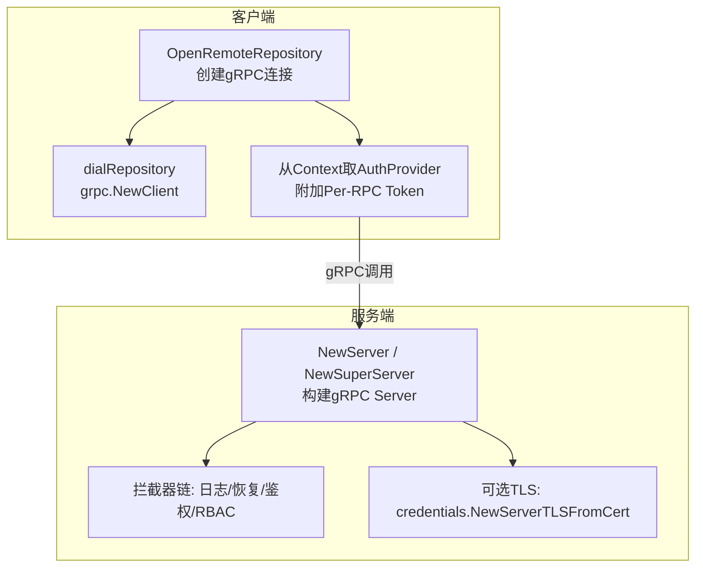
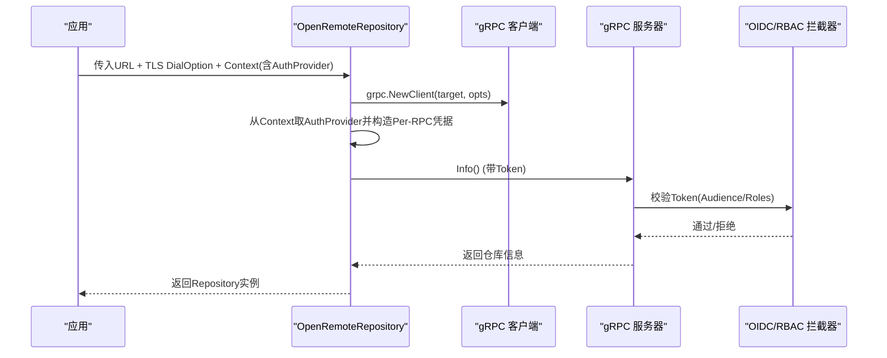
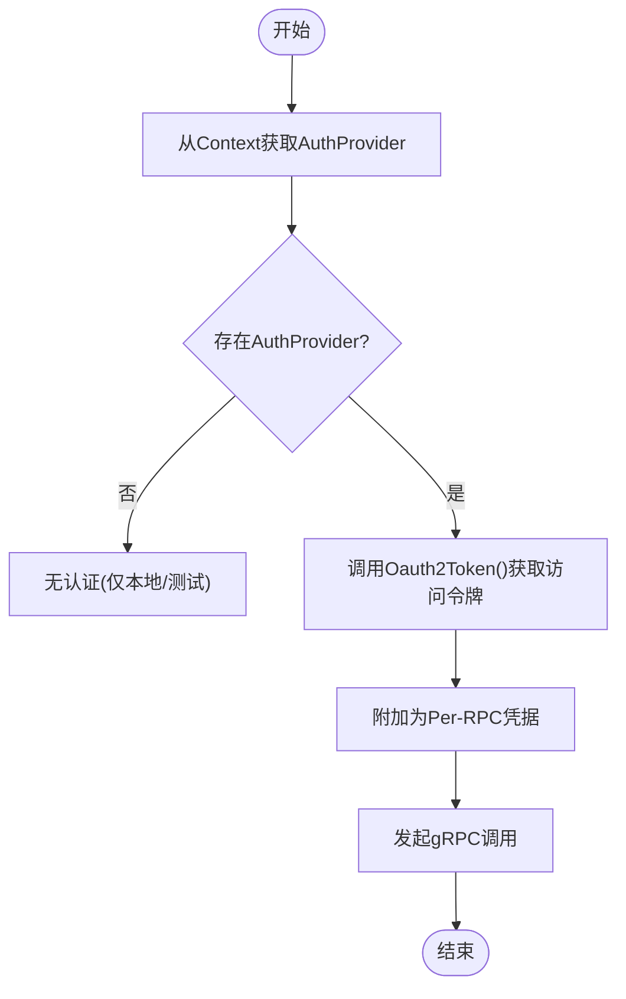
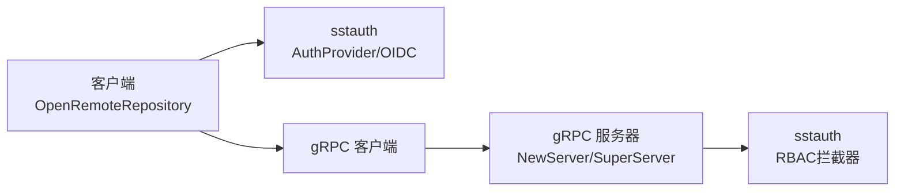

# 连接配置选项

<cite>
**本文引用的文件**
- [repository.go](file://sst/repository.go)
- [reporemote.go](file://sst/reporemote.go)
- [reporemoteapp.go](file://sst/reporemoteapp.go)
- [superremoterepository.go](file://sst/superremoterepository.go)
- [auth.go](file://sstauth/auth.go)
- [authoids.go](file://sstauth/authoids.go)
- [ACCESS_RIGHTS.md](file://sstauth/ACCESS_RIGHTS.md)
- [main.go](file://examples/helloworldreporemote/main.go)
- [gettoken.go](file://cli/cmd/utils/gettoken.go)
- [indexupdate.go](file://sst/indexupdate.go)
</cite>

## 目录
1. [简介](#简介)
2. [项目结构](#项目结构)
3. [核心组件](#核心组件)
4. [架构总览](#架构总览)
5. [详细组件分析](#详细组件分析)
6. [依赖关系分析](#依赖关系分析)
7. [性能与调优](#性能与调优)
8. [故障排查指南](#故障排查指南)
9. [结论](#结论)
10. [附录：场景化配置示例](#附录：场景化配置示例)

## 简介
本文件面向需要配置远程仓库连接的工程师，系统性说明 gRPC 客户端与服务端的连接配置、认证（OAuth2/OIDC）令牌获取与传递机制、健康检查与监控、以及性能调优要点。文档基于代码库中的实际实现进行归纳，并提供不同环境（开发、生产、高可用）的最佳实践建议。

## 项目结构
围绕远程仓库连接的关键路径包括：
- 客户端侧：OpenRemoteRepository 负责建立 gRPC 连接、附加 TLS、从上下文注入认证信息并验证连通性。
- 服务端侧：NewServer/NewSuperServer 构建 gRPC 服务器，注册拦截器链（日志、恢复、鉴权、RBAC），并可选启用 TLS。
- 认证模块：通过 sstauth 提供 AuthProvider 接口与 OIDC 校验、RBAC 拦截器。
- 示例与工具：示例服务启动、CLI 获取 OIDC Token、测试用 FakeOIDC Provider。

图表来源
- [repository.go:257-309](file://sst/repository.go#L257-L309)
- [reporemote.go:264-285](file://sst/reporemote.go#L264-L285)
- [reporemoteapp.go:456-530](file://sst/reporemoteapp.go#L456-L530)

章节来源
- [repository.go:257-309](file://sst/repository.go#L257-L309)
- [reporemote.go:264-285](file://sst/reporemote.go#L264-L285)
- [reporemoteapp.go:456-530](file://sst/reporemoteapp.go#L456-L530)

## 核心组件
- OpenRemoteRepository：组装 DialOption（TLS）、建立连接、从 Context 提取 OAuth2 访问令牌并附加到每次 RPC 调用，随后执行一次 Info 探测以确认连接有效。
- dialRepository：使用 grpc.NewClient 创建连接，封装 DatasetService/CommitService/IndexService 客户端。
- RepositoryServerConfig：服务端配置项，包含仓库目录、OIDC Issuer、ClientID、TLS 证书、是否 verbose、索引映射、是否开启 per-repo 授权等。
- sstauth.AuthProvider：客户端侧的认证提供者接口，用于在每次 RPC 调用时提供 OAuth2 Token。
- RBAC 拦截器：服务端根据方法角色与令牌 audience/roles 进行鉴权。

章节来源
- [repository.go:257-309](file://sst/repository.go#L257-L309)
- [reporemote.go:264-285](file://sst/reporemote.go#L264-L285)
- [reporemoteapp.go:294-303](file://sst/reporemoteapp.go#L294-L303)
- [auth.go:9-53](file://sstauth/auth.go#L9-L53)
- [ACCESS_RIGHTS.md:314-360](file://sstauth/ACCESS_RIGHTS.md#L314-L360)

## 架构总览
下图展示了客户端与服务端在连接与认证上的交互流程。

图表来源
- [repository.go:257-309](file://sst/repository.go#L257-L309)
- [reporemote.go:264-285](file://sst/reporemote.go#L264-L285)
- [reporemoteapp.go:456-530](file://sst/reporemoteapp.go#L456-L530)
- [authoids.go:42-493](file://sstauth/authoids.go#L42-L493)

## 详细组件分析

### 1) gRPC 连接与传输协议
- 传输协议选择：通过传入 grpc.DialOption 控制 TLS。示例中通过 credentials.NewTLS 或自定义传输凭证来启用加密通道。
- 连接建立：OpenRemoteRepository 将 TLS 选项加入 DialOptions，调用 grpc.NewClient 建立连接；dialRepository 进一步封装各 Service 客户端。
- 连接生命周期：Repository.Close 会关闭底层 gRPC 连接；服务端 GracefulStopAndClose 会优雅停止并关闭所有仓库。

章节来源
- [repository.go:257-309](file://sst/repository.go#L257-L309)
- [reporemote.go:264-285](file://sst/reporemote.go#L264-L285)
- [reporemoteapp.go:562-572](file://sst/reporemoteapp.go#L562-L572)

### 2) 超时设置
- 请求级超时：通过 context.WithTimeout 为单次 RPC 设置超时（例如测试中对 CheckoutRevision 设置短超时）。
- 连接级超时：当前代码未显式设置连接级超时参数；如需限制握手或长连接等待，可在上层通过 context 控制整体操作超时。

章节来源
- [real_keycloak_access_test.go:246-283](file://sst_test/real_keycloak_access_test.go#L246-L283)

### 3) 连接池大小与并发
- 连接复用：grpc.NewClient 默认复用连接；代码未显式配置最大连接数或空闲连接策略。
- 并发控制：客户端侧未暴露连接池大小参数；可通过进程内并发度与重试策略控制负载。

章节来源
- [reporemote.go:264-285](file://sst/reporemote.go#L264-L285)

### 4) 认证配置与令牌传递（OAuth2/OIDC）
- 客户端侧：
  - 通过 sstauth.ContextWithAuthProvider 将 AuthProvider 注入 Context。
  - 每次 RPC 调用前，从 Context 取出 Provider 并调用 Oauth2Token() 获取访问令牌，附加为 Per-RPC 凭据。
- 服务端侧：
  - 当配置了 Issuer 与 ClientID，服务器启用 OIDC 校验与 RBAC 拦截器。
  - 支持单仓库模式与 SuperRepository 的 per-repo 授权模型。
- 令牌获取：
  - CLI 工具通过环境变量读取 OIDC 配置并获取 Token。
  - 测试环境可使用 FakeOIDC Provider 生成签名令牌。

图表来源
- [auth.go:9-53](file://sstauth/auth.go#L9-L53)
- [reporemote.go:313-322](file://sst/reporemote.go#L313-L322)
- [gettoken.go:65-83](file://cli/cmd/utils/gettoken.go#L65-L83)

章节来源
- [auth.go:9-53](file://sstauth/auth.go#L9-L53)
- [reporemote.go:313-322](file://sst/reporemote.go#L313-L322)
- [gettoken.go:65-83](file://cli/cmd/utils/gettoken.go#L65-L83)
- [ACCESS_RIGHTS.md:314-360](file://sstauth/ACCESS_RIGHTS.md#L314-L360)

### 5) 健康检查与监控
- 连通性探测：OpenRemoteRepository 在打开后调用 Info 以验证连接有效。
- 服务端拦截器：内置日志与恢复拦截器，便于问题定位。
- 索引健康：内部对 Bleve 搜索做了健康状态记录与简单重试逻辑，可用于评估后端可用性。

章节来源
- [repository.go:296-309](file://sst/repository.go#L296-L309)
- [reporemoteapp.go:456-530](file://sst/reporemoteapp.go#L456-L530)
- [indexupdate.go:673-726](file://sst/indexupdate.go#L673-L726)

### 6) 性能调优相关配置
- 服务端消息大小：MaxRecvMsgSize 设置为 10MB，适合大对象流式传输。
- 索引重建：服务端支持重建 Bleve 索引，便于优化查询性能。
- 连接与并发：当前未暴露连接池大小参数；可通过应用层并发控制与重试策略优化吞吐。

章节来源
- [reporemoteapp.go:514-521](file://sst/reporemoteapp.go#L514-L521)
- [reporemoteapp.go:328-349](file://sst/reporemoteapp.go#L328-L349)

## 依赖关系分析
- 客户端依赖 sstauth 提供的 AuthProvider 接口与 OIDC 校验能力。
- 服务端依赖 sstauth 的 RBAC 拦截器与 OIDC Verifier，按方法级别控制访问权限。
- 示例程序展示如何配置仓库目录、OIDC Issuer/ClientID、TLS 证书等。

图表来源
- [repository.go:257-309](file://sst/repository.go#L257-L309)
- [reporemoteapp.go:456-530](file://sst/reporemoteapp.go#L456-L530)
- [authoids.go:42-493](file://sstauth/authoids.go#L42-L493)

章节来源
- [repository.go:257-309](file://sst/repository.go#L257-L309)
- [reporemoteapp.go:456-530](file://sst/reporemoteapp.go#L456-L530)
- [authoids.go:42-493](file://sstauth/authoids.go#L42-L493)

## 性能与调优
- 传输安全：生产环境务必启用 TLS，避免明文传输。
- 请求超时：为关键路径设置合理的 context 超时，防止阻塞。
- 消息大小：服务端已限制接收消息大小，确保与大对象传输匹配。
- 索引维护：按需重建索引以提升查询性能。
- 连接管理：当前未暴露连接池参数，建议通过应用层并发与重试策略控制资源占用。

[本节为通用指导，不直接分析具体文件]

## 故障排查指南
- 认证失败：检查 Issuer、ClientID、Audience 与 Roles 是否正确；确认 Token 未被篡改且未过期。
- 连接失败：确认 TLS 配置正确、网络可达；必要时增加日志输出。
- 性能问题：关注服务端 MaxRecvMsgSize、索引重建频率与应用层并发度。
- 健康检查：利用 Info 探测与索引健康状态记录辅助判断后端可用性。

章节来源
- [reporemoteapp.go:456-530](file://sst/reporemoteapp.go#L456-L530)
- [indexupdate.go:673-726](file://sst/indexupdate.go#L673-L726)

## 结论
本仓库提供了完整的远程仓库连接与认证能力：客户端通过 OpenRemoteRepository 建立 gRPC 连接并注入 OAuth2 令牌；服务端通过 OIDC 与 RBAC 拦截器保障安全访问。生产部署应启用 TLS、合理设置超时与消息大小，并结合索引维护提升性能。当前版本未暴露连接池大小等高级参数，可通过应用层并发与重试策略进行调优。

[本节为总结，不直接分析具体文件]

## 附录：场景化配置示例

### 开发环境
- 目标：快速连通、最小化配置。
- 建议：
  - 使用本地监听地址与可选的自签证书。
  - 可配置 test Issuer 或使用 FakeOIDC Provider 简化认证。
  - 通过 context 设置较短超时以便快速反馈。

章节来源
- [main.go:58-76](file://examples/helloworldreporemote/main.go#L58-L76)
- [ACCESS_RIGHTS.md:314-360](file://sstauth/ACCESS_RIGHTS.md#L314-L360)

### 生产环境
- 目标：安全、稳定、可观测。
- 建议：
  - 启用 TLS，配置有效的证书。
  - 配置 OIDC Issuer 与 ClientID，启用 RBAC。
  - 为关键操作设置合理的 context 超时。
  - 定期重建索引以维持查询性能。

章节来源
- [reporemoteapp.go:456-530](file://sst/reporemoteapp.go#L456-L530)
- [repository.go:296-309](file://sst/repository.go#L296-L309)

### 高可用环境
- 目标：容错、弹性、可回滚。
- 建议：
  - 结合负载均衡与多实例部署服务端。
  - 使用 per-repo 授权模型隔离不同仓库的访问。
  - 通过健康检查与重试策略提升鲁棒性。
  - 监控与日志：启用 verbose 日志与恢复拦截器，便于问题定位。

章节来源
- [ACCESS_RIGHTS.md:130-171](file://sstauth/ACCESS_RIGHTS.md#L130-L171)
- [reporemoteapp.go:456-530](file://sst/reporemoteapp.go#L456-L530)