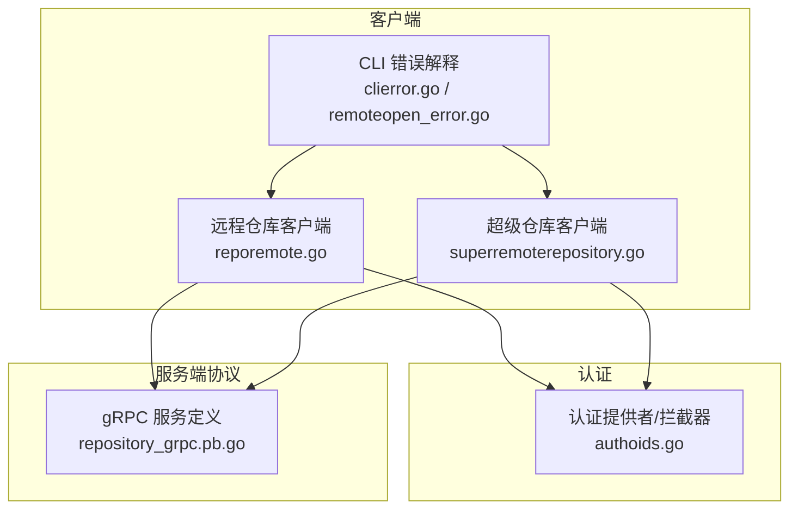
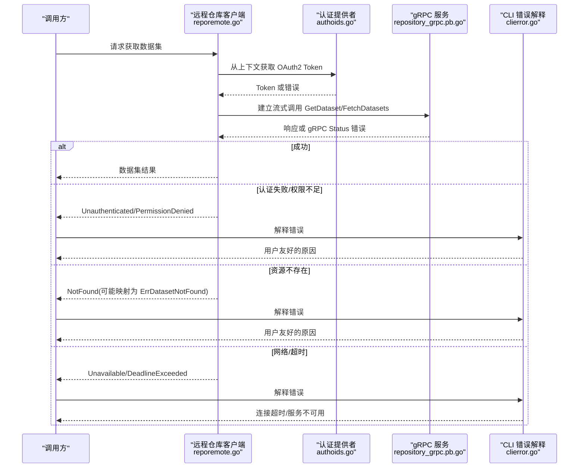
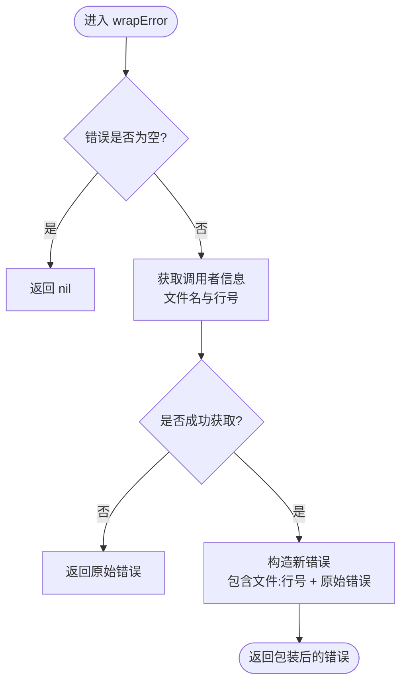
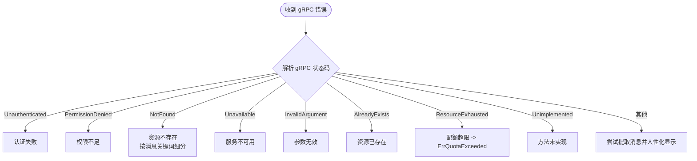
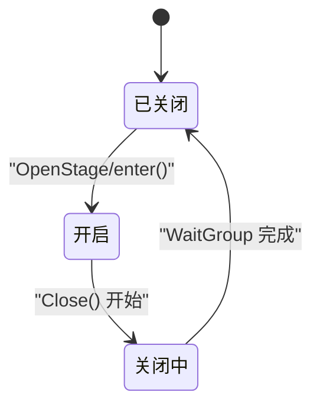
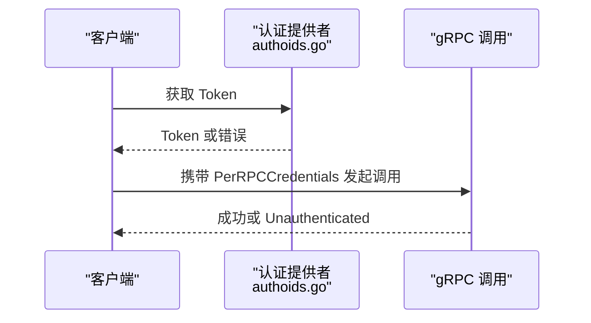
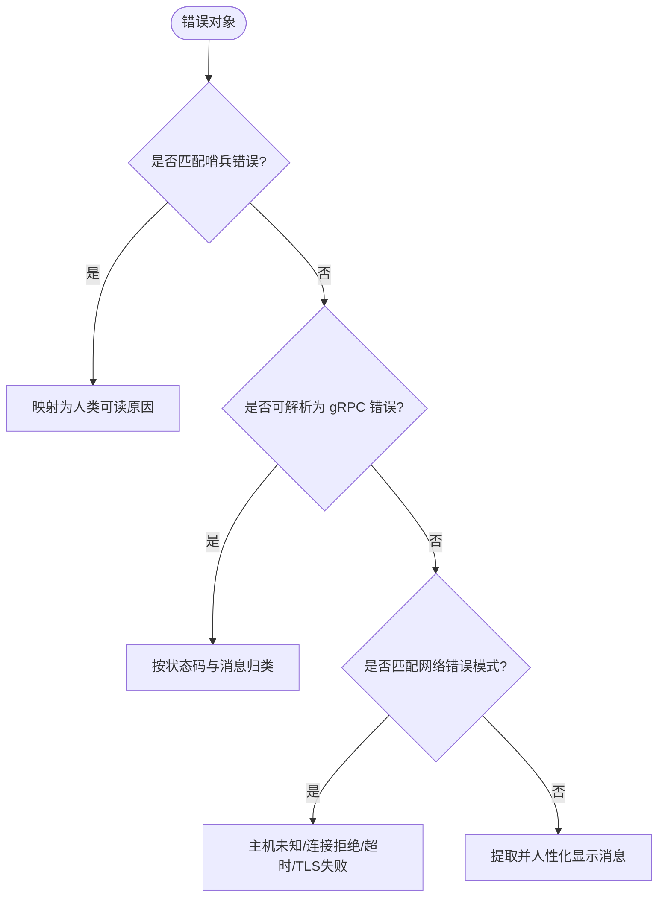
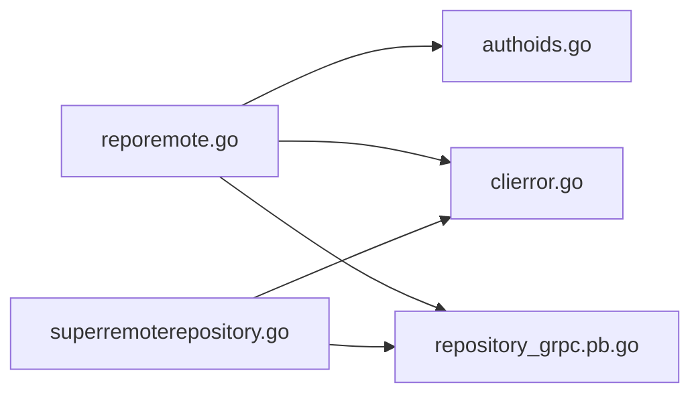

# 错误处理与恢复

<cite>
**本文引用的文件**
- [reporemote.go](file://sst/reporemote.go)
- [superremoterepository.go](file://sst/superremoterepository.go)
- [errrecovery.go](file://sst/errrecovery.go)
- [clierror.go](file://cli/cmd/utils/clierror.go)
- [remoteopen_error.go](file://cli/cmd/utils/remoteopen_error.go)
- [authoids.go](file://sstauth/authoids.go)
- [repository_grpc.pb.go](file://bboltproto/repository_grpc.pb.go)
</cite>

## 目录
1. [简介](#简介)
2. [项目结构](#项目结构)
3. [核心组件](#核心组件)
4. [架构总览](#架构总览)
5. [详细组件分析](#详细组件分析)
6. [依赖关系分析](#依赖关系分析)
7. [性能考虑](#性能考虑)
8. [故障排查指南](#故障排查指南)
9. [结论](#结论)
10. [附录](#附录)

## 简介
本文件聚焦于远程仓库的错误处理与恢复机制，覆盖以下主题：
- gRPC 错误的分类与处理策略（网络错误、认证失败、资源不存在等）
- 错误包装机制（wrapError 如何附加文件行号与上下文信息）
- 重试机制的实现现状与建议（指数退避、最大重试次数）
- 错误恢复最佳实践（优雅降级、熔断器与断路器模式）
- 错误日志记录、监控告警与故障诊断工具使用指南

## 项目结构
围绕远程仓库错误处理的代码主要分布在以下模块：
- sst/reporemote.go：远程仓库客户端实现、gRPC 调用、错误包装与状态控制
- sst/superremoterepository.go：超级仓库管理接口，包含配额超限等错误映射
- sst/errrecovery.go：panic 恢复与堆栈收集
- cli/cmd/utils/clierror.go：CLI 层错误解释与人类可读化
- cli/cmd/utils/remoteopen_error.go：远程仓库打开失败的友好提示
- sstauth/authoids.go：认证令牌提取与 Unauthenticated 错误生成
- bboltproto/repository_grpc.pb.go：gRPC 未实现方法返回 Unimplemented

图表来源
- [reporemote.go:1-200](file://sst/reporemote.go#L1-L200)
- [superremoterepository.go:50-120](file://sst/superremoterepository.go#L50-L120)
- [clierror.go:1-229](file://cli/cmd/utils/clierror.go#L1-L229)
- [remoteopen_error.go:1-69](file://cli/cmd/utils/remoteopen_error.go#L1-L69)
- [authoids.go:73-106](file://sstauth/authoids.go#L73-L106)
- [repository_grpc.pb.go:172-200](file://bboltproto/repository_grpc.pb.go#L172-L200)

章节来源
- [reporemote.go:1-200](file://sst/reporemote.go#L1-L200)
- [superremoterepository.go:50-120](file://sst/superremoterepository.go#L50-L120)
- [clierror.go:1-229](file://cli/cmd/utils/clierror.go#L1-L229)
- [remoteopen_error.go:1-69](file://cli/cmd/utils/remoteopen_error.go#L1-L69)
- [authoids.go:73-106](file://sstauth/authoids.go#L73-L106)
- [repository_grpc.pb.go:172-200](file://bboltproto/repository_grpc.pb.go#L172-L200)

## 核心组件
- 错误包装器 wrapError：在错误上附加调用方文件名与行号，便于定位问题。
- 远程仓库状态控制：enter/leave 保证并发安全并返回 ErrRepoClosed。
- gRPC 调用与错误处理：在多个数据集中调用 DatasetServiceClient/CommitServiceClient，结合认证上下文与 gRPC status 进行错误分类。
- CLI 错误解释：将后端错误转换为面向用户的简洁原因，支持 gRPC 码、已知消息与网络错误匹配。
- 超级仓库配额错误：将 ResourceExhausted 映射为业务错误 ErrQuotaExceeded。
- 认证拦截：从 gRPC metadata 提取 token，失败时返回 Unauthenticated。

章节来源
- [reporemote.go:51-73](file://sst/reporemote.go#L51-L73)
- [reporemote.go:109-124](file://sst/reporemote.go#L109-L124)
- [reporemote.go:479-522](file://sst/reporemote.go#L479-L522)
- [superremoterepository.go:74-90](file://sst/superremoterepository.go#L74-L90)
- [clierror.go:128-177](file://cli/cmd/utils/clierror.go#L128-L177)
- [authoids.go:73-91](file://sstauth/authoids.go#L73-L91)

## 架构总览
下图展示一次远程数据集获取的完整流程，包括认证、gRPC 调用、错误分类与日志记录。

图表来源
- [reporemote.go:479-522](file://sst/reporemote.go#L479-L522)
- [reporemote.go:960-1000](file://sst/reporemote.go#L960-L1000)
- [authoids.go:73-91](file://sstauth/authoids.go#L73-L91)
- [clierror.go:128-177](file://cli/cmd/utils/clierror.go#L128-L177)

## 详细组件分析

### 错误包装机制（wrapError）
- 功能：对非空错误附加调用方的文件名与行号，便于快速定位问题位置。
- 行为：若无法获取调用者信息则原样返回；否则以“文件名:行号: 原始错误”的形式包装。
- 使用场景：在远程仓库相关逻辑中广泛使用，确保错误链中包含精确的调用点。

图表来源
- [reporemote.go:51-61](file://sst/reporemote.go#L51-L61)

章节来源
- [reporemote.go:51-61](file://sst/reporemote.go#L51-L61)

### gRPC 错误分类与处理策略
- 认证失败：当认证提供者无法提供有效 token 或服务端验证失败时，返回 Unauthenticated。
- 权限不足：服务端返回 PermissionDenied，CLI 层解释为需要写入权限。
- 资源不存在：NotFound 且消息包含 dataset/branch/document/repository/commit 等关键词时，分别映射到具体语义。
- 服务不可用：Unavailable 表示临时性服务问题。
- 参数无效：InvalidArgument 直接转为用户可读消息。
- 已存在：AlreadyExists 表示资源已存在。
- 配额超限：ResourceExhausted 被映射为业务错误 ErrQuotaExceeded。
- 未实现：Unimplemented 由服务端返回，通常用于未启用或未实现的 gRPC 方法。

图表来源
- [clierror.go:128-177](file://cli/cmd/utils/clierror.go#L128-L177)
- [superremoterepository.go:74-90](file://sst/superremoterepository.go#L74-L90)
- [repository_grpc.pb.go:172-200](file://bboltproto/repository_grpc.pb.go#L172-L200)

章节来源
- [clierror.go:128-177](file://cli/cmd/utils/clierror.go#L128-L177)
- [superremoterepository.go:74-90](file://sst/superremoterepository.go#L74-L90)
- [repository_grpc.pb.go:172-200](file://bboltproto/repository_grpc.pb.go#L172-L200)

### 远程仓库状态与关闭错误
- enter/leave：在进入操作前检查仓库状态，若仓库已关闭则返回 ErrRepoClosed；同时通过 WaitGroup 管理并发阶段的生命周期。
- 关闭流程：设置状态为 closing/closed，等待所有进行中的阶段完成。

图表来源
- [reporemote.go:109-124](file://sst/reporemote.go#L109-L124)
- [reporemote.go:664-670](file://sst/reporemote.go#L664-L670)

章节来源
- [reporemote.go:109-124](file://sst/reporemote.go#L109-L124)
- [reporemote.go:664-670](file://sst/reporemote.go#L664-L670)

### 认证与鉴权
- 客户端侧：从上下文提取认证提供者，获取 OAuth2 Token 并注入 PerRPCCredentials。
- 服务端侧：从 gRPC metadata 提取 bearer token，校验失败返回 Unauthenticated。

图表来源
- [reporemote.go:479-486](file://sst/reporemote.go#L479-L486)
- [authoids.go:73-91](file://sstauth/authoids.go#L73-L91)

章节来源
- [reporemote.go:479-486](file://sst/reporemote.go#L479-L486)
- [authoids.go:73-91](file://sstauth/authoids.go#L73-L91)

### CLI 层错误解释与人类可读化
- 优先匹配哨兵错误（如 ErrDatasetNotFound、ErrRepositoryNotFound）。
- 其次解析 gRPC 错误链，根据状态码与消息内容归类。
- 最后基于网络错误字符串匹配（主机未知、连接拒绝、超时、TLS 握手失败）。
- 清理 wrapError 前缀，避免泄露内部细节。

图表来源
- [clierror.go:46-75](file://cli/cmd/utils/clierror.go#L46-L75)
- [clierror.go:128-177](file://cli/cmd/utils/clierror.go#L128-L177)
- [clierror.go:179-206](file://cli/cmd/utils/clierror.go#L179-L206)

章节来源
- [clierror.go:46-75](file://cli/cmd/utils/clierror.go#L46-L75)
- [clierror.go:128-177](file://cli/cmd/utils/clierror.go#L128-L177)
- [clierror.go:179-206](file://cli/cmd/utils/clierror.go#L179-L206)

### 远程仓库打开失败的友好提示
- 针对 OpenRemoteRepository 失败，统一输出“Cannot open repository: ...”格式。
- 将认证失败、资源不存在、服务不可用等归并为更简洁的原因。

章节来源
- [remoteopen_error.go:12-69](file://cli/cmd/utils/remoteopen_error.go#L12-L69)

### 错误恢复与 panic 处理
- recoveredError：捕获 panic 并附带可选堆栈信息，便于诊断。
- handleWithRecovery：在 goroutine 或关键路径中使用 recover 将 panic 转为 error，避免进程崩溃。

章节来源
- [errrecovery.go:15-56](file://sst/errrecovery.go#L15-L56)
- [errrecovery.go:81-92](file://sst/errrecovery.go#L81-L92)

## 依赖关系分析
- 远程仓库客户端依赖认证提供者注入 token，并在 gRPC 调用失败时进行分类与日志记录。
- CLI 层依赖 sst 包定义的哨兵错误与 gRPC 状态码，提供一致的用户体验。
- 超级仓库客户端将配额超限错误映射为业务错误，便于上层统一处理。

图表来源
- [reporemote.go:1-200](file://sst/reporemote.go#L1-L200)
- [superremoterepository.go:50-120](file://sst/superremoterepository.go#L50-L120)
- [clierror.go:1-229](file://cli/cmd/utils/clierror.go#L1-L229)
- [authoids.go:73-106](file://sstauth/authoids.go#L73-L106)
- [repository_grpc.pb.go:172-200](file://bboltproto/repository_grpc.pb.go#L172-L200)

章节来源
- [reporemote.go:1-200](file://sst/reporemote.go#L1-L200)
- [superremoterepository.go:50-120](file://sst/superremoterepository.go#L50-L120)
- [clierror.go:1-229](file://cli/cmd/utils/clierror.go#L1-L229)
- [authoids.go:73-106](file://sstauth/authoids.go#L73-L106)
- [repository_grpc.pb.go:172-200](file://bboltproto/repository_grpc.pb.go#L172-L200)

## 性能考虑
- 流式调用与缓存：远程数据集获取使用流式接口与请求缓存减少重复开销。
- 日志级别：对预期错误（如数据集不存在）使用 Debug 级别，避免噪声。
- 上下文与超时：所有方法均支持 context，便于设置超时与取消，避免长时间阻塞。
- 并发安全：通过 stateControl 的原子状态与 WaitGroup 管理并发阶段生命周期，防止竞态。

章节来源
- [reporemote.go:479-522](file://sst/reporemote.go#L479-L522)
- [reporemote.go:109-124](file://sst/reporemote.go#L109-L124)

## 故障排查指南
- 认证失败：检查上下文是否包含有效的认证提供者，确认 token 是否过期或被拒绝。
- 资源不存在：确认数据集/分支/文档/仓库名称是否正确，查看 NotFound 消息关键词。
- 服务不可用：检查服务端健康状态与网络连通性，必要时重试或降级。
- 配额超限：查看服务器配额配置，调整限制或释放空间。
- 方法未实现：确认服务端启用了相应 gRPC 方法。
- 日志与诊断：利用 GlobalLogger 的输出与 recoveredError 的堆栈信息定位问题。

章节来源
- [clierror.go:128-177](file://cli/cmd/utils/clierror.go#L128-L177)
- [superremoterepository.go:74-90](file://sst/superremoterepository.go#L74-L90)
- [repository_grpc.pb.go:172-200](file://bboltproto/repository_grpc.pb.go#L172-L200)
- [errrecovery.go:15-56](file://sst/errrecovery.go#L15-L56)

## 结论
该代码库在远程仓库错误处理方面具备完善的分类、包装与解释能力：
- 通过 wrapError 增强错误可追溯性
- 将 gRPC 状态码与消息映射为业务语义清晰的错误
- 在 CLI 层提供一致的人类可读错误提示
- 支持认证、权限、配额、资源存在性等常见场景
- 提供 panic 恢复机制与上下文超时控制

建议在生产环境中结合重试与熔断策略进一步提升鲁棒性。

## 附录

### 重试机制实现现状与建议
- 现状：当前代码未内置统一的指数退避与最大重试次数控制；部分调用通过 context 超时与流式接口管理。
- 建议：
  - 对幂等读操作（如搜索、获取数据集）引入指数退避重试，限制最大重试次数与总耗时。
  - 对写操作谨慎重试，确保幂等性或引入分布式锁/版本号控制。
  - 结合熔断器（如基于错误率与延迟阈值）与断路器（开/半开/关状态机）保护下游服务。
  - 在 CLI 层对用户可见的重试提供明确提示与退出选项。

[本节为通用指导，不直接分析具体文件]

### 错误恢复最佳实践
- 优雅降级：在服务不可用时返回缓存或默认结果，降低用户体验影响。
- 熔断器与断路器：在连续失败后快速失败，避免雪崩；在恢复后逐步试探。
- 监控告警：对关键错误（认证失败、配额超限、服务不可用）设置指标与告警。
- 日志规范：区分 Info/Debug/Error，避免泄露敏感信息；保留必要上下文（仓库名、数据集 ID、操作类型）。

[本节为通用指导，不直接分析具体文件]