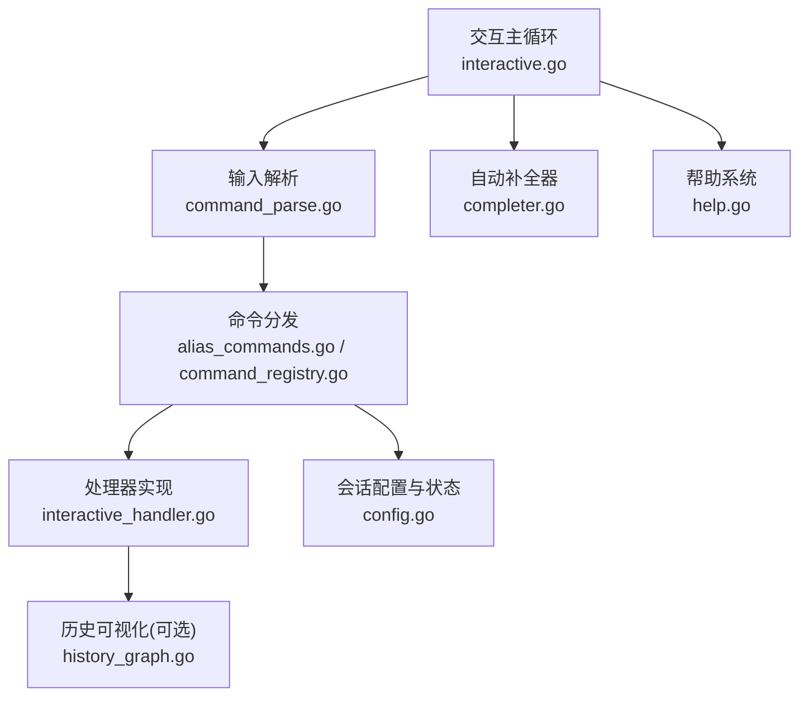
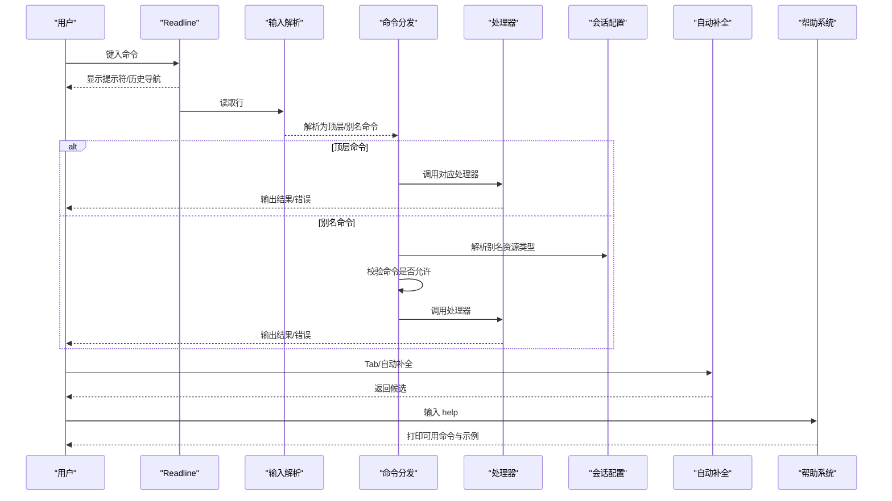
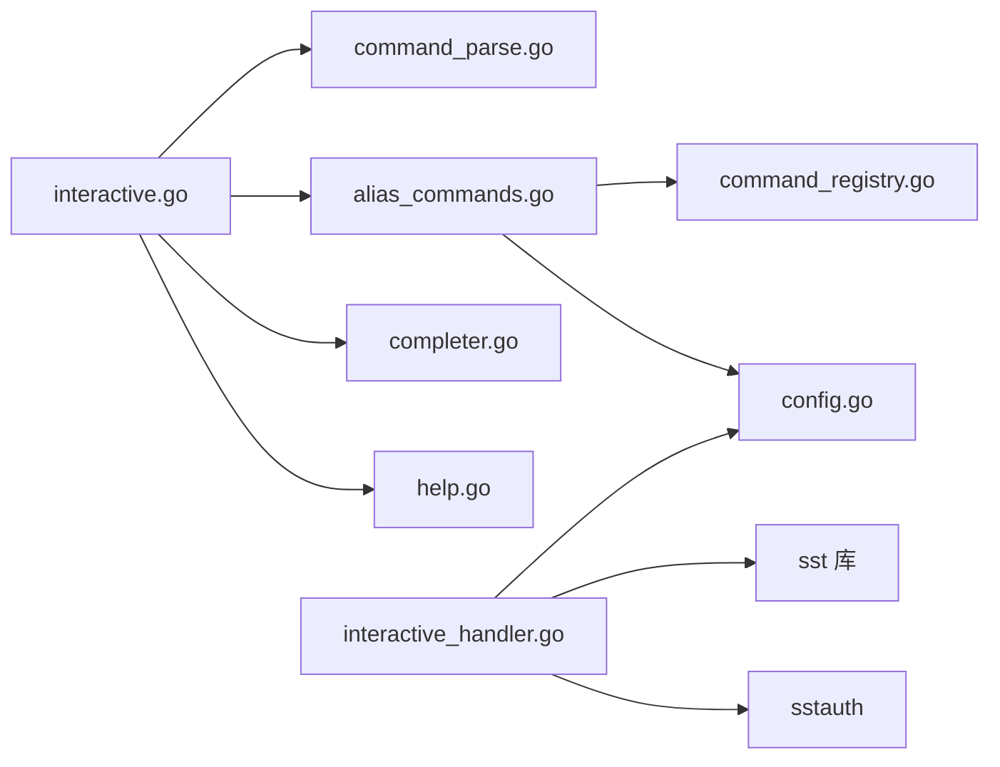

# 交互式会话

<cite>
**本文引用的文件**
- [interactive.go](file://cli/cmd/interactive/interactive.go)
- [command_registry.go](file://cli/cmd/interactive/command_registry.go)
- [completer.go](file://cli/cmd/interactive/completer.go)
- [help.go](file://cli/cmd/interactive/help.go)
- [config.go](file://cli/cmd/interactive/config.go)
- [command_parse.go](file://cli/cmd/interactive/command_parse.go)
- [alias_commands.go](file://cli/cmd/interactive/alias_commands.go)
- [interactive_handler.go](file://cli/cmd/interactive/interactive_handler.go)
- [history_graph.go](file://cli/cmd/interactive/history_graph.go)
</cite>

## 目录
1. [简介](#简介)
2. [项目结构](#项目结构)
3. [核心组件](#核心组件)
4. [架构总览](#架构总览)
5. [详细组件分析](#详细组件分析)
6. [依赖关系分析](#依赖关系分析)
7. [性能考量](#性能考量)
8. [故障排查指南](#故障排查指南)
9. [结论](#结论)
10. [附录](#附录)

## 简介
本文件面向SST CLI的“交互式会话模式”，提供从启动、命令补全、命令注册与扩展、历史记录管理、帮助系统查询到常用最佳实践与个性化配置的完整说明。读者无需深入代码即可高效使用交互式会话，同时为开发者提供扩展命令与定制行为的参考路径。

## 项目结构
交互式会话位于 cli/cmd/interactive 包中，围绕“输入解析—命令分发—处理器执行”的主线组织：
- 入口与主循环：负责读取用户输入、历史持久化、异常恢复与退出控制
- 命令注册与别名体系：集中声明顶层命令与按资源类型（仓库、数据集、阶段、命名图、IBNode）可用的别名命令
- 自动补全：基于当前会话状态（已打开的别名）与命令注册表提供上下文感知补全
- 帮助系统：按类别展示可用命令与用法示例
- 配置与会话状态：维护仓库、超级仓库、数据集、阶段、命名图、IBNode等别名映射及元信息
- 处理器实现：具体业务逻辑（打开仓库、导入数据、提交、验证、导出等）

图表来源
- [interactive.go:27-99](file://cli/cmd/interactive/interactive.go#L27-L99)
- [command_parse.go:21-56](file://cli/cmd/interactive/command_parse.go#L21-L56)
- [alias_commands.go:187-212](file://cli/cmd/interactive/alias_commands.go#L187-L212)
- [command_registry.go:45-148](file://cli/cmd/interactive/command_registry.go#L45-L148)
- [completer.go:15-51](file://cli/cmd/interactive/completer.go#L15-L51)
- [help.go:12-62](file://cli/cmd/interactive/help.go#L12-L62)
- [config.go:11-73](file://cli/cmd/interactive/config.go#L11-L73)
- [history_graph.go:26-339](file://cli/cmd/interactive/history_graph.go#L26-L339)

章节来源
- [interactive.go:27-99](file://cli/cmd/interactive/interactive.go#L27-L99)
- [command_registry.go:45-148](file://cli/cmd/interactive/command_registry.go#L45-L148)
- [completer.go:15-51](file://cli/cmd/interactive/completer.go#L15-L51)
- [help.go:12-62](file://cli/cmd/interactive/help.go#L12-L62)
- [config.go:11-73](file://cli/cmd/interactive/config.go#L11-L73)
- [command_parse.go:21-56](file://cli/cmd/interactive/command_parse.go#L21-L56)
- [alias_commands.go:187-212](file://cli/cmd/interactive/alias_commands.go#L187-L212)
- [interactive_handler.go:25-152](file://cli/cmd/interactive/interactive_handler.go#L25-L152)
- [history_graph.go:26-339](file://cli/cmd/interactive/history_graph.go#L26-L339)

## 核心组件
- 交互主循环与历史
  - 使用 readline 支持历史导航与持久化；失败时回退到基础输入模式
  - 支持 Ctrl+C 提示继续、Ctrl+D 或 EOF 退出；q 快捷退出
  - 每条有效命令写入历史文件（默认在用户家目录下）
- 命令解析与分发
  - 支持两种形式：顶层命令（如 help、openlocalrepository）和别名命令（如 r1.datasets）
  - 别名命令通过“资源类型—命令”白名单校验，错误提示友好并给出建议
- 自动补全
  - 空输入提示所有顶层命令
  - 输入包含点号时，优先补全别名后跟命令；否则尝试补全别名或顶层命令
  - 别名候选来自当前会话已打开的仓库/超级仓库/数据集/阶段/命名图/IBNode
- 帮助系统
  - 列出顶层命令与按资源类型分组的别名命令
  - 提供 dump key 参考与常见用法示例
- 会话配置
  - 集中维护各类资源的别名映射、位置/类型、分支/提交/修订元信息、认证上下文等

章节来源
- [interactive.go:27-99](file://cli/cmd/interactive/interactive.go#L27-L99)
- [command_parse.go:21-56](file://cli/cmd/interactive/command_parse.go#L21-L56)
- [alias_commands.go:50-136](file://cli/cmd/interactive/alias_commands.go#L50-L136)
- [completer.go:15-51](file://cli/cmd/interactive/completer.go#L15-L51)
- [help.go:12-62](file://cli/cmd/interactive/help.go#L12-L62)
- [config.go:11-73](file://cli/cmd/interactive/config.go#L11-L73)

## 架构总览
下图展示了交互式会话从输入到执行的端到端流程，包括自动补全与帮助系统的集成点。

图表来源
- [interactive.go:27-99](file://cli/cmd/interactive/interactive.go#L27-L99)
- [command_parse.go:21-56](file://cli/cmd/interactive/command_parse.go#L21-L56)
- [alias_commands.go:187-212](file://cli/cmd/interactive/alias_commands.go#L187-L212)
- [completer.go:15-51](file://cli/cmd/interactive/completer.go#L15-L51)
- [help.go:12-62](file://cli/cmd/interactive/help.go#L12-L62)

## 详细组件分析

### 启动交互式会话模式
- 通过 cobra 子命令进入交互模式，打印引导信息后调用启动函数
- 启动函数会：
  - 确定历史文件路径（用户家目录）
  - 创建自动补全器
  - 初始化 readline（提示符、历史限制、自动补全、中断/EOF处理）
  - 若初始化失败则降级为基础输入模式
  - 循环读取输入、保存历史、安全执行命令（panic 恢复）

章节来源
- [interactive.go:17-25](file://cli/cmd/interactive/interactive.go#L17-L25)
- [interactive.go:27-99](file://cli/cmd/interactive/interactive.go#L27-L99)
- [interactive.go:101-135](file://cli/cmd/interactive/interactive.go#L101-L135)

### 命令自动补全使用方法
- 行为规则
  - 空输入：列出所有顶层命令
  - 输入含“.”：识别为 alias.command 形式，先补全 alias，再补全 command
  - 无空格且未含“.”：优先尝试补全别名（成功后自动追加“.”）
  - 其他情况：按顶层命令前缀匹配
- 候选来源
  - 顶层命令：来自注册表
  - 别名：来自当前会话已打开的资源（仓库、超级仓库、数据集、阶段、命名图、IBNode）
  - 命令：根据别名对应的资源类型，仅列出该类型允许的命令集合
- 使用建议
  - 输入别名后直接按 Tab 可补全命令
  - 输入部分命令名可快速过滤
  - 不确定可用命令时，使用 help 查看分组列表

章节来源
- [completer.go:15-51](file://cli/cmd/interactive/completer.go#L15-L51)
- [completer.go:73-123](file://cli/cmd/interactive/completer.go#L73-L123)
- [alias_commands.go:72-97](file://cli/cmd/interactive/alias_commands.go#L72-L97)

### 命令注册机制与自定义命令扩展
- 顶层命令注册
  - 以声明式数组定义命令名、处理器函数、用法和帮助文本
  - 初始化时构建名称索引以便快速查找
- 别名命令注册
  - 每个别名命令可绑定一个或多个资源类型（仓库、超级仓库、数据集、阶段、命名图、IBNode）
  - 支持按资源类型差异化处理器（ByKind），否则共用统一处理器
  - 初始化时构建“别名—类型—命令”索引，用于校验与补全
- 扩展方式
  - 新增顶层命令：在顶层命令注册处添加条目，实现处理器函数
  - 新增别名命令：在别名命令注册处添加条目，指定 Kinds 与 Handler/ByKind
  - 如需新资源类型：扩展 aliasKind 枚举并在相关索引/补全/帮助中补充
- 校验与错误提示
  - 别名不存在、命令未知、命令对当前资源类型不可用均有明确错误消息与建议

章节来源
- [command_registry.go:45-148](file://cli/cmd/interactive/command_registry.go#L45-L148)
- [command_registry.go:156-184](file://cli/cmd/interactive/command_registry.go#L156-L184)
- [alias_commands.go:11-28](file://cli/cmd/interactive/alias_commands.go#L11-L28)
- [alias_commands.go:50-136](file://cli/cmd/interactive/alias_commands.go#L50-L136)
- [alias_commands.go:138-185](file://cli/cmd/interactive/alias_commands.go#L138-L185)

### 会话历史记录的管理和使用
- 存储位置
  - 默认保存在用户家目录下的隐藏历史文件
- 功能特性
  - 支持上下方向键浏览历史
  - 每次成功执行的有效命令会被保存
  - 最大历史条数可配置（默认上限）
- 降级策略
  - 若 readline 初始化失败，将回退到基础输入模式（无历史）

章节来源
- [interactive.go:27-54](file://cli/cmd/interactive/interactive.go#L27-L54)
- [interactive.go:56-99](file://cli/cmd/interactive/interactive.go#L56-L99)
- [interactive.go:101-135](file://cli/cmd/interactive/interactive.go#L101-L135)

### 帮助系统的查询方法
- 触发方式：输入 help
- 内容组织
  - 顶层命令列表（含用法与简要说明）
  - 按资源类型分组的别名命令（如 <repo>.info、<stage>.commit 等）
  - 内部 dump key 参考与示例
- 用途
  - 快速了解可用命令
  - 学习典型用法与注意事项

章节来源
- [help.go:12-62](file://cli/cmd/interactive/help.go#L12-L62)

### 常用交互操作的最佳实践
- 打开与管理资源
  - 使用 openlocalrepository/openremoterepository 打开本地/远程仓库，并通过 -a 指定别名便于后续引用
  - 使用 status 查看当前会话中所有已打开资源及其层级关系
- 数据导入与处理
  - 使用 rdfread/sstread/importap242xml/importp21/importsvg 将外部数据读入阶段
  - 使用 namedgraphs/referencednamedgraphs 检查阶段内容
- 版本管理与提交
  - 使用 commit 提交变更，必要时指定分支名
  - 使用 branches/listcommits/history 查看分支与提交历史
- 验证与导出
  - 使用 validate 进行数据校验，必要时输出报告文件
  - 使用 trig/ttl/sstwrite/exportsvg/exportap242xml 等导出不同格式
- 高效输入
  - 善用 Tab 自动补全与 help 减少拼写错误
  - 使用别名命令（如 r1.datasets）避免重复输入长路径或URL

章节来源
- [interactive_handler.go:25-152](file://cli/cmd/interactive/interactive_handler.go#L25-L152)
- [interactive_handler.go:583-703](file://cli/cmd/interactive/interactive_handler.go#L583-L703)
- [interactive_handler.go:705-785](file://cli/cmd/interactive/interactive_handler.go#L705-L785)
- [command_registry.go:45-148](file://cli/cmd/interactive/command_registry.go#L45-L148)

### 会话配置与个性化设置选项
- 会话状态
  - 维护仓库、超级仓库、数据集、阶段、命名图、IBNode 的别名映射
  - 记录仓库/超级仓库的位置与类型
  - 记录阶段的分支、提交、修订、源文件等信息
  - 维护认证上下文（用于远程访问）
- 个性化建议
  - 为频繁使用的仓库/数据集/阶段设置简洁别名，提升效率
  - 结合 status 定期清理不再使用的别名，保持会话整洁
  - 远程仓库连接失败时，检查网络与认证配置

章节来源
- [config.go:11-73](file://cli/cmd/interactive/config.go#L11-L73)
- [interactive_handler.go:25-152](file://cli/cmd/interactive/interactive_handler.go#L25-L152)

## 依赖关系分析
- 模块耦合
  - 主循环依赖输入解析、命令分发、自动补全与帮助系统
  - 命令分发依赖注册表与别名校验逻辑
  - 处理器依赖会话配置以获取/更新别名与元信息
- 外部依赖
  - readline 提供交互式输入、历史与补全能力
  - sst 库提供仓库、数据集、阶段、命名图等核心对象
  - sstauth 提供认证上下文
- 潜在风险
  - 别名冲突（同名别名覆盖）需在处理器中做存在性检查
  - 远程连接异常需捕获并给出清晰提示

图表来源
- [interactive.go:27-99](file://cli/cmd/interactive/interactive.go#L27-L99)
- [command_parse.go:21-56](file://cli/cmd/interactive/command_parse.go#L21-L56)
- [alias_commands.go:187-212](file://cli/cmd/interactive/alias_commands.go#L187-L212)
- [command_registry.go:45-148](file://cli/cmd/interactive/command_registry.go#L45-L148)
- [completer.go:15-51](file://cli/cmd/interactive/completer.go#L15-L51)
- [help.go:12-62](file://cli/cmd/interactive/help.go#L12-L62)
- [config.go:11-73](file://cli/cmd/interactive/config.go#L11-L73)
- [interactive_handler.go:25-152](file://cli/cmd/interactive/interactive_handler.go#L25-L152)

章节来源
- [interactive.go:27-99](file://cli/cmd/interactive/interactive.go#L27-L99)
- [command_registry.go:45-148](file://cli/cmd/interactive/command_registry.go#L45-L148)
- [alias_commands.go:187-212](file://cli/cmd/interactive/alias_commands.go#L187-L212)
- [interactive_handler.go:25-152](file://cli/cmd/interactive/interactive_handler.go#L25-L152)

## 性能考量
- 历史文件大小与滚动：历史上限可防止无限增长；大历史可能影响加载速度
- 自动补全：基于内存索引，响应迅速；大量别名时仍保持线性扫描，整体开销低
- 远程操作：网络延迟与认证握手为主要瓶颈；建议在稳定网络环境下执行
- 大数据导入：RDF/SST 读取与转换可能耗时，建议使用进度提示与后台任务（如有）

[本节为通用指导，不直接分析具体文件]

## 故障排查指南
- 无法进入交互模式或无历史
  - 检查 readline 初始化是否成功；若失败将回退基础模式
  - 确认用户家目录可写权限
- 别名或命令报错
  - 别名不存在：使用 status 查看已打开资源
  - 命令不可用：检查当前资源类型是否允许该命令；help 查看可用命令
  - 命令拼写错误：系统会给出最接近的建议
- 远程仓库连接失败
  - 检查 URL、网络与认证配置；错误信息包含技术细节便于定位
- 导入/读取失败
  - 检查文件格式与路径；关注错误中的具体原因（如不支持的格式）

章节来源
- [interactive.go:27-99](file://cli/cmd/interactive/interactive.go#L27-L99)
- [alias_commands.go:138-185](file://cli/cmd/interactive/alias_commands.go#L138-L185)
- [interactive_handler.go:25-152](file://cli/cmd/interactive/interactive_handler.go#L25-L152)

## 结论
SST 交互式会话提供了直观的命令行体验：强大的自动补全、清晰的帮助系统、完善的命令注册与别名机制，以及健壮的会话状态管理。通过合理设置别名与遵循最佳实践，用户可以高效完成数据导入、版本管理、验证与导出等任务。对于开发者而言，命令注册与别名体系为扩展提供了清晰而灵活的接口。

[本节为总结性内容，不直接分析具体文件]

## 附录

### 常用命令速查（节选）
- 顶层命令
  - help：显示可用命令
  - q：退出交互模式
  - openlocalrepository/openremoterepository：打开本地/远程仓库
  - createlocalrepository：创建本地仓库
  - rdfread/sstread/importap242xml/importp21/importsvg：导入数据到阶段
- 别名命令（示例）
  - <repo>.datasets：列出数据集
  - <repo>.log：查看提交历史
  - <stage>.commit：提交变更
  - <stage>.validate：校验数据
  - <stage>.trig/<namedgraph>.ttl：导出数据
  - <dataset>.branches/history：查看分支与历史

章节来源
- [command_registry.go:45-148](file://cli/cmd/interactive/command_registry.go#L45-L148)
- [help.go:12-62](file://cli/cmd/interactive/help.go#L12-L62)

### 历史可视化（可选）
- 当需要直观查看提交历史时，可使用内置的历史图绘制能力，按时间顺序与父子关系展示节点，并标注分支指向与作者信息

章节来源
- [history_graph.go:26-339](file://cli/cmd/interactive/history_graph.go#L26-L339)