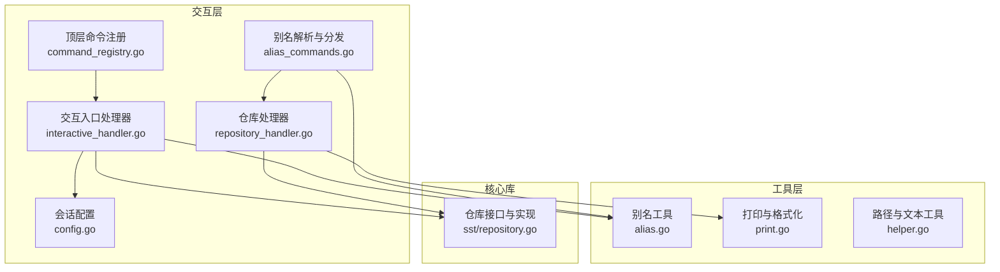
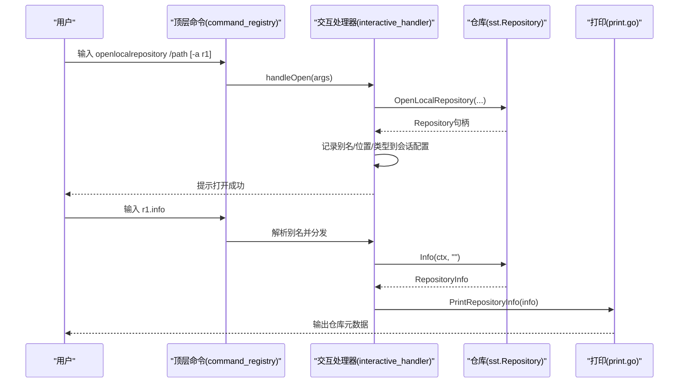
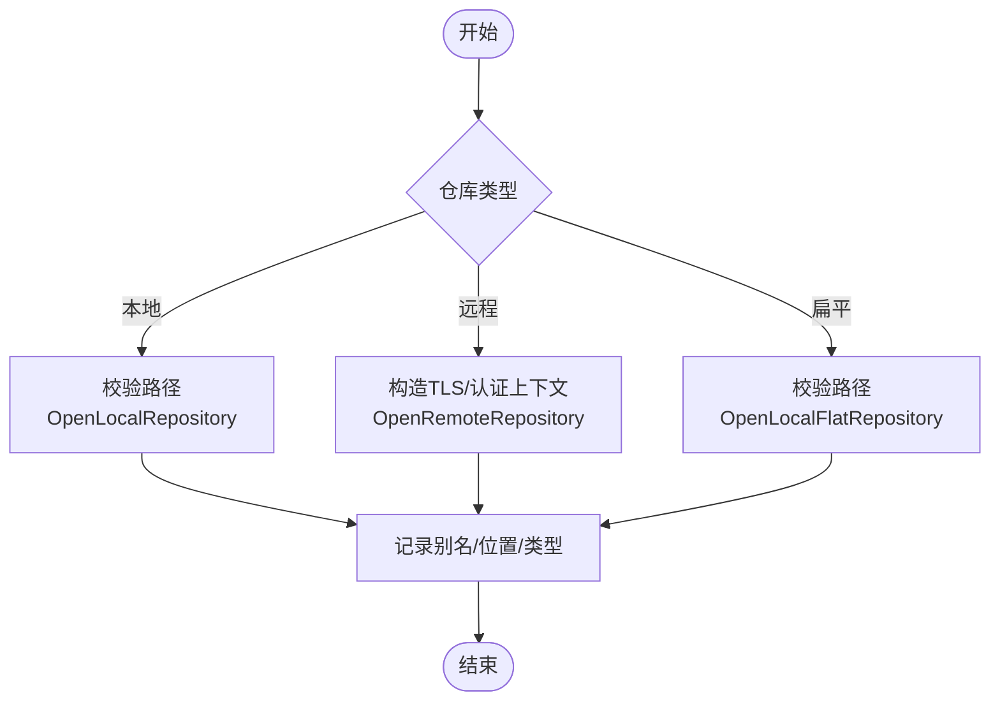
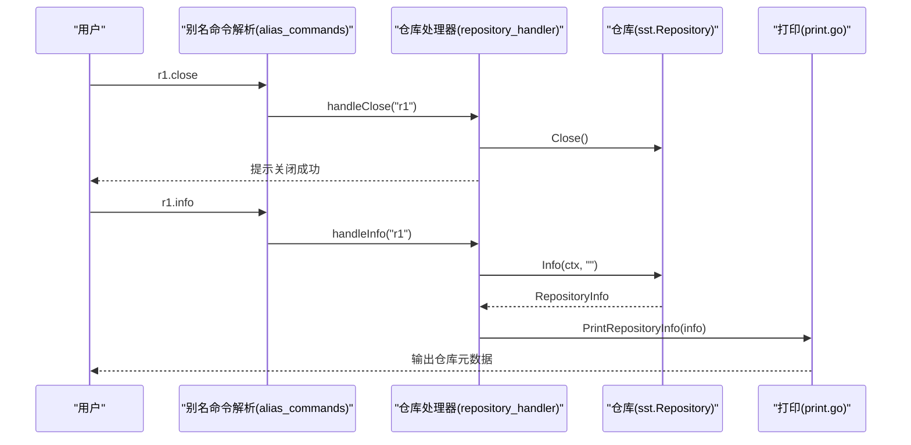
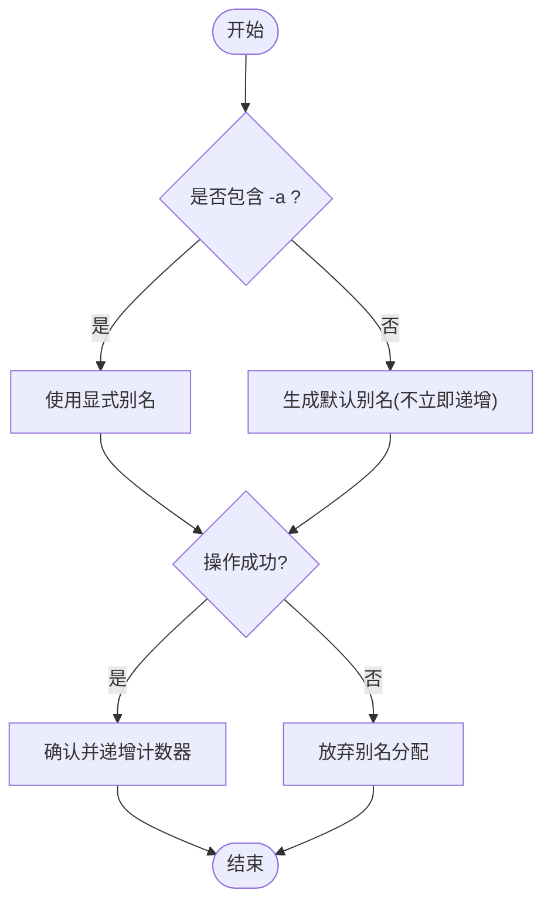
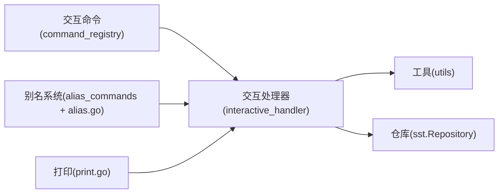

# 仓库操作命令

<cite>
**本文引用的文件**
- [interactive_handler.go](file://cli/cmd/interactive/interactive_handler.go)
- [repository_handler.go](file://cli/cmd/interactive/repository_handler.go)
- [command_registry.go](file://cli/cmd/interactive/command_registry.go)
- [alias_commands.go](file://cli/cmd/interactive/alias_commands.go)
- [config.go](file://cli/cmd/interactive/config.go)
- [alias.go](file://cli/cmd/utils/alias.go)
- [print.go](file://cli/cmd/utils/print.go)
- [helper.go](file://cli/cmd/utils/helper.go)
- [repository.go](file://sst/repository.go)
</cite>

## 目录
1. [简介](#简介)
2. [项目结构](#项目结构)
3. [核心组件](#核心组件)
4. [架构总览](#架构总览)
5. [详细组件分析](#详细组件分析)
6. [依赖关系分析](#依赖关系分析)
7. [性能考虑](#性能考虑)
8. [故障排除指南](#故障排除指南)
9. [结论](#结论)
10. [附录](#附录)

## 简介
本文件面向SST仓库的命令行交互模式，系统化说明仓库打开、关闭、信息查询等核心命令的使用方法；解释仓库别名管理（自动与显式别名）；介绍仓库信息查看命令以展示类型、位置、状态等元数据；并提供仓库生命周期管理的最佳实践（连接与资源释放），以及错误处理与故障排除建议。

## 项目结构
交互式CLI通过“顶层命令”和“别名命令”两层组织：
- 顶层命令：如 openlocalrepository、openremoterepository、createlocalrepository、status 等，负责仓库/超级仓库的创建与打开、会话状态展示等。
- 别名命令：绑定到已打开的仓库别名（如 r1.info、r1.close、r1.log 等），用于对具体仓库执行查询、日志、提交、文档等操作。

图表来源
- [command_registry.go:45-62](file://cli/cmd/interactive/command_registry.go#L45-L62)
- [alias_commands.go:113-203](file://cli/cmd/interactive/alias_commands.go#L113-L203)
- [interactive_handler.go:25-152](file://cli/cmd/interactive/interactive_handler.go#L25-L152)
- [config.go:11-47](file://cli/cmd/interactive/config.go#L11-L47)
- [alias.go:14-42](file://cli/cmd/utils/alias.go#L14-L42)
- [print.go:15-37](file://cli/cmd/utils/print.go#L15-L37)
- [repository.go:50-179](file://sst/repository.go#L50-L179)

章节来源
- [command_registry.go:45-62](file://cli/cmd/interactive/command_registry.go#L45-L62)
- [interactive_handler.go:25-152](file://cli/cmd/interactive/interactive_handler.go#L25-L152)
- [config.go:11-47](file://cli/cmd/interactive/config.go#L11-L47)

## 核心组件
- 仓库打开/创建
  - 本地仓库：openlocalrepository <path> [-a <alias>]
  - 远程仓库：openremoterepository <URL> [-a <alias>]
  - 新建本地仓库：createlocalrepository <path> [-a <alias>] [--basic]
  - 扁平仓库：openlocalflatrepository <path> [-a <alias>]
- 仓库关闭与信息
  - 关闭仓库：r1.close
  - 仓库信息：r1.info
  - 数据集列表：r1.datasets
  - 查询索引：r1.query <bleve-query> [--limit N]
  - 日志浏览：r1.log [-v|--verbose]
  - 提交详情：r1.commitInfo <commit-hash>
  - 提交差异：r1.commitdiff <commit-hash>
  - 检出提交：r1.checkoutcommit <hash> [-a <stage-alias>]
  - 文档操作：documentset/documentget/documentinfo/documents/documentdelete
  - 导出/同步/克隆等：extractsstfile/filterextract/syncfrom/clone
- 别名管理
  - 显式别名：使用 -a <alias> 指定
  - 自动别名：未提供 -a 时自动生成（如 r1、r2...），成功完成后才递增计数器
- 会话状态
  - status：显示当前打开的超级仓库、仓库、数据集、阶段、命名图、IB节点及其层级关系

章节来源
- [command_registry.go:45-147](file://cli/cmd/interactive/command_registry.go#L45-L147)
- [interactive_handler.go:25-281](file://cli/cmd/interactive/interactive_handler.go#L25-L281)
- [repository_handler.go:27-111](file://cli/cmd/interactive/repository_handler.go#L27-L111)
- [alias.go:14-42](file://cli/cmd/utils/alias.go#L14-L42)

## 架构总览
下图展示了从用户输入到仓库操作的完整调用链：顶层命令解析 -> 交互处理器 -> 仓库API -> 返回结果并格式化输出。

图表来源
- [command_registry.go:45-62](file://cli/cmd/interactive/command_registry.go#L45-L62)
- [interactive_handler.go:25-152](file://cli/cmd/interactive/interactive_handler.go#L25-L152)
- [repository.go:50-179](file://sst/repository.go#L50-L179)
- [print.go:15-37](file://cli/cmd/utils/print.go#L15-L37)

## 详细组件分析

### 仓库打开流程（本地/远程/扁平）
- 本地仓库打开
  - 校验路径存在且为目录
  - 调用 sst.OpenLocalRepository 打开BBolt数据库
  - 将仓库句柄、位置、类型写入会话配置
- 远程仓库打开
  - 构建TLS凭据与认证上下文
  - 调用 sst.OpenRemoteRepository 建立gRPC连接并验证连接有效性
  - 保存认证上下文与会话映射
- 扁平仓库打开
  - 校验路径后调用 sst.OpenLocalFlatRepository
  - 记录为 localflat 类型

图表来源
- [interactive_handler.go:25-152](file://cli/cmd/interactive/interactive_handler.go#L25-L152)
- [interactive_handler.go:155-203](file://cli/cmd/interactive/interactive_handler.go#L155-L203)
- [repository.go:465-562](file://sst/repository.go#L465-L562)
- [repository.go:240-309](file://sst/repository.go#L240-L309)
- [repository.go:650-694](file://sst/repository.go#L650-L694)

章节来源
- [interactive_handler.go:25-203](file://cli/cmd/interactive/interactive_handler.go#L25-L203)
- [repository.go:240-309](file://sst/repository.go#L240-L309)
- [repository.go:465-562](file://sst/repository.go#L465-L562)
- [repository.go:650-694](file://sst/repository.go#L650-L694)

### 仓库关闭与信息查看
- 关闭仓库
  - 根据别名查找仓库或超级仓库
  - 调用 Close() 释放资源并从会话中移除
- 仓库信息
  - 调用 repository.Info(ctx, branchName) 获取 RepositoryInfo
  - 使用 PrintRepositoryInfo 输出URL、访问权限、数据库大小、数据集数量、是否远程、Bleve信息等

图表来源
- [alias_commands.go:113-203](file://cli/cmd/interactive/alias_commands.go#L113-L203)
- [repository_handler.go:27-111](file://cli/cmd/interactive/repository_handler.go#L27-L111)
- [print.go:15-37](file://cli/cmd/utils/print.go#L15-L37)
- [repository.go:50-179](file://sst/repository.go#L50-L179)

章节来源
- [repository_handler.go:27-111](file://cli/cmd/interactive/repository_handler.go#L27-L111)
- [print.go:15-37](file://cli/cmd/utils/print.go#L15-L37)
- [alias_commands.go:113-203](file://cli/cmd/interactive/alias_commands.go#L113-L203)

### 别名管理与快速访问
- 显式别名：在命令中使用 -a <alias> 指定，例如 openlocalrepository /path -a myrepo
- 自动别名：未提供 -a 时生成默认别名（如 r1、r2...），仅在操作成功后递增计数器
- 别名去重与冲突检测：打开仓库前检查别名是否已存在
- 别名作用域：支持 superrepository、repository、dataset、stage、namedgraph、ibnode 等类型

图表来源
- [alias.go:14-42](file://cli/cmd/utils/alias.go#L14-L42)
- [interactive_handler.go:56-75](file://cli/cmd/interactive/interactive_handler.go#L56-L75)

章节来源
- [alias.go:14-42](file://cli/cmd/utils/alias.go#L14-L42)
- [interactive_handler.go:56-75](file://cli/cmd/interactive/interactive_handler.go#L56-L75)

### 仓库信息查询与元数据
- 仓库信息字段包括：URL、访问权限、主库/派生库/文档库大小、实际/最大仓库大小、数据集数量、分支内数据集数、数据集修订数、命名图修订数、提交数、日志条目数、文档数、是否远程、是否支持修订历史、Bleve名称与版本、版本哈希等
- 可通过 r1.info 直接查看；也可通过 status 查看当前会话中所有已打开资源的层级关系

章节来源
- [print.go:15-37](file://cli/cmd/utils/print.go#L15-L37)
- [interactive_handler.go:287-518](file://cli/cmd/interactive/interactive_handler.go#L287-L518)
- [repository.go:706-727](file://sst/repository.go#L706-L727)

### 仓库生命周期与资源管理最佳实践
- 打开与关闭配对
  - 每次打开仓库后，应在不再使用时调用 close 命令释放资源
  - 远程仓库需确保网络可用并正确配置TLS与认证上下文
- 连接与上下文
  - 远程仓库打开时会缓存认证上下文，后续查询复用该上下文
- 索引与查询
  - 本地仓库可注册索引处理器；查询前确保索引已就绪
- 批量操作与分页
  - 数据集列表、日志等长输出采用分页显示，避免终端卡顿
- 会话状态维护
  - 使用 status 随时查看当前打开的资源及层级关系，便于排查孤立对象

章节来源
- [interactive_handler.go:25-152](file://cli/cmd/interactive/interactive_handler.go#L25-L152)
- [repository_handler.go:27-111](file://cli/cmd/interactive/repository_handler.go#L27-L111)
- [config.go:11-47](file://cli/cmd/interactive/config.go#L11-L47)

## 依赖关系分析
- 交互层依赖工具层进行参数解析、路径校验、输出格式化
- 交互层通过仓库接口与核心库交互，屏蔽了本地/远程/扁平等不同实现的细节
- 别名系统统一管理资源的生命周期与可见性

图表来源
- [command_registry.go:45-147](file://cli/cmd/interactive/command_registry.go#L45-L147)
- [interactive_handler.go:25-152](file://cli/cmd/interactive/interactive_handler.go#L25-L152)
- [alias_commands.go:113-203](file://cli/cmd/interactive/alias_commands.go#L113-L203)
- [alias.go:14-42](file://cli/cmd/utils/alias.go#L14-L42)
- [print.go:15-37](file://cli/cmd/utils/print.go#L15-L37)
- [repository.go:50-179](file://sst/repository.go#L50-L179)

章节来源
- [command_registry.go:45-147](file://cli/cmd/interactive/command_registry.go#L45-L147)
- [interactive_handler.go:25-152](file://cli/cmd/interactive/interactive_handler.go#L25-L152)
- [alias_commands.go:113-203](file://cli/cmd/interactive/alias_commands.go#L113-L203)
- [alias.go:14-42](file://cli/cmd/utils/alias.go#L14-L42)
- [print.go:15-37](file://cli/cmd/utils/print.go#L15-L37)
- [repository.go:50-179](file://sst/repository.go#L50-L179)

## 性能考虑
- 远程仓库连接
  - 首次连接会进行认证与能力探测，建议在应用启动时预热连接
- 索引查询
  - 本地仓库查询前需注册索引处理器；大仓库建议合理设置 limit 参数以减少结果集
- 输出分页
  - 数据集列表、日志等长输出使用分页，避免一次性渲染大量内容
- 资源占用
  - 及时关闭仓库与阶段，减少BBolt与Bleve资源占用

[本节为通用指导，不直接分析具体文件]

## 故障排除指南
- 无法打开本地仓库
  - 检查路径是否存在且为目录；若不存在则返回“仓库不存在”错误
- 无法连接远程仓库
  - 检查URL是否正确、网络是否可达、TLS与认证上下文是否配置正确；若发生panic，会捕获并提示技术信息
- 别名冲突
  - 打开仓库前会检查别名是否已存在，重复将报错
- 查询无索引
  - 本地仓库需先注册索引处理器；否则查询将提示无索引
- 空仓库/无数据集
  - 列出数据集为空时，会提示仓库为空或找不到数据集桶
- 提交/日志相关
  - commitInfo 需要有效的提交哈希；log 为空时提示无日志条目

章节来源
- [interactive_handler.go:25-152](file://cli/cmd/interactive/interactive_handler.go#L25-L152)
- [interactive_handler.go:155-203](file://cli/cmd/interactive/interactive_handler.go#L155-L203)
- [repository_handler.go:190-235](file://cli/cmd/interactive/repository_handler.go#L190-L235)
- [repository_handler.go:402-436](file://cli/cmd/interactive/repository_handler.go#L402-L436)
- [repository_handler.go:363-400](file://cli/cmd/interactive/repository_handler.go#L363-L400)
- [repository.go:491-562](file://sst/repository.go#L491-L562)

## 结论
通过顶层命令与别名命令的组合，SST CLI提供了直观的仓库生命周期管理能力：打开/关闭、信息查询、数据集与文档操作、提交与日志浏览、检出与同步等。结合别名机制与分页输出，用户在交互式环境中可以高效地管理本地与远程仓库。遵循“打开即关闭”的原则，配合合理的索引与查询策略，可获得稳定且高效的体验。

## 附录
- 常用命令速查
  - 打开：openlocalrepository、openremoterepository、openlocalflatrepository
  - 创建：createlocalrepository [--basic]
  - 关闭：r1.close
  - 信息：r1.info、status
  - 数据集：r1.datasets、r1.dataset <iri>
  - 查询：r1.query <bleve-query> [--limit N]
  - 日志：r1.log [-v|--verbose]
  - 提交：r1.commitInfo <hash>、r1.commitdiff <hash>、r1.checkoutcommit <hash> [-a <stage-alias>]
  - 文档：r1.documentset、r1.documentget、r1.documentinfo、r1.documents、r1.documentdelete
  - 其他：r1.extractsstfile、r1.filterextract、r1.syncfrom、r1.clone

[本节为概览性内容，不直接分析具体文件]