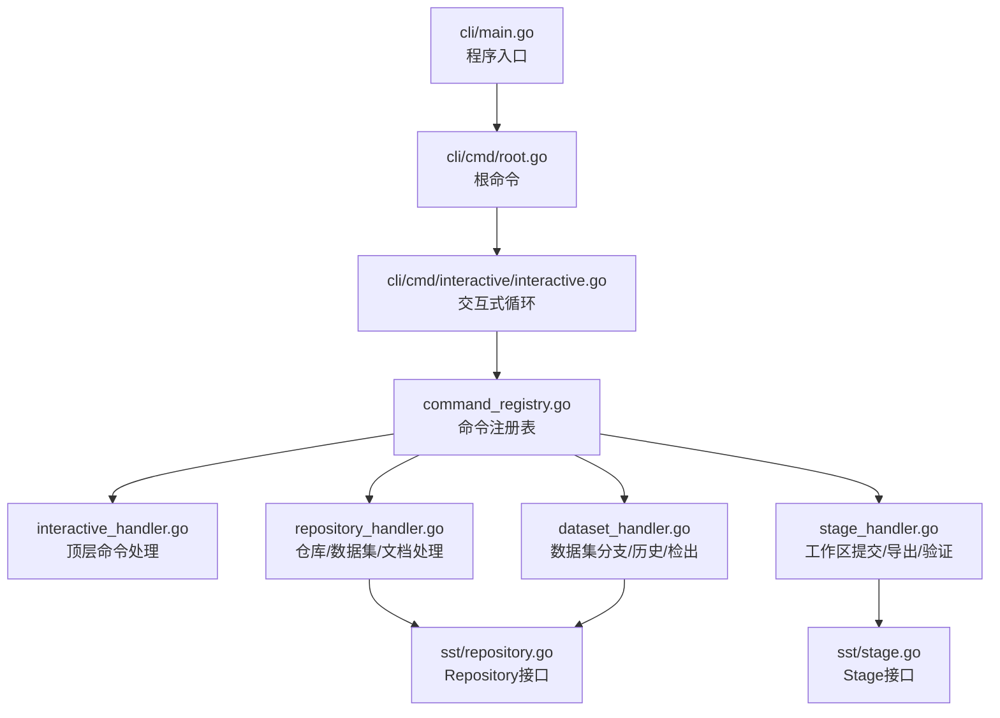
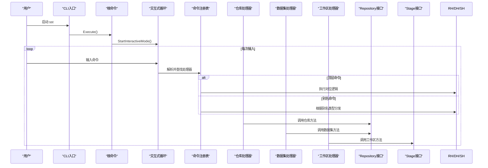
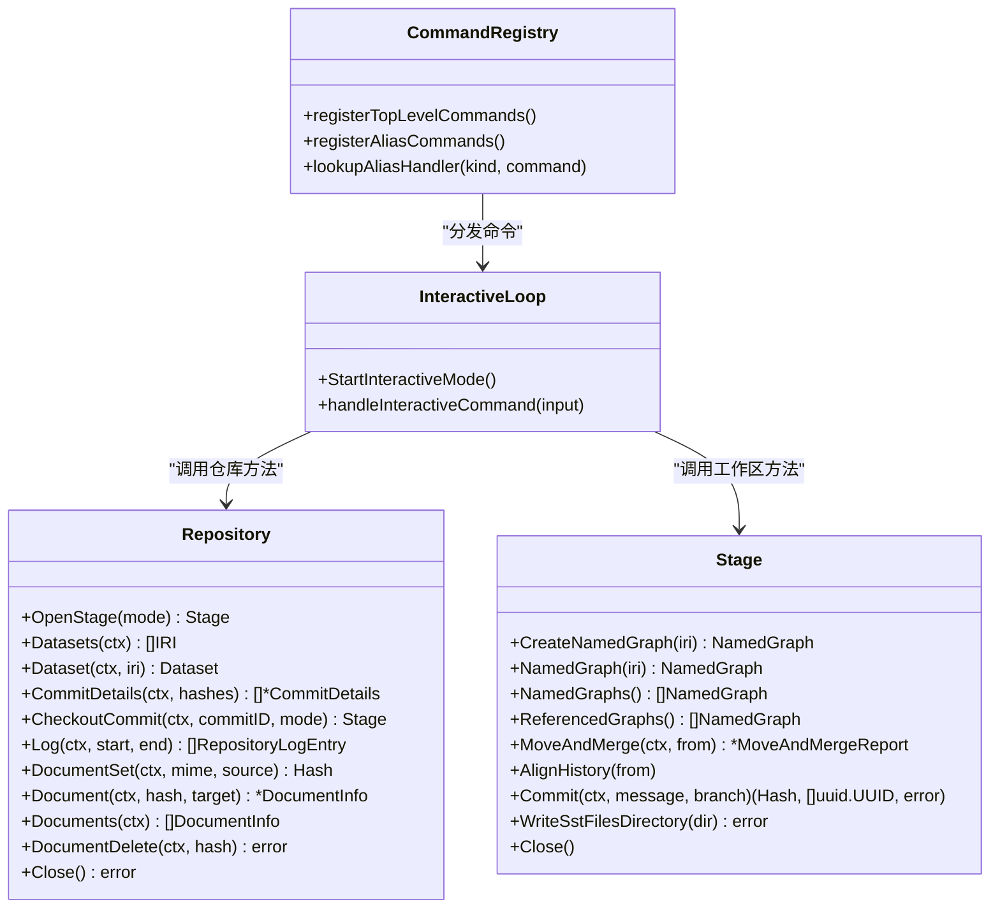

# 仓库管理命令

<cite>
**本文引用的文件**
- [cli/main.go](file://cli/main.go)
- [cli/cmd/root.go](file://cli/cmd/root.go)
- [cli/cmd/interactive/interactive.go](file://cli/cmd/interactive/interactive.go)
- [cli/cmd/interactive/command_registry.go](file://cli/cmd/interactive/command_registry.go)
- [cli/cmd/interactive/command_parse.go](file://cli/cmd/interactive/command_parse.go)
- [cli/cmd/interactive/interactive_handler.go](file://cli/cmd/interactive/interactive_handler.go)
- [cli/cmd/interactive/repository_handler.go](file://cli/cmd/interactive/repository_handler.go)
- [cli/cmd/interactive/dataset_handler.go](file://cli/cmd/interactive/dataset_handler.go)
- [cli/cmd/interactive/stage_handler.go](file://cli/cmd/interactive/stage_handler.go)
- [sst/repository.go](file://sst/repository.go)
- [sst/stage.go](file://sst/stage.go)
</cite>

## 目录
1. [简介](#简介)
2. [项目结构](#项目结构)
3. [核心组件](#核心组件)
4. [架构总览](#架构总览)
5. [详细组件分析](#详细组件分析)
6. [依赖关系分析](#依赖关系分析)
7. [性能考虑](#性能考虑)
8. [故障排查指南](#故障排查指南)
9. [结论](#结论)
10. [附录](#附录)

## 简介
本文件面向SST CLI的“仓库管理”能力，聚焦以下主题：
- 仓库创建、打开、关闭的命令语法与参数选项
- 数据集操作的CRUD使用方法（列出、获取、提交、分支等）
- 工作区（Stage）管理：创建、切换、提交、导出等
- 分支管理：创建、切换、合并（通过提交与移动合并实现）
- 版本控制相关命令的使用示例
- 批量操作与脚本化最佳实践

SST CLI提供交互式模式与顶层命令。默认进入交互式模式，支持别名命令（如 r1.datasets、ds1.branches），以及顶层命令（如 openlocalrepository、createlocalrepository）。

## 项目结构
CLI入口与命令注册位于 cli 目录；仓库与数据集的核心接口定义在 sst 目录。交互层将用户输入解析为顶层命令或别名命令，并分派到具体处理器。

图表来源
- [cli/main.go:13-17](file://cli/main.go#L13-L17)
- [cli/cmd/root.go:14-45](file://cli/cmd/root.go#L14-L45)
- [cli/cmd/interactive/interactive.go:18-98](file://cli/cmd/interactive/interactive.go#L18-L98)
- [cli/cmd/interactive/command_registry.go:45-147](file://cli/cmd/interactive/command_registry.go#L45-L147)
- [sst/repository.go:50-179](file://sst/repository.go#L50-L179)
- [sst/stage.go:74-200](file://sst/stage.go#L74-L200)

章节来源
- [cli/main.go:13-17](file://cli/main.go#L13-L17)
- [cli/cmd/root.go:14-45](file://cli/cmd/root.go#L14-L45)
- [cli/cmd/interactive/interactive.go:18-98](file://cli/cmd/interactive/interactive.go#L18-L98)
- [cli/cmd/interactive/command_registry.go:45-147](file://cli/cmd/interactive/command_registry.go#L45-L147)

## 核心组件
- 交互式命令循环：读取用户输入，支持历史记录与自动补全，解析为顶层命令或别名命令。
- 命令注册表：集中声明顶层命令与别名命令，按类型（superrepo/repo/dataset/stage/namedgraph/ibnode）分发。
- 仓库处理器：负责仓库信息、数据集列表、查询、日志、文档上传下载、克隆、同步等。
- 数据集处理器：负责数据集的历史、分支、检出、差异对比、叶子提交等。
- 工作区处理器：负责命名图列举、移动合并、对齐历史、提交、验证、RDF/SST导出等。
- 核心接口：Repository与Stage定义了仓库与工作区的统一能力边界。

章节来源
- [cli/cmd/interactive/interactive.go:28-98](file://cli/cmd/interactive/interactive.go#L28-L98)
- [cli/cmd/interactive/command_registry.go:45-147](file://cli/cmd/interactive/command_registry.go#L45-L147)
- [cli/cmd/interactive/repository_handler.go:27-111](file://cli/cmd/interactive/repository_handler.go#L27-L111)
- [cli/cmd/interactive/dataset_handler.go:15-105](file://cli/cmd/interactive/dataset_handler.go#L15-L105)
- [cli/cmd/interactive/stage_handler.go:19-146](file://cli/cmd/interactive/stage_handler.go#L19-L146)
- [sst/repository.go:50-179](file://sst/repository.go#L50-L179)
- [sst/stage.go:74-200](file://sst/stage.go#L74-L200)

## 架构总览
下图展示了从命令行到核心接口的调用链，包括交互式模式与别名命令的分发路径。

图表来源
- [cli/cmd/interactive/interactive.go:28-98](file://cli/cmd/interactive/interactive.go#L28-L98)
- [cli/cmd/interactive/command_registry.go:45-147](file://cli/cmd/interactive/command_registry.go#L45-L147)
- [cli/cmd/interactive/repository_handler.go:27-111](file://cli/cmd/interactive/repository_handler.go#L27-L111)
- [cli/cmd/interactive/dataset_handler.go:15-105](file://cli/cmd/interactive/dataset_handler.go#L15-L105)
- [cli/cmd/interactive/stage_handler.go:19-146](file://cli/cmd/interactive/stage_handler.go#L19-L146)
- [sst/repository.go:50-179](file://sst/repository.go#L50-L179)
- [sst/stage.go:74-200](file://sst/stage.go#L74-L200)

## 详细组件分析

### 仓库管理命令（创建、打开、关闭）
- 创建本地仓库
  - 顶层命令：createlocalrepository <path> [--basic]
  - 行为：在指定路径创建新的本地仓库；--basic用于选择基础模式（无版本历史）
  - 参考：[命令注册:45-61](file://cli/cmd/interactive/command_registry.go#L45-L61)、[实现入口:206-250](file://cli/cmd/interactive/interactive_handler.go#L206-L250)
- 打开本地仓库
  - 顶层命令：openlocalrepository <path>
  - 行为：以本地仓库方式打开，返回可使用的别名（如 r1）
  - 参考：[命令注册:45-61](file://cli/cmd/interactive/command_registry.go#L45-L61)、[实现入口:25-120](file://cli/cmd/interactive/interactive_handler.go#L25-L120)
- 打开本地扁平仓库（目录中的.sst文件集合）
  - 顶层命令：openlocalflatrepository <path>
  - 行为：以扁平模式打开，适合只读或简单场景
  - 参考：[命令注册:45-61](file://cli/cmd/interactive/command_registry.go#L45-L61)、[实现入口:155-205](file://cli/cmd/interactive/interactive_handler.go#L155-L205)
- 打开远程仓库
  - 顶层命令：openremoterepository <URL>
  - 行为：通过网络访问远程仓库，需要认证上下文
  - 参考：[命令注册:45-61](file://cli/cmd/interactive/command_registry.go#L45-L61)、[实现入口:25-120](file://cli/cmd/interactive/interactive_handler.go#L25-L120)
- 打开超级仓库（SuperRepository）
  - 顶层命令：openlocalsuperrepository <path> / openremotesuperrepository <URL>
  - 行为：打开包含多个子仓库的聚合仓库，便于批量管理
  - 参考：[命令注册:45-61](file://cli/cmd/interactive/command_registry.go#L45-L61)
- 关闭仓库
  - 别名命令：<alias>.close
  - 行为：关闭已打开的仓库或超级仓库，释放资源
  - 参考：[关闭实现:27-65](file://cli/cmd/interactive/repository_handler.go#L27-L65)

章节来源
- [cli/cmd/interactive/command_registry.go:45-61](file://cli/cmd/interactive/command_registry.go#L45-L61)
- [cli/cmd/interactive/interactive_handler.go:25-205](file://cli/cmd/interactive/interactive_handler.go#L25-L205)
- [cli/cmd/interactive/repository_handler.go:27-65](file://cli/cmd/interactive/repository_handler.go#L27-L65)

### 数据集操作（CRUD与版本）
- 列出数据集
  - 别名命令：<repo>.datasets
  - 行为：列出仓库中所有数据集IRI，支持分页输出
  - 参考：[数据集列表](file://cli/cmd/interactive/repository_handler.go:190-235)
- 获取数据集
  - 别名命令：<repo>.dataset <iri> [-a <alias>]
  - 行为：按IRI打开数据集，分配别名以便后续操作
  - 参考：[数据集打开](file://cli/cmd/interactive/repository_handler.go:237-296)
- 查看数据集历史
  - 别名命令：<dataset>.listcommits [--details]
  - 行为：从叶子提交和分支尖端遍历历史，去重显示
  - 参考：[历史列表](file://cli/cmd/interactive/dataset_handler.go:15-105)
- 查看提交详情
  - 别名命令：<dataset>.commitdetailsbyhash <hash> / <dataset>.commitdetailsbybranch <branch>
  - 行为：按哈希或分支名获取提交元数据
  - 参考：[提交详情](file://cli/cmd/interactive/dataset_handler.go:57-105)
- 检出工作区
  - 别名命令：<dataset>.checkoutcommit <hash> [-a <alias>]
  - 别名命令：<dataset>.checkoutrevision <hash> [-a <alias>]
  - 别名命令：<dataset>.checkoutbranch <name> [-a <alias>]
  - 行为：基于提交、修订或分支创建可编辑的工作区（Stage）
  - 参考：[检出实现](file://cli/cmd/interactive/dataset_handler.go:107-271)
- 差异比较
  - 别名命令：<dataset>.diff <NGR-hash1> <NGR-hash2>
  - 行为：比较两个命名图修订的差异，输出三元组级变更
  - 参考：[差异计算](file://cli/cmd/interactive/dataset_handler.go:402-434)

章节来源
- [cli/cmd/interactive/repository_handler.go:190-296](file://cli/cmd/interactive/repository_handler.go#L190-L296)
- [cli/cmd/interactive/dataset_handler.go:15-271](file://cli/cmd/interactive/dataset_handler.go#L15-L271)
- [cli/cmd/interactive/dataset_handler.go:402-434](file://cli/cmd/interactive/dataset_handler.go#L402-L434)

### 工作区管理（创建、切换、提交、导出）
- 创建工作区
  - 别名命令：<repo>.openstage
  - 行为：在当前仓库上创建一个空的工作区，用于增量修改
  - 参考：[命令注册](file://cli/cmd/interactive/command_registry.go:70-90)
- 列举命名图
  - 别名命令：<stage>.namedgraphs / <stage>.referencednamedgraphs
  - 行为：列出工作区内的本地命名图与引用命名图
  - 参考：[命名图列举](file://cli/cmd/interactive/stage_handler.go:19-53)
- 移动与合并
  - 别名命令：<target-stage>.moveandmerge <source-stage>
  - 行为：将源工作区的命名图移动到目标工作区并尝试合并冲突
  - 参考：[移动合并](file://cli/cmd/interactive/stage_handler.go:99-146)
- 对齐历史
  - 别名命令：<to-stage>.alignhistory <from-stage>
  - 行为：复制仓库指针与检出元数据，使新工作区能正确提交到同一历史
  - 参考：[对齐历史](file://cli/cmd/interactive/stage_handler.go:148-184)
- 提交
  - 别名命令：<stage>.commit <message> [branch]
  - 行为：将工作区变更提交到仓库，可选指定分支名
  - 参考：[提交实现](file://cli/cmd/interactive/stage_handler.go:374-427)
- 导出RDF/SST
  - 别名命令：<stage>.rdfwrite <file> / <stage>.trig / <stage>.writesstfilesdirectory <dir>
  - 行为：将工作区内容导出为TriG文件或SST二进制文件目录
  - 参考：[导出实现](file://cli/cmd/interactive/stage_handler.go:186-306)
- 验证
  - 别名命令：<stage>.validate [-o <file>]
  - 行为：对工作区进行RDF类型与域范围验证，输出报告
  - 参考：[验证实现](file://cli/cmd/interactive/stage_handler.go:429-485)

章节来源
- [cli/cmd/interactive/stage_handler.go:19-485](file://cli/cmd/interactive/stage_handler.go#L19-L485)
- [cli/cmd/interactive/command_registry.go:113-132](file://cli/cmd/interactive/command_registry.go#L113-L132)

### 分支管理（创建、切换、合并）
- 列出分支
  - 别名命令：<dataset>.branches
  - 行为：列出数据集的所有分支及其指向的提交哈希
  - 参考：[分支列表](file://cli/cmd/interactive/dataset_handler.go:461-499)
- 设置分支指向
  - 别名命令：<dataset>.setbranchcommit <commit-hash> <branch-name>
  - 别名命令：<dataset>.setbranchrevision <dataset-revision-hash> <branch-name>
  - 行为：将分支指向特定提交或修订，从而实现“创建/切换”分支的效果
  - 参考：[设置分支](file://cli/cmd/interactive/dataset_handler.go:273-333)
- 删除分支
  - 别名命令：<dataset>.removebranch <branch-name>
  - 行为：移除指定分支
  - 参考：[删除分支](file://cli/cmd/interactive/dataset_handler.go:335-357)
- 合并分支
  - 流程建议：
    1) 在工作区A中切换到目标分支（通过setbranchcommit/setbranchrevision）
    2) 在工作区B中切换到待合并分支
    3) 使用<target-stage>.moveandmerge <source-stage>进行合并
    4) 提交合并结果到目标分支
  - 参考：[移动合并](file://cli/cmd/interactive/stage_handler.go:99-146)、[提交](file://cli/cmd/interactive/stage_handler.go:374-427)

章节来源
- [cli/cmd/interactive/dataset_handler.go:273-357](file://cli/cmd/interactive/dataset_handler.go#L273-L357)
- [cli/cmd/interactive/stage_handler.go:99-146](file://cli/cmd/interactive/stage_handler.go#L99-L146)
- [cli/cmd/interactive/stage_handler.go:374-427](file://cli/cmd/interactive/stage_handler.go#L374-L427)

### 版本控制相关命令（日志、提交详情、差异）
- 仓库日志
  - 别名命令：<repo>.log [-v|--verbose]
  - 行为：列出仓库提交历史，支持详细模式
  - 参考：[日志实现](file://cli/cmd/interactive/repository_handler.go:363-400)
- 提交详情
  - 别名命令：<repo>.commitinfo <commit-hash>
  - 行为：展示指定提交的详细信息
  - 参考：[提交详情](file://cli/cmd/interactive/repository_handler.go:402-436)
- 提交差异
  - 别名命令：<repo>.commitdiff <commit-hash>
  - 行为：展示该提交中新增/修改/删除的命名图及三元组差异
  - 参考：[提交差异](file://cli/cmd/interactive/repository_handler.go:532-637)

章节来源
- [cli/cmd/interactive/repository_handler.go:363-637](file://cli/cmd/interactive/repository_handler.go#L363-L637)

### 文档管理（上传、下载、信息、删除、列表）
- 上传文档
  - 别名命令：<repo>.documentset <file>
  - 行为：将文件上传至仓库，自动推断MIME类型，支持去重
  - 参考：[上传实现](file://cli/cmd/interactive/repository_handler.go:639-719)
- 下载文档
  - 别名命令：<repo>.documentget <hash> [<outPathOrDir>]
  - 行为：按哈希下载文档到本地文件或目录
  - 参考：[下载实现](file://cli/cmd/interactive/repository_handler.go:721-780)
- 文档信息
  - 别名命令：<repo>.documentinfo <hash>
  - 行为：查看文档元数据（MIME类型、作者、时间戳等）
  - 参考：[文档信息](file://cli/cmd/interactive/repository_handler.go:782-800)
- 删除文档
  - 别名命令：<repo>.documentdelete <hash>
  - 行为：删除指定哈希的文档内容与元数据
  - 参考：[命令注册](file://cli/cmd/interactive/command_registry.go:80-90)
- 列出文档
  - 别名命令：<repo>.documents
  - 行为：列出仓库中所有文档的元数据
  - 参考：[命令注册](file://cli/cmd/interactive/command_registry.go:80-90)

章节来源
- [cli/cmd/interactive/repository_handler.go:639-800](file://cli/cmd/interactive/repository_handler.go#L639-L800)
- [cli/cmd/interactive/command_registry.go:80-90](file://cli/cmd/interactive/command_registry.go#L80-L90)

### 批量操作与脚本化最佳实践
- 使用别名命令进行批处理
  - 建议在脚本中先打开仓库/数据集，再依次执行别名命令（如 datasets、branches、listcommits、commit等）
  - 利用别名命令的稳定输出格式，结合外部工具（如grep、awk）进行过滤与统计
- 使用顶层命令自动化
  - 通过openlocalrepository/openremoterepository等顶层命令在脚本中快速初始化环境
  - 配合status命令检查当前状态，确保后续操作在正确的上下文中执行
- 工作区合并与提交
  - 在多分支协作时，采用“检出-移动合并-提交”的流程，保证历史一致性与可追溯性
- 文档批量导入
  - 对大量TTL/RDF文件，可使用filterextract命令拆分大图为子图并提交，减少单次提交体积
- 错误处理
  - 所有命令均会打印错误信息，脚本中应捕获非零退出码并记录日志
  - 对于网络请求（远程仓库），注意重试与超时策略

章节来源
- [cli/cmd/interactive/command_registry.go:45-147](file://cli/cmd/interactive/command_registry.go#L45-L147)
- [cli/cmd/interactive/repository_handler.go:190-235](file://cli/cmd/interactive/repository_handler.go#L190-L235)
- [cli/cmd/interactive/stage_handler.go:99-146](file://cli/cmd/interactive/stage_handler.go#L99-L146)

## 依赖关系分析
- 命令注册表依赖交互式循环与处理器模块，形成清晰的职责分离
- 仓库处理器依赖sst.Repository接口，屏蔽不同仓库实现的差异
- 数据集与工作区处理器依赖sst.Stage接口，提供统一的编辑与提交能力
- 认证上下文通过utils.GetAuthContext注入，确保远程仓库访问的安全性

图表来源
- [sst/repository.go:50-179](file://sst/repository.go#L50-L179)
- [sst/stage.go:74-200](file://sst/stage.go#L74-L200)
- [cli/cmd/interactive/command_registry.go:45-147](file://cli/cmd/interactive/command_registry.go#L45-L147)
- [cli/cmd/interactive/interactive.go:28-98](file://cli/cmd/interactive/interactive.go#L28-L98)

章节来源
- [sst/repository.go:50-179](file://sst/repository.go#L50-L179)
- [sst/stage.go:74-200](file://sst/stage.go#L74-L200)
- [cli/cmd/interactive/command_registry.go:45-147](file://cli/cmd/interactive/command_registry.go#L45-L147)
- [cli/cmd/interactive/interactive.go:28-98](file://cli/cmd/interactive/interactive.go#L28-L98)

## 性能考虑
- 索引查询：仓库支持Bleve全文检索，首次查询前需注册索引处理器；远程仓库由服务端维护索引
- 大数据集：建议使用filterextract拆分大图，避免单次提交过大导致内存压力
- 工作区合并：MoveAndMerge会尝试寻找共同祖先进行三向合并，复杂场景可能耗时较长
- 文档上传：上传前计算哈希以实现去重，减少重复存储与网络传输
- 日志与历史：长历史仓库的日志浏览建议使用分页与限制参数，避免一次性加载过多条目

章节来源
- [cli/cmd/interactive/repository_handler.go:300-361](file://cli/cmd/interactive/repository_handler.go#L300-L361)
- [cli/cmd/interactive/stage_handler.go:99-146](file://cli/cmd/interactive/stage_handler.go#L99-L146)
- [cli/cmd/interactive/repository_handler.go:639-719](file://cli/cmd/interactive/repository_handler.go#L639-L719)

## 故障排查指南
- 无法找到别名
  - 现象：提示别名不存在
  - 排查：确认是否已打开仓库/数据集/工作区，并使用正确的别名
  - 参考：[别名解析错误](file://cli/cmd/interactive/command_parse.go:21-56)
- 远程仓库连接失败
  - 现象：网络错误或认证失败
  - 排查：检查认证上下文配置与网络连通性
  - 参考：[认证上下文获取](file://cli/cmd/interactive/repository_handler.go:103-111)
- 提交失败
  - 现象：提交时报错
  - 排查：检查工作区是否有效、是否链接到仓库、消息是否为空
  - 参考：[提交实现](file://cli/cmd/interactive/stage_handler.go:374-427)
- 文档上传去重
  - 现象：提示文档已存在
  - 排查：确认哈希是否一致，必要时重新生成或覆盖
  - 参考：[上传去重](file://cli/cmd/interactive/repository_handler.go:668-694)

章节来源
- [cli/cmd/interactive/command_parse.go:21-56](file://cli/cmd/interactive/command_parse.go#L21-L56)
- [cli/cmd/interactive/repository_handler.go:103-111](file://cli/cmd/interactive/repository_handler.go#L103-L111)
- [cli/cmd/interactive/stage_handler.go:374-427](file://cli/cmd/interactive/stage_handler.go#L374-L427)
- [cli/cmd/interactive/repository_handler.go:668-694](file://cli/cmd/interactive/repository_handler.go#L668-L694)

## 结论
SST CLI通过交互式模式与别名命令提供了完整的仓库管理能力，涵盖仓库创建/打开/关闭、数据集CRUD、工作区管理、分支管理与版本控制。借助统一的Repository与Stage接口，用户可以在本地与远程环境中一致地操作数据。推荐在脚本中使用顶层命令初始化环境，并通过别名命令进行批量操作与自动化流程。

## 附录
- 常用命令速查
  - 仓库：openlocalrepository、openremoterepository、createlocalrepository、<repo>.close
  - 数据集：<dataset>.branches、<dataset>.listcommits、<dataset>.checkoutcommit、<dataset>.diff
  - 工作区：<stage>.commit、<stage>.moveandmerge、<stage>.rdfwrite、<stage>.validate
  - 文档：<repo>.documentset、<repo>.documentget、<repo>.documentinfo、<repo>.documents、<repo>.documentdelete
- 参考实现位置
  - 命令注册：[command_registry.go:45-147](file://cli/cmd/interactive/command_registry.go#L45-L147)
  - 仓库处理器：[repository_handler.go:27-800](file://cli/cmd/interactive/repository_handler.go#L27-L800)
  - 数据集处理器：[dataset_handler.go:15-532](file://cli/cmd/interactive/dataset_handler.go#L15-L532)
  - 工作区处理器：[stage_handler.go:19-486](file://cli/cmd/interactive/stage_handler.go#L19-L486)
  - 核心接口：[repository.go:50-179](file://sst/repository.go#L50-L179)、[stage.go:74-200](file://sst/stage.go#L74-L200)