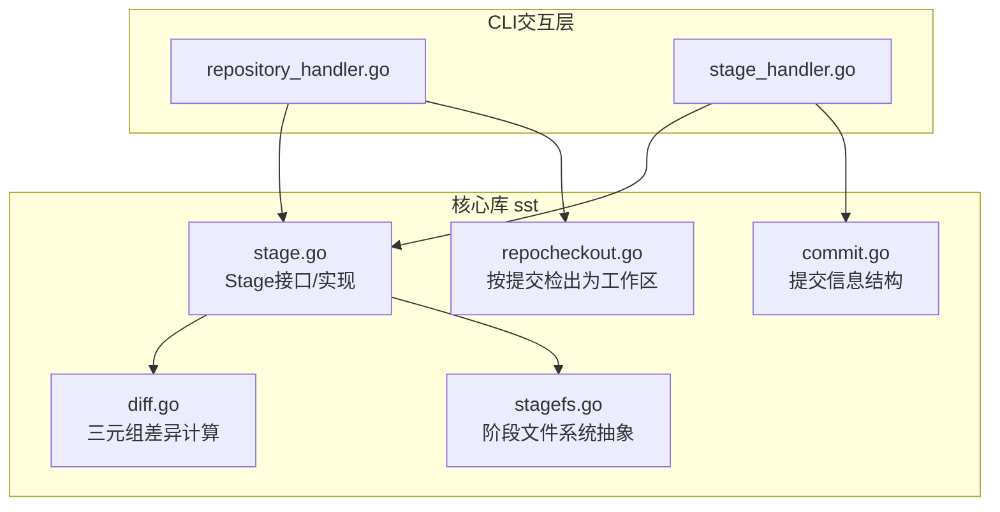
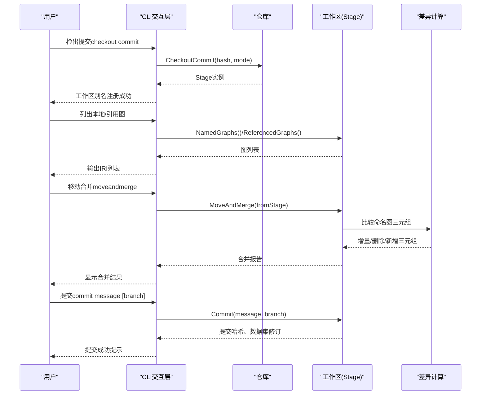
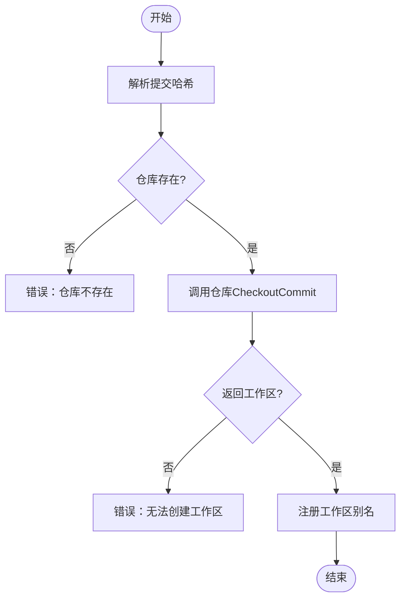
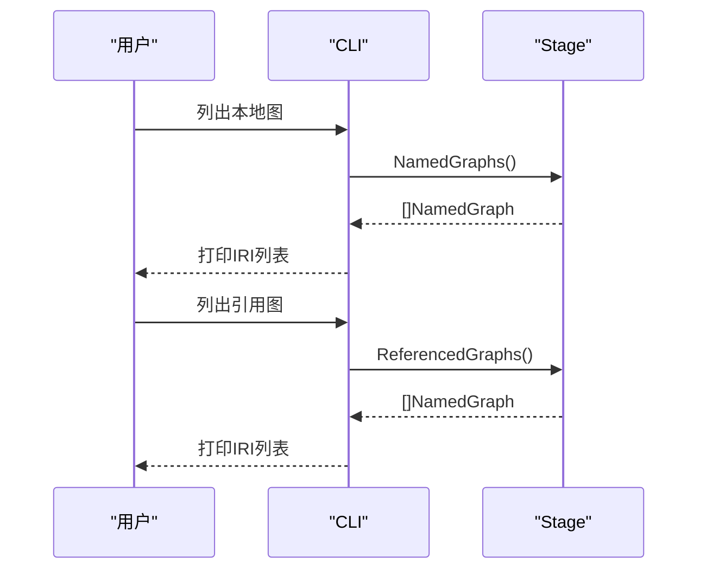
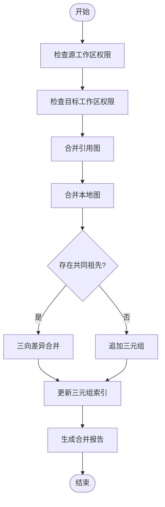
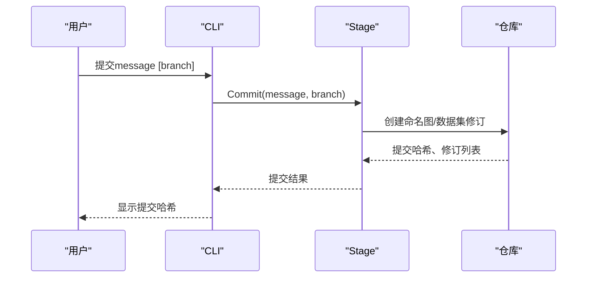
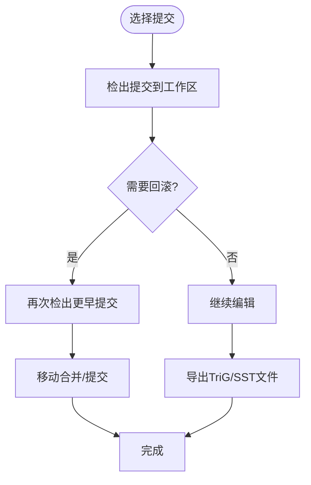
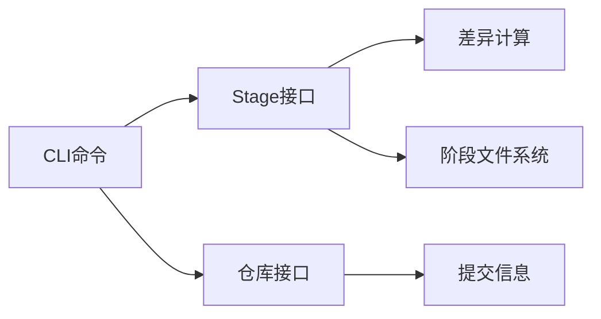

# 工作区操作命令

<cite>
**本文引用的文件**
- [stage.go](file://sst/stage.go)
- [commit.go](file://sst/commit.go)
- [repocheckout.go](file://sst/repocheckout.go)
- [stagefs.go](file://sst/stagefs.go)
- [diff.go](file://sst/diff.go)
- [repository_handler.go](file://cli/cmd/interactive/repository_handler.go)
- [stage_handler.go](file://cli/cmd/interactive/stage_handler.go)
</cite>

## 目录
1. [简介](#简介)
2. [项目结构](#项目结构)
3. [核心组件](#核心组件)
4. [架构总览](#架构总览)
5. [详细组件分析](#详细组件分析)
6. [依赖关系分析](#依赖关系分析)
7. [性能考虑](#性能考虑)
8. [故障排查指南](#故障排查指南)
9. [结论](#结论)
10. [附录](#附录)

## 简介
本文件面向SST工作区（Stage）的操作命令与使用实践，围绕以下目标展开：
- 工作区的创建、切换、提交等核心操作说明
- 工作区与分支的关系及在版本控制中的作用
- 工作区状态查看命令，展示当前修改、未提交更改等信息
- 工作区合并与冲突解决流程
- 工作区快照与回滚方法
- 多工作区并行操作的注意事项与最佳实践

## 项目结构
SST的工作区能力由核心库与CLI交互层共同实现：
- 核心库（sst包）提供Stage接口、提交、合并、差异计算、文件系统抽象等能力
- CLI交互层（cli/cmd/interactive）暴露用户可执行的命令，如列出图、移动合并、对齐历史、导出RDF、写入SST文件目录、提交、校验等

**图表来源**
- [stage.go:53-234](file://sst/stage.go#L53-L234)
- [commit.go:18-62](file://sst/commit.go#L18-L62)
- [repocheckout.go:10-44](file://sst/repocheckout.go#L10-L44)
- [diff.go:28-59](file://sst/diff.go#L28-L59)
- [stagefs.go:23-46](file://sst/stagefs.go#L23-L46)
- [repository_handler.go:438-491](file://cli/cmd/interactive/repository_handler.go#L438-L491)
- [stage_handler.go:19-53](file://cli/cmd/interactive/stage_handler.go#L19-L53)

**章节来源**
- [stage.go:53-234](file://sst/stage.go#L53-L234)
- [repository_handler.go:438-491](file://cli/cmd/interactive/repository_handler.go#L438-L491)
- [stage_handler.go:19-53](file://cli/cmd/interactive/stage_handler.go#L19-L53)

## 核心组件
- 工作区（Stage）：内存中的命名图集合，支持本地或引用状态的图，可关联仓库并执行提交、合并、导出等操作
- 提交（Commit）：将工作区变更持久化为提交对象，包含作者、时间、消息、父提交、数据集/命名图修订映射
- 差异（Diff）：对两个命名图进行三元组级别的增删改对比，支撑冲突分析与可视化
- 阶段文件系统（stageFS）：以BoltDB桶结构存储命名图版本，提供类文件系统访问能力
- CLI命令：封装工作区与仓库的常用操作，便于交互式使用

**章节来源**
- [stage.go:53-234](file://sst/stage.go#L53-L234)
- [commit.go:18-62](file://sst/commit.go#L18-L62)
- [diff.go:28-59](file://sst/diff.go#L28-L59)
- [stagefs.go:23-46](file://sst/stagefs.go#L23-L46)

## 架构总览
下图展示了从CLI命令到核心库的调用链路，包括检出提交、列出图、移动合并、提交等关键路径。

**图表来源**
- [repository_handler.go:438-491](file://cli/cmd/interactive/repository_handler.go#L438-L491)
- [stage_handler.go:99-146](file://cli/cmd/interactive/stage_handler.go#L99-L146)
- [stage_handler.go:374-427](file://cli/cmd/interactive/stage_handler.go#L374-L427)
- [stage.go:121-170](file://sst/stage.go#L121-L170)
- [diff.go:28-59](file://sst/diff.go#L28-L59)

## 详细组件分析

### 工作区创建与切换
- 通过仓库检出指定提交生成工作区：CLI命令“checkout commit”会解析提交哈希，调用仓库的CheckoutCommit，返回Stage实例并注册别名
- 工作区内部维护本地图和引用图，支持后续编辑、合并与提交

**图表来源**
- [repository_handler.go:438-491](file://cli/cmd/interactive/repository_handler.go#L438-L491)
- [repocheckout.go:10-44](file://sst/repocheckout.go#L10-L44)

**章节来源**
- [repository_handler.go:438-491](file://cli/cmd/interactive/repository_handler.go#L438-L491)
- [repocheckout.go:10-44](file://sst/repocheckout.go#L10-L44)

### 工作区状态查看
- 列出本地命名图：调用Stage.NamedGraphs()，输出每个图的IRI
- 列出引用命名图：调用Stage.ReferencedGraphs()，输出引用图的IRI
- 查看工作区信息：通过仓库或工作区Info接口获取统计信息（本地图数量、引用图数量、三元组总数）

**图表来源**
- [stage_handler.go:19-53](file://cli/cmd/interactive/stage_handler.go#L19-L53)
- [stage.go:74-111](file://sst/stage.go#L74-L111)

**章节来源**
- [stage_handler.go:19-53](file://cli/cmd/interactive/stage_handler.go#L19-L53)
- [stage.go:74-111](file://sst/stage.go#L74-L111)

### 工作区合并与冲突解决
- 移动合并（MoveAndMerge）：将源工作区的命名图移动到目标工作区，尝试自动合并；若存在共同祖先则基于三向差异合并，否则直接追加三元组
- 合并过程记录动作类型（合并图、重定向图、标记修改、更新三元组、跳过相同修订、三向合并等），并生成报告
- 冲突处理：当两图无共同祖先时，采用追加策略；当有共同祖先时，根据父子关系或三向差异决定保留或替换

**图表来源**
- [stage.go:468-800](file://sst/stage.go#L468-L800)
- [diff.go:28-59](file://sst/diff.go#L28-L59)

**章节来源**
- [stage.go:468-800](file://sst/stage.go#L468-L800)
- [diff.go:28-59](file://sst/diff.go#L28-L59)

### 工作区提交与分支
- 提交（Commit）：将工作区中所有命名图的变更持久化到仓库，为每个修改的命名图创建新修订，并为相关数据集创建修订；可选指定分支名，为空则不改变目标仓库的分支指针
- 分支关系：默认分支名为“master”，提交时可指定分支；提交后返回提交哈希与数据集修订列表
- 提交详情：可通过仓库查询提交详情，包含作者、时间、消息、父提交、数据集/命名图修订映射

**图表来源**
- [stage_handler.go:374-427](file://cli/cmd/interactive/stage_handler.go#L374-L427)
- [stage.go:121-170](file://sst/stage.go#L121-L170)
- [commit.go:18-62](file://sst/commit.go#L18-L62)

**章节来源**
- [stage_handler.go:374-427](file://cli/cmd/interactive/stage_handler.go#L374-L427)
- [stage.go:121-170](file://sst/stage.go#L121-L170)
- [commit.go:18-62](file://sst/commit.go#L18-L62)

### 工作区快照与回滚
- 快照：通过“检出提交”将特定提交的命名图加载到工作区，形成该时刻的快照
- 回滚：基于提交哈希重新检出，或将上游工作区内容移动合并到目标工作区，再提交以覆盖历史
- 导出：支持将工作区导出为TriG文件或独立SST文件目录，便于离线备份与迁移

**图表来源**
- [repository_handler.go:438-491](file://cli/cmd/interactive/repository_handler.go#L438-L491)
- [stage_handler.go:186-306](file://cli/cmd/interactive/stage_handler.go#L186-L306)
- [stage.go:179-223](file://sst/stage.go#L179-L223)

**章节来源**
- [repository_handler.go:438-491](file://cli/cmd/interactive/repository_handler.go#L438-L491)
- [stage_handler.go:186-306](file://cli/cmd/interactive/stage_handler.go#L186-L306)
- [stage.go:179-223](file://sst/stage.go#L179-L223)

### 多工作区并行操作
- 同时打开多个工作区：CLI允许为不同提交或数据源创建多个工作区别名，分别管理
- 注意事项：
  - 跨仓库移动合并时需标记修改位，确保提交能正确反映变更
  - 合并过程中需保证权限上下文一致，避免认证失败
  - 大量三元组操作时注意内存占用，合理选择三元组模式（默认为全量三元组）

**章节来源**
- [stage.go:468-800](file://sst/stage.go#L468-L800)
- [stage_handler.go:99-146](file://cli/cmd/interactive/stage_handler.go#L99-L146)

## 依赖关系分析
- CLI命令依赖Stage接口进行工作区操作，依赖仓库接口进行提交与日志查询
- 工作区内部依赖差异计算模块进行三元组对比，依赖文件系统抽象进行持久化
- 提交信息结构用于描述提交元数据与修订映射

**图表来源**
- [stage.go:53-234](file://sst/stage.go#L53-L234)
- [diff.go:28-59](file://sst/diff.go#L28-L59)
- [stagefs.go:23-46](file://sst/stagefs.go#L23-L46)
- [commit.go:18-62](file://sst/commit.go#L18-L62)

**章节来源**
- [stage.go:53-234](file://sst/stage.go#L53-L234)
- [diff.go:28-59](file://sst/diff.go#L28-L59)
- [stagefs.go:23-46](file://sst/stagefs.go#L23-L46)
- [commit.go:18-62](file://sst/commit.go#L18-L62)

## 性能考虑
- 三元组模式：默认模式同时维护主体、谓词、客体三元组，适合复杂遍历但内存占用较高；可根据应用需求权衡
- 差异计算：基于排序节点与三元组范围扫描，复杂度与图大小线性相关；大图中建议分批处理
- 文件系统：阶段文件系统使用BoltDB桶结构，读写高效；关闭文件时会计算哈希并去重存储，减少冗余

[本节为通用性能讨论，不直接分析具体文件]

## 故障排查指南
- 工作区无效或未链接仓库：检查Stage.IsValid()与Repository()是否为空
- 提交失败：确认工作区已链接仓库且消息非空；查看底层错误或连接问题
- 合并异常：检查源/目标工作区权限、仓库一致性；查看合并报告中的动作类型与警告
- 差异计算错误：确认命名图存在且可读取；检查三元组索引是否完整

**章节来源**
- [stage.go:21-31](file://sst/stage.go#L21-L31)
- [stage_handler.go:374-427](file://cli/cmd/interactive/stage_handler.go#L374-L427)
- [stage.go:468-800](file://sst/stage.go#L468-L800)

## 结论
SST工作区提供了灵活的内存级数据操作能力，结合提交、合并、差异计算与文件系统抽象，支持高效的版本控制与协作。通过CLI命令，用户可以便捷地创建、切换、查看、合并、提交工作区，并导出快照以满足备份与迁移需求。在多工作区并行场景中，需注意权限上下文、内存占用与合并策略，以确保数据一致性与性能。

[本节为总结性内容，不直接分析具体文件]

## 附录
- 常用命令速查：
  - 检出提交：r1.checkoutcommit <commit-hash> [-a <stage-alias>]
  - 列出本地图：<stage-alias>.listnamedgraphs
  - 列出引用图：<stage-alias>.listreferencednamedgraphs
  - 移动合并：<target-stage-alias>.moveandmerge <source-stage-alias>
  - 对齐历史：<to-stage-alias>.alignhistory <from-stage-alias>
  - 导出TriG：<stage-alias>.rdfwrite <output-file>
  - 导出SST文件目录：<stage-alias>.writesstfilesdirectory <directory>
  - 提交：<stage-alias>.commit <message> [branch]
  - 校验：<stage-alias>.validate [-o <file>]

**章节来源**
- [repository_handler.go:438-491](file://cli/cmd/interactive/repository_handler.go#L438-L491)
- [stage_handler.go:19-53](file://cli/cmd/interactive/stage_handler.go#L19-L53)
- [stage_handler.go:99-146](file://cli/cmd/interactive/stage_handler.go#L99-L146)
- [stage_handler.go:186-306](file://cli/cmd/interactive/stage_handler.go#L186-L306)
- [stage_handler.go:374-427](file://cli/cmd/interactive/stage_handler.go#L374-L427)
- [stage_handler.go:429-486](file://cli/cmd/interactive/stage_handler.go#L429-L486)