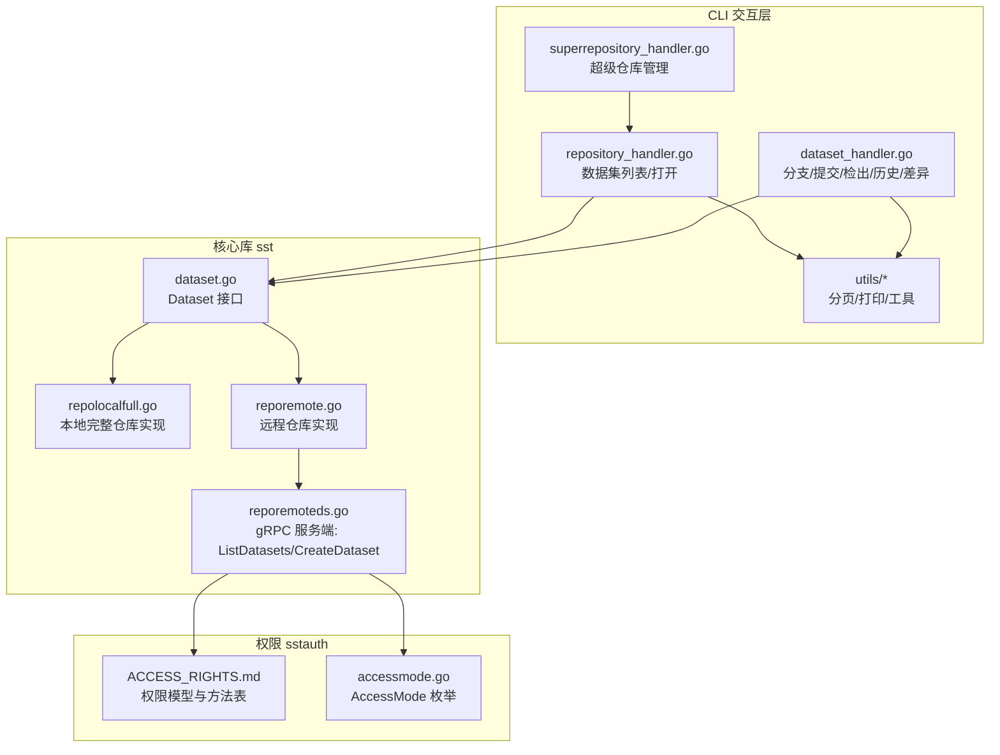
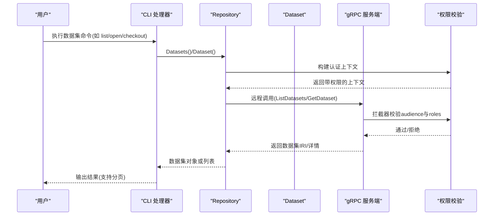
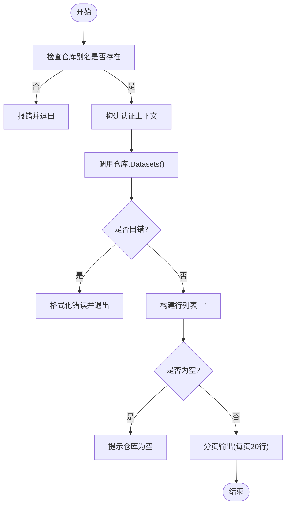
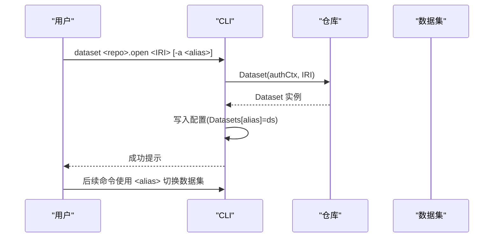
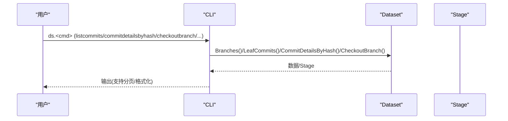
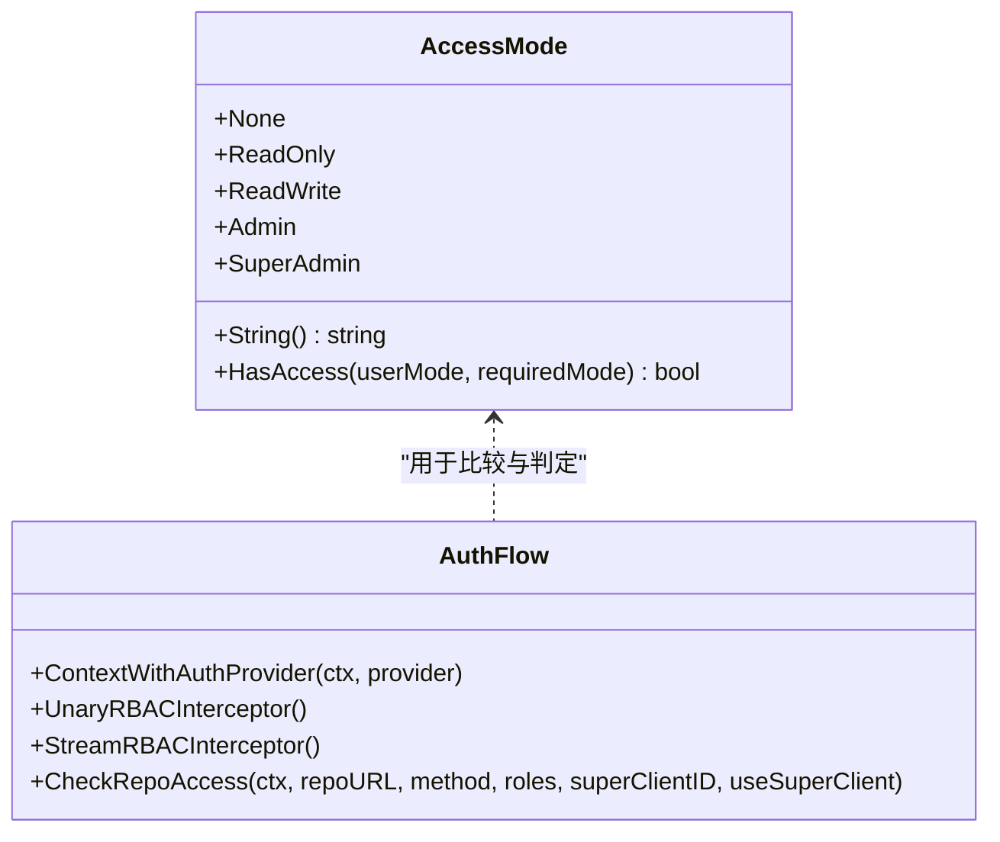

# 数据集管理命令

<cite>
**本文引用的文件**
- [dataset_handler.go](file://cli/cmd/interactive/dataset_handler.go)
- [repository_handler.go](file://cli/cmd/interactive/repository_handler.go)
- [superrepository_handler.go](file://cli/cmd/interactive/superrepository_handler.go)
- [pagination.go](file://cli/cmd/utils/pagination.go)
- [helper.go](file://cli/cmd/utils/helper.go)
- [print.go](file://cli/cmd/utils/print.go)
- [dataset.go](file://sst/dataset.go)
- [repolocalfull.go](file://sst/repolocalfull.go)
- [reporemote.go](file://sst/reporemote.go)
- [reporemoteds.go](file://sst/reporemoteds.go)
- [ACCESS_RIGHTS.md](file://sstauth/ACCESS_RIGHTS.md)
- [accessmode.go](file://sstauth/accessmode.go)
</cite>

## 目录
1. [简介](#简介)
2. [项目结构](#项目结构)
3. [核心组件](#核心组件)
4. [架构总览](#架构总览)
5. [详细组件分析](#详细组件分析)
6. [依赖关系分析](#依赖关系分析)
7. [性能考虑](#性能考虑)
8. [故障排查指南](#故障排查指南)
9. [结论](#结论)
10. [附录](#附录)

## 简介
本文件面向使用 SST CLI 的用户与开发者，系统化说明“数据集管理”相关命令与能力，包括：
- 数据集的创建、删除、查询（列出、打开）等操作
- 数据集 IRI 的概念与命名规范
- 数据集列表查看与分页显示
- 数据集与仓库的关系及在不同数据集间切换
- 批量操作与脚本化使用示例
- 权限控制与访问限制的配置方法

## 项目结构
CLI 层负责解析用户命令、组织参数、调用底层 sst 包能力；sst 包提供 Repository/Dataset/Stage 等核心抽象与实现；sstauth 提供基于 OIDC 的鉴权与授权。

图表来源
- [dataset_handler.go:15-532](file://cli/cmd/interactive/dataset_handler.go#L15-L532)
- [repository_handler.go:190-296](file://cli/cmd/interactive/repository_handler.go#L190-L296)
- [superrepository_handler.go:261-420](file://cli/cmd/interactive/superrepository_handler.go#L261-L420)
- [dataset.go:30-94](file://sst/dataset.go#L30-L94)
- [repolocalfull.go:550-585](file://sst/repolocalfull.go#L550-L585)
- [reporemote.go:470-536](file://sst/reporemote.go#L470-L536)
- [reporemoteds.go:670-751](file://sst/reporemoteds.go#L670-L751)
- [ACCESS_RIGHTS.md:13-36](file://sstauth/ACCESS_RIGHTS.md#L13-L36)
- [accessmode.go:7-36](file://sstauth/accessmode.go#L7-L36)

章节来源
- [dataset_handler.go:15-532](file://cli/cmd/interactive/dataset_handler.go#L15-L532)
- [repository_handler.go:190-296](file://cli/cmd/interactive/repository_handler.go#L190-L296)
- [superrepository_handler.go:261-420](file://cli/cmd/interactive/superrepository_handler.go#L261-L420)
- [pagination.go:12-59](file://cli/cmd/utils/pagination.go#L12-L59)
- [dataset.go:30-94](file://sst/dataset.go#L30-L94)
- [reporemoteds.go:670-751](file://sst/reporemoteds.go#L670-L751)
- [ACCESS_RIGHTS.md:13-36](file://sstauth/ACCESS_RIGHTS.md#L13-L36)

## 核心组件
- Dataset 接口：定义数据集的标识、分支、提交、检出、合并等能力
- Repository：仓库级能力，包含数据集列表、打开、索引、日志、文档等
- CLI 处理器：将用户命令映射到具体函数，处理参数、认证上下文、输出与分页
- gRPC 服务：远程侧提供数据集列表、获取、同步等方法，支持分页与字段掩码
- 权限系统：基于 OIDC 角色映射为 AccessMode，按方法最小权限校验

章节来源
- [dataset.go:30-94](file://sst/dataset.go#L30-L94)
- [repository_handler.go:190-296](file://cli/cmd/interactive/repository_handler.go#L190-L296)
- [reporemoteds.go:670-751](file://sst/reporemoteds.go#L670-L751)
- [ACCESS_RIGHTS.md:240-313](file://sstauth/ACCESS_RIGHTS.md#L240-L313)

## 架构总览
下图展示从 CLI 到 sst 再到 gRPC 的数据集管理流程，以及权限校验点。

图表来源
- [repository_handler.go:190-296](file://cli/cmd/interactive/repository_handler.go#L190-L296)
- [reporemote.go:470-536](file://sst/reporemote.go#L470-L536)
- [reporemoteds.go:670-751](file://sst/reporemoteds.go#L670-L751)
- [ACCESS_RIGHTS.md:52-128](file://sstauth/ACCESS_RIGHTS.md#L52-L128)

## 详细组件分析

### 数据集 IRI 概念与命名规范
- IRI 是数据集的唯一标识，对应默认 NamedGraph 的 IRI
- 在本地仓库中，IRI 通常以 URN 形式存储（例如 urn:uuid:...），也可从 SST 文件中读取并去除尾部 #
- 远程仓库通过 gRPC 返回 IRI，客户端会清理尾部 # 后作为 Dataset.IRI()
- 命名建议：
  - 使用可解析的 IRI，避免歧义
  - 若使用 UUID，推荐采用 urn:uuid:<uuid> 形式
  - 保持全局唯一，便于跨仓库引用

章节来源
- [dataset.go:30-32](file://sst/dataset.go#L30-L32)
- [repolocalfull.go:550-585](file://sst/repolocalfull.go#L550-L585)
- [reporemote.go:530-536](file://sst/reporemote.go#L530-L536)

### 数据集列表查看与分页
- CLI 命令：在已打开的仓库别名下执行数据集列表
- 行为：
  - 获取所有数据集 IRI
  - 将每条 IRI 转为“- <IRI>”行
  - 使用分页工具每 20 行提示一次，支持回车继续或输入 q 退出
- 错误处理：
  - 空仓库或无数据集时给出友好提示
  - 其他错误统一格式化输出

图表来源
- [repository_handler.go:190-235](file://cli/cmd/interactive/repository_handler.go#L190-L235)
- [pagination.go:12-30](file://cli/cmd/utils/pagination.go#L12-L30)

章节来源
- [repository_handler.go:190-235](file://cli/cmd/interactive/repository_handler.go#L190-L235)
- [pagination.go:12-30](file://cli/cmd/utils/pagination.go#L12-L30)

### 数据集打开与在不同数据集间切换
- 打开数据集：
  - 命令格式：支持可选别名 -a <alias>，必须提供数据集 IRI
  - 成功后将数据集存入配置，并记录别名
- 切换数据集：
  - 通过不同别名打开多个数据集，后续命令使用相应别名即可切换
- 关联仓库：
  - 数据集属于某个仓库，可通过 Dataset.Repository() 获取
  - 同一仓库内可打开多个数据集并行工作

图表来源
- [repository_handler.go:237-296](file://cli/cmd/interactive/repository_handler.go#L237-L296)
- [dataset.go:65-66](file://sst/dataset.go#L65-L66)

章节来源
- [repository_handler.go:237-296](file://cli/cmd/interactive/repository_handler.go#L237-L296)
- [dataset.go:65-66](file://sst/dataset.go#L65-L66)

### 数据集分支、提交与检出
- 列出提交：
  - 支持仅哈希或详细信息两种模式
  - 自动去重根节点（分支头与叶提交）
- 检出：
  - 按提交哈希、分支名、或数据集修订号检出为 Stage
  - 支持自定义别名，成功后写入配置
- 分支管理：
  - 设置/移动分支指向某提交或修订
  - 删除分支
- 历史与差异：
  - 显示历史图
  - 计算两个修订的差异三元组

图表来源
- [dataset_handler.go:15-333](file://cli/cmd/interactive/dataset_handler.go#L15-L333)
- [print.go:128-218](file://cli/cmd/utils/print.go#L128-L218)

章节来源
- [dataset_handler.go:15-333](file://cli/cmd/interactive/dataset_handler.go#L15-L333)
- [print.go:128-218](file://cli/cmd/utils/print.go#L128-L218)

### 数据集创建与删除（远程）
- 创建数据集：
  - 远程服务端提供 CreateDataset gRPC 方法（当前实现未启用，调用会触发非预期路径）
  - 实际使用中，通常通过仓库 API 或上层流程创建数据集
- 删除数据集：
  - 代码中未发现直接删除数据集的 CLI 入口
  - 可通过移除所有分支并将数据集标记为不可用等方式间接实现（需结合仓库策略）

章节来源
- [reporemoteds.go:789-796](file://sst/reporemoteds.go#L789-L796)

### 批量操作与脚本化使用示例
- 批量列出数据集：
  - 使用仓库别名 + 数据集列表命令，配合分页输出
  - 可将输出重定向至文件，供脚本处理
- 批量打开与切换：
  - 对每个数据集 IRI 循环执行打开命令，分配不同别名
  - 后续批处理任务按别名顺序执行
- 自动化要点：
  - 使用环境变量或配置文件维护仓库与认证信息
  - 利用别名机制隔离不同数据集的工作空间

章节来源
- [repository_handler.go:190-235](file://cli/cmd/interactive/repository_handler.go#L190-L235)
- [pagination.go:12-30](file://cli/cmd/utils/pagination.go#L12-L30)

### 权限控制与访问限制
- 访问模式：
  - none / read-only / read-write / admin / super-admin
  - 由 OIDC token 中的 roles 推导
- 方法级权限：
  - 读类方法（ListDatasets、GetDataset、Search 等）需要至少 ReadOnly
  - 写类方法（CreateDataset、SetBranch、DocumentSet 等）需要至少 ReadWrite
  - 管理方法（SuperRepository 操作）需要 SuperAdmin
- 客户端配置：
  - 通过 ContextWithAuthProvider 注入 Provider，携带 OAuth2 Token
  - 远程连接自动附加 Bearer Token
- 服务端校验：
  - Unary 与 Stream 拦截器分别校验 audience 与 roles
  - 流式 RPC 在 handler 内再次校验 per-repo 权限

图表来源
- [accessmode.go:7-36](file://sstauth/accessmode.go#L7-L36)
- [ACCESS_RIGHTS.md:13-36](file://sstauth/ACCESS_RIGHTS.md#L13-L36)
- [ACCESS_RIGHTS.md:52-128](file://sstauth/ACCESS_RIGHTS.md#L52-L128)
- [ACCESS_RIGHTS.md:240-313](file://sstauth/ACCESS_RIGHTS.md#L240-L313)

章节来源
- [ACCESS_RIGHTS.md:13-36](file://sstauth/ACCESS_RIGHTS.md#L13-L36)
- [ACCESS_RIGHTS.md:52-128](file://sstauth/ACCESS_RIGHTS.md#L52-L128)
- [ACCESS_RIGHTS.md:240-313](file://sstauth/ACCESS_RIGHTS.md#L240-L313)
- [accessmode.go:7-36](file://sstauth/accessmode.go#L7-L36)

## 依赖关系分析
- CLI 层依赖 sst 的 Repository/Dataset 接口，封装用户交互与输出
- sst 层实现多种仓库类型（本地基础/完整、远程），并通过 gRPC 与远端交互
- 权限模块贯穿 CLI 与 sst，确保每次 RPC 都具备正确的认证上下文
- 分页与打印工具被多处复用，保证一致的用户体验

```mermaid
graph LR
CLI["CLI 处理器"] --> SIF["sst 接口"]
SIF --> LFS["本地实现"]
SIF --> RMT["远程实现"]
RMT --> GRPC["gRPC 服务"]
CLI --> UT["工具(分页/打印)"]
GRPC --> AUTH["权限校验"]
```

图表来源
- [dataset_handler.go:15-532](file://cli/cmd/interactive/dataset_handler.go#L15-L532)
- [dataset.go:30-94](file://sst/dataset.go#L30-L94)
- [reporemote.go:470-536](file://sst/reporemote.go#L470-L536)
- [reporemoteds.go:670-751](file://sst/reporemoteds.go#L670-L751)

章节来源
- [dataset_handler.go:15-532](file://cli/cmd/interactive/dataset_handler.go#L15-L532)
- [dataset.go:30-94](file://sst/dataset.go#L30-L94)
- [reporemote.go:470-536](file://sst/reporemote.go#L470-L536)
- [reporemoteds.go:670-751](file://sst/reporemoteds.go#L670-L751)

## 性能考虑
- 数据集列表分页：每页 20 条，减少终端渲染压力
- 提交历史遍历：使用 visited 集合避免重复访问，提升效率
- 远程调用缓存：部分请求使用缓存降低网络开销
- 索引查询：本地仓库注册索引后可加速搜索，但需注意重建成本

章节来源
- [pagination.go:12-30](file://cli/cmd/utils/pagination.go#L12-L30)
- [print.go:128-218](file://cli/cmd/utils/print.go#L128-L218)
- [reporemote.go:470-536](file://sst/reporemote.go#L470-L536)

## 故障排查指南
- 数据集别名不存在：检查是否正确打开并分配别名
- 仓库为空：确认仓库是否包含任何数据集
- 权限不足：检查 OIDC token 的 aud 与 roles 是否符合方法要求
- 远程连接失败：确认网络与证书配置，重试并查看错误信息
- 提交哈希无效：确保传入的是有效的 Base58 字符串

章节来源
- [repository_handler.go:190-296](file://cli/cmd/interactive/repository_handler.go#L190-L296)
- [dataset_handler.go:15-333](file://cli/cmd/interactive/dataset_handler.go#L15-L333)
- [ACCESS_RIGHTS.md:52-128](file://sstauth/ACCESS_RIGHTS.md#L52-L128)

## 结论
SST 的数据集管理通过清晰的 CLI 接口与稳健的底层实现，提供了完整的创建、查询、分支与检出能力。IRI 作为数据集唯一标识，配合分页与权限控制，满足大规模数据集管理与协作需求。建议在脚本化场景中充分利用别名机制与分页输出，确保稳定与可维护性。

## 附录
- 常用命令参考：
  - 列出数据集：在仓库别名下执行数据集列表命令
  - 打开数据集：指定 IRI 与可选别名
  - 列出提交：支持详细模式
  - 检出：按提交/分支/修订号
  - 分支管理：设置/删除分支
  - 历史与差异：查看历史图与三元组差异
- 权限配置要点：
  - 客户端注入 Provider 并携带 Token
  - 服务端根据方法与角色进行最小权限校验
  - 流式 RPC 在 handler 内二次校验 per-repo 权限

章节来源
- [dataset_handler.go:15-532](file://cli/cmd/interactive/dataset_handler.go#L15-L532)
- [repository_handler.go:190-296](file://cli/cmd/interactive/repository_handler.go#L190-L296)
- [ACCESS_RIGHTS.md:240-313](file://sstauth/ACCESS_RIGHTS.md#L240-L313)