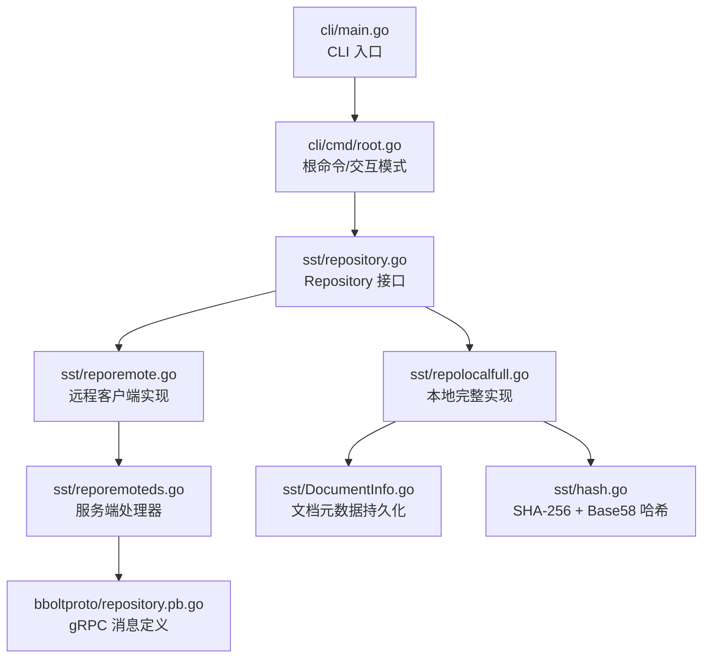
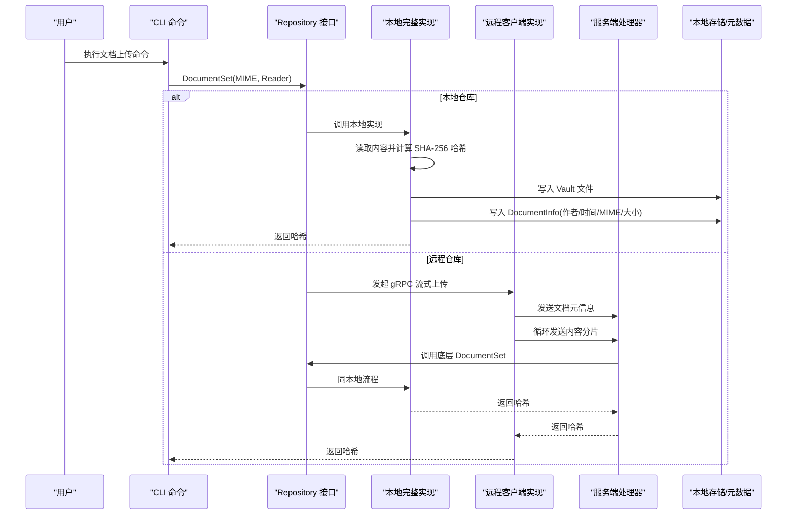
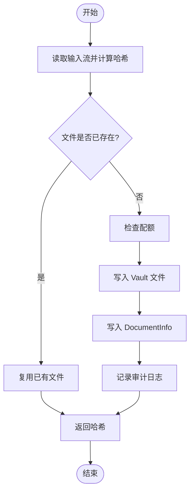
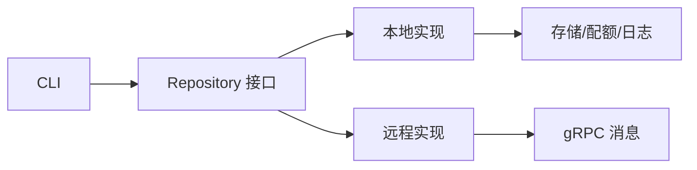

# 文档操作命令

<cite>
**本文引用的文件**
- [cli/main.go](file://cli/main.go)
- [cli/cmd/root.go](file://cli/cmd/root.go)
- [cli/cmd/interactive/document_helpers.go](file://cli/cmd/interactive/document_helpers.go)
- [sst/repository.go](file://sst/repository.go)
- [sst/repolocalfull.go](file://sst/repolocalfull.go)
- [sst/reporemote.go](file://sst/reporemote.go)
- [sst/reporemoteds.go](file://sst/reporemoteds.go)
- [sst/DocumentInfo.go](file://sst/DocumentInfo.go)
- [sst/hash.go](file://sst/hash.go)
- [bboltproto/repository.pb.go](file://bboltproto/repository.pb.go)
- [sstauth/ACCESS_RIGHTS.md](file://sstauth/ACCESS_RIGHTS.md)
- [cli/cmd/utils/loadingIndicator.go](file://cli/cmd/utils/loadingIndicator.go)
</cite>

## 目录
1. [简介](#简介)
2. [项目结构](#项目结构)
3. [核心组件](#核心组件)
4. [架构总览](#架构总览)
5. [详细组件分析](#详细组件分析)
6. [依赖关系分析](#依赖关系分析)
7. [性能考虑](#性能考虑)
8. [故障排查指南](#故障排查指南)
9. [结论](#结论)
10. [附录](#附录)

## 简介
本文件面向使用 SST CLI 进行文档（二进制或文本附件）管理的用户与开发者，系统性地说明以下能力：
- 文档上传、下载、信息查询与删除命令的使用方式
- 文档哈希值的计算与验证机制
- MIME 类型的自动识别与手动指定
- 大文件上传的进度显示与断点续传支持现状
- 批量操作与自动化处理建议
- 权限控制与访问审计的配置要点

## 项目结构
CLI 入口通过 main.go 加载环境变量并执行根命令；根命令默认进入交互模式。仓库层提供统一的 Repository 接口，包含 DocumentSet、Document、Documents、DocumentDelete 等方法。本地完整实现负责存储、哈希计算、配额检查与日志记录；远程实现通过 gRPC 流式传输完成上传与查询。

图表来源
- [cli/main.go:13-17](file://cli/main.go#L13-L17)
- [cli/cmd/root.go:14-22](file://cli/cmd/root.go#L14-L22)
- [sst/repository.go:165-178](file://sst/repository.go#L165-L178)
- [sst/repolocalfull.go:2894-2994](file://sst/repolocalfull.go#L2894-L2994)
- [sst/reporemote.go:1720-1803](file://sst/reporemote.go#L1720-L1803)
- [sst/reporemoteds.go:223-272](file://sst/reporemoteds.go#L223-L272)
- [sst/DocumentInfo.go:12-88](file://sst/DocumentInfo.go#L12-L88)
- [sst/hash.go:51-132](file://sst/hash.go#L51-L132)
- [bboltproto/repository.pb.go:6281-6310](file://bboltproto/repository.pb.go#L6281-L6310)

章节来源
- [cli/main.go:13-17](file://cli/main.go#L13-L17)
- [cli/cmd/root.go:14-22](file://cli/cmd/root.go#L14-L22)

## 核心组件
- 文档元数据模型：DocumentInfo 包含哈希、MIME 类型、作者、时间戳与大小等字段，用于持久化与返回给调用方。
- 哈希体系：采用 SHA-256 生成 32 字节哈希，并以 Base58 编码为固定长度字符串，便于人类可读与比较。
- 仓库接口：Repository 统一暴露 DocumentSet/Document/Documents/DocumentDelete 等方法，屏蔽本地与远程差异。
- 本地实现：读取内容时同时计算哈希、写入 Vault 存储、更新元数据、配额计数与审计日志。
- 远程实现：通过 gRPC 流式上传（先发送元信息，再分块发送内容），服务端聚合后调用本地实现。

章节来源
- [sst/DocumentInfo.go:12-88](file://sst/DocumentInfo.go#L12-L88)
- [sst/hash.go:51-132](file://sst/hash.go#L51-L132)
- [sst/repository.go:165-178](file://sst/repository.go#L165-L178)
- [sst/repolocalfull.go:2894-2994](file://sst/repolocalfull.go#L2894-L2994)
- [sst/reporemote.go:1720-1803](file://sst/reporemote.go#L1720-L1803)
- [sst/reporemoteds.go:223-272](file://sst/reporemoteds.go#L223-L272)

## 架构总览
下图展示了从 CLI 到仓库层的文档上传流程，包括本地与远程两种路径。

图表来源
- [sst/reporemote.go:1720-1803](file://sst/reporemote.go#L1720-L1803)
- [sst/reporemoteds.go:223-272](file://sst/reporemoteds.go#L223-L272)
- [sst/repolocalfull.go:2894-2994](file://sst/repolocalfull.go#L2894-L2994)
- [sst/DocumentInfo.go:23-88](file://sst/DocumentInfo.go#L23-L88)

## 详细组件分析

### 文档上传（DocumentSet）
- 本地完整实现
  - 读取源数据并同时计算 SHA-256 哈希，得到唯一标识
  - 若文件已存在则复用，否则创建 Vault 目录并写入文件
  - 写入 DocumentInfo（MIME、作者、时间戳），更新配额计数器
  - 记录审计日志（上传事件、作者、MIME、哈希、大小）
- 远程客户端实现
  - 通过 gRPC 流式接口先发送元信息，再分块发送内容
  - 接收服务端返回的哈希值
- 服务端处理器
  - 聚合请求中的元信息与内容分片，调用仓库实现完成存储
  - 将错误映射为合适的 gRPC 状态码（如配额超限）

图表来源
- [sst/repolocalfull.go:2894-2994](file://sst/repolocalfull.go#L2894-L2994)
- [sst/reporemoteds.go:223-272](file://sst/reporemoteds.go#L223-L272)

章节来源
- [sst/repolocalfull.go:2894-2994](file://sst/repolocalfull.go#L2894-L2994)
- [sst/reporemote.go:1720-1803](file://sst/reporemote.go#L1720-L1803)
- [sst/reporemoteds.go:223-272](file://sst/reporemoteds.go#L223-L272)

### 文档下载（Document）
- 接口行为
  - 根据哈希获取文档内容与元信息
  - 若目标 Writer 为空，仅返回元信息
- 远程实现
  - 通过 gRPC 流式响应返回文档内容分片
- 本地实现
  - 从 Vault 中按哈希定位文件并输出

章节来源
- [sst/repository.go:169-172](file://sst/repository.go#L169-L172)
- [bboltproto/repository.pb.go:6295-6300](file://bboltproto/repository.pb.go#L6295-L6300)

### 文档信息查询（Documents）
- 返回列表：返回仓库中所有文档的元信息（哈希、MIME、作者、时间戳、大小）
- 远程实现会校验哈希长度与时间戳有效性，并转换为内部结构

章节来源
- [sst/repository.go:174-175](file://sst/repository.go#L174-L175)
- [sst/reporemote.go:1894-1922](file://sst/reporemote.go#L1894-L1922)
- [bboltproto/repository.pb.go:6306-6310](file://bboltproto/repository.pb.go#L6306-L6310)

### 文档删除（DocumentDelete）
- 本地完整实现
  - 校验文件存在性，删除 Vault 文件
  - 更新配额计数器（释放空间）
  - 删除元数据并记录删除审计日志
- 远程实现
  - 通过 gRPC 调用服务端删除接口

章节来源
- [sst/repolocalfull.go:3144-3222](file://sst/repolocalfull.go#L3144-L3222)
- [sst/reporemote.go:1937-1961](file://sst/reporemote.go#L1937-L1961)
- [sst/reporemoteds.go:383-405](file://sst/reporemoteds.go#L383-L405)

### 文档哈希计算与验证
- 算法：SHA-256 生成 32 字节哈希
- 表示：Base58 编码为固定长度字符串，便于展示与比较
- 用途：作为文档的唯一标识，用于去重、定位与引用

章节来源
- [sst/hash.go:51-132](file://sst/hash.go#L51-L132)
- [sst/repolocalfull.go:2905-2918](file://sst/repolocalfull.go#L2905-L2918)

### MIME 类型识别与指定
- 自动识别：基于文件扩展名优先匹配常见类型；未知扩展名时回退到内容探测
- 手动指定：在上传时显式传入 MIME 类型，覆盖自动识别结果
- 下载命名：可根据 MIME 推断常用扩展名，便于保存文件

章节来源
- [cli/cmd/interactive/document_helpers.go:12-44](file://cli/cmd/interactive/document_helpers.go#L12-L44)
- [cli/cmd/interactive/document_helpers.go:46-69](file://cli/cmd/interactive/document_helpers.go#L46-L69)
- [sst/repolocalfull.go:2927-2941](file://sst/repolocalfull.go#L2927-L2941)

### 大文件上传：进度显示与断点续传
- 进度显示：CLI 工具提供加载指示器（旋转提示），适用于耗时操作；当前未内置逐块进度回调
- 断点续传：当前实现为一次性流式上传，未实现断点续传；如需支持，可在客户端侧实现分片与恢复逻辑，并在服务端增加相应协议支持

章节来源
- [cli/cmd/utils/loadingIndicator.go:10-46](file://cli/cmd/utils/loadingIndicator.go#L10-L46)
- [sst/reporemote.go:1765-1786](file://sst/reporemote.go#L1765-L1786)

### 批量操作与自动化处理
- 批量遍历：通过 ForDocuments 回调逐个处理文档元信息，适合导出、统计或迁移
- 批量下载：结合 Documents 列表与 Document 接口，循环下载各文档
- 批量删除：遍历哈希列表并调用 DocumentDelete
- 注意：批量操作应配合上下文超时与错误处理，避免长时间阻塞

章节来源
- [sst/repository.go:71-74](file://sst/repository.go#L71-L74)
- [sst/reporemote.go:1924-1935](file://sst/reporemote.go#L1924-L1935)

### 权限控制与访问审计
- 权限模型：基于角色派生效权限（只读、读写、管理员、超级管理员），不同方法要求不同权限级别
- 文档相关权限：
  - 读取：Document、Documents 需要只读及以上
  - 写入：DocumentSet 需要读写及以上
  - 删除：DocumentDelete 需要读写及以上
- 审计日志：本地实现在上传与删除时记录审计条目（类型、作者、时间、MIME、哈希、大小）

章节来源
- [sstauth/ACCESS_RIGHTS.md:13-29](file://sstauth/ACCESS_RIGHTS.md#L13-L29)
- [sstauth/ACCESS_RIGHTS.md:260-289](file://sstauth/ACCESS_RIGHTS.md#L260-L289)
- [sst/repolocalfull.go:2970-2988](file://sst/repolocalfull.go#L2970-L2988)
- [sst/repolocalfull.go:3200-3216](file://sst/repolocalfull.go#L3200-L3216)

## 依赖关系分析
- CLI 依赖根命令与交互模块，最终通过 Repository 接口与仓库交互
- 仓库接口解耦了本地与远程实现，便于替换与扩展
- 远程实现依赖 gRPC 消息定义，确保跨进程通信的一致性
- 本地实现依赖存储与配额子系统，保证数据一致性与资源限制

图表来源
- [cli/cmd/root.go:14-22](file://cli/cmd/root.go#L14-L22)
- [sst/repository.go:165-178](file://sst/repository.go#L165-L178)
- [sst/reporemote.go:1720-1803](file://sst/reporemote.go#L1720-L1803)
- [bboltproto/repository.pb.go:6281-6310](file://bboltproto/repository.pb.go#L6281-L6310)

章节来源
- [sst/repository.go:165-178](file://sst/repository.go#L165-L178)
- [sst/reporemote.go:1720-1803](file://sst/reporemote.go#L1720-L1803)
- [bboltproto/repository.pb.go:6281-6310](file://bboltproto/repository.pb.go#L6281-L6310)

## 性能考虑
- 上传缓冲：远程客户端使用固定大小缓冲区分块发送，降低内存占用
- 哈希计算：边读边算，避免额外拷贝
- 配额检查：在写入前检查配额，防止超额提交导致失败
- 批量操作：建议使用分页或分批处理，避免一次性加载全部元信息

[本节为通用指导，不直接分析具体文件]

## 故障排查指南
- 上传失败（配额超限）
  - 现象：服务端返回资源耗尽错误
  - 处理：调整配额或清理旧文档后重试
- 哈希无效
  - 现象：哈希长度不正确或无法解析
  - 处理：确认传入哈希为有效 Base58 字符串
- 文件不存在
  - 现象：删除时报找不到文件
  - 处理：确认哈希对应文件是否存在，或先列出文档列表核对
- 元数据缺失
  - 现象：远程返回缺少时间戳或哈希长度异常
  - 处理：检查服务端实现与客户端版本一致性

章节来源
- [sst/reporemote.go:1790-1795](file://sst/reporemote.go#L1790-L1795)
- [sst/reporemote.go:1894-1910](file://sst/reporemote.go#L1894-L1910)
- [sst/repolocalfull.go:3158-3169](file://sst/repolocalfull.go#L3158-L3169)

## 结论
SST 提供了完善的文档管理能力，涵盖上传、下载、查询与删除，并通过哈希与元数据确保可追溯性与一致性。远程与本地实现通过统一接口保持一致体验。建议在批量场景下结合上下文与配额管理，谨慎处理错误与边界条件。未来可考虑增强进度反馈与断点续传以提升大文件体验。

[本节为总结性内容，不直接分析具体文件]

## 附录
- 常用命令参考
  - 上传：调用 DocumentSet，传入 MIME 与输入流
  - 下载：调用 Document，传入哈希与可选输出流
  - 查询：调用 Documents 获取元信息列表
  - 删除：调用 DocumentDelete，传入哈希
- 最佳实践
  - 明确指定 MIME 类型以确保正确解析
  - 使用 ForDocuments 进行批量处理
  - 合理设置上下文超时与重试策略
  - 关注配额与审计日志，便于问题定位

[本节为补充说明，不直接分析具体文件]