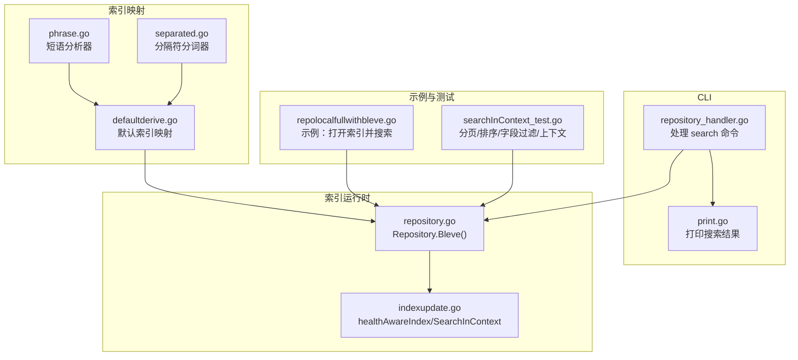
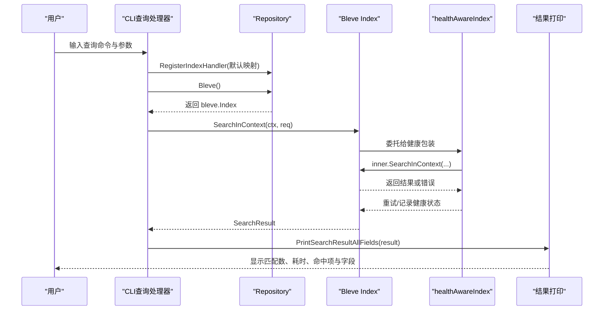
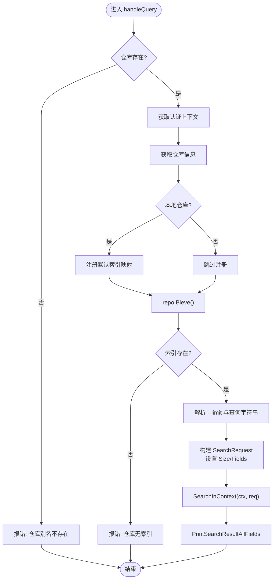
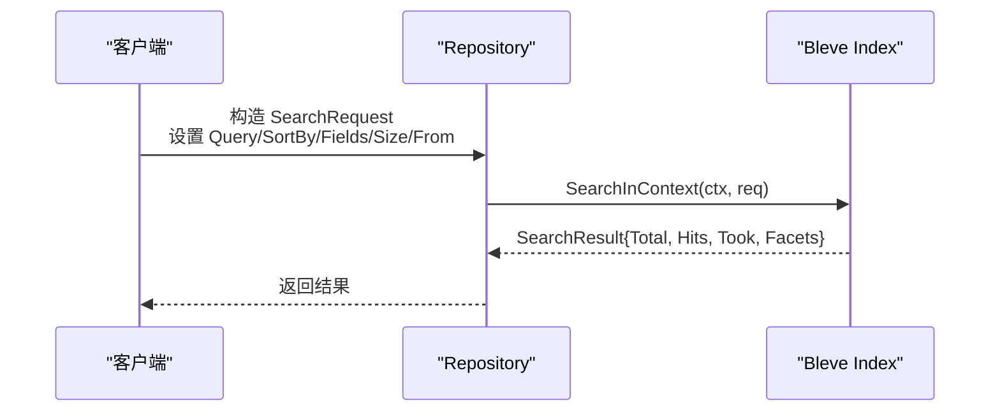
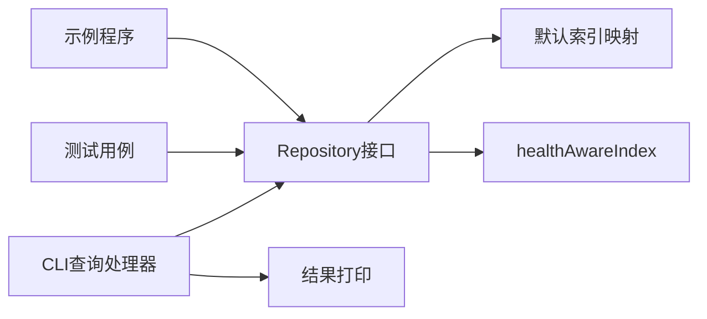

# 查询搜索命令

<cite>
**本文引用的文件**
- [repository_handler.go](file://cli/cmd/interactive/repository_handler.go)
- [print.go](file://cli/cmd/utils/print.go)
- [defaultderive.go](file://defaultderive/defaultderive.go)
- [phrase.go](file://defaultderive/analyzerphrase/phrase.go)
- [separated.go](file://defaultderive/tokenizerseparated/separated.go)
- [indexupdate.go](file://sst/indexupdate.go)
- [repository.go](file://sst/repository.go)
- [repolocalfullwithbleve.go](file://examples/helloworldrepolocalfullwithbleve/repolocalfullwithbleve.go)
- [searchInContext_test.go](file://sst_test/searchInContext_test.go)
</cite>

## 目录
1. [简介](#简介)
2. [项目结构](#项目结构)
3. [核心组件](#核心组件)
4. [架构总览](#架构总览)
5. [详细组件分析](#详细组件分析)
6. [依赖关系分析](#依赖关系分析)
7. [性能与索引调优](#性能与索引调优)
8. [故障排查指南](#故障排查指南)
9. [结论](#结论)
10. [附录：查询语法与示例](#附录：查询语法与示例)

## 简介
本文件面向SST的“查询搜索命令”，系统性说明如何使用全文搜索、如何构建复杂查询（条件组合、排序、分页）、如何控制返回字段、以及Bleve搜索引擎在SST中的集成与配置。同时给出性能优化建议，并说明查询缓存与预编译查询的使用方式与限制。

## 项目结构
SST将CLI交互层、索引映射定义、索引健康与更新、以及示例和测试组织为多个包：
- CLI交互层：解析用户输入、构造Bleve查询、执行搜索并输出结果
- 默认索引映射：定义字段、分词器与分析器、文档类型等
- 索引更新与健康：封装底层Bleve索引，提供重试与健康状态
- 仓库接口：暴露Bleve索引访问点与重建能力
- 示例与测试：演示搜索、分页、排序、高亮与字段过滤等用法

图表来源
- [repository_handler.go:300-361](file://cli/cmd/interactive/repository_handler.go#L300-L361)
- [print.go:220-257](file://cli/cmd/utils/print.go#L220-L257)
- [defaultderive.go:155-211](file://defaultderive/defaultderive.go#L155-L211)
- [phrase.go:14-31](file://defaultderive/analyzerphrase/phrase.go#L14-L31)
- [separated.go:24-46](file://defaultderive/tokenizerseparated/separated.go#L24-L46)
- [indexupdate.go:703-735](file://sst/indexupdate.go#L703-L735)
- [repository.go:102-120](file://sst/repository.go#L102-L120)
- [repolocalfullwithbleve.go:90-129](file://examples/helloworldrepolocalfullwithbleve/repolocalfullwithbleve.go#L90-L129)
- [searchInContext_test.go:218-235](file://sst_test/searchInContext_test.go#L218-L235)

章节来源
- [repository_handler.go:300-361](file://cli/cmd/interactive/repository_handler.go#L300-L361)
- [print.go:220-257](file://cli/cmd/utils/print.go#L220-L257)
- [defaultderive.go:155-211](file://defaultderive/defaultderive.go#L155-L211)
- [indexupdate.go:703-735](file://sst/indexupdate.go#L703-L735)
- [repository.go:102-120](file://sst/repository.go#L102-L120)
- [repolocalfullwithbleve.go:90-129](file://examples/helloworldrepolocalfullwithbleve/repolocalfullwithbleve.go#L90-L129)
- [searchInContext_test.go:218-235](file://sst_test/searchInContext_test.go#L218-L235)

## 核心组件
- CLI查询处理器：解析命令行参数，构造QueryStringQuery，设置Size与Fields，调用SearchInContext并输出结果
- 默认索引映射：定义label、comment、literal、mainType等字段及子文档结构；使用自定义分析器与分词器
- 健康感知索引：对底层Bleve索引进行包装，支持错误重试与健康告警
- 仓库接口：通过RegisterIndexHandler注册索引映射，通过Bleve()获取索引实例，支持RebuildBleveIndex重建索引
- 结果打印：支持白名单字段输出与全字段输出两种模式

章节来源
- [repository_handler.go:300-361](file://cli/cmd/interactive/repository_handler.go#L300-L361)
- [defaultderive.go:155-211](file://defaultderive/defaultderive.go#L155-L211)
- [indexupdate.go:703-735](file://sst/indexupdate.go#L703-L735)
- [repository.go:102-120](file://sst/repository.go#L102-L120)
- [print.go:220-257](file://cli/cmd/utils/print.go#L220-L257)

## 架构总览
下图展示了从CLI到Bleve索引的完整调用链，包括索引映射注册、查询构建、执行与结果输出。

图表来源
- [repository_handler.go:300-361](file://cli/cmd/interactive/repository_handler.go#L300-L361)
- [indexupdate.go:703-735](file://sst/indexupdate.go#L703-L735)
- [print.go:220-257](file://cli/cmd/utils/print.go#L220-L257)

## 详细组件分析

### CLI查询命令实现
- 参数解析：支持 --limit 指定返回条数；其余参数拼接为查询字符串
- 查询构建：使用QueryStringQuery，支持Bleve查询语法
- 请求配置：设置Size与Fields（当前实现为全部字段）
- 执行与输出：调用SearchInContext，并通过PrintSearchResultAllFields输出所有字段

图表来源
- [repository_handler.go:300-361](file://cli/cmd/interactive/repository_handler.go#L300-L361)

章节来源
- [repository_handler.go:300-361](file://cli/cmd/interactive/repository_handler.go#L300-L361)

### 全文搜索命令使用方法
- 基本用法：在交互式CLI中，选择仓库别名后执行查询命令，传入关键词或Bleve查询表达式
- 限制条数：使用 --limit N 控制返回数量
- 字段选择：当前CLI实现固定返回所有字段；如需仅返回特定字段，可在上层应用自行构造SearchRequest并设置Fields

章节来源
- [repository_handler.go:300-361](file://cli/cmd/interactive/repository_handler.go#L300-L361)
- [print.go:220-257](file://cli/cmd/utils/print.go#L220-L257)

### 查询语法与Bleve集成
- 查询语言：基于Bleve的查询语法，支持Match、QueryString、MatchAll等
- 字段名：由默认索引映射决定，常用字段包括 label、comment、literal、mainType、id.*、graphID、commit* 等
- 短语搜索：label字段包含短语分析器，适合精确短语匹配
- 示例参考：测试用例展示了MatchQuery、QueryStringQuery、MatchAllQuery、分页与排序等用法

章节来源
- [defaultderive.go:155-211](file://defaultderive/defaultderive.go#L155-L211)
- [searchInContext_test.go:218-235](file://sst_test/searchInContext_test.go#L218-L235)
- [searchInContext_test.go:518-524](file://sst_test/searchInContext_test.go#L518-L524)

### 复杂查询构建（条件组合、排序、分页）
- 条件组合：可使用Bleve的组合查询（如布尔查询）在SearchRequest中组合多个子查询
- 排序：通过SortBy设置排序字段，例如按-_id降序
- 分页：使用NewSearchRequestOptions(size, from, ...)或设置Size与From实现分页
- 字段过滤：通过SearchRequest.Fields指定需要返回的字段列表

图表来源
- [searchInContext_test.go:218-235](file://sst_test/searchInContext_test.go#L218-L235)
- [searchInContext_test.go:565-583](file://sst_test/searchInContext_test.go#L565-L583)
- [searchInContext_test.go:611-622](file://sst_test/searchInContext_test.go#L611-L622)

章节来源
- [searchInContext_test.go:218-235](file://sst_test/searchInContext_test.go#L218-L235)
- [searchInContext_test.go:565-583](file://sst_test/searchInContext_test.go#L565-L583)
- [searchInContext_test.go:611-622](file://sst_test/searchInContext_test.go#L611-L622)

### 高亮显示与字段过滤
- 高亮显示：当前CLI未启用高亮；如需高亮，可在SearchRequest中配置Highlighter并设置需高亮的字段
- 字段过滤：CLI默认返回所有字段；可通过设置SearchRequest.Fields限制返回字段，减少网络与序列化开销

章节来源
- [repository_handler.go:300-361](file://cli/cmd/interactive/repository_handler.go#L300-L361)
- [print.go:220-257](file://cli/cmd/utils/print.go#L220-L257)

### 索引映射与配置选项
- 默认映射：定义主类型、标签、评论、字面量、图ID、提交信息等字段；支持子文档结构
- 分析器与分词器：
  - phrase分析器：单字符分词+小写过滤，用于短语字段
  - separated分词器：以分隔符拆分，用于关键字字段
- 版本字段：内置版本标记字段，便于索引迁移与兼容性检查

章节来源
- [defaultderive.go:155-211](file://defaultderive/defaultderive.go#L155-L211)
- [phrase.go:14-31](file://defaultderive/analyzerphrase/phrase.go#L14-L31)
- [separated.go:24-46](file://defaultderive/tokenizerseparated/separated.go#L24-L46)

### 健康感知索引与重试
- healthAwareIndex包装底层Bleve索引，对可重试错误进行短暂休眠并重试
- 若索引处于不健康状态但本次搜索成功，仍会返回结果并附带警告信息

章节来源
- [indexupdate.go:703-735](file://sst/indexupdate.go#L703-L735)

### 仓库接口与索引重建
- RegisterIndexHandler：注册默认索引映射，使仓库具备Bleve索引能力
- Bleve()：返回bleve.Index，可直接调用SearchInContext
- RebuildBleveIndex：重建索引（本地仓库支持；远程仓库不支持）

章节来源
- [repository.go:102-120](file://sst/repository.go#L102-L120)

### 示例与测试参考
- 示例：展示创建仓库、注册索引、写入数据、直接打开索引并搜索
- 测试：覆盖分页、排序、字段过滤、上下文取消、空结果、删除后一致性等场景

章节来源
- [repolocalfullwithbleve.go:90-129](file://examples/helloworldrepolocalfullwithbleve/repolocalfullwithbleve.go#L90-L129)
- [searchInContext_test.go:218-235](file://sst_test/searchInContext_test.go#L218-L235)
- [searchInContext_test.go:313-354](file://sst_test/searchInContext_test.go#L313-L354)
- [searchInContext_test.go:518-524](file://sst_test/searchInContext_test.go#L518-L524)
- [searchInContext_test.go:526-563](file://sst_test/searchInContext_test.go#L526-L563)
- [searchInContext_test.go:565-583](file://sst_test/searchInContext_test.go#L565-L583)
- [searchInContext_test.go:611-622](file://sst_test/searchInContext_test.go#L611-L622)

## 依赖关系分析
- CLI依赖仓库接口获取索引，并依赖打印工具输出结果
- 仓库接口依赖索引映射定义来构建索引结构
- 索引运行时通过健康包装增强可靠性
- 示例与测试验证端到端流程与边界情况

图表来源
- [repository_handler.go:300-361](file://cli/cmd/interactive/repository_handler.go#L300-L361)
- [defaultderive.go:155-211](file://defaultderive/defaultderive.go#L155-L211)
- [indexupdate.go:703-735](file://sst/indexupdate.go#L703-L735)
- [print.go:220-257](file://cli/cmd/utils/print.go#L220-L257)

章节来源
- [repository_handler.go:300-361](file://cli/cmd/interactive/repository_handler.go#L300-L361)
- [defaultderive.go:155-211](file://defaultderive/defaultderive.go#L155-L211)
- [indexupdate.go:703-735](file://sst/indexupdate.go#L703-L735)
- [print.go:220-257](file://cli/cmd/utils/print.go#L220-L257)

## 性能与索引调优
- 合理设置Size与From：避免一次性返回大量结果，结合分页提升响应速度
- 字段过滤：仅返回必要字段，减少序列化与传输成本
- 查询选择：优先使用精确字段匹配（如label、id.*），减少全字段扫描
- 分析器选择：短语搜索使用phrase分析器；关键字字段使用separated或keyword分析器
- 健康重试：healthAwareIndex自动重试部分IO错误，降低瞬时失败影响
- 索引重建：当映射变更或数据不一致时，使用RebuildBleveIndex重建索引
- 批处理写入：批量提交数据后再刷新索引，减少频繁写入带来的开销

[本节为通用指导，无需具体文件引用]

## 故障排查指南
- 无索引：确认已调用RegisterIndexHandler且仓库非flat类型；Remote仓库需服务端侧配置
- 查询无结果：检查字段名是否与映射一致；确认数据已提交并刷新索引
- 上下文超时：SearchInContext支持context，确保设置合理超时
- 健康告警：若返回结果但携带健康警告，检查底层IO错误（如文件句柄耗尽、临时不可用）
- 重建索引：本地仓库支持重建；远程仓库需在服务端执行

章节来源
- [repository_handler.go:300-361](file://cli/cmd/interactive/repository_handler.go#L300-L361)
- [indexupdate.go:703-735](file://sst/indexupdate.go#L703-L735)
- [repository.go:102-120](file://sst/repository.go#L102-L120)

## 结论
SST通过CLI层与Bleve搜索引擎深度集成，提供了灵活的全文搜索能力。默认索引映射定义了丰富的字段结构，支持短语与关键字分析。CLI查询命令简单易用，同时允许在上层应用中构建更复杂的查询（组合、排序、分页、字段过滤）。健康感知索引增强了稳定性，配合合理的性能调优策略，可满足大规模数据的检索需求。

[本节为总结性内容，无需具体文件引用]

## 附录：查询语法与示例
- 基础查询：使用QueryStringQuery或MatchQuery在label、comment、literal等字段上搜索
- 短语搜索：利用phrase分析器在label.phrase字段上进行精确短语匹配
- 排序：通过SortBy设置排序字段，如-_id表示按ID降序
- 分页：使用NewSearchRequestOptions(size, from, ...)或设置Size与From
- 字段过滤：设置SearchRequest.Fields为所需字段列表
- 高亮：可在SearchRequest中配置Highlighter并指定高亮字段（当前CLI未启用）

章节来源
- [searchInContext_test.go:218-235](file://sst_test/searchInContext_test.go#L218-L235)
- [searchInContext_test.go:518-524](file://sst_test/searchInContext_test.go#L518-L524)
- [searchInContext_test.go:565-583](file://sst_test/searchInContext_test.go#L565-L583)
- [searchInContext_test.go:611-622](file://sst_test/searchInContext_test.go#L611-L622)