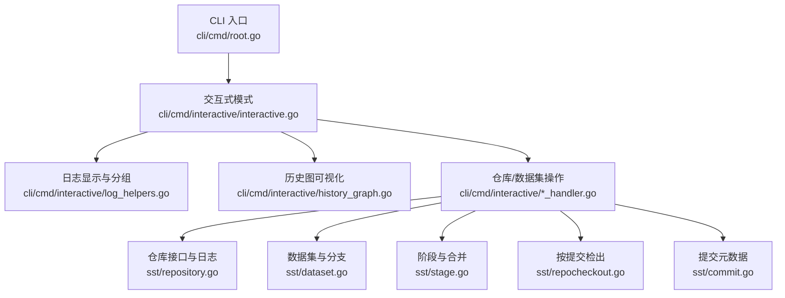
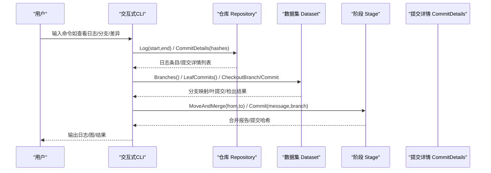
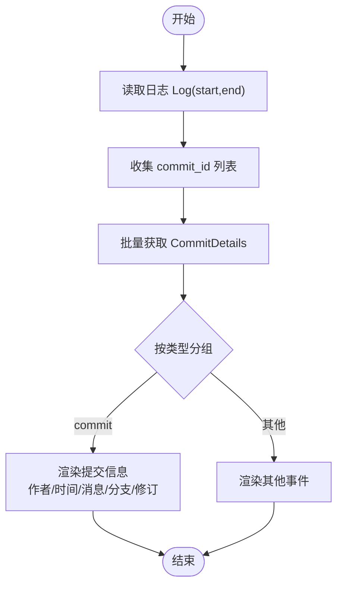
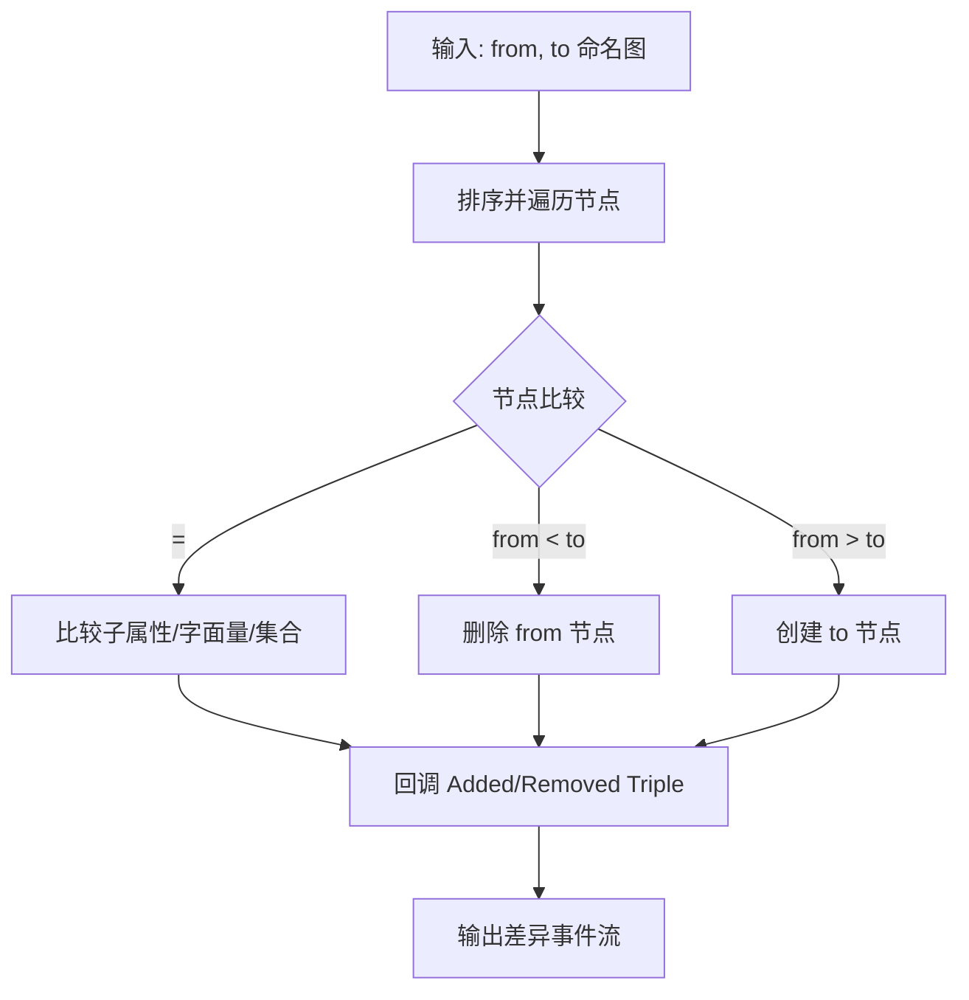
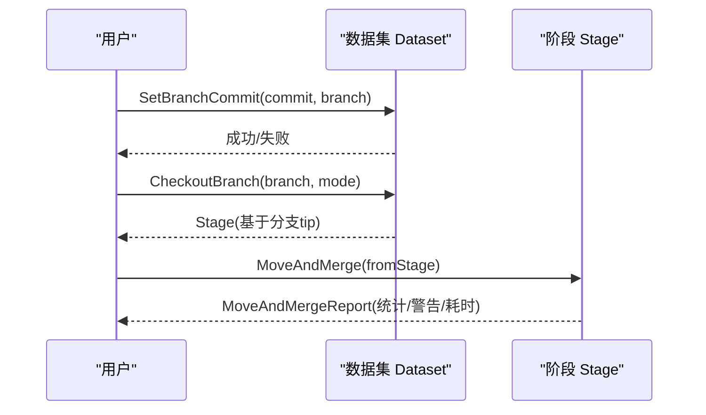
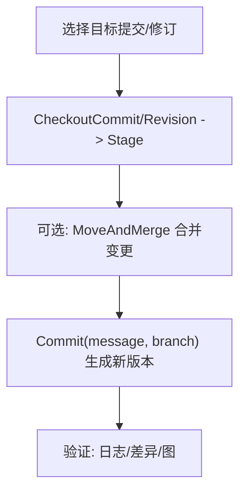
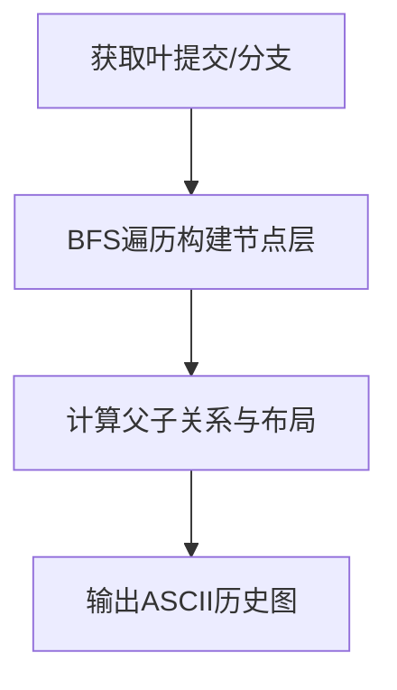
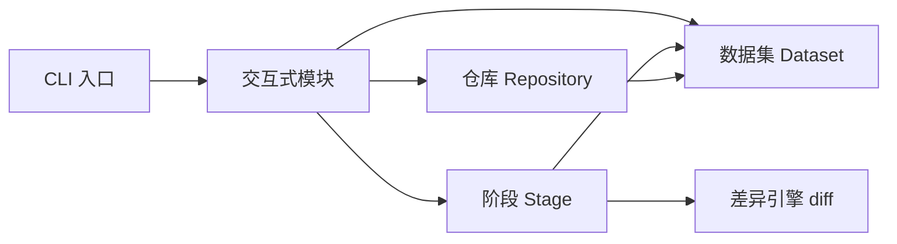

# 版本控制命令

<cite>
**本文引用的文件**
- [cli/cmd/root.go](file://cli/cmd/root.go)
- [cli/cmd/interactive/interactive.go](file://cli/cmd/interactive/interactive.go)
- [cli/cmd/interactive/log_helpers.go](file://cli/cmd/interactive/log_helpers.go)
- [cli/cmd/interactive/history_graph.go](file://cli/cmd/interactive/history_graph.go)
- [sst/commit.go](file://sst/commit.go)
- [sst/dataset.go](file://sst/dataset.go)
- [sst/repocheckout.go](file://sst/repocheckout.go)
- [sst/stage.go](file://sst/stage.go)
- [sst/repository.go](file://sst/repository.go)
</cite>

## 目录
1. [简介](#简介)
2. [项目结构](#项目结构)
3. [核心组件](#核心组件)
4. [架构总览](#架构总览)
5. [详细组件分析](#详细组件分析)
6. [依赖关系分析](#依赖关系分析)
7. [性能考量](#性能考量)
8. [故障排查指南](#故障排查指南)
9. [结论](#结论)
10. [附录](#附录)

## 简介
本文件面向SST版本控制系统，围绕“提交历史查看、日志分析、差异比较、分支管理、标签与版本标记、回滚与撤销、冲突检测与自动解决”等能力，提供从命令行到核心API的完整说明。读者可据此掌握如何高效浏览提交历史、定位变更、进行分支合并与版本回退，并理解底层数据模型与流程。

## 项目结构
SST CLI以交互式模式为入口，内部通过命令解析器分发到具体处理器；核心版本控制逻辑位于sst包中，包括仓库、数据集、阶段（Stage）、提交元数据与差异计算等。

图表来源
- [cli/cmd/root.go:13-45](file://cli/cmd/root.go#L13-L45)
- [cli/cmd/interactive/interactive.go:17-98](file://cli/cmd/interactive/interactive.go#L17-L98)
- [cli/cmd/interactive/log_helpers.go:17-177](file://cli/cmd/interactive/log_helpers.go#L17-L177)
- [cli/cmd/interactive/history_graph.go:26-339](file://cli/cmd/interactive/history_graph.go#L26-L339)
- [sst/repository.go:34-179](file://sst/repository.go#L34-L179)
- [sst/dataset.go:9-94](file://sst/dataset.go#L9-L94)
- [sst/stage.go:64-234](file://sst/stage.go#L64-L234)
- [sst/repocheckout.go:10-44](file://sst/repocheckout.go#L10-L44)
- [sst/commit.go:15-62](file://sst/commit.go#L15-L62)

章节来源
- [cli/cmd/root.go:13-45](file://cli/cmd/root.go#L13-L45)
- [cli/cmd/interactive/interactive.go:17-98](file://cli/cmd/interactive/interactive.go#L17-L98)

## 核心组件
- 仓库（Repository）：持久化存储多个相关数据集，支持日志、查询与数据集修订历史。
- 数据集（Dataset）：表示RDF数据集及其所有修订，维护分支指针与提交关系。
- 阶段（Stage）：内存中的工作区，承载命名图与三元组，支持提交、移动合并、对齐历史等操作。
- 提交元数据（CommitDetails）：包含提交哈希、作者、时间戳、消息、父提交、数据集/命名图修订映射。
- 差异引擎（diff）：基于命名图的节点与三元组对比，生成新增/删除/修改事件回调。

章节来源
- [sst/repository.go:34-179](file://sst/repository.go#L34-L179)
- [sst/dataset.go:9-94](file://sst/dataset.go#L9-L94)
- [sst/stage.go:64-234](file://sst/stage.go#L64-L234)
- [sst/commit.go:15-62](file://sst/commit.go#L15-L62)
- [sst/diff.go:28-327](file://sst/diff.go#L28-L327)

## 架构总览
下图展示从CLI交互到核心版本的调用链：用户输入经交互式模式解析后，调用仓库/数据集/阶段接口完成日志读取、提交详情获取、分支切换、合并与差异计算。

图表来源
- [cli/cmd/interactive/interactive.go:17-98](file://cli/cmd/interactive/interactive.go#L17-L98)
- [sst/repository.go:133-179](file://sst/repository.go#L133-L179)
- [sst/dataset.go:34-94](file://sst/dataset.go#L34-L94)
- [sst/stage.go:121-170](file://sst/stage.go#L121-L170)
- [sst/commit.go:18-62](file://sst/commit.go#L18-L62)

## 详细组件分析

### 提交历史查看与日志分析
- 日志读取：仓库提供Log接口，支持start/end参数实现分页与范围查询。
- 日志分组与展示：交互式模块将日志按类型分组，批量拉取提交详情，渲染简洁或详细视图。
- 提交详情：通过CommitDetails获取作者、时间、消息、父提交、数据集/命名图修订映射。

图表来源
- [sst/repository.go:133-147](file://sst/repository.go#L133-L147)
- [cli/cmd/interactive/log_helpers.go:17-177](file://cli/cmd/interactive/log_helpers.go#L17-L177)
- [sst/commit.go:18-62](file://sst/commit.go#L18-L62)

章节来源
- [sst/repository.go:133-147](file://sst/repository.go#L133-L147)
- [cli/cmd/interactive/log_helpers.go:17-177](file://cli/cmd/interactive/log_helpers.go#L17-L177)
- [sst/commit.go:18-62](file://sst/commit.go#L18-L62)

### 差异比较
- 差异算法：对两个命名图进行节点级比较，递归处理属性主体、字面量与集合，产生添加/删除/修改三元组的回调。
- 使用场景：用于三向合并前的差异分析、变更审计与可视化。

图表来源
- [sst/diff.go:28-327](file://sst/diff.go#L28-L327)

章节来源
- [sst/diff.go:28-327](file://sst/diff.go#L28-L327)

### 分支管理（创建、切换、合并）
- 分支定义：数据集维护唯一分支名到提交哈希的映射，支持设置/移除分支。
- 切换分支：CheckoutBranch返回对应分支最新提交的Stage。
- 合并分支：MoveAndMerge尝试寻找共同祖先，执行三向合并或替换策略，并记录动作报告。

图表来源
- [sst/dataset.go:34-74](file://sst/dataset.go#L34-L74)
- [sst/stage.go:121-170](file://sst/stage.go#L121-L170)

章节来源
- [sst/dataset.go:34-74](file://sst/dataset.go#L34-L74)
- [sst/stage.go:121-170](file://sst/stage.go#L121-L170)

### 标签管理与版本标记
- 当前代码库未直接暴露“标签”概念；可通过“分支”作为轻量级版本标记使用（例如固定某次提交）。
- 建议实践：将稳定版本对应的提交哈希设置为特定分支名（如v1.0），便于后续检出与同步。

章节来源
- [sst/dataset.go:34-63](file://sst/dataset.go#L34-L63)

### 版本回滚与撤销
- 回滚思路：通过CheckoutCommit或CheckoutRevision加载目标提交/修订的Stage，再提交为新版本，形成“回滚提交”。
- 安全建议：
  - 先创建新分支保存当前状态，再进行回滚提交。
  - 使用MoveAndMerge合并时关注报告中的Action类型与Warnings，确认无意外覆盖。
  - 对跨仓库移动/合并，注意modified标志与三元组更新。

图表来源
- [sst/repocheckout.go:10-44](file://sst/repocheckout.go#L10-L44)
- [sst/stage.go:121-170](file://sst/stage.go#L121-L170)

章节来源
- [sst/repocheckout.go:10-44](file://sst/repocheckout.go#L10-L44)
- [sst/stage.go:121-170](file://sst/stage.go#L121-L170)

### 冲突检测与自动解决配置
- 冲突检测：MoveAndMerge在存在不同修订且无共同祖先时，会尝试三向合并；若无法自动解决，会在报告中记录相应Action与Warnings。
- 自动解决策略：
  - 若一方是另一方的祖先，则保留/替换策略明确。
  - 否则执行三向合并，依据差异结果合并三元组。
- 配置选项：当前实现未暴露外部配置项；行为由MoveAndMerge内部逻辑决定。可通过审阅MoveAndMergeReport进行人工干预。

章节来源
- [sst/stage.go:468-800](file://sst/stage.go#L468-L800)

### 历史图可视化
- 功能：基于数据集的叶提交与分支信息，构建ASCII风格的历史图，标注作者、时间与分支指向。
- 适用：快速理解多分支合并拓扑与提交脉络。

图表来源
- [cli/cmd/interactive/history_graph.go:26-339](file://cli/cmd/interactive/history_graph.go#L26-L339)

章节来源
- [cli/cmd/interactive/history_graph.go:26-339](file://cli/cmd/interactive/history_graph.go#L26-L339)

## 依赖关系分析
- CLI层依赖交互式模块进行命令解析与输出格式化。
- 交互式模块依赖sst包的仓库、数据集、阶段与提交元数据接口。
- 阶段合并依赖差异引擎与数据集的公共祖先查找能力。

图表来源
- [cli/cmd/root.go:13-45](file://cli/cmd/root.go#L13-L45)
- [cli/cmd/interactive/interactive.go:17-98](file://cli/cmd/interactive/interactive.go#L17-L98)
- [sst/repository.go:34-179](file://sst/repository.go#L34-L179)
- [sst/dataset.go:9-94](file://sst/dataset.go#L9-L94)
- [sst/stage.go:64-234](file://sst/stage.go#L64-L234)
- [sst/diff.go:28-327](file://sst/diff.go#L28-L327)

章节来源
- [cli/cmd/root.go:13-45](file://cli/cmd/root.go#L13-L45)
- [cli/cmd/interactive/interactive.go:17-98](file://cli/cmd/interactive/interactive.go#L17-L98)
- [sst/repository.go:34-179](file://sst/repository.go#L34-L179)
- [sst/dataset.go:9-94](file://sst/dataset.go#L9-L94)
- [sst/stage.go:64-234](file://sst/stage.go#L64-L234)
- [sst/diff.go:28-327](file://sst/diff.go#L28-L327)

## 性能考量
- 日志批量拉取：交互式模块对commit_id进行批量获取提交详情，减少往返开销。
- 差异计算：按三元组有序扫描，避免全量比对；对大型图建议分批处理与限制范围。
- 合并报告：MoveAndMerge记录统计与耗时，便于评估合并成本与瓶颈。

[本节为通用指导，不直接分析具体文件]

## 故障排查指南
- 提交未找到：当请求的提交哈希不存在时，可能返回“提交未找到”错误；请核对哈希或分支指向。
- 阶段无效：MoveAndMerge或提交前需确保阶段有效；若阶段被移动/合并后失效，应重新打开或重建。
- 权限与连接：远程仓库操作受上下文认证影响；网络异常或权限不足会导致失败。
- 合并警告：审阅MoveAndMergeReport中的Warnings，识别潜在覆盖或不可预期变更。

章节来源
- [sst/commit.go:11-13](file://sst/commit.go#L11-L13)
- [sst/stage.go:21-31](file://sst/stage.go#L21-L31)
- [sst/repository.go:34-48](file://sst/repository.go#L34-L48)

## 结论
SST版本控制系统通过CLI交互界面与核心API协同，提供了完整的提交历史查看、日志分析、差异比较、分支管理、版本标记与回滚能力。借助MoveAndMerge与差异引擎，系统能在复杂合并场景中保持数据一致性与可追溯性。建议结合日志与历史图进行变更审计，并在关键操作前备份分支或使用新分支保护现有状态。

[本节为总结性内容，不直接分析具体文件]

## 附录
- 常用命令路径参考：
  - 交互式入口：[cli/cmd/interactive/interactive.go](file://cli/cmd/interactive/interactive.go)
  - 日志显示与分组：[cli/cmd/interactive/log_helpers.go](file://cli/cmd/interactive/log_helpers.go)
  - 历史图可视化：[cli/cmd/interactive/history_graph.go](file://cli/cmd/interactive/history_graph.go)
  - 仓库接口与日志：[sst/repository.go](file://sst/repository.go)
  - 数据集与分支：[sst/dataset.go](file://sst/dataset.go)
  - 阶段与合并：[sst/stage.go](file://sst/stage.go)
  - 按提交检出：[sst/repocheckout.go](file://sst/repocheckout.go)
  - 提交元数据：[sst/commit.go](file://sst/commit.go)

[本节为索引性内容，不直接分析具体文件]