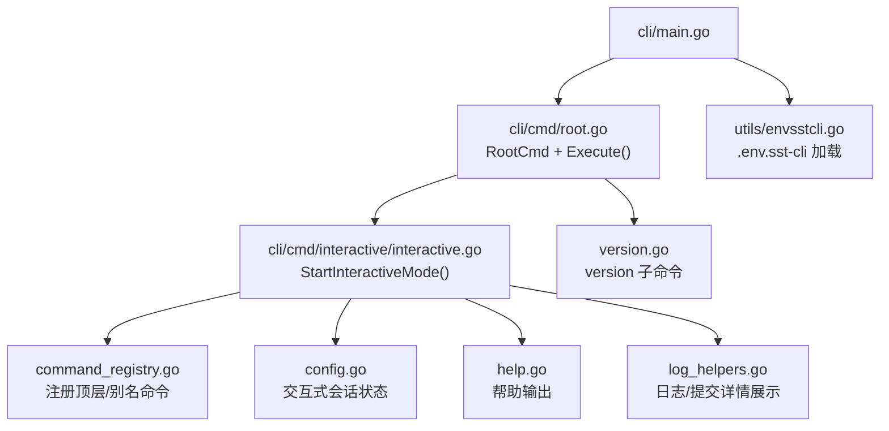
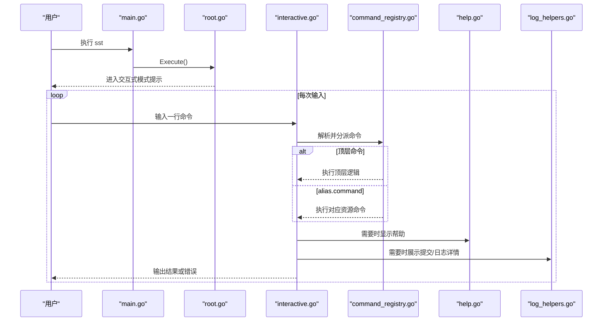
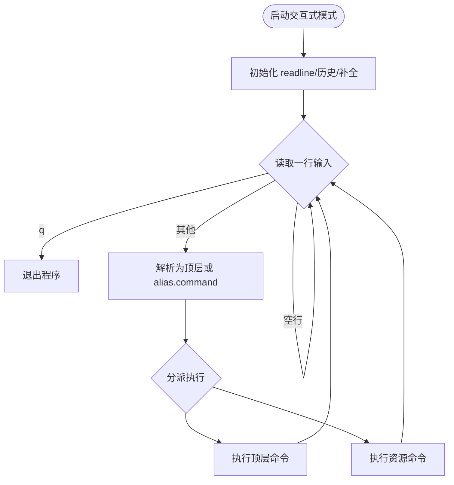
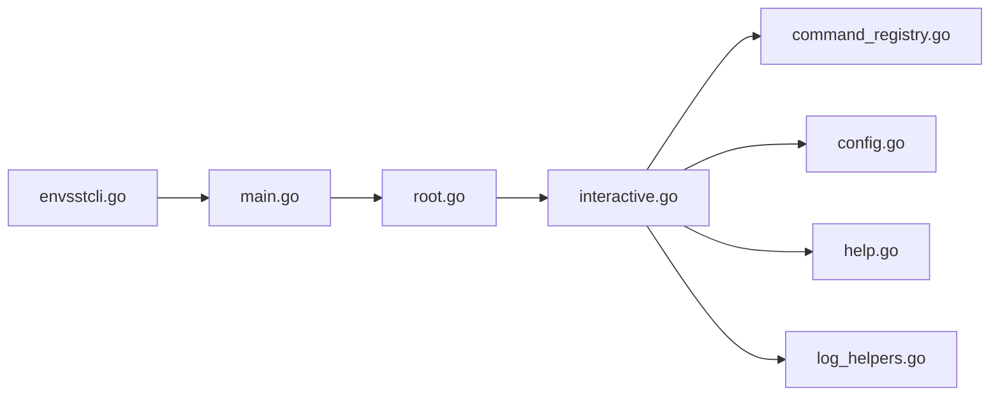

# 命令行工具

<cite>
**本文引用的文件**
- [cli/main.go](file://cli/main.go)
- [cli/cmd/root.go](file://cli/cmd/root.go)
- [cli/cmd/version.go](file://cli/cmd/version.go)
- [cli/CLI_INTRODUCTION.md](file://cli/CLI_INTRODUCTION.md)
- [cli/sst.1.md](file://cli/sst.1.md)
- [cli/cmd/interactive/interactive.go](file://cli/cmd/interactive/interactive.go)
- [cli/cmd/interactive/command_registry.go](file://cli/cmd/interactive/command_registry.go)
- [cli/cmd/interactive/config.go](file://cli/cmd/interactive/config.go)
- [cli/cmd/interactive/help.go](file://cli/cmd/interactive/help.go)
- [cli/cmd/utils/envsstcli.go](file://cli/cmd/utils/envsstcli.go)
- [cli/cmd/utils/clierror.go](file://cli/cmd/utils/clierror.go)
- [cli/cmd/interactive/log_helpers.go](file://cli/cmd/interactive/log_helpers.go)
</cite>

## 目录
1. [简介](#简介)
2. [项目结构](#项目结构)
3. [核心组件](#核心组件)
4. [架构总览](#架构总览)
5. [详细组件分析](#详细组件分析)
6. [依赖关系分析](#依赖关系分析)
7. [性能与使用建议](#性能与使用建议)
8. [故障排查与调试](#故障排查与调试)
9. [结论](#结论)
10. [附录：常用工作流命令组合](#附录：常用工作流命令组合)

## 简介
SST 命令行工具（sst）是一个面向 SST Core API 的低层 CLI，用于在本地或远程仓库、数据集、阶段（Stage）、命名图（NamedGraph）和 IBNode 之间进行交互式操作与调试。默认启动即进入交互式模式，支持历史、补全与 Tab 自动完成；也提供非交互的子命令如 version。

- 构建方式：从仓库根目录执行 go build -o cli/sst ./cli/main.go
- 默认行为：直接运行 sst 会进入交互式会话；也可显式执行 sst interactive
- 版本信息：通过 sst version 输出

**章节来源**
- [cli/main.go:1-18](file://cli/main.go#L1-L18)
- [cli/cmd/root.go:13-45](file://cli/cmd/root.go#L13-L45)
- [cli/cmd/version.go:14-46](file://cli/cmd/version.go#L14-L46)
- [cli/sst.1.md:7-23](file://cli/sst.1.md#L7-L23)

## 项目结构
CLI 采用 Cobra 作为命令框架，入口 main 加载环境变量并执行根命令；根命令注册 interactive 子命令与 version 子命令。交互式模式由独立包实现，包含命令解析、注册表、处理器、配置、帮助与日志等模块。

**图表来源**
- [cli/main.go:12-17](file://cli/main.go#L12-L17)
- [cli/cmd/root.go:13-45](file://cli/cmd/root.go#L13-L45)
- [cli/cmd/interactive/interactive.go:17-99](file://cli/cmd/interactive/interactive.go#L17-L99)
- [cli/cmd/interactive/command_registry.go:39-147](file://cli/cmd/interactive/command_registry.go#L39-L147)
- [cli/cmd/interactive/config.go:11-73](file://cli/cmd/interactive/config.go#L11-L73)
- [cli/cmd/interactive/help.go:11-62](file://cli/cmd/interactive/help.go#L11-L62)
- [cli/cmd/interactive/log_helpers.go:17-177](file://cli/cmd/interactive/log_helpers.go#L17-L177)
- [cli/cmd/version.go:39-46](file://cli/cmd/version.go#L39-L46)
- [cli/cmd/utils/envsstcli.go:14-34](file://cli/cmd/utils/envsstcli.go#L14-L34)

**章节来源**
- [cli/main.go:1-18](file://cli/main.go#L1-L18)
- [cli/cmd/root.go:1-52](file://cli/cmd/root.go#L1-L52)
- [cli/cmd/interactive/interactive.go:1-158](file://cli/cmd/interactive/interactive.go#L1-L158)

## 核心组件
- 入口与根命令：main 调用 utils.LoadEnvSstCLI 后执行 RootCmd.Execute；RootCmd 默认进入交互式模式，并注册 interactive 与 version 子命令
- 交互式会话：StartInteractiveMode 初始化 readline、历史记录、自动补全，循环读取输入并分发到顶层命令或 alias.command
- 命令注册表：集中声明所有顶层命令与按资源类型（仓库、数据集、阶段、命名图、IBNode）的别名命令，并提供 help 与补全索引
- 会话配置：维护当前打开的仓库、超级仓库、数据集、阶段、命名图、IBNode 及其元数据映射
- 环境变量：启动时从 .env.sst-cli 加载认证所需变量，不覆盖已存在的环境变量
- 版本命令：打印版本、构建时间与提交哈希

**章节来源**
- [cli/cmd/root.go:13-45](file://cli/cmd/root.go#L13-L45)
- [cli/cmd/interactive/interactive.go:17-99](file://cli/cmd/interactive/interactive.go#L17-L99)
- [cli/cmd/interactive/command_registry.go:39-147](file://cli/cmd/interactive/command_registry.go#L39-L147)
- [cli/cmd/interactive/config.go:11-73](file://cli/cmd/interactive/config.go#L11-L73)
- [cli/cmd/utils/envsstcli.go:14-34](file://cli/cmd/utils/envsstcli.go#L14-L34)
- [cli/cmd/version.go:14-46](file://cli/cmd/version.go#L14-L46)

## 架构总览
CLI 以 Cobra 为外壳，内部通过交互式命令解析器将用户输入转换为对 SST Core 的操作。错误处理统一格式化为用户友好的提示。

**图表来源**
- [cli/main.go:12-17](file://cli/main.go#L12-L17)
- [cli/cmd/root.go:13-45](file://cli/cmd/root.go#L13-L45)
- [cli/cmd/interactive/interactive.go:27-99](file://cli/cmd/interactive/interactive.go#L27-L99)
- [cli/cmd/interactive/command_registry.go:39-147](file://cli/cmd/interactive/command_registry.go#L39-L147)
- [cli/cmd/interactive/help.go:11-62](file://cli/cmd/interactive/help.go#L11-L62)
- [cli/cmd/interactive/log_helpers.go:17-177](file://cli/cmd/interactive/log_helpers.go#L17-L177)

## 详细组件分析

### 安装与基本使用
- 构建：go build -o cli/sst ./cli/main.go
- 启动：./sst 或 sst interactive（两者等价）
- 退出：在交互式提示符下输入 q
- 查看帮助：help
- 版本：sst version

**章节来源**
- [cli/CLI_INTRODUCTION.md:8-21](file://cli/CLI_INTRODUCTION.md#L8-L21)
- [cli/sst.1.md:7-23](file://cli/sst.1.md#L7-L23)
- [cli/cmd/version.go:39-46](file://cli/cmd/version.go#L39-L46)

### 交互式会话模式
- 启动后会显示提示符 sst >
- 支持历史（最多 1000 条）与 Tab 补全
- 输入行支持两种形式：
  - 顶层命令：如 openlocalrepository、rdfread、importp21 等
  - 资源命令：<alias>.<subcommand>，如 r1.info、d1.checkoutbranch master
- 大小写：顶层关键字大小写不敏感；点号后的子命令会被归一化为小写
- 可选别名：许多创建/检出命令支持 -a <alias> 指定新资源的别名，否则自动分配下一个可用别名

**图表来源**
- [cli/cmd/interactive/interactive.go:27-99](file://cli/cmd/interactive/interactive.go#L27-L99)
- [cli/sst.1.md:44-69](file://cli/sst.1.md#L44-L69)

**章节来源**
- [cli/cmd/interactive/interactive.go:27-99](file://cli/cmd/interactive/interactive.go#L27-L99)
- [cli/sst.1.md:44-69](file://cli/sst.1.md#L44-L69)

### 仓库管理命令
- 打开仓库：openlocalrepository、openlocalflatrepository、openremoterepository
- 打开超级仓库：openlocalsuperrepository、openremotesuperrepository
- 仓库信息：r1.info
- 列出数据集：r1.datasets
- 按 IRI 获取数据集：r1.dataset <iri>
- 全文检索：r1.query <bleve-query> [--limit n]
- 列出索引字段：r1.listfield
- 提交历史：r1.log [-v|--verbose]
- 提交详情：r1.commitinfo <hash>
- 提交差异：r1.commitdiff <hash>
- 检出提交到阶段：r1.checkoutcommit <hash> [-a <stage-alias>]
- 导出原始 SST 文件：r1.extractsstfile <hash>
- 内部数据转储（谨慎）：r1.dump <bucket-key>[/<sub-key>]
- 同步：r1.syncfrom <source-repo-alias> [branch] [dataset...]
- 克隆：r1.clone <target-directory>
- 文档操作：documents、documentinfo、documentset、documentget、documentdelete
- 关闭仓库：r1.close

**章节来源**
- [cli/CLI_INTRODUCTION.md:123-393](file://cli/CLI_INTRODUCTION.md#L123-L393)
- [cli/sst.1.md:97-123](file://cli/sst.1.md#L97-L123)
- [cli/cmd/interactive/command_registry.go:64-90](file://cli/cmd/interactive/command_registry.go#L64-L90)

### 数据集命令
- 列出提交：d1.listcommits [--details]
- 分支列表：d1.branches
- 叶提交：d1.leafcommits
- 提交详情：d1.commitdetailsbyhash <hash>、d1.commitdetailsbybranch <branch>
- 检出：d1.checkoutcommit <hash> [-a <stage-alias>]、d1.checkoutrevision <hash> [-a <stage-alias>]、d1.checkoutbranch <branch> [-a <stage-alias>]
- 分支管理：d1.setbranchcommit <commit-hash> <branch>、d1.setbranchrevision <ds-revision-hash> <branch>、d1.removebranch <branch>
- 差异与历史：d1.diff <NGR-hash1> <NGR-hash2>、d1.history

**章节来源**
- [cli/CLI_INTRODUCTION.md:395-547](file://cli/CLI_INTRODUCTION.md#L395-L547)
- [cli/sst.1.md:136-153](file://cli/sst.1.md#L136-L153)
- [cli/cmd/interactive/command_registry.go:98-111](file://cli/cmd/interactive/command_registry.go#L98-L111)

### 阶段与命名图命令
- 阶段信息：s1.info
- 列出命名图：s1.namedgraphs、s1.referencednamedgraphs
- 按 IRI 获取命名图：s1.namedgraph <iri>
- 合并：s1.moveandmerge <source-stage-alias>
- 对齐历史：s1.alignhistory <from-stage-alias>
- 提交：s1.commit <message> [branch]
- 验证：s1.validate [-o <file>]
- 输出 RDF：s1.rdfwrite <file>、s1.trig
- 写出 SST 文件：s1.writesstfilesdirectory <directory>
- 命名图信息：g1.info
- 节点列表：g1.foririnodes、g1.forallibnodes、g1.forblanknodes
- 节点查询：g1.getirinodebyfragment <id>、g1.getblanknodebyfragment <id>
- 输出：g1.rdfwrite <file>、g1.ttl、g1.sstwrite <file>
- 导出：g1.exportap242xml <file.xml>、g1.exportsvg <file>

**章节来源**
- [cli/CLI_INTRODUCTION.md:572-713](file://cli/CLI_INTRODUCTION.md#L572-L713)
- [cli/sst.1.md:154-183](file://cli/sst.1.md#L154-L183)
- [cli/cmd/interactive/command_registry.go:113-147](file://cli/cmd/interactive/command_registry.go#L113-L147)

### 数据导入导出
- 读取 RDF：rdfread <file>（Turtle/TriG）
- 读取 SST：sstread <file>
- 导入 AP242 XML：importap242xml <file>
- 导入 STEP P21：importp21 <file> [-o <raw-ttl>]
- 导出 AP242 XML：g1.exportap242xml <file.xml>
- 导出 SVG：g1.exportsvg <file>

**章节来源**
- [cli/CLI_INTRODUCTION.md:685-733](file://cli/CLI_INTRODUCTION.md#L685-L733)
- [cli/sst.1.md:83-95](file://cli/sst.1.md#L83-L95)
- [cli/cmd/interactive/command_registry.go:45-61](file://cli/cmd/interactive/command_registry.go#L45-L61)

### 批量操作与脚本化
- 推荐流程：在非交互模式下仅使用 sst version；交互式模式适合探索与调试
- 批量任务可通过 shell 脚本循环调用 sst interactive 的子命令（注意：交互式模式并非稳定脚本 API）
- 使用 -a 指定别名可避免歧义，便于自动化拼接命令序列

**章节来源**
- [cli/sst.1.md:230-236](file://cli/sst.1.md#L230-L236)
- [cli/sst.1.md:58-69](file://cli/sst.1.md#L58-L69)

### 配置文件与环境变量
- 配置文件：.env.sst-cli（位于当前目录或用户主目录），格式 KEY=VALUE，支持注释与引号
- 必需变量（远程认证）：SST_OIDC_REALM_URL、SST_OIDC_CLIENT_ID、SST_OIDC_CLIENT_SECRET
- 可选变量：SST_USERNAME、SST_PASSWORD（二者同时设置才生效）
- 行为：已存在的环境变量不会被覆盖；缺失文件或不可读不会阻止 CLI 启动

**章节来源**
- [cli/cmd/utils/envsstcli.go:14-34](file://cli/cmd/utils/envsstcli.go#L14-L34)
- [cli/sst.1.md:195-223](file://cli/sst.1.md#L195-L223)

## 依赖关系分析
- 顶层命令与别名命令在 command_registry.go 中集中注册，并通过索引表快速查找
- 交互式会话在 interactive.go 中维护 readline、历史、补全与输入循环
- 配置状态集中在 config.go 的 InteractiveConfig 中
- 帮助输出由 help.go 生成，并按资源类型分组
- 日志与提交详情展示由 log_helpers.go 负责，支持简洁与详细两种视图

**图表来源**
- [cli/cmd/interactive/interactive.go:27-99](file://cli/cmd/interactive/interactive.go#L27-L99)
- [cli/cmd/interactive/command_registry.go:39-147](file://cli/cmd/interactive/command_registry.go#L39-L147)
- [cli/cmd/interactive/config.go:11-73](file://cli/cmd/interactive/config.go#L11-L73)
- [cli/cmd/interactive/help.go:11-62](file://cli/cmd/interactive/help.go#L11-L62)
- [cli/cmd/interactive/log_helpers.go:17-177](file://cli/cmd/interactive/log_helpers.go#L17-L177)
- [cli/cmd/root.go:13-45](file://cli/cmd/root.go#L13-L45)
- [cli/main.go:12-17](file://cli/main.go#L12-L17)
- [cli/cmd/utils/envsstcli.go:14-34](file://cli/cmd/utils/envsstcli.go#L14-L34)

**章节来源**
- [cli/cmd/interactive/command_registry.go:39-147](file://cli/cmd/interactive/command_registry.go#L39-L147)
- [cli/cmd/interactive/interactive.go:27-99](file://cli/cmd/interactive/interactive.go#L27-L99)
- [cli/cmd/interactive/config.go:11-73](file://cli/cmd/interactive/config.go#L11-L73)
- [cli/cmd/interactive/help.go:11-62](file://cli/cmd/interactive/help.go#L11-L62)
- [cli/cmd/interactive/log_helpers.go:17-177](file://cli/cmd/interactive/log_helpers.go#L17-L177)

## 性能与使用建议
- 全文检索：r1.query 支持 --limit 控制返回数量，避免大量结果影响终端渲染
- 提交历史：r1.log -v 会批量拉取提交详情，建议在需要时再启用详细模式
- 大文件导入：importp21 可使用 -o 输出转换前的原始 Turtle，便于定位问题
- 阶段验证：s1.validate 可将报告写入文件，便于后续分析与归档
- 历史与补全：readline 历史上限为 1000 条，避免长时间无界累积

[本节为通用建议，无需具体文件引用]

## 故障排查与调试
- 错误消息标准化：CLI 将后端错误（包括 gRPC 状态码、网络错误、已知哨兵错误）统一格式化为“Cannot ...: ....”的用户友好提示
- 常见错误映射：
  - 权限不足：write access required
  - 未认证：authentication failed
  - 服务不可用：service unavailable
  - 主机不可达：host not found / connection refused / TLS handshake failed
  - 分支/数据集/仓库不存在：branch/dataset/repository not found
  - 并发修改：concurrent modification
  - 提交为空：nothing to commit
- 调试技巧：
  - 使用 r1.dump 查看底层 BoltDB 桶内容（谨慎在生产环境使用）
  - 使用 r1.log -v 查看详细的提交与事件
  - 使用 importp21 -o 输出中间 TTL 辅助定位转换问题
  - 使用 s1.validate -o report.txt 保存验证报告

**章节来源**
- [cli/cmd/utils/clierror.go:18-75](file://cli/cmd/utils/clierror.go#L18-L75)
- [cli/cmd/utils/clierror.go:77-197](file://cli/cmd/utils/clierror.go#L77-L197)
- [cli/cmd/interactive/log_helpers.go:17-177](file://cli/cmd/interactive/log_helpers.go#L17-L177)
- [cli/CLI_INTRODUCTION.md:339-383](file://cli/CLI_INTRODUCTION.md#L339-L383)

## 结论
SST CLI 提供了完整的交互式与基础非交互能力，覆盖仓库、数据集、阶段、命名图与 IBNode 的全生命周期操作。通过统一的错误处理、丰富的导入导出与验证能力，以及完善的帮助与日志展示，适合开发与运维场景下的数据管理与问题定位。

[本节为总结性内容，无需具体文件引用]

## 附录：常用工作流命令组合
- 新建本地仓库并添加数据
  - openlocalrepository <path>
  - r1.openstage
  - s1.commit "Initial commit"
- 从远程仓库检出并提交变更
  - openremoterepository <URL>
  - r1.datasets
  - r1.dataset <iri>
  - d1.checkoutbranch master
  - 编辑数据后：s1.commit "Update" feature-branch
- 导入外部数据并验证
  - rdfread <file>
  - s1.validate -o validation-report.txt
  - s1.commit "Imported data"
- 对比与回溯
  - r1.log -v
  - d1.diff <NGR-hash1> <NGR-hash2>
  - r1.commitdiff <hash>
- 导出与共享
  - g1.rdfwrite <output.ttl>
  - g1.sstwrite <output.sst>
  - g1.exportap242xml <output.xml>

[本节为示例性内容，无需具体文件引用]