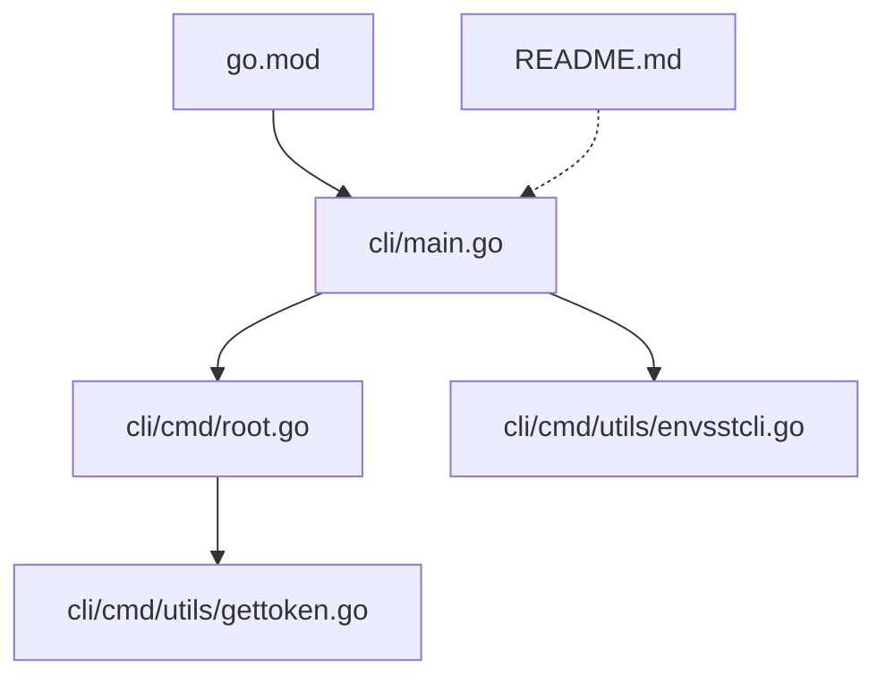
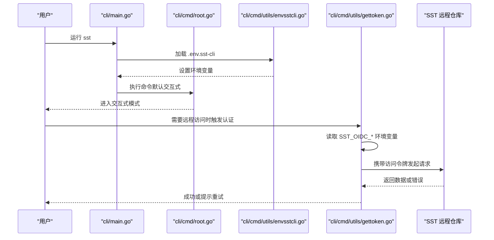
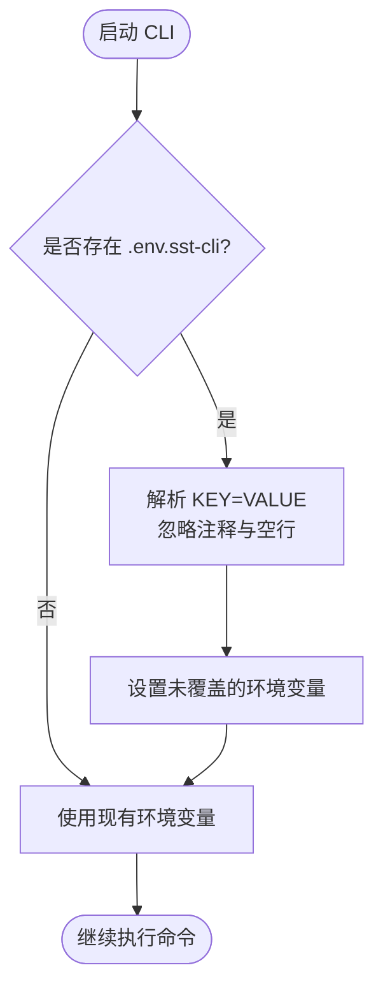
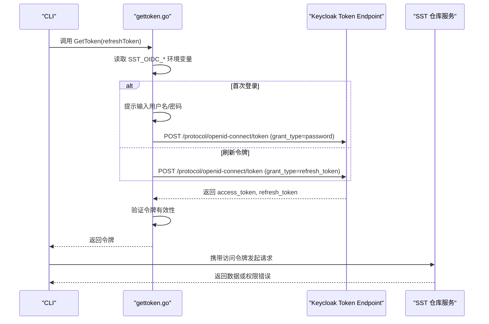
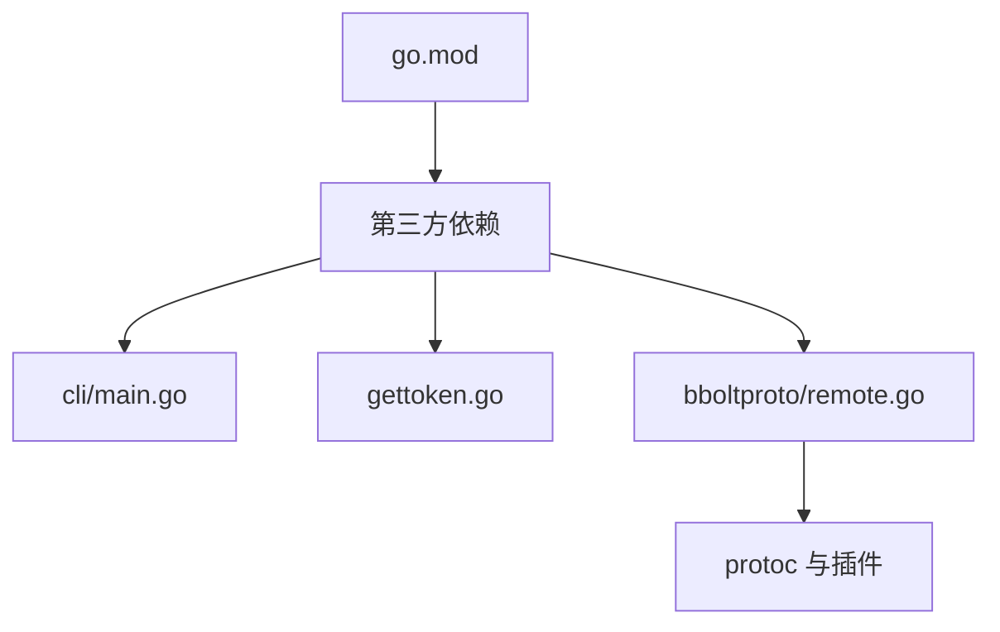

# 安装和配置

<cite>
**本文引用的文件**
- [cli/main.go](file://cli/main.go)
- [go.mod](file://go.mod)
- [README.md](file://README.md)
- [cli/cmd/root.go](file://cli/cmd/root.go)
- [cli/cmd/utils/envsstcli.go](file://cli/cmd/utils/envsstcli.go)
- [cli/cmd/utils/gettoken.go](file://cli/cmd/utils/gettoken.go)
- [bboltproto/remote.go](file://bboltproto/remote.go)
</cite>

## 目录
1. [简介](#简介)
2. [项目结构](#项目结构)
3. [核心组件](#核心组件)
4. [架构总览](#架构总览)
5. [详细组件分析](#详细组件分析)
6. [依赖关系分析](#依赖关系分析)
7. [性能注意事项](#性能注意事项)
8. [故障排除指南](#故障排除指南)
9. [结论](#结论)
10. [附录](#附录)

## 简介
本章节面向首次接触 SST 命令行工具的用户，提供从源码编译安装的完整步骤、Go 环境要求与依赖项说明、环境变量与配置文件的使用方法（含认证令牌与服务器地址）、不同操作系统下的安装差异，以及常见问题的排查方法。SST CLI 用于与 SST 仓库和数据集交互，默认进入交互式模式，支持本地与远程仓库访问。

## 项目结构
- CLI 入口位于 cli/main.go，启动时加载环境变量并执行命令。
- 根模块定义在 go.mod，指定 Go 版本与第三方依赖。
- 帮助文档与包说明在 README.md。
- 交互式模式与命令注册在 cli/cmd/root.go。
- 环境变量加载逻辑在 cli/cmd/utils/envsstcli.go。
- OIDC 认证与令牌获取在 cli/cmd/utils/gettoken.go。
- Protobuf 生成脚本与插件要求在 bboltproto/remote.go 中注释说明。

**图示来源**
- [cli/main.go:1-18](file://cli/main.go#L1-L18)
- [cli/cmd/root.go:13-30](file://cli/cmd/root.go#L13-L30)
- [cli/cmd/utils/envsstcli.go:12-34](file://cli/cmd/utils/envsstcli.go#L12-L34)
- [cli/cmd/utils/gettoken.go:65-83](file://cli/cmd/utils/gettoken.go#L65-L83)
- [go.mod:1-4](file://go.mod#L1-L4)
- [README.md:1-15](file://README.md#L1-L15)

**章节来源**
- [cli/main.go:1-18](file://cli/main.go#L1-L18)
- [go.mod:1-4](file://go.mod#L1-L4)
- [README.md:1-15](file://README.md#L1-L15)

## 核心组件
- 命令行入口：cli/main.go 负责初始化环境与执行 CLI。
- 命令框架：cli/cmd/root.go 使用 Cobra 构建命令树，默认进入交互式模式。
- 环境变量加载：cli/cmd/utils/envsstcli.go 从 .env.sst-cli 读取键值对，不覆盖已存在的环境变量。
- 认证与令牌：cli/cmd/utils/gettoken.go 通过 OIDC 获取访问令牌，支持用户名密码或刷新令牌流程。

**章节来源**
- [cli/main.go:12-17](file://cli/main.go#L12-L17)
- [cli/cmd/root.go:13-30](file://cli/cmd/root.go#L13-L30)
- [cli/cmd/utils/envsstcli.go:12-34](file://cli/cmd/utils/envsstcli.go#L12-L34)
- [cli/cmd/utils/gettoken.go:27-54](file://cli/cmd/utils/gettoken.go#L27-L54)

## 架构总览
下图展示 CLI 启动、环境变量加载、OIDC 认证与远程仓库访问的整体流程。

**图示来源**
- [cli/main.go:12-17](file://cli/main.go#L12-L17)
- [cli/cmd/root.go:13-30](file://cli/cmd/root.go#L13-L30)
- [cli/cmd/utils/envsstcli.go:12-34](file://cli/cmd/utils/envsstcli.go#L12-L34)
- [cli/cmd/utils/gettoken.go:65-83](file://cli/cmd/utils/gettoken.go#L65-L83)

## 详细组件分析

### 环境变量与配置文件
- 配置文件名：.env.sst-cli
- 搜索顺序：当前工作目录优先，其次为用户主目录。
- 文件格式：每行一个 KEY=VALUE；支持 # 注释与空行；值可用双引号或单引号包裹。
- 行为：不会覆盖已存在的环境变量。
- 必需环境变量（远程认证）：SST_OIDC_REALM_URL、SST_OIDC_CLIENT_ID、SST_OIDC_CLIENT_SECRET。
- 可选环境变量（非交互式登录）：SST_USERNAME、SST_PASSWORD（两者需同时设置）。

**图示来源**
- [cli/cmd/utils/envsstcli.go:12-34](file://cli/cmd/utils/envsstcli.go#L12-L34)
- [cli/cmd/utils/envsstcli.go:47-75](file://cli/cmd/utils/envsstcli.go#L47-L75)

**章节来源**
- [cli/cmd/utils/envsstcli.go:12-34](file://cli/cmd/utils/envsstcli.go#L12-L34)
- [cli/cmd/utils/envsstcli.go:47-75](file://cli/cmd/utils/envsstcli.go#L47-L75)

### 认证令牌与 OIDC 配置
- 令牌获取流程：
  - 读取 SST_OIDC_REALM_URL、SST_OIDC_CLIENT_ID、SST_OIDC_CLIENT_SECRET。
  - 若未设置 SST_USERNAME/SST_PASSWORD，则交互式提示输入。
  - 使用 password 或 refresh_token 授权类型向 Keycloak 的 token 端点请求令牌。
  - 校验令牌有效性后返回访问令牌与刷新令牌。
- 令牌刷新策略：
  - 维护可刷新提供者，在访问令牌即将过期时使用刷新令牌续期。
  - 若刷新失败且无刷新令牌，则重新进行用户名密码认证。

**图示来源**
- [cli/cmd/utils/gettoken.go:65-83](file://cli/cmd/utils/gettoken.go#L65-L83)
- [cli/cmd/utils/gettoken.go:85-142](file://cli/cmd/utils/gettoken.go#L85-L142)
- [cli/cmd/utils/gettoken.go:144-192](file://cli/cmd/utils/gettoken.go#L144-L192)

**章节来源**
- [cli/cmd/utils/gettoken.go:27-54](file://cli/cmd/utils/gettoken.go#L27-L54)
- [cli/cmd/utils/gettoken.go:65-83](file://cli/cmd/utils/gettoken.go#L65-L83)
- [cli/cmd/utils/gettoken.go:85-142](file://cli/cmd/utils/gettoken.go#L85-L142)
- [cli/cmd/utils/gettoken.go:144-192](file://cli/cmd/utils/gettoken.go#L144-L192)

### 交互式模式与命令入口
- 默认行为：直接运行 sst 会进入交互式模式，提示用户输入 help 查看可用命令。
- 命令注册：root.go 将交互式子命令与版本命令添加到根命令。

**章节来源**
- [cli/cmd/root.go:13-30](file://cli/cmd/root.go#L13-L30)
- [cli/cmd/root.go:32-51](file://cli/cmd/root.go#L32-L51)

## 依赖关系分析
- Go 版本要求：go.mod 指定 Go 1.25.0。
- 关键依赖：
  - Cobra/pflag：命令行框架与参数解析。
  - go-oidc/v3、oauth2：OIDC 认证与令牌管理。
  - grpc、protobuf：gRPC 通信与序列化。
  - bleve：全文检索索引。
  - bbolt：本地存储后端。
- 生成工具：Protobuf 代码生成需要 protoc 及相应插件（protoc-gen-go、protoc-gen-go-grpc、protoc-gen-fieldmask）。

**图示来源**
- [go.mod:1-34](file://go.mod#L1-L34)
- [bboltproto/remote.go:11-20](file://bboltproto/remote.go#L11-L20)

**章节来源**
- [go.mod:1-34](file://go.mod#L1-L34)
- [bboltproto/remote.go:11-20](file://bboltproto/remote.go#L11-L20)

## 性能注意事项
- 令牌缓存与刷新：可刷新提供者会在访问令牌接近过期时自动刷新，减少重复认证开销。
- 网络与 I/O：远程仓库操作受网络延迟影响，建议合理设置超时与重试策略（由上层库处理）。
- 索引与存储：Bleve 索引与 bbolt 存储的性能取决于数据规模与查询复杂度，建议在批量写入后刷新索引以获得一致搜索结果。

[本节为通用指导，不直接分析具体文件]

## 故障排除指南
- 无法找到 .env.sst-cli：
  - 确认文件位于当前工作目录或用户主目录。
  - 检查文件格式是否为 KEY=VALUE，避免多余空格或非法字符。
- 认证失败：
  - 检查 SST_OIDC_REALM_URL、SST_OIDC_CLIENT_ID、SST_OIDC_CLIENT_SECRET 是否正确。
  - 若非交互式登录，确保 SST_USERNAME 与 SST_PASSWORD 同时设置。
  - 确认 Keycloak 的客户端角色映射包含 resource_access.<clientID>.roles。
- 令牌无效或过期：
  - 使用刷新令牌续期；若仍失败，重新进行用户名密码认证。
  - 验证访问令牌的 exp 字段是否有效。
- Protobuf 生成失败：
  - 确保已安装 protoc 与所需插件（protoc-gen-go、protoc-gen-go-grpc、protoc-gen-fieldmask）。
  - 检查 GOPATH 或 PATH 中插件路径配置正确。

**章节来源**
- [cli/cmd/utils/envsstcli.go:12-34](file://cli/cmd/utils/envsstcli.go#L12-L34)
- [cli/cmd/utils/gettoken.go:65-83](file://cli/cmd/utils/gettoken.go#L65-L83)
- [cli/cmd/utils/gettoken.go:144-192](file://cli/cmd/utils/gettoken.go#L144-L192)
- [bboltproto/remote.go:11-20](file://bboltproto/remote.go#L11-L20)

## 结论
SST CLI 提供了简洁的命令行入口与强大的远程仓库交互能力。通过 .env.sst-cli 与环境变量完成认证配置，结合 OIDC 令牌机制实现安全访问。遵循本文的安装与配置步骤，可在不同操作系统上顺利部署并使用 SST CLI。遇到问题时，参考故障排除指南定位并解决常见问题。

[本节为总结性内容，不直接分析具体文件]

## 附录

### 从源码编译安装步骤
- 准备 Go 环境：
  - 安装 Go 1.25.0 或更高版本。
  - 配置 GOPATH 与 PATH，确保 go 命令可用。
- 获取源码：
  - 克隆仓库到本地目录。
- 安装 Protobuf 生成工具（如需重新生成代码）：
  - 安装 protoc 编译器。
  - 安装 protoc-gen-go、protoc-gen-go-grpc、protoc-gen-fieldmask。
- 编译 CLI：
  - 在项目根目录执行：go build -o ./cli/sst ./cli/main.go
- 运行 CLI：
  - 直接执行 sst 进入交互式模式。
  - 或在命令行中传入子命令执行特定功能。

**章节来源**
- [go.mod:1-4](file://go.mod#L1-L4)
- [bboltproto/remote.go:11-20](file://bboltproto/remote.go#L11-L20)
- [cli/main.go:12-17](file://cli/main.go#L12-L17)

### 环境变量清单
- 必需（远程认证）：
  - SST_OIDC_REALM_URL：OIDC 发行者地址（例如 Keycloak realm URL）。
  - SST_OIDC_CLIENT_ID：客户端标识符。
  - SST_OIDC_CLIENT_SECRET：客户端密钥。
- 可选（非交互式登录）：
  - SST_USERNAME：用户名。
  - SST_PASSWORD：密码。

**章节来源**
- [cli/cmd/utils/envsstcli.go:12-34](file://cli/cmd/utils/envsstcli.go#L12-L34)
- [cli/cmd/utils/gettoken.go:65-83](file://cli/cmd/utils/gettoken.go#L65-L83)

### 不同操作系统下的安装差异
- Windows：
  - 确保 PATH 中包含 Go 与 protoc 相关工具路径。
  - 使用 cmd 或 PowerShell 执行编译与运行命令。
- macOS/Linux：
  - 使用 bash 或 zsh 等 shell 执行命令。
  - 注意 .env.sst-cli 文件权限，确保可读。

[本节为通用指导，不直接分析具体文件]