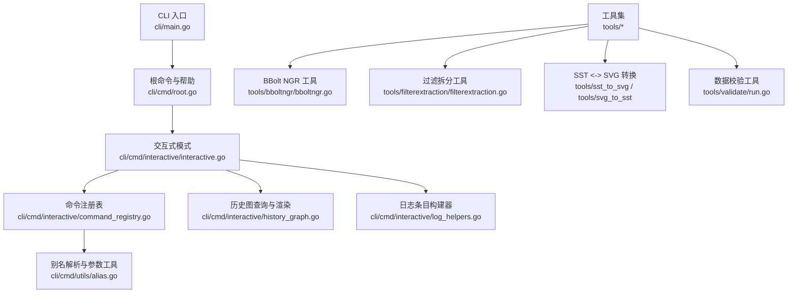
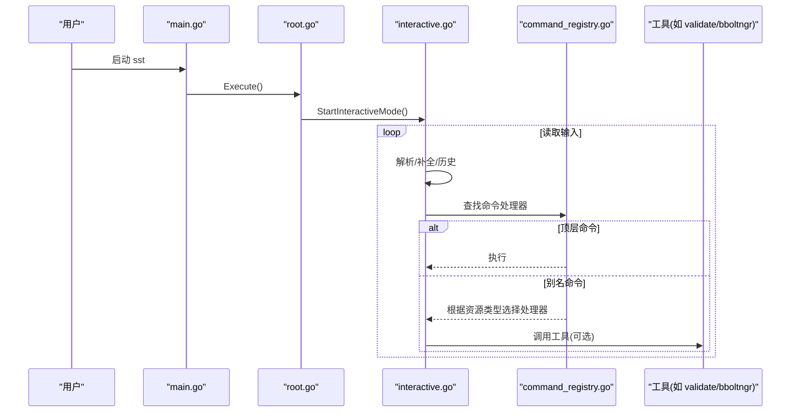
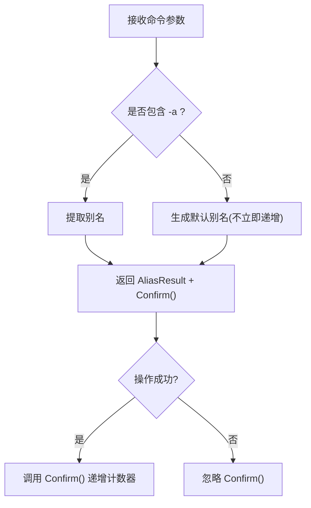
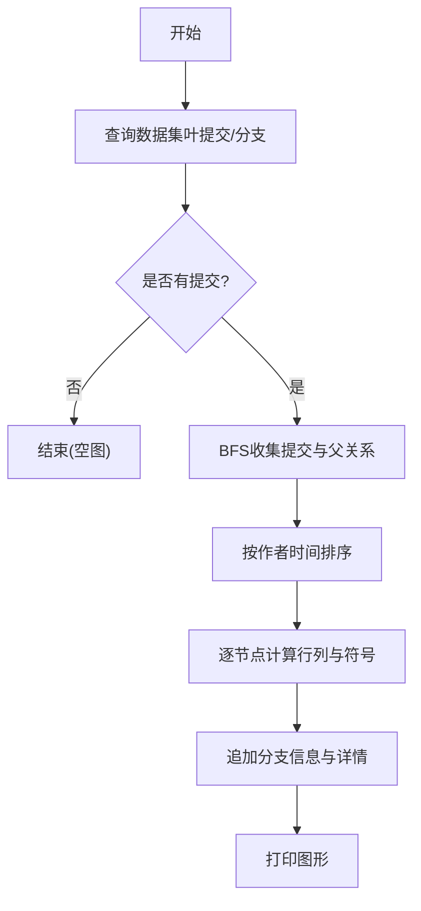
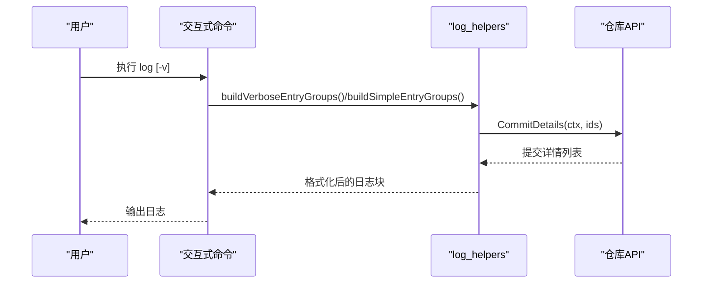
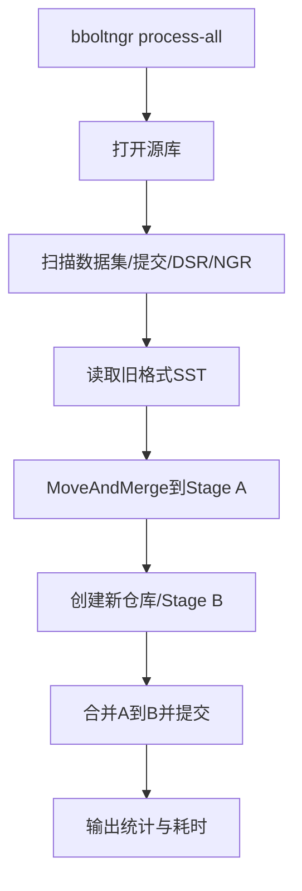
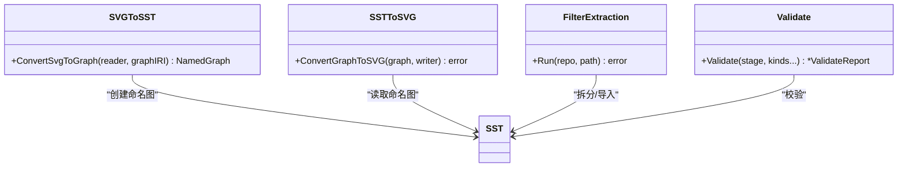
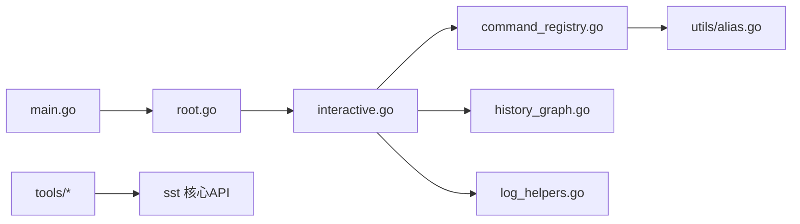

# 实用工具命令

<cite>
**本文引用的文件**
- [cli/main.go](file://cli/main.go)
- [cli/cmd/root.go](file://cli/cmd/root.go)
- [cli/cmd/interactive/interactive.go](file://cli/cmd/interactive/interactive.go)
- [cli/cmd/interactive/command_registry.go](file://cli/cmd/interactive/command_registry.go)
- [cli/cmd/utils/alias.go](file://cli/cmd/utils/alias.go)
- [cli/cmd/interactive/history_graph.go](file://cli/cmd/interactive/history_graph.go)
- [cli/cmd/interactive/log_helpers.go](file://cli/cmd/interactive/log_helpers.go)
- [tools/bboltngr/bboltngr.go](file://tools/bboltngr/bboltngr.go)
- [tools/filterextraction/filterextraction.go](file://tools/filterextraction/filterextraction.go)
- [tools/sst_to_svg/convert.go](file://tools/sst_to_svg/convert.go)
- [tools/svg_to_sst/convert.go](file://tools/svg_to_sst/convert.go)
- [tools/validate/run.go](file://tools/validate/run.go)
</cite>

## 目录
1. [简介](#简介)
2. [项目结构](#项目结构)
3. [核心组件](#核心组件)
4. [架构总览](#架构总览)
5. [详细组件分析](#详细组件分析)
6. [依赖关系分析](#依赖关系分析)
7. [性能注意事项](#性能注意事项)
8. [故障排查指南](#故障排查指南)
9. [结论](#结论)
10. [附录](#附录)

## 简介
本文件面向SST CLI与配套工具的使用者与维护者，系统化说明以下能力：
- 别名命令的创建与管理（交互式环境中的快捷命令）
- 历史图查看与分析（数据集提交历史的可视化浏览）
- 调试与日志相关工具（仓库日志、验证报告、BBolt底层数据操作）
- 性能分析与监控（批量处理、迁移流程、导出导入统计）
- 数据转换与格式化工具（TTL/SVG/STEP等互转、过滤拆分）
- 错误诊断与问题排查（常见错误定位、输出解读）

## 项目结构
SST CLI以交互式模式为主入口，提供丰富的顶层命令与按资源类型区分的别名命令；同时提供独立工具用于数据校验、图形转换、BBolt数据库操作等。

**图表来源**
- [cli/main.go:13-17](file://cli/main.go#L13-L17)
- [cli/cmd/root.go:14-45](file://cli/cmd/root.go#L14-L45)
- [cli/cmd/interactive/interactive.go:17-25](file://cli/cmd/interactive/interactive.go#L17-L25)
- [cli/cmd/interactive/command_registry.go:45-147](file://cli/cmd/interactive/command_registry.go#L45-L147)
- [cli/cmd/utils/alias.go:14-42](file://cli/cmd/utils/alias.go#L14-L42)
- [cli/cmd/interactive/history_graph.go:26-340](file://cli/cmd/interactive/history_graph.go#L26-L340)
- [cli/cmd/interactive/log_helpers.go:17-241](file://cli/cmd/interactive/log_helpers.go#L17-L241)
- [tools/bboltngr/bboltngr.go:96-217](file://tools/bboltngr/bboltngr.go#L96-L217)
- [tools/filterextraction/filterextraction.go:645-708](file://tools/filterextraction/filterextraction.go#L645-L708)
- [tools/sst_to_svg/convert.go:14-253](file://tools/sst_to_svg/convert.go#L14-L253)
- [tools/svg_to_sst/convert.go:23-61](file://tools/svg_to_sst/convert.go#L23-L61)
- [tools/validate/run.go:34-53](file://tools/validate/run.go#L34-L53)

**章节来源**
- [cli/main.go:13-17](file://cli/main.go#L13-L17)
- [cli/cmd/root.go:14-45](file://cli/cmd/root.go#L14-L45)

## 核心组件
- 交互式命令系统：支持自动补全、历史记录、安全执行（panic恢复）、命令分发。
- 命令注册表：集中管理顶层命令与别名命令，按资源类型（超级仓库、仓库、数据集、阶段、命名图、IBNode）区分。
- 别名与参数工具：统一解析-a/-o等标志，自动生成并确认别名计数。
- 历史图与日志：基于数据集提交信息生成可视化历史图；将仓库日志条目组装为可读块。
- 工具集：BBolt NGR 读写/迁移、过滤拆分、SVG/TTL/STEP 转换、数据校验。

**章节来源**
- [cli/cmd/interactive/interactive.go:27-99](file://cli/cmd/interactive/interactive.go#L27-L99)
- [cli/cmd/interactive/command_registry.go:45-147](file://cli/cmd/interactive/command_registry.go#L45-L147)
- [cli/cmd/utils/alias.go:14-42](file://cli/cmd/utils/alias.go#L14-L42)
- [cli/cmd/interactive/history_graph.go:26-340](file://cli/cmd/interactive/history_graph.go#L26-L340)
- [cli/cmd/interactive/log_helpers.go:17-241](file://cli/cmd/interactive/log_helpers.go#L17-L241)

## 架构总览
下图展示从CLI入口到交互式命令、再到具体工具调用的整体调用链。

**图表来源**
- [cli/main.go:13-17](file://cli/main.go#L13-L17)
- [cli/cmd/root.go:14-45](file://cli/cmd/root.go#L14-L45)
- [cli/cmd/interactive/interactive.go:27-99](file://cli/cmd/interactive/interactive.go#L27-L99)
- [cli/cmd/interactive/command_registry.go:45-147](file://cli/cmd/interactive/command_registry.go#L45-L147)

## 详细组件分析

### 别名命令的创建与管理
- 资源类型与命令映射：通过命令注册表将别名命令与资源类型绑定，支持跨类型复用（如info/close）。
- 参数解析：统一提取-a（别名）和-o（输出）标志，支持移除已处理的标志以便后续解析。
- 默认别名生成：未显式指定时按资源类型生成递增别名（r/d/s/g/n/sr），并在操作成功后才递增计数器。

**图表来源**
- [cli/cmd/utils/alias.go:14-42](file://cli/cmd/utils/alias.go#L14-L42)
- [cli/cmd/utils/alias.go:73-97](file://cli/cmd/utils/alias.go#L73-L97)
- [cli/cmd/utils/alias.go:99-146](file://cli/cmd/utils/alias.go#L99-L146)

**章节来源**
- [cli/cmd/interactive/command_registry.go:64-147](file://cli/cmd/interactive/command_registry.go#L64-L147)
- [cli/cmd/utils/alias.go:14-42](file://cli/cmd/utils/alias.go#L14-L42)
- [cli/cmd/utils/alias.go:73-97](file://cli/cmd/utils/alias.go#L73-L97)
- [cli/cmd/utils/alias.go:99-146](file://cli/cmd/utils/alias.go#L99-L146)

### 历史图查看与分析
- 数据来源：从数据集获取叶提交或分支尖端的提交哈希，回溯父提交构建图。
- 布局算法：按时间排序后逐层放置节点，计算父列位置，绘制连接符（|、/、\）形成树状图。
- 输出增强：在每行末尾附加提交消息、作者、时间与分支信息。

**图表来源**
- [cli/cmd/interactive/history_graph.go:26-340](file://cli/cmd/interactive/history_graph.go#L26-L340)

**章节来源**
- [cli/cmd/interactive/history_graph.go:26-340](file://cli/cmd/interactive/history_graph.go#L26-L340)

### 调试与日志相关工具
- 仓库日志显示：将原始日志条目按类型（init/commit/upload/download/delete/set_branch/remove_branch/sync_from）组装为易读块，支持简洁与详细两种视图。
- 提交详情聚合：对commit类型条目批量拉取提交详情，补充作者、时间、分支、数据集修订等信息。
- 校验报告：结构化输出错误与警告，支持人类可读与JSON格式，便于自动化集成。

**图表来源**
- [cli/cmd/interactive/log_helpers.go:17-177](file://cli/cmd/interactive/log_helpers.go#L17-L177)
- [cli/cmd/interactive/log_helpers.go:179-241](file://cli/cmd/interactive/log_helpers.go#L179-L241)

**章节来源**
- [cli/cmd/interactive/log_helpers.go:17-241](file://cli/cmd/interactive/log_helpers.go#L17-L241)
- [tools/validate/run.go:236-473](file://tools/validate/run.go#L236-L473)

### 性能分析与监控
- BBolt NGR 批量处理：支持list/get/put/process/process-all/export/import，内置进度与统计输出，适合大规模数据迁移与审计。
- 过滤拆分工具：遍历目录下的TTL文件，识别根节点并按谓词关系分组，生成子图并导入回仓库，过程中记录处理数量与耗时。
- SVG/SST 转换：将几何图形转换为SST命名图，或将SST图形导出为SVG，便于可视化审查。

**图表来源**
- [tools/bboltngr/bboltngr.go:409-639](file://tools/bboltngr/bboltngr.go#L409-L639)

**章节来源**
- [tools/bboltngr/bboltngr.go:96-217](file://tools/bboltngr/bboltngr.go#L96-L217)
- [tools/bboltngr/bboltngr.go:409-639](file://tools/bboltngr/bboltngr.go#L409-L639)
- [tools/filterextraction/filterextraction.go:645-708](file://tools/filterextraction/filterextraction.go#L645-L708)
- [tools/sst_to_svg/convert.go:14-253](file://tools/sst_to_svg/convert.go#L14-L253)
- [tools/svg_to_sst/convert.go:23-61](file://tools/svg_to_sst/convert.go#L23-L61)

### 数据转换与格式化工具
- TTL -> SST：通过RDF读取将TTL内容加载为阶段，再写入SST二进制文件或提交至仓库。
- SVG -> SST：解析SVG元素（矩形、圆、椭圆、多段线、路径、文本等）并构建几何表示上下文，生成命名图。
- SST -> SVG：提取图形元素属性（位置、颜色、宽度、变换等）并序列化为SVG XML。
- STEP/P21/AP242/XML：通过顶层命令importp21/importap242xml进行导入，配合-o选项输出中间TTL用于调试。

**图表来源**
- [tools/svg_to_sst/convert.go:23-61](file://tools/svg_to_sst/convert.go#L23-L61)
- [tools/sst_to_svg/convert.go:14-253](file://tools/sst_to_svg/convert.go#L14-L253)
- [tools/filterextraction/filterextraction.go:645-708](file://tools/filterextraction/filterextraction.go#L645-L708)
- [tools/validate/run.go:441-473](file://tools/validate/run.go#L441-L473)

**章节来源**
- [cli/cmd/interactive/command_registry.go:45-61](file://cli/cmd/interactive/command_registry.go#L45-L61)
- [tools/svg_to_sst/convert.go:23-61](file://tools/svg_to_sst/convert.go#L23-L61)
- [tools/sst_to_svg/convert.go:14-253](file://tools/sst_to_svg/convert.go#L14-L253)
- [tools/filterextraction/filterextraction.go:645-708](file://tools/filterextraction/filterextraction.go#L645-L708)
- [tools/validate/run.go:441-473](file://tools/validate/run.go#L441-L473)

## 依赖关系分析
- CLI内部依赖：main -> root -> interactive -> command_registry -> utils/alias。
- 工具与核心库：所有工具均依赖sst核心API进行数据读写与图操作；部分工具引入词汇表以支持语义规则。
- 外部依赖：Cobra（CLI框架）、readline（交互体验）、bbolt（本地存储）、zap（结构化日志）、XML编解码等。

**图表来源**
- [cli/main.go:13-17](file://cli/main.go#L13-L17)
- [cli/cmd/root.go:14-45](file://cli/cmd/root.go#L14-L45)
- [cli/cmd/interactive/interactive.go:27-99](file://cli/cmd/interactive/interactive.go#L27-L99)
- [cli/cmd/interactive/command_registry.go:45-147](file://cli/cmd/interactive/command_registry.go#L45-L147)
- [cli/cmd/utils/alias.go:14-42](file://cli/cmd/utils/alias.go#L14-L42)
- [cli/cmd/interactive/history_graph.go:26-340](file://cli/cmd/interactive/history_graph.go#L26-L340)
- [cli/cmd/interactive/log_helpers.go:17-241](file://cli/cmd/interactive/log_helpers.go#L17-L241)

**章节来源**
- [cli/cmd/interactive/command_registry.go:156-209](file://cli/cmd/interactive/command_registry.go#L156-L209)

## 性能注意事项
- 批量操作优先：使用process-all、export/import等命令进行大批量NGR处理，减少往返IO。
- 避免重复处理：工具中维护去重集合（如processedNGHashes），防止重复移动/合并。
- 日志级别控制：校验工具支持-v/-q控制输出，生产环境建议静默模式以减少I/O开销。
- 内存占用：大TTL文件处理时注意分块与流式读取，必要时先拆分再提交。

[本节为通用指导，无需特定文件引用]

## 故障排查指南
- 交互式模式异常：若readline初始化失败，会自动降级为基础输入模式；命令执行包裹panic恢复，避免崩溃退出。
- 别名参数错误：缺少-a值或-o路径时会返回明确错误提示；可通过RemoveAliasFlag/ArgsWithoutOutputFlag清理已处理标志。
- 历史图为空：检查数据集是否存在叶提交或分支；若无则返回空图。
- 日志缺失详情：commit类型条目需批量拉取详情，若失败会提示“details not found”。
- 校验失败：查看人类可读报告中的ERROR/WARNING明细，结合三元组定位问题。

**章节来源**
- [cli/cmd/interactive/interactive.go:27-99](file://cli/cmd/interactive/interactive.go#L27-L99)
- [cli/cmd/utils/alias.go:73-97](file://cli/cmd/utils/alias.go#L73-L97)
- [cli/cmd/interactive/history_graph.go:26-46](file://cli/cmd/interactive/history_graph.go#L26-L46)
- [cli/cmd/interactive/log_helpers.go:59-78](file://cli/cmd/interactive/log_helpers.go#L59-L78)
- [tools/validate/run.go:286-439](file://tools/validate/run.go#L286-L439)

## 结论
SST CLI与工具集提供了完整的交互式工作流与数据处理能力：从别名命令的高效管理，到历史图的直观分析；从日志与校验的诊断，到SVG/TTL/STEP等多格式转换；以及针对BBolt的底层操作与迁移。建议在生产环境中结合批量命令与静默日志，确保高效稳定的数据处理流水线。

[本节为总结性内容，无需特定文件引用]

## 附录
- 常用顶层命令示例（交互式）：openlocalrepository、createlocalrepository、openremoterepository、status、rdfread、sstread、importap242xml、importp21、importsvg。
- 常用别名命令示例（按资源类型）：
  - 仓库：datasets、dataset、query、listfield、log、commitinfo、commitdiff、checkoutcommit、dump、openstage、documentset、documentget、documentinfo、documents、documentdelete、extractsstfile、filterextract、syncfrom、clone。
  - 超级仓库：list、get、create、delete。
  - 数据集：listcommits、commitdetailsbyhash、commitdetailsbybranch、branches、leafcommits、checkoutcommit、checkoutrevision、checkoutbranch、setbranchcommit、setbranchrevision、removebranch、diff、history。
  - 阶段：namedgraphs、referencednamedgraphs、namedgraph、moveandmerge、alignhistory、commit、validate、trig、writesstfilesdirectory、rdfwrite。
  - 命名图：foririnodes、forallibnodes、forblanknodes、getirinodebyfragment、getblanknodebyfragment、exportap242xml、ttl、sstwrite、exportsvg。
  - IBNode：forall。

**章节来源**
- [cli/cmd/interactive/command_registry.go:45-147](file://cli/cmd/interactive/command_registry.go#L45-L147)