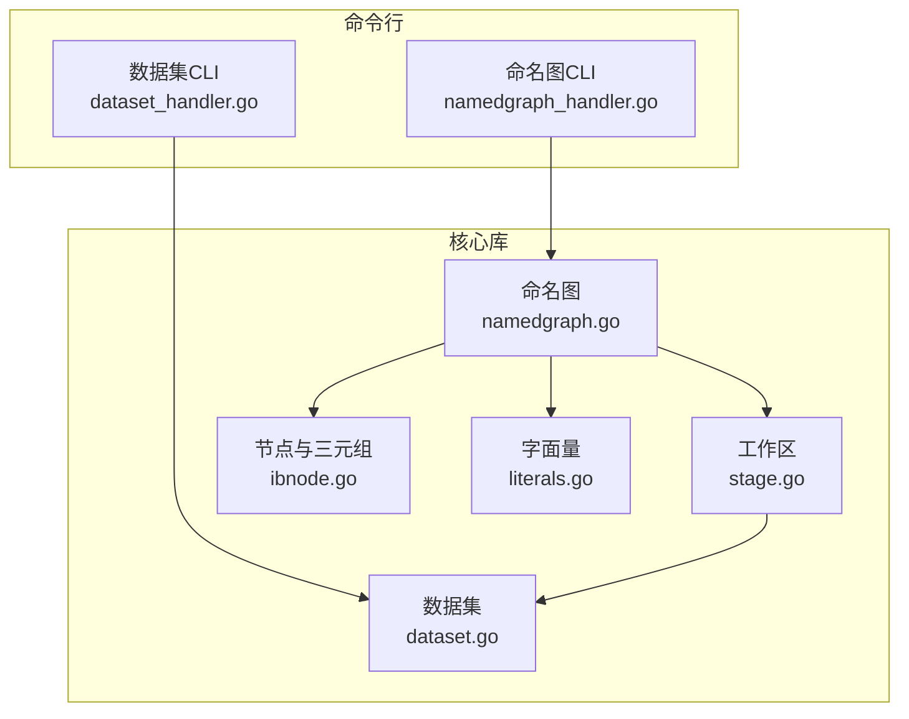
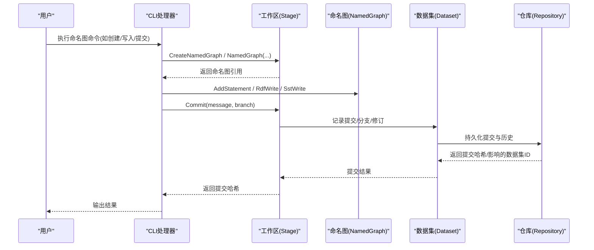
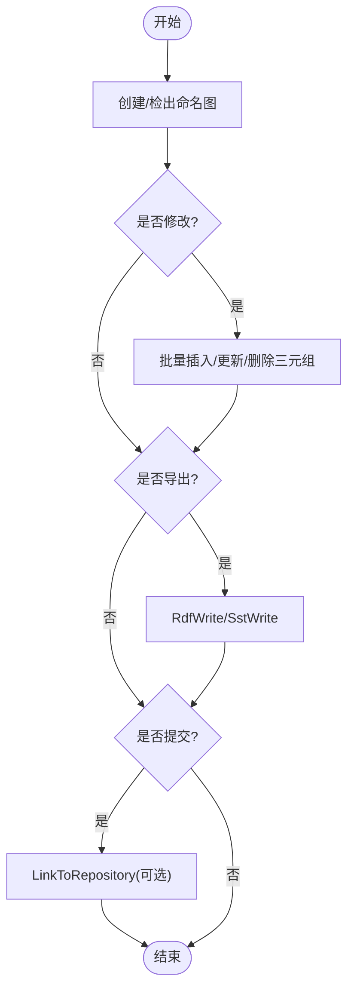
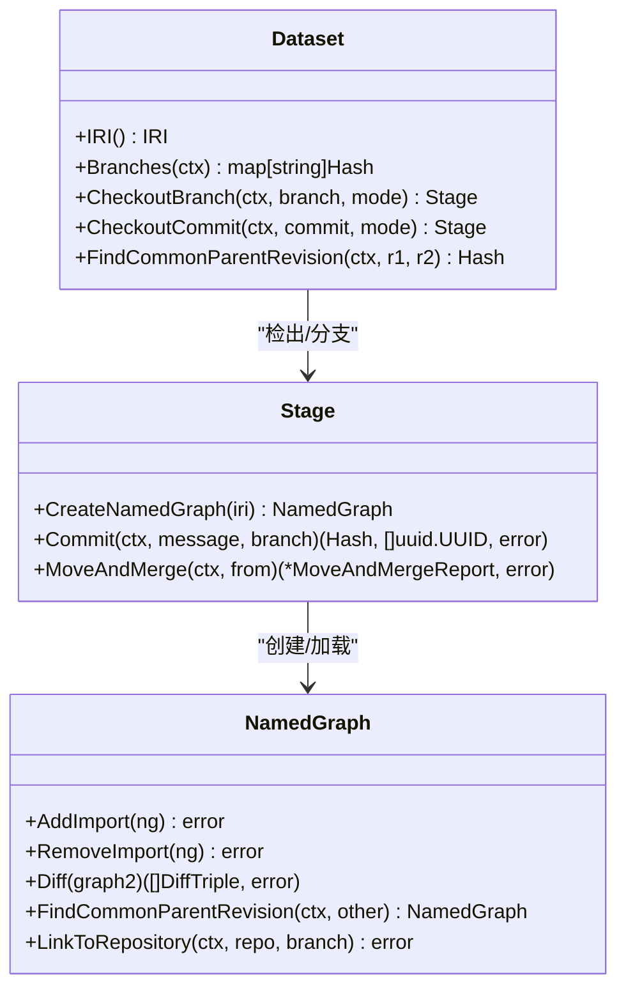
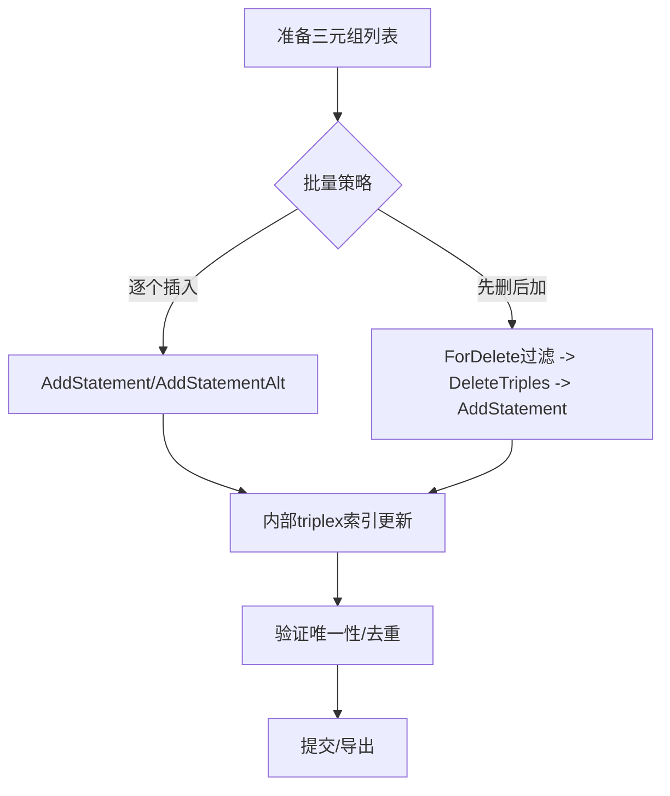
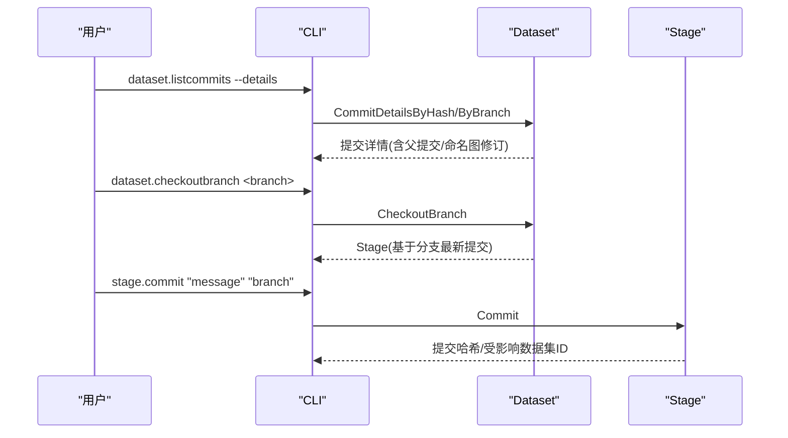
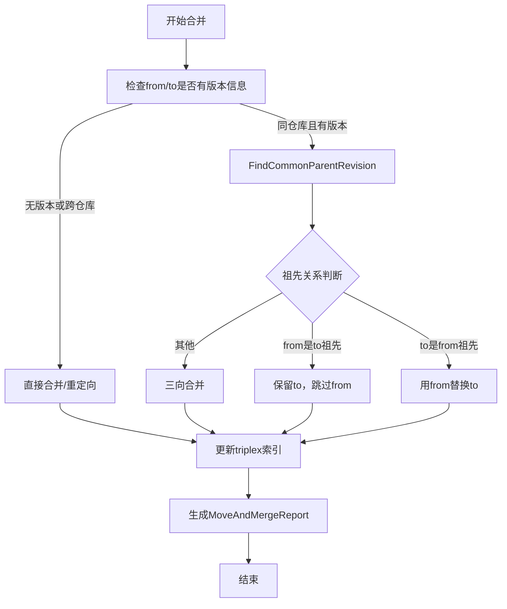
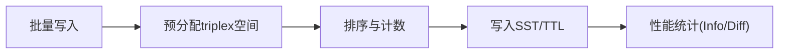
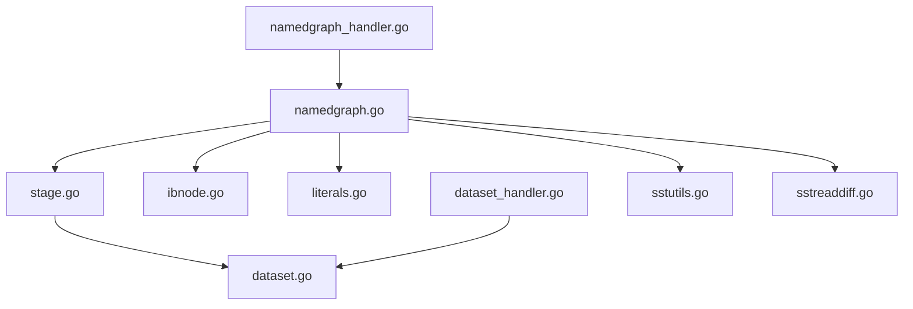

# 命名图操作

<cite>
**本文引用的文件**
- [namedgraph.go](file://sst/namedgraph.go)
- [stage.go](file://sst/stage.go)
- [dataset.go](file://sst/dataset.go)
- [ibnode.go](file://sst/ibnode.go)
- [literals.go](file://sst/literals.go)
- [namedgraph_handler.go](file://cli/cmd/interactive/namedgraph_handler.go)
- [dataset_handler.go](file://cli/cmd/interactive/dataset_handler.go)
- [sstutils.go](file://sst/sstutils.go)
- [sstreaddiff.go](file://sst/sstreaddiff.go)
</cite>

## 目录
1. [简介](#简介)
2. [项目结构](#项目结构)
3. [核心组件](#核心组件)
4. [架构总览](#架构总览)
5. [详细组件分析](#详细组件分析)
6. [依赖关系分析](#依赖关系分析)
7. [性能考虑](#性能考虑)
8. [故障排查指南](#故障排查指南)
9. [结论](#结论)
10. [附录](#附录)

## 简介
本文件面向SST（Semantic STEP Technology）中的“命名图”（NamedGraph）操作，提供从创建、修改、删除到版本控制、合并与冲突解决的完整使用指南。内容覆盖：
- 命名图的CRUD命令与CLI交互
- 命名图与数据集（Dataset）的关系与管理方式
- 三元组的批量插入、更新与删除
- 版本控制与历史追踪（分支、提交、差异）
- 命名图合并与冲突解决的实际流程
- 性能监控与优化建议
- IRI节点与字面量的处理方法

## 项目结构
围绕命名图的核心代码主要分布在以下模块：
- sst/namedgraph.go：命名图内存模型、导入/导出、差异比较、版本元数据等
- sst/stage.go：工作区（Stage）管理、移动与合并、提交、信息统计
- sst/dataset.go：数据集接口（分支、提交、检出、公共祖先查找）
- sst/ibnode.go：节点（IRI/空白节点）、三元组存储与索引、批量复制/合并
- sst/literals.go：字面量类型封装（字符串、数值、布尔、语言标签等）
- cli/cmd/interactive/*：交互式CLI对命名图、数据集的操作入口



图表来源
- [namedgraph.go:42-108](file://sst/namedgraph.go#L42-L108)
- [stage.go:53-74](file://sst/stage.go#L53-L74)
- [dataset.go:9-30](file://sst/dataset.go#L9-L30)
- [ibnode.go:634-660](file://sst/ibnode.go#L634-L660)
- [literals.go:12-31](file://sst/literals.go#L12-L31)

章节来源
- [namedgraph.go:42-108](file://sst/namedgraph.go#L42-L108)
- [stage.go:53-74](file://sst/stage.go#L53-L74)
- [dataset.go:9-30](file://sst/dataset.go#L9-L30)

## 核心组件
- 命名图（NamedGraph）：RDF命名图的内存表示，包含IBNode集合、三元组存储、导入关系、版本元数据（checkedOutCommits/NGRevisions/DSRevisions）。支持创建IRI/空白节点、添加语句、导入/移除导入、差异比较、三向合并、链接仓库、导出为Turtle/SST等。
- 工作区（Stage）：承载一个或多个命名图的内存视图，支持创建/获取命名图、移动与合并（MoveAndMerge）、提交（Commit）、对齐历史（AlignHistory）、导出等。
- 数据集（Dataset）：对应一个默认命名图及其所有直接/间接导入的命名图集合；维护分支、提交、修订、公共祖先查找等版本能力。
- 节点（IBNode）：IRI或空白节点，持有三元组索引（subject/predicate/object triplex），支持增删改查、批量复制/合并、词汇表索引等。
- 字面量（Literal）：多种数据类型封装（String/Int/Boolean/LangString等），用于三元组对象值。

章节来源
- [namedgraph.go:110-409](file://sst/namedgraph.go#L110-L409)
- [stage.go:64-177](file://sst/stage.go#L64-L177)
- [dataset.go:9-94](file://sst/dataset.go#L9-L94)
- [ibnode.go:698-800](file://sst/ibnode.go#L698-L800)
- [literals.go:12-31](file://sst/literals.go#L12-L31)

## 架构总览
命名图在SST中通过“工作区-数据集-仓库”三层协作完成数据的创建、修改、提交与版本管理。CLI提供便捷命令，底层调用API实现具体逻辑。



图表来源
- [stage.go:121-130](file://sst/stage.go#L121-L130)
- [dataset.go:68-93](file://sst/dataset.go#L68-L93)
- [namedgraph.go:200-275](file://sst/namedgraph.go#L200-L275)

## 详细组件分析

### 命名图CRUD与CLI命令
- 创建命名图：通过Stage.CreateNamedGraph(iri)创建本地命名图；或通过Dataset.CheckoutBranch/CheckoutCommit加载已有命名图。
- 读取/列举：CLI支持列出IRI节点、空白节点、全部IBNode；也可按片段获取IRI/空白节点并生成别名。
- 写入：支持将命名图导出为Turtle或SST格式；CLI提供交互式确认与进度提示。
- 删除：调用NamedGraph.Delete()会尝试删除命名图；若被其他命名图导入则报错；否则清理未引用节点并标记删除，提交后形成新的数据集修订。
- 导入/移除导入：AddImport/RemoveImport管理owl:imports关系；Diff可输出导入变更。



图表来源
- [namedgraph.go:200-275](file://sst/namedgraph.go#L200-L275)
- [stage.go:121-130](file://sst/stage.go#L121-L130)
- [namedgraph_handler.go:18-396](file://cli/cmd/interactive/namedgraph_handler.go#L18-L396)

章节来源
- [namedgraph.go:110-409](file://sst/namedgraph.go#L110-L409)
- [namedgraph_handler.go:18-396](file://cli/cmd/interactive/namedgraph_handler.go#L18-L396)

### 命名图与数据集的关系与管理
- Dataset由默认命名图及所有直接/间接导入的命名图组成；导入关系需构成有向无环图。
- 通过Dataset.Branches/LeafCommits/CommitDetailsByHash/Branch等接口管理分支与提交。
- CheckoutBranch/CheckoutCommit/CheckoutRevision将特定版本载入Stage，便于并发编辑不同修订。
- FindCommonParentRevision用于三向差异与合并的基础。



图表来源
- [dataset.go:9-94](file://sst/dataset.go#L9-L94)
- [stage.go:64-177](file://sst/stage.go#L64-L177)
- [namedgraph.go:222-348](file://sst/namedgraph.go#L222-L348)

章节来源
- [dataset.go:9-94](file://sst/dataset.go#L9-L94)
- [stage.go:64-177](file://sst/stage.go#L64-L177)
- [namedgraph.go:222-348](file://sst/namedgraph.go#L222-L348)

### 三元组的批量插入、更新与删除
- 插入：通过IBNode.AddStatement/AddStatementAlt添加三元组；内部维护subject/predicate/object三类triplex以支持高效遍历与反向查询。
- 更新：可通过ForDelete回调筛选并删除旧三元组，再添加新三元组；或使用AddStatementAlt避免重复错误。
- 删除：IBNode.DeleteTriples删除主体三元组；IBNode.Delete删除节点及其关联三元组。
- 批量处理：MoveAndMerge过程中会批量复制/合并节点与三元组，内部使用copyTriplexesAndImports、mergeNodes等方法进行高效迁移与去重。



图表来源
- [ibnode.go:773-796](file://sst/ibnode.go#L773-L796)
- [ibnode.go:181-328](file://sst/ibnode.go#L181-L328)
- [sstutils.go:168-226](file://sst/sstutils.go#L168-L226)

章节来源
- [ibnode.go:773-796](file://sst/ibnode.go#L773-L796)
- [ibnode.go:181-328](file://sst/ibnode.go#L181-L328)
- [sstutils.go:168-226](file://sst/sstutils.go#L168-L226)

### 版本控制与历史追踪
- 提交：Stage.Commit会为每个修改的命名图创建命名图修订，并为受影响的数据集创建数据集修订；同时记录父提交关系。
- 分支：Dataset.SetBranchCommit/SetBranchRevision移动分支指向；RemoveBranch删除分支。
- 检出：Dataset.CheckoutBranch/CheckoutCommit/CheckoutRevision载入指定版本到Stage。
- 历史查看：CLI支持列出提交、查看提交详情、显示历史图、列出叶子提交等。



图表来源
- [dataset_handler.go:15-105](file://cli/cmd/interactive/dataset_handler.go#L15-L105)
- [dataset_handler.go:107-271](file://cli/cmd/interactive/dataset_handler.go#L107-L271)
- [stage.go:121-130](file://sst/stage.go#L121-L130)

章节来源
- [dataset_handler.go:15-105](file://cli/cmd/interactive/dataset_handler.go#L15-L105)
- [dataset_handler.go:107-271](file://cli/cmd/interactive/dataset_handler.go#L107-L271)
- [stage.go:121-130](file://sst/stage.go#L121-L130)

### 命名图合并与冲突解决
- MoveAndMerge：将源Stage的命名图移动到目标Stage，若同名存在则尝试合并；若两者均有版本信息且同仓库，则查找公共祖先进行三向合并；若无公共祖先则追加合并。
- 合并动作报告：MoveAndMergeReport记录每一步动作（合并、重定向、变更类型、跳过相同修订等），便于审计与调试。
- 冲突处理：当两个命名图在同一位置有不同修改时，依据公共祖先与修改状态决定保留哪一方或执行三方合并；跨仓库移动时会标记modified以确保后续提交正确。



图表来源
- [stage.go:468-800](file://sst/stage.go#L468-L800)
- [stage.go:346-433](file://sst/stage.go#L346-L433)
- [namedgraph.go:255-265](file://sst/namedgraph.go#L255-L265)

章节来源
- [stage.go:468-800](file://sst/stage.go#L468-L800)
- [stage.go:346-433](file://sst/stage.go#L346-L433)
- [namedgraph.go:255-265](file://sst/namedgraph.go#L255-L265)

### 性能监控与优化建议
- 三元组模式：DefaultTriplexMode同时维护subject/predicate/object三类triplex，适合复杂查询但占用更多内存；可根据应用需求权衡。
- 预分配与排序：写路径中对triplex进行排序与计数，减少重复计算；批量写入时利用sort和计数上下文优化。
- 差异与增量：sstreaddiff在读取差异时按需分配triplex空间，减少内存抖动。
- 监控指标：通过Stage.Info/NamedGraph.Info获取本地/引用命名图数量与三元组总数；结合CLI的loading indicator与日志观察耗时。



图表来源
- [sstutils.go:168-226](file://sst/sstutils.go#L168-L226)
- [sstreaddiff.go:328-343](file://sst/sstreaddiff.go#L328-L343)
- [stage.go:198-213](file://sst/stage.go#L198-L213)

章节来源
- [sstutils.go:168-226](file://sst/sstutils.go#L168-L226)
- [sstreaddiff.go:328-343](file://sst/sstreaddiff.go#L328-L343)
- [stage.go:198-213](file://sst/stage.go#L198-L213)

### IRI节点与字面量的处理方法
- IRI节点：通过CreateIRINode创建，支持空片段（自动生成UUID）或指定片段；GetIRINodeByFragment按片段检索；IRI与UUID映射由iriToUUID保证确定性。
- 空白节点：CreateBlankNode创建，通过GetBlankNodeByID按UUID检索；空白节点不参与IRI索引，仅作为三元组对象或主体。
- 字面量：literals.go提供多种类型（String/Byte/Short/Int/Long/Double/Float/Integer/Boolean/LangString/TypedString），每种类型实现DataType()返回对应的XSD/RDF类型节点；TermKind统一标识为字面量。
- 集合：TermCollection用于表示RDF集合（rdf:first/rdf:rest链），CLI与解析器支持提取与重建。

```mermaid
classDiagram
class IBNode {
+CreateIRINode(fragment, types) IBNode
+CreateBlankNode(types) IBNode
+GetIRINodeByFragment(fragment) IBNode
+GetBlankNodeByID(id) IBNode
+AddStatement(predicate, object)
}
class Literal {
+DataType() IBNode
+apiValue() interface{}
}
class String
class Int
class Boolean
class LangString
class TypedString
IBNode --> Literal : "对象值"
String ..|> Literal
Int ..|> Literal
Boolean ..|> Literal
LangString ..|> Literal
TypedString ..|> Literal
```

图表来源
- [namedgraph.go:200-220](file://sst/namedgraph.go#L200-L220)
- [ibnode.go:698-800](file://sst/ibnode.go#L698-L800)
- [literals.go:12-31](file://sst/literals.go#L12-L31)
- [literals.go:246-335](file://sst/literals.go#L246-L335)

章节来源
- [namedgraph.go:200-220](file://sst/namedgraph.go#L200-L220)
- [ibnode.go:698-800](file://sst/ibnode.go#L698-L800)
- [literals.go:12-31](file://sst/literals.go#L12-L31)
- [literals.go:246-335](file://sst/literals.go#L246-L335)

## 依赖关系分析
- 命名图依赖工作区以管理生命周期与提交；工作区依赖数据集以持久化版本信息。
- 节点与三元组存储位于ibnode.go，命名图通过triplexStorage与triplexKinds组织三元组；批量操作依赖sstutils.go中的排序与计数逻辑。
- CLI层通过interactive包将用户命令映射到API调用，提供友好交互与错误提示。



图表来源
- [namedgraph.go:42-108](file://sst/namedgraph.go#L42-L108)
- [stage.go:53-74](file://sst/stage.go#L53-L74)
- [dataset.go:9-30](file://sst/dataset.go#L9-L30)
- [ibnode.go:634-660](file://sst/ibnode.go#L634-L660)
- [literals.go:12-31](file://sst/literals.go#L12-L31)
- [namedgraph_handler.go:18-396](file://cli/cmd/interactive/namedgraph_handler.go#L18-L396)
- [dataset_handler.go:15-532](file://cli/cmd/interactive/dataset_handler.go#L15-L532)
- [sstutils.go:168-226](file://sst/sstutils.go#L168-L226)
- [sstreaddiff.go:328-343](file://sst/sstreaddiff.go#L328-L343)

章节来源
- [namedgraph.go:42-108](file://sst/namedgraph.go#L42-L108)
- [stage.go:53-74](file://sst/stage.go#L53-L74)
- [dataset.go:9-30](file://sst/dataset.go#L9-L30)
- [ibnode.go:634-660](file://sst/ibnode.go#L634-L660)
- [literals.go:12-31](file://sst/literals.go#L12-L31)
- [namedgraph_handler.go:18-396](file://cli/cmd/interactive/namedgraph_handler.go#L18-L396)
- [dataset_handler.go:15-532](file://cli/cmd/interactive/dataset_handler.go#L15-L532)
- [sstutils.go:168-226](file://sst/sstutils.go#L168-L226)
- [sstreaddiff.go:328-343](file://sst/sstreaddiff.go#L328-L343)

## 性能考虑
- 三元组模式选择：根据查询方向与内存限制选择合适的triplex模式；默认模式适合大多数场景。
- 批量写入：优先使用批量插入与预分配，减少内存分配与排序开销。
- 差异与合并：利用FindCommonParentRevision与MoveAndMerge的三向合并机制，减少不必要的数据复制。
- 监控与诊断：通过Info/Diff/Report等接口收集统计信息，定位瓶颈；CLI的loading indicator辅助观察耗时。

[本节为通用指导，不直接分析具体文件]

## 故障排查指南
- 常见错误：
  - 命名图已删除/无效：确保在有效Stage内操作，避免使用已关闭或无效的引用。
  - 重复三元组：AddStatement要求唯一；如需容忍重复，使用AddStatementAlt并处理错误。
  - 导入循环：AddImport会检测循环依赖，避免形成环。
  - 分支不存在/已删除：CheckoutBranch/RemoveBranch前检查分支状态。
- 调试方法：
  - 使用PrintTriples/Dump输出命名图内容，核对三元组结构。
  - 使用Diff比较两个命名图，定位差异。
  - 查看MoveAndMergeReport，了解合并过程中的每一步动作与结果。

章节来源
- [namedgraph.go:20-40](file://sst/namedgraph.go#L20-L40)
- [ibnode.go:47-60](file://sst/ibnode.go#L47-L60)
- [stage.go:21-31](file://sst/stage.go#L21-L31)
- [namedgraph.go:505-514](file://sst/namedgraph.go#L505-L514)
- [stage.go:346-433](file://sst/stage.go#L346-L433)

## 结论
SST的命名图操作提供了完整的CRUD能力、版本控制、合并与冲突解决机制，并通过CLI简化日常使用。理解命名图与数据集的关系、三元组存储结构以及批量操作策略，有助于在实际项目中高效管理与优化语义数据。建议在生产环境中结合性能监控与差异分析，持续优化数据流与合并策略。

[本节为总结，不直接分析具体文件]

## 附录
- 常用CLI命令参考：
  - 命名图：list iri nodes / list blank nodes / get by fragment / rdfwrite / sstwrite / exportsvg
  - 数据集：listcommits / checkoutcommit / checkoutbranch / setbranchcommit / removebranch / diff / history / branches / leafcommits
- 相关API路径参考：
  - 命名图创建/修改/删除：[namedgraph.go:200-294](file://sst/namedgraph.go#L200-L294)
  - 工作区提交/合并：[stage.go:121-177](file://sst/stage.go#L121-L177), [stage.go:468-800](file://sst/stage.go#L468-L800)
  - 数据集版本管理：[dataset.go:34-93](file://sst/dataset.go#L34-L93)
  - 字面量类型：[literals.go:12-31](file://sst/literals.go#L12-L31), [literals.go:246-335](file://sst/literals.go#L246-L335)

[本节为附录，不直接分析具体文件]